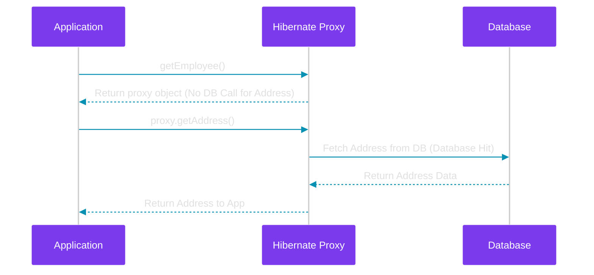
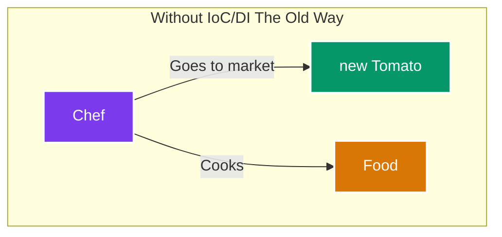
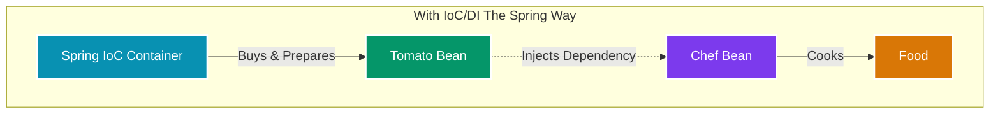
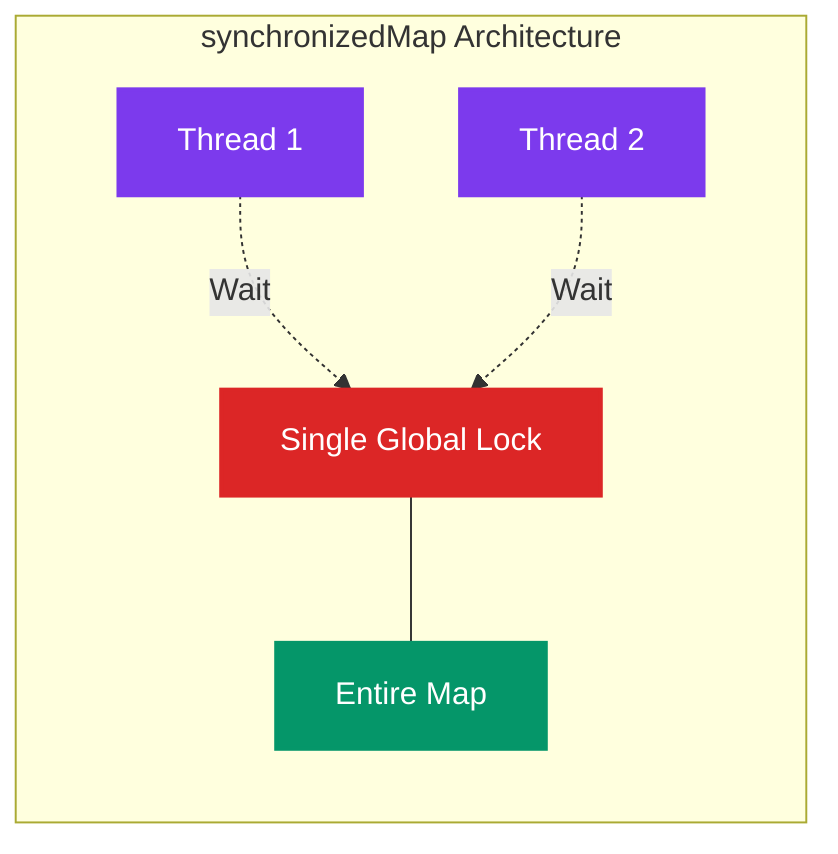
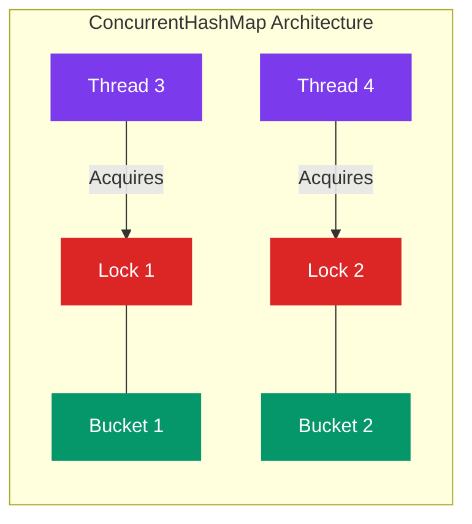
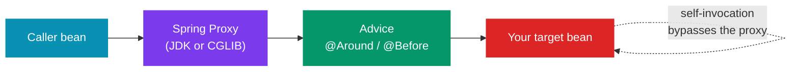
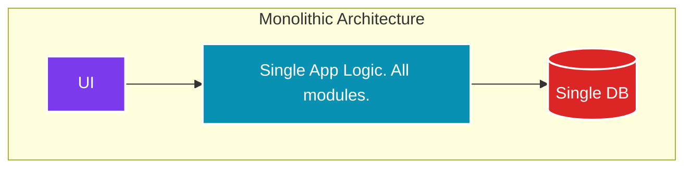
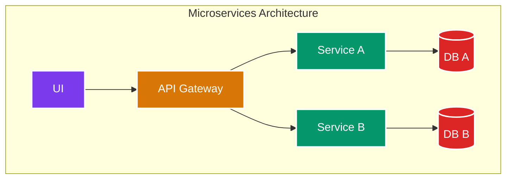
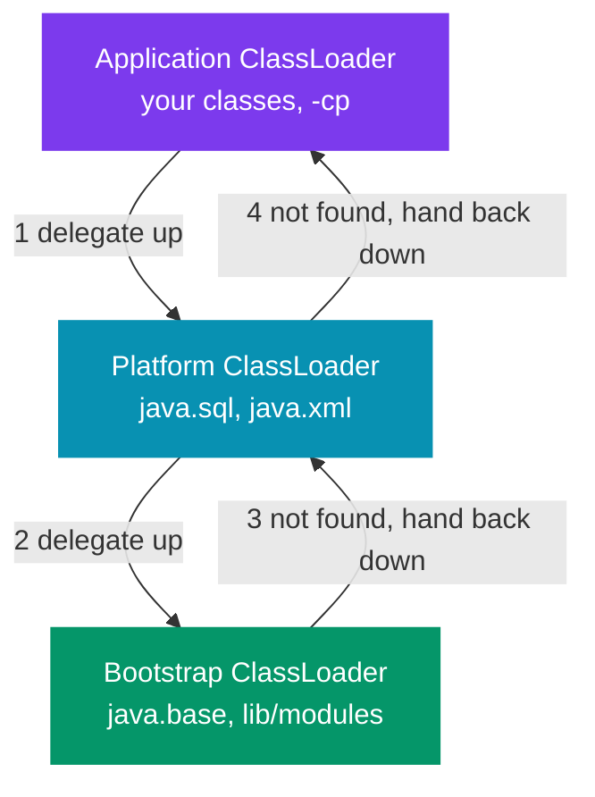

# Most Commonly Asked Java Interview Questions

**Most Commonly Asked Java Interview Questions** | It has the top 28 questions that interviewers ask most often. It covers core Java, collections, garbage collection, and Spring.

📊 **Question Count by Section**

| # | Section | Questions |
|---|---|---|
| 1 | [Most Commonly Asked Java Questions](#1-most-commonly-asked-java-questions) | 28 |
| | **Total** | **28** |

> 🔥🔥 Very High — asked in almost every Tier-1 loop &nbsp;·&nbsp; 🔥 High — very frequent in Tier-1 interviews &nbsp;·&nbsp; ⚡ Medium — commonly asked &nbsp;·&nbsp; 💤 Low — good to know, rarely asked

## 1. Most Commonly Asked Java Questions

1. **🔄 What is the difference between ArrayList and LinkedList? 🔥🔥**

<!-- -->
<details>
<summary>Answer</summary>

**Answer:**
- ArrayList usually uses a dynamic array inside to store the elements. LinkedList uses a doubly linked list inside to store elements. 
- ⚠️ **Be exact here. Most candidates lose the point on this.** `ArrayList` wins on **random access by index**. Its `get(i)` is `O(1)`, and it implements `RandomAccess`. `LinkedList.get(i)` must walk the chain, so it is `O(n)`. **Searching by *value*** (`contains()` / `indexOf()`) is `O(n)` on **both**. Neither is indexed, so you cannot avoid a linear scan.
- ArrayList can act only as a List, because it implements only a list. LinkedList can act as a list, and also as a queue and deque. This is because it implements the `List` and `Deque` interfaces. 
- `LinkedList` wins only in two cases: changes at the **ends** (`addFirst`/`removeFirst`/`addLast`), or when you already hold the position through an `Iterator`. For **index-based** insert/delete it is `O(n)` too. You must first walk to the index. Only *then* is the pointer update `O(1)`.

| Feature | ArrayList 📊 | LinkedList 🔗 |
|---------|--------------|---------------|
| **Data Structure** | Dynamic Array. | Doubly Linked List. |
| **Random access by index** (`get(i)`) | ✅ **`O(1)`**. Implements `RandomAccess`. | ⚠️ **`O(n)`**. Walks the chain from the nearer end. |
| **Search by value** (`contains`, `indexOf`) | ⚠️ **`O(n)`** — linear scan. | ⚠️ **`O(n)`** — linear scan. *(No winner.)* |
| **Insert / delete at an index** | `O(n)` — but it is a single bulk `System.arraycopy`. | `O(n)` — traversal to the index, *then* `O(1)` relink. |
| **Insert / delete at the ends** | `addLast` amortised `O(1)`; `add(0, e)` is `O(n)`. | ✅ **`O(1)`** for `addFirst`/`addLast`/`removeFirst`/`removeLast`. |
| **Capabilities** | Acts as a `List` only. | Acts as both a `List` and a `Deque` (so also a `Queue`). |
| **Best Used For** | Almost everything: indexed reads, iteration, append. | FIFO queue / deque behaviour at the ends. |

💡 **Pro Tip:** In real-world enterprise systems, teams strongly prefer `ArrayList`. It covers 95%+ of typical use cases. The reasons are CPU cache locality and lower memory overhead compared to `LinkedList`.

⚠️ **The result that surprises people (measured on JDK 17, 60 000 inserts):** for **mid-list** insertion, `ArrayList` beat `LinkedList` by roughly **17×** (~55 ms vs ~1060 ms). Why:
- `System.arraycopy` moves a block of memory in one fast, cache-friendly step.
- `LinkedList` gets a cache miss on every node just to *find* the index.

Change it to **head** insertion, and `LinkedList` wins by ~36× (3 ms vs 108 ms). So the correct rule is **"`LinkedList` for end operations, `ArrayList` for everything else"**. The rule is not "`LinkedList` is faster at manipulation".

<!-- -->
<details>
<summary>⚡ <b>1. How `RandomAccess` Interface makes Search Operation Fast?</b></summary>

**Answer:**

`RandomAccess` is a marker interface (an interface with no methods). `List` implementations like `ArrayList` use it to show that they support fast random access (generally constant time `O(1)`).

`ArrayList` is backed by an array. So to get any element by its index, it needs only one simple calculation: `memory_address = base_address + (index * element_size)`. This points straight to the correct place in memory.

The `RandomAccess` interface works as a flag:
- Utility classes like `Collections` check if a list implements `RandomAccess` (`if (list instanceof RandomAccess)`).
- If it does, algorithms (like `binarySearch`) use a fast, traditional `for` loop with index-based access `get(i)`.
- They do not use the slower `Iterator`, which is meant for sequential access.

---

</details>

<!-- -->
<details>
<summary>🧠 <b>2. Clarify "due to CPU cache locality and lower memory overhead" in detail.</b></summary>

**Answer:**

**CPU Cache Locality:**
Modern CPUs use layers of fast caches (L1, L2, L3). These let them avoid reading from the slower main RAM. When the CPU reads data, it fetches a contiguous (one after another, with no gaps) block of memory, called a "cache line".
- An `ArrayList` stores its elements (references) in a single contiguous array in memory. So reading the first element also loads the next elements into the very fast CPU cache. This makes walking through an `ArrayList` very fast.
- In contrast, `LinkedList` nodes are scattered randomly across the heap memory. Iterating through them causes "cache misses" again and again. The CPU must wait and fetch data from the slower main RAM for almost every single node.

**Lower Memory Overhead:**
In an `ArrayList`, the only overhead is the contiguous array structure itself. Each element takes only the size of a reference (4 or 8 bytes).
A `LinkedList` uses much more memory. Every original element is wrapped in a `Node` object. Each node needs memory for:
- The object reference (the data)
- A reference to the **next** node
- A reference to the **previous** node
- Standard Java object header overhead (typically 12-16 bytes)

So a `LinkedList` can easily use 3x to 4x more memory than an `ArrayList` for the exact same dataset. This leads to many more garbage collection pauses.

---

</details>

---

</details>

---

2. **😴 What is Lazy Initialization in Hibernate? 🔥**

<!-- -->
<details>
<summary>Answer</summary>

**Answer:**

Lazy initialization is an **idiom** (a common coding technique, not one of the GoF design patterns). It means you delay the creation or loading of something until it is actually needed.
- It is *not* one of the 23 GoF patterns. Don't call it a "design pattern" in an interview. The follow-up "which pattern is it, then?" has no good answer.
- Hibernate *implements* it with a **Proxy**, and Proxy **is** a GoF pattern.

In Hibernate, lazy initialization delays loading an associated entity until it is accessed for the first time.



For example, take an `Employee` class that has an `Address` mapped to it with a one-to-many or many-to-one relationship. Suppose you configure this relationship with `FetchType.LAZY`. Then Hibernate does not load the `Address` entity from the database until your code explicitly accesses it. This can help reduce the initial load time, because only the needed data is fetched at first.

⚠️ **You must state the defaults. The example above does *not* get lazy loading automatically.** The JPA spec sets a default fetch type for each association cardinality:

| Association | Default `FetchType` |
|---|---|
| `@ManyToOne` | ⚠️ **EAGER** |
| `@OneToOne` | ⚠️ **EAGER** |
| `@OneToMany` | ✅ LAZY |
| `@ManyToMany` | ✅ LAZY |

So an `Employee` → `Address` mapped as `@ManyToOne` is **EAGER by default**. You must write `@ManyToOne(fetch = FetchType.LAZY)` explicitly. A short way to remember it: *"to-one is eager, to-many is lazy."*

✅ **Advantages:**
- **Reduced Initial Load Time:** Associated entities load later, so the initial load time is much lower. Compare this with eager loading, where all associated entities load immediately.
- **Efficient Resource Utilization:** The app uses resources better, because it fetches only the required data from the database.

⚠️ **Disadvantages:**
- **Potential Performance Impact (N+1 Problem):** Lazy initialization can cause extra database hits when the associated entities are accessed. This may hurt performance. The reason: a proxy object represents the association. When you access it, it triggers a database query.

<!-- -->
<details>
<summary>💥 <b>What actually breaks: `LazyInitializationException` and `open-in-view`</b></summary>

**Answer:**

Interviews skip the normal success case and go straight to the failure. If you touch a lazy proxy **after the persistence context is closed**, it throws:

```txt
org.hibernate.LazyInitializationException: could not initialize proxy - no Session
```

A common trigger:
- A `@Transactional` service returns a managed entity.
- The transaction commits, and the session closes.
- Then the controller or a Jackson serializer calls `employee.getAddress()`.
- The proxy has no session left to load the data through.

🩹 **The four real fixes** — in the order you should offer them:

1. **`JOIN FETCH` in the query** — `@Query("select e from Employee e join fetch e.address where e.id = :id")`. Explicit, one SQL statement.
2. **`@EntityGraph`** — a declarative fetch plan on the repository method. Same effect, no hand-written JPQL.
3. **DTO projection** — never let an entity leave the transaction at all. This is the cleanest answer for an API layer.
4. **Widen the transaction** so the access happens inside it. This works, but it is easy to misuse.

⚠️ **`spring.jpa.open-in-view` defaults to `true` in Spring Boot.** The `OpenEntityManagerInViewInterceptor` keeps the `EntityManager` open for the whole HTTP request. That is why lazy access in a controller *usually* "just works". And that is exactly the problem:
- It **hides** N+1 queries until production load makes them visible.
- It holds a **database connection** for the entire request, including view rendering and JSON serialization. Under load, this leads to connection-pool exhaustion (no free connections left).
- Spring Boot logs a startup warning about it for exactly this reason.

The answer a senior engineer gives: set `spring.jpa.open-in-view=false`. Let the `LazyInitializationException`s show up in tests. Then fix each one with an explicit fetch plan or a DTO.

---

</details>

---

</details>

---

3. **🗄️ Difference between first-level and second-level cache in Hibernate? 🔥**

<!-- -->
<details>
<summary>Answer</summary>

**Answer:**
- The first level cache is enabled by default. The second level cache is disabled by default, and we have to enable it programmatically in the Hibernate application. 
- The first-level cache cannot be *switched off* for a normal `Session`. You can only `evict()` an entity or `clear()` the whole persistence context. ⚠️ **The only real way to avoid it is `StatelessSession`.** It bypasses the persistence context completely: no L1 cache, no dirty checking, no cascades, no lazy loading. This is why teams use it for bulk/batch inserts and updates. In those jobs, the L1 cache fills with thousands of managed entities, and that itself causes the memory problem. Mention it, because it clearly shows one thing: the L1 cache is a property of the *session type*. It is not a rule with no exceptions.
- The second-level cache is not enabled by default; you turn it on through configuration and can turn it back off the same way. 
- The first-level cache is associated with the `Session`. The second-level cache is associated with the `SessionFactory`. So when the session is closed, the objects in the first-level cache are lost. This does not happen with the second level cache. 
- Only the session that maintains the first-level cache can access its data. The second-level cache is accessible to the whole program.

**Basic Differences:**

| Feature | First-Level Cache (L1) 🥇 | Second-Level Cache (L2) 🥈 |
|---------|---------------------------|----------------------------|
| **Default Status** | ✅ Always on for a `Session` (only `evict()`/`clear()`, or use `StatelessSession` to bypass it). | ⚠️ Disabled by default (Must be configured). |
| **Association** | Tied to the `Session` object. | Tied to the `SessionFactory` object. |
| **Scope / Visibility** | Private to the current session/request. | Shared across the entire application. |
| **Lifespan** | Destroyed when the session is closed. | Lives as long as the application runs (or until evicted). |
| **Provider** | Built into Hibernate. | Requires a third-party provider (Redis, Ehcache). |

**In Simple Words:**
- **Scope (Who can see it):** 
  - **L1 Cache:** It acts like a "private notepad" 📝 for a single user's request. If two users request the same data at the same time, each one fetches it separately.
  - **L2 Cache:** It acts like a "public bulletin board" 📋 shared across the entire application. If one user fetches data, it is cached here. The next user can then read it right away without hitting the database.
- **Lifespan (How long it lasts):** 
  - **L1 Cache:** It lives only as long as the user's current transaction/session. Once the session is closed, the cache is destroyed.
  - **L2 Cache:** It lives as long as the application is running (or until the data is manually evicted/expired).
- **The Provider:** 
  - **L1 Cache:** It is built directly into Hibernate.
  - **L2 Cache:** It is not built in. You have to plug in a third-party caching tool (like Redis, Ehcache, or Hazelcast) to actually store the data.

**Examples:**

**1. First-Level (L1) Cache Example:**
```java
Session session = sessionFactory.openSession();

// Query 1: Hits the database and stores the object in the L1 Cache
Employee emp1 = session.get(Employee.class, 1);

// Query 2: Does NOT hit the database! Fetches directly from the L1 Cache
Employee emp2 = session.get(Employee.class, 1);

session.close(); // L1 Cache is destroyed here
```

**2. Second-Level (L2) Cache Example:**
```java
Session session1 = sessionFactory.openSession();
// Query 1: Hits the database, stores in session1's L1 Cache AND the shared L2 Cache
Employee emp1 = session1.get(Employee.class, 1);
session1.close(); // session1's L1 Cache is destroyed, but object survives in L2 Cache

Session session2 = sessionFactory.openSession();
// Query 2: Does NOT hit the database! Fetches from the shared L2 Cache
Employee emp2 = session2.get(Employee.class, 1);
session2.close();
```

<!-- -->
<details>
<summary>🍃 <b>How does this map to Spring Data JPA at the code level?</b></summary>

**Answer:**

With Spring Data JPA, Hibernate is still the engine underneath. But the names and the setup follow the JPA standard a little more closely.

1. **L1 Cache ➡️ `EntityManager` Persistence Context**:
   In Spring Data JPA, the JPA `EntityManager` wraps the Hibernate `Session`. The L1 cache is basically the `EntityManager`'s **Persistence Context**.
   - **Transaction Scope:** When you annotate a method with `@Transactional`, Spring opens an `EntityManager` for that thread. Inside that same transaction, repeated calls to `repository.findById(1L)` hit the L1 cache (Persistence Context). They won't trigger multiple SQL queries.

2. **L2 Cache ➡️ Spring Caching & Persistence Properties**:
   The L2 cache is still configured through Hibernate properties. You usually set them in your `application.yml` or `application.properties`.
   - **Configuration:** You enable it by setting `spring.jpa.properties.hibernate.cache.use_second_level_cache=true`.
   - **Usage:** You must annotate your Entity classes with `@Cacheable` (from `javax.persistence` or `jakarta.persistence`) and `@Cache` (Hibernate-specific). These tell Spring/Hibernate which objects should live in the global L2 cache.

**Code Example in Spring Data JPA:**
```java
@Service
public class EmployeeService {
    @Autowired private EmployeeRepository repository;

    @Transactional
    public void cacheDemo() {
        // First call: Hits DB, stores in L1 (EntityManager/Persistence Context)
        repository.findById(1L); 
        
        // Second call: Hits L1 cache! No SQL generated.
        repository.findById(1L); 
    }
}
```

---

</details>

<!-- -->
<details>
<summary>🧠 <b>Is this question important nowadays with respect to the interview? Because as far as I have seen in projects, we use Redis and then default first level cache.</b></summary>

💡 This is a good, practical point. Your observation is 100% accurate for modern system design. In most modern, distributed, or microservices-based applications:
- Developers rely on the default first-level (Session) cache.
- They use an external distributed cache like Redis or Memcached for application-level caching.
- They do this instead of dealing with Hibernate's JVM-bound second-level cache (like Ehcache).

✅ However, **yes, this question is still very important for interviews.**

Here is why interviewers still like to ask it:

- 🧩 **Tests Core Understanding:** It tests whether you understand the basic architecture of Hibernate. The key point is the difference between a Session (which lives for a single transaction/request) and a SessionFactory (which lives for the entire application).
- ⚡ **Redis CAN be the L2 Cache:** Many candidates don't know this. Redis can actually be plugged in as the Hibernate Second-Level Cache provider (using libraries like Redisson). If you discuss this in an interview, it shows deep practical knowledge.
- 🏛️ **Legacy and Monoliths:** Many companies still maintain large monolithic applications. In these, traditional JVM-bound L2 caches (like Ehcache) are still used a lot.
- 🎓 **Classic Interview Standard:** Like many interview questions, it has become a "standard" check. It shows if a candidate has studied standard ORM concepts. This is true even if the exact pattern has changed in modern cloud-native apps.

🌟 **A Great Way to Stand Out**

Your real-world experience lets you use this question to impress an interviewer! If asked this, first give the textbook difference. Then follow up with exactly what you just told me:

> "While the first-level cache is tied to the Session and L2 is tied to the SessionFactory, in my practical experience with modern distributed systems, we usually rely on the default L1 cache and bypass the traditional Hibernate L2 cache in favor of a distributed cache like Redis to avoid node-synchronization issues."

🔄 **What are "Node-Synchronization Issues"?**

In a modern application, you usually have more than one server running your code. You have multiple instances (nodes) of your application running behind a load balancer.

Suppose you use the traditional Hibernate L2 Cache (like Ehcache). That cache lives *inside the memory of each individual JVM*. 
- Imagine **Node A** fetches Employee #1 from the database and caches it in its Local L2 Cache. 
- Now, **Node B** gets a request to update Employee #1's salary. It updates the database and clears its own Local L2 cache.
- The problem: **Node A** doesn't know about this update! Its L2 cache still holds the old, stale salary. 

This is a **node-synchronization issue (stale data).** To fix this with traditional L2 caches, you must configure complex network broadcasts (like JGroups). Then the nodes can "talk" to each other and say *"Hey, I updated Employee #1, clear your caches!"*

🚀 **The Redis Solution:**
Use an external, true distributed cache like Redis instead. Then *all* nodes talk to the *same* Redis server. If Node B updates the database, it also updates the shared Redis cache. When Node A fetches Employee #1, it looks in Redis and gets the fresh data right away. No complex node-to-node communication is needed!

---

</details>

---

</details>

---

4. **🗺️ What is the difference between HashMap and Hashtable? 🔥**

<!-- -->
<details>
<summary>Answer</summary>

**Answer:**
- Hashtable is synchronized, so it is thread-safe. HashMap is not synchronized, so it is not thread-safe at all. Because of that, HashMap is much faster than Hashtable. 
- HashMap allows one null key and multiple null values. Hashtable is much stricter: it does not allow any null key or null value. 
- Hashtable came in the first version, Java1.0. HashMap came in Java 1.2. 
- To make a HashMap synchronized, you can always use the Collections class synchronizedMap() method. Hashtable is synchronized by default, so you don't need to do anything. 
- For iteration, you can always traverse a HashMap with an iterator, which is a universal iteration technique. You mostly traverse a Hashtable with `Enumeration`. But you can also use an iterator, because iterators are the usual universal iteration technique. 
- The iterator in HashMap is fail-fast. ⚠️ `Hashtable`'s legacy `Enumeration` is **non-fail-fast**, *not* "fail-safe". It simply never checks `modCount`. So it silently gives you a partly updated, inconsistent view instead of throwing an exception. It does **not** copy or snapshot anything (that is `CopyOnWriteArrayList`). And `Hashtable`'s own `keySet()` / `entrySet()` iterators **are** fail-fast. So the same class gives you both behaviours, depending on which traversal you pick.
- HashMap extends the abstractMap class while Hashtable extends the dictionary class.

| Feature | HashMap 🗂️ | Hashtable 🏛️ |
|---------|-------------|--------------|
| **Synchronization** | ⚠️ Not synchronized (Not thread-safe). | ✅ Synchronized (Thread-safe). |
| **Performance** | ✅ Faster, as there is no locking overhead. | ⚠️ Slower due to synchronized methods. |
| **Null Keys/Values**| ✅ Allows ONE null key and MULTIPLE null values. | ⚠️ Does NOT allow any null key or null value. |
| **Iteration** | Uses `Iterator` (Fail-Fast). | `Enumeration` is **non-fail-fast** (no `modCount` check, no snapshot); its `Iterator` **is** fail-fast. |
| **Inheritance** | Extends `AbstractMap` class. | Extends legacy `Dictionary` class. |
| **Introduction** | Java 1.2 (Collections Framework). | Java 1.0 (Legacy class). |

💡 **Pro Tip:** In modern Java applications, `Hashtable` is considered outdated. For thread-safe map operations, prefer `ConcurrentHashMap` over `Hashtable` or `Collections.synchronizedMap()`.

---

</details>

---

5. **♻️ Describe how Java's garbage collector works. 🔥🔥**

<!-- -->
<details>
<summary>Answer</summary>

**Answer:**

The GC's job is to free heap memory used by objects that are no longer **reachable** from any GC root (stack frames, static fields, JNI references). You never free memory yourself. You only stop referencing it.

🧬 **The weak generational hypothesis** is the observation that the whole design is built on: *most objects die young*. So the heap is split by age. The GC collects the young part much more often, and at a much lower cost.

🏗️ **HotSpot heap layout:**
- **Young Generation** = **Eden** + two **Survivor** spaces (`S0` / `S1`). New objects land in Eden.
- **Old Generation (Tenured)** — objects that survived enough young collections get **promoted** here.
- **Metaspace** — class metadata, in **native memory**, not the heap (see Q18).

♻️ **The two collection kinds:**
- **Minor GC** — collects the young gen only. Live objects are **copied** Eden → Survivor → (eventually) Old. Most of Eden is garbage, so copying the few survivors is cheap. Short stop-the-world pause.
- **Major / Full GC** — collects the old gen (and usually everything). Much longer pause. This is the pause you tune the GC to reduce.

⚙️ **Collectors you should name:**
- **G1 (Garbage First)** — the **default since Java 9**. Region-based, concurrent marking, targets a *pause-time goal* (`-XX:MaxGCPauseMillis`).
- **ZGC** and **Shenandoah** — concurrent, low-latency collectors. Their pauses are very short (ZGC's are under a millisecond), and they do not grow as the heap grows. ZGC became production-ready in Java 15.
- **Parallel GC** — built for throughput, still a good choice for batch workloads.
- **Serial GC** — single-threaded; the default in small containers.

👉 For the full mechanism (mark-sweep-compact, card tables, tuning flags) see **§3 "Garbage Collection"** in [02_Core_Java_Interview_Questions.md](./02_Core_Java_Interview_Questions.md#3-garbage-collection).

---

</details>

---

6. **📦 What is Serialization? Why do we need it? ⚡**

<!-- -->
<details>
<summary>Answer</summary>

**Answer:**

Serialization in Java is a mechanism that converts the state of an object into a byte stream. You can save this byte stream to a file or send it over a network. Saving an object's state to a file or sending it is called serialization. The byte stream is platform-independent. This means it can be deserialized on any platform to recreate the original object.

Serialization is needed for several reasons:
- 💾 **Persistence:** It lets you save the state of an object to a storage medium, such as a file or a database. You can then retrieve and use it later.
- 🌐 **Communication:** It lets you send objects over a network between different Java Virtual Machines (JVMs). This is especially useful in distributed systems, where different applications need to share objects.
- ⚡ **Caching:** Serialized objects can be cached to improve performance. This avoids the need to recreate objects from scratch.
- 📋 **Deep Copy:** Serialization can be used to create a deep copy of an object by serializing and then deserializing it.

🔑 **The two keywords that always follow:**

- **`serialVersionUID`** — a version stamp on the class. If you don't declare one, the JVM **computes** it from the class's fields, methods, and interfaces. So *any* structural change (even adding a method) produces a different value. Then deserializing old data throws `InvalidClassException`. If you declare `private static final long serialVersionUID = 1L;` explicitly, the value stays fixed. Then you control compatibility, instead of the compiler. Compatible changes: adding a field (it deserializes to its default). Incompatible: removing a field, changing its type, or changing the class hierarchy.
- **`transient`** — keeps a field out of the byte stream. On deserialization it comes back as the type's **default** (`null` / `0` / `false`). Use it for secrets (passwords, tokens), for anything unserializable (`Connection`, `Thread`, an open socket), and for derived values you can cheaply recompute.

⚠️ **Also worth knowing:** the constructor is **not** called during deserialization. The JVM allocates the object and writes the fields directly. This is how deserialization skips your invariants (the rules your constructor checks). And `static` fields are never serialized (they belong to the class, not the instance).

🚫 **Why Java's built-in serialization is now discouraged** — a good point to end on:
- 💣 **It is a security hole.** `ObjectInputStream.readObject()` on untrusted data instantiates arbitrary classes on the classpath and runs their `readObject()`. This is the whole class of **deserialization gadget-chain** attacks (the cause of a long list of CVEs in enterprise Java). Mark Reinhold, Oracle's chief Java architect, called it a "horrible mistake" (2018). JEP 290 added serialization filters to limit the damage. JEP 154 once proposed removing serialization, but it was withdrawn. Project Amber is still exploring a better replacement.
- 🔗 **It ties your wire format to your class layout.** So refactoring the class becomes a change that can affect compatibility.
- 🐌 It is slower and produces bigger output than the alternatives.

✅ **What is used instead:** **JSON** (Jackson) for APIs, and **Protobuf** / **Avro** for compact, schema-versioned binary payloads. All of these serialize *data*, not *object graphs*.

---

</details>

---

7. **💉 What is Dependency Injection or IOC ( Inversion of Control )? 🔥🔥**

<!-- -->
<details>
<summary>Answer</summary>

**Answer:**

Inversion of Control (IoC) is a design principle. The control of object creation and management moves from the user to a container or framework. In Spring, the IoC container (such as the `BeanFactory` or `ApplicationContext`) takes over this job. It instantiates, configures, and manages the lifecycle of objects (beans).

Dependency Injection (DI) is a specific implementation of IoC. The container injects dependencies into a class. The class does not create its own dependencies. This gives loose coupling and makes the code easier to test and maintain.

⚠️ **Do not mix up two different ideas (axes) here.** This is the single most common mistake on this question:

| Axis | The three options |
|---|---|
| **Forms of injection** (*how* the dependency reaches the object) | **Constructor**, **Setter**, **Field** |
| **Configuration metadata styles** (*how you tell Spring what to wire*) | Java-based (`@Configuration` + `@Bean`), XML, Annotation-based (`@Component` + `@Autowired`) |

When an interviewer asks "what are the types of dependency injection?", they mean the **first** row. If you answer with "Java / XML / annotation", you answer a question that was not asked.

**The three forms of injection:**

```java
@Service
public class LoanService {

    // 1️⃣ CONSTRUCTOR INJECTION — the recommended default
    private final CreditBureauClient bureau;      // can be final ✅

    public LoanService(CreditBureauClient bureau) {  // @Autowired optional since Spring 4.3
        this.bureau = bureau;
    }

    // 2️⃣ SETTER INJECTION — for genuinely optional dependencies
    private AuditPublisher audit;

    @Autowired(required = false)
    public void setAudit(AuditPublisher audit) {
        this.audit = audit;
    }

    // 3️⃣ FIELD INJECTION — concise, and discouraged
    @Autowired
    private RateCardRepository rateCards;
}
```

🏆 **Why constructor injection wins — the guaranteed follow-up ("which do you prefer and why?"):**

- ✅ **Fields can be `final`** → the object is immutable and safe to publish across threads.
- ✅ **Mandatory dependencies are enforced at construction.** The object cannot exist in a half-built state. So there is no time window where a field is still `null`.
- ✅ **Testable without a container.** `new LoanService(mockBureau)` in a plain JUnit test — no reflection, no `@SpringBootTest`, no `ReflectionTestUtils`.
- ✅ **Circular dependencies fail loudly at startup.** Spring does not silently accept them.
- ✅ **A very large constructor is a useful warning.** If it has eight parameters, this is a sign that the class violates SRP. Field injection hides that.

❌️ **Why field injection is discouraged:**
- Dependencies are invisible from the public API. You must read the class body to know what it needs.
- The field cannot be `final`.
- Testing needs reflection or a full context.
- It lets circular references go undetected.

🔁 **On circular dependencies:** Spring can break a cycle only for *setter/field* injection (it injects a partially built bean). A constructor-injection cycle cannot be resolved. It throws `BeanCurrentlyInCreationException` at startup. ⚠️ **Since Spring Boot 2.6, circular references are disabled by default.** You get a startup failure. You must either refactor or set `spring.main.allow-circular-references=true`. `@Lazy` on one side is a way around the failure. The actual fix is to refactor the shared logic into a third bean.

**In Simple Words (The Restaurant Analogy 👨‍🍳):**





**Without IoC/DI (The Old Way):** Suppose you are the Chef (a Class). You have to go to the market and buy your own ingredients (instantiating Dependencies like `new Tomato()`). Then you bring them back and cook. This is tightly coupled and hard to test, because the Chef is responsible for too many things.

**With IoC/DI (The Spring Way):** 
- **Inversion of Control (IoC):** You "invert", or give up, control. The Chef no longer goes to the market. The Restaurant Manager (the **Spring IoC Container**) takes over the job of gathering ingredients.
- **Dependency Injection (DI):** The Manager "injects" (hands over) the ready-made ingredients (Dependencies) to the Chef right when the Chef needs them to cook.

**Technical Definition:**
- **IoC (Inversion of Control):** A design principle. The control of creating and managing objects moves from your code to the Spring Framework (specifically the `ApplicationContext` or `BeanFactory`).
- **DI (Dependency Injection):** The actual pattern used to implement IoC. A class does not use the `new` keyword to create the objects it depends on. Instead, Spring creates those objects and "injects" them into the class (through a **constructor**, a **setter**, or directly into a **field**).

**And the three configuration metadata styles — how you *declare* the beans (a separate axis, see the table above):**

---

</details>

---

8. **🪶 What is WeakHashMap? 💤**

<!-- -->
<details>
<summary>Answer</summary>

**Answer:**

A WeakHashMap is a special implementation of the Map interface in Java. It works like a regular HashMap. The one big difference is how it manages memory for its keys.

🛡️ **Regular HashMap Behavior:**
- Say you use an object as a key in a regular HashMap (e.g., an Employee object).
- Later you remove all your references to this key object.
- The HashMap still keeps the key in memory.
- So even if you set the key reference to null, the HashMap still holds it. The garbage collector cannot remove it.

🌬️ **WeakHashMap Behavior:**
A WeakHashMap works differently:
- You set the key reference to null, and no other references to the key exist.
- Now the WeakHashMap lets Java's garbage collector remove the key from memory.
- So a WeakHashMap does not keep holding objects the way a regular HashMap does.

💡 **In simpler terms:** A regular HashMap keeps objects even when they are no longer needed. A WeakHashMap lets them go when they are no longer in use.

**Example:**

```java
class Employee {
    private String name;
    public Employee(String name) {
        this.name = name;
    }
    @Override
    public String toString() {
        return "Employee [name=" + name + "]";
    }
}

public class Test {
    public static void main(String[] args) throws Exception {
        testHashMap();
        System.out.println("-------------------------");
        testWeakHashMap();
    }

    public static void testHashMap() {
        Map<Employee, String> map = new HashMap<>();
        Employee emp = new Employee("Tom");
        map.put(emp, "Strong Reference");

        emp = null;
        System.gc();
        System.out.println("Regular HashMap After GC: " + map.keySet());
    }

    public static void testWeakHashMap() throws Exception {
        Map<Employee, String> map = new WeakHashMap<>();
        Employee emp = new Employee("Jerry");
        map.put(emp, "Weak Reference");

        emp = null;
        System.gc();
        Thread.sleep(100); // Give GC time to work
        System.out.println("WeakHashMap After GC: " + map.keySet());
    }
}
```

**Typical Output** (not guaranteed — see the caveat below):
```txt
Regular HashMap After GC: [Employee [name=Tom]]
-------------------------
WeakHashMap After GC: []
```

⚠️ **Why "typical" and not "expected":** the Java spec does not define two things in this snippet.
1. `System.gc()` is only a **hint**. The JVM can ignore it completely. (`-XX:+DisableExplicitGC` makes it a no-op.)
2. Even after the GC has cleared the weak references, `WeakHashMap` does not shrink by itself. It empties the `ReferenceQueue` in `expungeStaleEntries()`. That method runs only as a **side effect of a map operation** (`size()`, `get()`, `put()`, iteration). Until you call a method on the map, the entry is still there.

The `Thread.sleep(100)` does not make it work. Calling `map.keySet()` does. In an interview, never present this as a result that always happens. Present it as *"this is how you'd observe the behaviour, and here's why it isn't a guarantee."*

⚠️ **Common Pitfall:** Say you keep a reference to the key in a regular `HashMap` (or hold any other strong reference). Then the `WeakHashMap` entry will **not** be removed. The object stays in memory while at least one **Strong Reference** exists.

---

</details>

---

9. **⚡ What are functional interfaces? 🔥**

<!-- -->
<details>
<summary>Answer</summary>

**Answer:**

Java 8 introduced the idea of a functional interface. Before Java 8:
- interfaces could not contain default or static methods.
- there was no limit on the number of abstract methods.

Java 8 made big changes to interfaces.

🎯 **The Core Rule:**
A functional interface is a special type of interface. It can have **only one abstract method**. But it can have many default and static methods, with no limit. The main rule is: only one abstract method.

🚀 **Why are they important?**
- Functional interfaces are very important in Java. They are the target types for lambda expressions.
- Lambda expressions are a way to do functional programming in Java.
- Without a functional interface, a lambda expression would have no type to refer to. So it would be of no use.
- So you need functional interfaces to use lambda expressions in Java.

🏷️ **`@FunctionalInterface` is optional but you should always use it.** The annotation does not *make* an interface functional. The compiler works that out from the single abstract method. The annotation makes the compiler **enforce** the rule, and shows that it is **intentional**:
- If someone adds a second abstract method, they get a **compile error**.
- Without it, that change would silently break every lambda at every call site.
- It also tells the next developer what you meant.

⚠️ **The counting rule has two exceptions people miss:**
- `default` and `static` methods don't count (they aren't abstract).
- **Re-declarations of `public` methods of `Object`** also don't count.

That is why `Comparator<T>` is a valid functional interface. It declares both `compare()` **and** `equals()`.

🧰 **The built-in interfaces in `java.util.function` — memorize these four.** They are the parameter types of the whole Stream API:

| Interface | Signature | Where you meet it |
|---|---|---|
| `Function<T,R>` | `R apply(T t)` | `stream.map(...)` |
| `Predicate<T>` | `boolean test(T t)` | `stream.filter(...)` |
| `Supplier<T>` | `T get()` | `orElseGet(...)`, `Stream.generate(...)` |
| `Consumer<T>` | `void accept(T t)` | `stream.forEach(...)`, `ifPresent(...)` |

The next ones that come up:
- `BiFunction<T,U,R>`
- `UnaryOperator<T>` — a `Function` where input and output are the same type (`list.replaceAll`)
- `BinaryOperator<T>` (`stream.reduce`)
- the **primitive specialisations** `IntPredicate` / `ToIntFunction` / `IntSupplier`. They exist only to avoid boxing on hot paths (code that runs very often).

🕰️ **Pre-Java-8 examples you should name:** `Runnable`, `Callable<V>`, `Comparator<T>`, and `ActionListener`. They were all single-abstract-method interfaces long before the term existed. That is exactly why Java could add lambdas to existing APIs without changing a single signature.

---

</details>

---

10. **🔒 If `synchronizedMap()` is already there, why was `ConcurrentHashMap` introduced? 🔥**

<!-- -->
<details>
<summary>Answer</summary>

**Answer:**

Java 1.5 introduced `ConcurrentHashMap` to fix the performance problems of synchronized maps.
- A regular `HashMap` is not thread-safe.
- A synchronized map is created with `Collections.synchronizedMap()`. It is thread-safe because it synchronizes all read and write operations.
- But this approach has big performance costs.

In a synchronized map, every read or write by a thread locks the entire map. All other threads must wait until the lock is released. This gives poor performance when many threads run.

To fix this, `ConcurrentHashMap` locks much smaller parts of the map. ⚠️ **State the Java version. The design changed completely in Java 8. If you describe the Java 7 design, the interviewer sees your knowledge is old.**

🔒 **How it actually locks (Java 8 onwards — the current implementation):**
- 📖 **Reads are fully lock-free.** `get()` takes **no lock at all**. The `Node.val` and `Node.next` fields are `volatile`. So a reader always sees a consistent, published value.
- ✍️ **Writing into an *empty* bin uses a CAS** (compare-and-swap: `compareAndSwapObject` on the table slot). In the common case, with no other thread competing, no lock is acquired at all.
- ✍️ **Writing into an *occupied* bin uses `synchronized` on that bin's head node.** There is one lock per bucket. It is held only while that bucket is updated. Two threads that hash to different buckets never compete.
- 🔄 **`size()` is not a single counter.** It uses a striped `CounterCell[]` (the same idea as `LongAdder`). So many writers at once don't all compete for one field.

🗓️ **Java 7 and earlier (old design — say so clearly if you mention it):**
- The map was split into a fixed array of `Segment` objects (default **16**, each a `ReentrantLock`).
- So the number of parallel writes was limited to the segment count.
- That is where the textbook phrase *"lock striping"* comes from.

In Java 8+ the `Segment` class **still exists in the source, but it is a leftover with no real job**. It keeps only a `loadFactor` field and a `serialVersionUID`. It stays only so that maps serialized by an old JVM can still be deserialized. Nothing locks on it.

💡 _Note: `Collections.synchronizedMap()` does make a map thread-safe. But its locking gives big performance costs when many threads run at once. `ConcurrentHashMap` (introduced in Java 1.5) was created to solve these performance bottlenecks._

| Feature | `synchronizedMap()` 🐢 | `ConcurrentHashMap` ⚡ (Java 8+) |
|---------|------------------------|------------------------|
| **Locking Mechanism** | ⚠️ Global Lock (Locks the entire map). | ✅ CAS on an empty bin; `synchronized` on the bin's **head node** otherwise. |
| **Concurrency Level** | Low. Threads wait in a queue. | High — bounded by the number of buckets, not a fixed segment count. |
| **Read Operations** | Requires acquiring the global lock. | ✅ Completely lock-free (`volatile` reads). |
| **Write Operations** | Blocks all other read/write operations. | Locks only the one bucket being modified. |
| **Fail Mechanism** | Fail-Fast Iterator (throws `ConcurrentModificationException`). | **Weakly consistent** iterator. It never throws `ConcurrentModificationException`. It walks the **live** table (no copy, no snapshot). It *may or may not* show updates made after it was created. |
| **`null` keys / values** | Inherits the backing map (a `HashMap` allows one `null` key and `null` values). | ❌️ Rejects **both** `null` keys and `null` values with an `NPE`. |

⚠️ **"Fail-safe" is the wrong word for `ConcurrentHashMap`**, and interviewers test this.
- A weakly consistent iterator reads the *live* table. It does **not** copy or snapshot anything.
- The real snapshot collections are **`CopyOnWriteArrayList` / `CopyOnWriteArraySet`**. Their iterators work on a fixed copy taken at creation time. So they *cannot* see later writes at all.
- Verified on JDK 17, by inserting a key in the middle of iteration:
  - The `ConcurrentHashMap` iterator saw **6** keys (it picked up the new one) and threw nothing.
  - A `CopyOnWriteArrayList` iterator kept returning **3** of the list's now-**4** elements.

🚫 **Why `null` is banned:** in a concurrent map, `map.get(k) == null` would be unclear. Does it mean "absent" or "present with a `null` value"? A follow-up `containsKey()` cannot answer this. Another thread may have changed the mapping in between. A single-threaded `HashMap` has no such race. That is why it can safely allow `null`.

**① `synchronizedMap` — one global lock, writers and readers all queue behind it:**



**② `ConcurrentHashMap` (Java 8+) — one lock per *bucket head*, so writers to different buckets proceed in parallel (and readers take no lock at all):**



> Same two threads, same workload. In ①, they wait for one lock, one after another (dotted = blocked waiting). In ②, they acquire *different* bucket locks and run at the same time (solid = acquired).

---

</details>

---

11. **🌳 What is the latest enhancement done in Java 1.8 in HashMap? 🔥🔥**

<!-- -->
<details>
<summary>Answer</summary>

**Answer:**
- 💥 **Handling Collisions:** Sometimes two keys map to the same bucket in the HashMap (a collision). In earlier versions, Java stored the values in a linked list at that bucket. In the worst case, this made performance worse. The time complexity became O(N). So operations could get slower as the number of elements in the map grew.
- 🌳 **Introduction of Balanced Trees:** To fix this, Java 1.8 added a balanced tree structure (a red-black tree) in place of linked lists. It works in two steps:
  - At first, collisions are still stored in a linked list only.
  - When the number of elements in a bucket goes above a certain threshold, the linked list becomes a balanced tree.

  A balanced tree improves the worst case to O(log N). That is much better than the old O(N). This change makes HashMaps much faster, mainly when collisions are frequent.
- 🗑️ **Removal of alternative String Hash Functions:** Java 8 also removed some alternative string hash functions that Java 7 had introduced. They were removed to make the HashMap implementation simpler.

⚠️ **The interviewer will ask about "a certain threshold" right away — name the constants.** All five are `static final` fields in `java.util.HashMap`. (The values below were confirmed with `javap -p -constants java.util.HashMap` on JDK 17.)

| Constant | Value | What it controls |
|---|---:|---|
| `DEFAULT_INITIAL_CAPACITY` | **16** | Bucket-array size of `new HashMap<>()`. Always a power of two. |
| `DEFAULT_LOAD_FACTOR` | **0.75** | Resize when `size > capacity × 0.75`. A balance between memory use and collisions. |
| `TREEIFY_THRESHOLD` | **8** | A bin with more than 8 nodes becomes a candidate for treeification. |
| `MIN_TREEIFY_CAPACITY` | **64** | 🎯 **The trap.** If the *table* is smaller than 64, the map **resizes instead of treeifying**. Below 64 buckets, a long chain almost always means "too few buckets", not "hashes crafted by an attacker". |
| `UNTREEIFY_THRESHOLD` | **6** | On resize, a tree bin with ≤ 6 nodes goes back to a linked list. The gap from 8 stops the bin from switching back and forth between the two forms near the limit. |

🧮 **The other main Java 8 change — the spreading function.**
- `HashMap` finds the index with `hash & (n - 1)`.
- For a small table, this looks only at the **low** bits of the hash.
- If two keys differ only in their high bits, they collide every time.
- So Java 8 XORs the high 16 bits down into the low 16:

```java
static final int hash(Object key) {
    int h;
    return (key == null) ? 0 : (h = key.hashCode()) ^ (h >>> 16);
}
```

It costs one cheap shift and one XOR. Now the high bits also affect which bucket is chosen. This replaced Java 7's much heavier four-shift `hash()`, and the alternative-String-hashing code mentioned above.

📉 **Why treeification is a protection, not an optimisation.**
- With good hash codes, bins almost never reach 8 entries.
- The Javadoc says: with random hash codes, the chance of a bin reaching size 8 is about **1 in 10 million** (a Poisson distribution with λ = 0.5).
- Red-black bins exist to reduce the damage of **hash-collision DoS attacks**. In this attack, an attacker sends keys that all hash to one bucket on purpose. This turns `O(1)` lookups into `O(n)`.
- Treeification limits that to `O(log n)`.

⚠️ Treeification also needs the keys to be **comparable** to work well. If they are not `Comparable`, `HashMap` compares identity hash codes instead, to get an ordering. This still works, but it is a weaker guarantee.

---

</details>

---

12. **❓ What is the `Optional` class? ⚡**

<!-- -->
<details>
<summary>Answer</summary>

**Answer:**

In Java 8, the Optional class is a container object. It may or may not contain a non-null value. It helps prevent NullPointerException. It also gives a clearer way to handle cases where a value may be absent.

Before Java 8, developers often returned null to show that a value was absent. If code did not handle that null properly, it caused NullPointerException errors. Optional gives a cleaner and safer way to handle these cases.

Here's a brief overview of Optional:-
- 🏗️ **Creating Optional Objects:** `Optional.of(v)` when the value is **definitely** non-null, `Optional.ofNullable(v)` when it **might** be null, `Optional.empty()` for a known-absent value.
- 🔍 **Accessing Values:** You can get the contained value with `get()`. But it's better to use methods like `orElse()` or `orElseGet()`. They give a default value when the value is absent, and they avoid `NoSuchElementException`.

⚠️ **`of()` vs `ofNullable()` is the trap in this question.** `Optional.of(null)` throws an **`NullPointerException`** right away. That removes the whole point of using `Optional`. To wrap a value that may be null (a repository result, a map lookup), you **must** use `ofNullable()`. Verified on JDK 17:

```txt
Optional.of(null)          -> NullPointerException
Optional.ofNullable(null)  -> Optional.empty
```

🎣 **Know all four terminal accessors and how they differ:**

| Call | On empty | Note |
|---|---|---|
| `get()` | `NoSuchElementException: No value present` | Discouraged — no safer than dereferencing a null. |
| `orElse(v)` | returns `v` | ⚠️ **`v` is evaluated even when the value is present.** Never put a costly method call or one with a side effect here. |
| `orElseGet(() -> v)` | returns `v` | ✅ Lazy — the supplier only runs when the `Optional` is empty. (Verified: `orElse(expensive())` printed the side effect on a *present* `Optional`; `orElseGet(this::expensive)` did not.) |
| `orElseThrow()` / `orElseThrow(sup)` | throws `NoSuchElementException` / your exception | The standard way to say "this must exist" — `findById(id).orElseThrow(() -> new NotFoundException(id))`. |

🚫 **Where `Optional` should *not* be used** — a common follow-up. It was designed as a **return type** for methods that may correctly find nothing.
- It is **not `Serializable`**. (`Optional` does not implement it. The compiler will reject an `instanceof Serializable` check.) So do not use it for **entity fields**.
- Avoid it as a **method parameter**. The caller now has three states: absent, present, and a `null` `Optional` itself.
- Avoid it in **collections** (`List<Optional<T>>`). Filter the list instead.
- ✅ **Checking Presence:** Methods like `isPresent()` and `ifPresent()` let you check if a value is present. Then you can act on it.
- 🔗 **Chaining Operations:** Optional supports method chaining. You can work on the contained value without risk of touching a null.
- 🛡️ **Avoiding NullPointerExceptions:** Optional makes you handle the absent case clearly. So your code is cleaner and safer, with less risk of `NullPointerExceptions`.

Here's a simple example:-
```java
Optional<String> optionalName = Optional.of("John"); // default value
Optional<String> optionalName1 = Optional.empty(); // empty value
String name = optionalName.orElse("Unknown");
System.out.println("Name: " + name);
optionalName.ifPresent(n -> 
      System.out.println("Name length: " + n.length()));
```

In this example, optionalName contains the value “John”. We get the value with `orElse()`, which gives a default value if it's absent. Then we use `ifPresent()` to act only if the value is present.

---

</details>

---

13. **🔀 What is the difference between `map()` and `flatMap()` in Java 8 Streams? 🔥**

<!-- -->
<details>
<summary>Answer</summary>

**Answer:**

🗺️ **map()**
- **Purpose:** Transforms each element of the stream into another form (1-to-1 mapping).
- **Output:** A stream of transformed elements.
- **Example:** Converting a list of strings to their lengths.

```java
List<String> words = Arrays.asList("hello", "world!");
List<Integer> lengths = words.stream()
                             .map(String::length)
                             .collect(Collectors.toList());
System.out.println(lengths); // Output: [5, 6]
```

🥞 **flatMap()**
- **Purpose:** Transforms each element into a stream and then **flattens** these streams into a single stream (1-to-many mapping).
- **Output:** A single flattened stream.
- **Example:** Flattening a list of lists into a single list.

```java
List<List<String>> nestedList = Arrays.asList(
    Arrays.asList("a", "b"),
    Arrays.asList("c", "d")
);
List<String> flatList = nestedList.stream()
                                  .flatMap(List::stream)
                                  .collect(Collectors.toList());
System.out.println(flatList); // Output: [a, b, c, d]
```

👔 **Practical Employee Example**

Imagine an `Employee` class where each employee has a name and a list of phone numbers.

```java
class Employee {
    private String name;
    private List<String> phoneNumbers;

    public Employee(String name, List<String> phoneNumbers) {
        this.name = name;
        this.phoneNumbers = phoneNumbers;
    }

    public String getName() {
        return name;
    }
    public List<String> getPhoneNumbers() {
        return phoneNumbers;
    }
}

public class Test {
    public static void main(String[] args) {
        List<Employee> employees = Arrays.asList(
            new Employee("John", Arrays.asList("123", "456")),
            new Employee("Jane", Arrays.asList("789", "012")),
            new Employee("Jack", Arrays.asList("345", "678"))
        );

        // 1. map(): Get all Employee Names
        List<String> names = employees.stream()
                                      .map(Employee::getName) // Transforms Employee -> String
                                      .collect(Collectors.toList());
        System.out.println("Names (map): " + names); // [John, Jane, Jack]

        // 2. flatMap(): Get all Phone Numbers from all Employees
        List<String> allPhones = employees.stream()
                                          .flatMap(emp -> emp.getPhoneNumbers().stream()) // Flattens multiple lists into one
                                          .collect(Collectors.toList());
        System.out.println("All Phone Numbers (flatMap): " + allPhones); // [123, 456, 789, 012, 345, 678]
    }
}
```

| Method | Transformation | Final Result |
|--------|----------------|--------------|
| **`map()`** | `Employee` ➡️ `String` | `List<String>` (Names) |
| **`flatMap()`** | `Employee` ➡️ `Stream<String>` | `List<String>` (All Phone Numbers) |

---

</details>

---

14. **🏭 What is the difference between the factory and abstract factory design patterns? ⚡**

<!-- -->
<details>
<summary>Answer</summary>

**Answer:**

The key difference is **how many product types vary together**, not "levels of abstraction".

⚠️ Abstract Factory is **not** "a factory that creates another factory". A helper that *selects* which factory to use is just a **Simple Factory**. That is not even a GoF pattern, and it sits outside the pattern.

- 🏭 **Factory Method:** *"Define an interface for creating an object, but let subclasses decide which class to instantiate."* One creation method returns **one** product type. The creator **subclass** picks the concrete class. JDK example: `Collection.iterator()`. `ArrayList` returns its own `Itr`, but the client only ever sees `Iterator`.
- 🏗️ **Abstract Factory:** *"Provide an interface for creating **families** of related or dependent objects without specifying their concrete classes."* The factory interface declares **one method per product type**. Each concrete factory builds **one matching family**. JDK example: a vendor JDBC `Connection` produces the whole `Statement` → `PreparedStatement` → `ResultSet` family for that one vendor.

🔒 Abstract Factory exists to prevent one bug: **mixing products across families**. For example, a Windows button next to a Mac checkbox. The client picks a single factory at the start. So the design makes that mix impossible.

```java
// Products — one abstract type PER PRODUCT
interface Button   { void render(); }
interface Checkbox { void render(); }

class WindowsButton implements Button {
    @Override
    public void render() {
        System.out.println("Windows button");
    }
}

class WindowsCheckbox implements Checkbox {
    @Override
    public void render() {
        System.out.println("Windows checkbox");
    }
}

// AbstractFactory — one create-method PER PRODUCT, so the family is fixed at compile time
interface UIFactory {
    Button createButton();
    Checkbox createCheckbox();
}

// ConcreteFactory — produces exactly one coherent family
class WindowsFactory implements UIFactory {
    @Override
    public Button createButton() {
        return new WindowsButton();
    }

    @Override
    public Checkbox createCheckbox() {
        return new WindowsCheckbox();
    }
}
```

| | 🏭 Factory Method | 🏗️ Abstract Factory |
|---|---|---|
| **Product types** | 1 | ≥ 2, kept mutually consistent |
| **Who picks the concrete class** | The creator **subclass** | The chosen **concrete factory** |
| **Bug it prevents** | Client hardcoding `new` | **Mixing products across families** |
| **Main drawback** | A new product needs a new creator subclass | Adding a **product type** edits the interface **and every** concrete factory |

🤝 **They work together; they don't compete.** Each `createXxx()` on a concrete factory *is* a Factory Method. Abstract Factory just groups several of them behind one interface, so the whole set changes together.

⚠️ **The standard follow-up — one change is easy, the other is hard.**
- Adding a new **family** is easy ✅. You write one new class that implements `UIFactory`. Nothing else changes.
- Adding a new **product type** breaks OCP ❌️. You add `createMenu()` to `UIFactory`, then update **every** concrete factory.

Use it when the product set is stable but new families keep coming.

> 🎯 **One-liner:** *"Factory Method is a subclass deciding which single product to build. Abstract Factory is one interface with a create-method per product, where each concrete factory builds a whole matching family — so you can never end up with a Windows button next to a Mac checkbox."*

---

</details>

---

15. **🫘 What are the different bean scopes available in Spring? 🔥**

<!-- -->
<details>
<summary>Answer</summary>

**Answer:**

Spring gives you **six** built-in bean scopes. They fall into two groups:
- **Standard scopes** — available in any `ApplicationContext`.
- **Web-aware scopes** — available only in a web-aware context.

| Scope | Type | Description |
|-------|------|-------------|
| 🥇 **Singleton** | Standard | **(Default)** Only one instance is created per Spring IoC container. |
| 🔄 **Prototype** | Standard | A new instance is created every time the bean is requested. |
| 🌐 **Request** | Web | A new instance per individual HTTP request. |
| ⏱️ **Session** | Web | One instance for the lifetime of an HTTP session. |
| 🌍 **Application** | Web | One instance per `ServletContext` — i.e. shared across **all** `ApplicationContext`s in the same web application. |
| 🔌 **WebSocket** | Web | One instance for the lifetime of a WebSocket session. |

⚠️ **Do not say "five scopes" and do not mention `globalSession`.**
- `globalSession` was **removed in Spring 5** (2017), together with the whole Portlet MVC module.
- Some candidates still name this scope, which was deleted nearly a decade ago. They also leave out `application` and `websocket`, which do exist. This answer shows very clearly that their knowledge is old.
- Verified against Spring Framework 6.2:
  - `ConfigurableBeanFactory` declares `SCOPE_SINGLETON` and `SCOPE_PROTOTYPE`.
  - `WebApplicationContext` declares `SCOPE_REQUEST`, `SCOPE_SESSION` and `SCOPE_APPLICATION`.
  - There is no `SCOPE_GLOBAL_SESSION` constant, and no portlet class anywhere in the jar.
  - The messaging/WebSocket module registers the `websocket` scope.

💡 **`singleton` ≠ the Singleton pattern.**
- A Spring singleton is one instance **per container**. It is not one per JVM/classloader.
- The container's bean registry enforces it. A private constructor does not.
- Two `ApplicationContext`s in one JVM give you two instances.

🧩 **You can also register custom scopes.** Implement `org.springframework.beans.factory.config.Scope` and call `registerScope("myScope", …)`. This is exactly how `websocket` and Spring Batch's `step`/`job` scopes are built. Mention it in one sentence. It shows that the six are a default set, not a hard limit.

**🔍 Scope-by-scope detail:**

**1. 🥇 Singleton (Default)**
In this scope, the Spring IoC container creates exactly one instance of the object. Every time you ask for that bean (via `@Autowired` or `context.getBean()`), Spring returns the same instance.
*   **⚠️ Risk:** The bean is shared. So if one thread changes the state of a singleton bean, this affects every other part of the application that uses that bean.

**2. 🔄 Prototype**
In this scope, the container creates a new instance every time the bean is requested.
*   **✅ Best For:** Stateful beans, where you don't want sharing or side effects between different parts of the code.

**3. 🌐 Web-Aware Scopes**
*   **Request:** The bean lives only for one HTTP request. When the request is finished, the bean is thrown away.
*   **Session:** The bean lives as long as the user's HTTP session is active. Multiple requests from the same user share it.
*   **Application:** One instance per `ServletContext`. This is broader than singleton:
    *   A singleton is per `ApplicationContext`.
    *   A web app can hold several contexts (e.g. a root context plus a `DispatcherServlet` context).
    *   `application` scope covers all of them.
*   **WebSocket:** One instance for the lifetime of a WebSocket session. This is the natural place for per-connection state in a STOMP/WebSocket application.

⚠️ **The follow-up that always comes: "what happens when you inject a prototype bean into a singleton?"**
- Nothing good. Spring wires the singleton **once**, at startup.
- So the singleton holds **one** prototype instance and reuses it forever.
- The prototype scope stops working, and nothing warns you.

Three fixes:
1. Inject `ObjectProvider<T>` (or `Provider<T>`) and call `getObject()` each time you need it. This is the cleanest fix.
2. Use `@Lookup` on an abstract method. Spring overrides it via CGLIB, so each call fetches a fresh bean.
3. Use a scoped proxy: `@Scope(value = "prototype", proxyMode = ScopedProxyMode.TARGET_CLASS)`.

The same problem happens when you inject a `request`-scoped bean into a singleton. The same fixes apply. In real projects, this `request` case is far more common.

### 💡 Real-World Analogy (Mapping to Reality)

To understand these scopes, think of an office:

| Scope | Real-World Analogy 🏢 | Why? |
|-------|----------------------|------|
| **Singleton** | **The Office Printer** 🖨️ | There is only **one** printer. Everyone in the office shares it. If the printer runs out of ink, it’s out of ink for everyone. |
| **Prototype** | **A Notebook** 📝 | Every time an employee needs to take notes, they get a **fresh, new** notebook. What one person writes in their notebook doesn't appear in anyone else's. |

### 💻 Practical Code Example: Report Generator

In a real application, we don't usually make data objects (like `Employee`) into Spring Beans. Instead, we use `Prototype` for **stateful tasks**. One example is a report generator that stores temporary data for one user.

```java
// Logic that holds state for a specific task
@Component
@Scope("prototype")
public class ExcelReportGenerator {
    private List<String> reportData = new ArrayList<>();

    public void addRow(String data) {
        this.reportData.add(data);
    }

    public void printReport() {
        System.out.println("Report contains: " + reportData);
    }
}

@Service
public class ReportService {
    @Autowired
    private ApplicationContext context;

    public void generateReports() {
        // User A starts a report
        ExcelReportGenerator userAReport = context.getBean(ExcelReportGenerator.class);
        userAReport.addRow("User A Data");

        // User B starts a report at the same time
        ExcelReportGenerator userBReport = context.getBean(ExcelReportGenerator.class);
        userBReport.addRow("User B Data");

        // They are independent!
        userAReport.printReport(); // Output: [User A Data]
        userBReport.printReport(); // Output: [User B Data]
    }
}
```

**Why is this helpful?**
If `ExcelReportGenerator` were a **Singleton**, User B's data would be added to User A's report! With **Prototype**, every request starts with an empty object.

🏦 **A stronger, real example than a report generator.**

---

</details>

---

16. **🥊 Spring vs Spring Boot? 🔥**

<!-- -->
<details>
<summary>Answer</summary>

**Answer:**

**Spring:**
- 🏗️ **Framework:** A full framework for enterprise-level Java applications. It provides infrastructure support.
- 🎛️ **Flexibility:** Needs detailed configuration. This can take time, but you can customize a lot.
- 🧩 **Modules:** Offers many modules like Spring Core, Spring MVC, Spring Security, etc., so you can pick only what you need.
- 🏛️ **Maturity:** Well-established, with a large community and many resources.

**Spring Boot:**
- 🚀 **Framework:** Built on top of Spring. Its goal is to make setup and development of new Spring applications simpler.
- ✨ **Ease of Use:** Comes with default configurations ready to use, so setup takes less time.
- 📦 **Standalone:** Creates standalone applications with embedded servers (like Tomcat). You don't need a separate deployment step.
- ⚙️ **Autoconfiguration:** Configures Spring and third-party libraries for you. This reduces boilerplate code.

In short, Spring Boot is like Spring with extra power. It reduces complexity and speeds up development, and you still keep all of Spring's features.

| Feature | Spring Framework 🌱 | Spring Boot 🚀 |
|---------|--------------------|----------------|
| **Core Concept** | A full framework for enterprise-level Java applications. It provides infrastructure support. | Built on top of Spring. Its goal is to make setup and development of new Spring applications simpler. |
| **Configuration** | ⚠️ Needs detailed configuration (XML or Annotations). This takes time, but you can customize a lot. | ✅ Comes with default auto-configurations ready to use, so setup takes less time. |
| **Server/Deployment**| Must be deployed on an external App Server (like Tomcat, WebSphere). | Creates standalone applications with embedded servers. |
| **Dependencies** | Needs manual dependency management (you set each version). | Starter POMs group common dependencies and manage versions for you. |

💡 **Pro Tip:** In short, Spring Boot is like Spring with extra power. It reduces complexity and speeds up development, and you still keep all of Spring's features.

---

</details>

---

17. **🎯 What is Spring AOP? ⚡**

<!-- -->
<details>
<summary>Answer</summary>

**Answer:**

> 📎 Dedicated deep-dives: [11_Spring_AOP_using_AspectJ.md](./11_Spring_AOP_using_AspectJ.md) (Q&A format) and [3_spring/06_aop_tooling_utilities/01_Spring_AOP_using_AspectJ.md](../3_spring/06_aop_tooling_utilities/01_Spring_AOP_using_AspectJ.md) (concept reference).

Spring AOP (Aspect-Oriented Programming) helps you add extra behavior to your code without changing that code. You can use it to add features like logging, security, or transaction management to your methods, without filling them with extra code.

Key Concepts:-
- 🎭 **Aspect:** A class that contains the extra methods you want to add, like logging.
- 📍 **Joinpoint:** A specific point in your program, such as when a method is called.
- 💡 **Advice:** The action an aspect takes at a joinpoint. For example, logging before a method runs.
- ✂️ **Pointcut:** A set of joinpoints where the advice should be applied. It tells where and when to add the extra behavior.
- 🧵 **Weaving:** The process of applying aspects to your code to create an advised object (an object with the advice applied).

### ⚙️ How Spring AOP works (The Workflow)

In Spring AOP, you keep your "helper" code separate from your "business" code. It works in layers:

1.  **The Aspect:** You create a special class, called an **Aspect**. This class contains your "helper" logic (like logging or security).
2.  **The Advice:** Inside that Aspect class, you write methods, called **Advice**. Each method contains one cross-cutting concern (the extra logic you want to run).
3.  **The Pointcut:** How does Spring know *where* to run that advice? You use a **Pointcut** expression. It works like a regular expression for your code. It tells Spring: *"Run this advice whenever a method in the 'Service' package is called."*
4.  **The Joinpoint:** A **Joinpoint** is the actual moment when your business code runs (e.g., just before `saveOrder()` starts).

**In short:** Your running code reaches a **Joinpoint**. If it matches your **Pointcut** expression, Spring "intercepts" the call and runs your **Advice** from the **Aspect** class.

Example:- You have a method that processes orders. You want to log when this method starts and ends. You don't add logging code inside the method. Instead, you create an aspect for logging.
```java
@Aspect
@Component
public class LoggingAspect {
    @Before("execution(* com.example.OrderService.processOrder(..))")
    public void logBefore(JoinPoint joinPoint) {
        System.out.println("Starting method: " + joinPoint.getSignature().getName());
    }

    @After("execution(* com.example.OrderService.processOrder(..))")
    public void logAfter(JoinPoint joinPoint) {
        System.out.println("Ending method: " + joinPoint.getSignature().getName());
    }
}
```

In this example:-
- The `@Aspect` annotation marks the class as an aspect.
- The `@Before` and `@After` annotations add logging before and after the `processOrder` method in the `OrderService` class.

1.  **The Aspect:** The `LoggingAspect` class itself (annotated with `@Aspect`) is the **Aspect**. It holds all our cross-cutting logic.
2.  **The Advice:** The methods `logBefore` and `logAfter` are the **Advice**. They contain the actual logic (the "action") we want to run.
3.  **The Pointcut:** The expression inside the annotation `(execution(* com.example...))` is the **Pointcut**. It works as a filter. It tells Spring exactly *where* to apply the advice.
4.  **The Joinpoint:** The actual execution of the `processOrder()` method in your service is the **Joinpoint**. It is the specific point in the application where the aspect "joins" in.

**In short:** Your running code reaches a **Joinpoint** (like `processOrder`). If it matches your **Pointcut** expression, Spring "intercepts" it and runs your **Advice** (`logBefore`) from the **Aspect** class (`LoggingAspect`).

✅ **Benefits:**
- ✨ **Cleaner Code:** Your main code stays free of extra code like logging.
- ♻️ **Reusable:** You can use the same aspect in different parts of your application.
- 🛠️ **Easy to Maintain:** To change the logging, you change it in one place only.
- 🏗️ **Organized Code:** You add extra features without mixing them with your main business logic.

### 🧬 The mechanism: Spring AOP is **proxy-based** (this is the part interviews actually test)

The terms above are the easy part. The part that earns marks is *how* the interception happens.
- Spring AOP does **not** change your bytecode.
- At startup, an `AbstractAutoProxyCreator` post-processor wraps every matching bean in a **proxy**.
- The container gives the **proxy** to every bean that injects that bean.
- Callers reach your original object only through the proxy.



🔀 **Two proxy strategies:**

| | **JDK dynamic proxy** | **CGLIB proxy** |
|---|---|---|
| Requires | The target implements at least one interface | Nothing — subclasses the target class |
| Produces | A new class implementing the same interfaces | A **subclass** of your bean |
| Can't proxy | Anything not declared on an interface | `final` classes, `final` methods, `private` methods |
| Used when | Plain Spring Framework, bean has interfaces | ⚠️ **Spring Boot's default** — `spring.aop.proxy-target-class=true` is set, so Boot uses CGLIB even when interfaces exist |

⚠️ **Four hard limits come directly from "it's a proxy". Each one is a separate interview question:**

1. 💥 **Self-invocation skips the proxy completely.**
   - If method `a()` calls `this.b()` on the same object, the call never leaves the target instance. So no advice runs.
   - **This is why `@Transactional` (and `@Async`, and `@Cacheable`) "silently doesn't work".** It is the most-asked Spring AOP question.
   - Fixes: move `b()` into a separate bean (best), self-inject via `@Lazy`/`ObjectProvider`, or switch to true AspectJ load-time weaving.
2. 🫘 **It only applies to Spring-managed beans.** An object you created with `new` has no proxy and gets no advice.
3. 🎯 **Only method-execution joinpoints.** Full AspectJ can advise field access, constructors, and static methods. Spring AOP cannot.
4. 🔒 **`private` and `final` methods are never advised.** A JDK proxy can't see them, and a CGLIB subclass can't override them.

🩹 **The advice types** (you listed `@Before` / `@After` above; know all five):

| Annotation | Runs |
|---|---|
| `@Before` | Before the joinpoint. |
| `@AfterReturning` | Only on **normal** return; can bind the returned value. |
| `@AfterThrowing` | Only when an exception **escapes**; can bind the exception. |
| `@After` | Always (a `finally`) — runs on both paths. |
| `@Around` | 🌟 The most powerful — wraps the call, receives a `ProceedingJoinPoint`, decides **whether** to call `proceed()`, and can alter the arguments *and* the return value. Retry, timing, caching, and circuit-breaking are all `@Around`. |

---

</details>

---

18. **🧠 What is MetaSpace? How does it differ from from permanent generation (PermGen)? ⚡**

<!-- -->
<details>
<summary>Answer</summary>

**Answer:**

Before Java 8, Java used a memory area called **PermGen (Permanent Generation)** to store class metadata. PermGen had a big limit:
- It had a fixed maximum size (`-XX:MaxPermSize`). It could not grow past that limit.
- When the space was full, you often got `OutOfMemoryError: PermGen space`, because PermGen could not grow with the application's needs.
- PermGen was part of the JVM's heap memory. So garbage collection covered it, but it was not flexible and did not scale well.

**MetaSpace** came in Java 8 and replaced PermGen to fix these problems.
- MetaSpace uses native memory (outside the JVM heap).
- It can grow and shrink at runtime, based on what the application needs.
- This resizing lowers the risk of `OutOfMemoryError` for class metadata storage. It also makes garbage collection more efficient and improves overall JVM performance.

| Key Differences | PermGen 📦 | MetaSpace 🌌 |
|-----------------|------------|--------------|
| **Memory Type** | Part of the JVM heap memory. | Uses native memory outside the JVM heap. |
| **Size Management** | Fixed maximum size, leading to potential memory issues. | Resizes at runtime, based on the application's needs. |
| **Performance** | Limited by its fixed size and heap memory constraints. | Better performance due to dynamic sizing and better garbage collection. |

Before Java 8, an application that loaded many classes could hit `OutOfMemoryError` because PermGen had a fixed size. With MetaSpace in Java 8 and later, the same application can load more classes without hitting a fixed limit, because MetaSpace can grow as needed. (It is unlimited by default. A classloader leak can still cause `OutOfMemoryError: Metaspace`.)

In summary, MetaSpace is a more flexible and efficient way to manage class metadata. It fixes the limits of PermGen and improves the overall performance and stability of Java applications.

---

</details>

---

19. **🪤 What is the multi-catch block in Java? 💤**

<!-- -->
<details>
<summary>Answer</summary>

**Answer:**

A **multi-catch** block (added in **Java 7**) is a **single `catch` clause that declares several exception types, separated by the pipe operator (`|`)**.

⚠️ It is *not* "a try block followed by multiple catch blocks". That is just ordinary multiple catch clauses, which Java has always had. This difference is the main point of the question.

```java
// ❌️ NOT multi-catch — three ordinary catch clauses, duplicated body
try { … }
catch (IOException e)    { log.error("failed", e); }
catch (SQLException e)   { log.error("failed", e); }
catch (ParseException e) { log.error("failed", e); }

// ✅ Multi-catch — ONE clause, three alternatives
try { … }
catch (IOException | SQLException | ParseException e) { log.error("failed", e); }
```

🛠️ **How it works:**
Group multiple exception types in one clause with `|`. This removes the duplicated handler body. Before, that duplication pushed people to write a lazy `catch (Exception e)`.

⚠️ **The two rules that are the standard follow-ups.** Both were verified by compiling on JDK 17:

1. **The parameter is implicitly `final`.** You cannot reassign it. If you assign to it, compilation fails:
   ```txt
   error: multi-catch parameter e may not be assigned
   ```
   (With a single-type `catch`, reassignment is legal. So this restriction applies only to multi-catch.)

2. **The alternatives must not be related by subclassing.** `catch (FileNotFoundException | IOException e)` will not compile, because the broader type already covers the narrower one:
   ```txt
   error: Alternatives in a multi-catch statement cannot be related by subclassing
     Alternative FileNotFoundException is a subclass of alternative IOException
   ```

🧬 **What is the static type of `e`?**
- It is the **least upper bound** of the alternatives (their closest common supertype). For `IOException | SQLException`, that is `Exception`.
- So inside the block you can only call members that all alternatives share.
- To tell them apart, use `e.getClass()` or `instanceof`.

✅ **Benefit:**
- Less duplication.
- You can keep handlers **narrow**. You don't need to fall back to `catch (Exception e)` just to avoid repeating yourself.
- The bytecode is also smaller. The compiler emits **one** copy of the handler code. The exception table still has one row per type, and all rows point to that one handler.
```java
public class MultiCatchExample {
    public static void main(String[] args) {
        try {
            // Some code that might throw exceptions
            String str = null;
            System.out.println(str.length()); // This will throw a NullPointerException
        } catch (NullPointerException | ArrayIndexOutOfBoundsException ex) {
            // Handling both NullPointerException and ArrayIndexOutOfBoundsException
            System.out.println("An exception occurred: " + ex.getMessage());
        }
    }
}
```

---

</details>

---

20. **📋 What is the Criteria API, and when would you use it? ⚡**

<!-- -->
<details>
<summary>Answer</summary>

**Answer:**

⚠️ **First, the version trap.**

✅ **The replacement is the JPA Criteria API** (`jakarta.persistence.criteria`). It was standardised in JPA 2.0, and it is now the only Criteria API. Its main parts:
- **`CriteriaBuilder`** — the factory for everything.
- **`CriteriaQuery`** — the query.
- **`Root`** — the FROM clause / the entity you select from.
- **`Predicate`** — a WHERE fragment.

🎯 **What it is really *for*.**
- It is not "an alternative to JPQL" in general. For a fixed query, JPQL is shorter and easier to read, so use JPQL.
- Criteria is worth its extra code in exactly one situation: **a query whose *structure* is decided at runtime.**
- The standard case is a search screen with a dozen optional filters. Building that JPQL by joining strings would be messy and hard to maintain (and open to injection).

```java
// Build the WHERE clause from whichever filters the caller actually supplied
List<LoanApplication> search(EntityManager em, String status, BigDecimal minAmount) {
    CriteriaBuilder cb = em.getCriteriaBuilder();
    CriteriaQuery<LoanApplication> cq = cb.createQuery(LoanApplication.class);
    Root<LoanApplication> root = cq.from(LoanApplication.class);

    List<Predicate> predicates = new ArrayList<>();
    if (status != null) {
        predicates.add(cb.equal(root.get("status"), status));
    }
    if (minAmount != null) {
        predicates.add(cb.greaterThanOrEqualTo(root.get("amount"), minAmount));
    }
    cq.where(cb.and(predicates.toArray(new Predicate[0])));
    cq.orderBy(cb.desc(root.get("amount")));

    return em.createQuery(cq).getResultList();
}
```

🍃 **In Spring Data JPA, you almost never write that by hand. You write a `Specification<T>`.**
- It is a thin functional wrapper over exactly the same three objects.
- Extend `JpaSpecificationExecutor<T>` on the repository.
- Then you can combine the specs with `and()` / `or()` / `not()`:

```java
interface LoanApplicationRepository
        extends JpaRepository<LoanApplication, Long>,
                JpaSpecificationExecutor<LoanApplication> { }

class LoanSpecs {
    static Specification<LoanApplication> hasStatus(String status) {
        return (root, query, cb) -> cb.equal(root.get("status"), status);
    }

    static Specification<LoanApplication> amountAtLeast(BigDecimal min) {
        return (root, query, cb) -> cb.greaterThanOrEqualTo(root.get("amount"), min);
    }
}

// Usage — reusable, composable, and each spec is unit-testable on its own
repo.findAll(LoanSpecs.hasStatus("APPROVED").and(LoanSpecs.amountAtLeast(min)));
```

*(Both snippets above compile against `jakarta.persistence-api` 3.1 and `spring-data-jpa` 3.5.)*

| | ✅ Strength | ❌️ Cost |
|---|---|---|
| **Dynamic shape** | The only clean way to assemble optional predicates. | — |
| **Type safety** | Real with the **JPA metamodel** (`LoanApplication_.status`, generated by an annotation processor). | With plain `root.get("status")` **strings**, a typo is a *runtime* `IllegalArgumentException`, not a compile error. Say this clearly — "compile-time checking" is only true if you generate the metamodel. |
| **Readability** | — | Much longer than the same JPQL; a 3-line query becomes 12. |
| **Performance** | Same SQL, so same speed as JPQL. | ⚠️ Slightly higher **parse/plan** cost per call, and JPQL/named queries cache their plans better. |

💡 **The one-liner:** *"Legacy Hibernate `Criteria` is gone as of Hibernate 6 — the modern answer is the JPA Criteria API, and in Spring Data I'd use `Specification` rather than `CriteriaBuilder` directly. I use it only for genuinely dynamic queries; for a fixed query JPQL is clearer and plans better."*

---

</details>

---

21. **🌊 What are the types of cascades supported by JPA? 🔥**

<!-- -->
<details>
<summary>Answer</summary>

**Answer:**

When you run an operation on an entity (e.g., `Employee`), you often want the same operation to cascade to its associated entities (e.g., `Address`). JPA provides six standard cascade types, defined in the `CascadeType` enum.

| Cascade Type | Action Propagated 🌊 | Description |
|--------------|-----------------------|-------------|
| `PERSIST` 💾 | Save / Insert | When the parent entity is persisted, all associated child entities are also saved to the database. |
| `MERGE` 🔄 | Update | When the parent entity is merged (updated), the changes to the parent and all related child entities are updated in the database. |
| `REMOVE` 🗑️ | Delete | When the parent entity is removed, its related child entities are also deleted from the database. |
| `REFRESH` 📅 | Sync with DB | When the parent entity is refreshed, unsaved changes are thrown away. Both parent and child entities go back to their state in the database. |
| `DETACH` 🔌 | Disconnect from Session | When the parent entity is detached from the `EntityManager` (persistence context), all associated child entities are also detached (no longer managed). |
| `ALL` 🌟 | All Operations | Applies all of the above cascade operations at the same time. |

💡 **Pro Tip:** In real enterprise applications, use `CascadeType.ALL` with care. The risk is mainly `REMOVE`: you might delete more records than you meant to, by mistake. Usually `PERSIST` and `MERGE` are the safest default choices.

⚠️ **The follow-up: `orphanRemoval = true` vs `CascadeType.REMOVE` — they are not the same thing.**

| | `CascadeType.REMOVE` | `orphanRemoval = true` |
|---|---|---|
| **Trigger** | You delete the **parent** → children are deleted too. | A child is **removed from the parent's collection** (or the reference is set to `null`) → that child is deleted, even though the parent still exists. |
| **`parent.getChildren().remove(c)`** | ❌️ Nothing is deleted — the child row stays in the table. | ✅ `c` is deleted from the database. |
| **Implies** | — | It also implies delete-on-parent-removal, so it is the **stronger** of the two. |

Use `orphanRemoval` only when the parent really **owns** the child's lifecycle (an order and its line items). Never use it on a shared reference. Removing an `Employee` from one `Project`'s collection must not delete the employee.

⚠️ Note also: **`CascadeType` is a JPA-level concept. The persistence provider applies it one entity at a time.**
- It is *not* an SQL `ON DELETE CASCADE`.
- Hibernate sends a separate `DELETE` for each child row. So cascading a delete over 10 000 children means 10 000 statements.
- A database-level FK cascade is one statement. But the persistence context never learns about it, so its data goes stale.

<!-- -->
<details>
<summary>🧠 <b>Real-World Perspective: Why do many high-scale Microservices avoid JPA Cascades and Mappings?</b></summary>

**Answer:**

JPA mappings (`@OneToMany`, etc.) and Cascades work well for small-to-medium projects. But many high-scale organizations do not allow them in their **Coding Standard**. If an interviewer asks about this, you can give these "Senior Architect" level reasons:

1.  **🚀 Performance & ⛓️ DB Locks:** Cascading an operation (like a delete) can start a long chain of SQL queries. Under high traffic, this causes long-running transactions and **Database Deadlocks**. These can bring down a whole service.
2.  **🛰️ Distributed Systems (Microservice Boundaries):** In a true microservices system, data is often split across different databases. For example, an `Employee` and their `Address` might not even be in the same database! You can't have a `@OneToMany` if the data lives in two different services. You just store the `address_id` as a `long/string`. This keeps **Loose Coupling**.
3.  **🕵️‍♂️ Preventing "Magic" Performance Issues:** JPA "Magic" (like Eager Loading) often causes the **N+1 problem**. For example, one query for 100 employees quietly triggers 100 extra queries for their addresses. Without mappings, developers must write explicit, optimized queries.
4.  **🏗️ Manual Transaction Control:** When developers handle associations by hand in the Service layer, they have 100% control over the transaction order, logging, and error handling. This is very important for patterns like the **Saga Pattern**.

**The Modern Industrial Standard:** 
Use JPA for simple CRUD. For complex relationships, store only the **Foreign ID** and handle the logic by hand in your Service class.

A junior developer usually just lists the `CascadeType` enums. With this extra context, you show the interviewer that you understand the **architectural trade-offs** of high-scale systems.

---

</details>

---

</details>

---

22. **🔬 What are microservices and why we are using them? ⚡**

<!-- -->
<details>
<summary>Answer</summary>

**Answer:**

Microservices is an architectural style. You split an application into small, independent services. Each service handles one specific function. The traditional monolithic architecture is different. There, you build the whole application as a single, connected unit.





**Why Use Microservices?**

- 🛡️ **Increased Resilience:** The application is split into many services. So the failure of one service has a smaller impact. This fault tolerance keeps the application running even if some parts fail.
- 📈 **Improved Scalability:** You can scale each service on its own, based on its own needs. For example, you can scale a business-critical service across many servers. You do not have to scale the whole application.
- 🛠️ **Technology Flexibility:** Different services can use different technologies and tools. For example, one compute-heavy service might be in Go or C++, while another might be in Java. 
- ⏱️ **Faster Time to Market:** Teams can work on different services at the same time and deploy independently.
- 🐛 **Easier to Reason About *in Isolation*:** Each service is small enough for one person to understand as a whole. You can ship a fix without redeploying everything else.
  - ⚠️ **But do not claim debugging gets easier overall — a senior interviewer will correct you.**
  - End-to-end debugging gets much *harder*. One user action now spans N services and N log streams.
  - To rebuild that action, you need **correlation IDs** passed through every hop.
  - You also need **distributed tracing** (Micrometer Tracing / OpenTelemetry into Zipkin or Jaeger) and centralised logging.
  - The honest way to say it: "Easier per service, much harder end-to-end".

⚖️ **The costs.** If your answer has no downsides, the interviewer will ask "so why doesn't everyone do it?" Name these before you are asked:
- 🔀 **Distributed transactions are gone.** No cross-service `@Transactional`. You need the **Saga pattern** with compensating actions. Or you need the **outbox pattern** for reliable event publishing.
- ⏳ **Eventual consistency.** Data is inconsistent across services for a short time. The *product* has to accept this. That is a business discussion, not just a technical one.
- 🌐 **The network is now in your call path.** A nanosecond method call becomes a millisecond RPC. That RPC can time out, retry, or partly fail. This is why you need circuit breakers, retries with backoff, and idempotency keys.
- 🏗️ **Operational overhead.** N pipelines, N dashboards, N on-call runbooks, service discovery, API gateway, service mesh.
- 🧩 **Wrong boundaries are expensive.** If you split at the wrong place, you get a *distributed monolith*. It has all the operational cost and none of the independence. This is why "monolith first, extract when the seams are proven" is a position you can defend. (Seams = the natural boundaries between parts of the code.)

### 📜 **A Scalability Story: From Monolith to Microservices**

Imagine you are building a "Flash Sale" E-commerce platform:

1.  **Phase 1: The Monolith (The Early Days)** 🏗️
    At first, you build everything (Orders, Inventory, Payments, Shipping) in a single application. It's easy to build and deploy. For 5,000 users, it works perfectly.

2.  **Phase 2: The Growth (Issues start coming)** 📈
    Now you have **1 Million users**. Sudden issues appear:
    -   **Inefficient Scaling:** Your "Orders" module is under heavy load during a sale. To handle this, you have to copy the *entire* 2GB application 100 times. But "Shipping" and "Inventory" don't need extra power. This wastes a lot of server resources.
    -   **The "Wait" Game:** Say the "Payments" team makes a small fix. They have to wait for the "Shipping" team to finish their test cases. Only then can the whole monolith be deployed.
    -   **Total Blackout:** A memory leak in the "Inventory" module crashes the entire server. Now, users can't even "Pay" or "View Orders". The whole site is down.

3.  **Phase 3: Moving to Microservices (The Solution)** 🚀
    You break the app into 4 independent services:- `Order-Service`, `Inventory-Service`, `Payment-Service`, and `Shipping-Service`.
    
    -   **⚖️ Intelligent Scaling (Browsing vs Buying):** They look related, but they have different loads. During a sale, 10,000 people check if an item is "In Stock" (`Inventory-Service`). But only 100 actually "Checkout" (`Order-Service`). You can scale the Inventory service 10x more than the others.
    -   **⏳ Handling External Slowness:** The `Payment-Service` has to wait for slow bank APIs. It is now a separate service. So a slow bank response won't "hang" your `Order-Service` or `Inventory-Service`.
    -   **🧱 Fault Isolation:** If the `Shipping-Service` crashes, it's okay! It's an async task. Users can still place orders and pay. The site is "partially available" instead of "totally down."
    -   **Zero-Downtime:** The Payments team can update their bank integration logic in 5 minutes. They do not even need to tell the Shipping team.

**Summary:** Microservices give better resilience, scalability, flexibility, faster development, and easier maintenance. This makes them a popular choice for modern, robust cloud-native applications.

---

</details>

---

23. **🚫 Difference between `NoClassDefFoundError` and `ClassNotFoundException`? ⚡**

<!-- -->
<details>
<summary>Answer</summary>

**Answer:**

| Property | `ClassNotFoundException` 🔍 | `NoClassDefFoundError` 💥 |
|----------|----------------------------|---------------------------|
| **Hierarchy Type** | ⚠️ It is an **Exception** (`java.lang.Exception`). Needs to be caught/declared. | 🚨 It is an **Error** (`java.lang.Error`). Typically unrecoverable. |
| **When it occurs** | Application actively tries to load a class dynamically at runtime via reflection, but the class is missing. | The Java runtime attempts to load a class implicitly that was present at compile-time but is missing at runtime. |
| **Trigger Mechanism** | Explicitly thrown by methods like `Class.forName()`, `ClassLoader.loadClass()`. | Implicitly thrown by the JVM when linking classes or creating new instances using `new`. |
| **Common Cause** | The classpath is not updated with the required JAR files, or reflection invoked a wrong class name. | The `.class` file existed during compilation but was deleted, corrupted, or failed static initialization at runtime. |
      
    
```java
public class ClassNotFoundExceptionDemo {
    public static void main(String[] args) {
        try {
            Class.forName("com.mysql.jdbc.Driver");
        } catch (ClassNotFoundException e) {
            e.printStackTrace();
        }
    }
}
```

Exception:- `java.lang.ClassNotFoundException: com.mysql.jdbc.Driver`.  
Why:- The `com.mysql.jdbc.Driver` class is not present in the classpath. We have not added the `mysql-connector-java.jar` file to the classpath.
    
```java
public class Temp {
    int x = 1;
}

public class NoClassDefFoundErrorDemo {
    public static void main(String[] args) {
        Temp temp = new Temp();
        System.out.println(temp.x);
    }
}
```

Compile the program. It will generate the `Temp.class` and `NoClassDefFoundErrorDemo.class` files.
```bash
javac NoClassDefFoundErrorDemo.java Temp.java
```
    
If we run the `NoClassDefFoundErrorDemo.class`, it gives a valid result:-
    
```bash
java NoClassDefFoundErrorDemo
```

Output:-

```txt
1
```

Now, delete the generated `Temp.class` file. Then try to run the `NoClassDefFoundErrorDemo.class` file again.
    
```bash
java NoClassDefFoundErrorDemo
```

Error:- `Exception in thread "main" java.lang.NoClassDefFoundError: Temp`

This time the JVM can't find the `Temp.class` file. So it gives an error message.

---

</details>

---

24. **🔑 Apart from String, what else predefined class we can use as Keys in a Map? 💤**

<!-- -->
<details>
<summary>Answer</summary>

**Answer:**

We can use any immutable class as a key. Java already provides many immutable classes like `String`, and **Wrapper classes**.

🔑 **Standard Key Candidates:**
So `java.lang.Integer`, `java.lang.Byte`, `java.lang.Character`, `java.lang.Short`, `java.lang.Boolean`, `java.lang.Long`, `java.lang.Double`, `java.lang.Float` are natural candidates for a Map Key. Other good keys:
- `java.time` types (`LocalDate`, `Instant`, …), `UUID`, `BigDecimal`/`BigInteger`.
- **enums** — use `EnumMap`. It stores values in an array indexed by the enum's ordinal, so it is faster than `HashMap`.
- **records** — a `record` auto-generates a correct `equals`/`hashCode` from its components. This makes it the modern first choice for a composite key.

### 🤝 The real reason: the `equals` / `hashCode` contract

"Immutable" is only the *visible sign*. The actual requirement has two parts. The key must follow the `Object` contract. And it must **never change** while it is in the map.

**The contract (from `java.lang.Object`):**
1. **If `a.equals(b)`, then `a.hashCode() == b.hashCode()`.** ← the one that matters. Equal objects **must** have equal hash codes.
2. The reverse is **not** required. Unequal objects may share a hash code. That is just a collision, and it is legal.
3. `hashCode()` must be **consistent**. Repeated calls return the same value, as long as nothing used by `equals()` changes.
4. `equals()` must be reflexive, symmetric, transitive, consistent, and `x.equals(null)` must be `false`.

**Why a map needs it.** Lookup has two steps:
- `hashCode()` picks the **bucket**.
- Then `equals()` finds the **entry within** that bucket.

Say you break rule 1: you override `equals()` and forget `hashCode()`. Then two "equal" objects land in different buckets. So `map.get(equalKey)` returns `null`, and a `HashSet` stores duplicates without any error.

⚠️ **The classic trap: mutating a key after insertion.** Shown on JDK 17 with a mutable `Point` key:

```java
Map<Point, String> m = new HashMap<>();
Point k = new Point(1);
m.put(k, "value");     // hashed into the bucket for x == 1
k.x = 99;              // 💥 the key's hash code just changed
```

```txt
before mutate: get(k) = value, size = 1
after mutate:  get(k) = null
containsKey(k) = false
but size() is still 1 and entries = [Point(99)=value]
remove(k) = null  -> entry is unreachable AND unremovable
size still 1 (leak)
```

The entry is now in the **wrong bucket**. Lookup cannot reach it, and `remove()` cannot reach it. But iteration still shows it. This is a real memory leak that no API call can clean up. **This is why immutability is the rule:** an immutable key's hash code cannot change.

💡 **Two extra points to have ready:**
- ⚠️ **Build `hashCode()` and `equals()` from the *same* fields.**
  - For an entity, never use a database-generated `@Id`. It is `null` before the insert and non-`null` after.
  - That is the JPA version of the same bug above. An entity put into a `HashSet` before flush becomes unreachable after it.
- 🔒 **Mutable keys are sometimes deliberate.** `IdentityHashMap` uses `==` and `System.identityHashCode()` instead of the overrides. So mutation is harmless. That is exactly why serialization frameworks use it to track already-visited objects.

---

</details>

---

25. **🔐 Why is `char[]` preferred over `String` for passwords? ⚡**

<!-- -->
<details>
<summary>Answer</summary>

**Answer:**

- **🚫 String Immutability:** Strings in Java are immutable.
  - Once a `String` is created, there is **no API that can overwrite its contents**. You can only drop your reference to it.
  - The object then stays on the heap until the GC collects it at some point. You cannot force that (`System.gc()` is only a hint).
  - So the plaintext stays in RAM for a time you do not control.
- **💀 Security Risk (Memory Dump):** If an attacker gets a heap dump, they can read the password in plain text. Setting your variable to `null` only removes *your* reference. It does not erase the bytes. The object stays in the dump until it is collected and its memory is reused.

> ⚠️ **Don't say "it stays in the String Constant Pool."** This is the most common way to get this answer wrong.
> - A password read from a login form, a socket, a `Scanner`, or a JSON body is an **ordinary heap `String`**. It never enters the constant pool.
> - Only **compile-time literals** and strings you explicitly `intern()` are pooled. No reasonable code hardcodes a password as a literal.
> - The correct argument does not need the pool at all: *immutable → cannot be zeroed → lives on the heap for a time you cannot control → visible in any heap dump taken in that window.*
> - If you bring up the pool, the interviewer will ask "how did the password get into the pool?" You will have no good answer.
- **🛡️ The `char[]` Advantage (Zeroing Out):** A character array is **mutable**, so you can change its content. When you finish validating the password, you can manually "overwrite" it (e.g., fill it with zeros):
  ```java
  Arrays.fill(passwordArray, '0');
  ```
  This erases the sensitive data **immediately**. A hacker finds nothing in a memory dump.

<!-- -->
<details>
<summary>🕵️‍♂️ <b>Advanced Follow-up: How can someone actually get access to my application's memory dump?</b></summary>

**Answer:**

A memory dump (Heap Dump) is a snapshot of all objects in the JVM at one moment. It holds every live object, including every `String`. (Since Java 7 the String Constant Pool also lives in the heap, so pooled literals show up too.) Common ways attackers get dumps:

1.  **⚠️ Over-exposed Actuator Endpoints:** Spring Boot's `/actuator/heapdump` streams a full `.hprof` of your RAM.
    - ⚠️ **Be accurate about the default or you will be corrected.** Since Spring Boot 2.5, only `health` is exposed over HTTP by default (2.0–2.4 also exposed `info`). So `heapdump` is **not** reachable by default.
    - It becomes reachable when someone widens `management.endpoints.web.exposure.include`.
    - Sadly, a very common way this happens is `include: "*"`. Someone copies it from a blog post to get metrics working, and never narrows it again.
    - Now add two more conditions: the actuator port is on the same connector as the app, and there is no Spring Security rule on `/actuator/**`. Now the endpoint really is world-readable (anyone can read it).
    - The honest way to say it: *"not on by default, but one config line turns it on, and that line is very common."*
2.  **📂 Crash Dumps:** The JVM flag `-XX:+HeapDumpOnOutOfMemoryError` saves the heap to disk when an app crashes. If these files sit in an insecure directory or cloud bucket, someone can steal them.
3.  **🛠️ System Tools:** Say an attacker gets basic shell access (SSH). They can use JDK tools like `jmap` or `jcmd` to generate a dump file of a running process. They don't need to see your source code. They can just run: `jmap -dump:format=b,file=dump.hprof <pid>` This creates a binary file of your memory. Then they can use a tool like Eclipse MAT (Memory Analyzer Tool) to search for "password" or "secret" in the String Pool.
4.  **📑 Error Logs:** Sometimes developers print the memory state or large objects to logs by mistake during a crash. Tools like Splunk or ELK then index these logs, and many people have access there.

**Conclusion:** Your code may be secure, but the **infrastructure** or **logs** might not be. Using `char[]` gives "Defense in Depth" (several layers of protection). It makes sure the secret doesn't stay in memory long enough to be captured.

---

</details>

---

</details>

---

26. **☕ What is JVM and is it Platform-independent? ⚡**

<!-- -->
<details>
<summary>Answer</summary>

**Answer:**

Java Virtual Machine (JVM) is a specification. It provides a runtime environment that can execute Java bytecode(.class files). The JVM acts as a “virtual” machine or processor. Java's platform independence comes mostly from its Java Virtual Machine (JVM). The JVM makes this possible because it knows the specific instruction lengths and other details of the platform (Operating System).

⚠️ **Is JVM Platform-Independent?**
_The JVM is NOT platform-independent_.
- Java Virtual Machine (JVM) provides the environment to execute the java file ( .class file).
- So in the end it depends on the kernel. The kernel differs from OS (Operating System) to OS.
- The JVM does two jobs. It translates the bytecode into the machine language for a particular computer. It also executes those machine-language instructions.

---

</details>

---

27. **📂 What is Classloader in Java? What are the different types of classloaders? ⚡**

<!-- -->
<details>
<summary>Answer</summary>

**Answer:**

The Java ClassLoader is a part of the Java Runtime Environment. It dynamically loads Java classes into the Java Virtual Machine.
- The `javac` compiler compiles Java code into the class file.
- The JVM runs the Java program by executing the byte codes in the class file.
- The ClassLoader loads class files from the file system, network, or any other source.

⚠️ **Answer this for Java 9+, not Java 8.** The textbook three-loader answer (`rt.jar`, Extension loader, `lib/ext`) describes an old JVM. That JVM has not existed since **Java 9 (JPMS)**. Every claim below was checked by running on **JDK 17**.

**Types of ClassLoader (Java 9 onwards):**

| Loader | Loads | Notes |
|---|---|---|
| 🚀 **Bootstrap** | The core platform classes (`java.base` — `java.lang`, `java.util`, …) | Written in native code, so it has **no Java object**: `String.class.getClassLoader()` returns **`null`**. ⚠️ Reads from the modular runtime image **`$JAVA_HOME/lib/modules`** — **`rt.jar` no longer exists**. |
| 🧩 **Platform** | The remaining JDK platform modules (`java.sql`, `java.xml`, …) | ⚠️ **Replaced the Extension ClassLoader.** Obtain it with `ClassLoader.getPlatformClassLoader()`. **`$JAVA_HOME/lib/ext` and the `java.ext.dirs` property were removed** — passing `-Djava.ext.dirs=…` now **prevents the JVM from starting** (`"-Djava.ext.dirs=/tmp is not supported.  Use -classpath instead."`). |
| 💻 **Application / System** | Your classes, from the classpath (`-cp`) and the module path | ⚠️ **No longer a `URLClassLoader`** — it is `jdk.internal.loader.ClassLoaders$AppClassLoader`. Code that did `(URLClassLoader) getSystemClassLoader()` to hack a jar onto the classpath at runtime **breaks on Java 9+** with a `ClassCastException`. |
| 🛠️ **Custom** | Anything you want | Extend `java.lang.ClassLoader` and override `findClass()`. This is how Tomcat isolates web apps, how OSGi and Spring Boot's nested-jar loader work (`LaunchedURLClassLoader` before Boot 3.2, `LaunchedClassLoader` by default from 3.2), and how hot-reload frameworks swap classes. |

**Observed on JDK 17:**
```txt
app       = jdk.internal.loader.ClassLoaders$AppClassLoader@5cb0d902
app is URLClassLoader? false
parent    = jdk.internal.loader.ClassLoaders$PlatformClassLoader@76f5b1f7
grandparent (bootstrap) = null
String.class.getClassLoader() = null
```

🔗 **The parent delegation model.** This is what the "types" question really tests. When a loader must load a class, it **first delegates upward to its parent**. It tries to load the class itself only if every ancestor failed:



**Why it exists — two reasons, both worth stating:**
- 🔒 **Security.** You cannot shadow (replace) a core class.
  - Say you write your own `java.lang.String` and put it on the classpath.
  - Delegation reaches the bootstrap loader first. The real one wins, and yours is never loaded.
  - (A separate check also blocks defining a class in a `java.*` package, with a `SecurityException`.)
- 🧬 **Type uniqueness.** A class's runtime identity is **`(fully-qualified name, defining classloader)`**, not the name alone.
  - Delegation keeps `java.lang.String` loaded exactly once, so it is one type everywhere.
  - This also explains a classic bug: **the same class loaded by two different loaders produces two incompatible types**.
  - Casting between them throws `ClassCastException` with the confusing message *"`com.foo.Bar` cannot be cast to `com.foo.Bar`"*.
  - You usually see it in Servlet containers with per-webapp loaders.

---

</details>

---

28. **💥 Explain about Exception Propagation. ⚡**

<!-- -->
<details>
<summary>Answer</summary>

**Answer:**

An exception is first thrown from the top of the stack (the current method). If that method does not catch it, it moves down the call stack to the calling method.

🌊 **The Ripple Effect (Step-by-Step):**
1.  **Method C** throws an exception.
2.  If **Method C** doesn't have a `try-catch`, the exception moves to **Method B** (which called C).
3.  If **Method B** doesn't catch it, it moves to **Method A** (which called B).
4.  This continues until some method catches the exception, or it reaches the **JVM** (which terminates the program).

### 💻 Code Example:

```java
public class ExceptionPropagationExample {
    void methodC() {
        int data = 50 / 0; // 1. Exception occurs here (ArithmeticException)
    }

    void methodB() {
        methodC(); // 2. No catch here, exception propagates to Method B
    }

    void methodA() {
        try {
            methodB(); // 3. Exception reaches here from Method B
        } catch (Exception e) {
            System.out.println("Exception caught in Method A: " + e);
        }
    }

    public static void main(String args[]) {
        ExceptionPropagationExample obj = new ExceptionPropagationExample();
        obj.methodA();
        System.out.println("Program continues...");
    }
}
```

**Note:** By default, **Unchecked Exceptions** (like `ArithmeticException`) are automatically propagated. But you must declare **Checked Exceptions** with the `throws` keyword to propagate them.

---

</details>

---
