# Core Java Interview Questions

**Core Java Interview Questions** | Also see:- [Java Collection Interview Questions](03_Java_Collection_Interview_Questions.md), [Java 8 Stream Operations with Examples](07_Java_8_Stream_Operations_with_Examples.md)

📊 **Question Count by Section**

| # | Section | Questions |
|---|---|---|
| 1 | [Java OOP Interview Questions 🔥🔥](#1-java-oop-interview-questions) | 17 |
| 2 | [Object Class 🔥🔥](#2-object-class) | 2 |
| 3 | [Garbage Collection 🔥🔥](#3-garbage-collection) | 18 |
| 4 | [Serialization, Deserialization & Externalization ⚡](#4-serialization-deserialization-and-externalization-interview-questions) | 12 |
| 5 | [Java Coding and Output Puzzles 🔥](#5-java-coding-and-output-puzzles) | 6 |
| 6 | [Java String 🔥🔥](#6-java-string-interview-questions) | 12 |
| | **Total** | **67** |

> 🔥🔥 Very High — asked in almost every Tier-1 loop &nbsp;·&nbsp; 🔥 High — very frequent in Tier-1 interviews &nbsp;·&nbsp; ⚡ Medium — commonly asked &nbsp;·&nbsp; 💤 Low — good to know, rarely asked

---

## 1. Java OOP Interview Questions 🔥

1. **☕ Why Java is not 100% Object-oriented? 💤**

<!-- -->
<details>
<summary>Answer</summary>

**Answer:**

💡 Because of primitive data types:- `boolean`, `byte`, `char`, `int`, `float`, `double`, `long`, `short`. These are not objects. To use them as objects, Java has wrapper classes. A wrapper class puts the primitive value inside an object. Examples: `Integer`, `Float`, `Double`, `Boolean`, `Byte`, `Character`, `Long`, `Short`.

---

</details>

---

2. **🚫 Why pointers are not used in Java? ⚡**

<!-- -->
<details>
<summary>Answer</summary>

**Answer:**

In Java, the JVM allocates and frees memory.

- A pointer points to a memory location.
- With a pointer, the user can do wrong operations on that memory location.
- The user can also change whatever is stored at that location.

So Java has no pointers at all. It has references, and you cannot do arithmetic on them. This stops the user from accessing memory locations directly.

---

</details>

---

3. **⚡ What is the JIT compiler in Java? ⚡**

<!-- -->
<details>
<summary>Answer</summary>

**Answer:**

💡 The JIT (Just-In-Time) compiler is a part of the Java Virtual Machine (JVM). It makes Java applications faster. It does this by compiling bytecode into native machine code at runtime.

- When a Java program runs, the JVM first interprets the bytecode instructions.
- To run faster, the JIT compiler finds the parts of the bytecode that run often.
- It compiles those parts into native machine code. The CPU can run this code directly.

The JIT compiler uses several optimization techniques to make efficient native code. Examples: method inlining, loop unrolling, and dead code elimination. This approach gives the benefits of both:

- interpretation (platform independence and fast startup)
- compilation (optimized execution speed)

In short, the JIT compiler is very important for Java performance. It optimizes the bytecode instructions while the program runs.

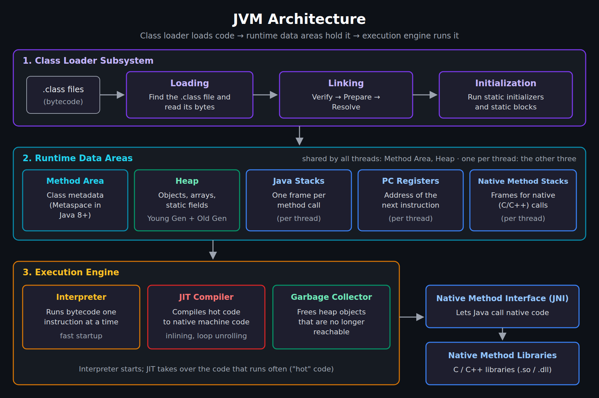

> 📊 **Priority of the optimization terms:** for `method inlining`, `loop unrolling`, and `dead code elimination`, know the *name + one line each*. That is enough. Interviewers rarely ask how they work. The two topics they *do* ask more about are **tiered compilation (C1/C2)** and **escape analysis** below.

<details>
<summary><strong>🤔 Doubt: What is tiered compilation (C1 vs C2)?</strong></summary>

The HotSpot JVM does not go straight from the interpreter to fully-optimized native code. It uses **tiered compilation**. A method moves up through levels as it runs more often ("gets hotter").

- **Interpreter** — runs bytecode directly. Zero compile cost, slowest execution. It also collects **profiling** data (invocation counts, branch frequencies, observed types).
- **C1 (Client compiler)** — starts for warm methods. It compiles **fast** with light optimization. Good startup latency, moderate peak speed.
- **C2 (Server compiler)** — starts for **hot** methods (methods that crossed a compile threshold). It compiles **slowly**. But it produces **aggressively optimized** native code, using the profile collected earlier. Heavy inlining, loop unrolling, etc. actually happen here.

So the lifecycle is: `interpret → C1 → C2`. Per-method **hotness counters** drive it.

- This is why a Java service is slower in its first seconds ("warm-up").
- In those seconds, C2 has not compiled the hot paths yet.
- The service speeds up under steady load.

`-XX:+TieredCompilation` is on by default in modern JVMs.

💡 *Profile-guided* is the key phrase. The JVM optimizes based on what actually happened at runtime. An ahead-of-time compiler (C/C++/Go) can't do this.

---

</details>
<br/>

<details>
<summary><strong>🤔 Doubt: What is escape analysis (and why does it matter)?</strong></summary>

**Escape analysis** is a JIT optimization. It checks whether an object **escapes** the method/thread that created it. That means: does any reference to it go outside? For example, it is returned, stored in a field, or passed to another thread.

If the JVM proves an object **does not escape**, it can:

- 🏗️ **Scalar replacement** — not allocate the object at all. Instead, break it into its primitive fields, held in registers/stack.
- **Stack allocation** — allocate on the stack instead of the heap. This is the textbook idea, but HotSpot does **not** do true stack allocation. It uses scalar replacement (above) instead.
- 🔒 **Lock elision** — remove synchronization on an object that only one thread ever uses (e.g. a local `StringBuffer`).

**Why interviewers like it:** it connects the JIT to **GC and memory**. A non-escaping object never reaches the heap, so it creates **zero GC pressure**. It sounds like a senior answer because it links three topics together.

```java
// 'p' never escapes addUp() → JIT may scalar-replace it: no heap allocation at all
int addUp(int a, int b) {
    Point p = new Point(a, b);   // looks like a heap allocation...
    return p.x + p.y;            // ...but the object never leaves the method
}
```

---

</details>
<br/>

<details>
<summary><strong>🤔 Doubt: Why might a hot method NOT get inlined?</strong></summary>

Inlining is the JIT's most valuable optimization, because it makes the other optimizations possible. But the JVM won't always do it:

- **Method too large** — the method is over the bytecode-size limit (`-XX:MaxInlineSize`, `-XX:FreqInlineSize`). The JVM skips big methods, so the generated native code does not grow too large.
- **Megamorphic call site** — a call through an interface/virtual method where the JVM sees **many** concrete implementations at runtime. The JVM can't predict the target, so it can't inline. (Mono-/bi-morphic sites *do* get inlined with a type guard.)
- **Not hot enough** — the call site has not crossed the profiling threshold. So C2 never considered it.

✅ Practical takeaway: keep hot methods small. Keep call sites monomorphic (few implementations behind an interface). This helps the JIT optimize them.

---

</details>
<br/>

---

</details>

---

4. **🏷️ What is the marker interface and use of it & example? ⚡**

<!-- -->
<details>
<summary>Answer</summary>

**Answer:**

💡 A marker interface is an interface with no data members and no member functions. In simple terms, it is an empty interface. E.x:- Serializable, Cloneable.

```java
public interface Cloneable { }
```

Its only purpose is to mark (tag) the classes that implement it. The mark says the class has a certain property or capability.

- These interfaces often give metadata about the class that implements them.
- They are a way to group or identify classes at runtime.

One common use is Java’s serialization mechanism. There, a marker interface like `Serializable` shows that objects of a class can be serialized.

- When an object is serialized, the Java runtime checks if the object's class implements the `Serializable` interface.
- If it does, the object can be serialized.
- If not, a `NotSerializableException` is thrown.

Here’s an example of a marker interface in Java:-

```java
import java.io.Serializable;

// Marker interface
interface MarkerInterface extends Serializable {
    // This marker interface doesn't declare any methods
}

// Class implementing the marker interface
class MyClass implements MarkerInterface {
    // Class implementation
}

public class Main {
    public static void main(String[] args) {
        MyClass obj = new MyClass();

        // Check if the object implements the marker interface
        if (obj instanceof MarkerInterface) {
            System.out.println("Object belongs to a class implementing MarkerInterface.");
        } else {
            System.out.println("Object does not belong to a class implementing MarkerInterface.");
        }
    }
}
```

---

</details>

---

5. **🔒 Can we override a private or static method in Java? 🔥**

<!-- -->

<details>

<summary>Answer</summary>

**Answer:**

💡 No. You cannot override private methods or static methods in Java. But the reasons are different:

**Private methods:**
- Subclasses cannot see them, so they are not inherited.
- If a subclass defines a method with the same name, it is a completely new, independent method. It is **not** an override.
- No polymorphic behavior happens.

**Static methods:**
- They belong to the class, not to an instance. So they cannot take part in runtime polymorphism.
- If a subclass defines the same static method signature, the result is **method hiding**, not overriding.
- Key difference: method hiding is resolved at **compile time**, based on the reference type. Overriding is resolved at **runtime**, based on the object type.

```java
class Parent {
    static void staticMethod() {
        System.out.println("Parent static");
    }

    void instanceMethod() {
        System.out.println("Parent instance");
    }
}

class Child extends Parent {
    // hiding — NOT overriding
    static void staticMethod() {
        System.out.println("Child static");
    }

    @Override
    void instanceMethod() {
        System.out.println("Child instance");
    }
}

public class Test {
    public static void main(String[] args) {
        Parent obj = new Child();
        obj.staticMethod();   // "Parent static"  ← reference type wins (hiding)
        obj.instanceMethod(); // "Child instance" ← object type wins (overriding)
    }
}
```

> **Interview tip:** When asked this, always name *method hiding*. Then explain the compile-time vs runtime dispatch difference. Interviewers at Tier-1 companies listen for exactly this.

---

</details>

---

6. **🔢 What is the difference between method hiding and method overriding? 🔥**

<!-- -->

<details>

<summary>Answer</summary>

**Answer:**

💡 In both, a subclass defines a method with the same signature as the parent. The difference is the dispatch mechanism:

| Aspect | Method Overriding | Method Hiding |
|---|---|---|
| Applies to | Instance methods | Static methods |
| Dispatch | Runtime (dynamic) — object type decides | Compile-time (static) — reference type decides |
| Polymorphism | Yes | No |
| `@Override` annotation | Valid and recommended | Not applicable |

```java
Parent ref = new Child();
ref.instanceMethod(); // → Child’s version (overriding — runtime dispatch)
ref.staticMethod();   // → Parent’s version (hiding — compile-time dispatch)
```

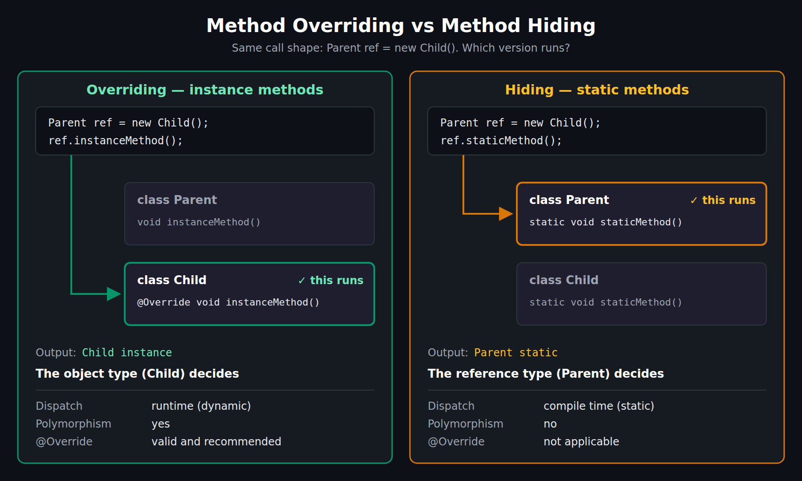

---

</details>

---

7. **🖨️ What will be the output of the below program, is it valid Java code? ⚡**

```java
public class Test {
    public static void main(String[] args) {
        Test test = new Test();
        System.out.println(test.get());
    }

    // static method
    public static int get() {
        return 1;
    }
}
```

<!-- -->

<details>

<summary>Answer</summary>

**Answer:**

💡 Yes, it is valid Java code, and the output is 1. We can call a static method on an object reference. But calling a static method this way is not a best practice.

> Also note:- A static method and an instance method can never exist with the same signature. Not in the same class, and not across parent-child. The compiler enforces this strictly.

---

</details>

---

8. **🛡️ Does the "finally" block always execute in Java? 🔥**

<!-- -->

<details>

<summary>Answer</summary>

**Answer:**

💡 Not in the following cases:-

1. `System.exit(0)` or `Runtime.getRuntime().halt(0)` is called in the try-catch block.
2. System crash (JVM crash, power loss, or the process is killed with `kill -9`).
3. The `try` block never ends (an infinite loop, or a thread blocked forever).
4. The code runs in a daemon thread and the JVM exits. Daemon threads stop without running their `finally` blocks.

Note:- There is no method like `System.crash()`.

> ⚠️ **Bonus — `finally` with its own `return`:** if `finally` has its own `return`, it **silently overrides** the `try`'s `return`. This is an easy mistake that causes real bugs.
>
> ```java  
> int f() {  
>     try { return 1; }  
>     finally { return 2; }  // method returns 2 — the try's 1 is silently discarded  
> }  
> ```

---

</details>

---

9. **📦 Is Java pass by value or pass by reference? 🔥🔥**

<!-- -->

<details>

<summary>Answer</summary>

**Answer:**

💡 Java is **always pass by value** — strictly, with no exceptions.

The confusion comes with objects. So split it into two cases:

**Case 1: Primitives — simple**

```java
void change(int x) {
    x = 100;
}

int a = 10;
change(a);
System.out.println(a); // 10 — original unchanged
```

A copy of the primitive value is passed. The caller's variable is never affected.

**Case 2: Objects — where the confusion comes from**

```java
void modify(StringBuilder sb) {
    sb.append(" World"); // mutates the object ✅
}

void reassign(StringBuilder sb) {
    sb = new StringBuilder("New"); // only changes local copy ❌️
}

StringBuilder s = new StringBuilder("Hello");
modify(s);
System.out.println(s);   // "Hello World" — mutation IS visible

reassign(s);
System.out.println(s);   // "Hello World" — reassignment is NOT visible
```

Java passes a **copy of the reference** (memory address), not the object itself:
- You **can** mutate the object's internal state through that copied reference → the caller sees the changes.
- You **cannot** make the caller's variable point to a new object → reassignment is local only.

**Mental model — the duplicate key analogy:**
> Java gives the method a duplicate key (copy of reference), not the original.  
> - The method can enter the house and move the furniture (mutate state). The caller sees it.  
> - The method may throw away the duplicate key and get a new one (reassignment). The caller's original key still points to the same house.

**One-line interview answer:**
> Java is always pass by value. For objects, the *value* being passed is a copy of the reference. So a method can mutate the object's state. But it can never reassign the original reference from inside the method.

---

</details>

---

10. **🧊 How can we make a Class immutable? 🔥🔥**

<!-- -->

<details>

<summary>Answer</summary>

**Answer:**

💡 Perform 6 steps:-

1. Declare the class as final so it can’t be extended.
2. Make all fields private so that direct access is not allowed.
3. Do not provide setter methods for variables.
4. Make all fields final so that their value can be assigned only once.
5. Initialize all the fields via a constructor performing a deep copy.
6. Clone objects in the getter methods. Return a copy, not the actual object reference.

Example:- String is an immutable class in Java.

> 🆕 **Mention this next — `record` (Java 16) does steps 1–4 for you.** A `record` is implicitly `final`. Its fields are `private final`. It has no setters. It generates the canonical constructor, accessors, `equals`, `hashCode` and `toString`. On a Java 17 baseline, do not answer with only the six hand-written steps. If you never mention `record`, the answer sounds several years out of date.
> ```java
> public record Person(String name, int age, Address address) {
>     // compact constructor — the one place you still hand-write the defensive copy
>     public Person {
>         address = new Address(address);          // step 5: deep copy IN
>     }
>     public Address address() {
>         return new Address(address);             // step 6: defensive copy OUT
>     }
> }
> ```
> ⚠️ The warning interviewers want to hear: a `record` is only **shallowly** immutable.
> - A component may be a mutable type (`Date`, `List`, an array, a mutable `Address`).
> - Then you must still make a defensive copy on the way in **and** on the way out.
> - Steps 5 and 6 above are exactly what the language does *not* do for you.
>
> The usual follow-up is *"is a `record` holding a `List` immutable?"* The answer is no, unless you wrap it in `List.copyOf()`.

```java
// Step 1: Declare the class as final so it can't be extended.
public final class Person {

    // Step 2: Make all fields private so that direct access is not allowed.
    private final String name;
    private final int age;
    private final Address address;
    // Address may be mutable, so we copy it in and out.

    // Step 4: Make all fields final so that 
    // their value can be assigned only once.
    // If Address were immutable, we could assign it directly.
    // Here we treat it as mutable, so we deep-copy it (step 5 and 6).

    // Step 5: Initialize all the fields via a constructor performing a deep copy.
    public Person(String name, int age, Address address) {
        this.name = name;
        this.age = age;
        this.address = new Address(address); 
        // Perform deep copy if Address is mutable.
    }

    // Step 3: Do not provide setter methods for variables.

    // Step 6: Perform cloning of objects in the getter methods 
    // to return a copy rather than returning the actual object reference.

    public String getName() {
        return name;
    }

    public int getAge() {
        return age;
    }

    public Address getAddress() {
        return new Address(address); 
        // Perform cloning or return immutable Address object.
    }
}
```

---

</details>

---

11. **👁️ Can parents have high visibility and children have less visibility? 💤**

<!-- -->
<details>
<summary>Answer</summary>

**Answer:**

💡 No. An overriding method can not have less visibility than the parent method. We will get a compile-time error. The overriding method can have the same or more visibility (for example, `protected` → `public`). Only reducing visibility is not allowed.

---

</details>

---

12. **👤 Shadowing of Static Methods/Variable | Find the output of the below programs. 🔥**

**Program 1 — Instance method + instance variable:**
```java
class Vehicle {
    int wheels = 4;
    public void specialProperty() {
        System.out.println("Vehicle.specialProperty()");
    }
}

class Bike extends Vehicle {
    int wheels = 2;
    public void specialProperty() {
        System.out.println("Bike.specialProperty()");
    }
}

class Test {
    public static void main(String[] args) {
        Vehicle v = new Bike();
        v.specialProperty();        // What is the output?
        System.out.println(v.wheels); // What is the output?
    }
}
```

**Program 2 — Static method shadowing:**
```java
class Animal {
    public static void specialProperty() {
        System.out.println("Animal.specialProperty()");
    }
}

class Dog extends Animal {
    public static void specialProperty() {
        System.out.println("Dog.specialProperty()");
    }
}

class StaticShadowTest {
    public static void main(String[] args) {
        Animal animal = new Dog();
        animal.specialProperty(); // What is the output?
    }
}
```

<!-- -->

<details>

<summary>Answer</summary>

**Answer:**

**Program 1 output:**
```
Bike.specialProperty()
4
```

- ✅ `v.specialProperty()` → resolved at **runtime** using the actual object type (`Bike`) → `Bike.specialProperty()`
- ⚠️ `v.wheels` → resolved at **compile time** using the reference type (`Vehicle`) → `4`

**Program 2 output:**
```
Animal.specialProperty()
```

Static methods are not overridden. They are **shadowed (hidden)**. The compiler picks the method at compile time. It uses the reference type (`Animal`), not the actual object.

**Resolution rules at a glance:**

| Feature | Resolved By | Mechanism |
|---|---|---|
| Instance method | Runtime object type | Overriding (polymorphism) |
| Instance variable | Compile-time reference type | Variable hiding |
| Static method | Compile-time reference type | Method hiding |
| Static variable | Compile-time reference type | Variable hiding |

**To get polymorphic behaviour for fields, use a getter method:**
```java
class Animal {
    int legs = 4;
    public int getLegs() {
        return legs;
    }
}

class Dog extends Animal {
    int legs = 2;
    @Override
    public int getLegs() {
        return legs;
    }
}

Animal animal = new Dog();
System.out.println(animal.getLegs()); // 2 — runtime dispatch via method
```

> **Interview tip:** Only instance methods are polymorphic in Java. Fields and static methods are always resolved by the compiler, using the reference type. This is a common trick question in interviews.

---

</details>

---

13. **🔀 Can we achieve runtime polymorphism with instance variables? 🔥**

```java
public class Animal {
    public String color = "Animal Color";
}

public class Dog extends Animal {
    public String color = "Dog Color";
}

public class Test {
    public static void main(String[] args) {
        Animal animal = new Dog();
        System.out.println(animal.color); // What is the output?
    }
}
```

<!-- -->

<details>

<summary>Answer</summary>

**Answer:**

No. Output is `Animal Color`.

Instance variables are resolved at **compile time**. The compiler uses the **reference type**, not the actual object type. This is called **variable hiding**, not overriding.

In Java, only methods can be overridden. Instance variables cannot. So runtime polymorphism (dynamic dispatch) does not apply to fields.

| | Methods | Instance Variables |
|---|---|---|
| Resolved at | Runtime (object type) | Compile time (reference type) |
| Can be overridden | Yes | No (variable hiding only) |
| Polymorphism | Yes | No |

> **Interview tip:** Always declare instance variables `private`. This is one reason why. Public fields lead to variable hiding bugs that are hard to find.

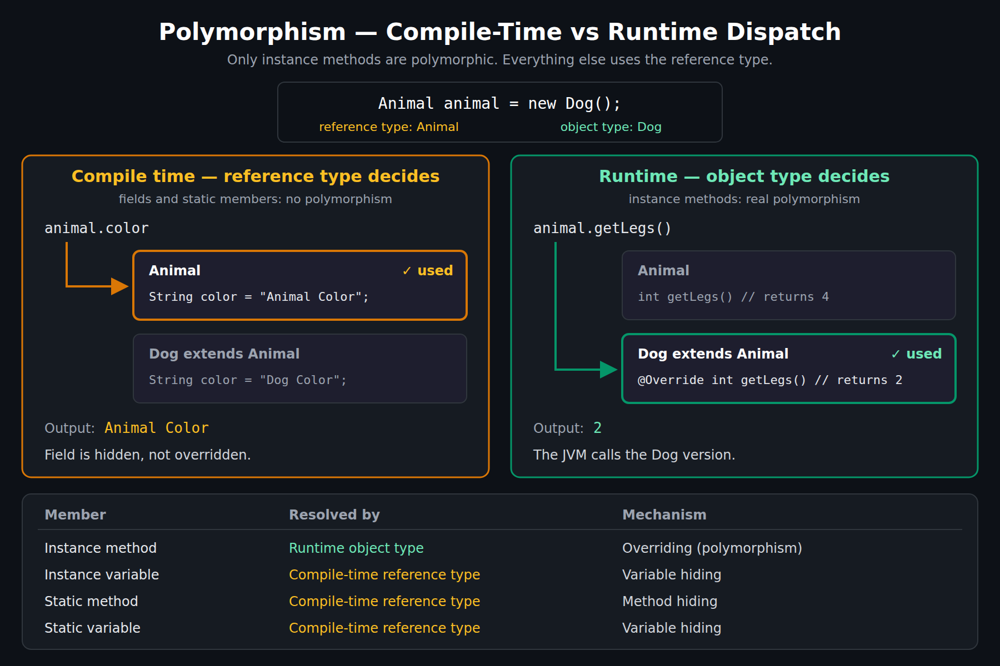

---

</details>

---

14. **👶 What if the child class does not override the method and we are calling:- ⚡**

```java
Animal animal = new Dog();
animal.methodName(); // What happens if Dog does not override methodName()?
```

<!-- -->

<details>

<summary>Answer</summary>

**Answer:**

The **parent class method** is executed.

Suppose the child class does not override the method. Then the JVM goes up the inheritance chain. It runs the nearest implementation it finds. In this case, that is `Animal.methodName()`.

This is standard method resolution in Java:
- The JVM looks at the actual object type (`Dog`) first.
- It finds no override there.
- So it uses the method in `Animal` instead.

---

</details>

---

15. **🔗 What is Association Aggregation and Composition? 🔥**

<!-- -->

<details>

<summary>Answer</summary>

**Answer:**

All three describe relationships between classes. Association is the most general term. Aggregation and Composition are its two special forms.

Association Types:-
- Aggregation
- Composition

| | Association | Aggregation | Composition |
|---|---|---|---|
| **Relationship** | General connection | Weak HAS-A | Strong HAS-A |
| **Lifecycle** | Independent | Independent | Part dies with whole |
| **Ownership** | None | Shared | Exclusive |
| **Direction** | Uni or Bidirectional | Usually unidirectional | Unidirectional |

**1. Association** — defines how two classes are connected and interact with each other

A `Teacher` teaches `Student`s. Both exist independently; neither owns the other.

```java
class Teacher {
    String name;
    List<Student> students; // knows about students, doesn’t own them
}

class Student {
    String name;
    List<Teacher> teachers;
}
```

**2. Aggregation** — weak HAS-A, parts survive without the whole

A `Department` has `Professor`s. But professors can exist without that department. They can move to another one.

```java
class Department {
    String name;
    List<Professor> professors; // professors passed in, not created here
}

class Professor {
    String name;
}
```

> Key signal: the part object is **passed in / injected**, not created inside the owner.

**3. Composition** — strong HAS-A, parts cannot survive without the whole

A `Car` is composed of an `Engine`. If the car is destroyed, the engine no longer exists as part of it.

```java
class Car {
    private final Engine engine;

    public Car() {
        this.engine = new Engine(); // created inside — Car owns Engine’s lifecycle
    }
}

class Engine { }
```

> Key signal: the part object is **created inside** the owner’s constructor. Their lifecycles are tied.

**Interview tip:** Interviewers often ask *"How do you tell Aggregation from Composition in code?"*
> In plain Java: if the part is **instantiated inside** the owner → Composition. If it is **injected/passed in** → Aggregation.
>
> **What about Spring `@Autowired`?** The container manages Spring-injected dependencies. The owning class does not control their lifecycle. So `@Autowired` fields are **Aggregation** in OOP terms. This is true even though they look like tight coupling. Composition in Spring would be rare. It means the owner explicitly calls `new Dependency()` inside itself. That skips the container completely.

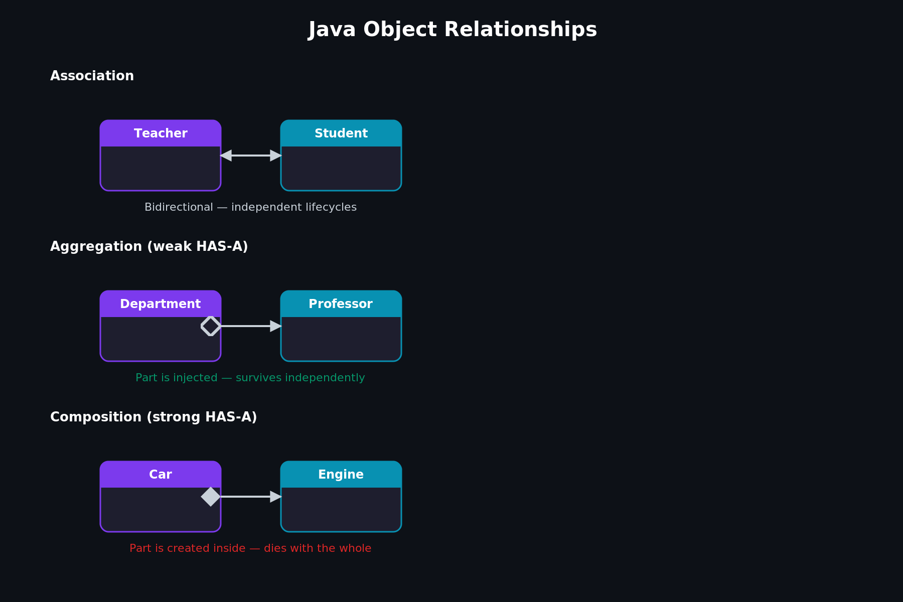

---

</details>

---

16. **↩️ What is the covariant return type? ⚡**

<!-- -->

<details>

<summary>Answer</summary>

**Answer:**

Covariant return type means this: the overriding method in a subclass can return a more specific (narrower) type. The parent class declares the broader type. It is a standard Java feature. Treat it as basic knowledge.

The rule: the overridden method’s return type must be the **same or a subtype** of the parent method’s return type.

```java
class Animal {
    public Animal create() {
        return new Animal();
    }
}

class Dog extends Animal {
    @Override
    public Dog create() {   // Dog is a subtype of Animal — valid covariant return
        return new Dog();
    }
}
```

Without covariant return types (pre-Java 5), the caller would need an explicit cast:

```java
// Without covariant return — caller must cast
Animal a = new Dog();
Dog d = (Dog) a.create();  // unsafe, boilerplate

// With covariant return — no cast needed
Dog dog = new Dog().create();  // clean and type-safe
```

**Direction check — `Object` vs `String`.** The one thing to get right is *which way* the type moves. `String` is a subtype of `Object`. So an override may return `String` where the parent declared `Object`. The reverse is never allowed:

```java
class Parent {
    Object create() { return new Object(); }   // parent declares the broad type
}

class Child extends Parent {
    @Override
    String create() { return "hello"; }        // ✅ String IS-A Object → narrowing = covariant
    // ❌️ Flip it (parent String, child Object) → "return type Object is not compatible with String"
}
```

⚠️ **Why widening is illegal — the Liskov argument.** Look at the flipped case: the parent declares `String create()`. A caller that holds a `Parent` reference was promised a `String`, so it may write `parent.create().length()`. Suppose `Child` could return a plain `Object`. Then that call would break at runtime on a `Child` instance. So an override may promise **more** (a narrower, more specific type), never **less**. Visibility follows the same principle: an override can widen `protected` → `public`, but never narrow it.

A real-world example is the **Builder pattern**. A setter like `setName()` in a subclass builder returns the concrete subtype, not the base type. So calls can chain without a cast:

```java
class BaseBuilder {
    public BaseBuilder setName(String name) {
        return this;
    }
}

class ConcreteBuilder extends BaseBuilder {
    @Override
    public ConcreteBuilder setName(String name) {  // covariant — returns ConcreteBuilder
        super.setName(name);
        return this;
    }
}
```

> **Interview tip:** Covariant return type makes fluent APIs and the Builder pattern possible. Callers do not have to cast. It is also why `clone()` in subclasses can return the concrete type instead of `Object`.

---

</details>

---

17. **⬆️ Type promotion | Find the output of the below programs. ⚡**

**Program 1:**
```java
public class OverloadingExample {
    public void add(int a, long b) {
        System.out.println("add(int, long)");
    }
}

public class Test {
    public static void main(String[] args) {
        new OverloadingExample().add(10, 20); // What is the output?
    }
}
```

**Program 2:**
```java
public class AmbiguousOverloading {
    public void add(long a, int b) {
        System.out.println("add(long, int)");
    }
    public void add(int a, long b) {
        System.out.println("add(int, long)");
    }
}

public class AmbiguousOverloadingTest {
    public static void main(String[] args) {
        new AmbiguousOverloading().add(10, 20); // What is the output?
    }
}
```

<!-- -->

<details>

<summary>Answer</summary>

**Answer:**

**Program 1 output:** `add(int, long)`

`10` matches `int` exactly. `20` is an `int` literal. There is no `add(int, int)`. So the compiler promotes `20` to `long` and matches `add(int, long)`.

**Program 2 output:** Compile-time error. `javac` says *"reference to add is ambiguous"*. (Eclipse says *"The method add(long, int) is ambiguous"*.)

Both overloads need one argument to be promoted:
- `add(long, int)` promotes the first.
- `add(int, long)` promotes the second.

The compiler cannot decide which one is more specific. So it gives an ambiguity error.

**Type promotion order:** `byte → short → int → long → float → double`

> **Interview tip:** Type promotion happens when there is no exact match. Ambiguity happens when two overloads are equally valid after promotion. The compiler never guesses.

---

</details>

---

## 2. Object Class 🔥🔥

1. **🧬 What methods does the Object class have? 🔥**

<!-- -->

<details>

<summary>Answer</summary>

**Answer:**

💡 Every class in Java extends `java.lang.Object`, even if you do not write it. `Object` has 11 methods. They fall into three groups:

**🔁 Object identity & comparison**

| Method | Signature | Description |
|---|---|---|
| `equals` | `public boolean equals(Object obj)` | Compares by reference by default. Override for content-based equality. |
| `hashCode` | `public int hashCode()` | Returns a hash of the object. Must be consistent with `equals`. |
| `toString` | `public String toString()` | Returns `ClassName@hashCode` by default. Override for meaningful output. |

**🧬 Object lifecycle**

| Method | Signature | Description |
|---|---|---|
| `clone` | `protected Object clone() throws CloneNotSupportedException` | Creates a shallow copy. The class must implement `Cloneable`. ⚠️ Seen as problematic. In modern Java, prefer copy constructors or `copyOf()`. |
| `finalize` | `protected void finalize() throws Throwable` | ⚠️ Called by GC before collecting the object. Deprecated since Java 9. See → [GC Q10](#3-garbage-collection) for alternatives. |
| `getClass` | `public final Class<?> getClass()` | Returns the runtime class of the object. Cannot be overridden. |

**🔒 Thread coordination (all `final` — cannot be overridden)**

| Method | Description |
|---|---|
| `wait()` | Causes the current thread to wait until `notify()` / `notifyAll()` is called. |
| `wait(long timeout)` | Waits for at most the given milliseconds. |
| `wait(long timeout, int nanos)` | Waits with nanosecond precision. |
| `notify()` | Wakes up one thread waiting on this object's monitor. |
| `notifyAll()` | Wakes up all threads waiting on this object's monitor. |

> **Interview tip:** Interviewers often ask which methods are `final`. The answer: all three thread coordination methods (`wait`, `notify`, `notifyAll`) and `getClass`. You cannot override them, because the JVM must guarantee their behaviour.

---

</details>

---

2. **⚖️ What is the `equals()` and `hashCode()` Contract? 🔥🔥**

<!-- -->

<details>

<summary>Answer</summary>

**Answer:**

💡 The contract is a set of rules that link `equals()` and `hashCode()`. If you break it, you get bugs in `HashMap`, `HashSet`, and other hash-based collections.

**📜 The three rules:**

| Rule | Description |
|---|---|
| ✅ Equal objects → same hashCode | If `a.equals(b)` is `true`, then `a.hashCode() == b.hashCode()` must be `true`. |
| ⚠️ Same hashCode → not necessarily equal | Two objects can have the same hashCode (a hash collision). `equals()` may still return `false` for them. |
| 🔁 Consistency | During one run of the program, `hashCode()` must return the same value on every call. This holds as long as the object has not changed. |

**🔍 Why it matters — HashMap example:**

`HashMap` uses `hashCode()` to find the bucket. It uses `equals()` to find the exact key. Suppose you override `equals()` but not `hashCode()`:

- Two logically equal objects almost always go into different buckets.
- So `get()` will almost always return `null`, even after a successful `put()`. (It works only by luck, if both default hash codes happen to be equal. `HashMap` compares the hash before it calls `equals()`.)

```java
Map<Employee, String> map = new HashMap<>();
Employee e1 = new Employee(1, "Alice");
Employee e2 = new Employee(1, "Alice"); // logically equal

map.put(e1, "Engineering");
map.get(e2); // ❌️ almost always null if hashCode() not overridden
```

**✅ Correct implementation:**

```java
import java.util.Objects;

public class Employee {
    private Integer id;
    private String name;

    @Override
    public boolean equals(Object obj) {
        if (this == obj) return true;
        if (obj == null || getClass() != obj.getClass()) return false;
        Employee other = (Employee) obj;
        return Objects.equals(id, other.id) && Objects.equals(name, other.name);
    }

    @Override
    public int hashCode() {
        return Objects.hash(id, name); // same fields as equals()
    }
}
```

> **Interview tip:** Always override `equals()` and `hashCode()` together. Never override one without the other. IDEs and Lombok (`@EqualsAndHashCode`) can generate them. But interviewers test whether you know the contract.

---

</details>

---

## 3. Garbage Collection 🔥🔥

1. **🔥 Explain the Generational GC strategy and HotSpot Heap structure. 🔥🔥**

<!-- -->

<details>

<summary>Answer</summary>

**Answer:**

> ⚡ **In short — the object lifecycle:** allocate in **Eden** → Eden fills → **Minor GC** → survivors copied to a survivor space, **age = 1** → each later Minor GC copies live objects from **Eden + the occupied survivor** into the **other** survivor, **age++** → at **age ≥ 15** (default `MaxTenuringThreshold`) → promoted to **Old Gen** → Old Gen fills → **Major GC** (slow, larger pause).
>
> ⚠️ **Exactly two survivor spaces — S0 and S1, never three.** Minor GC is a *copying* collector:
>
> - It moves live objects out of Eden **and** the occupied survivor into the **other** survivor.
> - Then it wipes both sources.
>
> This needs exactly one empty destination at all times. A third space would have nothing to do.

💡 The **Generational GC strategy** is based on one observation: *most objects die young*. So the GC works like this:

- It collects short-lived objects often, in a small space (Young Generation).
- It collects long-lived objects rarely (Old Generation).

This makes GC faster and more efficient.

**🏗️ HotSpot Heap Structure:**

| Region | Part of Heap? | Purpose |
|---|---|---|
| Eden Space | ✅ Yes (Young Gen) | All new objects are allocated here |
| Survivor S0 / S1 | ✅ Yes (Young Gen) | Objects that survive Minor GC bounce between S0 and S1 |
| Old Generation | ✅ Yes | Long-lived objects promoted from Young Gen |
| Metaspace | ❌️ No (Non-heap) | Class metadata. Replaced PermGen from Java 8 onwards |

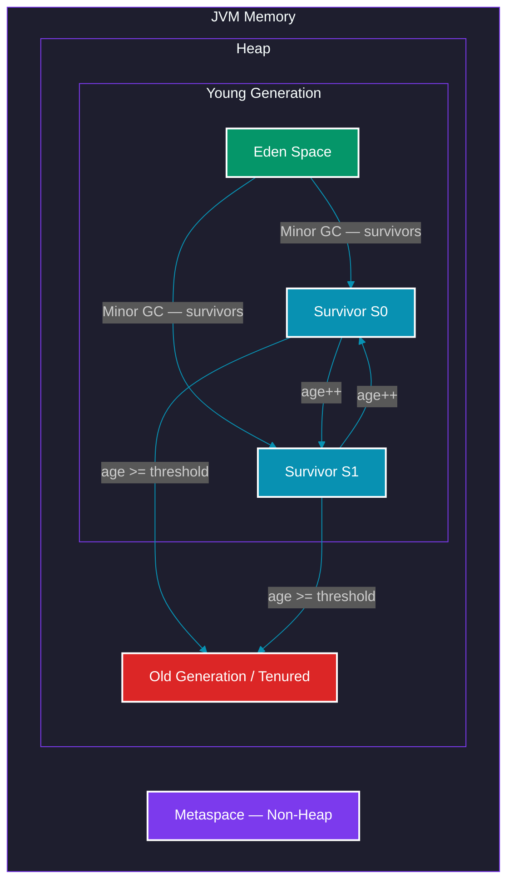

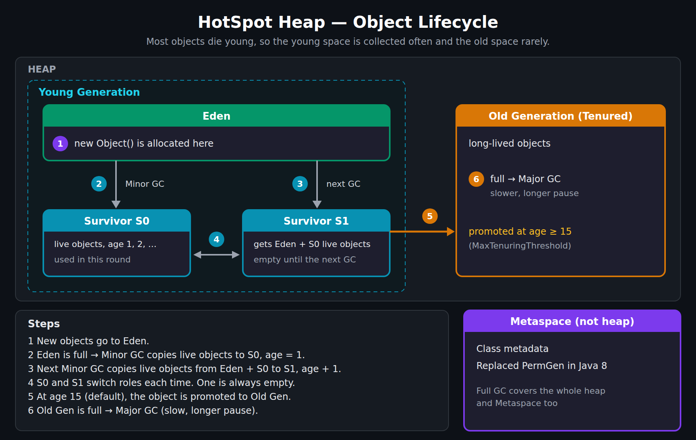

**⚙️ GC Flow — step by step:**

1. 🟢 **Object allocation** — all new objects go to **Eden**.
2. 🔄 **Minor GC triggered** when Eden fills up. It is fast, because it scans only Young Gen.
3. The GC copies the live objects in Eden to **S0**, and sets their age to 1. It does not touch the dead objects one by one. It just treats all of Eden as empty again.
4. Next Minor GC — the GC copies the live objects from **Eden and S0** to **S1**, and their age goes up by one. Then Eden and S0 are treated as empty.
5. Each Minor GC cycle repeats this, switching between S0 and S1. The object age goes up each time.
6. 📤 **Promotion** — when an object's age reaches the threshold (default: 15), the GC promotes it to **Old Generation**.
7. 🔴 **Major GC / Full GC** — runs when Old Generation fills up. It is slower, and it pauses the application for longer.

**⚡ GC types at a glance:**

| GC Type | Scope | Speed | Trigger |
|---|---|---|---|
| Minor GC | Young Generation only | ⚡ Fast | Eden full |
| Major GC | Old Generation | 🐢 Slow | Old Gen full |
| Full GC | Entire heap + Metaspace | 🐢🐢 Slowest | Low memory / explicit `System.gc()` |

> **Interview tip:** Interviewers want to hear *why* generational GC is efficient. Most objects are short-lived (temporary variables, request objects). So Minor GC frees most memory quickly, without touching the Old Gen at all.

---

</details>

---

2. **🧓 Why do most GCs use the Generational GC strategy? What is the Weak Generational Hypothesis? 🔥**

<!-- -->

<details>

<summary>Answer</summary>

**Answer:**

💡 Most GCs use the Generational strategy because of the **Weak Generational Hypothesis**. It is an observation from real measurements:

> 🔑 **Most objects die young.**

In real applications, the vast majority of objects are short-lived. Examples: temporary variables, request/response objects, loop iterators, intermediate results. They are created and become unreachable within milliseconds.

**📊 Why this makes generational GC efficient:**

| Without Generational GC | With Generational GC |
|---|---|
| Scan entire heap every GC cycle | Scan only Young Gen (small, fast) frequently |
| Long pause times | ⚡ Short Minor GC pauses (ms range) |
| No distinction between short & long-lived objects | Long-lived objects promoted to Old Gen, collected rarely |

**🔁 The strategy in practice:**
- **Young Gen** — collected often (Minor GC). Small size → fast scan → short pauses.
- **Old Gen** — collected rarely (Major GC). Only long-lived objects reach here.
- Result: the GC frees most garbage (short-lived objects) cheaply, without ever touching the Old Gen.

- These are all created and become unreachable **within a single request**: the `HttpServletRequest`, the deserialised request DTO, per-request validation results, the JPA entities loaded for one transaction, and every intermediate `String`. These are typical Young Gen objects.
- What survives to Old Gen is the small, fixed set of long-lived singletons: the `ApplicationContext` and its beans (repositories, `CacheManager`, `RestTemplate`/`WebClient`), the connection pool, and any data held in an in-process cache.

⚠️ Do not name specific classes you haven't checked. The interviewer really wants the honest, general version: "per-request DTOs and entities die young; Spring singletons and the connection pool live in Old Gen".

> **Interview tip:** Mention the *Weak Generational Hypothesis* by name. It shows you understand the *theory* behind GC design, not just how to use it.

---

</details>

---

3. **⚙️ How does garbage collection work? 🔥🔥**

<!-- -->

<details>

<summary>Answer</summary>

**Answer:**

💡 Garbage collection works in **2 phases**:

**1. 🔍 Marking** — the GC starts from **GC roots** (thread stacks, static fields, JNI references). It marks every object it can reach. When the walk ends, anything unmarked is unreachable garbage. This **reachability analysis** lets the GC collect Islands of Isolation (groups of objects that point only to each other).

**2. 🗑️ Deletion** — in one of two forms:

| Variant | What it does | Cost |
|---|---|---|
| **Normal deletion** | Frees unmarked objects and leaves gaps where they were | ⚡ Cheap |
| **Deletion + Compaction** | Frees them, then **moves surviving objects together** into contiguous blocks at the start of the region | 🐢 Expensive — the GC must move objects and update every reference to them |

⚠️ **Compaction solves fragmentation.** After plain deletion, the free space is spread out in holes between survivors.

- You can have 500 MB free in total and still fail to allocate a 10 MB array. No single hole is 10 MB.
- The result is an `OutOfMemoryError` with plenty of free memory.
- Compaction also makes later allocation very cheap. With one contiguous free block, the JVM allocates by **bumping a pointer** (moving it forward). It does not need to search a free list.

> **Interview tip:** That is the two-phase algorithm — **mark, then sweep** (or **mark-sweep-compact**). Memorise it as those three words. These are the standard terms, and interviewers usually ask the question using them.

---

</details>

---

4. **🛑 What is the "Stop the world" concept in GC? 🔥**

<!-- -->

<details>

<summary>Answer</summary>

**Answer:**

💡 **Stop-the-World (STW)** is a phase during GC where the JVM **pauses all application threads**. The GC can then scan and free memory safely, because no thread changes objects at the same time.

**🔍 Why is it necessary?**
Without STW, application threads could change object references while the GC walks the heap. This can lead to:

- missed live objects (data loss)
- live objects collected by mistake (crashes)

STW guarantees a consistent heap snapshot.

**⚡ Which GC phases trigger STW:**

| GC Phase | STW? | Notes |
|---|---|---|
| Minor GC (Young Gen) | ✅ Yes | Short — Young Gen is small |
| Major GC (Old Gen) | ✅ Yes | Longer — Old Gen is large |
| Full GC | ✅ Yes | Longest — entire heap + Metaspace |
| G1GC **concurrent mark phase** | ❌️ No | Runs alongside app threads |
| G1GC concurrent mark **cycle** | ⚠️ Partly | The *cycle* still has short STW pauses: **Concurrent Start** (older name: *Initial Mark*; done together with a young collection), **Remark** and **Cleanup** |
| ZGC / Shenandoah most phases | ❌️ No | Short STW only (ZGC under 1 ms; Shenandoah usually under 10 ms) — concurrent, not pause-free |

**📉 Impact on applications:**
- During STW, **no requests are processed**, so users see latency spikes
- A 500ms Full GC pause on a payment API = 500ms timeout risk
- Frequent long pauses → SLA breaches in latency-sensitive systems

**✅ How modern GCs minimise STW:**

| GC | Approach |
|---|---|
| **G1GC** | Splits the heap into regions and aims for a configurable pause goal (`-XX:MaxGCPauseMillis`) |
| **ZGC** | Almost entirely concurrent — STW < 1ms regardless of heap size |
| **Shenandoah** | Concurrent compaction — STW usually under 10 ms, often under 1 ms, not tied to heap size |

> **Interview tip:** If asked *"How would you reduce GC pauses in a payment service?"*:
>
> - Switch from Parallel GC (high STW) to G1GC or ZGC.
> - Set `-XX:MaxGCPauseMillis=100`.
> - Monitor with GC logs (`-Xlog:gc*`).
> - Avoid allocating large short-lived objects in hot paths (code that runs very often).

---

</details>

---

5. **🏢 What are the modern GC collectors in Java and how do they differ? 🔥**

<!-- -->

<details>

<summary>Answer</summary>

**Answer:**

💡 **HotSpot** is Oracle’s most commonly used JVM. It supports multiple GC algorithms. The right one depends on what matters more to you: **throughput** or **low latency**.

**📊 GC Collectors at a glance:**

| GC | Available since | Ever the default? | Pause Type | Best For |
|---|---|---|---|---|
| **Serial GC** | Java 1 | ✅ Yes — and **still chosen ergonomically on a 1-CPU machine** | Stop-the-World (long) | Single-threaded / small apps, **1-CPU containers** |
| **Parallel GC** | Java 1.4 | ✅ Yes — default in Java 5–8 | Stop-the-World (parallel) | High throughput, batch jobs |
| **CMS** | Java 1.4.1 | ❌️ No | Mostly concurrent | ⚰️ **Deprecated in Java 9, removed in Java 14** — never propose it |
| **G1GC** | Java 7u4 | ✅ Yes — **the default since Java 9** | Short, predictable pauses | Balanced — large heaps, general use |
| **ZGC** | Java 11 (experimental), **15 (production)** | ❌️ Never a JVM default (opt-in via `-XX:+UseZGC`) | Sub-millisecond | Ultra-low latency systems |
| **Shenandoah** | Java 12 (experimental), 15 (production) | ❌️ Never a default (opt-in via `-XX:+UseShenandoahGC`) | Usually < 10 ms, often < 1 ms | Ultra-low latency, large heaps |

⚠️ The column above used to be called *"Default Since"*. That name was misleading, because **ZGC and Shenandoah have never been anyone's default.** They are opt-in flags. The JVM has only ever picked these collectors for you: Serial, Parallel (≤ Java 8) and **G1 (Java 9 onwards)**.

💡 **"Default" depends on the machine — it is ergonomics** (the JVM picks settings based on the machine).

- On a *server-class* machine, the JVM picks G1.
- On a machine it judges too small, it still picks **Serial**.

✅ Verified on JDK 17: plain `java` on a 12-CPU host reports `UseG1GC = true {ergonomic}`. But `java -XX:ActiveProcessorCount=1` reports `UseSerialGC = true {ergonomic}`.

This is a real production trap. **A container limited to 1 CPU silently gets Serial GC.** So check `-Xlog:gc*` (or `-XX:+PrintFlagsFinal`). Do not assume.

**🆕 The 2026 update interviewers listen for — ZGC is now generational.**
- **JDK 21 (JEP 439)** introduced **Generational ZGC**, opt-in via `-XX:+UseZGC -XX:+ZGenerational`.
- **JDK 23 (JEP 474)** made the **generational mode the default** for ZGC.
- **JDK 24 (JEP 490)** **removed** the non-generational mode entirely.

If you say just "ZGC" and do not know it is generational now, you are giving a 2021 answer. This matters:

- The original single-generation ZGC had to scan the whole heap every cycle. So it gave up throughput to get low latency.
- The generational version applies the weak generational hypothesis. It gets back much of that throughput.

**🔍 Key collectors explained:**

**G1GC (Garbage First)** — default since Java 9
- Splits the heap into equal-sized **regions** instead of fixed Young/Old areas
- Collects regions with most garbage first (hence "Garbage First")
- Targets a configurable pause time goal: `-XX:MaxGCPauseMillis=200`
- ✅ Good default for most production applications

**ZGC (Z Garbage Collector)** — experimental in Java 11, production-ready since Java 15, **generational since Java 21**
- Pause times under **1ms**, regardless of heap size (even 1TB heaps)
- Performs most work concurrently with application threads
- Enable with: `-XX:+UseZGC` (generational is the default mode from JDK 23; before that add `-XX:+ZGenerational` on 21/22)
- ⚠️ You pay for the low latency with **throughput and footprint** (memory use), because of coloured pointers + load barriers. It is not a free upgrade over G1
- ✅ Considered for payment systems, trading platforms, APIs with strict tail-latency SLAs

**Shenandoah** — experimental in Java 12, production-ready since Java 15
- Similar goals to ZGC — concurrent work, pauses not tied to heap size (usually under 10 ms, often under 1 ms)
- Developed by RedHat, available in OpenJDK builds (not in Oracle JDK)
- Enable with: `-XX:+UseShenandoahGC`
- ✅ Alternative to ZGC for low-latency workloads

**⚙️ How to set a GC:**
```bash
java -XX:+UseG1GC -XX:MaxGCPauseMillis=200 -jar app.jar   # G1GC with 200ms pause target
java -XX:+UseZGC -jar app.jar                              # ZGC
java -XX:+UseShenandoahGC -jar app.jar                     # Shenandoah
```

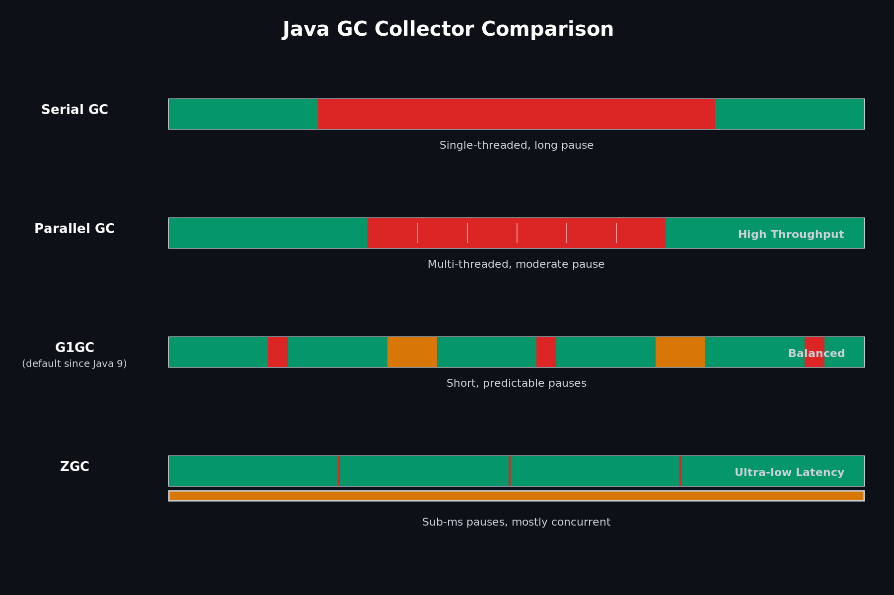

---

</details>

---

6. **♻️ What is the Garbage Collection and What are its advantages? 🔥**

<!-- -->

<details>

<summary>Answer</summary>

**Answer:**

💡 Garbage Collection (GC) is Java's automatic memory management process. It scans the heap and finds objects that are no longer reachable. Then it frees their memory. The developer does not do this by hand.

**🔍 Referenced vs Unreferenced objects:**

| Type | Description |
|---|---|
| 📌 Referenced (in-use) | At least one part of the program holds a pointer to the object — GC leaves it alone |
| 🗑️ Unreferenced | No live references point to it — it can be collected |

**✅ Advantages:**

- 🧹 **No manual memory management** — unlike C/C++, developers don't call `free()` or `delete`. GC frees memory automatically.
- 🛡️ **Reduces memory leaks** — GC frees unreachable objects, so forgetting `free()` is not possible. But it does **not** prevent all leaks. An object you still reference (for example, in a static `Map`) is never collected.
- 🚫 **Removes dangling pointer bugs** — you can't access freed memory by mistake.
- 🎯 **Developer focus** — engineers focus on business logic, not on tracking memory.

> **Interview tip:** GC is not free. It has a performance cost (pause times during Major/Full GC). In latency-sensitive apps (trading, payments), GC tuning is critical — for example, choosing G1GC, ZGC, or Shenandoah. Saying this shows depth beyond just knowing what GC is.

---

</details>

---

7. **💾 Where are objects created in memory? Stack or Heap? What does each store? 🔥**

<!-- -->

<details>

<summary>Answer</summary>

**Answer:**

✅ Objects are created on the **Heap**. The Stack holds only references to them, not the objects themselves. (One exception: the JIT may remove a non-escaping object completely with scalar replacement. See the escape analysis doubt in §1 Q3.)

**📦 Stack vs Heap — what each stores:**

| | Stack | Heap |
|---|---|---|
| **Stores** | Local primitive variables, reference variables | All objects (`new` keyword) |
| **Lifetime** | Until method returns | Until GC collects it |
| **Size** | Small, fixed per thread | Large, shared across threads |
| **Speed** | ⚡ Fast (LIFO allocation) | 🐢 Slower (GC managed) |
| **Thread safety** | ✅ Each thread has its own stack | ⚠️ Shared — needs synchronization |

```java
void method() {
    int x = 5;              // x → Stack (primitive)
    MyObject obj = new MyObject(); // obj reference → Stack, MyObject instance → Heap
}
// when method() returns: x and obj reference are popped from Stack
// MyObject on Heap is eligible for GC once no references point to it
```

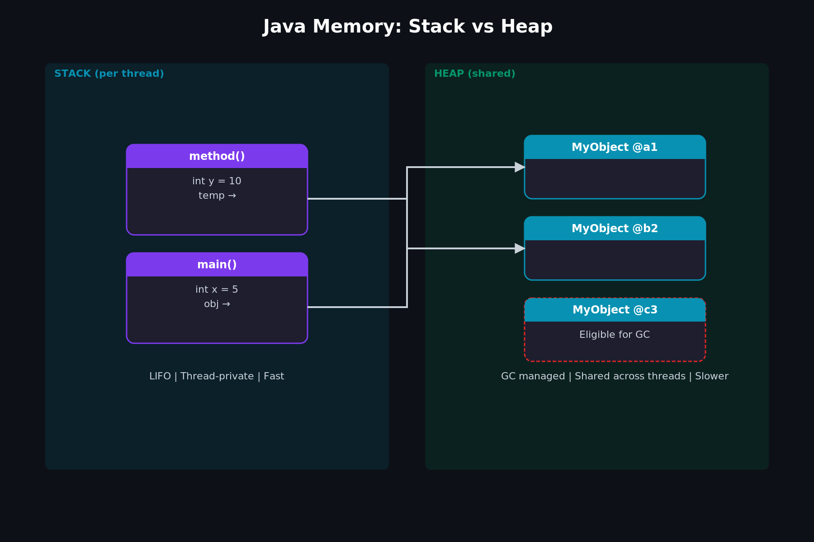

> **Interview tip:** A common follow-up is *"What happens to the object when the method returns?"*
>
> - The stack frame is popped, so the reference is gone.
> - The object on the heap stays until GC collects it.
> - If the reference was passed somewhere else, the object is still reachable.

---

</details>

---

8. **⏳ When does an object become eligible for garbage collection? 🔥**

<!-- -->

<details>

<summary>Answer</summary>

**Answer:**

- An object becomes eligible for Garbage Collection when no live thread can access it. 
- Objects not in use (unreferenced objects) are objects the Java program no longer needs. No part of the program points to them.
- The GC (garbage collection) process can clean up these unused objects and free the memory they use.

---

</details>

---

9. **🔄 What are the different ways to make an object eligible for garbage collection? 🔥**

<!-- -->

<details>

<summary>Answer</summary>

**Answer:**

💡 There are 3 ways to make an object eligible for GC:

**1. 🔴 Set the reference to null**

```java
MyObject obj = new MyObject();
obj = null; // original object has no reference → eligible for GC
```

**2. 🔁 Reassign the reference to another object**

```java
MyObject obj1 = new MyObject(); // Object A
MyObject obj2 = new MyObject(); // Object B

obj1 = obj2; // obj1 now points to Object B → Object A has no reference → eligible for GC
```

**3. 🏝️ Island of Isolation (circular reference)**

Two objects reference each other, but no external live reference points to either of them.

```java
class Node {
    Node next;
}

Node a = new Node();
Node b = new Node();
a.next = b; // a → b
b.next = a; // b → a (circular)

a = null;
b = null;
// Both objects still reference each other but are unreachable from any GC root
// → Island of Isolation — both eligible for GC
```

⚠️ This works only because Java's GC uses **reachability analysis** (tracing from GC roots), not reference counting. A **pure** reference-counting collector cannot free a cycle, because each object's count never reaches zero. Tracing GCs collect cycles with no extra work.

> ⚠️ Be careful with the usual example. CPython is *primarily* refcounted. But it ships a **separate generational cycle detector** (the `gc` module). It is enabled by default, exactly to clean these up. So the correct way to say it is *"refcounting needs a cycle collector bolted on top; a tracing GC like Java's handles it inherently"* — not *"Python leaks cycles"*.

> **Interview tip:** Mentioning Islands of Isolation shows you understand *how* Java's GC decides what can be collected. It uses reachability from GC roots (stack, static fields, JNI refs), not just reference counts.

---

</details>

---

10. **🏁 What is the purpose of overriding the finalize() method? 🔥**

<!-- -->

<details>

<summary>Answer</summary>

**Answer:**

💡 `finalize()` is a method defined in `java.lang.Object`. The GC calls it just before it collects an eligible object. It gives the object a last chance to release resources or clean up.

⚠️ But `finalize()` is **deprecated since Java 9**. Since **Java 18 (JEP 421)**, it is **deprecated for removal**.

- You can already disable finalization at runtime with `--finalization=disabled`.
- It will be removed completely in a future release.

Avoid it, because:
- GC timing is **non-deterministic** — no guarantee when it runs
- Can **delay object collection** and hurt GC performance
- Can accidentally **resurrect objects** (make an unreachable object reachable again)
- Runs on an unpredictable thread

**✅ Alternatives:**

**1. `java.lang.ref.Cleaner`** (Java 9+) — the official replacement. It registers a cleanup action. The action runs on a dedicated cleaner thread when the object becomes unreachable.
```java
public class ResourceHolder implements AutoCloseable {
    private static final Cleaner cleaner = Cleaner.create();
    private final Cleaner.Cleanable cleanable;

    public ResourceHolder() {
        cleanable = cleaner.register(this, () -> System.out.println("Cleaning up!"));
    }

    @Override
    public void close() {
        cleanable.clean(); // deterministic cleanup
    }
}
```

**2. `try-with-resources`** with `AutoCloseable` — preferred for resources like DB connections, file handles, and streams. When the block exits, cleanup is **immediate and deterministic**.

> **Interview tip:** When asked why `finalize()` was deprecated: GC timing is non-deterministic, and `finalize()` can delay collection, resurrect objects, and cause performance issues. The right answers are **`try-with-resources` first, `Cleaner` only as a safety net**. Add *"deprecated for removal in Java 18, JEP 421"*. It shows your knowledge is from the current JDK, not from 2017.
>
> ⚠️ Note the order:
>
> - `Cleaner` is **not** a drop-in replacement for `finalize()`. It is still non-deterministic. It still runs only when the object becomes unreachable.
> - Deterministic cleanup comes from `AutoCloseable` + try-with-resources.
> - `Cleaner` exists to catch the case where a caller *forgot* to close.
> - The classic `Cleaner` mistake is capturing `this` in the cleanup lambda. This keeps the object reachable forever, so the action never runs. The cleanup state must live in a **static** nested class, or in a lambda that captures no reference to the owner.

---

</details>

---

11. **🧩 What is Metaspace and how is it different from PermGen? 🔥**

<!-- -->

<details>

<summary>Answer</summary>

**Answer:**

💡 **Metaspace** is the memory area that stores **class metadata**. Java 8 introduced it. Class metadata means class definitions, method bytecode, field info and the constant pool. Metaspace replaced **PermGen**, which no longer exists in Java 8+.

**📊 PermGen vs Metaspace:**

| | PermGen (≤ Java 7) | Metaspace (Java 8+) |
|---|---|---|
| **Location** | A separate fixed-size JVM area next to the Java heap (not native memory) | Native OS memory (off-heap) |
| **Size** | Fixed max (`-XX:MaxPermSize`) | Dynamically grows by default |
| **OOM risk** | ❌️ High — `OutOfMemoryError: PermGen space` | ✅ Lower — grows with available native memory |
| **GC** | Collected with Full GC | Cleaned when class metadata hits threshold |
| **Tuning flag** | `-XX:MaxPermSize=256m` | `-XX:MaxMetaspaceSize=256m` |

**🔍 What Metaspace stores:**
- Klass metadata — class definitions, field/method **descriptors**
- Method bytecode and JIT-related method metadata
- The runtime constant pool

**❌️ What Metaspace does *not* store — `static` fields.**
This is the single most common wrong belief about Metaspace.

- In HotSpot, **Java 7** moved the storage slots for a class's `static` fields out of PermGen.
- They moved into the class's **`java.lang.Class` mirror object on the Java heap**.
- This happened before Java 8 fully removed PermGen.
- So both the static *slot* and the object it points to live on the heap.
- Metaspace only holds the metadata that *describes* the field: its name, type descriptor and offset.

> **Interview tip:** *"Where do static variables live?"* is a favourite follow-up. "Metaspace" is the wrong answer on any JDK ≥ 7. The right answer: **on the heap, inside the `java.lang.Class` mirror**. This is also why a leaked classloader keeps its statics alive, and everything they reach.

**⚙️ Key tuning flags:**
```bash
-XX:MetaspaceSize=128m        # initial size before GC is triggered
-XX:MaxMetaspaceSize=256m     # cap to prevent unbounded growth
-XX:MinMetaspaceFreeRatio=40  # min free % after GC before expanding
-XX:MaxMetaspaceFreeRatio=70  # max free % after GC before shrinking
```

> ⚠️ Metaspace grows dynamically, but always set `-XX:MaxMetaspaceSize` in production. Without a cap, a class-loading leak can use up all native memory and crash the JVM. Examples of such leaks: dynamic proxies, reflection abuse, classloader leaks.

> **Interview tip:** If asked *"What causes Metaspace OOM?"*, the answer is classloader leaks. In frameworks like Spring, each `ApplicationContext` loads classes. Sometimes code creates contexts and does not destroy them, for example in tests or hot-reload setups. Then class metadata builds up and fills Metaspace.

---

</details>

---

12. **📞 How can the Garbage Collection be requested? 🔥**

<!-- -->

<details>

<summary>Answer</summary>

**Answer:**

We can ask the JVM to run Garbage Collection in two ways:

- System.gc();
- Runtime.getRuntime().gc(); The Runtime class is a Singleton for each Java main program. The method getRuntime() returns the singleton instance of the Runtime class. You call gc() on this instance to request garbage collection.

```java
public class Test {
    public static void main(String[] args) {
        Test test = new Test();
        test = null; // eligible for GC

        System.gc();                    // hint to JVM — not guaranteed to run immediately
        Runtime.getRuntime().gc();      // equivalent to System.gc()

        System.out.println("Main method is done");
    }
}
```

> ⚠️ Both `System.gc()` and `Runtime.getRuntime().gc()` are only **hints**. The JVM may ignore them. Never rely on them in production code.

---

</details>

---

13. **📋 What is the responsibility of the Garbage Collector? ⚡**

<!-- -->

<details>

<summary>Answer</summary>

**Answer:**

💡 The GC has two core responsibilities:

**🗑️ 1. Memory reclamation**
It finds and deletes unreachable objects on the heap. This frees memory for new allocations. An object is unreachable when no live thread holds a reference to it. The reference can be direct, or indirect through a chain from a GC root.

**⚡ 2. Efficient memory utilisation**
It compacts the heap to reduce fragmentation. This improves allocation performance. But it does **not** guarantee that enough memory will always be available. If the heap is still full after GC, the JVM throws `OutOfMemoryError`.

**What GC is NOT responsible for:**
- 🚫 Cleaning up non-heap resources (file handles, DB connections, sockets). Use `try-with-resources` for these.
- 🚫 Running at a predictable time. GC is non-deterministic.
- 🚫 Collecting objects that are still reachable, even if your logic is "done" with them. This is a common source of memory leaks.

> **Interview tip:** A common follow-up is *"Can GC cause application slowdown?"* Yes. Major/Full GC triggers Stop-the-World pauses. In these pauses, all application threads stop. This is why GC tuning (G1GC, ZGC, Shenandoah) matters in low-latency systems like payment platforms.

---

</details>

---

14. **🗑️ Which part of the memory is involved in Garbage Collection? Stack or Heap? ⚡**

<!-- -->

<details>

<summary>Answer</summary>

**Answer:**

Garbage collection works **primarily on the Heap**. That is where all objects live. Stack frames are freed automatically when a method returns, so they never need a collector.

⚠️ "Heap only" is too simple, and you should correct it yourself:

- **Metaspace is also reclaimed**, through **class unloading**. With G1 (the default), this happens at the end of a concurrent marking cycle. It does not need a Full GC.
- This happens once class metadata goes past the `MetaspaceSize` threshold (the high-water mark).
- A class is unloaded only when its **defining classloader** becomes unreachable.
- This is exactly why a leaked classloader causes a Metaspace OOM. No amount of heap tuning fixes it.

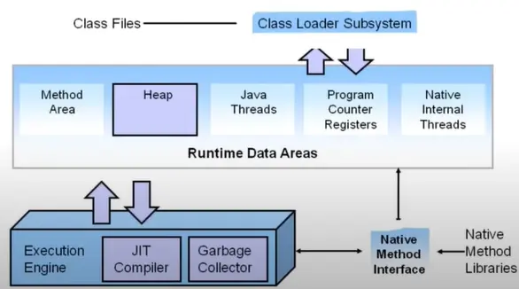

---

</details>

---

15. **🤖 Who manages the garbage collection process? ⚡**

<!-- -->

<details>

<summary>Answer</summary>

**Answer:**

- The JVM controls the garbage collection.
- The JVM decides when to run the Garbage Collector.
- The JVM runs the Garbage Collector when it sees that memory is running low.
- We can request Garbage collection from within the Java program. Use either `System.gc();` or `Runtime.getRuntime().gc();`. But **there is no guarantee that the JVM will act on this request**.

---

</details>

---

16. **👻 What is a daemon thread? ⚡**

<!-- -->

<details>

<summary>Answer</summary>

**Answer:**

- A daemon thread runs in the background of the application.
- The JVM starts some daemon threads itself (for example, the Finalizer thread). Your code can also make one: call `setDaemon(true)` before `start()`.
- The JVM stops the daemon thread when all non-daemon / foreground threads stop. We don’t need to stop them manually.

---

</details>

---

17. **🌙 Is the garbage collector a foreground or background thread? 💤**

<!-- -->

<details>

<summary>Answer</summary>

**Answer:**

Garbage Collector runs in the background. In HotSpot, GC threads are JVM-internal threads, not normal Java threads. They are not Java daemon threads in the `setDaemon(true)` sense, but they behave like background threads: they do not keep the JVM alive.

---

</details>

---

18. **🧠 Does the object move from old gen to metaspace? 💤**

<!-- -->

<details>

<summary>Answer</summary>

**Answer:**

No, objects do not move from the old generation to Metaspace. Objects in the old generation stay there until one of two things happens: a Major GC collects them, or the application stops. Metaspace is managed separately. It is used only for class metadata, not for regular object instances.

---

</details>

---

## 4. Serialization Deserialization and Externalization Interview Questions 💤

1. **💿 What is Serialization? ⚡**

<!-- -->

<details>

<summary>Answer</summary>

**Answer:**

- Serialization converts a Java object into a static stream (sequence) of bytes. We can then save these bytes to a database or send them over a network.
- A class that can be serialized must implement a special marker interface, **Serializable**. It declares no methods. It is only a flag that tells the JVM "this type is allowed to be sent as bytes".
- The byte stream is platform-independent. You can turn the bytes back into an object in any environment.

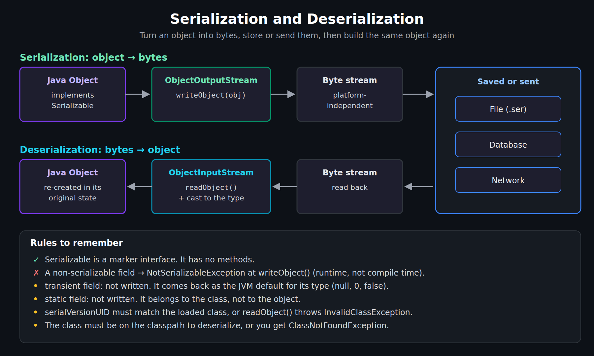

A class can be serialized successfully only if two conditions hold:

- The class must implement the `java.io.Serializable` interface.
- **Every non-`transient`, non-`static` field must itself be serializable.** If one is not, the write fails at runtime with `java.io.NotSerializableException`. The exception names the type that caused it. Note that it fails on `writeObject()`, not at compile time. The reason: `Serializable` declares no methods, so the compiler has nothing to check.

- To convert an object into a stream of Bytes, use **`ObjectOutputStream`**. It has the method **`writeObject`**.
- To convert a stream of Bytes into an object, use **`ObjectInputStream`**. It has the method **`readObject`**.

```java
FileOutputStream fileOut = new FileOutputStream("/tmp/employee.ser");
ObjectOutputStream out = new ObjectOutputStream(fileOut);
out.writeObject(e);
out.close();
fileOut.close();
```

---

</details>

---

2. **📥 What is Deserialization? ⚡**

<!-- -->

<details>

<summary>Answer</summary>

**Answer:**

Deserialization is the exact opposite of serialization. You start with a byte stream. Then you re-create the object you serialized earlier, in its original state. But the class definition must be on the classpath, or you cannot re-create it.

```java
public class Employee implements Serializable {
    private static final long serialVersionUID = 1L;

    private Integer id;
    private String name;

    // setter, getter, toString
}
```

Full round trip with try-with-resources:

```java
public class Test {
    public static void main(String[] args) {
        Employee emp = new Employee();
        emp.setId(1);
        emp.setName("Alice");

        // serialization
        try (ObjectOutputStream oos = new ObjectOutputStream(new FileOutputStream("emp.ser"))) {
            oos.writeObject(emp);
        } catch (IOException e) {
            log.error("Failed to serialize employee", e);
        }

        // de-serialization
        try (ObjectInputStream ois = new ObjectInputStream(new FileInputStream("emp.ser"))) {
            Employee e = (Employee) ois.readObject();
            System.out.println(e);
        } catch (IOException | ClassNotFoundException e) {
            log.error("Failed to deserialize employee", e);
        }
    }
}
```

💡 **Reading a file that holds multiple objects.** There is no `hasNext()`. You read until `EOFException`. Here, that exception is the *normal* way the loop ends, not an error:

```java
try (ObjectInputStream ois = new ObjectInputStream(new FileInputStream("emp.ser"))) {
    while (true) {
        try {
            Employee e = (Employee) ois.readObject();
            System.out.println(e);
        } catch (EOFException e) {
            break; // end of stream reached — expected exit condition
        }
    }
} catch (IOException | ClassNotFoundException e) {
    log.error("Failed to read objects from file", e);
}
```

---

</details>

---

3. **🔧 How do serialization and deserialization actually work under the hood? 🔥**

<!-- -->

<details>

<summary>Answer</summary>

**Answer:**

**➡️ On the way out (serialization).**

- Java serialization uses **reflection** to read all needed data from the object's fields. This includes `private` and `final` fields.
- If a field holds another object, that object is serialized **recursively**. So writing one object can also write every object it can reach.
- You might have getters and setters, but **these are not used**. The JVM reads the fields directly.

**⬅️ On the way back (deserialization).**

- The JVM **does not invoke the class's own constructor**. It also does not run its field initialisers or its instance initialiser blocks.
- It allocates a blank instance.
- Then it uses reflection to write the stream's data straight into the fields, `private` and `final` included.

⚠️ **Exactly one constructor *does* run.** It is the **no-argument constructor of the first non-serializable superclass** in the hierarchy (see Q7). Object creation still has to start somewhere. Every non-serializable superclass is initialized the normal way. If `Object` is the first non-serializable ancestor, that constructor is just `Object()`.

❌️ What if that first non-serializable superclass has **no accessible no-arg constructor**? Then deserialization fails at read time with:
```
java.io.InvalidClassException: com.example.Child; no valid constructor
```
Note *when* it fails. Writing the object succeeds. The error appears only on `readObject()`. Verified on JDK 17. A `private` no-arg constructor in the superclass is also not accessible to the subclass, and fails the same way.

💡 **Why this matters: this is the root cause of the whole group of security bugs in Q11.** Suppose a class checks its invariants in its constructor. During deserialization, **no** check runs. Your constructor may reject a negative balance. An attacker can still build a byte stream by hand that gives you an object with a negative balance.

<details>
<summary><strong>🤔 Doubt: Are records and enums exceptions to "the constructor never runs"?</strong></summary>

✅ **Yes, both. Name both in the interview.**

**Records (Java 16+)** have their own serialization path, defined by the language spec.

- Deserializing a record **does** invoke its **canonical constructor**. It passes the values read from the stream.
- So a record's compact-constructor validation *is* enforced on the way back in.
- This is the biggest safety improvement over classic serialization.
- It is also a strong answer to the follow-up "so how do you make deserialization check invariants?"

```java
public record Money(String currency, BigDecimal amount) implements Serializable {
    public Money {
        if (amount.signum() < 0) {
            throw new IllegalArgumentException("negative amount");  // ✅ runs on deserialize too
        }
    }
}
```

**Enums** get even more special handling:

- An enum constant is serialized **by name only**.
- Deserialization works like `Enum.valueOf(Class, name)`.
- The fields are not written. `writeObject`/`readObject`/`readResolve` are **ignored**.
- You always get back the one existing constant.

That is exactly why the **enum singleton** is the simplest and safest serialization-proof singleton (see [15_Design_Pattern_Interview_Questions.md](15_Design_Pattern_Interview_Questions.md)). A stream has no way to create a second instance.

---

</details>
<br/>

---

</details>

---

4. **🆔 What is serialVersionUID? 🔥**

<!-- -->

<details>

<summary>Answer</summary>

**Answer:**

The JVM links a version number (`long`) to each serializable class. `serialVersionUID` is used to check that a loaded class and a serialized object are compatible.

- It is written into the stream header.
- On read, the stream's value must match the local class's value.
- If not, you get `InvalidClassException`.

Declare it exactly like this. The JVM uses it only if the modifiers match:

```java
private static final long serialVersionUID = 1L;
```

> ℹ️ Yes, it is `static`, and Q6 says `static` fields are not serialized. Both are true. `serialVersionUID` is not written *as a field*. It is written into the **stream's class descriptor**. It is data about the class, not the state of one object.

**If you don't declare one**, the JVM generates it at runtime. It hashes the class name, its fields, its methods and their access modifiers. The generated value is **compiler/implementation-dependent**. So the same source, compiled by two toolchains, can produce two different UIDs. This is why you should always declare it yourself.

**⚖️ The real follow-up question: which changes break compatibility?** With an explicitly fixed UID, the JVM lets the read go ahead. It then matches the data field by field:

| Change to the class | Compatible? | What happens on read |
|---|:---:|---|
| **Add** a field | ✅ | Old stream has no value for it → set to the **JVM default** for its type |
| **Remove** a field | ✅ | Value in the stream is read and **discarded** |
| Change a field's **type** | ❌️ | Primitive type: `InvalidClassException` (incompatible types). Reference type: `ClassCastException` when the old value does not fit the new type |
| **Rename** a field | ⚠️ | Technically "remove + add" — compiles and runs, but the value is **silently lost** |
| Change `static`/`transient` status | ✅ | Field simply stops (or starts) being written |
| Change a field's **access modifier** | ✅ | Modifiers are bypassed reflectively anyway |
| Add/remove an **interface** or a **method** | ✅ | Not part of the serialized state (except removing `Serializable` itself — then the class cannot be read) |
| Change the **class hierarchy** | ⚠️ | Adding or removing a class in the chain works (missing fields get defaults). Moving a class up or down the chain is incompatible |
| Change the class from `Serializable` to `Externalizable` | ❌️ | Different stream format entirely |

⚠️ The "rename a field" row is the one that causes production bugs. Nothing throws. The object deserializes cleanly, and the field is just `null`. A fixed UID protects you from unneeded *exceptions*. It does not protect you from **silent data loss**. You still have to follow the compatibility rules yourself.

---

</details>

---

5. **🚧 What is the use of a transient variable? ⚡**

<!-- -->

<details>

<summary>Answer</summary>

**Answer:**

If a variable is `transient`, the JVM ignores it and does not write it during serialization. After deserialization, the field holds **the JVM default value for its declared type**. It is *not* always `null`.

| Declared type | Value after deserialization |
|---|---|
| Any reference type (`String`, `Integer`, `List`, …) | `null` |
| `int` / `long` / `short` / `byte` | `0` |
| `double` / `float` | `0.0` |
| `boolean` | `false` |
| `char` | `'\u0000'` (the null character) |

⚠️ *"What about a `transient int`?"* is the standard follow-up. The answer "null" is wrong, because a primitive cannot be `null`.

```java
public class Employee implements Serializable {
    private static final long serialVersionUID = 1L;

    private Integer id;
    private transient String name;

    // setter, getter, toString
}
```

Now run the same code again. This time the value of the `name` variable is not stored in the file. The JVM ignores it.

💡 **What `transient` is really used for in real code:**

- Fields that are *derived*, like a cached total you can recompute.
- Fields that *cannot be serialized by nature*, like a `Connection`, a `Thread`, a `Socket`, a `Logger`.
- Fields that are *sensitive*, like a password, a token, a PAN.

The first two are the common cases. For the third, see Q11. `transient` keeps a secret out of the byte stream, but it is not by itself a security control.

---

</details>

---

6. **✅ Which fields get serialized and which don't? ⚡**

<!-- -->

<details>

<summary>Answer</summary>

**Answer:**

⚠️ Be careful with the usual wording of this question. `static` and `transient` fields are **not "disallowed"**. Declaring them is fully legal. They are just **not written to the stream**.

| Modifier | Serialized? | Why |
|---|---|---|
| `private` | ✅ Yes | Default serialization reads/writes fields **reflectively** — access modifiers are bypassed entirely. Encapsulation is no defence here. |
| `final` | ✅ Yes | Written out normally, and restored reflectively on read (the JVM writes `final` instance fields directly, without a constructor). |
| `static` | ❌️ No | A `static` field belongs to the **class**, not to the instance — there is no per-object value to serialize. On the receiving JVM it holds whatever that JVM's class already has. |
| `transient` | ❌️ No | Explicitly opted out. Comes back as the **JVM default for its type** — see Q5. |

⚠️ **The `final` + `Externalizable` trap.**

- With `Externalizable`, you write the fields yourself in `readExternal()`.
- `readExternal()` is an **ordinary instance method**. So it **cannot assign a `final` field**. That is a compile error.
- This is why `Externalizable` does not work well with immutable classes.
- It is also why `Externalizable` requires a **public no-arg constructor**. Default serialization does not.
- Plain `Serializable` has no such problem. The JVM restores `final` fields reflectively, not through your code.

---

</details>

---

7. **👪 What inheritance rules apply to serialization — and what happens when a class is serializable but its superclass is not? 💤**

<!-- -->

<details>

<summary>Answer</summary>

**Answer:**

**📜 The two rules:**

- **If the superclass is serializable, every subclass is automatically serializable.** `Serializable` is inherited. So a subclass that never declares it can still be written to a stream.
- **If the superclass is *not* serializable, the subclass can still be serialized.** The subclass itself must implement `Serializable`. The superclass does not need to do anything. But the JVM then handles its fields very differently. That is the real point of this question.

**⬆️ At serialization time**, any instance variable inherited from the non-serializable superclass is **skipped**. The JVM does not write those values to the stream at all.

**⬇️ At deserialization time**, the JVM must still give those inherited fields a value. So it **invokes the no-argument constructor of the first non-serializable superclass**.

- This is the *one* constructor that runs during deserialization. The serializable subclass's own constructor does **not** run (see Q3).
- Any initialization logic in that constructor runs.
- The inherited fields end up holding **whatever that constructor sets — not the values the object had when it was serialized.**

💡 **Worked example.** Superclass `Parent { int x; Parent() { x = 42; } }` is not serializable. The subclass sets `x = 99` before serialization. After a round trip, `x` is **42**, not 99. The field was never written to the stream, and the no-arg constructor ran again.

⚠️ **A trap this question usually leaves out:** the non-serializable superclass may have **no accessible no-arg constructor** (only parameterised ones, or a `private` one). Then deserialization fails with:
```
java.io.InvalidClassException: com.example.Child; no valid constructor
```
The write side succeeds. The failure only appears on `readObject()`. This is why people often find it in production, not in a unit test. ✅ Verified on JDK 17.

---

</details>

---

8. **🎛️ How do you customize serialization without using Externalizable? ⚡**

<!-- -->

<details>

<summary>Answer</summary>

**Answer:**

💡 People often skip this question and jump to Q9's `Externalizable` answer. But in real code, **this way is far more common**. It keeps default serialization for the simple 95% of fields. It only overrides the part you care about.

`Serializable` looks for a set of **private magic methods** (special methods the JVM finds by name).

- They are not overrides of anything. No interface declares them.
- The JVM looks them up **reflectively by exact signature**.
- This is why a typo silently does nothing.

| Method | Signature | When it runs |
|---|---|---|
| `writeObject` | `private void writeObject(ObjectOutputStream out)` | On write — call `out.defaultWriteObject()` first, then add your own |
| `readObject` | `private void readObject(ObjectInputStream in)` | On read — call `in.defaultReadObject()` first, then restore the rest |
| `writeReplace` | `ANY-ACCESS-MODIFIER Object writeReplace()` | Before writing — substitute a **different object** onto the stream |
| `readResolve` | `ANY-ACCESS-MODIFIER Object readResolve()` | After reading — substitute the **object actually returned** |

**✍️ `writeObject` / `readObject` — encrypt a field, or restore a derived one:**

```java
public class Account implements Serializable {
    private static final long serialVersionUID = 1L;

    private String id;
    private transient String pan;   // not written by default serialization

    private void writeObject(ObjectOutputStream out) throws IOException {
        out.defaultWriteObject();          // writes id
        out.writeObject(encrypt(pan));     // we control this one ourselves
    }

    private void readObject(ObjectInputStream in) throws IOException, ClassNotFoundException {
        in.defaultReadObject();            // restores id
        this.pan = decrypt((String) in.readObject());
    }
}
```

⚠️ **`readObject` is where you check invariants again.**

- The constructor never runs (Q3), so its validation is skipped.
- So a defensive `readObject` should re-run those checks.
- It should throw `InvalidObjectException` if the stream is bad.
- Also **defensively copy mutable fields** here, exactly as you would in a constructor. If you don't, an attacker can keep a reference to a field inside your "immutable" object and change it.

**🔄 `readResolve` — the singleton fix.** Without it, deserialization creates a *brand-new* instance. This silently breaks the singleton rule. `readResolve` lets you throw that instance away and return the one real instance:

```java
public class ConfigCache implements Serializable {
    private static final long serialVersionUID = 1L;
    private static final ConfigCache INSTANCE = new ConfigCache();

    private ConfigCache() {
    }

    public static ConfigCache getInstance() {
        return INSTANCE;
    }

    private Object readResolve() {
        return INSTANCE;   // discard the deserialized copy, hand back the real singleton
    }
}
```

> 🎯 The stronger answer to "how do you make a singleton serialization-safe" is **use an enum**. Enums are safe by design (Q3's doubt block). Use `readResolve` when the class cannot be an enum. See [03_Singleton_Design_Pattern_in_Java.md](../2_design_patterns/03_Singleton_Design_Pattern_in_Java.md).

**♻️ `writeReplace` — the serialization-proxy pattern.** Write a small, simple proxy object instead of the real object. `readResolve` on the proxy rebuilds the real object **through its normal constructor**. So all invariants hold. This is *Effective Java* Item 90. It is the safest pattern for classic serialization.

---

</details>

---

9. **🔌 What is Externalization? 💤**

<!-- -->

<details>

<summary>Answer</summary>

**Answer:**

Externalization is used when you want to take **complete** control of the serialization mechanism.

In default serialization, the JVM does all the writing and reading of objects. That is easy, but it has costs:

- You cannot decide the format.
- You pay for reflection and per-field metadata.
- Sensitive fields go out unless you remember to mark them `transient`.

With `Externalizable`, your code does the whole job. The JVM does not decide what is written or in what order.

`Externalizable` internally extends `Serializable`: `public interface Externalizable extends java.io.Serializable`

Unlike `Serializable`, it is **not a marker interface**. It declares two methods you must implement:

- `void writeExternal(ObjectOutput out)` — write the object's fields to the stream. Throws `IOException` on an I/O error.
- `void readExternal(ObjectInput in)` — read them back. Throws `IOException`. Throws `ClassNotFoundException` if the class of a nested object cannot be found.

```java
public class Employee implements Externalizable {
    private static final long serialVersionUID = 1L;

    private Integer id;
    private String name;

    // a public no-arg constructor is REQUIRED for externalization
    public Employee() {
    }

    // getter, setter, and toString

    @Override
    public void writeExternal(ObjectOutput out) throws IOException {
        // write only those fields which you want to write
        out.writeInt(id);
    }

    @Override
    public void readExternal(ObjectInput in) throws IOException, ClassNotFoundException {
        id = in.readInt();
    }
}
```

⚠️ **Two rules come directly from the design:**

1. **A public no-arg constructor is mandatory.** Here, deserialization *does* create the object normally. The JVM calls `new Employee()`. Then it passes the object to your `readExternal()` to fill in. That is the opposite of default serialization (Q3). It is also why `Externalizable` cannot restore `final` fields (Q6).
2. **The order of reads must exactly match the order of writes.** The stream carries no field names, only values in order. If you swap two `writeInt` calls, the values silently go into the wrong fields. You get no exception.

---

</details>

---

10. **⚖️ Serializable vs Externalizable? 💤**

<!-- -->

<details>

<summary>Answer</summary>

**Answer:**

**🔀 How the JVM chooses:** on write, it checks for `Externalizable` **first**.

- If the object implements it, the JVM calls `writeExternal()` and does nothing else.
- Otherwise, if it implements `Serializable`, the JVM does default reflective serialization. This covers every instance field that is neither `static` nor `transient`.

| Property | `Serializable` | `Externalizable` |
|---|---|---|
| **Marker interface?** | ✅ Yes — declares no methods | ❌️ No — declares `writeExternal()` and `readExternal()` |
| **Who controls the format?** | The JVM. Default algorithm, no say for the programmer (beyond the hooks in Q8). | The programmer, completely. The JVM has no control. |
| **No-arg constructor** | Not required on the class — only the first non-serializable superclass needs an accessible one (Q7) | **Public no-arg constructor is mandatory** |
| **`transient` keyword** | Central — it is how you exclude a field | Irrelevant — you write only what you choose anyway |
| **Partial saving of an object** | Only via `transient` or the Q8 hooks | Native — write whatever subset you like |
| **`final` fields** | ✅ Restored reflectively | ❌️ Cannot be assigned in `readExternal()` |
| **Schema evolution** | Governed by `serialVersionUID` rules (Q4) | Entirely yours to manage — and yours to get wrong |

⚠️ **Don't state the performance row as always true.** "Externalizable is faster" is true of a *good* implementation, for the reason above. It is not a feature of the interface. If asked, explain why: no reflection, no field metadata, no unused fields. Don't just repeat the short claim.

🎯 **In practice, neither is the right answer for new code.** See Q12.

---

</details>

---

11. **⚠️ What is a Java deserialization vulnerability, and how do you prevent it? ⚡**

<!-- -->

<details>

<summary>Answer</summary>

**Answer:**

**💣 What it is.** A serialized object is just a byte array that holds state. Anyone with a hex editor can change it. Suppose an application deserializes bytes it did not produce. Then an attacker controls:

- the *contents* of objects your code is about to use;
- much worse, **which classes get created** and which of their methods run during the read.

The important part is how "changed data" turns into **remote code execution** (RCE):

1. Deserialization **runs code**: `readObject()`, `readResolve()`, and `readExternal()` on every class in the graph. This happens before your application ever sees the result.
2. The attacker doesn't need your classes to be exploitable. They link together classes **already on your classpath**. This is called a "gadget chain". The classic ones came from Apache Commons Collections.
3. `readObject()` on the receiving side runs those gadgets during the read itself. The attack is done before your code can check anything.

And because the constructor never runs (Q3), the invariants you rely on were never enforced.

**🛡️ How to prevent it, strongest first:**

1. **Don't deserialize untrusted input.** This is the only complete fix. If the data comes from a source you do not trust, use a data format that never creates an object of a type named in the data. Examples: JSON, protobuf, Avro (Q12).
2. **Set a deserialization filter (JEP 290 — Java 9, backported to 8u121).** It is an allow-list of the classes allowed on the stream. This is the real protection in production:
   ```java
   ObjectInputStream ois = new ObjectInputStream(in);
   ois.setObjectInputFilter(ObjectInputFilter.Config.createFilter(
           "com.example.dto.*;java.base/java.lang.*;!*"));   // allow these, reject everything else
   ```
   You can set a JVM-wide default with `-Djdk.serialFilter=...`. Java 17 added **filter factories** (JEP 415) for per-context filters. Note the `!*` at the end. An allow-list without a final "reject everything else" is not a filter.
3. **Make the class refuse to deserialize at all.** Do this when it implements `Serializable` only because of inheritance:
   ```java
   private void readObject(ObjectInputStream in) throws IOException {
       throw new NotSerializableException("Deserialization is disabled for " + getClass());
   }
   ```
   ⚠️ Note this is `readObject`, a **private magic method** (Q8). It is *not* an `@Override`. It is not `readExternal()` either, which only exists on `Externalizable`. If you add `@Override`, you get a compile error. If you name it `readExternal()` without `@Override`, it compiles but never runs.
4. **Validate inside `readObject()`** and throw `InvalidObjectException`. Re-check whatever the constructor would have checked.
5. **Keep secrets off the stream** (`transient`), and restrict access to `.ser` files. These are good habits, but they do not protect you from a gadget chain.

---

</details>

---

12. **🏭 Do you actually use Java serialization in production? What are the alternatives? 🔥🔥**

<!-- -->

<details>

<summary>Answer</summary>

**Answer:**

🎯 **This is the question a senior interviewer really wants to ask.** "Yes, with `ObjectOutputStream`" is the wrong answer. Native Java serialization is legacy now. New work on it is mostly about security, such as deserialization filters (JEP 290, JEP 415 in Java 17). The honest answer: you know how it works, but you do not choose to use it.

**❌️ Why it is avoided:**

| Problem | Consequence |
|---|---|
| **Security** | An entire RCE class (Q11) that no amount of careful coding on your side removes |
| **Fragile versioning** | The class *is* the schema — a rename silently loses data (Q4) |
| **Java-only** | The bytes are meaningless to a Python or Go service |
| **Invariants bypassed** | Constructors don't run (Q3) |
| **Verbose on the wire** | Full class descriptors and field metadata are written alongside the data |

> 📚 *Effective Java* Item 85 is titled **"Prefer alternatives to Java serialization"**. Oracle's own architects have publicly called it a long-term mistake. Work to replace it is still going on. Saying this shows the difference between "I memorised the API" and "I've made this decision".

**✅ What to use instead:**

| Instead of | Use | Why |
|---|---|---|
| Objects over HTTP | **JSON** (Jackson / Gson) | Human-readable, language-neutral, the REST default |
| High-throughput RPC / internal services | **Protobuf**, **Thrift** | Compact binary, explicit schema (`.proto` / `.thrift` IDL), generated code, backward/forward compatible by design |
| Kafka / event streams | **Avro** + Schema Registry | Schema evolution is enforced centrally instead of hoped for |
| Caching (Redis, Hazelcast) | JSON, or Kryo/Protobuf when size matters | Never put native Java bytes in a shared cache — every consumer is then pinned to your class files |
| HTTP session replication | Prefer stateless + a token; if you must, JSON-serialize the session | The classic native-serialization use case, and a classic source of upgrade pain |

🗣️ **How to say it in one breath:** *"I know how it works and I've had to debug `InvalidClassException` from it, but I wouldn't choose it for anything new — the security surface and the schema fragility aren't worth it when JSON or protobuf give you a real schema and cross-language support. Where I've seen it in the wild it's session replication and legacy DTOs."*

---

</details>

---

## 5. Java Coding and Output Puzzles ⚡

1. **👯 Find all duplicate characters in a string 🔥**

Given a string, find all characters that appear more than once. Return them in the order they first appear.

```
Input:  "Know Program"
Output: [o, r]
```

> ℹ️ `"Know Program"` has **one** space, so the space is *not* a duplicate. `K` and `P` do not match any other character, even ignoring case. So they are not duplicates either. Only `o` (2×) and `r` (2×) repeat.

<!-- -->

<details>

<summary>Answer</summary>

**Answer:**

💡 **Approach: frequency map + LinkedHashSet**
- Count the frequency of each character in **one pass** — O(n).
- Collect the characters whose count > 1 into a `LinkedHashSet`.

⚠️ **The trap this question tests.**
- "Return them in the order they first appear" needs more than a `LinkedHashSet` alone.
- The `LinkedHashSet` keeps the order in which **you insert** into it.
- If you insert while iterating a `HashMap`, you get **hash order**, not first-appearance order.
- Example: `"Know Program"` with a `HashMap`. `Character.hashCode()` is the char value, and the table capacity is 16.
- So `r` (114 & 15 = 2) is visited before `o` (111 & 15 = 15). The result is **`[r, o]`**, which is wrong.

✅ The fix: make the **frequency map** a `LinkedHashMap` (or do a second pass over the original string).

**Approach 1 — LinkedHashMap (preferred):**

```java
public class Test {
    public static void main(String[] args) {
        String s = "Know Program";
        System.out.println(findDuplicates(s)); // [o, r]
    }

    private static Set<Character> findDuplicates(String s) {
        // LinkedHashMap — iteration order = first-appearance order of each character
        Map<Character, Integer> freq = new LinkedHashMap<>();
        for (char c : s.toCharArray()) {
            freq.merge(c, 1, Integer::sum);
        }
        Set<Character> duplicates = new LinkedHashSet<>();
        for (Map.Entry<Character, Integer> entry : freq.entrySet()) {
            if (entry.getValue() > 1) {
                duplicates.add(entry.getKey());
            }
        }
        return duplicates;
    }
}
```

❌️ Replace the `LinkedHashMap` with a plain `HashMap`, and the same code prints `[r, o]` (checked on JDK 17). That one word decides whether the answer is correct or wrong.

**Approach 2 — Java 8 Streams:**

```java
private static Set<Character> findDuplicatesStream(String s) {
    // ⚠️ groupingBy() defaults to HashMap → hash order. Ask for a LinkedHashMap explicitly.
    Map<Character, Long> freq = s.chars()
            .mapToObj(c -> (char) c)
            .collect(Collectors.groupingBy(
                    c -> c, LinkedHashMap::new, Collectors.counting()));
    return freq.entrySet().stream()
            .filter(e -> e.getValue() > 1)
            .map(Map.Entry::getKey)
            .collect(Collectors.toCollection(LinkedHashSet::new));
}
```

> ⚠️ Avoid `Collections.frequency()` in a stream filter. It rescans the list for every element, so it becomes O(n²). The frequency-map approach is O(n).

**Complexity:**
| | Time | Space |
|---|---|---|
| Frequency-map approach (`LinkedHashMap`) | O(n) | O(k) — k = unique chars |
| `Collections.frequency()` | O(n²) | O(n) |

---

</details>

---

2. **1️⃣ Find the first non-repeating character in a string 🔥**

Given a string, return the first character that occurs exactly once. Return `null` (or a special marker value) if there isn't one.

```
Input:  "swiss"        →  'w'
Input:  "aabbcc"       →  none
Input:  "Know Program" →  'K'
```

<!-- -->

<details>

<summary>Answer</summary>

**Answer:**

💡 **Same `LinkedHashMap` idea as Q1, one step further.** This is the most frequently asked string question in Java rounds. The ordering trap is the same.

**Approach 1 — LinkedHashMap, two passes:**

```java
public class Test {
    public static void main(String[] args) {
        System.out.println(firstNonRepeating("swiss"));  // w
        System.out.println(firstNonRepeating("aabbcc")); // null
    }

    private static Character firstNonRepeating(String s) {
        Map<Character, Integer> freq = new LinkedHashMap<>();
        for (char c : s.toCharArray()) {
            freq.merge(c, 1, Integer::sum);
        }
        for (Map.Entry<Character, Integer> e : freq.entrySet()) {
            if (e.getValue() == 1) {
                return e.getKey();
            }
        }
        return null;
    }
}
```

**Approach 2 — count array, then rescan the string (fastest, no map at all):**

```java
private static Character firstNonRepeating(String s) {
    int[] count = new int[256];               // chars 0-255 only; use a Map for full Unicode
    for (char c : s.toCharArray()) {
        count[c]++;
    }
    for (char c : s.toCharArray()) {          // rescan the STRING, not the array
        if (count[c] == 1) {
            return c;
        }
    }
    return null;
}
```

🎯 **Why approach 2 is the better interview answer:**
- Rescanning the *original string* gives first-appearance order with no extra work.
- No `LinkedHashMap`, no ordering trap, and O(1) extra space for a fixed alphabet.
- The question wants you to name this choice and its cost.

⚠️ **The follow-up: "what if it's a stream and you can't rescan?"** Keep a `LinkedHashMap<Character, Integer>` of counts. Answer queries by scanning its entry set. That is the classic *first non-repeating character in a stream* variant.

**Complexity:** O(n) time both ways; O(k) space for the map, O(1) for the fixed count array.

---

</details>

---

3. **↩️ Reverse a string 🔥**

Given a string, return it reversed.

```
Input:  "hello"    →  "olleh"
Input:  "program"  →  "margorp"
```

<!-- -->

<details>

<summary>Answer</summary>

**Answer:**

**Approach 1 — `StringBuilder` (what you should actually write):**

```java
private static String reverse(String s) {
    return new StringBuilder(s).reverse().toString();
}
```

**Approach 2 — Two pointers on a char array (what to write if asked to do it manually):**

```java
public class Test {
    public static void main(String[] args) {
        System.out.println(reverse("hello"));   // olleh
        System.out.println(reverse("program")); // margorp
    }

    private static String reverse(String s) {
        char[] chars = s.toCharArray();
        int left = 0, right = chars.length - 1;
        while (left < right) {
            char temp = chars[left];
            chars[left] = chars[right];
            chars[right] = temp;
            left++;
            right--;
        }
        return new String(chars);
    }
}
```

**Approach 3 — Java 8 Streams (⚠️ elegant but quadratic — do *not* write this in an interview):**

```java
private static String reverse(String s) {
    return s.chars()
            .mapToObj(c -> String.valueOf((char) c))
            .reduce("", (a, b) -> b + a);   // ❌️ b + a allocates a NEW String every element
}
```

❌️ `reduce("", (a, b) -> b + a)` joins immutable `String`s inside the `reduce` step:
- Element *i* copies a string of length *i*.
- So the total work is `1 + 2 + … + n` = **O(n²) time and O(n²) bytes allocated**.
- It looks like "I know streams". But it tells the interviewer "I don't know what `String` concatenation costs". In an interview, that is a very bad trade.

🎯 **What makes a strong answer different — surrogate pairs.** (A surrogate pair is two `char`s that together hold one character, such as an emoji.)
- `StringBuilder.reverse()` is **documented to keep surrogate pairs**.
- It detects a valid high/low surrogate pair and keeps the two `char`s in order. So an emoji comes out whole.
- The manual `char[]` swap in Approach 2 **corrupts them**. It treats every `char` as a separate unit:

```java
String s = "a😀b";                          // "a😀b" — the emoji is 2 chars
System.out.println(new StringBuilder(s).reverse());   // "b😀a" ✅ pair preserved
// manual char[] swap → "b\uDE00\uD83Da" ❌️ — the surrogates are reversed, emoji destroyed
```

That is the real reason to prefer the library method. Interviewers like it when you mention this without being asked.

**Complexity:**

| Approach | Time | Space |
|---|---|---|
| 1 — `StringBuilder.reverse()` | O(n) | O(n) |
| 2 — two pointers on `char[]` | O(n) | O(n) for the new string |
| 3 — stream `reduce` concat | ❌️ **O(n²)** | ❌️ **O(n²)** allocated |

---

</details>

---

4. **⚖️ Implement `equals()` and `hashCode()` correctly — and what breaks if you don't? 🔥🔥**

Write a correct `equals`/`hashCode` pair for a simple value class, and explain what goes wrong when the contract is violated.

<!-- -->

<details>

<summary>Answer</summary>

**Answer:**

💡 This is the most common "write some code" question in a Java round. It tests the contract (the rules), not the syntax.

**✍️ The standard implementation:**

```java
public final class Employee {

    private final Long id;
    private final String name;

    public Employee(Long id, String name) {
        this.id = id;
        this.name = name;
    }

    @Override
    public boolean equals(Object o) {
        if (this == o) {
            return true;                       // fast path: same reference
        }
        if (o == null || getClass() != o.getClass()) {
            return false;                      // null-safe + type check
        }
        Employee other = (Employee) o;
        return Objects.equals(id, other.id)
                && Objects.equals(name, other.name);
    }

    @Override
    public int hashCode() {
        return Objects.hash(id, name);         // same fields, same order
    }
}
```

**📜 The contract, in the order interviewers probe it:**

| Rule | Statement |
|---|---|
| **Reflexive** | `x.equals(x)` is always `true` |
| **Symmetric** | `x.equals(y)` ⟺ `y.equals(x)` |
| **Transitive** | `x.equals(y)` and `y.equals(z)` ⟹ `x.equals(z)` |
| **Consistent** | Repeated calls return the same result while the objects are unchanged |
| **Null** | `x.equals(null)` is always `false` — never throws |
| **hashCode ①** | Equal objects **must** have equal hash codes |
| **hashCode ②** | ⚠️ Equal hash codes do **not** imply equality — collisions are legal and expected |

**💥 What breaks — the three failure modes:**

1. **`equals` without `hashCode`.** Two equal objects land in different buckets, so a `HashMap` lookup misses:
   ```java
   Map<Employee, String> map = new HashMap<>();
   map.put(new Employee(1L, "Alice"), "engineering");
   map.get(new Employee(1L, "Alice"));   // null ❌️ — equal, but different hashCode
   ```
   In the same way, `HashSet` accepts a duplicate. It never finds the existing entry to compare against.
2. **Changing a key after insertion.** The object's hash changes, but the object still sits in the **old** bucket. Lookup *and* removal can no longer reach it. This is a real memory leak. It is why value objects used as keys should be immutable.
3. **`instanceof` instead of `getClass()`** breaks **symmetry** with a subclass. `parent.equals(child)` can be `true` while `child.equals(parent)` is `false`. Use `getClass()` for value types. Or make the class `final` (as above), so no subclass can exist.

🎯 **`records` do all of this for you** (Java 16+). A `record Employee(Long id, String name) {}` generates a correct `equals`, `hashCode` and `toString` over all components. The strongest answer is: "in modern code I'd write a record, and here's the hand-written version it's equal to".

> 🔗 [03_Java_Collection_Interview_Questions.md](03_Java_Collection_Interview_Questions.md) covers the `HashMap` bucket details behind failure mode 1.

---

</details>

---

5. **🔤 Sort a Map by value, and build a multi-key Comparator 🔥**

Given `Map<String, Integer> scores`, produce the entries sorted by value descending, then by key ascending as a tie-break.

<!-- -->

<details>

<summary>Answer</summary>

**Answer:**

💡 A `Map` has no order you can sort. Instead:
- Sort its **entry set**.
- Collect into something that *keeps* order (`LinkedHashMap` or a `List`).

The trap: collecting back into a plain `HashMap` loses the sort.

```java
public class Test {
    public static void main(String[] args) {
        Map<String, Integer> scores = Map.of("alice", 90, "bob", 95, "carol", 90);

        Map<String, Integer> sorted = scores.entrySet().stream()
                .sorted(Map.Entry.<String, Integer>comparingByValue().reversed()
                        .thenComparing(Map.Entry.comparingByKey()))
                .collect(Collectors.toMap(
                        Map.Entry::getKey,
                        Map.Entry::getValue,
                        (a, b) -> a,          // merge fn — unreachable here, but required
                        LinkedHashMap::new)); // ⚠️ preserves the sort order

        System.out.println(sorted); // {bob=95, alice=90, carol=90}
    }
}
```

⚠️ **Three things that go wrong here, all commonly asked:**

1. **`Collectors.toMap` with two args returns a `HashMap`**, so the order is lost. You must pass the 4-arg form with `LinkedHashMap::new`.
2. **The 2-arg `toMap` throws `IllegalStateException` on duplicate keys.** Once duplicates are possible, you must pass the merge function.
3. **`.reversed()` applies to the whole comparator chain, not only the last link.**
   - `comparingByValue().reversed().thenComparing(...)` reverses only the value comparison. This is because `reversed()` is applied *before* `thenComparing`.
   - But `a.thenComparing(b).reversed()` reverses **both**.
   - Getting this the wrong way round is the most common `Comparator` bug.

**📋 The `Comparator` methods worth memorising:**

```java
// sort a list of objects by multiple keys
employees.sort(Comparator.comparing(Employee::getDepartment)
        .thenComparing(Employee::getSalary, Comparator.reverseOrder())
        .thenComparing(Employee::getName));

// null-safe ordering
Comparator<String> safe = Comparator.nullsFirst(Comparator.naturalOrder());

// primitive-specialised — avoids boxing on every comparison
employees.sort(Comparator.comparingInt(Employee::getAge));
```

💡 **Grouping is the usual follow-up:** `employees.stream().collect(Collectors.groupingBy(Employee::getDepartment, Collectors.counting()))`. `groupingBy` also defaults to a `HashMap`. So pass `TreeMap::new` or `LinkedHashMap::new` when order matters. Same trap, different collector.

---

</details>

---

6. **🎲 Output puzzles — `try/finally`, `Integer` cache, and `String` identity ⚡**

What does each snippet print, and why?

```java
// A
static int f() {
    int x = 1;
    try {
        return x;
    } finally {
        x = 2;
    }
}

// B
static int g() {
    try {
        return 1;
    } finally {
        return 2;
    }
}

// C
Integer a = 127, b = 127, c = 128, d = 128;
System.out.println((a == b) + " " + (c == d));

// D
String s1 = "code";
String s2 = "co" + "de";
String co = "co";
String s3 = co + "de";
System.out.println((s1 == s2) + " " + (s1 == s3));
```

<!-- -->

<details>

<summary>Answer</summary>

**Answer:**

| Snippet | Output | Why |
|---|---|---|
| **A** | `1` | Java **evaluates and copies the return value** before `finally` runs. Assigning the local variable after that changes only the variable. It does not change the return value already saved. |
| **B** | `2` | A `return` in `finally` **replaces** the pending return. In the same way, it would **hide (discard) a pending exception**. |
| **C** | `true false` | `Integer` caches −128…127, so `a` and `b` are the same object. 128 is outside the cache, so `c` and `d` are two objects. |
| **D** | `true false` | `"co" + "de"` is a **compile-time constant**, folded into the pool. `co + "de"` is a **runtime** concat that creates a new heap object. |

**🔍 A vs B is the pair that shows who really understands `finally`.** The rule: `finally` cannot change a **value** that is already evaluated. But it *can* change **control flow** completely.

```java
// A returns 1 — but if the return type were mutable, finally CAN still mutate the object:
static List<String> h() {
    List<String> list = new ArrayList<>();
    try {
        return list;          // the REFERENCE is captured here
    } finally {
        list.add("mutated");  // ...but the object it points to is still mutable
    }
}                             // caller receives a list containing "mutated"
```

⚠️ **`return` (or `throw`) inside `finally` is a bug, not a technique.**
- It silently throws away whatever the `try` block was returning or throwing.
- That includes exceptions you needed to see.
- Most static analysis tools warn about it. Treat B as "what the compiler allows", never as a pattern.

**⏭️ The other two follow-ups that come with this set:**

- **`System.exit()` in `try`** — `finally` does **not** run. The JVM terminates. Only shutdown hooks run.
- **`finally` with a `break`/`continue`** — it discards the pending result or exception in the same way as `return`.

🔗 The `Integer` cache ranges (including `Character`'s 0…127 off-by-one) are in §6 Q7's doubt block. The compile-time-constant folding rule is in §6 Q3.

---

</details>

---

## 6. Java String Interview Questions 🔥

1. **🧱 Why is String immutable in Java, and why is it declared `final`? 🔥🔥**

<!-- -->

<details>

<summary>Answer</summary>

**Answer:**

💡 **Immutable** means that once the object is created, its value cannot change. `String` does this with a **`private final byte[] value`** backing array and no setters (plus a `private final byte coder`).

> 🆕 **Get this right — interviewers like to ask it.** `String` has **not** used a `char[]` since **Java 9 / JEP 254 "Compact Strings"**. The fields today are:
> ```java
> private final byte[] value;   // was char[] before Java 9
> private final byte   coder;   // LATIN1 (0) or UTF16 (1)
> ```
> If all the characters of a string fit in Latin-1, Java stores it with **1 byte per char** instead of 2. This roughly **halves the heap memory** used by the most common strings. Only strings with a non-Latin-1 character use `UTF16` (2 bytes per char). Verified by reflection on JDK 17: the instance fields of `java.lang.String` are `byte[] value`, `byte coder`, `int hash`, `boolean hashIsZero`.

There are 4 core reasons:

**1. 🏊 String Constant Pool (SCP)**
Many variables can point to the same SCP object. If strings were mutable, changing one reference would silently change the value for all other references to that object.
```java
String s1 = "hello";
String s2 = "hello"; // same SCP object as s1
// if mutable: s1.setValue("world") would also change s2 — dangerous
```

**2. 🔒 Security**
Strings are used as file paths, DB connection URLs, network hostnames, and class names passed to `ClassLoader`. If they were mutable, an attacker could change the value after a security check passes. This is a classic TOCTOU (Time-of-Check-Time-of-Use) vulnerability.
```java
String path = "/safe/path";
checkPermission(path);   // passes check
// if mutable: path could be changed to "/etc/passwd" before actual use
openFile(path);
```

**3. 🧵 Thread Safety**
Immutable objects are thread-safe by design, so no synchronization is needed. Many threads can share the same `String` instance with no risk of data races.

**4. #️⃣ hashCode Caching**
`String` caches its `hashCode` after the first call (see Q9). This makes `String` keys in `HashMap`/`HashSet` very fast. If strings were mutable, a changed value would make the cached hash wrong. That would break the contract of hash-based collections.

**🔒 And why is the class `final`?** Immutability can only be enforced if nobody can subclass the class.

- Without `final`, a subclass could override `charAt()`, `length()` or `substring()`.
- It could then return different answers on each call.
- This would break all four guarantees above, from outside the class.
- And the subclass would still be accepted as a `String` everywhere in the JDK.

> ⚠️ **`final` on a class ≠ immutability.** They are two halves of one design. `final` prevents subclassing. Immutability comes from the `private final byte[]` + no setters. A class can be `final` and mutable (`StringBuilder`). It can also be immutable and non-`final`. That is fragile, because any subclass can break it. `String` needs both.

---

</details>

---

2. **🏭 What are the different ways to create string objects? 🔥🔥**

<!-- -->

<details>

<summary>Answer</summary>

**Answer:**

String objects can be created in two ways:

**1. Using double quotes (a string literal):**

```java
String s2 = "program";
```

When you create a String with double quotes, the JVM searches the string pool. If it finds the same value, it returns a reference to that String. If not, it creates a new object in the pool with the given value.

**2. Using the `new` operator:**

```java
String s1 = new String("code");
```

Two steps happen here:

1. The JVM checks the string pool for the literal `"code"`. If it is not there yet, the JVM adds it. If it is there, no new pool object is created.
2. A new `String` object is **always** created in heap memory, separate from the pool entry.

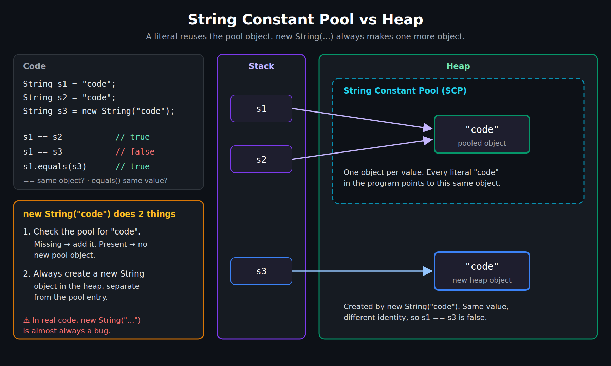

⚠️ **`new String("code")` is almost always a bug in real code.**

- It always creates one extra heap object.
- The only difference from the pooled literal is its identity. And identity is exactly the thing you should never compare on (Q7).
- The only valid uses: building a string from a `char[]`/`byte[]`, or creating a separate instance on purpose in a teaching example like Q4.

💡 Strings also come from many other places: concatenation, `substring()`, `String.valueOf()`, `StringBuilder.toString()`, `new String(byte[], charset)`, `String.join()`. **All of these produce heap objects, not pool entries**, unless the value is a compile-time constant. Q4 tests this difference.

---

</details>

---

3. **🏊 What is the String constant pool and why does Java have one? 🔥🔥**

<!-- -->

<details>

<summary>Answer</summary>

**Answer:**

The **String Constant Pool (SCP)** is a special region that holds string literals. No two entries in it have the same value. Every string literal in your source code is interned (added to the pool). HotSpot does this lazily, the first time the code that uses the literal runs, not at class-load time. Identical literals anywhere in the program point to the **same object**.

**🎯 Why it exists — two benefits:**

1. **Memory.** Strings are by far the most common object type in a typical heap. Literals like `"SUCCESS"`, `"UTF-8"` or a status code may repeat across thousands of classes. With the pool, they cost one object instead of thousands.
2. **Speed.** Reusing an existing reference avoids creating a new object. It *also* makes `equals()` fast. `String.equals()` starts with a `this == anObject` identity check. That check returns `true` at once for two references to the same pooled literal.

```java
String s1 = "code";
String s2 = "code";
System.out.println(s1 == s2);   // true — the SAME object, resolved from the pool
```

⚠️ This reuse is exactly why immutability is **mandatory** and not just nice to have (Q1). Sharing one object across unrelated code is only safe if nobody can change it.

💡 **Compile-time constants are folded into the pool too.** The compiler evaluates `"co" + "de"`, so it points to the same pooled `"code"`. But `s + "de"`, where `s` is a non-`final` variable, is a **runtime** concatenation. It produces a new heap object:

```java
String a = "code";
String b = "co" + "de";           // compile-time constant → pooled
System.out.println(a == b);        // true

String co = "co";
String c = co + "de";              // runtime concat → new heap object
System.out.println(a == c);        // false
System.out.println(a.equals(c));   // true
```

If you make `co` a `final` local (`final String co = "co";`), it becomes a compile-time constant again. Then `a == c` becomes `true`. Interviewers often ask this as a trick question.

---

</details>

---

4. **🔢 How many objects are created by these snippets? 🔥🔥**

```java
// A
String s1 = new String("code");

// B
String s1 = "code";
String s2 = new String("code");

// C
String s1 = new String("code");
String s2 = new String("code");
```

<!-- -->

<details>

<summary>Answer</summary>

**Answer:**

💡 **One rule answers all three:**

- A **literal** creates a pool entry *only if that value is not already in the pool*.
- **`new String(...)` always creates a heap object**, with no condition.

Assume a fresh JVM context where `"code"` has not been interned before:

| Snippet | SCP | Heap | **Total** |
|---|---|---|:---:|
| **A** — `new String("code")` | 1 (literal `"code"` is pooled) | 1 (`new` always allocates) | **2** |
| **B** — literal, then `new String` | 1 (from line 1; line 2 reuses it) | 1 (from line 2) | **2** |
| **C** — two `new String`s | 1 (from line 1; line 2 reuses it) | 2 (one per `new`) | **3** |

**Walking through C**, which is the one people get wrong:

- Line 1: `"code"` is not in the SCP → **1 pool object**. `new String(...)` → **1 heap object**. `s1` points at the heap one.
- Line 2: `"code"` **is** now in the SCP → **0 new pool objects**. `new String(...)` → **1 heap object**. `s2` points at the heap one.
- Total = 1 + 2 = **3**.

⚠️ **The follow-up that catches people on A: "are you sure it's 2?"**

- The honest answer is **1 or 2**. The count depends on whether `"code"` was already interned.
- In a fresh context it is 2.
- If any other class in the JVM already used that literal, the pool entry exists. Then only the heap object is new.
- Say "2, assuming the literal isn't already in the pool". The assumption is the most important part of the answer.

💡 The pool entry also does not become *garbage* as early as people think. It stays reachable from the class's constant pool as long as the class is loaded. The heap object dies with its last reference.

---

</details>

---

5. **📍 Where does the String pool live, is it garbage collected, and should you call `intern()` in production? 🔥**

<!-- -->

<details>

<summary>Answer</summary>

**Answer:**

**📍 Where it lives — and the Java version the interviewer wants you to name.**

- The pool **moved out of PermGen and into the regular heap in Java 7**.
- Before that it lived in PermGen, which was small and fixed-size. So interning many strings gave you `OutOfMemoryError: PermGen space`.
- Since Java 8, PermGen is gone completely (replaced by Metaspace — see §3). The pool has been on the heap for more than a decade (since 2011).

> 🔬 To be exact: the *strings* are ordinary heap objects. What the JVM keeps natively is a hash table (`StringTable`) of references to them. Size it with `-XX:StringTableSize=<n>`. The default was 60013 buckets in JDK 7u40–10. Since JDK 11 the default is 65536, and the table is concurrent and resizes itself. Inspect it with `java -XX:+PrintStringTableStatistics`.

**♻️ Is it garbage collected? ✅ Yes.** An interned string that nothing can reach any more can be collected like any other object. The `StringTable` entry is cleared with it. The claim "interned strings live forever" is a myth. Even in PermGen they were collected, but only during a full GC. Since Java 7 they are normal heap objects, so any GC can collect them.

**⚠️ Should you call `intern()`? Almost never.** It sounds like free removal of duplicates, but usually it isn't:

| Why not | Detail |
|---|---|
| **It costs a native hash-table lookup** | Every call hashes the full string and searches `StringTable`. On a hot path this can cost more than the allocation it saves |
| **Bucket collisions slow it down** | Up to JDK 10 the table had a **fixed** bucket count, so millions of distinct strings made long chains and slow lookups. Since JDK 11 it resizes itself, but a huge table still costs memory and resize work |
| **It keeps strings alive** | Interning a value that would otherwise be short-lived gives it a table reference. This can *increase* the memory kept in use |
| **The gain is usually tiny** | It only helps when a *small* set of distinct values is repeated a huge number of times. And if you know the set, an `enum` or a `static final` constant is better |

✅ **The valid case** is parsing a huge input with a small set of repeated values. For example, reading millions of CSV rows where a status column holds one of six strings. Even then, measure first. Prefer a `HashMap<String, String>` canonicalisation map (a map that returns one shared copy per value) that you control, over the JVM's global table.

🎯 **The better answer for a modern JVM: `-XX:+UseStringDeduplication`.**

- G1 (and now other collectors) can deduplicate the **backing `byte[]`** of equal strings automatically during GC.
- No code change, and no extra load on the pool.
- It works on strings built at runtime. With `intern()`, you would have to call it on each of them yourself.
- This is the production answer to "we have too many duplicate strings".

---

</details>

---

6. **🏠 What does the String `intern()` method do? 🔥🔥**

<!-- -->

<details>

<summary>Answer</summary>

**Answer:**

`intern()` puts the string into the string constant pool. If an equal string is already there, it returns the pooled one instead.

In detail: when you call `intern()`, the JVM checks if the pool already contains a string equal to this one (as determined by `equals(Object)`). If yes, the **string from the pool is returned**. If not, this string object is **added** to the pool, and a reference to it is returned.

```java
public class Test {
    public static void main(String[] args) {
        String s1 = "Code";
        String s2 = new String("Code");
        String s3 = s2.intern();       // returns the pooled object — the same one s1 points at

        System.out.println(s3 == s1);  // true
        System.out.println(s3 == s2);  // false
    }
}
```

⚠️ **`intern()` does not change `s2`.** It returns a *different reference*. `s2` still points at its own heap object. If you ignore the return value (`s2.intern();` as a statement), it does nothing useful. Many people get this wrong.

🎯 Knowing what it does is the basic level. Knowing **when not to call it** is what makes your answer better than others — see Q5.

---

</details>

---

7. **🆚 How do you compare two strings in Java? 🔥🔥**

<!-- -->

<details>

<summary>Answer</summary>

**Answer:**

Compare **values** with `equals()`. The `==` operator compares **references**: whether the two variables point at the same object. For strings, that is almost never what you want.

```java
String S1 = "code";
String S2 = new String("code");
System.out.println(S1 == S2);      // false — different objects
System.out.println(S1.equals(S2)); // true  — same characters
```

✅ Verified on JDK 17: `false`, then `true`.

**📋 The full set of comparison tools:**

| Need | Use |
|---|---|
| Value equality | `equals()` |
| Value equality, ignoring case | `equalsIgnoreCase()` |
| Ordering (sorting, `compareTo` contract) | `compareTo()` — returns negative/zero/positive by lexicographic (dictionary) order |
| Null-safe equality | `Objects.equals(a, b)` |
| Content equality against any `CharSequence` | `contentEquals()` — e.g. comparing a `String` to a `StringBuilder` |

💡 **A null-safety trick to mention:** put the literal first. `"ACTIVE".equals(status)` never throws. But `status.equals("ACTIVE")` throws an NPE when `status` is null. (`Objects.equals` handles both sides.)

<details>
<summary><strong>🤔 Doubt: Does the same `==` trap apply to boxed numbers (`Integer`, `Long`, `Character`)?</strong></summary>

Yes — and it is **worse**. For small values, `==` gives the right answer by chance. So the bug passes testing and then fails in production on a bigger number.

```java
Integer a = 127, b = 127;
System.out.println(a == b);   // true  ✅ — both come from the cache

Integer c = 128, d = 128;
System.out.println(c == d);   // false ❌️ — two distinct objects
```

**Why:** autoboxing calls `Integer.valueOf(int)`. For a small range, this returns a **cached** instance instead of allocating a new one. Inside the range you compare the *same object*. Outside it, you compare two different objects.

**📊 The exact cached ranges (verified on JDK 17):**

| Wrapper | Cached range | Note |
|---|---|---|
| `Integer` | **−128 … 127** | Upper bound is tunable: `-XX:AutoBoxCacheMax=<n>` |
| `Short`, `Long` | **−128 … 127** | Not tunable |
| `Byte` | **−128 … 127** | The whole range of the type — always cached |
| `Character` | ⚠️ **0 … 127** | `char` is **unsigned**, so there is no −128. Saying "−128..127" here is the classic off-by-one mistake. |
| `Boolean` | `TRUE` / `FALSE` | Both values cached |
| `Float`, `Double` | ❌️ **never cached** | `Double d1 = 1.0, d2 = 1.0; d1 == d2` → `false` |

💡 **Bonus — the same mechanism in another class:** `BigDecimal.valueOf(long)` caches **0 … 10** (the `ZERO_THROUGH_TEN` array). So `BigDecimal.valueOf(10) == BigDecimal.valueOf(10)` is `true`, while `valueOf(11) == valueOf(11)` is `false`. In money code this matters for a second reason too. `BigDecimal.equals()` also compares **scale**, so `2.0` is *not* `equals` to `2.00`. Use `compareTo() == 0`.

**✅ Rules to state:**
1. **Never** use `==` on boxed types. Use `.equals()`, or unbox to a primitive first (`a.intValue() == b.intValue()`).
2. ⚠️ A mixed comparison (`Integer == int`) **unboxes** the wrapper and compares the numbers. So it is correct. But it throws `NullPointerException` if the wrapper is `null`. Hidden NPEs from unboxing are a separate interview question.
3. The cache exists to save **memory**, not to give the same object. Never depend on it.

---

</details>
<br/>

---

</details>

---

8. **💻 Prove that String objects are immutable — what does this code print? 🔥**

```java
String s1 = "Java";
s1.concat("Code");
System.out.println(s1);
```

<!-- -->

<details>

<summary>Answer</summary>

**Answer:**

💡 It prints **`Java`**, not `JavaCode`. `concat()` does not change the original string. It **returns a new one**, and here the code throws the return value away.

```java
String s1 = "Java";
s1 = s1.concat("Code");   // assign the result back
System.out.println(s1);   // JavaCode
```

**🔬 The general proof — every "change" method returns a new object and leaves the original as it was:**

```java
public class Test {
    public static void main(String[] args) {
        String s1 = "Code";
        String s2 = s1.concat("Java");

        System.out.println(s1);        // "Code"     — original untouched
        System.out.println(s2);        // "CodeJava" — new object
        System.out.println(s1 == s2);  // false      — different references
    }
}
```

**Proof at the reference level, using identity hash codes:**

```java
public class Test {
    public static void main(String[] args) {
        String s1 = "Code";
        System.out.println(System.identityHashCode(s1)); // e.g. 123456

        String s2 = s1 + "Java";
        System.out.println(System.identityHashCode(s2)); // different — a new object
        System.out.println(System.identityHashCode(s1)); // unchanged — s1 was not modified
    }
}
```

> ⚠️ Use `System.identityHashCode()` (not `hashCode()`) for this proof. `String.hashCode()` returns the same value for equal content **by design**. It depends on the characters, not on the object identity (Q9).

**📋 Every `String` method that "changes" the string actually returns a new one.** The same trap applies to all of them:

| Method | Example | Result |
|---|---|---|
| `concat(String)` | `"Hello".concat(" World")` | `"Hello World"` — original still `"Hello"` |
| `replace(char, char)` | `"Java".replace('a', 'o')` | `"Jovo"` |
| `replaceAll(regex, repl)` | `"ababab".replaceAll("ab", "cd")` | `"cdcdcd"` |
| `substring(int[, int])` | `"Hello World".substring(6)` | `"World"` — original unchanged |
| `toUpperCase()` / `toLowerCase()` | `"hello".toUpperCase()` | `"HELLO"` |
| `trim()` / `strip()` | `"  Hello  ".trim()` | `"Hello"` — leading/trailing whitespace removed |

⚠️ Every row above does **nothing if you discard the return value**. That is exactly the bug in the opening snippet.

---

</details>

---

9. **#️⃣ How does `String.hashCode()` work? ⚡**

<!-- -->

<details>

<summary>Answer</summary>

**Answer:**

`String.hashCode()` is a simple polynomial rolling hash over the characters:

```
h = s[0]*31^(n-1) + s[1]*31^(n-2) + ... + s[n-1]
```

The JDK computes it step by step in a loop:

```java
// conceptually what the JDK does
int h = 0;
for (int i = 0; i < value.length; i++) {
    h = 31 * h + charAt(i);
}
```

The hash of the empty string is **0**. The value is **specified in the javadoc**. This means it is guaranteed to be the same across JVMs and versions. That is why it is safe to store it or to use it to pick a shard. (`Object.hashCode()` gives no such guarantee.)

**🤔 Why 31?** There are three reasons, and interviewers like all three:

1. It is **odd**, so multiplying loses no information to trailing zero bits (an even multiplier drops a bit each round).
2. It is **prime**, which spreads values across buckets more evenly for typical text.
3. It is cheap: the JIT can turn `31 * h` into `(h << 5) - h`. That is a shift and a subtract instead of a multiply.

**💾 The caching detail — this is the important part.**

- `String` caches the result in a `private int hash` field. So repeated `HashMap` lookups don't re-scan the characters.
- But `0` is a legal hash value, and the cache starts at `0`.
- So the JDK could not tell "not computed yet" from "computed, and it was 0". It recomputed the hash every time for such strings.
- **Java 13 added a `boolean hashIsZero` flag** to tell these two cases apart:

```java
private int hash;              // cached hash
private boolean hashIsZero;    // added in JDK 13 to distinguish "0" from "uncached"
```

The empty string `""` hashes to 0, as does `"f5a5a608"` and infinitely many others.

> 🔗 This caching only works **because `String` is immutable** (Q1). A mutable string would make its own cached hash wrong. It would silently break every `HashMap` that used it as a key. This is the same failure as changing any key after insertion.

⚠️ **Never use `hashCode()` for equality or security.** Collisions are guaranteed (`"Aa"` and `"BB"` both hash to 2112). The algorithm is also very easy to reverse. It only picks a bucket, nothing more.

---

</details>

---

10. **✂️ How does substring work in Java, and how did it once cause memory leaks? 💤**

<!-- -->

<details>

<summary>Answer</summary>

**Answer:**

```java
String string = "java";
String subString = string.substring(1, 3);
// startIndex inclusive, endIndex exclusive
System.out.println(subString); // av
```

In modern Java (7u6+), `substring()` **copies** the characters into a brand-new backing array. This array holds only the characters of the substring. So the GC can free the original large string separately. ✅ No memory leak in current Java.

ℹ️ On Java 9+ that backing array is a **`byte[]`** (Compact Strings, JEP 254), not a `char[]`. On Java 7–8 it was still a `char[]`. This question is really about *copy vs share*. That behaviour is the same in both cases.

> ⚠️ **Historical note (Java 6 and Java 7 before update 6):** `substring()` used to share the original backing array, together with an `offset`/`count` pair. Setting the original string to `null` did not free the large array. The substring still held a reference to it. This was a known memory leak. Java 7 update 6 (7u6) fixed it.

```java
String bigString = new String(new byte[100_000]);
String substr = bigString.substring(0, 2);
bigString = null;
// Java 7u6+: bigString's backing array is now eligible for GC — substr has its own copy ✅
// Java 6 / early 7: bigString's backing array is still retained by substr — memory leak ❌️ (historical only)
```

💡 Java made this change on purpose. Java 6's `substring()` was O(1). Today's is **O(n)** in the length of the substring. Java accepted slower substring calls to remove a whole type of memory leak.

---

</details>

---

11. **⚡ What is the difference between `String`, `StringBuilder`, and `StringBuffer`? 🔥🔥**

<!-- -->

<details>

<summary>Answer</summary>

**Answer:**

| Feature | `String` | `StringBuilder` | `StringBuffer` |
|---|---|---|---|
| Mutability | Immutable | Mutable | Mutable |
| Thread-safety | ✅ Yes (immutable) | ❌️ No | ✅ Yes (synchronized) |
| Performance | Slow for repeated concatenation | ⚡ Fastest | Slower than `StringBuilder` |
| Storage | SCP + Heap | Heap only | Heap only |
| Introduced | Java 1.0 | Java 5 | Java 1.0 |
| Use case | Fixed/constant strings | Single-threaded string building | Multi-threaded string building |

**When to use which:**

- `String` — when the value won't change (config keys, constants, map keys).
- `StringBuilder` — when you build or change strings in a loop or in single-threaded code. **The default choice.**
- `StringBuffer` — only when two or more threads really share and change the same builder. This is rare in modern code. Thread confinement (each thread keeps its own object) + `StringBuilder` is almost always better.

⚠️ **`StringBuffer`'s thread-safety is weaker than it sounds.**

- Each *individual* method is synchronized.
- But a *sequence* of calls is not atomic. Two threads that interleave `append()` calls still produce mixed-up output.
- Per-method locking gives no protection for compound operations (several calls that must act as one).
- So "just use `StringBuffer` for threads" is a bad rule.

💡 Both builders wrap a resizable array. When the array is full, it grows to roughly **double** its size. If you know the final size, `new StringBuilder(expectedLength)` avoids the extra copies in between.

🔗 The concatenation-in-a-loop performance case is Q12.

---

</details>

---

12. **🔁 What happens when you concatenate Strings in a loop? How do you fix it? 🔥**

<!-- -->

<details>

<summary>Answer</summary>

**Answer:**

💡 String concatenation with `+` inside a loop creates a **new `String` object on every iteration**. This leads to O(n²) work and GC pressure (the GC must clean up many short-lived objects).

**Why:** `String` is immutable. Every `s = s + x` copies the whole string built so far into a new object and drops the old one. Iteration *i* copies *i* characters, so the total is `1 + 2 + … + n`.

```java
// Bad — O(n²) time and allocation
String result = "";
for (int i = 0; i < n; i++) {
    result += "item" + i; // a new String object each time
}
```

Internally, the compiler converts `+` in a different way for each version:

- `StringBuffer.append()` (Java 1.0–1.4)
- `StringBuilder.append()` (Java 5–8)
- `invokedynamic` + `StringConcatFactory` (Java 9+)

But in every version, **inside a loop a new buffer is created on every iteration**. So it is still O(n²).

**Fix — move a single `StringBuilder` outside the loop:**

```java
// Good — O(n), single buffer
StringBuilder sb = new StringBuilder();
for (int i = 0; i < n; i++) {
    sb.append("item").append(i);
}
String result = sb.toString();
```

⚠️ **`+` outside a loop is fine — don't change it without a reason.**

- For a fixed number of concatenations (`"a" + b + "c"`), Java 9+ compiles the whole expression into one `invokedynamic` call. That call sizes the buffer once.
- Rewriting that as a `StringBuilder` chain only makes the code harder to read. On modern JDKs it can even be *slower*.
- The problem is only **repeated concatenation in a loop**, where each iteration is a separate expression.

💡 To join a collection, use the methods made for this: `String.join(", ", list)` or `list.stream().collect(Collectors.joining(", "))`.

> ⚠️ Interview tip: Mention O(n²) complexity and GC pressure — not just "use StringBuilder". That is what makes a good answer a great one.

---

</details>

---
