# Java Collection Interview Questions

**Java Collection Interview Questions** | Here are some important Java Collection interview questions. They are the most commonly asked ones. Also see:- [Java 8 Interview Questions](08_Java_8_Interview_Questions.md)

📊 **Question Count by Section**

| # | Section | Questions |
|---|---|---|
| 1 | [Collection Questions](#1-collection-questions) | 25 |
| 2 | [Concurrent Collections Interview Questions](#2-concurrent-collections-interview-questions) | 17 |
| 3 | [Internal Working of HashMap and HashSet – After Java 8 Performance Improvement](#3-internal-working-of-hashmap-and-hashset--after-java-8-performance-improvement) | 6 |
| 4 | [Array, ArrayList, Vector, and LinkedList — Key Comparisons](#4-array-arraylist-vector-and-linkedlist--key-comparisons) | 3 |
| 5 | [Comparable & Comparator](#5-comparable--comparator) | 3 |
| 6 | [Coding Questions](#6-coding-questions) | 5 |
| | **Total** | **59** |

> 🔥🔥 Very High — asked in almost every Tier-1 loop &nbsp;·&nbsp; 🔥 High — very frequent in Tier-1 interviews &nbsp;·&nbsp; ⚡ Medium — commonly asked &nbsp;·&nbsp; 💤 Low — good to know, rarely asked

> 📌 This file is interview-ready for Tier-1/Tier-2 product companies at SDE II level. This file covers the HashMap and ConcurrentHashMap internals in great depth. These are the top 2 collection topics asked at Razorpay, PhonePe, Atlassian, etc.

<details>
<summary>📊 <strong>Quick Reference — Time Complexity & Characteristics</strong></summary>

| Collection | Underlying Structure | get / access | add / insert | remove | contains / search | Ordering | Null Allowed | Thread-Safe |
|---|---|---|---|---|---|---|---|---|
| `ArrayList` | Dynamic array | O(1) | O(1) amortized / O(n) worst | O(n) | O(n) | Insertion order | ✅ | ❌️ |
| `LinkedList` | Doubly linked list | O(n) | O(1) head/tail | O(1) head/tail | O(n) | Insertion order | ✅ | ❌️ |
| `ArrayDeque` | Resizable circular array | O(1) head/tail | O(1) amortized head/tail | O(1) head/tail | O(n) | Insertion order | ❌️ | ❌️ |
| `PriorityQueue` | Binary heap | O(1) peek | O(log n) | O(log n) poll / O(n) remove(Object) | O(n) | Natural / Comparator order | ❌️ | ❌️ |
| `HashSet` | HashMap-backed | N/A | O(1) avg / O(n) worst | O(1) avg / O(n) worst | O(1) avg / O(n) worst | No guarantee | ✅ one null | ❌️ |
| `LinkedHashSet` | LinkedHashMap-backed | N/A | O(1) avg | O(1) avg | O(1) avg | Insertion order | ✅ one null | ❌️ |
| `TreeSet` | Red-Black Tree | N/A | O(log n) | O(log n) | O(log n) | Sorted (natural / Comparator) | ❌️ | ❌️ |
| `HashMap` | Array of linked lists / trees | O(1) avg / O(n) worst | O(1) avg / O(n) worst | O(1) avg / O(n) worst | O(1) avg / O(n) worst | No guarantee | ✅ one null key | ❌️ |
| `LinkedHashMap` | HashMap + doubly linked list | O(1) avg | O(1) avg | O(1) avg | O(1) avg | Insertion / access order | ✅ one null key | ❌️ |
| `TreeMap` | Red-Black Tree | O(log n) | O(log n) | O(log n) | O(log n) | Sorted (natural / Comparator) | ❌️ | ❌️ |
| `Hashtable` | Array of linked lists | O(1) avg | O(1) avg | O(1) avg | O(1) avg | No guarantee | ❌️ | ✅ synchronized |
| `ConcurrentHashMap` | `Node[]` table — same shape as `HashMap` | O(1) avg | O(1) avg | O(1) avg | O(1) avg | No guarantee | ❌️ | ✅ per-bin CAS + `synchronized` (Java 8+; segments removed) |
| `CopyOnWriteArrayList` | Array (copy-on-write) | O(1) | O(n) full copy | O(n) full copy | O(n) | Insertion order | ✅ | ✅ |
| `Vector` | Dynamic array | O(1) | O(1) amortized / O(n) worst | O(n) | O(n) | Insertion order | ✅ | ✅ synchronized |
| `WeakHashMap` | HashMap with WeakReference keys | O(1) avg | O(1) avg | O(1) avg | O(1) avg | No guarantee | ✅ one null key | ❌️ |

> 💡 O(n) worst case for HashMap/HashSet occurs when all keys hash to the same bucket. Java 8 treeification (turning the bucket's list into a tree) limits this to O(log n). But **this happens only when the bucket grows past 8 nodes (the 9th node triggers it) _and_ the table is ≥ 64 buckets**. Below a 64-bucket table, the map resizes instead of treeifying. So O(n) can really happen there. That is why the `O(n) worst` cell above is the correct answer.  
> 💡 `ConcurrentHashMap` uses CAS operations and per-bin synchronization in Java 8+. It has no full table lock like `Hashtable`. It also has no `Segment` array (that was removed in Java 8).

---

</details>

---

## 1. Collection Questions

1. **🏗️ Explain Collection Hierarchy. ⚡**

<!-- -->
<details>
<summary>Answer</summary>

**Answer:**

`java.util.Collection` is the root of the Java collection framework. Most collections in Java inherit from this interface, **except the Map interface.**

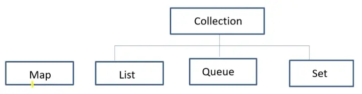

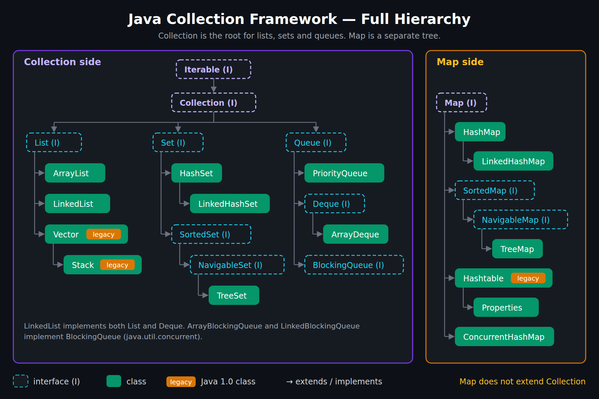

**Collection Interface Hierarchy:**

Colour key for all three diagrams: violet = the `Collection` root · cyan = the three top-level sub-interfaces · red = further interfaces · green = concrete classes.

**① The root and the `List` branch:**

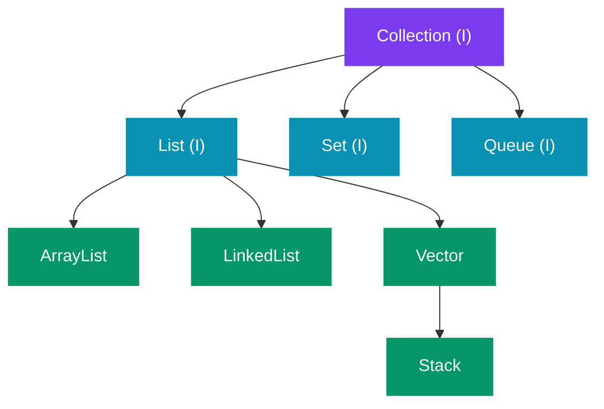

**② The `Set` branch — sorted vs unsorted:**

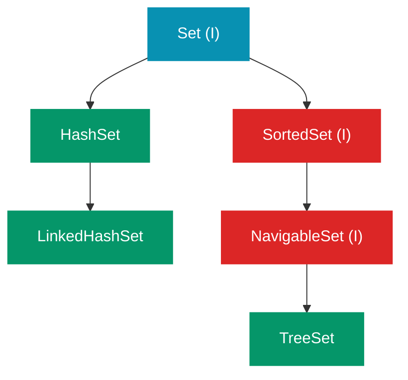

**③ The `Queue` branch — including `Deque` and the blocking family:**

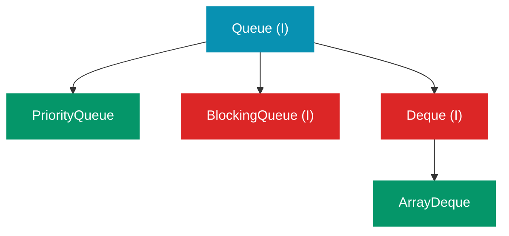

> `List`, `Set`, and `Queue` in diagrams ② and ③ are the same cyan nodes under `Collection` in diagram ①. The split is only there to keep each branch easy to read.

`java.util.List`:

- 📋 It contains **ordered** elements
- 🔸 May include **duplicates**
- 🔍 Supports the **index-based search**, and random access.
- ➕ You can easily insert elements at any position.

`java.util.Set`:

- 🚫 Does not define an order for the elements. So index-based search is not supported.
- 🎯 Does not contain duplicates

`java.util.Queue`:

- 📥 It usually follows the FIFO approach. `PriorityQueue` is an exception — it orders by priority.
- 📤 In a FIFO queue, you add elements at the rear end and remove them from the front end.

`java.util.Map`:

- 🔑 It stores key-value pairs.
- 📑 It does not implement collection.
- 🎯 Each key must be unique.
- 🔸 It can have duplicate values.

**List(I)**

- Collection(I) _1.2v_
  - List(I) _1.2v_
    - ArrayList _1.2v_
    - LinkedList _1.2v_
    - Vector _1.0v_
      - Stack _1.0v_

ArrayList:

- 📐 It has dynamic resizing. It **grows by 50% (×1.5)**. When the backing array is full and you add another element, ArrayList allocates a new array of `oldCapacity + (oldCapacity >> 1)` and copies the elements over (10 → 15 → 22 → 33 …). ⚠️ It grows *by* half. It does not shrink *to* half.
- 🔓 It is non-synchronized.

LinkedList:

- 📑 It implements List and Deque interfaces.
- 📋 It maintains the insertion order.
- 🔓 It is non-synchronized.
- 🚫 It does not support accessing elements randomly.
- 🔄 We can use ListIterator to iterate LinkedList elements.

<details>
<summary><strong>🤔 Doubt: Does non-synchronized mean non-thread-safe?</strong></summary>

Yes — in the context of Java Collections, **non-synchronized = not thread-safe**.

Non-synchronized means there is no built-in locking mechanism. Two threads may access or modify the collection at the same time, with no outside coordination. Then you can get race conditions, data corruption, or `ConcurrentModificationException`.

| Term | Meaning |
|---|---|
| Synchronized | Has built-in locks → thread-safe (but slower) |
| Non-synchronized | No built-in locks → not thread-safe (but faster) |

To make a non-synchronized collection thread-safe, either:
- Wrap it: `Collections.synchronizedList(new ArrayList<>())` — coarse-grained lock (one lock for the whole collection)
- Use a concurrent alternative: `CopyOnWriteArrayList`, `ConcurrentHashMap` — fine-grained

> 💡 Thread-safety is a broader concept. A class can also be thread-safe through immutability or CAS operations (e.g. `ConcurrentHashMap`). But for standard collections, non-synchronized reliably means not thread-safe.

---

</details>
<br/>

Vector:

- 🔒 It is synchronized.
- 📋 It maintains the insertion order.
- 🛡️ It is thread-safe.
- 📐 It increases its size by doubling the array size. (100% increment)
- 📜 It is a legacy class.

Stack:

- 📤 Last in First out (LIFO).
- 🔄 You both add and remove elements at the top.

**Set(I)**

- Collection(I) _1.2v_
  - Set(I) _1.2v_
    - HashSet _1.2v_
      - LinkedHashSet _1.4v_
    - SortedSet(I) _1.2v_
      - NavigableSet(I) _1.6v_
        - TreeSet _1.2v_

HashSet:

- #️⃣ It is backed by a `HashMap` internally.
- 🗝️ Only one null element can be added.
- 🎯 It contains only unique elements.
- 🔀 It is an unordered set.

LinkedHashSet:

- 🏗️ It is an ordered version of HashSet. It keeps a doubly linked List across all elements.
- 📋 It preserves the insertion order.

SortedSet:

- 🚫 Duplicates are not allowed. The set keeps all objects in a sorting order.
- 📑 All elements must be **mutually comparable** (any two can be compared with each other). There are two ways:
  - the element type implements `Comparable` (natural ordering), **or**
  - a `Comparator` is given at construction (`new TreeSet<>(comparator)`).

  Only the no-arg constructor requires `Comparable`.
- 📊 (By default, the set is sorted in ascending order.)

Tree Set:

- 🏗️ Uses a Tree for storage (self-balancing binary search tree like Red-Black Tree).
- 📊 A TreeSet stores objects in sorted, ascending order.
- 🗝️ It doesn't accept null with natural ordering. A `Comparator` that handles `null` can allow it.

**Queue(I)**

- Collection(I) _1.2v_
  - Queue(I) _1.5v_
    - PriorityQueue _1.5v_
    - BlockingQueue _1.5v_
      - PriorityBlockingQueue _1.5v_
      - LinkedBlockingQueue _1.5v_
    - Deque(I) _1.6v_
      - ArrayDeque _1.6v_

Here Queue and Deque are interfaces. PriorityQueue and ArrayDeque are classes.

Priority Queue:

- 💡 PriorityQueue is a queue where each element has a priority.
- 📊 A high-priority element is served before a low-priority element, whatever their insertion order.

Deque(I):

- 💡 It means a double-ended queue.
- 🔄 You can add and remove elements at either end.

ArrayDeque(C):

- 🏗️ It uses a resizable array to implement the Deque interface.
- 📏 It has no capacity limit.

**Map Interface Hierarchy:**

**① The main branch — `HashMap` and the sorted maps:**

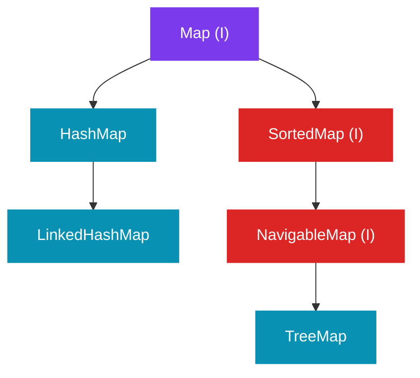

**② The legacy and special-purpose branch:**

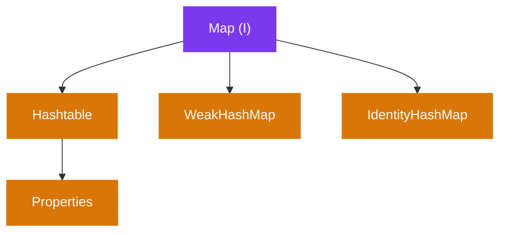

> Both diagrams start from the same `Map` root (violet). Amber marks the branch you should rarely use in new code:
> - `ConcurrentHashMap` has replaced `Hashtable`.
> - `WeakHashMap` / `IdentityHashMap` are for special cases only.

**Map(I)**

- Map(I) _1.2v_
  - HashMap _1.2v_
    - LinkedHashMap _1.4v_
  - WeakHashMap _1.2v_
  - IdentityHashMap _1.4v_
  - Hashtable _1.0v_
    - Properties _1.0v_
  - SortedMap(I) _1.2v_
    - NavigableMap(I) _1.6v_
      - TreeMap _1.2v_

Hashtable implements Map(I) and extends the Dictionary(AC) class. These classes came in 1.0v, so they are called legacy classes.

- Dictionary (AC) 1.0v
  - Hashtable 1.0v
    - Properties 1.0v

HashMap:

- 🔓 It is non-synchronized.
- 🗝️ It allows only one null key but multiple null values.

LinkedHashMap:

- 📋 It preserves the insertion order of the element.

WeakHashMap:

- 💾 Entries are removed automatically when no strong reference points to their keys any more. This prevents memory leaks.
- 🗝️ It allows null values and the null key

IdentityHashMap:

- ⚖️ It uses reference equality (==) instead of object equality (equals()) for comparing keys.

Hashtable:

- 🔒 It is synchronized.
- 🗝️ It does not allow any null key or value.

Properties:

- 🗂️ It is a persistent set of properties. You can load it from a stream or save it to a stream.
- ⚙️ It is often used for configuration settings.

Sorted Map:

- 📊 The map keeps all objects in a sorting order. By default, entries are kept in ascending key order.

Tree Map:

- 🏗️ It uses a Red-Black Tree internally.
- 🗝️ Can not store a null key with natural ordering. A `Comparator` that handles `null` can allow it.

---

</details>

---

2. **🗺️ Why does Map not extend the Collection interface? ⚡**

<!-- -->
<details>
<summary>Answer</summary>

**Answer:**

- 💡 The Map interface in Java uses a key-value pair structure. The Collection interface is a group of single objects. It stores them in a fixed structure and gives a defined way to access them.
- 📑 The main reason: the `add(E e)` method of the Collection interface does not support a key-value pair. The Map interface's `put(K, V)` method does. So Map does not extend the Collection interface.
- 🔹 Map does not extend the Collection interface. But it is still a core part of the Java Collections framework.

```java
public interface List<E> extends Collection<E> { }

public interface Map<K, V> { }
```

---

</details>

---

3. **⚙️ Internal working of HashMap. 🔥**

<!-- -->
<details>
<summary>Answer</summary>

**Answer:**

- #️⃣ HashMap in Java works on the **hashing principle**. A hash function links the key to the value.
- 📦 You store objects (Map.Entry -> contains both key and value object) by calling the **put(key, value)** method of HashMap. You read them back by calling the `get(key)` method.
- ⚙️ When we call the `put()` method, it calls the `hashCode()` method of the key object. HashMap spreads that hash code and computes `(n - 1) & hash`. This gives the index of the bucket where we can store the value object.
- 🔍 To read, you call the `get()` method and pass the key object again. It goes to the same index (bucket), and you get the value object.
- 💥 If two different keys give the same hash index, a collision occurs. Then HashMap forms a linked list at that bucket and stores the new entry as the next node.
- ➕ Now the `put()` method just appends the object nodes to the linked list.
- 🔍 But `get()` is different. If there is a linked list at that index, we need an extra check to find the correct value. The `equals()` method does this check. It checks the key of every node. If `equals()` returns true, the Map returns that node's value from the linked list.

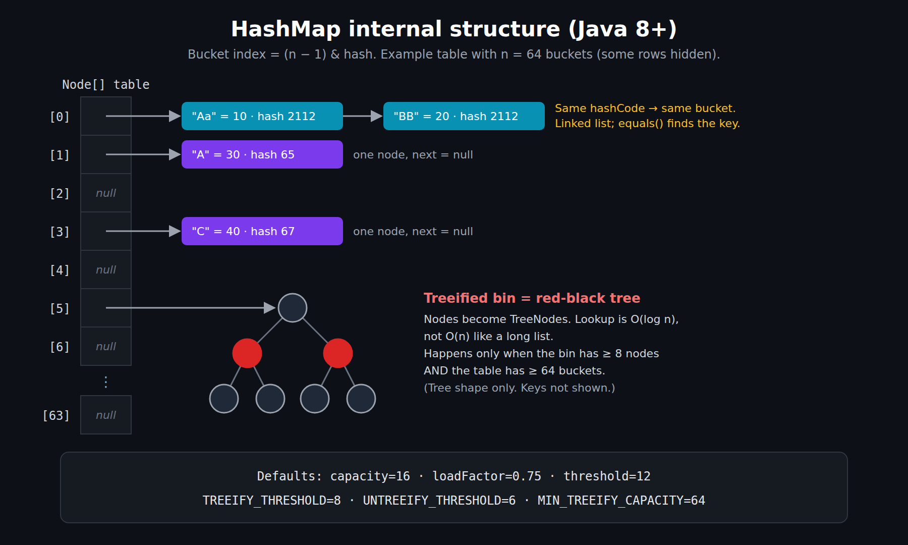

The `put()` method in HashMap works as follows:

**① `put()` — hashing and the empty-bucket fast path:**

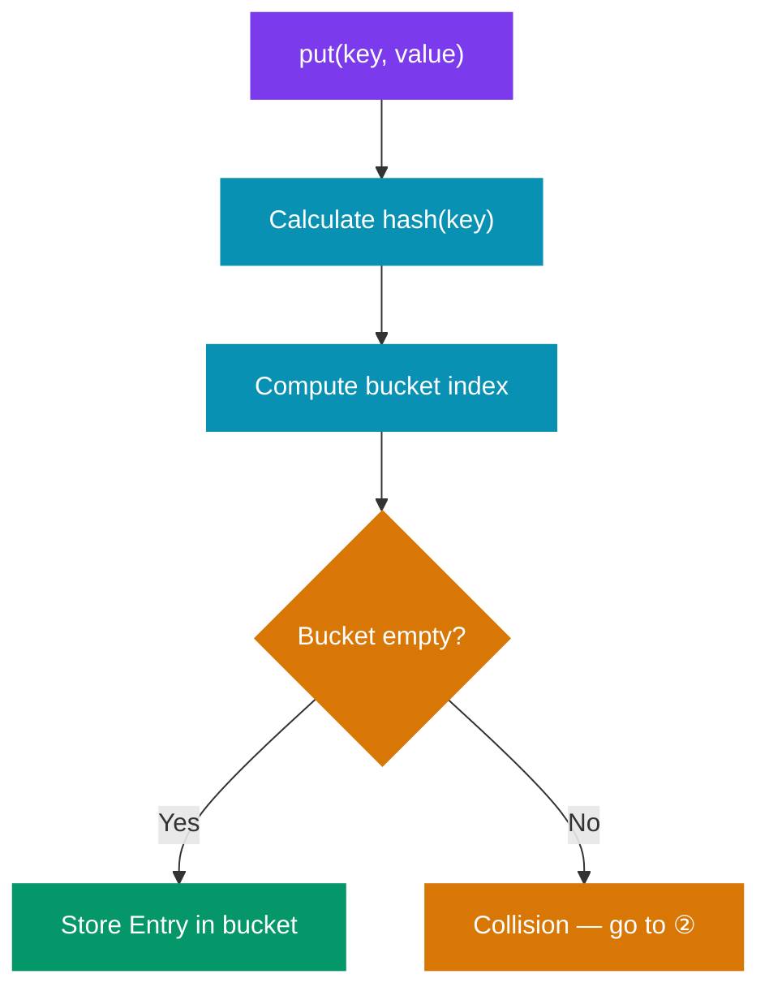

**② `put()` — collision handling and treeification:**

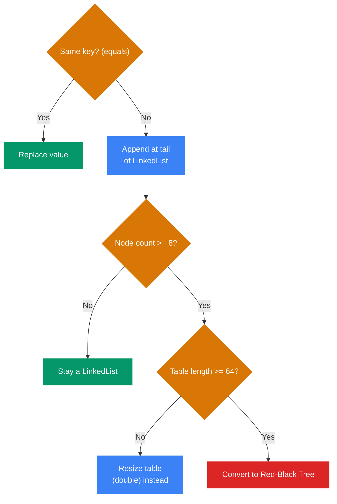

> ⚠️ Both conditions are required. A bin (bucket) turns into a tree only when it grows **past 8 nodes (the 9th node triggers it) AND the table is ≥ 64 buckets** (`MIN_TREEIFY_CAPACITY`). Below 64, the map resizes instead. Many people answer "8 nodes → tree" and miss the second condition. This is the most common follow-up trap on this question.

> Diagram ② starts exactly where ① ends, at the "Collision" node. A non-empty bucket means one of two things:
> - the same key (overwrite), or
> - a real hash collision (chain, then treeify past 8 nodes, only if the table is ≥ 64).

The `get()` method in HashMap works as follows:

**① `get()` — the O(1) fast path (empty bucket or first-node hit):**

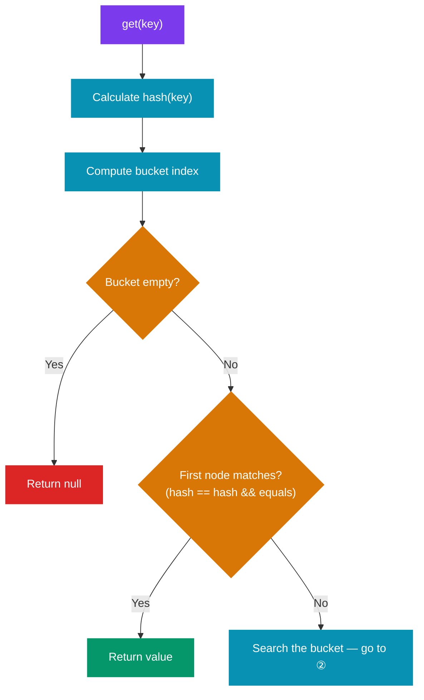

**② `get()` — searching a collided bucket: tree vs chain:**

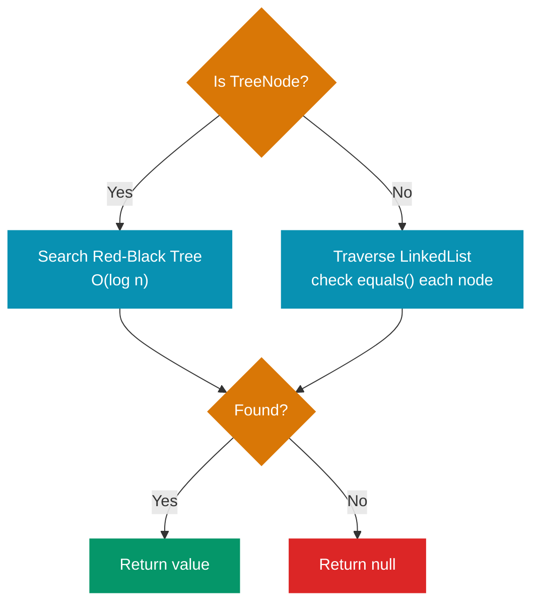

---

</details>

---

4. **#️⃣ Internal working of HashSet. 🔥**

<!-- -->
<details>
<summary>Answer</summary>

**Answer:**

`HashSet<E>` has no storage of its own. Inside, it keeps everything in a `HashMap<E, Object>`. Every entry uses one shared dummy constant, `PRESENT`, as its value. Only the keys matter.

**Simplified internal structure:**

```java
public class HashSet<E> {
    private static final Object PRESENT = new Object(); // dummy value — same object for all entries
    private final HashMap<E, Object> map;

    public HashSet() {
        map = new HashMap<>();
    }

    public boolean add(E e) {
        return map.put(e, PRESENT) == null; // null return → new key → added ✅
    }                                        // PRESENT return → duplicate → not added ❌️

    public boolean contains(Object o) {
        return map.containsKey(o);
    }

    public boolean remove(Object o) {
        return map.remove(o) == PRESENT;
    }
}
```

**`add()` flow:**

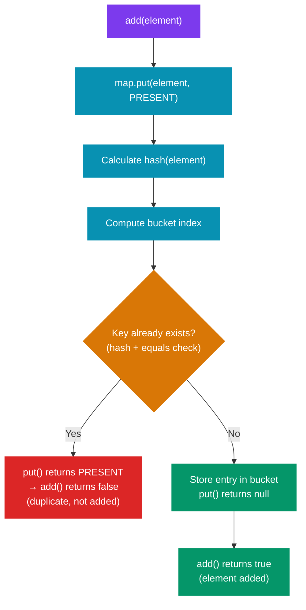

**Key implications:**

| Property | Reason |
|---|---|
| No duplicates | `HashMap` key uniqueness — `equals()` + `hashCode()` contract |
| O(1) avg for `add`, `remove`, `contains` | Delegates directly to `HashMap` |
| One `null` element allowed | `HashMap` allows one null key |
| Unordered | `HashMap` has no ordering guarantee |
| Override `hashCode()` + `equals()` | Required for correct behaviour with custom objects |

> 🔑 **Interview one-liner:** `HashSet` is a `HashMap` where only keys matter. All values are the same dummy `PRESENT` object. Every `HashSet` operation is a thin wrapper that calls the matching `HashMap` operation.

---

</details>

---

5. **⚖️ What will happen if we don't override `hashcode()` and `equals()` method in our class? (Talk in terms of collection/Map). 🔥**

<!-- -->
<details>
<summary>Answer</summary>

**Answer:**

If you do not override `hashCode()` and `equals()`, Java uses the default `Object` versions:

- `hashCode()` returns an identity hash code. It depends on the object itself, not its fields. It is not guaranteed to be the memory address.
- `equals()` checks **reference equality** (`==`).

This breaks HashMap/HashSet behavior. Two logically equal objects will have different hash codes. So the map does not see them as the same key/element.

#### ❌️ The Bug — Without Override

```java
class Employee {
    private int id;
    private String name;

    Employee(int id, String name) {
        this.id = id;
        this.name = name;
    }
}

// HashMap — duplicate keys appear
Map<Employee, String> map = new HashMap<>();
Employee e1 = new Employee(1, "Alice");
Employee e2 = new Employee(1, "Alice");  // logically same employee

map.put(e1, "Engineering");
map.put(e2, "Engineering");  // should replace, but DOESN'T

System.out.println(map.size());          // 2 ❌️ (expected 1)
System.out.println(map.get(new Employee(1, "Alice")));  // null ❌️ (can't find it)
```

**Why?**
- `e1.hashCode() != e2.hashCode()` → different buckets → HashMap treats them as different keys
- `new Employee(1, "Alice")` creates one more object with a different hash → `get()` looks in the wrong bucket → returns `null`

#### ✅ The Fix — With Override

```java
class Employee {
    private int id;
    private String name;

    Employee(int id, String name) {
        this.id = id;
        this.name = name;
    }

    @Override
    public boolean equals(Object o) {
        if (this == o) return true;
        if (o == null || getClass() != o.getClass()) return false;
        Employee emp = (Employee) o;
        return id == emp.id && Objects.equals(name, emp.name);
    }

    @Override
    public int hashCode() {
        return Objects.hash(id, name);
    }
}

Map<Employee, String> map = new HashMap<>();
map.put(new Employee(1, "Alice"), "Engineering");
map.put(new Employee(1, "Alice"), "Engineering");  // replaces — same key

System.out.println(map.size());          // 1 ✅
System.out.println(map.get(new Employee(1, "Alice")));  // "Engineering" ✅
```

#### 📊 Impact on Different Collections

| Collection | Without Override | With Override |
|---|---|---|
| `HashMap` | Duplicate keys, `get()` returns `null` for logically equal keys | Correct key uniqueness and retrieval |
| `HashSet` | Duplicate elements not detected | Correct uniqueness |
| `TreeMap` | Works if `Comparable`/`Comparator` is provided (uses `compareTo`, not `equals`) | ✅ But `equals` should be consistent with `compareTo` |
| `LinkedHashMap` | Same as HashMap | Same as HashMap |

#### ⚠️ The Contract Rules

| Rule | What happens if violated |
|---|---|
| If `a.equals(b)` is `true`, then `a.hashCode() == b.hashCode()` must be `true` | Equal objects go into different buckets → HashMap can't find them |
| If `a.hashCode() == b.hashCode()`, `a.equals(b)` may or may not be `true` | Normal collision — handled by chaining |
| Override `equals()` but not `hashCode()` | ❌️ Most dangerous — `equals` says equal, but different hash codes → duplicate keys |
| Override `hashCode()` but not `equals()` | `equals` uses `==` → only same reference matches → `get()` fails with new object |

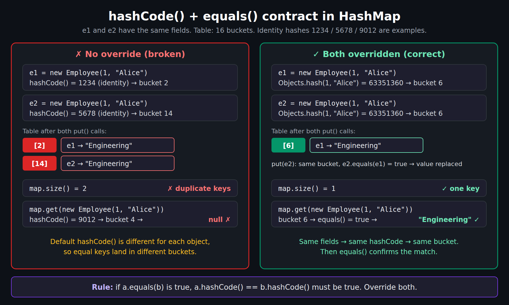

> 🔑 **Interview one-liner:** If you do not override both `hashCode()` and `equals()`, HashMap uses object identity (`==`). It treats two logically equal objects as different keys. This causes duplicate entries and failed lookups. Always override both together.

---

</details>

---

6. **🔗 How is LinkedList implemented in Java, is it a Singly or Doubly linked list? ⚡**

<!-- -->
<details>
<summary>Answer</summary>

**Answer:**

Java's `LinkedList` is a **doubly linked list**. Every node holds references to both its previous and next node. This gives O(1) insertion and removal at either end.

**Node structure (simplified inner class):**

```java
private static class Node<E> {
    E item;
    Node<E> next;
    Node<E> prev;

    Node(Node<E> prev, E element, Node<E> next) {
        this.item = element;
        this.next = next;
        this.prev = prev;
    }
}
```

`LinkedList` keeps two fields: `first` (head) and `last` (tail). Both point directly to the nodes at the two ends.

**Visual — 3-node doubly linked list:**

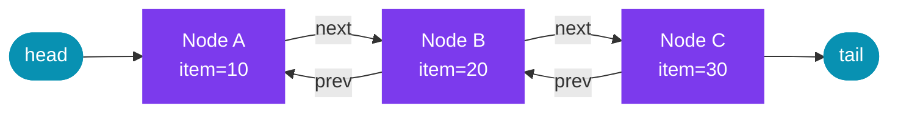

**Complexity implications:**

| Operation | Complexity | Reason |
|---|---|---|
| `addFirst()` / `addLast()` | O(1) | Direct head/tail pointer update |
| `removeFirst()` / `removeLast()` | O(1) | Direct head/tail pointer update |
| `get(index)` | O(n) | Traversal from head or tail |
| `add(index, element)` in middle | O(n) | Traversal to position + O(1) link rewire |

> 🔑 `LinkedList` implements both `List<E>` and `Deque<E>`. So it can work as a list, stack, queue, or double-ended queue. All of these use the same doubly linked structure.

---

</details>

---

7. **🤔 When to use ArrayList and LinkedList? ⚡**

<!-- -->
<details>
<summary>Answer</summary>

**Answer:**

The right choice depends completely on **the operation you do most often**.

**Use `ArrayList` when:**
- 🔍 You need frequent **random access by index** — O(1) because of the array inside
- 📋 The list is mostly **read-heavy**, with few structural changes
- 💾 Memory use matters. Each slot stores only the element, with no prev/next pointers

🛠️ **Real-world example:** A leaderboard that you build once and query thousands of times. `list.get(0)` for rank-1 is instant.

**Use `LinkedList` when:**
- ➕➖ You need **frequent insertions or deletions at the head or tail** — O(1)
- 🔄 You are implementing a **queue or deque** (but `ArrayDeque` is the better choice for pure stack/queue)
- 🔗 You hold an `Iterator` and make **many changes in the middle of the list** (O(1) to change the links, after an O(n) walk to the position)

🛠️ **Real-world example:** A job-scheduling queue. Tasks are always added at the tail and removed from the head. `addLast()` + `removeFirst()` are both O(1).

**Operation Comparison:**

| Operation | ArrayList | LinkedList |
|---|---|---|
| `get(index)` | ✅ O(1) | ❌️ O(n) |
| `add(element)` at end | ✅ O(1) amortized | ✅ O(1) |
| `add(index, element)` in middle | ❌️ O(n) shift | ❌️ O(n) traverse + O(1) link |
| `remove(index)` in middle | ❌️ O(n) shift | ❌️ O(n) traverse + O(1) link |
| `addFirst()` / `removeFirst()` | ❌️ O(n) shift | ✅ O(1) |
| Memory per element | ✅ Low (element only) | ⚠️ Higher (element + 2 pointers) |
| CPU cache locality | ✅ Good (contiguous array) | ❌️ Poor (scattered heap nodes) |

> 💡 **Modern advice:** In practice `ArrayList` is faster in most benchmarks because of CPU cache locality (its elements sit next to each other in memory). For pure stack/queue use, `ArrayDeque` is faster than `LinkedList`. Choose `LinkedList` mainly when you hold an `Iterator` and do many insertions/deletions in the middle of the list.

---

</details>

---

8. **🌳 What is the difference between HashMap, TreeMap, and LinkedHashMap? 🔥**

<!-- -->
<details>
<summary>Answer</summary>

**Answer:**

All three implement `Map<K, V>`. They differ in ordering, performance, and internal structure.

#### 📊 Comparison

| Feature | `HashMap` | `TreeMap` | `LinkedHashMap` |
|---|---|---|---|
| **Ordering** | ❌️ No order guarantee | ✅ Sorted by key (natural or Comparator) | ✅ Insertion order (or access order) |
| **Internal structure** | Hash table (array + linked list / red-black tree) | Red-black tree (self-balancing BST) | Hash table + doubly linked list |
| **`get` / `put`** | O(1) average | O(log n) | O(1) average |
| **Null keys** | ✅ One null key | ❌️ Throws `NullPointerException` (natural ordering) | ✅ One null key |
| **Null values** | ✅ Multiple | ✅ Multiple | ✅ Multiple |
| **Key requirement** | `hashCode()` + `equals()` | `Comparable` or `Comparator` (+ `equals()` consistent with `compareTo()`) | `hashCode()` + `equals()` |
| **Thread-safe** | ❌️ | ❌️ | ❌️ |
| **Iterator** | Fail-fast | Fail-fast | Fail-fast |
| **Memory overhead** | Low | Medium (tree node pointers: parent, left, right, color) | Medium (hash table + prev/next pointers) |

#### ✅ When to Use Which

| Scenario | Use |
|---|---|
| General-purpose map, fastest lookups | `HashMap` |
| Need entries sorted by key (range queries, `firstKey()`, `lastKey()`) | `TreeMap` |
| Need insertion-order iteration (e.g., config maps, JSON-like output) | `LinkedHashMap` |
| LRU cache (access-order mode) | `LinkedHashMap` with `accessOrder = true` |
| Need concurrent access | `ConcurrentHashMap` (none of these three) |

#### 🛠️ Quick Example

```java
Map<String, Integer> hashMap = new HashMap<>();
Map<String, Integer> treeMap = new TreeMap<>();
Map<String, Integer> linkedMap = new LinkedHashMap<>();

for (Map<String, Integer> map : List.of(hashMap, treeMap, linkedMap)) {
    map.put("Banana", 2);
    map.put("Apple", 5);
    map.put("Cherry", 1);
}

System.out.println("HashMap:       " + hashMap);     // {Apple=5, Cherry=1, Banana=2} (hash order, not guaranteed)
System.out.println("TreeMap:       " + treeMap);      // {Apple=5, Banana=2, Cherry=1} (sorted)
System.out.println("LinkedHashMap: " + linkedMap);    // {Banana=2, Apple=5, Cherry=1} (insertion order)
```

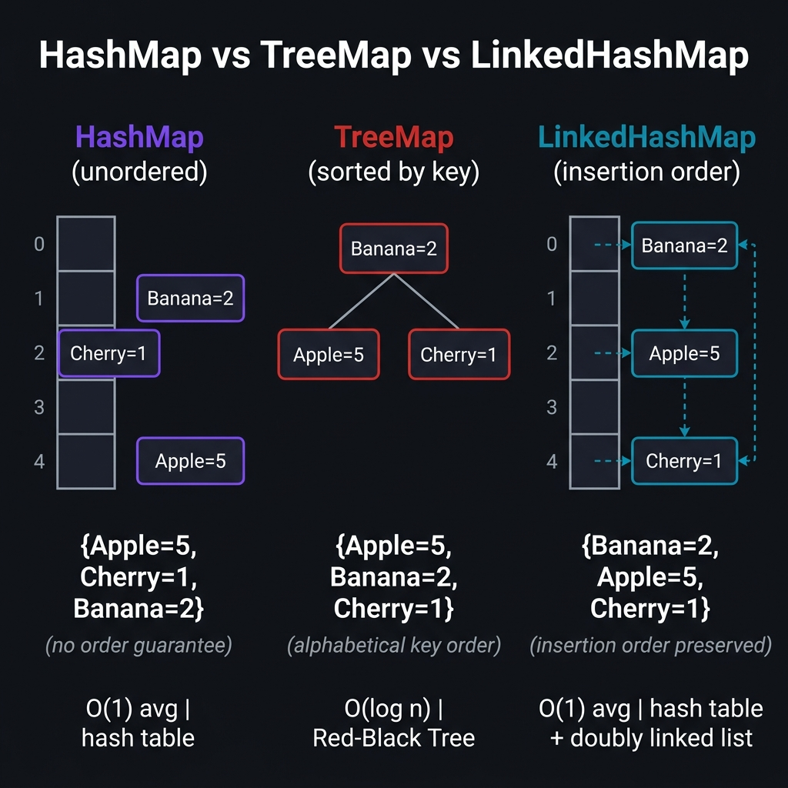

> 🔑 **Interview one-liner:** `HashMap` is unordered O(1). `TreeMap` is sorted O(log n) and uses a red-black tree. `LinkedHashMap` keeps insertion order in O(1) and uses a hash table + doubly linked list.

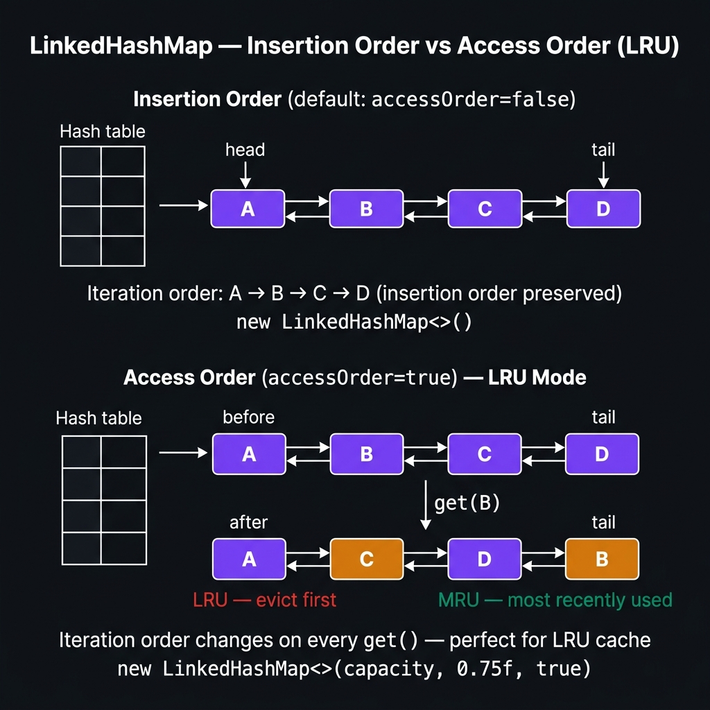

---

</details>

---

9. **📊 What is a PriorityQueue in Java? ⚡**

<!-- -->
<details>
<summary>Answer</summary>

**Answer:**

- 💡 A priority queue in Java is an abstract data type. It is like a regular queue. The difference: each element has a priority linked to it.
- 📊 In this queue, a high-priority element is served before a low-priority element. Their insertion order does not matter. The PriorityQueue uses a priority heap inside.
- ⚙️ The queue orders its elements by their natural ordering, or by a `Comparator` you pass when you create the queue. This depends on which constructor you use.

🛠️ **Example:**

```java
import java.util.PriorityQueue;

public class Test {
    public static void main(String[] args) {
        PriorityQueue<Integer> priorityQueue = new PriorityQueue<>(); // default is min heap
        priorityQueue.add(10);
        priorityQueue.add(20);
        priorityQueue.add(5);
        priorityQueue.add(15);
        System.out.println("PriorityQueue: " + priorityQueue);
        System.out.println("Removed element: " + priorityQueue.poll());
        System.out.println("PriorityQueue after removal: " + priorityQueue);
        System.out.println("Head of the queue: " + priorityQueue.peek());
    }
}
```

📤 **Output:**

```
PriorityQueue: [5, 15, 10, 20]
Removed element: 5
PriorityQueue after removal: [10, 15, 20]
Head of the queue: 10
```

In Java's PriorityQueue, one of two things decides the priority:

- the natural ordering of the elements (like numerical or alphabetical order), or
- a custom `Comparator` you provide.

The element at the head always has the highest priority by this ordering. If you want a custom priority, you can use a `Comparator`:

```java
import java.util.Comparator;
import java.util.PriorityQueue;

public class Test {
    public static void main(String[] args) {
        // custom Comparator for descending order — max heap
        Comparator<Integer> customComparator = Comparator.reverseOrder();
        // equivalent: (a, b) -> Integer.compare(b, a)
        // ❌️ never (a, b) -> b - a — int subtraction overflows (see §5)
        PriorityQueue<Integer> priorityQueue = new PriorityQueue<>(customComparator);
        priorityQueue.add(10);
        priorityQueue.add(20);
        priorityQueue.add(5);
        priorityQueue.add(15);
        System.out.println("PriorityQueue: " + priorityQueue);
        System.out.println("Removed element: " + priorityQueue.poll());
        System.out.println("PriorityQueue after removal: " + priorityQueue);
        System.out.println("Head of the queue: " + priorityQueue.peek());
    }
}
```

📤 **Output:**

```
PriorityQueue: [20, 15, 5, 10]
Removed element: 20
PriorityQueue after removal: [15, 10, 5]
Head of the queue: 15
```

---

</details>

---

10. **🔑 Can you use any class as a Map key? 🔥**

<!-- -->
<details>
<summary>Answer</summary>

**Answer:**

Technically yes — any object can be a key. But for lookups by value (not by the same instance), the class needs these things:

- ⚙️ The class should override the `equals()` method and the `hashCode()` method. If it does not, only the same instance finds the entry.
- 📑 The class should follow the rules of `equals()` and `hashCode()` for all instances.
- 🔧 If a class field is not used in the `equals()` method, it should not be used in the `hashCode()` method either.
- 🔐 The best way to use a user-defined key class is to make it **immutable**. Then you can cache the `hashCode()` value for better performance. An immutable class also makes sure that `hashCode()` and `equals()` do not change in the future.
- ✅ Java Wrapper classes (`Integer`, `Long`, `Boolean`, etc) and `String` already meet these conditions. That is why they are usually used as keys.

---

</details>

---

11. **🔒 How do you make the Java ArrayList read-only? 💤**

<!-- -->
<details>
<summary>Answer</summary>

**Answer:**

To get a read-only view of a Java `ArrayList`, call the **`Collections.unmodifiableList()`** method. After you wrap the list, you cannot change it through the `add()`, `remove()`, or `set()` methods. Each one throws `UnsupportedOperationException`.

⚠️ Use `unmodifiableList()`, **not** `unmodifiableCollection()`. The second one returns a `Collections$UnmodifiableCollection`. That object is **not** a `List`:

- It has no `get(int)` and no index access.
- You cannot assign it to a `List` variable.

🛠️ **Example:**

```java
import java.util.ArrayList;
import java.util.Collections;
import java.util.List;

public class Test {
    public static void main(String[] args) {
        List<String> list = new ArrayList<>();
        list.add("One");
        list.add("Two");

        // make the ArrayList read-only
        List<String> readOnlyList = Collections.unmodifiableList(list);

        // try modifying the read-only list
        try {
            readOnlyList.add("Three");
        } catch (UnsupportedOperationException e) {
            System.out.println("Modification attempt failed: " + e);
        }

        System.out.println("Read-Only List: " + readOnlyList);
    }
}
```

📤 **Output:**

```
Modification attempt failed: java.lang.UnsupportedOperationException
Read-Only List: [One, Two]
```

📝 **Note:** The `Collections` class also has `unmodifiableSet()`, `unmodifiableMap()`, `unmodifiableCollection()`, `unmodifiableNavigableMap()`, `unmodifiableNavigableSet()`, `unmodifiableSortedMap()`, and `unmodifiableSortedSet()` methods.

<details>
<summary><strong>🤔 Doubt: What is the difference between `Collections.unmodifiableList()`, `List.of()`, and `List.copyOf()`?</strong></summary>

All three give lists that throw `UnsupportedOperationException` when you try to change them. But they differ in important ways:

| Feature | `Collections.unmodifiableList(list)` | `List.of(...)` (Java 9+) | `List.copyOf(list)` (Java 10+) |
|---|---|---|---|
| **Type** | Unmodifiable **view** of the original list | Really **immutable** list | Really **immutable** copy |
| **Shows changes to the original?** | ✅ Yes. It is a view, not a copy | N/A (no original) | ❌️ No. It is a separate copy |
| **Null elements** | ✅ Allowed (if original has nulls) | ❌️ Throws NPE | ❌️ Throws NPE |
| **Duplicate elements** | ✅ Allowed | ✅ Allowed | ✅ Allowed |
| **Serializable** | ✅ Yes | ✅ Yes | ✅ Yes |

```java
// unmodifiableList — VIEW (reflects mutations on original)
List<String> original = new ArrayList<>(List.of("A", "B"));
List<String> view = Collections.unmodifiableList(original);

original.add("C");
System.out.println(view);  // [A, B, C] ← view sees the change!

// List.of — truly immutable, created directly
List<String> immutable = List.of("A", "B", "C");
// immutable.add("D");  // ❌️ UnsupportedOperationException

// List.copyOf — immutable snapshot of existing collection
List<String> copy = List.copyOf(original);
original.add("D");
System.out.println(copy);  // [A, B, C] ← copy is independent
```

> 🔑 **Key insight:** `unmodifiableList` is a **read-only wrapper**. Anyone who holds a reference to the original list can still change it.  
> `List.of` and `List.copyOf` create really **immutable** lists. They do not point to any other list.

> ⚠️ **Interview trap:** "Is `Collections.unmodifiableList()` immutable?" **No.** The wrapper only blocks changes made through the wrapper itself. The original list can still change, and you can see those changes through the wrapper.

---

</details>
<br/>

---

</details>

---

12. **🔄 How to traverse or loop over a Map in Java? 💤**

<!-- -->
<details>
<summary>Answer</summary>

**Answer:**

#### 5 Ways to Iterate a Map

```java
// mutable — Map.of(...) alone is immutable, so method 5 below would fail on it
Map<String, Integer> map = new HashMap<>(Map.of("Alice", 30, "Bob", 25, "Charlie", 35));
```

**1. `entrySet()` with for-each (most common):**
```java
for (Map.Entry<String, Integer> entry : map.entrySet()) {
    System.out.println(entry.getKey() + " → " + entry.getValue());
}
```

**2. `keySet()` with for-each:**
```java
for (String key : map.keySet()) {
    System.out.println(key + " → " + map.get(key));  // extra get() call per key
}
```

**3. `forEach()` with lambda (Java 8+):**
```java
map.forEach((key, value) -> System.out.println(key + " → " + value));
```

**4. `entrySet().stream()` (Java 8+):**
```java
map.entrySet().stream()
   .filter(e -> e.getValue() > 25)
   .forEach(e -> System.out.println(e.getKey() + " → " + e.getValue()));
```

**5. `Iterator` on `entrySet()` (you need it to remove entries safely while you loop):**
```java
Iterator<Map.Entry<String, Integer>> it = map.entrySet().iterator();
while (it.hasNext()) {
    Map.Entry<String, Integer> entry = it.next();
    if (entry.getValue() < 30) {
        it.remove();  // ✅ safe removal
    }
}
```

| Method | Java Version | Safe Removal | Best For |
|---|---|---|---|
| `entrySet()` for-each | 5+ | ❌️ | General iteration |
| `keySet()` for-each | 5+ | ❌️ | When you only need keys |
| `forEach()` lambda | 8+ | ❌️ | Concise read-only iteration |
| `entrySet().stream()` | 8+ | ❌️ | Filtering, mapping, collecting |
| `Iterator` on entrySet | 2+ | ✅ | Removing entries during iteration |

> 🔑 **Default choice:** `map.forEach((k, v) -> ...)` for read-only, `Iterator` for removal during iteration.

> ⚠️ **Trap:** `Iterator.remove()` is "safe removal" only on a **mutable** map.  
> On an immutable map (`Map.of`, `Map.copyOf`, `Collections.unmodifiableMap`), the entry-set iterator has no working `remove()`. It throws `UnsupportedOperationException`. Verified on JDK 17.  
> So wrap the map first: `new HashMap<>(Map.of(...))`.

> 💡 **Simpler way to remove many entries:** `map.entrySet().removeIf(e -> e.getValue() < 30)` (Java 8+) does the same thing in one line.  
> `map.values().removeIf(...)` and `map.keySet().removeIf(...)` also work. All three are *views* of the map, so a change to them changes the map itself.

---

</details>

---

13. **🧹 How to remove duplicates from ArrayList? ⚡**

<!-- -->
<details>
<summary>Answer</summary>

**Answer:**

There are two ways to remove duplicates from an ArrayList:

- 🎯 **Using HashSet:** A HashSet removes the duplicate elements from the ArrayList. But it does not keep the insertion order.
- 📋 **Using LinkedHashSet:** Use LinkedHashSet instead of HashSet to also keep the insertion order.

Steps to remove duplicate elements from an ArrayList with a LinkedHashSet:

1. Copy all the elements of ArrayList to LinkedHashSet.
2. Empty the ArrayList with the `clear()` method. It removes all the elements from the list.
3. Copy all the elements of the LinkedHashset back to the ArrayList.

🛠️ **Example:**

```java
List<Integer> numbers = new ArrayList<>(Arrays.asList(100, 10, 50, 100, 50, 50));
Set<Integer> uniqueNumbers = new LinkedHashSet<>(numbers);
System.out.println(uniqueNumbers); // [100, 10, 50]

numbers.clear();
numbers.addAll(uniqueNumbers); // copy back into the same list
System.out.println(numbers); // [100, 10, 50]
```

In Java 8, use the `distinct()` method.

```java
List<Integer> numbers = new ArrayList<>(Arrays.asList(100, 10, 50, 100, 50, 50));
List<Integer> uniqueNumbers = numbers.stream()
               .distinct()
               .collect(Collectors.toList());
System.out.println(uniqueNumbers); // [100, 10, 50]
```

---

</details>

---

14. **🎯 Different types of references? ⚡**

<!-- -->
<details>
<summary>Answer</summary>

**Answer:**

Java has **4 types of references**, all in the `java.lang.ref` package (except strong):

**1. Strong Reference** — the default. The GC never collects the object while a strong reference exists.

```java
Object a = new Object();  // strong reference — a will NOT be GC'd
```

**2. Soft Reference** — the GC collects the object only when the JVM is low on memory. Good for **memory-sensitive caches**.

```java
Object a = new Object();
SoftReference<Object> soft = new SoftReference<>(a);
a = null;  // now only softly reachable → GC'd only on memory pressure
Object val = soft.get();  // returns null if already collected
```

**3. Weak Reference** — the GC collects the object at the next GC that finds it only weakly reachable, no matter how much memory is free.

- **WeakHashMap** uses it for its keys.
- When a key has no strong reference, the map removes the entry automatically.

```java
Object a = new Object();
WeakReference<Object> weak = new WeakReference<>(a);
a = null;  // now only weakly reachable → GC'd at the next GC
Object val = weak.get();  // returns null if already collected
```

**4. Phantom Reference** — the object is already finalized, but its memory is not yet reclaimed.

- It is used for **post-mortem cleanup** (cleanup after the object is dead), e.g., releasing native resources.
- `get()` always returns `null`.
- You use a `ReferenceQueue` to detect when the object is about to be reclaimed.

```java
ReferenceQueue<Object> queue = new ReferenceQueue<>();
Object a = new Object();
PhantomReference<Object> phantom = new PhantomReference<>(a, queue);
a = null;
// When the object becomes phantom reachable, the GC enqueues the phantom reference
// poll the queue to run cleanup logic
```

<details>
<summary><strong>🤔 Doubt: Why not show this with `Integer a = 1;`?</strong></summary>

⚠️ Because **the GC would never collect it**. The demo would show the opposite of what it claims, with no warning.

Autoboxing `Integer a = 1` calls `Integer.valueOf(1)`. This returns an instance from the **`IntegerCache`**. The cache is a `static final Integer[]` that holds every value in **−128 … 127**.

- That static array is a **strong reference**. It lives as long as the class.
- So `a = null` removes *your* reference only.
- The cached object stays strongly reachable forever. It never becomes softly or weakly reachable.

Verified on JDK 17:

```java
Integer a = 1;
WeakReference<Integer> weak = new WeakReference<>(a);
a = null;
System.gc();
System.out.println(weak.get());   // → 1     ❌️ NOT collected (cached)

Integer b = 1000;                 // outside the cache → a fresh object
WeakReference<Integer> weak2 = new WeakReference<>(b);
b = null;
System.gc();
System.out.println(weak2.get());  // → null  ✅ collected
```

This is why the `WeakHashMap` example later in this file uses `Integer key1 = 1000`, not `1`.

**Which wrappers are cached?**

| Wrapper | Cached range | Note |
|---|---|---|
| `Byte`, `Short`, `Integer`, `Long` | **−128 … 127** | `Integer`'s upper bound is tunable via `-XX:AutoBoxCacheMax` |
| `Character` | **0 … 127** | `char` is unsigned — there is **no** negative half |
| `Boolean` | `TRUE` / `FALSE` | Both values cached |
| `Float`, `Double` | ❌️ none | Never cached |

> 🎯 The same cache explains a classic `==` vs `.equals()` interview trap. `Integer a = 127, b = 127; a == b` is `true`. But `a = 128, b = 128; a == b` is `false`. Verified on JDK 17.

---

</details>
<br/>

**Quick Comparison:**

| Type | GC Behavior | `get()` | Use Case |
|---|---|---|---|
| Strong | Never GC'd while referenced | N/A (direct ref) | Normal variables |
| Soft | GC'd on memory pressure | Returns referent or null | Memory-sensitive caches |
| Weak | GC'd at the next GC once only weakly reachable | Returns referent or null | WeakHashMap, canonicalization |
| Phantom | GC'd after finalization | Always `null` | Native resource cleanup, Cleaner API |

<details>
<summary><strong>🤔 Doubt: Can the GC collect the variable `soft` / `weak` / `phantom` itself?</strong></summary>

**No.** `soft`, `weak`, `phantom` are **strong references** to the wrapper objects (`SoftReference`, `WeakReference`, `PhantomReference`). The wrapper objects are normal heap objects. The GC **never collects** them while those variables are in scope.

The GC can collect only the **referent**. That is the object *inside* the wrapper (i.e., the original `Object` after `a = null`):

```
soft  ──strong──▶  SoftReference  ──soft──▶  Object
  ↑                      ↑                        ↑
in scope              NOT GC'd              eligible for GC
(strong ref)        (strong ref             (only softly
                     from 'soft')            reachable)
```

If you also set the wrapper variable to null, the GC can collect the wrapper too:

```java
soft = null;  // now SoftReference wrapper is also eligible for GC
```

This is how **WeakHashMap** works. The map holds the **key** inside a `WeakReference`:

1. Your application drops its strong reference to the key.
2. The key becomes weakly reachable → GC collects it.
3. `WeakHashMap` removes the entry automatically.

---

</details>
<br/>

---

</details>

---

15. **💨 How does WeakHashMap differ from other HashMap? ⚡**

<!-- -->
<details>
<summary>Answer</summary>

**Answer:**

WeakHashMap is a hash-table `Map` whose keys are held by WeakReference. It does not extend `HashMap`; it extends `AbstractMap`.

🗑️ WeakHashMap removes an entry automatically when no strong reference points to its key any more.

- Only weak references to the key are left.
- When the garbage collector (GC) discards a key, the map also loses that key's entry. This happens even though the key is inside a WeakHashMap.
- In short: the Garbage Collector has priority over WeakHashMap.

💾 HashMap is different. Say no variable in your code points to a key any more.

- The key looks ready for GC, but in reality it is not.
- The reason: the entry object stored in a bucket of the hashMap still refers to the key.
- In short: the HashMap has priority over the garbage collector.

🛠️ **Example:**

```java
import java.util.HashMap;
import java.util.Map;
import java.util.WeakHashMap;

public class Test {
    public static void main(String[] args) {
        Map<Integer, String> hashMap = new HashMap<>();
        Map<Integer, String> weakHashMap = new WeakHashMap<>();

        // key object
        Integer key1 = 1000;
        Integer key2 = 2000;

        hashMap.put(key1, "HashMapValue");
        weakHashMap.put(key2, "WeakHashMapValue");

        // display initial content
        System.out.println("HashMap before GC: " + hashMap);
        System.out.println("WeakHashMap before GC: " + weakHashMap);

        // remove strong references
        key1 = null;
        key2 = null;

        // Invoke garbage collection
        System.gc();
        System.out.println("===Called GC===");

        // wait a bit for GC to happen
        try {
            Thread.sleep(1000);
        } catch (InterruptedException e) {
            e.printStackTrace();
        }

        // display content after GC
        System.out.println("HashMap after GC: " + hashMap);
        System.out.println("WeakHashMap after GC: " + weakHashMap);
    }
}
```

📤 **Output:**

```
HashMap before GC: {1000=HashMapValue}
WeakHashMap before GC: {2000=WeakHashMapValue}
===Called GC===
HashMap after GC: {1000=HashMapValue}
WeakHashMap after GC: {}
```

---

</details>

---

16. **✅ What are the best practices related to the Java Collections Framework? ⚡**

<!-- -->
<details>
<summary>Answer</summary>

**Answer:**

- ✅ Choose the right type of collection for the need. For example, if the size is fixed, we might want to use an **Array** instead of an ArrayList.
- 🎯 If we don't want duplicates, use a **Set**.
- 📋 If we want to keep the insertion order, use a List (e.g. ArrayList)/LinkedHashSet/LinkedHashMap.
- 📐 Some collection classes let us set the **initial capacity**. If we know roughly how many elements we will store, we can set it to avoid rehashing or resizing.
- 📑 Write code against interfaces, not implementations. Then we can change the implementation easily later.
- 🛡️ Always use Generics. They give type safety and avoid `ClassCastException` at runtime.
- 🔐 Use immutable JDK classes as keys in a Map. Then we do not need to implement `hashCode()` and `equals()` in our own custom class.

---

</details>

---

17. **⚡ What is the load factor in HashMap? 🔥**

<!-- -->
<details>
<summary>Answer</summary>

**Answer:**

**Load factor** is the threshold ratio that decides when HashMap does a **resize (rehash)**. It says how full the internal array can get before the capacity doubles.

**Default values:**
- Initial capacity = **16** buckets
- Load factor = **0.75** (75%)
- Resize threshold = `capacity × loadFactor` = 16 × 0.75 = **12**

So when the 13th entry is added, HashMap doubles to 32 buckets and rehashes all entries.

```java
// Default — capacity 16, load factor 0.75, threshold = 12
HashMap<String, Integer> map = new HashMap<>();

// Custom — capacity 32, load factor 0.5, threshold = 16
HashMap<String, Integer> map2 = new HashMap<>(32, 0.5f);
```

**Why 0.75 is the default:**

The JavaDoc says 0.75 is a good tradeoff between time and space. The JDK source also has a Poisson distribution analysis. At 0.75 load, the chance that a bucket has 8 entries is extremely low (~0.00000006). That analysis explains the treeify threshold of 8, not the 0.75 value. The time/space tradeoff looks like this:

| Load Factor | Collisions | Memory Usage | Rehash Frequency |
|---|---|---|---|
| Low (e.g. 0.5) | ✅ Few | ❌️ High (many empty buckets) | ❌️ Often |
| **0.75 (default)** | **✅ Balanced** | **✅ Balanced** | **✅ Balanced** |
| High (e.g. 0.9) | ❌️ Many | ✅ Low | ✅ Rare |

💡 A **lower** load factor gives faster lookups (fewer collisions) but uses more memory. A **higher** load factor saves memory. But lookups slow down as buckets get crowded. Chains get longer. In Java 8+, tree buckets cap this at O(log n) once the table is ≥ 64.

---

</details>

---

18. **📐 How does resize happen in HashMap? 🔥**

<!-- -->
<details>
<summary>Answer</summary>

**Answer:**

Resizing (rehashing) happens when the number of entries goes above the **threshold** (`capacity × loadFactor`). HashMap **doubles** the table capacity. Then it rehashes all existing entries into the new table.

#### ⚙️ Step-by-Step Resize Process

1. **Trigger:** `size > threshold` (e.g., 13th entry when capacity=16, loadFactor=0.75, threshold=12)
2. **Create new table:** `Node[] newTable = new Node[oldCapacity * 2]`
3. **Rehash every entry:** For each node in the old table, find its bucket index in the new table again
4. **Index recalculation:** `newIndex = hash & (newCapacity - 1)`

#### 🔑 Java 8+ Optimization — No Rehash Needed

Capacity is always a power of 2. So doubling it adds exactly **one bit** to the index mask. Each node either:
- **Stays** at the same index (new bit is 0)
- **Moves** to `oldIndex + oldCapacity` (new bit is 1)

```
Old capacity = 16  →  mask = 0b01111  (15)
New capacity = 32  →  mask = 0b11111  (31)
                              ^
                              this one extra bit determines stay or move
```

```java
// Java 8+ optimization — no hashCode() recalculation needed
if ((hash & oldCapacity) == 0) {
    // stays at same index
} else {
    // moves to index + oldCapacity
}
```

#### 📊 Resize Progression

| Entries added | Capacity | Threshold (0.75) | Action |
|---|---|---|---|
| 1–12 | 16 | 12 | No resize |
| 13 | 16 → 32 | 24 | Resize triggered |
| 25 | 32 → 64 | 48 | Resize triggered |
| 49 | 64 → 128 | 96 | Resize triggered |

#### ⚠️ Performance Impact

- Resize is **O(n)** — every entry must be moved
- It happens **rarely** (only when the threshold is crossed). So `put()` is still amortized O(1) (the average cost over many calls)
- **Pre-size** the map if you know the count. But ⚠️ do **not** do it with `new HashMap<>(expectedSize)`

#### ⚠️ How to Pre-Size a HashMap Correctly

The constructor argument is an **initial capacity (bucket count)**. It is not the expected number of entries. HashMap *still* multiplies it by the load factor to get the threshold. So if you pass the entry count, the map still resizes one extra time:

```java
new HashMap<>(100);   // ❌️ table = 128, threshold = 128 × 0.75 = 96
                      //    the 97th put still resizes 128 → 256

new HashMap<>((int) (100 / 0.75f) + 1);   // ✅ = 134 → table = 256, threshold = 192
                                          //    100 puts, zero resizes
```

Verified on JDK 17: over 100 puts, `new HashMap<>(100)` allocates the table twice (128, then 256). The corrected form allocates it once.

**General form:**

```java
new HashMap<>((int) (expectedSize / 0.75f) + 1);
```

On **Java 19+** the JDK does this math for you: `HashMap.newHashMap(expectedSize)`. There are also `LinkedHashMap.newLinkedHashMap` and `HashSet.newHashSet`. Guava's `Maps.newHashMapWithExpectedSize()` has done the same thing for years.

> 🎯 **Why this gets asked:** "how do you pre-size a HashMap?" is the usual follow-up to the load-factor question. Almost everyone answers `new HashMap<>(n)`. If you name the `/ 0.75f` correction, you quickly show that you have really read the constructor.

> 🔑 **Interview one-liner:** HashMap doubles its capacity when `size > capacity × 0.75`. Java 8+ does not recalculate hash codes during resize. Each node either stays at the same index or moves to `index + oldCapacity`. A single bit check decides which.

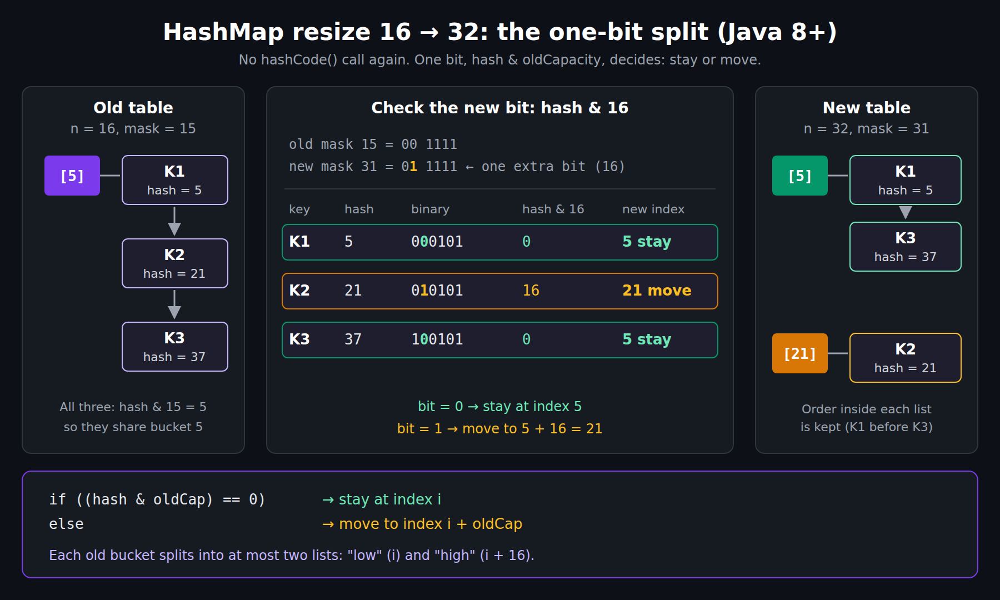

---

</details>

---

19. **📏 What is the difference between the capacity and size of HashMap in Java? ⚡**

<!-- -->
<details>
<summary>Answer</summary>

**Answer:**

| Term | Meaning | Method | Example |
|---|---|---|---|
| **Capacity** | Total number of **buckets** (array length) in the internal table | No public method — internal only | Default: 16, always a power of 2 |
| **Size** | Number of **key-value pairs** currently stored | `map.size()` | 0 when empty, grows with `put()` |
| **Threshold** | `capacity × loadFactor` — the point that starts a resize | No public method | 16 × 0.75 = 12 |

```java
HashMap<String, Integer> map = new HashMap<>();  // table == null! size=0, capacity NOT yet allocated
map.put("A", 1);                                 // ← table[16] allocated here, threshold=12
map.put("B", 2);
System.out.println(map.size());  // 2 (entries stored)
// capacity is now 16 (not exposed via public API)
```

⏳ **Lazy allocation:** `new HashMap<>()` does **not** allocate the 16-bucket array.
- It leaves `table == null`.
- It waits until the first `put()` to allocate it.
- Verified on JDK 17 (the `table` field is `null` before the first put; its length is 16 after).
- This keeps empty maps cheap. That matters when a class holds many maps that often stay empty.

> 🔑 **One-liner:** Capacity = how many buckets exist. Size = how many entries are stored. Resize happens when `size > capacity × loadFactor`. The default capacity is 16 and the default load factor is 0.75. But the table itself is allocated lazily, on the first `put()`.

---

</details>

---

20. **🚫 Does Set have a get(i) method or does Set allow index-based fetch? 💤**

<!-- -->
<details>
<summary>Answer</summary>

**Answer:**

❌️ No. `Set` does not have a `get(i)` method because sets have **no index**. Many sets (like `HashSet`) also have no fixed order. There is no idea of "element at index 3". Even `LinkedHashSet` (which keeps insertion order) does not give index-based access.

#### 🔧 Workarounds If You Need Index Access

**1. Convert to List:**
```java
Set<String> set = new LinkedHashSet<>(List.of("A", "B", "C")); // Set.of has no fixed order
List<String> list = new ArrayList<>(set);
String second = list.get(1);  // "B"
```

**2. Stream with skip (Java 8+):**
```java
String second = set.stream().skip(1).findFirst().orElse(null);
```

**3. Iterate manually:**
```java
int i = 0;
for (String s : set) {
    if (i == 1) { System.out.println(s); break; }
    i++;
}
```

> ⚠️ All workarounds are **O(n)**. If you often need index access, use a `List` instead.

> 🔑 **Interview tip:** `Set` guarantees uniqueness. `List` guarantees ordered index access. If you need both, use a `LinkedHashSet`. Convert it to a `List` when you need index access.

---

</details>

---

21. **🔢 Why does `Arrays.sort()` use Dual-Pivot Quicksort for primitives but TimSort for objects? 🔥**

<!-- -->
<details>
<summary>Answer</summary>

**Answer:**

**💡 The "why" in one line — the reason is stability and identity:**
- **Primitives have no identity beyond their value.** You cannot tell two equal `int`s apart. So keeping their relative order means nothing. *Stability gives no benefit.* Java is free to pick the **faster, unstable Dual-Pivot Quicksort**.
- **Objects have identity.** Two objects can be "equal" on the sort key but still different objects (e.g. two employees with the same salary but different names). The order of equal keys must be kept. So Java uses the **stable TimSort**. This is what makes multi-key sorting work: sort by name, then stably by salary → name order is kept within each salary group.

> 🔑 So the choice is not about speed alone. Primitives *don't need* stability, and objects *do*. Java optimizes each case for its own need.

**`Collections.sort()` and `Arrays.sort()` for Objects → TimSort (since Java 7)**

TimSort is a **hybrid algorithm** that combines Merge Sort and Insertion Sort. Tim Peters first designed it for Python. Java adopted it in Java 7.

**How TimSort works:**
1. Scan the input for **natural runs** (parts that are already sorted). If a run is too short, extend it to a minimum length (16–32 elements in Java)
2. Sort each short run using **binary Insertion Sort** (fast on small, nearly-sorted data)
3. Merge the sorted runs using **Merge Sort**

**Complexity:**

| Case | Time | Space |
|---|---|---|
| Best (already sorted) | O(n) | O(1) |
| Average | O(n log n) | O(n) |
| Worst | O(n log n) | O(n) |

> ✅ TimSort is **stable** — equal elements keep their original relative order. This is very important when sorting objects (e.g. sorting by last name must keep an earlier first-name sort).

**`Arrays.sort()` for primitives → Dual-Pivot Quicksort (since Java 7)**

```java
int[] nums = {5, 2, 8, 1};
Arrays.sort(nums);         // Dual-Pivot Quicksort — NOT TimSort

Integer[] boxed = {5, 2, 8, 1};
Arrays.sort(boxed);        // TimSort — objects need a stable sort
```

| | Object arrays | Primitive arrays |
|---|---|---|
| Algorithm | TimSort | Dual-Pivot Quicksort |
| Stable | ✅ Required | ❌️ Not needed (primitives have value, not identity) |
| Space | O(n) | O(log n) |

> 🔑 **Interview one-liner:** `Collections.sort()` uses **TimSort** (stable, O(n log n)). `Arrays.sort()` on primitives uses **Dual-Pivot Quicksort** (faster, not stable). The old "Insertion Sort if < 7, Merge Sort otherwise" answer is out of date. It was Java 6 behaviour.

---

</details>

---

22. **🔥 Why is `ArrayDeque` preferred over `Stack` in Java? ⚡**

<!-- -->
<details>
<summary>Answer</summary>

**Answer:**

`Stack` is a legacy class with many old design problems. `ArrayDeque` is its modern, faster, cleaner replacement.

**Problems with `Stack`:**

1. **Extends `Vector`** — `Vector` is fully `synchronized` on every method. Every `push()` and `pop()` acquires a lock, even in single-threaded code. This is extra cost for no reason.
2. **Inherits unrelated methods** — `Stack` inherits 40+ methods from `Vector` (`elementAt()`, `insertElementAt()`, `setSize()`, etc.). These methods do not belong on a stack. This breaks the principle of least surprise (code should behave the way a reader expects).
3. **Exposes access by any index** — `stack.get(2)` is valid on a `Stack`. A real stack should only expose the top of the stack. This breaks the stack contract.
4. **Wrong class hierarchy** — `Stack extends Vector` is an IS-A relationship. But a stack is not a vector. It should use composition (keep the storage as a field), not inheritance.

**Comparison:**

| Concern | `Stack` | `ArrayDeque` |
|---|---|---|
| Thread-safe | ✅ Over-synchronized | ❌️ Explicit sync if needed (faster) |
| Backed by | `Vector` (synchronized array) | Resizable circular array |
| API cleanliness | ❌️ Inherits irrelevant Vector methods | ✅ Clean `Deque` API |
| Arbitrary index access | ❌️ Exposes it (breaks contract) | ✅ Hidden |
| Implements / extends | extends `Vector`, implements `List` | implements `Deque`, `Queue` |
| Performance | Slower (lock on every op) | ✅ Faster (no locking) |
| Null elements | ✅ Allows | ❌️ Throws NPE |

**Equivalent stack operations on `ArrayDeque`:**

```java
Deque<Integer> stack = new ArrayDeque<>();

stack.push(10);   // addFirst(10) — LIFO push
stack.push(20);
stack.push(30);

System.out.println(stack.peek());  // 30 — view top
System.out.println(stack.pop());   // 30 — remove top
System.out.println(stack.pop());   // 20
```

> 💡 `push()`, `pop()`, and `peek()` on `ArrayDeque` map to `addFirst()`, `removeFirst()`, and `peekFirst()`. The LIFO behaviour does not change.

> 🔑 **Simple rule:** Declare it as `Deque<T> stack = new ArrayDeque<>()` — program to the interface (the variable type is the interface, not the class). Treat `Stack` as deprecated for new code.

---

</details>

---

23. **⚡ What is the difference between `Iterator`, `ListIterator`, and `Enumeration`? ⚡**

<!-- -->
<details>
<summary>Answer</summary>

**Answer:**

All three are ways to traverse Java collections. They come from different Java versions and can do very different things.

**`Enumeration` — Java 1.0 (Legacy):**
- Introduced with legacy classes: `Vector`, `Hashtable`, `Stack`
- Forward traversal only — no `remove()` support
- Methods: `hasMoreElements()`, `nextElement()`
- ⚠️ Outdated — avoid in new code

**`Iterator` — Java 1.2 (Standard):**
- Part of the Collections Framework
- Forward traversal only
- Supports `remove()` of the current element — you can safely remove during iteration
- Methods: `hasNext()`, `next()`, `remove()`
- Works on **all** `Collection` implementations (`List`, `Set`, `Queue`, etc.)

**`ListIterator` — Java 1.2 (Extended):**
- Extends `Iterator` — it has every `Iterator` method, plus more
- **Bidirectional**: forward and backward traversal
- Supports `add()`, `set()`, `remove()` during iteration
- Provides index context: `nextIndex()`, `previousIndex()`
- Only available on **`List` implementations** (`ArrayList`, `LinkedList`)

**Comparison Table:**

| Feature | `Enumeration` | `Iterator` | `ListIterator` |
|---|---|---|---|
| Introduced | Java 1.0 | Java 1.2 | Java 1.2 |
| Direction | Forward only | Forward only | Forward + Backward |
| `remove()` | ❌️ | ✅ | ✅ |
| `add()` | ❌️ | ❌️ | ✅ |
| `set()` | ❌️ | ❌️ | ✅ |
| Index access | ❌️ | ❌️ | ✅ |
| Works on | `Vector`, `Hashtable` | All `Collection` types | `List` types only |
| Status | ⚠️ Legacy | ✅ Standard | ✅ Standard |

**`ListIterator` — backward traversal:**

```java
List<String> cities = new ArrayList<>(List.of("Delhi", "Mumbai", "Bangalore", "Chennai"));

ListIterator<String> it = cities.listIterator(cities.size()); // start at end
while (it.hasPrevious()) {
    System.out.println(it.previous());
}
// Output: Chennai → Bangalore → Mumbai → Delhi
```

**`Iterator` — safe removal during traversal:**

```java
List<Integer> numbers = new ArrayList<>(List.of(1, 2, 3, 4, 5, 6));
Iterator<Integer> it = numbers.iterator();
while (it.hasNext()) {
    if (it.next() % 2 == 0) {
        it.remove();  // ✅ safe — no ConcurrentModificationException
    }
}
System.out.println(numbers);  // [1, 3, 5]
```

> ⚠️ Never call the collection's own `remove()` while you iterate with a for-each loop. This usually throws `ConcurrentModificationException`. (§2 Q2 shows the one case where it does not throw and skips an element instead.) Always use `Iterator.remove()` to remove safely during traversal.  
> 🔑 **One-liner:** `Enumeration` is legacy and read-only. `Iterator` adds `remove()` for all collections. `ListIterator` extends `Iterator`. It can move in both directions and can add, set and remove elements, but only for `List`.

---

</details>

---

24. **🗃️ What are `EnumMap` and `EnumSet`, and why are they faster than `HashMap` and `HashSet` for enum keys? ⚡**

<!-- -->
<details>
<summary>Answer</summary>

**Answer:**

**`EnumMap` — array-indexed Map for enum keys:**

`EnumMap<K extends Enum<K>, V>` uses a plain `Object[]` array. Each enum constant's **ordinal** (declaration order: 0, 1, 2, …) is the direct index into it. There is no hashing, no bucket lookup, and no collision handling. `get(Day.MON)` reads `vals[Day.MON.ordinal()]` at runtime.

```java
enum Day { MON, TUE, WED, THU, FRI, SAT, SUN }

EnumMap<Day, String> schedule = new EnumMap<>(Day.class);
schedule.put(Day.MON, "Standup at 9AM");
schedule.put(Day.FRI, "Retrospective at 4PM");

System.out.println(schedule.get(Day.MON)); // Standup at 9AM
```

**`EnumSet` — bitmask-backed Set for enum elements:**

| Enum size | Implementation | Backing store |
|---|---|---|
| ≤ 64 constants | `RegularEnumSet` | Single `long` bitmask |
| > 64 constants | `JumboEnumSet` | `long[]` array |

Each enum constant maps to a bit position. `add`, `contains`, `removeAll` and intersections all become bitwise operations.

```java
enum Permission { READ, WRITE, DELETE, ADMIN }

EnumSet<Permission> userPerms  = EnumSet.of(Permission.READ, Permission.WRITE);
EnumSet<Permission> adminPerms = EnumSet.allOf(Permission.class);

System.out.println(userPerms.contains(Permission.DELETE));  // false
System.out.println(adminPerms.containsAll(userPerms));      // true

EnumSet<Permission> overlap = userPerms.clone();
overlap.retainAll(adminPerms);
System.out.println(overlap);  // [READ, WRITE]
```

**Why are they faster?**

| Root cause | HashMap / HashSet | EnumMap / EnumSet |
|---|---|---|
| Key lookup | Compute `hashCode()`, find bucket, walk collision chain | Ordinal = direct array index / bit position |
| Collision handling | Required — O(1) amortized, worst O(n) | Impossible by design |
| `equals()` calls | Only when the key is not the same instance (`==` is checked first) | Never needed |
| Memory layout | Entry objects + linked nodes / tree nodes | Compact array or single `long` |

⚡ **Lookup, insert and remove** on `EnumMap` and `EnumSet` are **O(1) guaranteed** — not just amortized. The ordinal *is* the index, and collisions are impossible.

⚠️ But not *every* operation is O(1). Say "lookup/insert/remove", and your claim stays correct when the interviewer asks a follow-up:

| Operation | Cost | Why |
|---|---|---|
| `get` / `put` / `remove` / `containsKey` | O(1) guaranteed | Direct `array[ordinal]` access |
| `EnumMap.containsValue` | O(n) | Linear scan of the value array — no value index |
| `EnumMap` iteration | O(universe), not O(size) | Walks every ordinal slot, skipping empties |
| `EnumSet` bulk ops (`addAll`, `retainAll`) | O(1) for ≤ 64 constants, O(n/64) beyond | `RegularEnumSet` = one `long`; `JumboEnumSet` = a `long[]` |

**Comparison table:**

| Feature | HashMap | EnumMap | HashSet | EnumSet |
|---|---|---|---|---|
| Key/element type | Any object | Enum only | Any object | Enum only |
| Backing store | Hash table | `Object[]` array | Hash table | `long` bitmask |
| Ordering | Unordered | Declaration order | Unordered | Declaration order |
| `null` keys | ✅ 1 allowed | ❌️ | ✅ 1 allowed | ❌️ |
| Time complexity | O(1) amortized | O(1) guaranteed | O(1) amortized | O(1) guaranteed |
| Memory efficiency | Low | High | Low | Very high |

✅ **When to prefer:** any time your key or element is an enum. For example: feature flag maps, state machine transition tables, permission sets, day/month configs.

⚠️ **Limitation:** keys must be a single enum type known at compile time.

---

</details>

---

25. **🧰 What are the commonly used utility methods in the `Collections` class? ⚡**

<!-- -->
<details>
<summary>Answer</summary>

**Answer:**

`java.util.Collections` is a utility class of **static methods**. These methods work on collections or return them. All methods work through the `Collection` / `List` interface. They are not tied to any specific implementation.

**Sorting & Searching:**

```java
List<Integer> nums = new ArrayList<>(List.of(5, 3, 8, 1, 9, 2));

Collections.sort(nums);                             // natural order — TimSort, stable, O(n log n)
Collections.sort(nums, Comparator.reverseOrder());  // with Comparator
int idx = Collections.binarySearch(nums, 5, Comparator.reverseOrder()); // O(log n) — same order as the sort
Collections.reverse(nums);                          // in-place reversal
Collections.shuffle(nums);                          // random permutation
```

⚠️ `binarySearch` returns a **negative value** if it does not find the key. Results are undefined on an unsorted list.

**Min / Max:**

```java
String smallest = Collections.min(List.of("banana", "apple", "cherry")); // apple
String largest  = Collections.max(List.of("banana", "apple", "cherry")); // cherry
```

**Frequency & Membership:**

```java
int count      = Collections.frequency(List.of("a","b","a","c","a"), "a"); // 3
boolean noGap  = Collections.disjoint(List.of(1,2,3), List.of(4,5,6));     // true
```

💡 `disjoint` works on any two `Collection` instances. They don't need to be the same type.

**Fill & Copy:**

```java
List<String> dest = new ArrayList<>(List.of("x","x","x","x")); // dest pre-sized to 4
List<String> src  = List.of("a","b","c");

Collections.copy(dest, src);        // dest: [a, b, c, x]
Collections.fill(dest, "?");        // dest: [?, ?, ?, ?]

List<String> fiveHellos = Collections.nCopies(5, "hello"); // immutable List of 5 "hello"s
```

⚠️ `copy(dest, src)` requires `dest.size() >= src.size()`. It checks **size, not capacity**. If you pass a `new ArrayList<>()` (size 0), it throws `IndexOutOfBoundsException`.

**Thread-safety wrappers:**

```java
List<String> syncList = Collections.synchronizedList(new ArrayList<>());
syncList.add("item"); // individual ops are synchronized

// ⚠️ Iteration still requires EXTERNAL synchronization:
synchronized (syncList) {
    for (String s : syncList) { System.out.println(s); }
}
```

⚠️ These wrappers synchronize each method call on its own. So **compound operations (two or more calls in a row) are not atomic**. For modern concurrency, prefer `ConcurrentHashMap`, `CopyOnWriteArrayList`, etc.

**Unmodifiable views:**

```java
List<String> readOnly = Collections.unmodifiableList(base);
readOnly.add("x"); // throws UnsupportedOperationException
```

🔑 These are **views, not copies**. If the backing collection changes, the view shows the change. Use `List.copyOf(...)` (Java 10+) for a true immutable snapshot.

**Singleton & Empty collections:**

```java
List<String>         oneList = Collections.singletonList("only");   // immutable, 1 element
List<String>         empty   = Collections.emptyList();              // shared instance, 0 allocation
Map<String, Integer> emptyM  = Collections.emptyMap();
```

💡 `emptyList()` / `emptySet()` / `emptyMap()` return a **shared singleton** — zero object allocation. Use them instead of `new ArrayList<>()` when a method returns "no results".

**Quick Reference:**

| Category | Key methods | Gotcha |
|---|---|---|
| Sort / Search | `sort`, `binarySearch`, `reverse`, `shuffle` | `binarySearch` needs sorted input |
| Min / Max | `min`, `max` | Accepts custom `Comparator` |
| Frequency | `frequency`, `disjoint` | Works on any `Collection` |
| Fill / Copy | `fill`, `nCopies`, `copy` | `copy` needs `dest.size >= src.size` |
| Thread-safety | `synchronizedList/Map/Set` | Iteration needs external sync |
| Read-only view | `unmodifiableList/Map/Set` | Still reflects backing mutation |
| Singleton | `singletonList/Map/singleton` | Immutable, exactly 1 element |
| Empty | `emptyList/Map/Set` | Shared instance, zero allocation |

<details>
<summary>🤔 <strong>Doubt: What are the exact singleton methods? Is there a `singletonSet()`?</strong></summary>

No `singletonSet()` exists. The three singleton factory methods are:

| Method | Returns |
|---|---|
| `Collections.singleton(T o)` | Immutable **Set** with 1 element |
| `Collections.singletonList(T o)` | Immutable **List** with 1 element |
| `Collections.singletonMap(K, V)` | Immutable **Map** with 1 entry |

```java
Set<String>         oneSet  = Collections.singleton("only");           // Set
List<String>        oneList = Collections.singletonList("only");       // List
Map<String,Integer> oneMap  = Collections.singletonMap("key", 42);     // Map
```

`singleton()` itself is the **Set** variant. The names do not follow one pattern. The reason: `Set` was the original (Java 1.2). `singletonList` / `singletonMap` came later (Java 1.3), with the type name added at the end.

---

</details>
<br/>

---

</details>

---

## 2. Concurrent Collections Interview Questions

1. **🧵 What is the need for concurrent collection? 🔥**

<!-- -->
<details>
<summary>Answer</summary>

**Answer:**

- 🔓 Traditional collections are not thread-safe. Only a few classes, like `Vector` and `Hashtable`, are thread-safe.
- 🐢 `Collections` has methods like `synchronizedList`, `synchronizedMap`, and `synchronizedSet`. They give thread safety.
  - The problem: they take a lock on the whole collection, even for reading.
  - That lowers performance.
- 🚨 In a traditional collection, one thread may iterate over it. If the same thread or another thread makes a structural change (adds or removes an element), you get a `ConcurrentModificationException`.

🛠️ **Example:**

```java
// Example of ConcurrentModificationException in single thread
public class Test {
    public static void main(String[] args) {
        HashMap<Integer, Integer> map = new HashMap<>();
        map.put(1, 1);
        map.put(2, 2);
        map.put(3, 3);

        Iterator<Integer> iterator = map.keySet().iterator();
        while (iterator.hasNext()) {
            Integer key = iterator.next();
            System.out.println(map.get(key));
            if (key.equals(2)) {
                map.put(4, 4);
            }
        }
    }
}
```

📤 **Output:**

```
1
2
Exception in thread "main" java.util.ConcurrentModificationException
```

Now run the same program with the `ConcurrentHashMap` class. It does not throw any exception, and the code adds 4 to the map.

```java
import java.util.Iterator;
import java.util.concurrent.ConcurrentHashMap;

public class Test {
    public static void main(String[] args) {
        ConcurrentHashMap<Integer, Integer> map = new ConcurrentHashMap<>();
        map.put(1, 1);
        map.put(2, 2);
        map.put(3, 3);

        Iterator<Integer> iterator = map.keySet().iterator();
        while (iterator.hasNext()) {
            Integer key = iterator.next();
            System.out.println(map.get(key));
            if (key.equals(2)) {
                map.put(4, 4);
            }
        }
    }
}
```

📤 **Output:**

```
1
2
3
4
```

---

</details>

---

2. **💥 Difference between fail-fast and fail-safe iterators? 🔥**

<!-- -->
<details>
<summary>Answer</summary>

**Answer:**

These terms describe how an iterator behaves when someone changes its collection during iteration.

> ⚠️ **Note:** The Java documentation uses the term **"weakly consistent"**, not "fail-safe". "Fail-safe" is common in interviews, but it is an informal term.

#### 📊 Comparison

| Feature | Fail-Fast | Weakly Consistent ("Fail-Safe") |
|---|---|---|
| **Behavior on modification** | Throws `ConcurrentModificationException` immediately | No exception — iteration continues |
| **How it detects changes** | Checks `modCount` vs `expectedModCount` on every `next()` call | Doesn't track modifications at all |
| **Operates on** | The original collection directly | A snapshot or weakly consistent view |
| **Guarantees** | Fails immediately if collection is structurally modified | May or may not reflect concurrent changes |
| **Iterator `remove()`** | ✅ Supported — the only safe way to modify during iteration | ❌️ Throws `UnsupportedOperationException` (CopyOnWrite) or ✅ supported (ConcurrentHashMap) |
| **Performance** | No overhead beyond modCount check | Snapshot copy (CopyOnWrite) or lock-free traversal (CHM) |

#### 🔴 Fail-Fast Collections

| Collection | Iterator type |
|---|---|
| `ArrayList` | Fail-fast |
| `LinkedList` | Fail-fast |
| `HashMap` | Fail-fast |
| `HashSet` | Fail-fast |
| `TreeMap` / `TreeSet` | Fail-fast |
| `Vector` | Fail-fast |

```java
// Fail-fast — throws ConcurrentModificationException
List<String> list = new ArrayList<>(List.of("A", "B", "C", "D", "E"));
for (String s : list) {
    if (s.equals("B")) {
        list.remove(s);  // ❌️ modifies collection during iteration → CME on the next next()
    }
}

// ✅ Safe way — use Iterator.remove()
List<String> list2 = new ArrayList<>(List.of("A", "B", "C", "D", "E"));
Iterator<String> it = list2.iterator();
while (it.hasNext()) {
    if (it.next().equals("B")) {
        it.remove();  // ✅ removes via the iterator, then resyncs expectedModCount = modCount
    }
}
// list2 == [A, C, D, E]
```

**Why `Iterator.remove()` is the fix:**

- `list.remove()` increases `modCount`. It does not update the iterator's `expectedModCount`, so that value is now old.
- So the next `next()` fails `checkForComodification()`.
- `Iterator.remove()` does the same removal. *Then* it sets `expectedModCount = modCount`, so the two stay in sync.
- It also moves `cursor` back by one, so the loop does not skip an element.

<details>
<summary><strong>🤔 Doubt: Does removing inside a for-each ALWAYS throw ConcurrentModificationException?</strong></summary>

❌️ **No. Tier-1 companies like to ask this as a trick question.**

`ArrayList.Itr.hasNext()` is just `cursor != size`. It **never** checks `modCount`. Only `next()` does.

So a removal may make `cursor == size` true. Then the loop exits *silently*. The code never reaches `checkForComodification()`.

This happens exactly when you remove the **second-to-last** element:

```java
// 3 elements, remove "B" (index 1 of 0..2 — the penultimate one)
List<String> list = new ArrayList<>(List.of("A", "B", "C"));
for (String s : list) {
    if (s.equals("B")) {
        list.remove(s);
    }
}
System.out.println(list);   // → [A, C]   ✅ NO exception thrown!
```

**Trace:** after `next()` returns `"B"`, `cursor == 2`. The removal drops `size` from 3 to 2. `hasNext()` now checks `2 != 2` → `false` → loop ends. The loop never visits `"C"`, and no check ever runs.

Verified on JDK 17:

- The 3-element version above prints `[A, C]` with **no exception**.
- The 5-element version at the top of this answer throws `ConcurrentModificationException`.
- Removing the **last** element also throws (`cursor` is 5, `size` becomes 4, `5 != 4` → `hasNext()` is true → `next()` → CME).

> 🎯 **How to answer it:** "Fail-fast is *best-effort*, not a guarantee. The JavaDoc says so clearly. Never depend on it for correctness, only for finding bugs. Removing the second-to-last element is not caught, because `hasNext()` doesn't check `modCount`." This answer is worth more than repeating the normal case.

---

</details>
<br/>

#### 🟢 Weakly Consistent ("Fail-Safe") Collections

| Collection | Iterator mechanism |
|---|---|
| `ConcurrentHashMap` | Weakly consistent — traverses the live table, may reflect some concurrent changes |
| `CopyOnWriteArrayList` | Snapshot — iterates over the array reference captured at iterator creation |
| `CopyOnWriteArraySet` | Snapshot (backed by CopyOnWriteArrayList) |
| `ConcurrentLinkedQueue` | Weakly consistent |
| `ConcurrentSkipListMap` | Weakly consistent |

```java
// Weakly consistent — no exception
ConcurrentHashMap<Integer, String> map = new ConcurrentHashMap<>();
map.put(1, "A");
map.put(2, "B");
map.put(3, "C");

for (Map.Entry<Integer, String> e : map.entrySet()) {
    if (e.getKey() == 2) {
        map.put(4, "D");  // ✅ no exception — may or may not appear in this iteration
    }
}
```

#### ⚙️ How Fail-Fast Works Internally (modCount)

```java
// Inside ArrayList's Iterator
final void checkForComodification() {
    if (modCount != expectedModCount)
        throw new ConcurrentModificationException();
}
```

- `modCount` increments on every structural change (`add`, `remove`, `clear`)
- The iterator stores `expectedModCount = modCount` when it is created
- Every `next()` / `remove()` call checks if they still match
- `Iterator.remove()` is safe because it updates both `modCount` and `expectedModCount`

> 🔑 **Interview one-liner:** Fail-fast iterators detect changes through `modCount` and throw `ConcurrentModificationException` immediately. Weakly consistent iterators (concurrent collections) never throw CME. They work on a snapshot, or they walk the live structure without change checks.

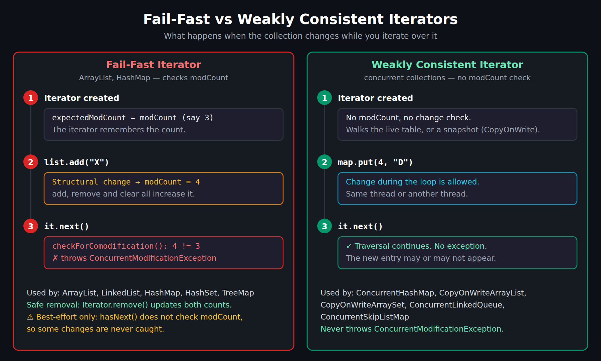

---

</details>

---

3. **📦 Example of Concurrent Collection classes? ⚡**

<!-- -->
<details>
<summary>Answer</summary>

**Answer:**

The `java.util.concurrent` package gives high-performance thread-safe collections. They replace the old synchronized wrappers.

#### 🗺️ Maps

| Class | Backed By | Thread-safety Mechanism | Iterator | Null Keys/Values | Ordering |
|---|---|---|---|---|---|
| `ConcurrentHashMap` | Hash table (Node[]) | Per-bin CAS + synchronized (Java 8+) | Weakly consistent | ❌️ / ❌️ | Unordered |
| `ConcurrentSkipListMap` | Skip list | Lock-free CAS | Weakly consistent | ❌️ / ❌️ | Sorted (natural / Comparator) |

#### 📋 Lists

| Class | Backed By | Thread-safety Mechanism | Iterator | Null Elements |
|---|---|---|---|---|
| `CopyOnWriteArrayList` | `Object[]` (copied on every write) | Full array copy + synchronized write | Snapshot (immutable) | ✅ |

#### 🎯 Sets

| Class | Backed By | Thread-safety Mechanism | Iterator | Null Elements |
|---|---|---|---|---|
| `CopyOnWriteArraySet` | `CopyOnWriteArrayList` internally | Same as COWAL — copy on write | Snapshot | ✅ |
| `ConcurrentSkipListSet` | `ConcurrentSkipListMap` internally | Lock-free CAS | Weakly consistent | ❌️ |

#### 📬 Queues

| Class | Backed By | Blocking? | Bounded? | Best For |
|---|---|---|---|---|
| `ConcurrentLinkedQueue` | Lock-free linked nodes (CAS) | ❌️ Non-blocking | ❌️ Unbounded | High-throughput non-blocking queue |
| `ArrayBlockingQueue` | Fixed-size array | ✅ Blocking | ✅ Mandatory capacity | Classic bounded producer-consumer |
| `LinkedBlockingQueue` | Linked nodes | ✅ Blocking | Optional (default unbounded) | High-throughput producer-consumer |
| `PriorityBlockingQueue` | Binary heap | ✅ Blocking | ❌️ Unbounded | Priority-based task processing |
| `SynchronousQueue` | No storage | ✅ Blocking | Zero capacity | Direct thread-to-thread handoff |

#### ✅ When to Use Which

| Need | Use |
|---|---|
| Concurrent key-value map (general purpose) | `ConcurrentHashMap` |
| Concurrent sorted map | `ConcurrentSkipListMap` |
| Thread-safe list — reads >> writes | `CopyOnWriteArrayList` |
| Thread-safe sorted set | `ConcurrentSkipListSet` |
| Non-blocking queue (no waiting) | `ConcurrentLinkedQueue` |
| Producer-consumer with backpressure | `ArrayBlockingQueue` / `LinkedBlockingQueue` |
| Direct handoff between threads | `SynchronousQueue` |
| Delayed/scheduled task queue | `DelayQueue` |

> 🔑 **Interview one-liner:** `java.util.concurrent` gives three families of thread-safe collections:
> - **ConcurrentHashMap** (per-bin locking for maps)
> - **CopyOnWrite** (snapshot iteration for lists/sets with rare writes)
> - **BlockingQueue** implementations (producer-consumer patterns)
>
> Under many threads, they are usually faster than `Collections.synchronized*()` wrappers. The exception: CopyOnWrite is slower when writes are frequent.

---

</details>

---

4. **🚧 What do you understand by BlockingQueue? ⚡**

<!-- -->
<details>
<summary>Answer</summary>

**Answer:**

**`java.util.concurrent.BlockingQueue`** is a thread-safe queue interface. It supports **blocking operations**:

- A producer thread blocks when the queue is full.
- A consumer thread blocks when the queue is empty.

It is the base of the **Producer-Consumer pattern** in Java.

🔑 **Key Characteristics:**
- 🔒 Thread-safe: many threads can insert/take at the same time, with no external synchronization
- 🚫 Does **not allow `null`** elements (throws `NullPointerException`)
- 📏 Can be **bounded** (fixed capacity) or **unbounded**
- ⏳ Supports **blocking, timed, and non-blocking** operations

📊 **Four Categories of Operations:**

| Operation | Throws Exception | Returns Special Value | Blocks | Times Out |
|---|---|---|---|---|
| **Insert** | `add(e)` → `IllegalStateException` | `offer(e)` → `false` | `put(e)` 🔒 | `offer(e, time, unit)` |
| **Remove** | `remove()` → `NoSuchElementException` | `poll()` → `null` | `take()` 🔒 | `poll(time, unit)` |
| **Examine** | `element()` → `NoSuchElementException` | `peek()` → `null` | N/A | N/A |

> 💡 `put()` and `take()` are the **blocking** methods. They are what make `BlockingQueue` different from a regular `Queue`.

🏗️ **Common Implementations:**

| Implementation | Backed By | Bounded? | Use Case |
|---|---|---|---|
| `ArrayBlockingQueue` | Fixed-size array | ✅ Yes (mandatory capacity) | Classic bounded buffer |
| `LinkedBlockingQueue` | Linked nodes | Optional (`Integer.MAX_VALUE` default) | High-throughput producer-consumer |
| `PriorityBlockingQueue` | Binary heap | ❌️ Unbounded | Priority-based task processing |
| `SynchronousQueue` | No internal storage | Zero capacity | Direct handoff between threads |
| `DelayQueue` | Priority heap of `Delayed` elements | ❌️ Unbounded | Scheduled/delayed task execution |

⚙️ **Producer-Consumer Example:**

```java
BlockingQueue<String> queue = new ArrayBlockingQueue<>(5);

// Producer thread
Thread producer = new Thread(() -> {
    try {
        queue.put("Task-1");  // blocks if queue is full
        queue.put("Task-2");
        System.out.println("Produced tasks");
    } catch (InterruptedException e) {
        Thread.currentThread().interrupt();
    }
});

// Consumer thread
Thread consumer = new Thread(() -> {
    try {
        String task = queue.take();  // blocks if queue is empty
        System.out.println("Consumed: " + task);
    } catch (InterruptedException e) {
        Thread.currentThread().interrupt();
    }
});

producer.start();
consumer.start();
```

⚡ **`ArrayBlockingQueue` vs `LinkedBlockingQueue`:**

| Feature | `ArrayBlockingQueue` | `LinkedBlockingQueue` |
|---|---|---|
| Lock mechanism | **Single lock** (one `ReentrantLock`) | **Two locks** (separate for put & take) |
| Throughput | Lower under high contention | Higher — producers & consumers don't block each other |
| Memory | Pre-allocated array | Nodes allocated on each insert (GC overhead) |
| Capacity | Must specify at creation | Optional (defaults to `Integer.MAX_VALUE`) |

> 🔥 **Interview tip:** `SynchronousQueue` has **zero capacity**. Every `put()` blocks until another thread calls `take()`. This gives a direct thread-to-thread handoff. `Executors.newCachedThreadPool()` uses it internally.

<details>
<summary><strong>🤔 Doubt: Is BlockingQueue the same thing used in Kafka, SQS, etc.?</strong></summary>

They share the same **producer-consumer pattern**, but they work at very different scales.

**`BlockingQueue` (Java)** is an **in-memory, in-process** data structure from `java.util.concurrent`. You use it for **thread-to-thread** communication inside a single JVM.

**Kafka / SQS** are **distributed, cross-process** message brokers. They:

- sit between separate services/machines
- persist messages to disk
- support retries, consumer groups, etc.

| Aspect | `BlockingQueue` | Kafka / SQS |
|---|---|---|
| Scope | Threads within 1 JVM | Services across network |
| Persistence | Memory only (lost on restart) | Disk-backed, durable |
| Scaling | Single machine | Distributed, partitioned |
| Delivery guarantees | N/A (same process) | At-least-once, exactly-once |
| Use case | Thread pool internals, `ExecutorService` | Microservice decoupling, event streaming |

💡 **Connection:** `ExecutorService` uses a `BlockingQueue` internally. That's how `ThreadPoolExecutor` queues submitted tasks for worker threads. Kafka/SQS solve the same basic problem, but at the **distributed systems level**.

---

</details>
<br/>

---

</details>

---

5. **🔀 What is the difference between a synchronized collection and a concurrent collection? 🔥**

<!-- -->
<details>
<summary>Answer</summary>

**Answer:**

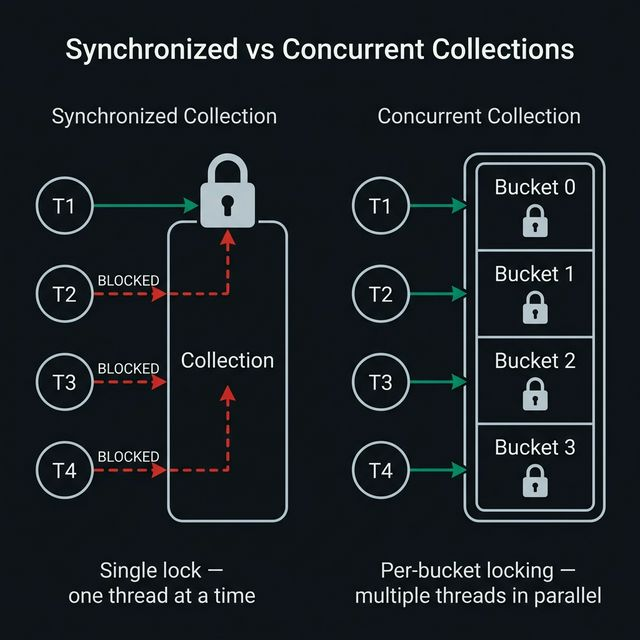

Both give thread safety, but they use very different locking strategies.

**Synchronized Collections** (`Collections.synchronizedList()`, `Hashtable`, `Vector`):
- 🔒 Wrap the whole collection with a **single mutex lock**. Every method (`get`, `put`, `remove`, `size`) acquires the **same lock**
- Only **one thread** can access the collection at a time, even for reads
- ⚠️ Iteration is **not thread-safe**. You must synchronize it yourself:
  ```java
  List<String> syncList = Collections.synchronizedList(new ArrayList<>());
  synchronized (syncList) {   // ← required, or ConcurrentModificationException
      for (String s : syncList) { System.out.println(s); }
  }
  ```
- 🐢 A big bottleneck under high concurrency: all threads compete for one lock

**Concurrent Collections** (`ConcurrentHashMap`, `CopyOnWriteArrayList`, `ConcurrentLinkedQueue`):
- 🔓 Use **fine-grained locking** or **lock-free algorithms**. Different threads can work on different segments/buckets at the same time
- ✅ Iterators are **weakly consistent**: no `ConcurrentModificationException`, and safe to iterate without external sync
- ⚡ Much higher throughput under multi-threaded workloads

**Comparison:**

| Feature | Synchronized Collection | Concurrent Collection |
|---|---|---|
| Locking | Single lock on entire object | Per-bucket / CAS / copy-on-write |
| Read concurrency | ❌️ Blocked by writers | ✅ Multiple readers allowed |
| Write concurrency | ❌️ One writer at a time | ✅ Multiple writers (different segments) |
| Iterator safety | ❌️ Fail-fast (`ConcurrentModificationException`) | ✅ Weakly consistent (no exception) |
| `null` support | ✅ Allowed (❌️ in `Hashtable`) | ❌️ Not allowed (`ConcurrentHashMap`) |
| Performance | 🐢 Poor under contention | 🚀 Scales with thread count |
| Examples | `synchronizedList`, `Hashtable`, `Vector` | `ConcurrentHashMap`, `CopyOnWriteArrayList` |

> 🔑 **One-liner:** Synchronized collections lock the **whole collection** (safe but slow). Concurrent collections lock **smaller parts** (safe and fast). Prefer concurrent collections when many threads share the data. But `CopyOnWriteArrayList` is slow when writes are frequent.

---

</details>

---

6. **🔧 Internal working of ConcurrentHashMap? 🔥**

<!-- -->
<details>
<summary>Answer</summary>

**Answer:**

`ConcurrentHashMap` is the thread-safe alternative to `HashMap`. Its internal design changed a lot in **Java 8**. Interviewers expect you to know both versions.

### Pre-Java 8: Segment-Based Locking

#### 📦 Internal Structure (Pre-Java 8)

The map is split into an array of **`Segment`** objects (default **16**). Each `Segment` extends `ReentrantLock`. Each one is basically a **mini-HashMap** with its own `HashEntry[]` array.

```
ConcurrentHashMap
├── Segment[0]  (ReentrantLock) → HashEntry[] → [bucket0] → [bucket1] → ...
├── Segment[1]  (ReentrantLock) → HashEntry[] → [bucket2] → [bucket3] → ...
├── ...
└── Segment[15] (ReentrantLock) → HashEntry[] → [bucket30] → [bucket31] → ...
```

#### ⚙️ How Operations Work (Pre-Java 8)

**`put()` — Write Operation:**

1. Compute hash → determine which **segment** the key belongs to
2. Acquire `ReentrantLock` on **that segment only**
3. Within the segment, find the bucket → walk linked list → insert/update
4. Release lock

```java
// Simplified pre-Java 8 put()
Segment<K,V> segment = segments[(hash >>> segmentShift) & segmentMask];
segment.lock();           // ReentrantLock on this segment
try {
    // find bucket within segment, walk chain, insert/update
} finally {
    segment.unlock();
}
```

- Two threads writing to **different segments** → no contention, both run in parallel
- Two threads writing to the **same segment** → one waits for the other
- Max parallelism = number of segments (default 16)

**`get()` — Read Operation:**

- **Lock-free**: `HashEntry.value` is `volatile`, so reads see the latest write without locking
- No segment lock needed for reads

**`size()` — Counting Elements:**

- First it tries up to **3 unlocked passes** (Java 7 code). Each pass sums the segments' `count` fields and their `modCount` fields. If the `modCount` total is the same in two passes in a row, the count is stable
- If the counts are unstable (it detects a concurrent change), it **locks all segments** and sums again
- This is slow when many threads write at the same time

#### ⚠️ Limitations of Segment-Based Approach

| Problem | Impact |
|---|---|
| Fixed segment count (16 by default) | Max concurrent writers is fixed at creation, regardless of map size |
| Coarse lock granularity | Multiple buckets share one lock — unnecessary contention |
| Linked list only for collisions | O(n) worst case per bucket |
| Single-threaded resize per segment | Slow expansion under load |
| `size()` may lock all segments | Blocks entire map momentarily |

### Java 8+: Per-Bin CAS + Synchronized (Current)

#### 📦 Internal Structure (Java 8+)

Inside, `ConcurrentHashMap` uses a **`Node<K,V>[]` array** (called `table`). This is the same basic structure as `HashMap`. Each bucket can hold:

| Bucket state | Structure | When |
|---|---|---|
| Empty | `null` | No entry at this index |
| Few entries (< 8) | **Linked list** of `Node` | Default for collisions |
| Many entries (>= 8) **and table >= 64** | **Red-black tree** wrapped in a `TreeBin` | Treeification threshold — same two conditions as `HashMap`; below a 64-bucket table it resizes instead |

> 🔒 **`TreeBin` — the thread-safe tree wrapper:** `HashMap` stores bare `TreeNode` objects in tree buckets. `ConcurrentHashMap` is different: it wraps them in a **`TreeBin`** object.  
> - `TreeBin` has its own **embedded read-write lock**.  
> - Readers use CAS-based optimistic reads (lock-free fast path).  
> - Writers first `synchronized` on the `TreeBin` (it *is* the bin's head node). Then they take the `TreeBin` write lock, which waits for active readers.  
>
> This makes tree-bucket operations thread-safe. It does not lock the entire map.

#### ⚙️ How Operations Work

**`put()` — Write Operation:**

1. Compute hash → find bucket index
2. If bucket is **empty** → insert using **CAS (Compare-And-Swap)** — no lock needed
3. If bucket is **non-empty** → `synchronized` on the **first node (head)** of that bucket
4. Walk the chain/tree, update existing key or append new node
5. If chain length >= 8 **and** the table is >= 64 buckets → treeify to red-black tree (otherwise resize)

```java
// Simplified internal logic of put()
if (bucket[i] == null) {
    // CAS — lock-free insert into empty bucket
    casTabAt(tab, i, null, new Node<>(hash, key, value));
} else {
    synchronized (firstNodeOfBucket) {  // lock ONLY this bin's head node
        // walk chain or tree, insert/update
    }
}
```

**`get()` — Read Operation:**

- **Completely lock-free** — uses `volatile` reads on the `Node.val` and `Node.next` fields
- No lock — just direct array access + chain/tree traversal. A tree-bin read may use a CAS to count itself as a reader, but it never blocks
- Many threads can read any bucket at the same time, even during writes

**`resize()` — Table Expansion:**

- Uses **concurrent transfer** — many threads can help move nodes from the old table to the new table
- Each thread claims a range of buckets to transfer using CAS on a shared `transferIndex`
- The thread puts a special `ForwardingNode` in each bucket it has moved. This node sends reads to the new table

#### 🔄 Evolution: Pre-Java 8 vs Java 8+

| Aspect | Pre-Java 8 | Java 8+ |
|---|---|---|
| Structure | `Segment[]` → each segment is a mini-HashMap | Single `Node[]` array (like HashMap) |
| Lock granularity | Per-segment (`ReentrantLock`) | Per-bin (`synchronized` on head node) |
| Default segments/locks | 16 fixed segments | As many as there are non-empty bins |
| Empty bucket insert | Requires segment lock | Lock-free CAS |
| Read locking | Lock-free | Lock-free |
| Collision handling | Linked list only | Linked list → red-black tree (threshold 8) |
| Resize | Single-threaded per segment | Multi-threaded concurrent transfer |

#### 📊 Operation Summary

| Operation | Locking | Mechanism |
|---|---|---|
| `get()` | None | `volatile` reads — completely lock-free |
| `put()` into empty bucket | None | CAS (Compare-And-Swap) |
| `put()` into non-empty bucket | Per-bin | `synchronized` on first node of bucket |
| `size()` | None | Uses `baseCount` + `CounterCell[]` (like `LongAdder`) |
| `resize()` | Cooperative | Multiple threads transfer buckets concurrently |

> 🔑 **Interview one-liner:** Java 8+ `ConcurrentHashMap` replaced segment-based `ReentrantLock` with per-bin `synchronized` + CAS. Reads are lock-free via `volatile`. Writes lock only the head node of that one bin. Resizing is concurrent — many threads work together to transfer buckets. This scales far better than the old 16-segment limit.

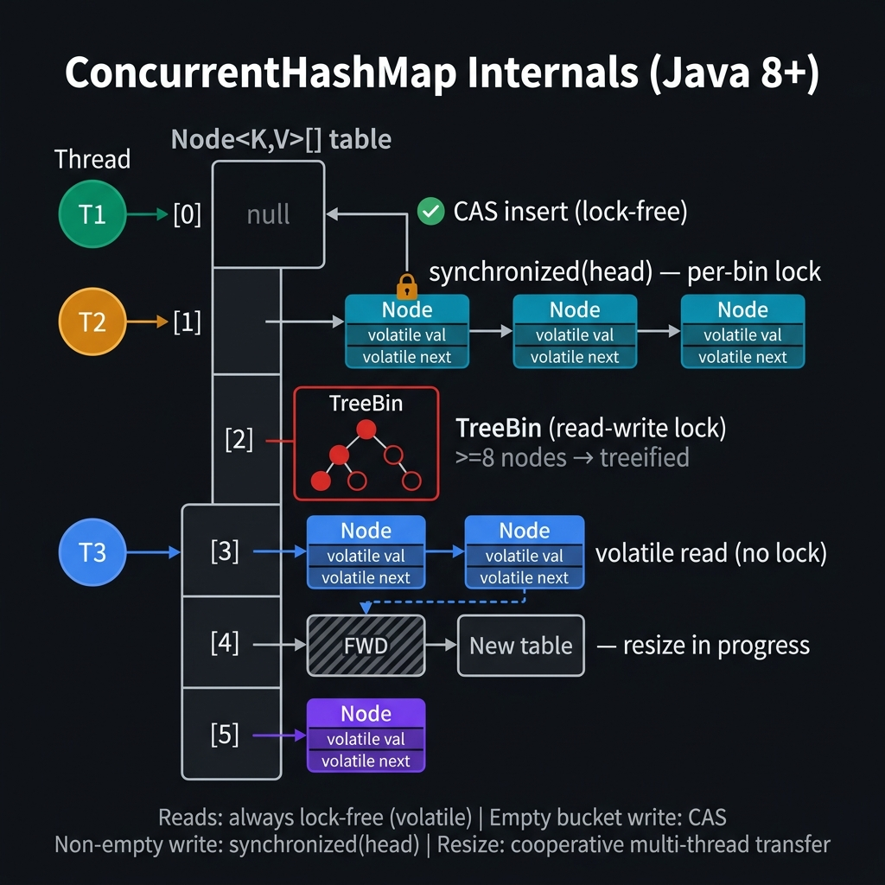

#### 🔍 The Root Cause: The "What Does `null` Mean?" Problem

When `map.get(key)` returns `null`, it could mean one of two things:
1. The key **does not exist** in the map.
2. The key **exists**, but its stored value is `null`.

**In a single-threaded `HashMap`**, this ambiguity is easy to resolve. You can safely call `containsKey()` right after `get()` to check which case it is:

```java
// Single-threaded — this is safe
String val = map.get("someKey");
if (val == null && map.containsKey("someKey")) {
    // Case 2: key exists, value is intentionally null
} else if (val == null) {
    // Case 1: key is absent
}
```

This works because no other thread can touch the map between these two lines.

#### ⚡ Why This Breaks in a Concurrent Environment

In a multi-threaded application, the two calls `get()` and `containsKey()` are **not atomic**. Another thread can modify the map in the gap between them. So you cannot trust the result of `containsKey()` at all.

```java
// Thread 1 (your code)                  // Thread 2 (another thread)
String val = map.get("user_123");        //
// val == null ... but why?              //
                                         // map.put("user_123", "Alice"); ← inserts key
boolean exists = map.containsKey(        //
    "user_123"); // returns TRUE         //
// 🔥 exists=true, but val is still null from get()
// You CANNOT determine the original state. The information is lost.
```

In a `ConcurrentHashMap`, you can never make the two calls atomic without external locking. And external locking removes the main benefit of the map.

#### 🛡️ The Design Decision by Doug Lea

`ConcurrentHashMap` was designed by Doug Lea with a strict rule:

> **Neither null keys nor null values are permitted.**

Now `get()` has only one meaning:

- `get()` returns a **non-null value** → key exists, this is its value.
- `get()` returns **`null`** → key is **definitely absent**. No follow-up check needed.

#### 📊 Summary

| Behavior | `HashMap` | `ConcurrentHashMap` |
|---|---|---|
| Null key allowed | ✅ One null key | ❌️ Throws `NullPointerException` |
| Null value allowed | ✅ Multiple null values | ❌️ Throws `NullPointerException` |
| `get()` returns `null` | ⚠️ Ambiguous: absent OR value is null | ✅ Unambiguous: key is definitely absent |
| `get()` + `containsKey()` safe? | ✅ Yes, single-threaded | ❌️ No, state can change between the two calls |

💡 **How to answer this in an interview:**

> "`ConcurrentHashMap` does not allow null. In a concurrent environment, `get()` returning `null` is always ambiguous. You cannot know if the key was absent or its value was null. The reason is that the map can be modified between a `get()` and a `containsKey()` check. Null is banned completely, so `null` from `get()` has exactly one meaning: the key is absent. This is a deliberate design decision by Doug Lea. It makes the map correct without the caller doing external locking."

---

</details>

---

12. **⚠️ Can ConcurrentModificationException occur only in a multithreaded environment? ⚡**

<!-- -->
<details>
<summary>Answer</summary>

**Answer:**

❌️ No. `ConcurrentModificationException` can also occur in a single-threaded environment. Say you loop over a map with a for loop and try to remove one element. You will get the `ConcurrentModificationException`. This is because we broke the rule: do not modify a Collection during iteration.

🛠️ **Example:**

```java
public class Test {
    public static void main(String[] args) {
        HashMap<Integer, Integer> map = new HashMap<>();
        map.put(1, 1);
        map.put(2, 2);
        map.put(3, 3);

        Iterator<Integer> iterator = map.keySet().iterator();
        while (iterator.hasNext()) {
            Integer key = iterator.next();
            System.out.println(map.get(key));
            if (key.equals(2)) {
                map.remove(key);
            }
        }
    }
}
```

⚙️ How does Java know to throw `ConcurrentModificationException`? It uses a transient variable called `modCount`. It counts how many times a list is modified structurally. Structural modifications are those that change the size of the list. They can break an iteration that is in progress and give wrong results.

Both `Iterator` and `ListIterator` use this field to detect unexpected changes. Other List methods that structurally modify the List also update this field, e.g. `add()`, `remove()`.

🔑 **Key Point:** The real cause of `ConcurrentModificationException` is an inconsistent `modCount`.

- When we iterate over an ArrayList, the Iterator's `next()` method keeps track of `modCount`.
- If we add or remove elements, `modCount` changes.
- Then it no longer matches the expected `modCount`.
- So the Iterator throws `ConcurrentModificationException`.

💡 **Pro Tip:** To remove elements while you loop:

- In a single-threaded environment, use the Iterator.
- Otherwise, use concurrent collection classes, e.g. `CopyOnWriteArrayList`. Call `list.remove()` directly — its iterator does not support `remove()`.

```java
// list.remove(ele);
//itr.remove(); // right call

public class Test {
    public static void main(String[] args) {
        List<Integer> list = new ArrayList<>();
        list.add(1);
        list.add(2);
        list.add(3);
        list.add(4);
        list.add(5);

        Iterator<Integer> iterator = list.iterator();
        while (iterator.hasNext()) {
            Integer value = iterator.next();
            System.out.println(value);
            if (value.equals(2)) {
                // list.remove(value);
                iterator.remove();
            }
        }

        System.out.println("After removing");
        Iterator<Integer> itAfterModification = list.iterator();
        while (itAfterModification.hasNext()) {
            Integer value = itAfterModification.next();
            System.out.println(value);
        }
    }
}
```

---

</details>

---

13. **🔢 What is the mod count in ArrayList? ⚡**

<!-- -->
<details>
<summary>Answer</summary>

**Answer:**

🔄 `modCount` is the ArrayList variable that holds the modification count.

- It changes every time we use the `add`, `remove`, or `trimToSize` methods.
- `expectedModCount` is the iterator variable. When we create an iterator, it is set to the same value as `modCount`.
- `set()` replaces an existing element but does not change `modCount`. This explains why we don't get exceptions if we use `set()` during iteration.

So the iterator throws `ConcurrentModificationException` if `modCount` changed (a structural change, such as a size change). When you create an iterator, it copies `modCount` into its own `expectedModCount` as the starting value.

```java
final void checkForComodification() {
    if (modCount!= expectedModCount) {
        throw new ConcurrentModificationException();
    }
}
```

---

</details>

---

14. **📋 Internal working of CopyOnWriteArrayList? ⚡**

<!-- -->
<details>
<summary>Answer</summary>

**Answer:**

`CopyOnWriteArrayList` is a thread-safe `List` implementation from `java.util.concurrent`. Its main idea: **every write creates a new copy of the underlying array**.

#### 📦 Internal Structure

```java
// Actual fields inside CopyOnWriteArrayList (simplified)
private transient volatile Object[] array;  // the backing array
final transient Object lock = new Object();  // lock for writes
```

- The backing `array` is `volatile`. Any thread that reads it always sees the latest reference.
- There is **no modCount, no fail-fast**. Iterators never throw `ConcurrentModificationException`.

#### ✍️ Write Operation (`add`, `set`, `remove`)

Every change follows the same steps — **lock → copy → modify copy → replace reference**:

```java
// Simplified internal logic of add()
synchronized (lock) {
    Object[] current = getArray();
    Object[] newArray = Arrays.copyOf(current, current.length + 1);  // full copy
    newArray[current.length] = element;
    setArray(newArray);  // volatile write — readers instantly see new array
}
```

1. Acquire the **single write lock** (`synchronized`)
2. Copy the **entire array** to a new array
3. Modify the new array (add/remove/update)
4. Replace the `volatile` reference to point to the new array
5. Release the lock. GC can now collect the old array

⚠️ **Only one writer at a time** (single lock). Every write is **O(n)** because of the full array copy.

#### 📖 Read Operation (`get`, `iterator`, `size`)

- **Completely lock-free**. It just reads the `volatile` array reference and then reads the element.
- No synchronization is needed. The array is **never modified in place**. After the write sets the reference, that array never changes.

```java
// Simplified internal logic of get()
public E get(int index) {
    return (E) getArray()[index];  // volatile read, no lock
}
```

#### 🔄 Iterator — Snapshot Semantics

```java
CopyOnWriteArrayList<String> list = new CopyOnWriteArrayList<>(List.of("A", "B", "C"));

Iterator<String> it = list.iterator();  // captures snapshot of array at this moment
list.add("D");                          // creates new array — iterator still sees old one

while (it.hasNext()) {
    System.out.print(it.next() + " ");  // prints: A B C  (not D!)
}
```

- The iterator captures a **snapshot** of the array when it is created
- Later writes create new arrays. The iterator's reference still points to the old (immutable) array
- ✅ Never throws `ConcurrentModificationException`
- ⚠️ The iterator does **not** support `remove()`, `set()`, `add()`. They throw `UnsupportedOperationException`

#### 📊 Performance Characteristics

| Operation | Time Complexity | Locking |
|---|---|---|
| `get(i)` | O(1) | None (volatile read) |
| `add(e)` | O(n) — full array copy | Synchronized |
| `remove(i)` | O(n) — full array copy | Synchronized |
| `set(i, e)` | O(n) — full array copy | Synchronized |
| `iterator()` | O(1) — snapshot reference | None |
| `size()` | O(1) | None (volatile read) |

#### ✅ When to Use

| Scenario | Use `CopyOnWriteArrayList`? |
|---|---|
| Reads >> Writes (e.g., listener lists, config caches) | ✅ Ideal |
| Frequent writes | ❌️ Terrible — O(n) copy per write |
| Large lists with mutations | ❌️ Memory + GC pressure from constant array copies |
| Iteration must not see concurrent changes | ✅ Snapshot guarantees this |

> 🔑 **One-liner:** `CopyOnWriteArrayList` gets thread-safety by copying the entire array on every write. Reads are lock-free and iterate over a snapshot. Best for read-heavy, write-rare cases like event listener lists.

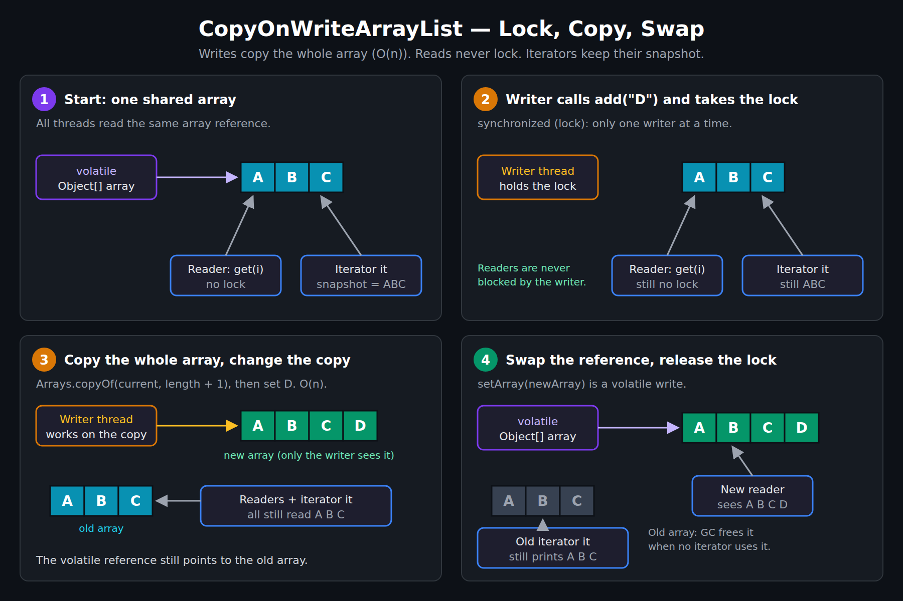

#### 📊 Comparison

| Feature | `ArrayList` | `CopyOnWriteArrayList` |
|---|---|---|
| **Thread safety** | ❌️ Not thread-safe | ✅ Thread-safe |
| **Write mechanism** | Modifies array in place | Creates a **new copy** of entire array on every write |
| **Read locking** | None (but unsafe under concurrency) | None — `volatile` read, always safe |
| **Write locking** | None | `synchronized` — single writer at a time |
| **Iterator type** | ❌️ Fail-fast (`ConcurrentModificationException`) | ✅ Snapshot — never throws CME |
| **Iterator sees concurrent changes** | N/A (throws exception) | ❌️ No — iterates over snapshot taken at creation |
| **`iterator.remove()`** | ✅ Supported | ❌️ Throws `UnsupportedOperationException` |
| **Modification detection** | `modCount` / `expectedModCount` check | No modCount — snapshot is immutable |
| **Read performance** | O(1) | O(1) — same (volatile read) |
| **Write performance** | O(1) amortized (add at end) | O(n) — full array copy on every write |
| **Memory overhead** | Low — single array | High — temporary duplicate arrays on each write + GC |
| **Best for** | Single-threaded or externally synchronized | Read-heavy, write-rare (listener lists, config caches) |

#### 🛠️ Behavior Differences — Code Examples

**ArrayList — fail-fast on concurrent modification:**

```java
List<Integer> list = new ArrayList<>(List.of(1, 2, 3, 4, 5));
Iterator<Integer> it = list.iterator();
while (it.hasNext()) {
    Integer val = it.next();
    if (val == 2) {
        list.remove(val);  // ❌️ ConcurrentModificationException
    }
}
```

**CopyOnWriteArrayList — snapshot iteration, no exception:**

```java
CopyOnWriteArrayList<Integer> list = new CopyOnWriteArrayList<>(List.of(1, 2, 3, 4, 5));
Iterator<Integer> it = list.iterator();  // snapshot of [1, 2, 3, 4, 5]
list.add(6);                              // creates new array — iterator still sees old one

while (it.hasNext()) {
    System.out.print(it.next() + " ");    // prints: 1 2 3 4 5 (not 6)
}
```

**CopyOnWriteArrayList — iterator.remove() is NOT supported:**

```java
CopyOnWriteArrayList<Integer> list = new CopyOnWriteArrayList<>(List.of(1, 2, 3));
Iterator<Integer> it = list.iterator();
it.next();
it.remove();  // ❌️ UnsupportedOperationException
              // Because iterator operates on a snapshot — can't modify the original
```

> 💡 To remove elements from `CopyOnWriteArrayList`, call `list.remove(element)` directly. Do not go through the iterator.

#### ✅ When to Use Which

| Scenario | Choice |
|---|---|
| Single-threaded code | `ArrayList` |
| Multi-threaded, frequent reads, rare writes | `CopyOnWriteArrayList` |
| Multi-threaded, frequent writes | Neither — consider `Collections.synchronizedList()` or `ConcurrentLinkedQueue` |
| Need `iterator.remove()` in multi-threaded code | `Collections.synchronizedList()` with external sync |

> 🔑 **Interview one-liner:** `ArrayList` is fast but not thread-safe. Its iterator is fail-fast. `CopyOnWriteArrayList` is thread-safe because it copies the entire array on every write. Reads and iteration are lock-free snapshots, but writes are O(n). Use it only when reads are far more than writes.

---

</details>

---

17. **🔧 What are `computeIfAbsent()`, `computeIfPresent()`, and `merge()` in ConcurrentHashMap? 🔥**

<!-- -->
<details>
<summary>Answer</summary>

**Answer:**

These are **atomic compound operations**, added in Java 8. Each one combines a check + action into a single thread-safe call. No external synchronization is needed.

#### 1. `computeIfAbsent(key, mappingFunction)`

If the key is **absent** (or mapped to `null`), it computes the value and inserts it **atomically**. If the key is already present, it returns the existing value.

```java
ConcurrentHashMap<String, List<String>> map = new ConcurrentHashMap<>();

// Thread-safe: creates list only if key is absent, then adds to it
map.computeIfAbsent("fruits", k -> new ArrayList<>()).add("Apple");
map.computeIfAbsent("fruits", k -> new ArrayList<>()).add("Banana");

System.out.println(map);  // {fruits=[Apple, Banana]}
```

⚠️ **Without `computeIfAbsent` — race condition:**

```java
// ❌️ NOT thread-safe — check-then-act is not atomic
if (!map.containsKey("fruits")) {
    map.put("fruits", new ArrayList<>());  // another thread may put between check and put
}
map.get("fruits").add("Apple");
```

**Common use case:** a concurrent lazy-loading cache. It loads each value once and reads it many times. Two threads never load the same key twice.

```java
ConcurrentHashMap<String, Session> sessions = new ConcurrentHashMap<>();

Session getSession(String userId) {
    // loadFromDb runs at most once per absent key, even under concurrent callers
    return sessions.computeIfAbsent(userId, id -> loadFromDb(id));
}
```

⚠️ **Hard rule: the mapping function must NOT modify the same map.**

`ConcurrentHashMap` holds the bin's monitor for the whole time the mapping function runs. If that function touches the same map, one of three things happens. None of them is good:

| What the function does | Result |
|---|---|
| Recursively `computeIfAbsent` a key in the **same bin** | `IllegalStateException: Recursive update` |
| Recursively `computeIfAbsent` a key in a **different bin** | Appears to work — a hidden bug that fails once the table resizes |
| `put`/`remove` on the same map from another bin | Can deadlock |

```java
// ❌️ ANTI-PATTERN — recursive memoization on a ConcurrentHashMap
ConcurrentHashMap<Integer, BigInteger> cache = new ConcurrentHashMap<>();

BigInteger fibonacci(int n) {
    return cache.computeIfAbsent(n, key -> {
        if (key <= 1) return BigInteger.valueOf(key);
        return fibonacci(key - 1).add(fibonacci(key - 2));  // 💥 modifies the map it is locking
    });
}
```

Verified on JDK 17:

- `fibonacci(n)` succeeds for `n ≤ 11` (`fibonacci(10)` returns `55` with no error).
- From `n = 12` upward, it throws **`java.lang.IllegalStateException: Recursive update`**.
- At `n = 12`, the map reaches 12 entries (0.75 × 16), so it resizes. The resize finds a bin still reserved by an unfinished `computeIfAbsent`, so it throws.

*Your small unit test passes. That is exactly what makes this dangerous.*

On a plain `HashMap`, the same pattern is no better. JDK 9+ throws `ConcurrentModificationException` (verified). On Java 8, it could silently corrupt the table.

✅ **Fix:** do the recursion outside the map, then store the result.

```java
BigInteger fibonacci(int n) {
    BigInteger hit = cache.get(n);
    if (hit != null) return hit;
    BigInteger v = (n <= 1)
        ? BigInteger.valueOf(n)
        : fibonacci(n - 1).add(fibonacci(n - 2));   // recursion happens outside any lock
    cache.putIfAbsent(n, v);
    return v;
}
```

> 🎯 **Interview one-liner:** "`computeIfAbsent` is atomic because the bin stays locked for the whole mapping function — which is exactly why that function must be short, side-effect-free, and must never touch the same map."

#### 2. `computeIfPresent(key, remappingFunction)`

If the key **exists** (and its value is non-null), it applies the function to compute a new value **atomically**. If the function returns `null`, the map **removes** the entry.

```java
ConcurrentHashMap<String, Integer> scores = new ConcurrentHashMap<>();
scores.put("Alice", 80);

// Atomically update only if present
scores.computeIfPresent("Alice", (k, v) -> v + 10);   // Alice → 90
scores.computeIfPresent("Bob", (k, v) -> v + 10);     // no-op — Bob absent

// Remove by returning null
scores.computeIfPresent("Alice", (k, v) -> v > 100 ? v : null);  // removes Alice (90 ≤ 100)
```

#### 3. `merge(key, value, remappingFunction)`

If the key is **absent**, it inserts the value. If the key is **present**, it applies the remapping function to the old and new values **atomically**. If the function returns `null`, the map removes the entry.

```java
ConcurrentHashMap<String, Integer> wordCount = new ConcurrentHashMap<>();

// Counting word occurrences — thread-safe
String[] words = {"hello", "world", "hello", "java", "hello"};
for (String word : words) {
    wordCount.merge(word, 1, Integer::sum);  // absent → put 1, present → old + 1
}

System.out.println(wordCount);  // {world=1, java=1, hello=3}  (hash order)
```

**Comparison with `put()` / `replace()`:**

```java
// ❌️ Not atomic — race condition between get and put
Integer old = map.get(key);
map.put(key, old == null ? 1 : old + 1);

// ✅ Atomic — merge handles absent + present in one call
map.merge(key, 1, Integer::sum);
```

#### 📊 Quick Reference

| Method | Key absent | Key present | Returns `null` from function |
|---|---|---|---|
| `computeIfAbsent(k, f)` | Compute + insert | Return existing value | Entry not created |
| `computeIfPresent(k, f)` | No-op | Compute new value | Entry removed |
| `compute(k, f)` | Compute + insert | Compute new value | Entry removed |
| `merge(k, v, f)` | Insert `v` | Apply `f(oldVal, v)` | Entry removed |
| `putIfAbsent(k, v)` | Insert `v` | Return existing value | N/A |

#### ✅ When to Use Which

| Scenario | Method |
|---|---|
| Lazy initialization / caching | `computeIfAbsent()` |
| Conditional update of existing entry | `computeIfPresent()` |
| Counting / accumulating (word count, sum) | `merge()` |
| Insert only if absent (simple value, no computation) | `putIfAbsent()` |
| Always compute regardless of presence | `compute()` |

> 🔑 **Interview one-liner:** `computeIfAbsent` is for lazy-init caches, `merge` is for atomic counters/accumulators, `computeIfPresent` is for conditional updates. All are atomic in `ConcurrentHashMap` — no external synchronization needed. They replace the old check-then-act pattern, which is not atomic.

---

</details>

---

## 3. Internal Working of HashMap and HashSet – After Java 8 Performance Improvement

1. **#️⃣ What is Hashing? How does HashMap use it internally? ⚡**

<!-- -->
<details>
<summary>Answer</summary>

**Answer:**

Hashing turns an object into an integer by using a function. This integer is the **hash code**. HashMap uses hashing to decide which **bucket (array index)** stores a key-value pair.

#### 🔄 The Two-Step Hash Process

**Step 1 — `hashCode()`:** The key's `hashCode()` method returns a raw integer.

**Step 2 — `hash()` (internal spread function):** HashMap does not use the raw hash code directly. It applies an internal `hash()` function. This function **XORs the upper 16 bits with the lower 16 bits**. This spreads the hash more evenly:

```java
// Java 8+ internal hash() — from HashMap source
static final int hash(Object key) {
    int h;
    return (key == null) ? 0 : (h = key.hashCode()) ^ (h >>> 16);
}
```

> 💡 Why? Many `hashCode()` implementations cluster in low bits. The XOR spread makes sure that differences in the higher bits also change the bucket index. This reduces collisions.

**Step 3 — Bucket index calculation:**

```java
int index = (n - 1) & hash;   // n = table.length (always a power of 2)
```

For a non-negative `hash`, a bitwise AND with `(n - 1)` gives the same result as `hash % n`, but it is faster. For a negative `hash`, `%` gives a negative number, but `&` still gives 0 to n-1. This only works because `n` is always a **power of 2** in HashMap.

#### 📊 Full Flow

```
key.hashCode()  →  hash() spread  →  (n-1) & hash  →  bucket index
     ↓                  ↓                  ↓               ↓
  raw int         XOR upper/lower      bitwise AND      0 to n-1
```

#### ⚠️ Equals and HashCode Contract

If you override `hashCode()`, you **must** also override `equals()`:

| Rule | Consequence if violated |
|---|---|
| Equal objects must have equal hash codes | HashMap can't find keys that are logically equal |
| Unequal objects may have equal hash codes (collision) | Normal — handled by chaining |
| `hashCode()` overridden but not `equals()` | Duplicate keys in HashMap — `get()` fails to match |

---

</details>

---

2. **📥 How does the `put()` method work internally in HashMap (Java 8+)? 🔥**

<!-- -->
<details>
<summary>Answer</summary>

**Answer:**

#### 📦 Internal Node Structure

Java 8+ uses `Node<K,V>` (renamed from `Entry<K,V>` in pre-Java 8):

```java
static class Node<K,V> implements Map.Entry<K,V> {
    final int hash;     // pre-computed hash (from hash() spread function)
    final K key;
    V value;
    Node<K,V> next;     // pointer to next node in chain (linked list)
}
```

#### ⚙️ Step-by-Step: `put(key, value)`

1. **Compute hash:** `hash = hash(key.hashCode())` — applies XOR spread function
2. **Calculate bucket index:** `index = (n - 1) & hash` where `n` = table length
3. **Check if bucket is empty**:
   - ✅ Empty → create new `Node` and place it directly in the bucket
4. **Bucket is non-empty — walk the chain**:
   - Compare each node: `hash == node.hash && (key == node.key || key.equals(node.key))`
   - 🔄 **Key match found** → **replace** the old value with the new value, return old value
   - ❌️ **No match** → append new `Node` at the **end** of the chain (Java 8+ uses tail insertion, pre-Java 8 used head insertion)
5. **Check treeification threshold**:
   - If the chain already had **>= 8** nodes before this add AND table size **>= 64** → convert linked list to **red-black tree**
   - If table size < 64 → **resize** instead of treeifying
6. **Check load factor**:
   - If `size > capacity * loadFactor` (default 0.75) → **resize** table (double capacity)

```java
// Simplified put() logic
int index = (n - 1) & hash(key);

if (table[index] == null) {
    table[index] = new Node<>(hash, key, value, null);  // empty bucket
} else {
    // Walk chain — check each node for key match
    for (Node<K,V> e = table[index]; e != null; e = e.next) {
        if (e.hash == hash && (e.key == key || key.equals(e.key))) {
            e.value = value;  // key exists — replace value
            return oldValue;
        }
    }
    // No match — append at tail
    lastNode.next = new Node<>(hash, key, value, null);
    if (binCount >= TREEIFY_THRESHOLD - 1)  // >= 7: chain had 8 nodes, new one is the 9th
        treeifyBin(table, hash);  // convert to red-black tree
}
size++;
if (size > threshold) resize();  // double table capacity
```

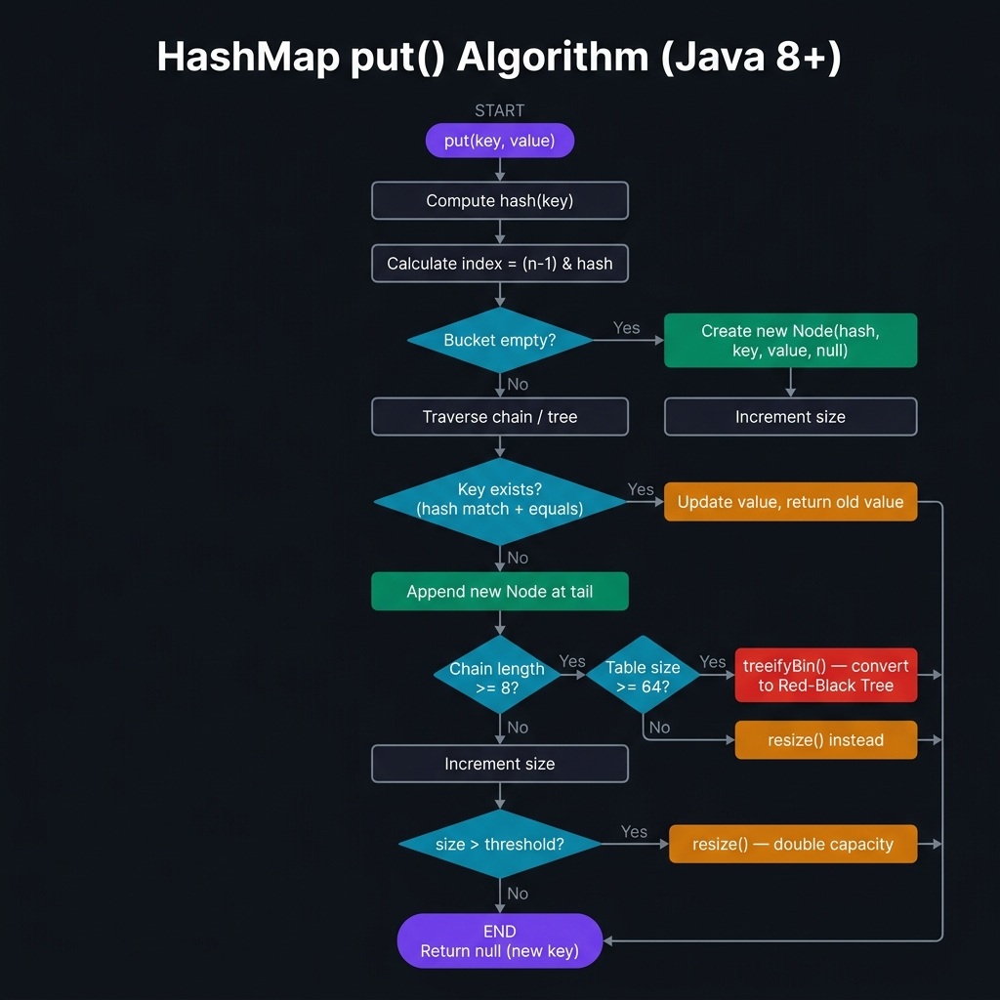

#### 🔑 Key Points

| Aspect | Detail |
|---|---|
| Null key handling | `hash(null)` returns 0 — always stored in bucket 0 |
| Tail insertion (Java 8+) | New nodes added at end of chain (prevents infinite loop during concurrent resize) |
| Head insertion (pre-Java 8) | ⚠️ Could cause infinite loop if two threads resize simultaneously |
| Load factor 0.75 | Resize when 75% full — balance between space and collision rate |

<details>
<summary><strong>🤔 Doubt: Why is HashMap not thread-safe? What can go wrong?</strong></summary>

`HashMap` has **no synchronization**. Concurrent access leads to three different kinds of failure:

**1. 🏁 Lost updates (race on `put()`)**

Two threads may insert into the same bucket at the same time. Then one thread can overwrite the other's entry.

The `++size` operation is also not atomic (it is a read-modify-write sequence). So the reported map size can be wrong with no error shown, even if both entries survive.

**2. ♾️ Infinite loop during resize (Java 7 only)**

In Java 7, `HashMap` used **head-insertion** when rehashing. Two threads could trigger a resize at the same time. Then they could build a **circular linked list** in a bucket. If that happens, any later `get()` on that bucket loops forever at 100% CPU. The thread hangs. No exception is thrown.

Java 8 fixed this. It switched to **tail-insertion** during rehash. Tail-insertion keeps the chain order and removes the cycle.

**3. 👁️ Visibility issues (JMM)**

Say there is no `volatile` and no synchronization. Thread A writes something: a new entry, an updated value, or a resized table pointer.

- That write may **never be flushed to main memory**.
- Thread B may keep reading stale (old) data from its CPU cache, with no time limit.
- The Java Memory Model allows this. Unsynchronized writes have no happens-before relationship with reads on other threads.

> ⚠️ Even `Collections.synchronizedMap()` is not enough for compound operations like check-then-act (`containsKey()` + `put()`). Another thread can run between the two calls. For atomic compound operations, use `ConcurrentHashMap` with `putIfAbsent()` / `computeIfAbsent()`.

---

</details>
<br/>

---

</details>

---

3. **💢 How were collisions handled before Java 8? ⚡**

<!-- -->
<details>
<summary>Answer</summary>

**Answer:**

**Pre-Java 8**, every bucket used a **singly linked list** to handle collisions. When two keys hashed to the same bucket, HashMap inserted the new node at the **head** of the list.

#### ⚙️ Collision Resolution Steps (Pre-Java 8)

1. Compute `hash` → calculate bucket `index`
2. If bucket is empty → store the `Entry` directly
3. If bucket is non-empty → **iterate the linked list**:
   - For each node, check `hash == e.hash && key.equals(e.key)`
   - Match found → **replace** the value
   - No match → insert new `Entry` at the **head** of the linked list

```
Bucket 5:  [NewEntry] → [Entry3] → [Entry2] → [Entry1] → null
            ↑ head insertion
```

#### 🐢 The Performance Problem

| Scenario | Lookup Time |
|---|---|
| Good hash distribution | O(1) — few collisions per bucket |
| Poor hash / many collisions | O(n) — entire linked list traversal |
| Worst case (all keys in one bucket) | O(n) — HashMap degrades to a linked list |

#### ⚠️ Head Insertion Bug (Pre-Java 8)

Head insertion caused a **serious bug during concurrent resize**. Two threads resizing at the same time could create a **circular linked list**. Then `get()` would loop forever (100% CPU hang). Java 8 switched to **tail insertion** to remove this bug.

---

</details>

---

4. **🛡️ How are collisions handled since Java 8 for HashMap, LinkedHashMap, and ConcurrentHashMap? 🔥**

<!-- -->
<details>
<summary>Answer</summary>

**Answer:**

Java 8 introduced **treeification**. When a bucket's collision chain grows too long, HashMap converts it from a linked list to a **red-black tree**. This improves worst-case lookup from O(n) to O(log n).

#### 📐 Thresholds

| Constant | Value | Action |
|---|---|---|
| `TREEIFY_THRESHOLD` | 8 | Chain already has 8 nodes and a 9th is added → convert to red-black tree |
| `UNTREEIFY_THRESHOLD` | 6 | During a resize split, tree node count <= 6 → convert back to linked list (on `remove()`, a tree-shape check is used instead) |
| `MIN_TREEIFY_CAPACITY` | 64 | Table must be >= 64 to treeify; otherwise resize instead |

<details>
<summary><strong>🤔 Doubt: What if table size is < 64 but a bucket reaches TREEIFY_THRESHOLD (8)?</strong></summary>

HashMap **resizes (doubles) the table instead of treeifying**.

**Why?** In a small table, the likely cause of collisions is too few buckets, not bad hash distribution. Doubling the table spreads the entries across more buckets. This makes the chains shorter on its own, so no tree is needed.

**Step by step:**

```
Table size = 16, Bucket 5 has 8 nodes, a 9th is added

→ TREEIFY_THRESHOLD (8) passed, but table size (16) < MIN_TREEIFY_CAPACITY (64)
→ Instead of treeifying: resize table from 16 → 32
→ Entries in Bucket 5 get rehashed — some stay in Bucket 5, some move to Bucket 21 (5 + 16)
→ Chain in Bucket 5 is now shorter (split across two buckets)
```

This can **repeat**. After a resize, the chain may still be longer than 8 and the table may still be < 64. Then HashMap resizes again (32 → 64). It treeifies only when the table reaches 64.

```java
// From HashMap source — inside treeifyBin()
if (tab == null || tab.length < MIN_TREEIFY_CAPACITY)
    resize();        // ← resize instead of treeify
else
    // convert to tree
```

| Table size | Bucket has 9+ nodes | Action |
|---|---|---|
| 16 | Yes | Resize → 32 (no tree) |
| 32 | Still yes | Resize → 64 (no tree) |
| 64 | Still yes | Treeify → red-black tree |

> 🔑 For small tables, HashMap prefers resizing over treeifying. Resizing is cheaper. It usually solves the problem by spreading entries across more buckets.

---

</details>
<br/>

#### 🔄 Lifecycle of a Bucket

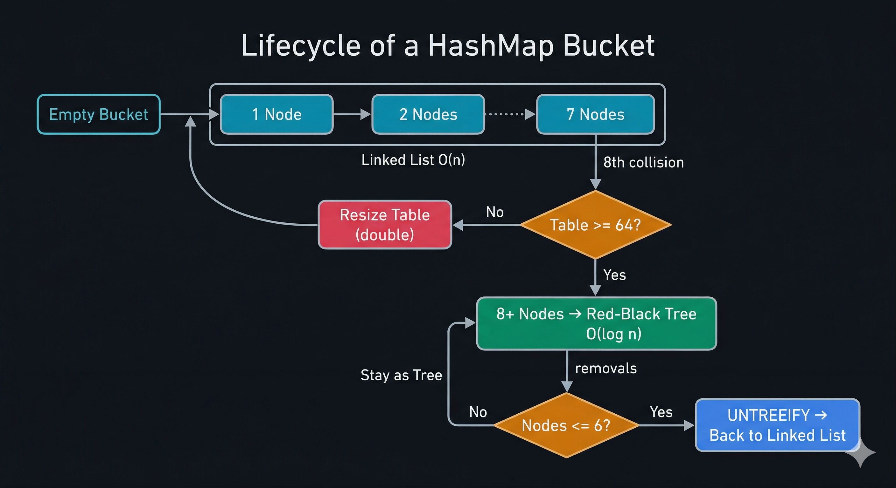

#### 🌳 How Tree Ordering Works

Red-black tree nodes are ordered by:

1. **Hash code** — primary ordering (lower hash goes left, higher goes right)
2. **`compareTo()`** — if hash codes are equal AND keys implement `Comparable`, use natural ordering
3. **`tieBreakOrder()`** — used last, to break a tie, if keys are not mutually `Comparable`. It compares class names first, then `System.identityHashCode()`

> 💡 So it is good practice to make HashMap keys implement `Comparable`. Then the tree order stays predictable when keys collide.

#### 📏 Why Two Different Thresholds (8 and 6)?

The gap between 8 (treeify) and 6 (untreeify) prevents **thrashing** (switching again and again with no benefit). Without the gap, a bucket whose size stays near the threshold would keep switching between list and tree, again and again.

#### 📊 Performance Comparison

| Scenario | Pre-Java 8 | Java 8+ |
|---|---|---|
| No collisions | O(1) | O(1) |
| Few collisions (< 8 per bucket) | O(k) linked list | O(k) linked list (same) |
| Many collisions (>= 8 per bucket) | O(n) linked list | O(log n) red-black tree |
| Worst case (all keys same bucket) | O(n) | O(log n) if keys are `Comparable`; can still be O(n) when hashes are equal and keys are not `Comparable` |

#### 📝 TreeNode Memory Trade-off

`TreeNode` is about **twice the size** of a regular `Node`. It has extra fields: `parent`, `left`, `right`, `prev`, `red` flag. It also gets `before`/`after` from `LinkedHashMap.Entry`. So HashMap treeifies a bucket only when it has enough collisions to be worth the extra memory.

> 🔑 **One-liner:** Java 8+ converts a bucket's linked list to a red-black tree when chain length >= 8 (and table >= 64). This improves worst-case collision lookup from O(n) to O(log n). It converts back to a linked list when a resize split leaves <= 6 nodes, or when `remove()` makes the tree too small.

📜 This change applies to **HashMap, LinkedHashMap, and ConcurrentHashMap**.

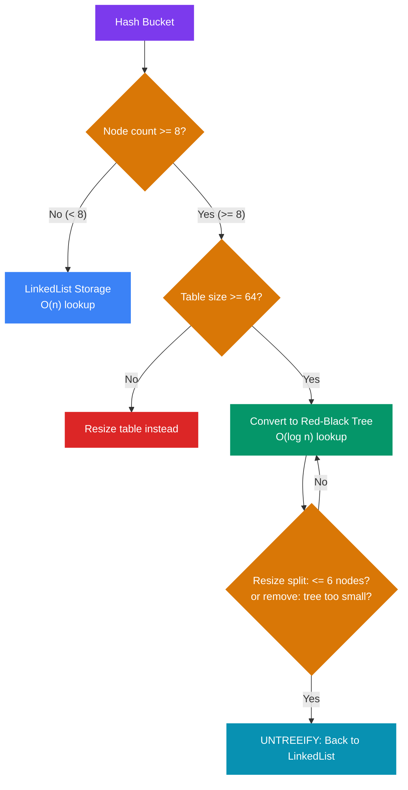

---

</details>

---

5. **📤 How does the `get()` method work internally in HashMap (Java 8+)? 🔥**

<!-- -->
<details>
<summary>Answer</summary>

**Answer:**

#### ⚙️ Step-by-Step: `get(key)`

1. **Compute hash:** `hash = hash(key.hashCode())`
2. **Calculate bucket index:** `index = (n - 1) & hash`
3. **Check first node** (optimization — most buckets have only 1 node):
   - If `first.hash == hash && (first.key == key || key.equals(first.key))` → return `first.value`
4. **First node doesn't match — check node type**:
   - **`TreeNode`** → call `getTreeNode(hash, key)` — O(log n) red-black tree traversal
   - **Regular `Node`** → walk the linked list — O(n) linear scan
5. **No match found** → return `null`

```java
// Simplified get() logic from HashMap source
public V get(Object key) {
    int hash = hash(key);
    Node<K,V> first = table[(n - 1) & hash];

    if (first == null) return null;  // empty bucket

    // Check first node (fast path — covers most cases)
    if (first.hash == hash && (first.key == key || key.equals(first.key)))
        return first.value;

    // More than one node in bucket
    if (first instanceof TreeNode) {
        // ⚠️ getTreeNode() returns null on a miss — must null-check before dereferencing
        TreeNode<K,V> e = ((TreeNode<K,V>) first).getTreeNode(hash, key);  // O(log n)
        return e == null ? null : e.value;
    }

    // Linked list traversal
    for (Node<K,V> e = first.next; e != null; e = e.next) {           // O(n)
        if (e.hash == hash && (e.key == key || key.equals(e.key)))
            return e.value;
    }
    return null;  // key not found
}
```

#### 📊 Lookup Performance

| Bucket state | Lookup time | Path taken |
|---|---|---|
| Empty | O(1) | `null` check |
| Single node | O(1) | First-node fast path |
| Linked list (< 8 nodes) | O(k) | Linear scan |
| Red-black tree (>= 8 collisions) | O(log n) | `getTreeNode()` |

> 🔑 **Interview tip:** Always mention the first-node optimization. It shows you have read the actual source. In practice, most buckets have 0 or 1 node. So `get()` is O(1) almost always.

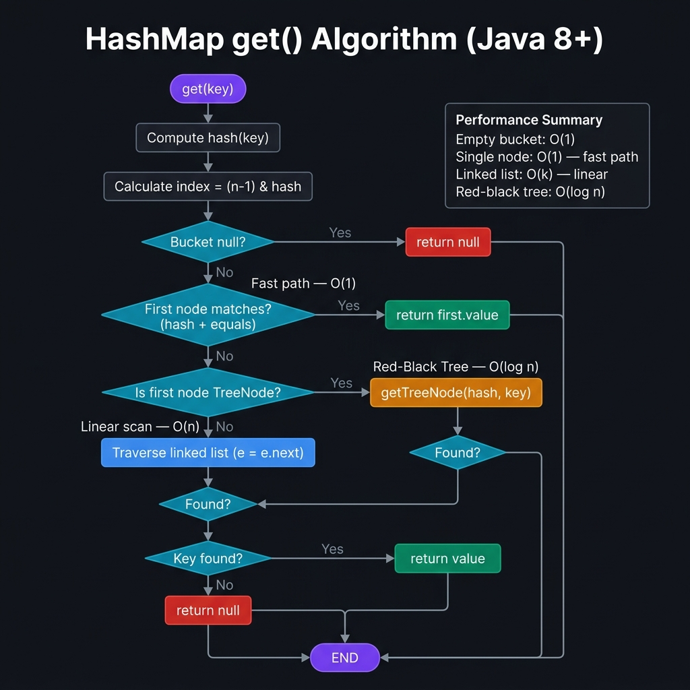

---

</details>

---

6. **💡 Key rules and gotchas for HashMap, LinkedHashMap, and ConcurrentHashMap? ⚡**

<!-- -->
<details>
<summary>Answer</summary>

**Answer:**

#### 🔑 Core Rules

| Rule | Detail |
|---|---|
| Storage unit | `Node<K,V>` (Java 8+), was `Entry<K,V>` pre-Java 8 |
| Bucket = array index | Each index in `Node[]` table can hold a chain (list or tree) |
| Index calculation | `(n - 1) & hash(key.hashCode())` — bitwise AND, not modulo |
| Key uniqueness | Determined by `hashCode()` + `equals()` together |
| Value's hashCode/equals | Not used to store or find entries — only the key's methods matter (`containsValue()` does call the value's `equals()`) |

#### 🗝️ Null Handling

| Map type | Null key | Null values |
|---|---|---|
| `HashMap` | ✅ One (stored in bucket 0, `hash(null)` = 0) | ✅ Multiple |
| `LinkedHashMap` | ✅ One | ✅ Multiple |
| `ConcurrentHashMap` | ❌️ Throws NPE | ❌️ Throws NPE |

#### ⚠️ Common Interview Gotchas

**1. Mutable keys break HashMap:**
```java
List<String> key = new ArrayList<>(List.of("A"));
map.put(key, "value");
key.add("B");           // hashCode changes!
map.get(key);           // returns null — can't find the entry anymore
```
> Never use mutable objects as HashMap keys. Prefer `String`, `Integer`, or custom immutable classes.

**2. `equals()` without `hashCode()` causes duplicates:**
```java
// If equals() says two keys are equal but hashCode() differs:
// → They land in different buckets → HashMap treats them as different keys
// → Duplicate "logical" entries in the map
```

**3. Table size is always a power of 2:**
- Even if you pass `new HashMap<>(10)`, internal capacity becomes **16** (next power of 2)
- This makes sure `(n - 1) & hash` works correctly as a fast modulo

**4. Load factor trade-off:**

| Load factor | Space | Collisions | Use case |
|---|---|---|---|
| 0.5 | More memory | Fewer | Time-critical lookups |
| 0.75 (default) | Balanced | Balanced | General purpose |
| 1.0 | Less memory | More | Memory-constrained |

---

</details>

---

## 4. Array, ArrayList, Vector, and LinkedList — Key Comparisons

1. **📊 Difference between Array and ArrayList ⚡**

<!-- -->
<details>
<summary>Answer</summary>

**Answer:**

#### 📊 Core Differences

| Feature | `Array` | `ArrayList` |
|---|---|---|
| **Size** | Fixed at creation — cannot grow or shrink | Dynamic — grows by 50% when full (`newCapacity = oldCapacity + (oldCapacity >> 1)`) |
| **Type safety** | Can hold primitives + objects (`int[]`, `String[]`) | Objects only — primitives auto-boxed (`int` → `Integer`) |
| **Generics** | ❌️ No generic arrays (`new T[]` illegal due to type erasure) | ✅ Full generics support (`ArrayList<String>`) |
| **Dimensions** | Multi-dimensional (`int[][]`, `String[][][]`) | Single-dimensional only (use `List<List<T>>` for 2D) |
| **Length / Size** | `.length` (field) | `.size()` (method) |
| **API** | No built-in methods — manual loops for search/sort | Rich API: `add()`, `remove()`, `contains()`, `sort()`, `subList()` |
| **Memory layout** | Contiguous block — elements stored in adjacent memory | Also backed by `Object[]` array internally — same contiguous layout |
| **Initialization** | Size mandatory: `new int[10]` or `{1,2,3}` | Optional: `new ArrayList<>()` gets capacity 10 on the first `add()` (it starts with an empty array) |

#### ⏱️ Time Complexity

| Operation | `Array` | `ArrayList` |
|---|---|---|
| Access by index | O(1) | O(1) |
| Set by index | O(1) | O(1) |
| Add at end | N/A (fixed size) | O(1) amortized (O(n) on resize) |
| Add at index | N/A | O(n) — shifts elements right |
| Remove by index | N/A | O(n) — shifts elements left |
| Search (unsorted) | O(n) | O(n) |

> ⚠️ **Common misconception:** "ArrayList is not stored in contiguous memory" — this is **wrong**. ArrayList is backed by an `Object[]`, which is a contiguous array. The *references* sit next to each other in memory. The *objects they point to* may be spread across the heap. But this is true for any `Object[]` array, including a plain array.

> 🔑 **When to use which:** Use arrays for fixed-size, primitive-heavy, performance-critical code (e.g., `int[]` for DSA). Use `ArrayList` for everything else. Dynamic sizing, generics, and a rich API make it the default choice.

---

</details>

---

2. **🏹 Difference between ArrayList and Vector ⚡**

<!-- -->
<details>
<summary>Answer</summary>

**Answer:**

#### 📊 Core Differences

| Feature | `ArrayList` | `Vector` |
|---|---|---|
| **Thread safety** | ❌️ Not synchronized | ✅ Every method is `synchronized` |
| **Performance** | ⚡ Faster — no locking overhead | 🐢 Slower — acquires lock on every operation, even single-threaded |
| **Growth strategy** | Grows by **50%** (`newCapacity = old + (old >> 1)`) | Grows by **100%** (doubles) — more memory waste |
| **Iterator** | `Iterator` (fail-fast) | `Iterator` (fail-fast) + legacy `Enumeration` (**no modification check at all**) |
| **Introduced** | Java 1.2 (Collections Framework) | Java 1.0 (legacy class) |
| **Modern usage** | ✅ Standard choice for `List` | ❌️ Effectively deprecated — avoid in new code |

#### ⚠️ Why Vector is Obsolete

1. **Synchronization is too coarse** — it locks each method on its own. This does not help with compound operations (check-then-act, where you check a value and then act on it). You still need external synchronization for real thread safety.
2. **Better alternatives exist**:
   - Need thread-safe list? → `Collections.synchronizedList(new ArrayList<>())` or `CopyOnWriteArrayList`
   - Need concurrent access? → `ConcurrentLinkedQueue` or other `java.util.concurrent` classes
3. **Performance cost with no benefit** — in single-threaded code (99% of list usage), Vector's synchronization only adds cost.

```java
// ❌️ Don't use Vector
Vector<String> v = new Vector<>();

// ✅ Use ArrayList (single-threaded)
List<String> list = new ArrayList<>();

// ✅ Use synchronizedList (multi-threaded, if you must)
List<String> syncList = Collections.synchronizedList(new ArrayList<>());

// ✅ Use CopyOnWriteArrayList (read-heavy, multi-threaded)
List<String> cowList = new CopyOnWriteArrayList<>();
```

<details>
<summary><strong>🤔 Doubt: Is Vector's legacy `Enumeration` fail-safe?</strong></summary>

❌️ **No — it is neither fail-fast nor a snapshot. It is simply unchecked.**

`Vector.elements()` returns an `Enumeration`. It holds only an `int count` and reads the live backing array. It **never looks at `modCount`**. So it gives you none of the three guarantees people expect:

```java
public Enumeration<E> elements() {
    return new Enumeration<E>() {
        int count = 0;
        public boolean hasMoreElements() {
            return count < elementCount;      // ← no modCount check
        }
        public E nextElement() {
            synchronized (Vector.this) {
                if (count < elementCount) return elementData(count++);
            }
            throw new NoSuchElementException("Vector Enumeration");
        }
    };
}
```

Three behaviours, all verified on JDK 17:

| Scenario | Result |
|---|---|
| `hasMoreElements()` returns `true`, vector is then cleared, `nextElement()` called | 💥 `NoSuchElementException: Vector Enumeration` |
| Remove element 0 after each `nextElement()` on `[1,2,3,4,5]` | 🤫 Silently yields `1, 3, 5` — **elements are skipped, no exception** |
| `Vector.iterator()` (not `elements()`): `clear()` in the middle of the loop, then `next()` | ✅ `ConcurrentModificationException` — the modern `Iterator` **is** fail-fast |

Silent element-skipping is the worst of the three:
- There is no snapshot (unlike `CopyOnWriteArrayList`).
- There is no failure signal (unlike a fail-fast `Iterator`).
- You just get wrong results, with no warning.

> 🎯 **How to answer:** "`Enumeration` predates `modCount` (Java 1.0), so it is *unchecked*, not fail-safe. Vector's `Iterator`, added in 1.2, is properly fail-fast." If you call it "fail-safe", you suggest a snapshot guarantee. It does not have one.

---

</details>
<br/>

> 🔑 **Interview one-liner:** Vector is a legacy synchronized ArrayList from Java 1.0. It is out of date. Use `ArrayList` for single-threaded code. Use `CopyOnWriteArrayList` or `Collections.synchronizedList()` when you need thread safety.

---

</details>

---

3. **⚔️ Difference between ArrayList and LinkedList 🔥**

<!-- -->
<details>
<summary>Answer</summary>

**Answer:**

#### 📊 Core Differences

| Feature | `ArrayList` | `LinkedList` |
|---|---|---|
| **Backing structure** | Dynamic `Object[]` array | Doubly linked list (`Node` with `prev`/`next` pointers) |
| **Implements** | `List`, `RandomAccess` | `List`, `Deque`, `Queue` |
| **Memory per element** | ~4 bytes (object reference only, with compressed oops; 8 bytes without) | ~24 bytes (data + prev pointer + next pointer + node object header) |
| **CPU cache friendliness** | ✅ Excellent — contiguous memory, sequential access | ❌️ Poor — nodes scattered across heap, cache misses |
| **Default capacity** | 10 (when using no-arg constructor) | None — no pre-allocation |
| **Reverse iteration** | No `descendingIterator()` | ✅ `descendingIterator()` from `Deque` interface |

#### ⏱️ Time Complexity

| Operation | `ArrayList` | `LinkedList` |
|---|---|---|
| `get(index)` | **O(1)** — random access | O(n) — traverse from head or tail |
| `add(e)` (at end) | **O(1)** amortized | **O(1)** |
| `add(0, e)` (at head) | O(n) — shifts all elements | **O(1)** |
| `add(index, e)` (middle) | O(n) — shift right | O(n) — traverse + O(1) insert |
| `remove(0)` (head) | O(n) — shifts all elements | **O(1)** |
| `remove(size-1)` (tail) | **O(1)** | **O(1)** |
| `remove(index)` (middle) | O(n) — shift left | O(n) — traverse + O(1) unlink |
| `contains(e)` | O(n) | O(n) |
| `iterator.remove()` | O(n) — shift elements | **O(1)** — unlink node |

#### ⚠️ The "LinkedList is faster for insertions" Myth

The textbook answer says "LinkedList is faster for add/remove". In practice, this is **misleading**:

1. **Mid-list operations are O(n) for both** — LinkedList must *traverse* to the index first, then unlink in O(1). ArrayList must *shift* elements via `System.arraycopy()`. When you compare traversal with shift, ArrayList often wins. The reason: `arraycopy` is a native memory-copy operation optimized by the JVM.

2. **CPU cache locality matters** — ArrayList's memory is contiguous. So sequential access is much faster, because the CPU prefetches whole cache lines (loads nearby memory in advance). LinkedList's nodes are spread across the heap. They cause constant cache misses.

3. **Memory overhead** — each LinkedList node allocates a separate object on the heap (~24 bytes overhead per element). For large lists, this adds a lot of GC pressure.

> 💡 **In benchmarks, ArrayList is faster than LinkedList for almost all real-world use cases.** This includes mid-list insertions on medium-sized lists. LinkedList only wins for **heavy head/tail operations** (queue/deque patterns).

#### ✅ When to Use Which

| Use case | Choice |
|---|---|
| General-purpose list | `ArrayList` (default) |
| Frequent random access / index lookup | `ArrayList` |
| Queue / Deque (FIFO/LIFO at head/tail) | `LinkedList` (or `ArrayDeque` — even better) |
| Frequent `iterator.remove()` during traversal | `LinkedList` |
| Memory-constrained with large lists | `ArrayList` (less overhead per element) |

> 🔑 **Interview one-liner:** ArrayList uses a dynamic array (O(1) random access, O(n) mid-insert). LinkedList uses a doubly linked list (O(1) head/tail ops, O(n) random access). In practice, ArrayList wins for most workloads. The reasons are cache locality and lower memory overhead. Use LinkedList only for queue/deque patterns.

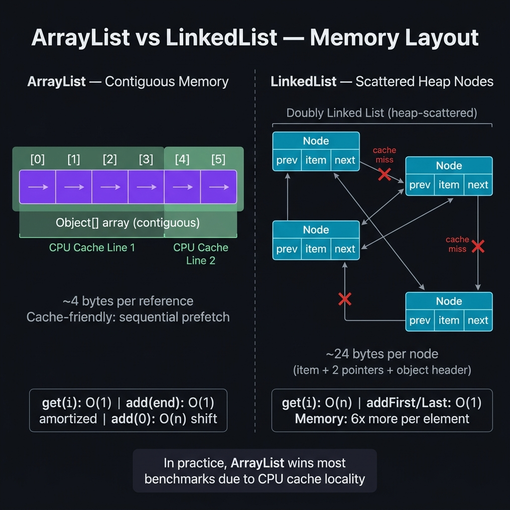

---

</details>

---

## 5. Comparable & Comparator

1. **🔄 Why are Comparable and Comparator interfaces required in Java? 🔥**

<!-- -->
<details>
<summary>Answer</summary>

**Answer:**

💡 Java cannot sort custom objects the same way it sorts an array of primitives. For example, to sort an array of integers, we can simply call the `Arrays.sort(array)` method.

```java
int[] array = { 10, 5, 9, 1 };
Arrays.sort(array);
System.out.println(Arrays.toString(array));
```

Assume we have an Employee class. If we try to sort an array of employees, the JVM throws: `ClassCastException: Employee cannot be cast to java.lang.Comparable`.

To fix this error, the Employee class should **implement the Comparable interface and provide an implementation of the `compareTo()` method in the Employee class**.

```java
public class Employee implements Comparable<Employee> {
    private int id;
    private String name;
    // constructor, getter, setter, toString

    @Override
    public int compareTo(Employee o) {
        return this.id - o.id;
    }
}

Employee[] empArr = new Employee[4];
empArr[0] = new Employee(5, "John");
empArr[1] = new Employee(9, "Paul");
empArr[2] = new Employee(1, "Amit");
empArr[3] = new Employee(10, "Ame");
Arrays.sort(empArr);
System.out.println(Arrays.toString(empArr));
```

📤 **Output:**

```
[
Employee [id=1, name=Amit],
Employee [id=5, name=John],
Employee [id=9, name=Paul],
Employee [id=10, name=Ame]
]
```

Now, the Employee class has default sorting based on ID. But suppose we want to sort by employee name instead of ID. And we do not want to change the default behavior. In that case, the `Comparator` interface is useful.

```java
public class Employee implements Comparable<Employee> {
    private int id;
    private String name;
    // constructor
    // getter and setter
    // toString

    @Override
    public int compareTo(Employee o) {
        return this.id - o.id;
    }

    public static Comparator<Employee> nameComparator = new Comparator<Employee>() {
        @Override
        public int compare(Employee e1, Employee e2) {
            return e1.getName().compareTo(e2.getName());
        }
    };
}

// Sort based on name ascending
Arrays.sort(empArr, Employee.nameComparator);
System.out.println(Arrays.toString(empArr));
```

📤 **Output:**

```
[ Employee [id=10, name=Ame], Employee [id=1, name=Amit], Employee [id=5, name=John], Employee [id=9, name=Paul] ]
```

```java
Arrays.sort(empArr); // sort based on ID
Arrays.sort(empArr, Employee.nameComparator); // sort based on Name
```

The same can be done in Java 8 without creating an explicit nameComparator in the Employee class:

```java
// Sorting by name using lambda expression
Arrays.sort(empArr, Comparator.comparing(Employee::getName));
// or
// Arrays.sort(empArr, Comparator.comparing(e -> e.getName()));
// Arrays.sort(empArr, (e1, e2) -> e1.getName().compareTo(e2.getName()));
```

To sort in descending order of the name:

```java
// Sorting in descending order of name
Arrays.sort(empArr, Comparator.comparing(Employee::getName).reversed());
// or
// Arrays.sort(empArr, (e1, e2) -> e2.getName().compareTo(e1.getName())); 
```

<details>
<summary><strong>🤔 Doubt: Is `this.id - o.id` safe in `compareTo()`?</strong></summary>

⚠️ **No — it can cause integer overflow!**

```java
// Dangerous — overflow if this.id = Integer.MAX_VALUE and o.id = -1
return this.id - o.id;  // returns negative (wrong!) instead of positive

// ✅ Safe alternatives:
return Integer.compare(this.id, o.id);           // recommended
return this.id < o.id ? -1 : (this.id == o.id ? 0 : 1);  // manual
```

The same applies to any `Comparator` that uses subtraction. For example, `(e1, e2) -> e1.getAge() - e2.getAge()` is unsafe. Always use `Integer.compare()` or `Comparator.comparingInt()`.

---

</details>
<br/>

<details>
<summary><strong>🤔 Doubt: Why not just use subtraction for int comparison like `e1.getAge() - e2.getAge()`?</strong></summary>

⚠️ **Subtraction is UNSAFE for int comparisons — it causes integer overflow!**

```java
// ❌️ DANGEROUS — integer overflow!
Arrays.sort(empArr, (e1, e2) -> e1.getAge() - e2.getAge());

// If e1.getAge() = Integer.MAX_VALUE and e2.getAge() = -1
// Expected: positive (MAX_VALUE > -1)
// Actual:   Integer.MAX_VALUE - (-1) = Integer.MAX_VALUE + 1 = Integer.MIN_VALUE (negative!)
// → WRONG ordering — sorts as if MAX_VALUE < -1
```

**Safe alternatives:**

```java
// ✅ Safe — no overflow possible
Arrays.sort(empArr, (e1, e2) -> Integer.compare(e1.getAge(), e2.getAge()));

// ✅✅ Cleanest — handles it internally
Arrays.sort(empArr, Comparator.comparingInt(Employee::getAge));
```

`Integer.compare()` uses conditional checks (`<`, `>`, `==`) instead of subtraction. So there is no overflow risk. `Comparator.comparingInt()` calls `Integer.compare()` internally.

> 🔑 **Rule:** Never use `a - b` in comparators for `int`/`long`. Always use `Integer.compare(a, b)` or `Comparator.comparingInt()`.

---

</details>
<br/>

---

</details>

---

2. **🔀 Difference between Comparable and Comparator interfaces? 🔥**

<!-- -->
<details>
<summary>Answer</summary>

**Answer:**

#### 📊 Comparison Table

| Feature | `Comparable` | `Comparator` |
|---|---|---|
| **Package** | `java.lang` | `java.util` |
| **Method** | `compareTo(T o)` — compares `this` with `o` | `compare(T o1, T o2)` — compares two separate objects |
| **Modifies class?** | ✅ Yes — class must `implements Comparable<T>` | ❌️ No — external class or lambda |
| **Sorting type** | **Natural ordering** — one default sort per class | **Custom ordering** — unlimited sort strategies |
| **Number of sort orders** | One (defined inside the class) | Many (each Comparator = different sort) |
| **Functional interface?** | ⚠️ Technically yes (one abstract method), but not marked `@FunctionalInterface` — rarely used as a lambda | ✅ Yes — can use lambdas |
| **Null handling** | `compareTo(null)` should throw `NullPointerException` | `Comparator.nullsFirst()` / `nullsLast()` available |
| **Java 8+ usage** | Same as before | `Comparator.comparing()`, chaining, `reversed()` |

#### 🔧 Method Signatures

```java
// Comparable — implemented BY the class being sorted
public interface Comparable<T> {
    int compareTo(T o);  // this vs o → negative / 0 / positive
}

// Comparator — external sorting strategy
@FunctionalInterface
public interface Comparator<T> {
    int compare(T o1, T o2);  // o1 vs o2 → negative / 0 / positive
}
```

#### ⚙️ Usage Side-by-Side

```java
// Comparable — natural order (inside class)
public class Employee implements Comparable<Employee> {
    private int id;
    private String name;

    @Override
    public int compareTo(Employee o) {
        return Integer.compare(this.id, o.id);  // default sort by ID
    }
}

Collections.sort(employees);  // uses compareTo() — sort by ID
```

```java
// Comparator — custom order (external, multiple strategies)
Comparator<Employee> byName = Comparator.comparing(Employee::getName);
Comparator<Employee> byNameDesc = byName.reversed();
Comparator<Employee> byNameThenId = byName.thenComparingInt(Employee::getId);

Collections.sort(employees, byName);         // sort by name
Collections.sort(employees, byNameThenId);   // sort by name, then ID
```

#### 💡 Java 8+ Comparator Chaining

```java
// Multi-level sort: by age ascending, then by name descending
Comparator<Employee> multiSort = Comparator
    .comparingInt(Employee::getAge)
    .thenComparing(Employee::getName, Comparator.reverseOrder());

employees.sort(multiSort);
```

#### ✅ When to Use Which

| Scenario | Use |
|---|---|
| Class has one obvious natural order (e.g., `String` alphabetical, `Integer` numeric) | `Comparable` |
| Need multiple sort strategies (by name, by age, by salary) | `Comparator` |
| Can't modify the class (third-party library) | `Comparator` |
| Need null-safe sorting | `Comparator.nullsFirst()` / `nullsLast()` |
| Need reverse or chained sorting | `Comparator.reversed()` / `thenComparing()` |

> 🔑 **Interview one-liner:** `Comparable` defines the natural ordering inside the class (`compareTo`). `Comparator` defines external, reusable sorting strategies (`compare`). Use `Comparable` for the default sort. Use `Comparator` for everything else, especially with Java 8 lambdas and method references.

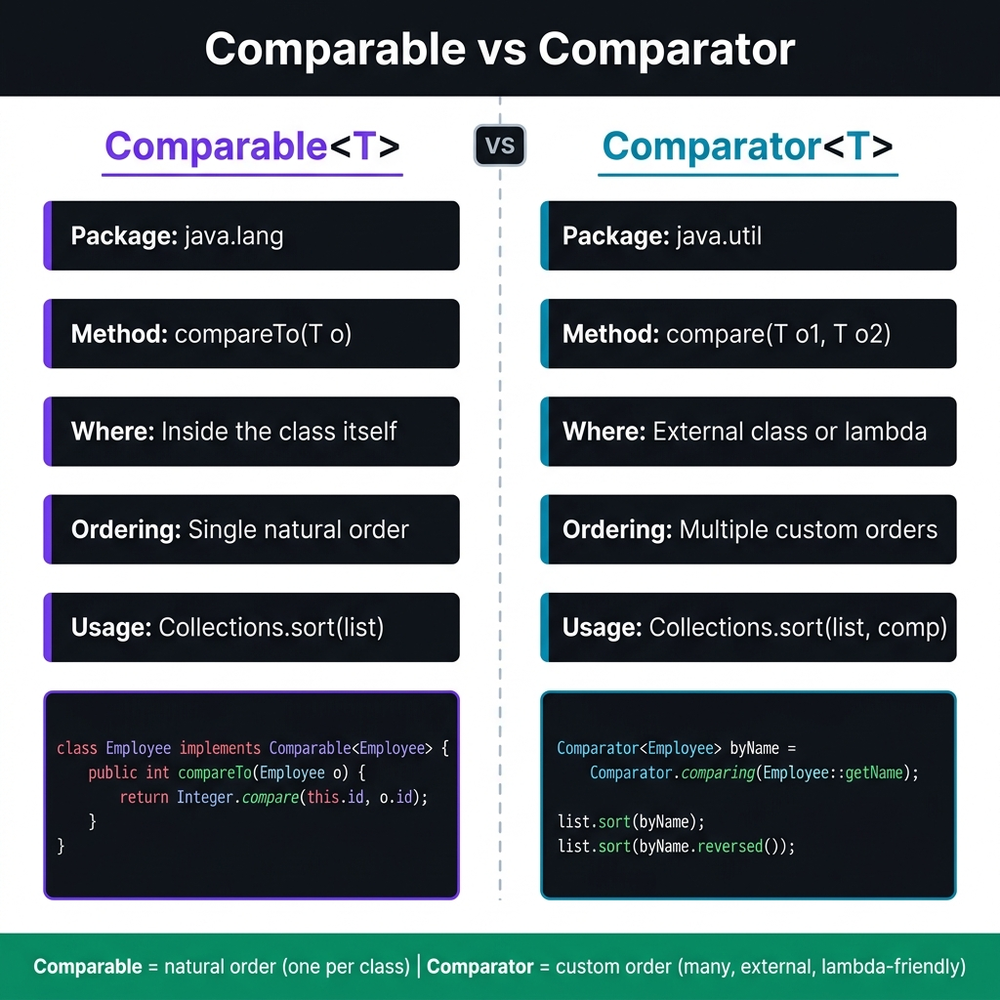

<details>
<summary><strong>🤔 Doubt: Lambda `(e1, e2) ->` vs `Comparator.comparing()` — which should I use in interviews?</strong></summary>

**Start with `Comparator.comparing()`** — it shows you write modern, standard Java 8+ code. Use a lambda only if the interviewer asks for it.

**Comparison:**

| Aspect | Lambda `(e1, e2) ->` | `Comparator.comparing()` |
|---|---|---|
| **Readability** | Must read logic to understand intent | Intent obvious from method name |
| **Chaining** | Cannot chain without wrapping | `.thenComparing()`, `.reversed()` built-in |
| **Null safety** | Manual null checks needed | `Comparator.nullsFirst()` / `nullsLast()` |
| **Type safety** | `int` subtraction overflow bugs possible | `comparingInt()` handles it safely |
| **Reusability** | Anonymous, inline only | Named, composable, reusable |
| **Descending** | Swap e1/e2 (easy to get wrong) | `.reversed()` — no ambiguity |
| **Case-insensitive** | `toLowerCase()` creates new String objects every time | `String.CASE_INSENSITIVE_ORDER` — no allocation |

**Multi-level sort — the biggest difference:**

```java
// Lambda — verbose, error-prone
(e1, e2) -> {
    int nameCompare = e1.getName().compareTo(e2.getName());
    if (nameCompare != 0) return nameCompare;
    return Integer.compare(e1.getAge(), e2.getAge());
}

// Comparator.comparing — clean, composable
Comparator.comparing(Employee::getName)
    .thenComparingInt(Employee::getAge)
    .thenComparing(Employee::getDepartment, Comparator.reverseOrder())
```

**Interview strategy:**
1. Start with `Comparator.comparing(Employee::getName)` — this shows you know the modern API
2. If the interviewer asks "can you do it without method reference?", switch to a lambda — this shows you understand both
3. If asked for a multi-level sort, chain with `.thenComparing()` — this is an easy strong answer

---

</details>
<br/>

---

</details>

---

3. **👨‍💼 Write different Comparators in Java to sort employees based on name, age, and Address. ⚡**

<!-- -->
<details>
<summary>Answer</summary>

**Answer:**

#### 📦 Setup

```java
public class Address {
    private String streetName;
    private Integer pincode;
    // constructor, toString, getters
}

public class Employee {
    private Integer id;
    private Integer age;
    private String name;
    private Address address;
    // constructor, toString, getters
}
```

#### ⚙️ Three Approaches — Old Style vs Java 8 vs Method Reference

**Sort by Age:**

```java
// ❌️ Old style — anonymous class
Comparator<Employee> byAgeOld = new Comparator<Employee>() {
    @Override
    public int compare(Employee e1, Employee e2) {
        return Integer.compare(e1.getAge(), e2.getAge());  // ✅ safe, no overflow
    }
};

// ✅ Java 8 lambda
Comparator<Employee> byAgeLambda = (e1, e2) -> Integer.compare(e1.getAge(), e2.getAge());

// ✅✅ Java 8 method reference (cleanest)
Comparator<Employee> byAge = Comparator.comparingInt(Employee::getAge);
```

**Sort by Name:**

```java
Comparator<Employee> byName = Comparator.comparing(Employee::getName);

// Descending
Comparator<Employee> byNameDesc = Comparator.comparing(Employee::getName, Comparator.reverseOrder());

// Case-insensitive
Comparator<Employee> byNameIgnoreCase = Comparator.comparing(Employee::getName, String.CASE_INSENSITIVE_ORDER);
```

**Sort by Address Pincode (nested field):**

```java
Comparator<Employee> byPincode = Comparator.comparingInt(e -> e.getAddress().getPincode());
// ⚠️ NPE if address or pincode (an Integer) is null — unboxing to int fails
```

#### 🔗 Chained / Multi-Level Sorting

```java
// Sort by age ascending, then by name ascending (tiebreaker)
Comparator<Employee> byAgeThenName = Comparator
    .comparingInt(Employee::getAge)
    .thenComparing(Employee::getName);

// Sort by name descending, then by pincode ascending
Comparator<Employee> byNameDescThenPincode = Comparator
    .comparing(Employee::getName, Comparator.reverseOrder())
    .thenComparingInt(e -> e.getAddress().getPincode());
```

#### 🛠️ Full Example

```java
List<Employee> employees = List.of(
    new Employee(1, 29, "Tom",   new Address("Street1", 456)),
    new Employee(2, 28, "Jerry", new Address("Street2", 344)),
    new Employee(3, 30, "Rocco", new Address("Street3", 12)),
    new Employee(4, 18, "Patil", new Address("Street4", 567)),
    new Employee(5, 22, "Patel", new Address("Street5", 678))
);

// Sort by age
employees.stream().sorted(Comparator.comparingInt(Employee::getAge)).forEach(System.out::println);
// Output order: Patil(18), Patel(22), Jerry(28), Tom(29), Rocco(30)

// Sort by name
employees.stream().sorted(Comparator.comparing(Employee::getName)).forEach(System.out::println);
// Output order: Jerry, Patel, Patil, Rocco, Tom

// Sort by pincode
employees.stream().sorted(Comparator.comparingInt(e -> e.getAddress().getPincode())).forEach(System.out::println);
// Output order: Rocco(12), Jerry(344), Tom(456), Patil(567), Patel(678)
```

#### 📊 Quick Reference

| Sort by | Comparator |
|---|---|
| int field | `Comparator.comparingInt(Employee::getAge)` |
| String field | `Comparator.comparing(Employee::getName)` |
| Nested field | `Comparator.comparingInt(e -> e.getAddress().getPincode())` |
| Descending | `.reversed()` or `Comparator.reverseOrder()` |
| Multi-level | `.thenComparing()` / `.thenComparingInt()` |
| Null-safe | `Comparator.nullsFirst(Comparator.comparing(...))` |

> ⚠️ **Never use subtraction** (`e1.getAge() - e2.getAge()`) in comparators. It causes integer overflow for extreme values. Always use `Integer.compare()` or `Comparator.comparingInt()`.

---

</details>

---

## 6. Coding Questions

1. **🗂️ Design an LRU Cache in Java using LinkedHashMap. 🔥**

[LeetCode 146](https://leetcode.com/problems/lru-cache/)

<!-- -->
<details>
<summary>Answer</summary>

**Answer:**

An **LRU (Least Recently Used) Cache** has a fixed capacity. When it is full, it evicts the least recently accessed entry. Every `get` or `put` counts as a "use". The entry that was not touched for the longest time is evicted first.

💡 **Why `LinkedHashMap` is a perfect fit:**
- It keeps **access order** when you create it with `accessOrder = true`. Every `get` moves the accessed entry to the tail (most recently used).
- It gives the `removeEldestEntry()` hook. The map calls it after each `put` that adds a new key. You use it to decide when to evict the head (least recently used).
- It is a hash table with a doubly-linked list over its entries. All operations are O(1).

**Key constructor — access-order mode:**

```java
new LinkedHashMap<>(capacity, 0.75f, true)
//                             ^        ^
//                        load factor  accessOrder=true → LRU ordering
```

**Full LRU Cache implementation:**

```java
import java.util.LinkedHashMap;
import java.util.Map;

public class LRUCache {

    private final int capacity;
    private final LinkedHashMap<Integer, Integer> cache;

    public LRUCache(int capacity) {
        this.capacity = capacity;
        this.cache = new LinkedHashMap<>(capacity, 0.75f, true) {
            @Override
            protected boolean removeEldestEntry(Map.Entry<Integer, Integer> eldest) {
                return size() > LRUCache.this.capacity; // evict head (LRU) when over capacity
            }
        };
    }

    public int get(int key) {
        return cache.getOrDefault(key, -1); // accessing key moves it to tail (MRU)
    }

    public void put(int key, int value) {
        cache.put(key, value); // inserting/updating moves it to tail (MRU)
    }

    @Override
    public String toString() {
        return cache.toString(); // head → tail = LRU → MRU
    }
}
```

**Usage example:**

```java
LRUCache lru = new LRUCache(3);

lru.put(1, 10);
lru.put(2, 20);
lru.put(3, 30);
System.out.println(lru);         // {1=10, 2=20, 3=30}

lru.get(1);                      // access key 1 → moves to tail (MRU)
System.out.println(lru);         // {2=20, 3=30, 1=10}

lru.put(4, 40);                  // over capacity → evicts key 2 (LRU head)
System.out.println(lru);         // {3=30, 1=10, 4=40}

System.out.println(lru.get(2));  // -1 (evicted)
System.out.println(lru.get(3));  // 30
```

📤 **Output:**

```
{1=10, 2=20, 3=30}
{2=20, 3=30, 1=10}
{3=30, 1=10, 4=40}
-1
30
```

💡 **How `removeEldestEntry` works:** The head of the linked list is always the least recently used entry. If the hook returns `true`, the map removes that head entry by itself after each `put` that adds a new key.

⚡ **Time complexity:** O(1) for both `get` and `put`
💾 **Space complexity:** O(capacity)

<details>
<summary>🏗️ <strong>Approach 2: HashMap + DoublyLinkedList (FAANG Version)</strong></summary>

FAANG/Tier-1 interviews use this version when `LinkedHashMap` is not allowed. You build the LRU logic from scratch.

**Core idea:**
- `HashMap<Integer, Node>` → O(1) key lookup
- Doubly linked list with dummy `head` (LRU) and `tail` (MRU) → O(1) insert/remove
- On `get`: move the accessed node to the tail
- On `put`: add at the tail. If over capacity, remove the node right after head

```java
class LRUCache {

    private class Node {
        int key, value;
        Node prev, next;
        Node(int key, int value) {
            this.key = key;
            this.value = value;
        }
    }

    private final int capacity;
    private final Map<Integer, Node> map;
    private final Node head, tail;  // dummy sentinels

    public LRUCache(int capacity) {
        this.capacity = capacity;
        this.map = new HashMap<>();
        this.head = new Node(0, 0);  // dummy head → LRU side
        this.tail = new Node(0, 0);  // dummy tail → MRU side
        head.next = tail;
        tail.prev = head;
    }

    public int get(int key) {
        if (!map.containsKey(key)) return -1;
        Node node = map.get(key);
        remove(node);       // detach from current position
        addToTail(node);    // move to MRU end
        return node.value;
    }

    public void put(int key, int value) {
        if (map.containsKey(key)) {
            Node node = map.get(key);
            node.value = value;
            remove(node);
            addToTail(node);
        } else {
            if (map.size() == capacity) {
                Node lru = head.next;     // least recently used = right after dummy head
                remove(lru);
                map.remove(lru.key);      // remove from map too
            }
            Node newNode = new Node(key, value);
            addToTail(newNode);
            map.put(key, newNode);
        }
    }

    // Remove node from its current position in the doubly linked list
    private void remove(Node node) {
        node.prev.next = node.next;
        node.next.prev = node.prev;
    }

    // Add node just before dummy tail (MRU position)
    private void addToTail(Node node) {
        node.prev = tail.prev;
        node.next = tail;
        tail.prev.next = node;
        tail.prev = node;
    }
}
```

**Visual — after `put(1,10)`, `put(2,20)`, `put(3,30)`, `get(1)`:**

```
head ↔ [2,20] ↔ [3,30] ↔ [1,10] ↔ tail
 LRU                              MRU
        ↑                    ↑
    evicted next         accessed, moved to tail
```

**Why dummy head/tail sentinels?**
- They remove the need for null checks in `remove()` and `addToTail()`
- Without sentinels, every operation needs `if (node == head)` / `if (node == tail)` checks. These checks are easy to get wrong

> 🔑 **Interview tip:** Start with this approach (not LinkedHashMap). It shows you can design data structures, not just use library classes. Mention LinkedHashMap only as "in production, I'd use LinkedHashMap". This shows you are practical.

---

</details>

---

</details>

---

2. **🎯 Two Sum — Given two inputs first an array of integers "nums" and an integer "target", return indices of the two numbers such that they add up to the target. 🔥**

[LeetCode 1](https://leetcode.com/problems/two-sum/)

📥 **Examples:**

Example 1:
Input: nums = [2,7,11,15], target = 9
Output: [0,1]

Example 2:
Input: nums = [3,2,4], target = 6
Output: [1,2]

Example 3:
Input: nums = [3,3], target = 6
Output: [0,1]

<!-- -->
<details>
<summary>Answer</summary>

**Answer:**

Assume that each input has exactly one solution. You may not use the same element twice. You can return the answer in any order.

🛠️ **Solution:**

```java
import java.util.Arrays;
import java.util.HashMap;
import java.util.Map;

public class Test {
    public static void main(String[] args) {
        int[] nums = { 2, 7, 11, 15 };
        int target = 9;
        Test test = new Test();
        System.out.println(Arrays.toString(test.twoSum(nums, target)));  // [0, 1]
    }

    public int[] twoSum(int[] nums, int target) {
        Map<Integer, Integer> input = new HashMap<>();
        for (int i = 0; i < nums.length; i++) {
            int secondNumber = target - nums[i];
            if (input.containsKey(secondNumber)) {
                return new int[] { input.get(secondNumber), i };
            } else {
                input.put(nums[i], i);
            }
        }
        return new int[] { -1, -1 };
    }
}
```

⚡ **Time Complexity:** O(n)
💾 **Space Complexity:** O(n)

Check Similar Problems: Two Pointer Approach

---

</details>

---

3. **🧩 How to find all pairs of elements in an array whose sum is equal to a given number? ⚡** 

[GFG](https://www.geeksforgeeks.org/problems/count-pairs-with-given-sum5022/1)

📥 **Example:**

```
Input:  arr = [1, 5, 7, -1], sum = 6
Output: (1, 5), (7, -1)
```

<!-- -->
<details>
<summary>Answer</summary>

**Answer:**

Given an array of integers and a target sum, find **all pairs** whose sum equals the target.

#### ⚙️ Approach — HashSet for O(1) Lookup

For each element, check if `(sum - element)` is already in a "seen" set. If yes, it is a valid pair.

```java
public static List<int[]> findPairs(int[] arr, int target) {
    Set<Integer> seen = new HashSet<>();
    List<int[]> pairs = new ArrayList<>();

    for (int num : arr) {
        int complement = target - num;
        if (seen.contains(complement)) {
            pairs.add(new int[]{complement, num});
        }
        seen.add(num);
    }
    return pairs;
}
```

**Usage:**

```java
int[] arr = {1, 5, 7, -1};
List<int[]> result = findPairs(arr, 6);
result.forEach(p -> System.out.println(Arrays.toString(p)));
```

📤 **Output:**

```
[1, 5]
[7, -1]
```

#### 🔍 Step-by-Step Trace — `arr = [1, 5, 7, -1], target = 6`

| Element | Complement | `seen` contains complement? | Action | `seen` after |
|---|---|---|---|---|
| 1 | 5 | ❌️ No | Add 1 to seen | {1} |
| 5 | 1 | ✅ Yes | Pair found: (1, 5) | {1, 5} |
| 7 | -1 | ❌️ No | Add 7 to seen | {1, 5, 7} |
| -1 | 7 | ✅ Yes | Pair found: (7, -1) | {1, 5, 7, -1} |

#### ⚠️ Handling Duplicates

Say the array has duplicates, like `[3, 3, 3]` with target 6. The basic approach above finds 2 pairs. Use a **frequency map** instead if each element may be used in only one pair. For `[3, 3, 3]` it finds 1 pair:

```java
public static List<int[]> findPairsWithDuplicates(int[] arr, int target) {
    Map<Integer, Integer> freqMap = new HashMap<>();
    List<int[]> pairs = new ArrayList<>();

    for (int num : arr) {
        int complement = target - num;
        if (freqMap.getOrDefault(complement, 0) > 0) {
            pairs.add(new int[]{complement, num});
            freqMap.merge(complement, -1, Integer::sum);  // consume one occurrence
        } else {
            freqMap.merge(num, 1, Integer::sum);
        }
    }
    return pairs;
}
```

⚡ **Time Complexity:** O(n) — single pass, HashSet/HashMap lookup is O(1)
💾 **Space Complexity:** O(n) — for the seen set / frequency map

> ⚠️ **Why not use `ArrayList.contains()`?** It does a linear scan, which is O(n) per call. That makes the whole solution O(n²). Always use `HashSet` for membership checks.

---

</details>

---

4. **🔤 Group anagrams together from a list of strings using HashMap. 🔥** 

[LeetCode 49](https://leetcode.com/problems/group-anagrams/)

📥 **Example:**

Input: `["eat","tea","tan","ate","nat","bat"]`   
Output: `[["eat","tea","ate"], ["tan","nat"], ["bat"]]`

💡 **Key insight:** Two strings are anagrams if and only if their **sorted character arrays are identical**.

<!-- -->
<details>
<summary>Answer</summary>

**Answer:**

💡 **Key insight:** Two strings are anagrams if and only if their **sorted character arrays are identical**. Use the sorted form as the HashMap key. All anagrams then hash to the same bucket.

**Solution:**

```java
import java.util.*;

public class GroupAnagrams {

    public static List<List<String>> groupAnagrams(String[] words) {
        Map<String, List<String>> map = new HashMap<>();

        for (String word : words) {
            char[] chars = word.toCharArray();
            Arrays.sort(chars);                          // "eat" → "aet", "tea" → "aet"
            String key = new String(chars);              // sorted form is the canonical key

            map.computeIfAbsent(key, k -> new ArrayList<>()).add(word);
        }

        return new ArrayList<>(map.values());
    }

    public static void main(String[] args) {
        String[] input = {"eat", "tea", "tan", "ate", "nat", "bat"};
        System.out.println(groupAnagrams(input));
    }
}
```

📤 **Output:**

```
[[eat, tea, ate], [bat], [tan, nat]]
```

🛠️ **Step-by-step trace:**

| Word | Sorted key | Map state |
|---|---|---|
| "eat" | "aet" | `{aet: [eat]}` |
| "tea" | "aet" | `{aet: [eat, tea]}` |
| "tan" | "ant" | `{aet: [eat, tea], ant: [tan]}` |
| "ate" | "aet" | `{aet: [eat, tea, ate], ant: [tan]}` |
| "nat" | "ant" | `{aet: [eat, tea, ate], ant: [tan, nat]}` |
| "bat" | "abt" | `{aet: [...], ant: [...], abt: [bat]}` |

⚡ **Time complexity:** O(n × k log k). Sorting each of the `n` strings takes O(k log k), where `k` is the max string length.
💾 **Space complexity:** O(n × k)

💡 **Bonus — character frequency array as key (O(n × k) time):** Do not sort. Instead, build a 26-element frequency count for each word. Use `Arrays.toString(freq)` as the key. This removes the O(k log k) sort cost.

```java
for (String word : words) {
    int[] freq = new int[26];
    for (char c : word.toCharArray()) freq[c - 'a']++;
    String key = Arrays.toString(freq);              // e.g. "[1, 0, 0, 0, 1, 0, ...]"
    map.computeIfAbsent(key, k -> new ArrayList<>()).add(word);
}
```

---

</details>

---

5. **📊 Find the top K frequent elements in an array using a PriorityQueue (min-heap). 🔥** 

[LeetCode 347](https://leetcode.com/problems/top-k-frequent-elements/)

📥 **Example:**

Input: `nums = [1,1,1,2,2,3]`, `k = 2`  
Output: `[1, 2]` (the 2 most frequent elements)

<!-- -->
<details>
<summary>Answer</summary>

**Answer:**

**Approach — min-heap of size K:**
1. Count frequencies using `HashMap<Integer, Integer>`
2. Keep a min-heap (`PriorityQueue`) ordered by frequency **ascending**. The weakest candidate sits at the top
3. For each frequency-map entry: add it to the heap. If `heap.size() > k`, poll (this evicts the least frequent)
4. After all entries, the heap contains exactly the K most frequent elements

**Why min-heap of size K, not max-heap of all elements?**

| Approach | Complexity | When to use |
|---|---|---|
| Max-heap (all n elements, poll K times) | O(n log n) with n `offer()` calls; O(n + K log n) if built from a collection in one step | K is close to n |
| Min-heap of size K | O(n log K) | K << n ✅ preferred |

💡 A min-heap of size K works as a "keep the best K" filter. The weakest sits at the top. It is evicted when a stronger candidate arrives.

**Full solution:**

```java
import java.util.*;

public class TopKFrequent {

    public static int[] topKFrequent(int[] nums, int k) {
        // Step 1: frequency map
        Map<Integer, Integer> freqMap = new HashMap<>();
        for (int num : nums) {
            freqMap.merge(num, 1, Integer::sum);
        }

        // Step 2: min-heap ordered by frequency ascending
        PriorityQueue<Map.Entry<Integer, Integer>> minHeap =
            new PriorityQueue<>(Comparator.comparingInt(Map.Entry::getValue));

        // Step 3: maintain heap of size K
        for (Map.Entry<Integer, Integer> entry : freqMap.entrySet()) {
            minHeap.offer(entry);
            if (minHeap.size() > k) {
                minHeap.poll(); // remove least frequent
            }
        }

        // Step 4: extract results
        int[] result = new int[k];
        for (int i = k - 1; i >= 0; i--) {
            result[i] = minHeap.poll().getKey();
        }
        return result;
    }

    public static void main(String[] args) {
        System.out.println(Arrays.toString(topKFrequent(new int[]{1, 1, 1, 2, 2, 3}, 2)));
        System.out.println(Arrays.toString(topKFrequent(new int[]{4, 4, 4, 6, 6, 7}, 1)));
    }
}
```

📤 **Output:**

```
[1, 2]
[4]
```

💡 The code fills `result` **back-to-front** (`for (int i = k - 1; i >= 0; i--)`) on purpose:
- The heap polls the least frequent element first.
- So the code writes to the end of the array first.
- This leaves the result in **descending frequency** order — `[1, 2]`.
- This matches the problem statement and the bucket-sort variant below. Verified on JDK 17.

(LeetCode 347 accepts any order. But a fixed order is easier to explain and to justify.)

**Step-by-step trace — `nums = [1,1,1,2,2,3], k = 2`:**

Frequency map: `{1→3, 2→2, 3→1}`

| Action | Heap contents (freq) | Size | Poll triggered? |
|---|---|---|---|
| offer `(1, freq=3)` | `[(1,3)]` | 1 | ❌️ |
| offer `(2, freq=2)` | `[(2,2), (1,3)]` | 2 | ❌️ |
| offer `(3, freq=1)` | `[(3,1), (1,3), (2,2)]` | 3 > k | ✅ poll `(3,1)` → `[(2,2),(1,3)]` |

Element 3 (lowest frequency) is evicted. The heap keeps `{1, 2}`.

⚡ **Time:** O(n log K) — n insertions each O(log K)
💾 **Space:** O(n) for frequency map + O(K) for heap

**Bonus — Bucket Sort approach O(n):**

A frequency can never be more than `n`. So use the frequency as the bucket index. No heap is needed.

```java
public static int[] topKFrequentBucket(int[] nums, int k) {
    Map<Integer, Integer> freqMap = new HashMap<>();
    for (int num : nums) freqMap.merge(num, 1, Integer::sum);

    List<Integer>[] bucket = new List[nums.length + 1];  // raw array: Java cannot create generic arrays (unchecked warning)
    for (Map.Entry<Integer, Integer> e : freqMap.entrySet()) {
        int freq = e.getValue();
        if (bucket[freq] == null) bucket[freq] = new ArrayList<>();
        bucket[freq].add(e.getKey());
    }

    int[] result = new int[k];
    int idx = 0;
    for (int freq = bucket.length - 1; freq >= 1 && idx < k; freq--) {
        if (bucket[freq] != null) {
            for (int num : bucket[freq]) {
                result[idx++] = num;
                if (idx == k) break;
            }
        }
    }
    return result;
}
```

⚡ **Time:** O(n). The bucket index comes directly from the frequency. There is no sorting and no heap operation
💾 **Space:** O(n)

✅ Use bucket sort for the best time, O(n). Use the min-heap approach when K is small. It is also the clean, reusable pattern that interviewers expect.

---

</details>

---
