# Java Multithreading Interview Questions

**Java Multithreading Interview Questions** | Multithreading is one of the most important Java topics in interviews. So this file has many questions and answers on Java multithreading.

📊 **Question Count by Section**

| # | Section | Questions |
|---|---|---|
| 1 | [Java Multithreading Introduction Interview Questions 🔥](#1-java-multithreading-introduction-interview-questions) | 11 |
| 2 | [Defining Threads in Java – Multithreading 🔥](#2-defining-threads-in-java--multithreading) | 14 |
| 3 | [Thread Priority Questions ⚡](#3-thread-priority-questions) | 5 |
| 4 | [yield(), join(), sleep() & interrupt() Questions 🔥](#4-yield-join-sleep--interrupt-questions) | 12 |
| 5 | [Synchronization Basics 🔥](#5-synchronization-basics) | 7 |
| 6 | [Race Condition, Object-Level & Class-Level Locks 🔥](#6-race-condition-object-level--class-level-locks) | 11 |
| 7 | [Synchronized Blocks 🔥](#7-synchronized-blocks) | 7 |
| 8 | [Thread Safety, Advanced Locking & Concurrency Patterns 🔥](#8-thread-safety-advanced-locking--concurrency-patterns) | 9 |
| 9 | [Inter-Thread Communication 🔥](#9-inter-thread-communication) | 14 |
| 10 | [Deadlock and Starvation 🔥](#10-deadlock-and-starvation) | 7 |
| 11 | [Daemon Thread ⚡](#11-daemon-thread) | 4 |
| | **Total** | **101** |

> 🔥🔥 Very High — asked in almost every Tier-1 loop &nbsp;·&nbsp; 🔥 High — very frequent in Tier-1 interviews &nbsp;·&nbsp; ⚡ Medium — commonly asked &nbsp;·&nbsp; 💤 Low — good to know, rarely asked

<a id="1-java-multithreading-introduction-interview-questions"></a>
## 1. Java Multithreading Introduction Interview Questions ⚡

1. **🔀 What are the different ways of executing tasks? ⚡**

<!-- -->
<details>
<summary>Answer</summary>

**Answer:**

There are three different flows of executing tasks:

1. **_Sequential flow_** of execution: Two tasks run one after the other. The second task starts only after the first task is fully completed.
2. **_Parallel flow_** of execution: Two tasks run at the same time, without depending on each other. At the same point of time, both tasks can be in running mode.
3. **_Concurrent flow_** of execution: Two tasks make progress over the same period by **interleaving** on the CPU (taking turns on it).
   - The scheduler switches between them very fast. So they *appear* to run together, even on a single core.
   - Parallel = really at the same instant, on multiple cores. Concurrent = interleaved, possibly on one core.
   - When the first task is paused (e.g. waiting on I/O), the second runs. The same happens the other way around.

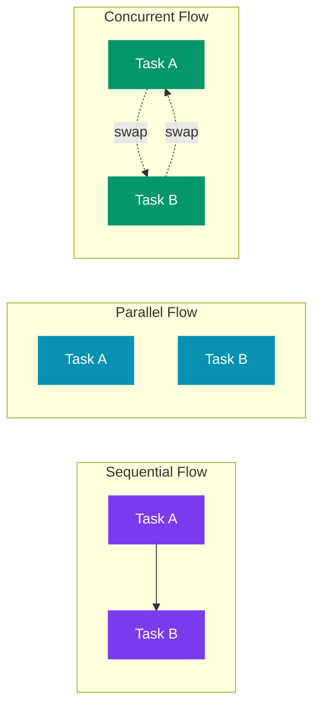

Note:-
- Thread A is blocked, waiting on I/O: a DB query, a network call, a disk read, or user input.
- Without other threads, the core would sit idle during that wait.
- Multithreading gives the core to thread B. So useful work happens during the wait.
- This is the "CPU idle time" that Q3 talks about ("by using CPU idle time effectively").

---

</details>

---

2. **🧶 What is Thread? 🔥**

<!-- -->
<details>
<summary>Answer</summary>

**Answer:**

**Thread is an independent sequence flow of execution.** It executes methods in sequence, one after the other. Each thread has its own call stack. A process may contain multiple threads. Threads share the process resources, but they still execute independently.

🧠 **In Simple Words:** A thread is like a separate worker inside a program. Each worker does its own job independently. But all workers share the same workspace (memory).

---

</details>

---

3. **🔄 What is multithreading? 🔥**

<!-- -->
<details>
<summary>Answer</summary>

**Answer:**

Multithreading is a **process of creating multiple threads for executing multiple independent tasks concurrently**. The goal is to finish the tasks in less time **by using CPU idle time effectively**.

---

</details>

---

4. **🚀 What is the main advantage of multithreading? 🔥**

<!-- -->
<details>
<summary>Answer</summary>

**Answer:**

The main advantage of multithreading is to **increase the performance of the system by reducing response time**. Its other advantages are:

- ⚡ Better use of memory, because threads share the same heap. They can share data without copying it. (But heavy sharing can also slow threads down, for example false sharing of CPU cache lines.)
- 🖥️ Fewer servers are needed, because one server can execute multiple threads at a time.
- 🔄 An application/program always stays responsive to input, even while it runs some background tasks.
- 🚀 Faster execution of tasks, because threads execute independently.

---

</details>

---

5. **⚖️ What is the difference between multitasking and multithreading? ⚡**

<!-- -->
<details>
<summary>Answer</summary>

**Answer:**

| Feature | Multitasking 🅰️ | Multithreading 🅱️ |
|---------|----------------|-------------------|
| **Definition** | The process of executing multiple independent main tasks at a time concurrently. | The process of executing multiple independent sub-tasks in one main task at a time. |
| **Execution** | Each task is executed in a separate process. | All tasks are executed in a single process. |
| **Weight** | ⚠️ Heavyweight — switching between contexts is slow. Each task is in a separate process at a different address. | ✅ Lightweight — switching between contexts is fast. All threads are created in a single process at the same address. |
| **Level** | Exists at the OS level. Example: Windows, Linux, Mac. | Exists at the process level. Example: JVM. |

---

</details>

---

6. **☕ Is Java by default a multithreaded programming language? ⚡**

<!-- -->
<details>
<summary>Answer</summary>

**Answer:**

**Yes**, by default Java is a multithreaded programming language. JVM creates a "main" thread, which belongs to the "main" thread group. The "main" thread calls the `main()` method. JVM also creates many daemon threads, not only the main thread. These run in the background and provide services to the non-daemon threads. See more: [Daemon thread in Java](../java_tutorial/190_Daemon_Thread_in_Java_with_Examples.md)

---

</details>

---

7. **📅 What is a thread scheduler? ⚡**

<!-- -->
<details>
<summary>Answer</summary>

**Answer:**

Thread Scheduler is **responsible for scheduling thread execution**. Old books call it "part of JVM". But on HotSpot, each Java thread is an OS thread, so the **OS scheduler** does this work (see §2 Q11). Many threads may be waiting for their chance to run. The thread scheduler decides the order in which they run.

---

</details>

---

8. **🎯 What is the Job of Thread Scheduler? ⚡**

<!-- -->
<details>
<summary>Answer</summary>

**Answer:**

The main task of the thread scheduler is: **Scheduling the thread execution**.

---

</details>

---

9. **🏗️ When should we create multiple threads to execute different tasks? ⚡**

<!-- -->
<details>
<summary>Answer</summary>

**Answer:**

We should create multiple threads **to finish many independent tasks in less time**. A multithreaded program uses CPU idle time effectively.

---

</details>

---

10. **🔃 What is context switching? 🔥**

<!-- -->
<details>
<summary>Answer</summary>

**Answer:**

In context switching, the system saves the state of the process (or thread). Later it restores this state, and execution continues from the same point. Context switching lets multiple processes share the same CPU.

🧠 **In Simple Words:** Context switching is like a video game. You save your progress, switch to another game, and later come back to the exact point where you stopped.

---

</details>

---

11. **📚 Does each thread have its stack in multithreaded programming? 🔥**

<!-- -->
<details>
<summary>Answer</summary>

**Answer:**

Yes. In multithreaded programming, every thread has its own separate stack area in memory. Because of this, every thread is independent of the others.

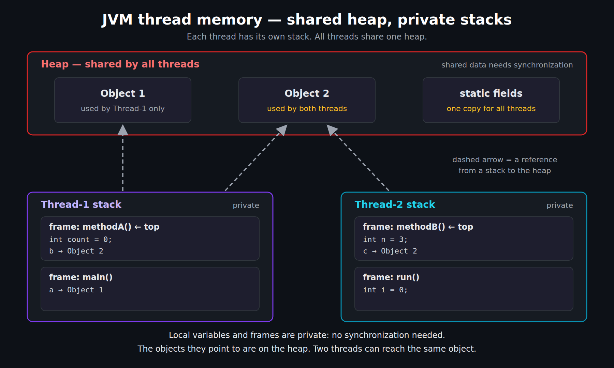

---

</details>

---

<a id="2-defining-threads-in-java--multithreading"></a>
## 2. Defining Threads in Java – Multithreading ⚡

1. **🛤️ What are the different ways to define a thread in Java? 🔥**

<!-- -->
<details>
<summary>Answer</summary>

**Answer:**

We can define a thread in the following 2 ways:

- 🏗️ By extending `Thread` class.
- 📑 By implementing `Runnable` interface.

**Defining a thread by extending from Thread class:**

```java
// defining a thread extending from Thread class
class MyThread extends Thread {
   // override run() method
   @Override
   public void run() {
      // code
   }
}
// Testing
public class ThreadDemo {
   public static void main(String[] args) {
      // thread instantiation
      MyThread t = new MyThread();
      t.start(); // child thread start
   }
}
```

**Defining a thread by implementing the Runnable interface:**

```java
// defining a thread by implementing Runnable interface
class MyThread implements Runnable {
   // implement run() method
   @Override
   public void run() {
      // code
   }
}
// Testing
public class ThreadDemo {
   public static void main(String[] args) {
      MyThread mt = new MyThread();
      Thread t = new Thread(mt);
      t.start(); // child thread start
   }
}
```

---

</details>

---

2. **🏆 Among these two ways of defining a thread which is better and why? 🔥**

<!-- -->
<details>
<summary>Answer</summary>

**Answer:**

**Defining a thread by implementing the Runnable interface is better and recommended to use.**

- ❌️ In the first approach (by extending from `Thread` class), our class already extends the `Thread` class. So it cannot extend any other class. We lose inheritance benefits.
- ✅ In the 2nd way (by implementing `Runnable` interface), our class can still extend any class. So we keep inheritance benefits. That is why the 2nd way, i.e. "implementing from `Runnable` interface", is recommended.

📝 **Note:** There is **no real runtime performance difference** between the two approaches. Both end up running a `run()` method on a thread. You prefer `Runnable` only for design reasons:
- It separates the *task* (what to run) from the *thread* (the worker).
- It keeps your one allowed parent class free (Java has single inheritance).
- The same task can be reused across threads, or submitted to an `ExecutorService`.

Ignore the old claim that extending `Thread` is "slower". It is a myth.

🎯 **Interview Tip:** Always say why implementing `Runnable` is preferred. Java doesn't support multiple inheritance for classes, but a class can implement multiple interfaces.

---

</details>

---

3. **▶️ If we want to start a thread then which method must be called start() or run() method? 🔥**

<!-- -->
<details>
<summary>Answer</summary>

**Answer:**

The **`start()` method**. If we call the `run()` method, it runs as a normal method call. No new thread is created.

---

</details>

---

4. **🚦 Why do we need to call the start() method for starting a new thread? 🔥**

<!-- -->
<details>
<summary>Answer</summary>

**Answer:**

`Thread` class `start()` method is responsible for:

1. 📝 Register the thread with thread scheduler.
2. ⚙️ Perform all other mandatory activities.
3. ▶️ Invoke `run()` method.

So, **without executing the thread class `start()` method there is no chance of starting a new thread in Java**.

---

</details>

---

5. **⏳ When we call the start() method on a Thread object, will thread execution start immediately? ⚡**

<!-- -->
<details>
<summary>Answer</summary>

**Answer:**

**No, the `start()` method has to perform some important activities** first. It registers the thread and performs all other mandatory activities. After that, it invokes the `run()` method, and then thread execution starts.

---

</details>

---

6. **🔍 What is the difference between t.start() and t.run()? 🔥**

<!-- -->
<details>
<summary>Answer</summary>

**Answer:**

```java
MyThread t = new MyThread();
t.start();
t.run();
```

- 🧵 **In the case of `t.start()`**, a separate thread is created. This new thread executes the `run()` method.
- ⚠️ **In the case of `t.run()`**, it is a normal method call. No new thread is created. The main thread itself executes the `run()` method.

---

</details>

---

7. **📦 Can we overload the run() method? ⚡**

<!-- -->
<details>
<summary>Answer</summary>

**Answer:**

**Yes, overloading of the `run()` method is possible. But the Thread class `start()` method always invokes the `run()` method with no argument.** To execute another overloaded form of `run()`, we must call it ourselves, like a normal method call.

```java
class MyThread extends Thread {
   // start() method always call run()
   @Override
   public void run() {
      // call other run(-) method from here
      run(7.5);
   }

   public void run(double n) {
      // code
   }
}
```

📝 **Note:** Overloading of the `main()` method is also possible. But the main thread always calls the `public static void main(String[] args)` method. Other overloaded forms of `main()` are treated like normal methods. To execute them, we must call them ourselves.

---

</details>

---

8. **❓ What happens if we don't override the run() method (when the thread is defined by extending from the Thread class)? ⚡**

<!-- -->
<details>
<summary>Answer</summary>

**Answer:**

```java
class MyThread extends Thread { }
public class ThreadDemo {
   public static void main(String[] args) {
      MyThread t = new MyThread();
      t.start();
   }
}
```

The child class (`MyThread`) has no `run()` method. So **the `run()` method runs from the parent class (`Thread` class). The `run()` method of the `Thread` class has an empty implementation.** So the program runs successfully, but this child thread **won't give any output.**

---

</details>

---

9. **🚫 What happens if we override the start() method? ⚡**

<!-- -->
<details>
<summary>Answer</summary>

**Answer:**

```java
class MyThread extends Thread {
   @Override
   public void start() {
      // code
   }
   @Override
   public void run() {
      // code
   }
}
```

We override the `start()` method in the `MyThread` class. So the **`start()` method of the `Thread` class will not get a chance to execute**. The `start()` method of `MyThread` is **executed like a normal method call. A new thread will not be created.** Only the main thread does all the work. So the output is always the same.

⚠️ **Caution:** Never override `start()`. It breaks the thread creation mechanism. Always override `run()` instead.

---

</details>

---

10. **🔁 After Starting the Thread if we are restarting the same thread then what happens? ⚡**

<!-- -->
<details>
<summary>Answer</summary>

**Answer:**

```java
class MyThread extends Thread {
   @Override
   public void run() {
      // code
   }
}
public class ThreadDemo {
   public static void main(String[] args) {
      MyThread t = new MyThread();
      t.start();
      // some code
      t.start();
   }
}
```

If we try to start the same thread again after it has started, we get a runtime exception: **`java.lang.IllegalThreadStateException`**. So we can't start a thread more than once.

---

</details>

---

11. **🔄 Explain the life cycle phases of a thread. 🔥**

<!-- -->
<details>
<summary>Answer</summary>

**Answer:**

- 🆕 **NEW**: Thread has been created but not yet started. The thread will be started after the `start()` method call.
- ▶️ **RUNNABLE**: Thread is ready to run or is running now. Java does not show which one (see the note below).
- ⏱️ **TIMED_WAITING**: The thread was running, and now it waits for a fixed amount of time. After that time, the thread scheduler decides which thread gets a chance to execute. The `sleep(ms)` / `join(ms)` / `wait(ms)` → TIMED_WAITING (auto-wakes when time expires).
- ⏳ **WAITING**: The thread waits with no time limit. It waits until another thread acts: it calls `notify()`/`notifyAll()`, or the joined thread ends. The `wait()` / `join()` with no timeout → WAITING (waits with no time limit, until notified/joined).
- 🚫 **BLOCKED**: The thread got blocked for some reason.
  - A thread is BLOCKED when it waits to acquire a monitor lock that another thread holds. It needs this lock to enter a synchronized method/block.
  - No deadlock is required. It is the normal "someone else holds the lock, I'm in the queue for it" state.
  - Another reason could be deadlock.
- 🏁 **TERMINATED**: Thread execution completed.

⚠️ **There is no separate `RUNNING` state.** Java's `Thread.State` enum has exactly **6** states. `RUNNING` is **not** one of them:

```
NEW, RUNNABLE, BLOCKED, WAITING, TIMED_WAITING, TERMINATED
```

In Java, `RUNNABLE` joins two OS-level ideas into one:
- 🟢 "ready to run, sitting in the scheduler queue" **and**
- 🏃 "actually executing on a CPU core."

The JVM does **not** show the ready-vs-running difference, and this is on purpose. The **OS scheduler** decides it, and Java doesn't track it. So `thread.getState()` can **never** return `RUNNING`.

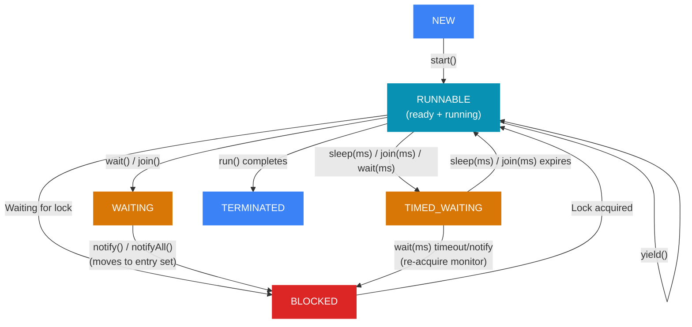

🚨 **The transition most candidates get wrong: `notify()` does NOT send a thread straight to `RUNNABLE`.**

- `wait()` released the monitor when the thread started waiting. So the woken thread must **get it back** before it can continue.
- `notify()` only moves it from the monitor's **wait set** to its **entry set**.
- In the entry set, the thread is `BLOCKED`. It waits in the queue behind whoever holds the lock now.
- This includes the notifier itself. The notifier keeps the lock until it exits its `synchronized` block.

The real path is:

```
WAITING  --notify()-->  BLOCKED  --monitor acquired-->  RUNNABLE
```

**Proof you can see**: the notifier calls `notify()`. Then, on purpose, it keeps holding the monitor for one more second:

```java
public class NotifyStateDemo {
    static final Object lock = new Object();
    static boolean signalled = false;   // guarded by lock

    public static void main(String[] args) throws InterruptedException {
        Thread waiter = new Thread(() -> {
            synchronized (lock) {
                while (!signalled) {
                    try {
                        lock.wait();
                    } catch (InterruptedException e) {
                        return;
                    }
                }
            }
        }, "waiter");
        waiter.start();
        Thread.sleep(300);
        System.out.println("before notify : " + waiter.getState());

        new Thread(() -> {
            synchronized (lock) {
                signalled = true;
                lock.notify();
                try {
                    Thread.sleep(1000);   // still holding the monitor
                } catch (InterruptedException e) {
                    Thread.currentThread().interrupt();
                }
            }
        }).start();
        Thread.sleep(400);
        System.out.println("after  notify : " + waiter.getState());
    }
}
```

📤 **Output** (identical across repeated runs):
```
before notify : WAITING
after  notify : BLOCKED
```

- The same is true when a `wait(ms)` times out. The timeout ends the wait, but the thread still waits in the queue for the monitor.
- `sleep(ms)` is different. It never released a lock, so it goes straight back to `RUNNABLE`.
- Inside, `join(ms)` calls `wait()` on the `Thread` object. So it also briefly re-acquires that object's monitor. You cannot see this in practice. This is why the `Thread` javadoc advises you not to use `wait()`/`notify()`/`notifyAll()` on a `Thread` object.

🎯 **Interview Tip:**
- Be ready to draw the thread lifecycle diagram and explain each transition between states.
- If asked "how many thread states are there?", the answer is **6** (per `Thread.State`). Be ready to explain why `RUNNING` isn't one of them.
- The next question is almost always *"after `notify()`, what state is the woken thread in?"* → **`BLOCKED`**, not `RUNNABLE`.

---

</details>

---

12. **📊 How can we get the state of a thread? ⚡**

<!-- -->
<details>
<summary>Answer</summary>

**Answer:**

We can get the state of a thread by **using the `getState()` method.**

```java
MyThread mt = new MyThread();
System.out.println(mt.getState()); // NEW
mt.start();
System.out.println(mt.getState()); // RUNNABLE (rarely TERMINATED, if run() already ended)
```

---

</details>

---

13. **💓 How can we find whether a given thread is a live thread or not? 💤**

<!-- -->
<details>
<summary>Answer</summary>

**Answer:**

We check whether a given thread is a live thread or not **by using `isAlive()` method.**

```java
class MyThread extends Thread {}
public class Test {
   public static void main(String[] args) throws Exception {
      MyThread mt = new MyThread();
      System.out.println(mt.isAlive()); // false
      mt.start();
      System.out.println(mt.isAlive()); // true (rarely false, if run() already ended)
      Thread.sleep(2000);
      System.out.println(mt.isAlive()); // false
   }
}
```

---

</details>

---

14. **👆 How can we get the currently running thread reference? ⚡**

<!-- -->
<details>
<summary>Answer</summary>

**Answer:**

**`Thread.currentThread()` method**. The `currentThread()` method of the `Thread` class is a static method that returns a reference to the currently running thread.

```java
public class Test {
   public static void main(String[] args) {

      Thread t = Thread.currentThread();
      System.out.println(t.getName()); // main

      t.setName("KnowProgram");
      System.out.println(t.getName()); // KnowProgram
   }
}
```

---

</details>

---

<a id="3-thread-priority-questions"></a>
## 3. Thread Priority Questions 💤

1. **🔝 What is thread priority? ⚡**

<!-- -->
<details>
<summary>Answer</summary>

**Answer:**

Every thread in the JVM has an `int` **priority** in the range **1–10**. `Thread` gives three constants for it:

| Constant | Value |
|---|---|
| `Thread.MIN_PRIORITY` | 1 |
| `Thread.NORM_PRIORITY` | 5 |
| `Thread.MAX_PRIORITY` | 10 |

⚠️ **Priority is only an advisory *hint* (a suggestion) to the thread scheduler. It is never a scheduling guarantee.**

- Nothing in the JLS or the `Thread` javadoc promises that a higher-priority thread runs first, runs sooner, or gets more CPU.
- It only shows a *preference*. The scheduler is free to ignore it completely.
- In the most common setup, the scheduler does ignore it.

🎯 Keep this idea in mind as you read the rest of this section:

- **Q2–Q3** cover how to set and read the value.
- **Q4** covers why it usually changes nothing at runtime. It also names the JVM flag that makes it do nothing on Linux.

If you remember only one thing from §3, remember this question, not the API.

---

</details>

---

2. **5️⃣ What is the default priority of every new thread? ⚡**

<!-- -->
<details>
<summary>Answer</summary>

**Answer:**

A new thread inherits its default priority from the parent thread. For example, the main thread has a default priority of 5. If the main thread creates a new thread, the new thread also has priority = 5.

---

</details>

---

3. **🎚️ How can we get and set the priority of a thread? ⚡**

<!-- -->
<details>
<summary>Answer</summary>

**Answer:**

Use the `getPriority()` and `setPriority(int p)` methods. When you call `setPriority()`, the value you pass must be from 1 to 10.

- **Out-of-range value** → `java.lang.IllegalArgumentException` (thrown for anything below 1 or above 10).
- **Default priority of the `main` thread** → 5 (`NORM_PRIORITY`).
- **A new thread's priority** → **inherited from the creating thread** when the thread is constructed. It is *not* fixed at 5. Verified on JDK 17: with `main` at 5, a new thread starts at 5. Set `main` to 3 first, and the next thread it creates starts at 3.

⚠️ **Myth: "changing the priority after `start()` is ignored."** Both halves of this myth are **wrong**. There is no exception, **and the change does take effect.**

- `setPriority()` on a live thread calls down to the native `setPriority0()`.
- Verified on JDK 17: `t.setPriority(10)` on an already-running thread makes `t.getPriority()` return `10`.
- (`setName()` works the same way — you can rename a running thread.)

🎯 The correct detail is *"the call applies, but priority itself is only advisory"*. See Q4 below for why the scheduler is free to ignore it anyway. There are two common myths, and both are factually wrong:

- "changes after `start()` are ignored"
- "the highest-priority thread always gets the CPU first"

---

</details>

---

4. **🥇 If two threads have different priority then which thread will execute first? ⚡**

<!-- -->
<details>
<summary>Answer</summary>

**Answer:**

⚠️ **There is no guarantee.** Priority is a **hint to the thread scheduler**, not a contract. A higher-priority thread is *more likely* to be picked. But nothing in the JLS or the `Thread` javadoc promises that it runs first. Code that must behave the same on every platform must never depend on it.

**Why it is usually a no-op on Linux:** By default, HotSpot uses `-XX:ThreadPriorityPolicy=0`. On Linux, this setting maps **all ten Java priorities to the same native OS priority**. (This no-op is Linux only. On Windows, HotSpot maps Java priorities to different Windows priorities by default.) Check it on your own JVM:

```bash
java -XX:+PrintFlagsFinal -version | grep -E "ThreadPriorityPolicy|JavaPriority"
# ThreadPriorityPolicy = 0   (default)
# JavaPriority1_To_OSPriority ... JavaPriority10_To_OSPriority = -1  (unset)
```

A quick throughput test: two identical CPU-bound spin loops, one at `MIN_PRIORITY` (1) and one at `MAX_PRIORITY` (10). Each loop counts its iterations for 1.5 s on a 12-core Linux box:

| Run | `MIN_PRIORITY` (1) | `MAX_PRIORITY` (10) | Ratio high/low |
|---|---|---|---|
| 1 | 2,423,634,034 | 2,938,455,194 | 1.21× |
| 2 | 2,425,450,347 | 2,440,031,316 | **1.01×** |
| 3 | 2,225,302,189 | 2,716,752,599 | 1.22× |

Priority 10 got about the same CPU as priority 1. The "advantage" is random noise. It does not come from scheduling.

🎯 **Interview-safe answer:** *"Priority is only a hint. The scheduler is free to ignore it, and on Linux with the default `ThreadPriorityPolicy=0` the JVM maps every Java priority to the same OS priority, so it's effectively a no-op. If I need ordering I use a `PriorityBlockingQueue` or an explicit sequencing mechanism — never `setPriority()`."*

---

</details>

---

5. **🎲 If two threads have the same priority, which thread will execute first? ⚡**

<!-- -->
<details>
<summary>Answer</summary>

**Answer:**

If two threads have the same priority, the thread scheduler decides their execution order. We cannot predict it.

---

</details>

---

<a id="4-yield-join-sleep--interrupt-questions"></a>
## 4. yield(), join(), sleep() & interrupt() Questions ⚡

1. **⏸️ What are the different ways to pause thread Execution? ⚡**

<!-- -->
<details>
<summary>Answer</summary>

**Answer:**

You can stop a thread's execution for a short time (not permanently) in these ways:

- ⏸️ `sleep()` method
- ⏳ `join()` method
- 🔄 `yield()` method

---

</details>

---

2. **😴 When should we use the sleep() method? 🔥**

<!-- -->
<details>
<summary>Answer</summary>

**Answer:**

Use the `sleep()` method when a thread should not do any work for a fixed amount of time.

```java
public class Test {
    public static void main(String[] args) throws InterruptedException {
        System.out.println("Test.main() - start");

        Thread t = new Thread(() -> {
            System.out.println("Child thread - start");
            try {
                Thread.sleep(1000); // 1 sec
            } catch (InterruptedException e) {
                e.printStackTrace();
            }
            System.out.println("Child thread - end");
        });
        t.start();

        Thread.sleep(2000); // 2 sec
        System.out.println("Test.main() - end");
    }
}
```

📤 **Output:**

```
Test.main() - start
Child thread - start
Child thread - end
Test.main() - end
```

---

</details>

---

3. **🤝 When should we use the join() method? 🔥**

<!-- -->
<details>
<summary>Answer</summary>

**Answer:**

Use the `join()` method when a thread wants to wait until another thread finishes. You can also use it for a timed wait.

```java
public class Test {
    public static void main(String[] args) throws InterruptedException {
        System.out.println("Test.main() - start");

        Thread t = new Thread(() -> {
            System.out.println("Child thread - start");
            try {
                Thread.sleep(2000); // 2 sec
            } catch (InterruptedException e) {
                e.printStackTrace();
            }
            System.out.println("Child thread - end");
        });
        t.start();

        // main thread will wait for the completion of thread t
        t.join();
        System.out.println("Test.main() - end");
    }
}
```

📤 **Output:**

```
Test.main() - start
Child thread - start
Child thread - end
Test.main() - end
```

---

</details>

---

4. **🤲 What is the purpose of the yield() method? 🔥**

<!-- -->
<details>
<summary>Answer</summary>

**Answer:**

The `yield()` method **pauses the current thread to give waiting threads of the same or higher priority a chance to run**.

- 🔄 If no threads are waiting, or all waiting threads have low priority, the same thread can continue its execution.
- 🎲 If more than one thread with the same priority is waiting, we cannot predict which one gets the chance. It depends on the thread scheduler.
- ⏳ When the yielding thread gets its chance back also depends on the thread scheduler. We cannot predict it exactly.

More detail:

- `yield()` hints to the thread scheduler that the current thread is willing to pause its execution.
- This lets other threads of **equal or higher priority** run.
- But it is only a suggestion. The scheduler decides based on its own rules and logic.
- Threads with lower priority won't get a chance to run because of a `yield()` call.
- ⚠️ This "same or higher priority" rule is the classic textbook model. It is **not** a guarantee. The `Thread.yield()` javadoc promises nothing about priority, and on HotSpot/Linux all priorities map to the same OS priority by default (§3 Q4).
- In simple words, the thread politely says: "I can wait if there's someone else ready to go."

```java
public class Test {
    public static void main(String[] args) throws InterruptedException {
        System.out.println("Test.main() - start");

        Thread t1 = new Thread(() -> {
            for (int i = 0; i < 5; i++) {
                System.out.println("Thread 1 - iteration " + i);
                Thread.yield(); // give chance for thread-2 execution
            }
        });

        Thread t2 = new Thread(() -> {
            for (int i = 0; i < 5; i++) {
                System.out.println("Thread 2 - iteration " + i);
                Thread.yield(); // give chance for thread-1 execution
            }
        });

        t1.start();
        t2.start();

        // main thread will wait till the completion of t1 & t2 threads
        t1.join();
        t2.join();

        System.out.println("Test.main() - end");
    }
}
```

📤 **Sample Output:**

```
Test.main() - start
Thread 1 - iteration 0
Thread 1 - iteration 1
Thread 2 - iteration 0
Thread 1 - iteration 2
Thread 2 - iteration 1
Thread 1 - iteration 3
Thread 2 - iteration 2
Thread 1 - iteration 4
Thread 2 - iteration 3
Thread 2 - iteration 4
Test.main() - end
```

---

</details>

---

5. **🛑 How can a thread interrupt another thread? 🔥**

<!-- -->
<details>
<summary>Answer</summary>

**Answer:**

One thread calls the **`interrupt()`** method on another thread object. This signals that thread to stop what it is doing.

🔑 **Purpose of interrupt:**

- Java does not give a safe way to **forcefully stop** a thread. (`Thread.stop()` is deprecated. It can leave objects in an inconsistent state.)
- Instead, `interrupt()` is a **cooperative mechanism**. It sets a flag and asks the target thread to stop cleanly.
- The target thread decides how to respond.

**How interrupt works — two scenarios:**

| Target Thread State | What Happens |
|---|---|
| **Sleeping / Waiting** (`sleep()`, `wait()`, `join()`) | `InterruptedException` is thrown immediately, interrupt flag is **cleared** |
| **Running (not blocked)** | No immediate effect. Only the **interrupt flag is set to `true`**. The thread must check `Thread.interrupted()` or `isInterrupted()` itself |

**Example 1 — Interrupting a sleeping thread:**

```java
public class InterruptDemo {
    public static void main(String[] args) throws InterruptedException {
        Thread t = new Thread(() -> {
            try {
                for (int i = 0; i < 5; i++) {
                    System.out.println("Iteration " + i);
                    Thread.sleep(1000);
                }
            } catch (InterruptedException e) {
                System.out.println("Interrupted! Cleaning up...");
                // perform cleanup, close resources, then exit
            }
        });

        t.start();
        Thread.sleep(2500);
        t.interrupt(); // interrupts during sleep — throws InterruptedException
    }
}
```

📤 **Output:**
```
Iteration 0
Iteration 1
Iteration 2
Interrupted! Cleaning up...
```

**Example 2 — Interrupting a running (non-blocked) thread:**

```java
Thread t = new Thread(() -> {
    while (!Thread.currentThread().isInterrupted()) { // check flag manually
        // do CPU-bound work
        System.out.println("Working...");
    }
    System.out.println("Interrupt flag detected — stopping gracefully.");
});

t.start();
Thread.sleep(100);
t.interrupt(); // sets flag — thread exits on next loop check
```

**Three interrupt-related methods:**

| Method | Type | Returns | Side Effect |
|---|---|---|---|
| `t.interrupt()` | Instance | void | Sets interrupt flag on thread `t` |
| `t.isInterrupted()` | Instance | boolean | Reads flag — does NOT clear it |
| `Thread.interrupted()` | Static | boolean | Reads flag AND **clears** it (resets to false) |

⚠️ **Common mistake:** Catching `InterruptedException` and silently ignoring it ("swallowing" it). Always do one of these: re-throw it, re-interrupt (`Thread.currentThread().interrupt()`), or handle shutdown properly.

```java
// ❌️ WRONG — swallows the interrupt, caller never knows
catch (InterruptedException e) {
    // do nothing
}

// ✅ CORRECT — restore the interrupt flag
catch (InterruptedException e) {
    Thread.currentThread().interrupt(); // re-set the flag
    // cleanup and return
}
```

🎯 **Interview Tip:** If asked "how to stop a thread?", never say `Thread.stop()`. The correct answer is: use `interrupt()` + cooperative checking (`isInterrupted()` or handling `InterruptedException`).

---

</details>

---

6. **💤 What happens after calling the interrupt() method if the target thread is not in a waiting or sleeping state? ⚡**

<!-- -->
<details>
<summary>Answer</summary>

**Answer:**

`interrupt()` **always** does something. It sets the target thread's **interrupt status flag** to `true`. This happens immediately, and the flag stays set until something clears it. The only difference is *when and how the target notices*.

| Target thread's situation | What `interrupt()` does |
|---|---|
| Blocked in `sleep()` / `wait()` / `join()` | Flag is set. The blocking call is aborted, **`InterruptedException` is thrown**, and the throw **clears** the flag |
| Blocked in `lock.lockInterruptibly()`, `Selector.select()`, or an `InterruptibleChannel` I/O | Unblocks. `lockInterruptibly()` throws `InterruptedException`. The channel is closed and throws `ClosedByInterruptException`. `Selector.select()` just returns early, with no exception. In the last two cases the flag stays set |
| Running CPU-bound, never blocks | Flag is set **and stays set**. The thread sees it as soon as it calls `isInterrupted()` / `Thread.interrupted()`, or when it next enters an interruptible blocking call |
| Blocked on a `synchronized` entry (`BLOCKED`), or on plain `InputStream.read()` on a socket | Flag is set, but **nothing unblocks**. `synchronized` and classic blocking I/O are not interruptible |

⚠️ **Do not say "the interrupt is wasted."**

- The flag stays set on the thread object. It is not a one-time signal that disappears after some time.
- It has *no effect* only if the thread never checks it **and** never enters an interruptible blocking call.
- Even then, code outside the thread can still read the flag via `t.isInterrupted()`.

**Proof — a thread that never blocks still sees the flag:**

```java
static volatile boolean go = true;

Thread t = new Thread(() -> {
    long x = 0;
    while (go) {
        x++;                       // pure CPU — never enters wait/sleep
    }
    System.out.println("flag seen inside: " + Thread.currentThread().isInterrupted());
});

t.start();
Thread.sleep(200);
t.interrupt();                     // target was never waiting/sleeping
Thread.sleep(200);
System.out.println("flag seen outside: " + t.isInterrupted());
go = false;
```

📤 **Output:**
```
flag seen outside: true
flag seen inside: true
```

💡 **The real mistake** is the opposite one. `InterruptedException` **clears** the flag when it is thrown. So a `catch` block that swallows (silently ignores) it loses the signal. That is why you restore it with `Thread.currentThread().interrupt()`.

---

</details>

---

7. **⏩ If the interrupt() method is called on the child thread by the main thread, then will the main thread wait till the child thread gets interrupted? 💤**

<!-- -->
<details>
<summary>Answer</summary>

**Answer:**

```java
public class Test {
   public static void main(String[] args) {
      MyThread t = new MyThread();
      t.start();
      t.interrupt();
      // other work
   }
}
```

No, the main thread will not wait. `interrupt()` only sets the child's interrupt flag. If the child is sleeping or waiting, it also wakes the child up. Then `interrupt()` returns at once, and the main thread continues with its own work. The child reacts later, when its own code sees the flag or catches `InterruptedException`.

---

</details>

---

8. **🆚 Difference between yield() and join() method? 🔥**

<!-- -->
<details>
<summary>Answer</summary>

**Answer:**

- Use `yield()` when a thread wants to pause its execution. It gives the remaining threads of the same or higher priority a chance to run.
- Use `join()` when a thread wants to wait until another thread finishes.

**Signatures — as of Java 8 / 11 / 17** (verified with `javap -p java.lang.Thread`):

- `public static native void yield()`
- `public final void join() throws InterruptedException`
- `public final synchronized void join(long ms) throws InterruptedException`
- `public final synchronized void join(long ms, int ns) throws InterruptedException`

| Feature | `yield()` 🅰️ | `join()` 🅱️ |
|---------|-------------|-------------|
| **Purpose** | Pause execution to give chance to equal/higher priority threads | Wait until another thread completes |
| **Overloaded** | ❌️ No | ✅ Yes — **3** forms on Java 8–17, **4** from Java 19 (see below) |
| **Throws Exception** | ❌️ No | ✅ `InterruptedException` |
| **Native** | ✅ Yes on Java 8–17 · ❌️ No from Java 19 (see below) | ❌️ No |
| **Static** | ✅ Yes | ❌️ No (instance method) |
| **Final** | ❌️ No | ✅ Yes |

⚠️ **These signatures changed in Java 19 (Project Loom).** Two things changed:

- Both `yield()` and `sleep(long)` were **de-nativised** (the public methods are no longer `native`). This lets them check if the thread is virtual or platform, and act differently for each.
- The `synchronized` modifier was removed from the `join` overloads.

| | Java 8 / 11 / 17 | Java 19+ (incl. 21, 25) |
|---|---|---|
| `Thread.yield()` | `public static **native** void yield()` | `public static void yield()` → delegates to `private static native void yield0()` |
| `Thread.sleep(long)` | `public static **native** void sleep(long)` | `public static void sleep(long)` → delegates to `private static native void sleep0(long)` |
| `Thread.join(long)` | `public final **synchronized** void join(long)` | `public final void join(long)` — the `synchronized(this)` moved *inside* the method body |
| `join` overloads | 3 | **4** — Java 19 added `public final boolean join(Duration)` (returns `true` if the thread terminated) |
| `sleep` overloads | 2 | **3** — Java 19 added `public static void sleep(Duration)` |

🎯 **How to say this safely in an interview:** *"`yield()` and `sleep()` were `native` through Java 17; Loom de-nativised the public methods in Java 19 so they can dispatch on virtual threads — the native call is now a private `yield0()`/`sleep0()`. The observable behaviour is unchanged."* If you are not sure which Java version the interviewer means, describe the **behaviour**, not the modifier.

<details>
<summary><strong>🤔 Doubt: What do "native" and "final" mean here?</strong></summary>

**`native`** — A method whose implementation is written in a **platform-dependent language** (C/C++), not in Java. It is declared with the `native` keyword and has **no Java body**. The actual logic lives in a native library. Java calls it via **JNI (Java Native Interface)**.

```java
// Java 8 / 11 / 17 — no body in Java; the OS handles the actual thread suspension
public static native void yield();
public static native void sleep(long millis) throws InterruptedException;
```

Why native? These methods need to work directly with the **OS**. For example: thread scheduling, suspension, memory management. Java can't do these things on its own. That is also why the behaviour of `yield()` and `sleep()` is **platform-dependent** (it depends on the OS scheduler).

⚠️ **Java 19+ moved the `native` one level down.** The *public* methods are no longer `native`. They first check whether the current thread is virtual. Only platform threads go on to a private native helper:

```java
// Java 19+ (shape, simplified)
public static void yield() {
    if (currentThread() instanceof VirtualThread vthread) {
        vthread.tryYield();          // scheduler-level yield, no OS call
    } else {
        yield0();                    // platform thread → the real native call
    }
}
private static native void yield0();
```

So on Java 21/25, the answer to "is `yield()` native?" is **no** for the public method. It is **yes** for the private `yield0()` that it delegates to.

**`final`** — A method that **cannot be overridden** by subclasses. If you try, the compiler gives an error. `join()` is `final` because its behavior (waiting for the thread to finish) is a core part of the thread contract. If subclasses could change it, they could break the threading model.

```java
// ❌️ Compile error — cannot override final method
class MyThread extends Thread {
    @Override
    public void join() { } // ERROR: Cannot override the final method from Thread
}
```

| Modifier | Effect on Method |
|---|---|
| `native` | Implementation is in C/C++ (via JNI), not Java |
| `final` | Cannot be overridden by subclasses |
| `static` | Belongs to the class, not an instance — called via `Thread.yield()`, `Thread.sleep()` |

---

</details>
<br/>

---

</details>

---

9. **🔀 What is the difference between yield() and sleep() method? ⚡**

<!-- -->
<details>
<summary>Answer</summary>

**Answer:**

- A thread calls `yield()` when it wants to pause its execution. This gives a chance to the remaining threads of the same or higher priority.
- A thread calls `sleep()` when it doesn't want to do any work for a fixed amount of time.

**Signatures — Java 8 / 11 / 17:**

- `public static native void yield()`
- `public static native void sleep(long ms) throws InterruptedException`
- `public static void sleep(long ms, int ns) throws InterruptedException` — internally rounds the nanos and calls `sleep(long ms)`.

> ⚠️ From **Java 19**, neither public method is `native` any more. Each one checks if the thread is a virtual or a platform thread. Then it passes the call to a private `yield0()` / `sleep0()`. Java 19 also added `public static void sleep(Duration)`. See the version table in **Q8** above.

---

</details>

---

10. **⏱️ What is the difference between join(), join(1000), and sleep(1000)? ⚡**

<!-- -->
<details>
<summary>Answer</summary>

**Answer:**

- ⏳ **`join()`** — the main thread enters `WAITING` state and waits **indefinitely** until the child thread completes.
- ⏱️ **`join(1000)`** — the main thread enters `TIMED_WAITING` state for a **maximum of 1000 ms**.
  - If the child thread completes within 1000 ms, the main thread resumes early.
  - If not, the main thread moves to `RUNNABLE` state after the timeout.
  - But it actually runs again only when the **thread scheduler** picks it up. This may not happen right away.
- 😴 **`sleep(1000)`** — the thread enters `TIMED_WAITING` state for **at least 1000 ms**. After the timeout, the thread moves to `RUNNABLE`. Again, it must wait for the **thread scheduler** to give it CPU time.

⚠️ **Key point:** When the timeout ends, `join(1000)` and `sleep(1000)` both move the thread to `RUNNABLE`, not `RUNNING`. The thread scheduler decides when it actually gets CPU time. So "wait 1000 ms" really means "wait **at least** 1000 ms."

<details>
<summary><strong>🤔 Doubt: So join(1000) and sleep(1000) behave exactly the same?</strong></summary>

**No.** Both wait *at least* 1000 ms before the thread becomes `RUNNABLE`. But the events that can **end** the wait are different:

| | `sleep(1000)` | `join(1000)` |
|---|---|---|
| **Wait ends on** | ⏱️ timeout · 🛑 **interrupt** | 🏁 target thread terminates · ⏱️ timeout · 🛑 **interrupt** |
| **Ends early because another thread finished?** | ❌️ No — `sleep` knows nothing about other threads | ✅ Yes — if the child finishes in 200 ms, `join` returns at ~200 ms |
| **Ends early on `interrupt()`?** | ✅ **Yes** — throws `InterruptedException` | ✅ **Yes** — throws `InterruptedException` |
| **Releases the lock of an enclosing `synchronized`?** | ❌️ No | ❌️ No (see the note below on the *`Thread` object's own* monitor) |
| **Called on** | `Thread.sleep(1000)` (static) | `t.join(1000)` (instance — tied to a specific thread) |

⚠️ **Common myth: "`sleep()` always waits the full duration."** It does not. `Thread.sleep()` is an **interruptible** blocking call. `interrupt()` stops it immediately:

```java
Thread s = new Thread(() -> {
    long start = System.nanoTime();
    try {
        Thread.sleep(5000);
        System.out.println("slept the full 5000ms");
    } catch (InterruptedException e) {
        System.out.println("sleep(5000) exited early after "
                + (System.nanoTime() - start) / 1_000_000 + "ms");
        System.out.println("flag cleared by the throw? "
                + Thread.currentThread().isInterrupted());
    }
});
s.start();
Thread.sleep(150);
s.interrupt();
```

📤 **Output:**
```
sleep(5000) exited early after 150ms
flag cleared by the throw? false
```

(The exact number changes a little on each run, for example 150–152 ms.)

💡 **In short:** `sleep(1000)` = "pause me for 1 second **unless someone interrupts me**." `join(1000)` = "wait for this thread to finish, but stop waiting after 1 second — **or if someone interrupts me**."

🔍 **Footnote on "releases lock" for `join`.**
- `join()` is built on `wait()` **on the `Thread` object itself**. In Java 8–17, `join(long)` is even declared `public final synchronized`.
- So while a thread is inside `t.join()`, it *does* release `t`'s own monitor.
- But it never releases any *unrelated* lock that the caller holds.
- That is why the javadoc advises you not to use `wait()`/`notify()`/`notifyAll()` on a `Thread` instance. If you do, you share a monitor with the JVM's own code that tracks thread termination.

---

</details>
<br/>

---

</details>

---

11. **📊 Comparison table for yield(), join() and sleep() method of thread class? ⚡**

<!-- -->
<details>
<summary>Answer</summary>

**Answer:**

> ℹ️ The `native` / overload-count rows below describe **Java 8 / 11 / 17**, verified with `javap -p java.lang.Thread`. Java 19+ changed them — see the version table in **§4 Q8**.

| Properties | `yield()` 🔄 | `join()` ⏳ | `sleep()` 😴 |
|------------|-------------|------------|-------------|
| **Purpose** | Pause execution to give chance for remaining threads of same/higher priority. | Wait until the completion of another thread. | Thread doesn't want to perform any operation for a particular amount of time. |
| **Is it overloaded?** | ❌️ No | ✅ Yes — 3 forms (4 from Java 19) | ✅ Yes — 2 forms (3 from Java 19) |
| **Is it final?** | ❌️ No | ✅ Yes | ❌️ No |
| **Throws InterruptedException?** | ❌️ No | ✅ Yes | ✅ Yes |
| **Is it Native?** (Java 8–17) | ✅ Yes | ❌️ No | `sleep(long ms)` => ✅ native; `sleep(long ms, int ns)` => ❌️ non-native |
| **Is it Native?** (Java 19+) | ❌️ No — delegates to private `yield0()` | ❌️ No | ❌️ No — delegates to private `sleep0()` |
| **Is it static?** | ✅ Yes | ❌️ No | ✅ Yes |
| **Releases the lock?** | ❌️ **No** | ❌️ No — see footnote | ❌️ **No** |
| **Wait ends on** | scheduler's discretion (may not pause at all) | target terminates · timeout · **interrupt** | timeout · **interrupt** |

**Method signatures (Java 8 / 11 / 17):**

- `public static native void yield()`
- `public final void join() throws InterruptedException`
- `public final synchronized void join(long ms) throws InterruptedException`
- `public final synchronized void join(long ms, int ns) throws InterruptedException`
- `public static native void sleep(long ms) throws InterruptedException`
- `public static void sleep(long ms, int ns) throws InterruptedException`

**Added in Java 19:** `public final boolean join(Duration)` and `public static void sleep(Duration)`.

⚠️ **None of these three releases a lock the caller holds. Only `wait()` releases the monitor you call it on.** (`join()` releases only the `Thread` object's own monitor — see the footnote below.) A thread inside `sleep()`, `yield()` or `join()` keeps every lock it holds. So any thread queued on that monitor stays `BLOCKED` for the whole time. See **Q12** below for the full `yield()` vs `wait()` comparison.

> 🔍 **Footnote on `join()`.** `join()` is built on `wait()` on the **`Thread` object itself**. So it does release *that* object's monitor. But it never releases any unrelated lock the caller holds. That is why the javadoc advises you not to use `wait()` / `notify()` / `notifyAll()` on a `Thread` instance.

`Thread.yield()` is a static hint:
- It says the current thread is willing to pause. It gives the CPU to other waiting threads of the same or higher priority.
- Lower-priority threads do not benefit. (This is the classic model, not a guarantee. The javadoc says nothing about priority.)
- It is only a suggestion. The scheduler can ignore it fully. The scheduler may even pick the yielding thread again right away.
- It does not release any lock and throws no exception.

---

</details>

---

12. **🆚 What is the difference between yield() and wait()? 🔥**

<!-- -->
<details>
<summary>Answer</summary>

**Answer:**

These are **not two types of "pause"**. They solve unrelated problems. Every difference below comes from that:

- 🔄 **`yield()` is about the CPU.** *"I'm willing to give up my core."*
- ⏳ **`wait()` is about a condition on shared state.** *"I can't proceed until someone changes something — park me and let them in."*

| Feature | `Thread.yield()` 🔄 | `obj.wait()` ⏳ |
|---------|--------------------|-----------------|
| **Declared on** | `Thread` (static method) | **`Object`** — every object has it |
| **Purpose** | Give up the CPU | Wait until a condition becomes true |
| **Releases the monitor** | ❌️ **No** | ✅ **Yes** — the monitor of the object it is called on |
| **Must hold the lock to call it** | ❌️ No — callable anywhere | ✅ Yes — inside `synchronized` on that object, else `IllegalMonitorStateException` |
| **Thread state** | stays `RUNNABLE` | `WAITING` (`TIMED_WAITING` for `wait(ms)`) |
| **How it resumes** | scheduler re-picks it — no signal needed | `notify()` / `notifyAll()` · timeout (`wait(ms)`) · interrupt |
| **Throws** | ❌️ Nothing | ✅ `InterruptedException` |
| **Who benefits** | only equal-or-higher priority threads | whichever thread acquires the freed lock |

🔑 **The one difference that explains all the others: `wait()` releases the monitor, `yield()` does not.**

This is not a random detail to memorise. It **comes directly from what each method is for.**
- `wait()` exists *so another thread can acquire the lock and change the condition you are waiting on*.
- If `wait()` kept its monitor, it would deadlock instantly, every single time. Nobody could get in to make the condition true.
- So releasing the monitor isn't an extra *feature* of `wait()`. It is how `wait()` works.

But `yield()` does not know that a lock exists. If you yield inside a `synchronized` block, you hold the monitor the whole time. That is why yielding while holding a lock does not help any thread queued for it:

```java
synchronized (lock) {
    Thread.yield();   // ⚠️ gives up the CPU but KEEPS the monitor
                      //    every thread queued on `lock` stays BLOCKED
}
```

⚠️ **`wait()` outside `synchronized` is a runtime failure, not a compile error:**

```java
public class WaitOutsideSync {
    private static final Object lock = new Object();

    public static void main(String[] args) throws InterruptedException {
        Thread.yield();   // ✅ fine anywhere — no monitor involved
        lock.wait();      // ❌️ IllegalMonitorStateException — we never held lock's monitor
    }
}
```

✅ The correct pattern. Note the `while`, not `if`:

```java
synchronized (lock) {
    while (!ready) {      // re-check: spurious wakeups, and notifyAll() wakes everyone
        lock.wait();      // releases lock's monitor, parks in the wait set
    }
    // condition is genuinely true here, and we hold the monitor again
}
```

📌 **Two follow-ups that almost always come next:**

- **"After `notify()`, what state is the woken thread in?"** → **`BLOCKED`**, not `RUNNABLE`. It gave up the monitor when it entered `wait()`, so it must re-acquire it. `notify()` only moves it from the monitor's **wait set** to its **entry set**. See **§2 Q11**.
- **"Why `while` and not `if`?"** → Two reasons: spurious wakeups (a thread wakes up with no `notify()`), and `notifyAll()` wakes every waiter. By the time you re-acquire the monitor, another thread may already have consumed what you were waiting for. See **§9 Q13**.

🎯 **Interview-safe answer:** *"They're unrelated. `yield()` is a static scheduler hint. It says I'll give up the CPU to an equal-or-higher priority thread. It's not guaranteed to do anything, and it holds every lock. `wait()` is on `Object`. It must be called while holding that object's monitor. It releases the monitor so another thread can change the condition. It's the only one of these methods that does. That's why `sleep()`, `yield()` and `join()` inside a `synchronized` block keep everyone else blocked, and `wait()` doesn't."*

---

</details>

---

<a id="5-synchronization-basics"></a>
## 5. Synchronization Basics ⚡

1. **🔒 When should we develop synchronization, and why? 🔥**

<!-- -->
<details>
<summary>Answer</summary>

**Answer:**

If multiple threads work at the same time on the same Java object/class, data inconsistency problems can happen. This problem is also known as the "race condition". To solve this problem, we should use synchronization.

---

</details>

---

2. **💢 Why is the object data modified inconsistently from multiple threads? 🔥**

<!-- -->
<details>
<summary>Answer</summary>

**Answer:**

Threads run concurrently. So this can happen:

1. The first thread's execution is paused in the middle.
2. The second thread modifies the object data.
3. The first thread resumes. It now uses the values that the second thread modified, not its own actual values.

This is called a data inconsistent modification problem. It leads to wrong results.

🧠 **In Simple Words:** Imagine two people edit the same document at the same time. They cannot see each other's changes. The final document would be full of errors. That's what happens without synchronization.

---

</details>

---

3. **🌐 Explain different application areas where synchronization is used. ⚡**

<!-- -->
<details>
<summary>Answer</summary>

**Answer:**

Any system where **multiple threads read/write shared mutable data** needs synchronization. Common application areas:

| Domain | What Needs Sync | What Goes Wrong Without It |
|---|---|---|
| 🏦 **Banking / Fintech** | Account balance during concurrent transfers | Two withdrawals both pass the balance check → overdraft (check-then-act race) |
| 🎫 **Ticket Booking** (IRCTC, BookMyShow) | Available seat count | Two users book the same last seat → double booking |
| 🛒 **E-commerce** (inventory) | Stock quantity during checkout | Two orders reduce stock from 1 → both succeed → overselling |
| 💳 **Payment Processing** | Transaction status updates | Concurrent retry + webhook both update status → duplicate payment or lost update |
| 🌐 **Web Applications** (shared caches, counters) | Request counters, rate limiters, in-memory caches | Counter increments lost (`count++` is not atomic), stale cache reads |
| 📊 **Database Connection Pools** | Pool of available connections | Two threads grab the same connection → corrupted queries |

🎯 **Interview Tip:** Don't only list domains. Explain **what shared resource** needs protection. Also explain **what specific problem** occurs without synchronization. This shows deep knowledge.

---

</details>

---

4. **🛠️ How can we develop synchronization in Java? ⚡**

<!-- -->
<details>
<summary>Answer</summary>

**Answer:**

Java gives multiple ways to get synchronization. They range from the built-in `synchronized` keyword to the `java.util.concurrent` package:

**1. `synchronized` keyword (built-in):**

```java
// Synchronized method — locks entire method
public synchronized void deposit(double amount) {
    balance += amount;
}

// Synchronized block — locks only critical section (preferred)
public void deposit(double amount) {
    synchronized (this) {
        balance += amount;
    }
}
```

**2. `ReentrantLock` (explicit locking):**

```java
private final ReentrantLock lock = new ReentrantLock();

public void deposit(double amount) {
    lock.lock();
    try {
        balance += amount;
    } finally {
        lock.unlock();
    }
}
```

**3. `volatile` keyword (visibility only):**

```java
private volatile boolean running = true; // writes visible to all threads
```

**4. `Atomic*` classes (lock-free, CAS-based):**

```java
private AtomicInteger count = new AtomicInteger(0);
count.incrementAndGet(); // atomic read-modify-write
```

**5. Concurrent collections:**

```java
ConcurrentHashMap<String, Integer> map = new ConcurrentHashMap<>();
map.putIfAbsent("key", 1); // atomic compound operation
```

**Quick comparison:**

| Approach | Mutual Exclusion | Visibility | Lock-free | Best For |
|---|---|---|---|---|
| `synchronized` | ✅ | ✅ | ❌️ | Simple cases, auto lock release |
| `ReentrantLock` | ✅ | ✅ | ❌️ | tryLock, fairness, multiple conditions |
| `volatile` | ❌️ | ✅ | ✅ | Single variable, flag-based signaling |
| `Atomic*` | ❌️ (CAS) | ✅ | ✅ | Single variable, counters |
| Concurrent collections | ✅ (fine-grained) | ✅ | Partial | Shared data structures |

🎯 **Interview Tip:** Start with the simplest tool that fits. `volatile` for flags, `AtomicInteger` for counters, `synchronized` for multi-step operations, `ReentrantLock` for advanced control.

---

</details>

---

5. **🔑 What is the synchronized keyword and where can we apply it? 🔥**

<!-- -->
<details>
<summary>Answer</summary>

**Answer:**

`synchronized` is a modifier. You can apply it to methods and blocks. You cannot apply it to a class, objects, or variables.

---

</details>

---

6. **✅ What is the advantage of the synchronized keyword? ⚡**

<!-- -->
<details>
<summary>Answer</summary>

**Answer:**

It solves data inconsistency problems.

If a method/block is declared as `synchronized`, only one thread at a time can execute that method/block on the given object. Other threads have to wait until that thread completes. So the data inconsistency problem is solved.

---

</details>

---

7. **❌️ Disadvantages of synchronized keywords? ⚡**

<!-- -->
<details>
<summary>Answer</summary>

**Answer:**

⚠️ **Disadvantages:**

- 🐢 It increases the waiting time of threads and causes performance issues.
- ⏳ Threads run one by one. This increases the waiting time of each thread.

💡 **Pro Tip:** The `java.util.concurrent` package can reduce these problems. Any lock still makes threads wait. But it gives finer tools: `ReadWriteLock` (many readers at once), `tryLock()` with a timeout, atomic classes (no lock), and concurrent collections (fine-grained locking).

---

</details>

---

<a id="6-race-condition-object-level--class-level-locks"></a>
## 6. Race Condition, Object-Level & Class-Level Locks 🔥

1. **🏎️ What is race condition? 🔥**

<!-- -->
<details>
<summary>Answer</summary>

**Answer:**

A **race condition** happens when **two or more threads access shared mutable data concurrently**. The final result then depends on the **unpredictable order of execution**. This leads to wrong (inconsistent) data.

**Real example — lost update:**

```java
class Counter {
    private int count = 0; // shared mutable state

    public void increment() {
        count++; // NOT atomic — actually 3 steps: read → modify → write
    }
}
```

If two threads call `increment()` at the same time:

| Step | Thread-1 | Thread-2 | `count` in memory |
|---|---|---|---|
| 1 | Reads `count = 0` | | 0 |
| 2 | | Reads `count = 0` | 0 |
| 3 | Writes `count = 1` | | 1 |
| 4 | | Writes `count = 1` | 1 ❌️ |

Expected: `2`. Actual: `1`. Thread-2's update **overwrites** Thread-1's update. This happens because both threads read the same old (stale) value.

**Two types of race conditions:**

| Type | Pattern | Example |
|---|---|---|
| **Read-modify-write** | Read a value, compute new value, write it back | `count++`, `balance -= amount` |
| **Check-then-act** | Check a condition, then act on it | `if (!map.containsKey(key)) map.put(key, value)` |

Both are unsafe. Another thread can **interleave between the two steps** (run its own code in the gap between them).

**A third pattern — lazy initialization.** This is check-then-act on a field:

```java
// ❌️ Race — two threads can both see null and create two instances
if (instance == null) {
    instance = new Singleton();
}
```

The fix is the holder idiom (a static nested class that holds the instance), or double-checked locking with `volatile`. See **§8 Q9**.

**🔧 Fixing check-then-act on a map:**

```java
// ❌️ Race — two threads can both pass the check
if (!map.containsKey(key)) {
    map.put(key, value);
}

// ✅ Fix — one atomic call, ON A ConcurrentHashMap
ConcurrentMap<String, Value> map = new ConcurrentHashMap<>();
map.putIfAbsent(key, value);
// or
map.computeIfAbsent(key, k -> computeValue(k));
```

⚠️ **The fix is the map type, not the method name.**
- On a plain `HashMap`, `putIfAbsent` and `computeIfAbsent` are normal methods. They have the same check-then-act race inside.
- On a plain `HashMap`, concurrent writes can even corrupt the table.
- These methods are atomic only on a `ConcurrentMap` such as `ConcurrentHashMap`.
- Also, `computeIfAbsent` on a `ConcurrentHashMap` locks that bin (the hash bucket of that key) while the lambda runs. So keep the lambda short. Never use the same map from inside it.

**How to detect race conditions:**

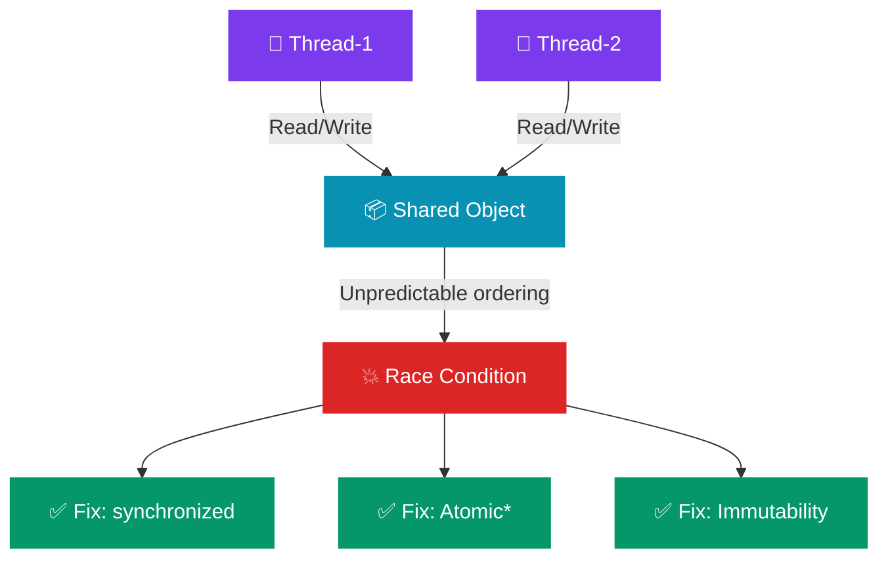

🎯 **Interview Tip:** Don't just say "use synchronized to fix it." Show you know **several fixes**:
- `synchronized` for multi-step operations
- `AtomicInteger` for counters
- `ConcurrentHashMap.putIfAbsent()` for check-then-act
- an **immutable** object, which removes the race completely

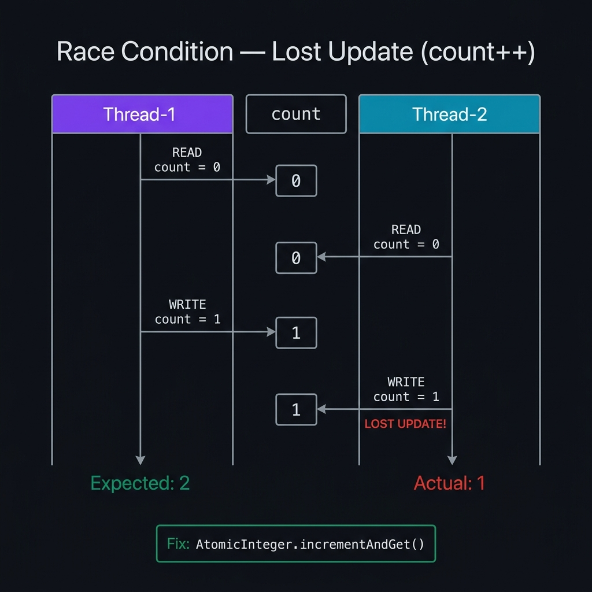

---

</details>

---

2. **🔐 What is an object-level lock and when is it required? 🔥**

<!-- -->
<details>
<summary>Answer</summary>

**Answer:**

Every object in Java has a built-in **intrinsic lock** (also called **monitor lock**). This is the object-level lock. A thread must acquire this lock before it runs any **instance `synchronized`** method or block on that object.

**When is it required?** When multiple threads call `synchronized` instance methods on the **same object**. The lock makes sure only one thread runs at a time.

```java
class Account {
    private double balance = 1000;

    // Both methods lock on 'this' (the Account instance)
    public synchronized void deposit(double amount) {
        balance += amount;
    }

    public synchronized void withdraw(double amount) {
        balance -= amount;
    }
}
```

```java
Account acc = new Account(); // one object = one lock

// Thread-1: acc.deposit(500)  → acquires lock of 'acc'
// Thread-2: acc.withdraw(200) → ❌️ BLOCKED — same object, lock held by Thread-1
```

🔑 **Key points:**

- **One lock per object instance.** `acc1` and `acc2` have **separate** locks. Two threads can call `synchronized` methods on different objects at the same time. They do not block each other.
- The lock is on the **object**, not the method. All `synchronized` instance methods on the same object share the **same single lock**.
- It is the same as this synchronized block: `synchronized(this) { ... }`
- The lock is **automatically released** when the method/block completes (even if an exception is thrown).

```java
Account acc1 = new Account();
Account acc2 = new Account();

// Thread-1: acc1.deposit(500) → locks acc1
// Thread-2: acc2.deposit(300) → locks acc2 → ✅ runs concurrently (different objects)
```

<details>
<summary><strong>🤔 Doubt: In synchronized(this), is the 'this' object locked for the entire block execution?</strong></summary>

**Yes.** When a thread enters `synchronized(this) { ... }`, the `this` object is locked for the **entire duration** of that block. Other threads may try to enter any `synchronized` method/block on the same object. They will be **blocked** until the first thread exits.

```java
public void deposit(double amount) {
    // 🔓 'this' is NOT locked here — other threads can run

    synchronized (this) {
        // 🔒 'this' IS locked — only this thread can execute
        balance += amount;
    }

    // 🔓 'this' is NOT locked here — lock released
}
```

This is the **advantage of synchronized block over synchronized method**. You lock `this` only for the critical section, not the entire method:

```java
// Synchronized method — locks 'this' for the ENTIRE method
public synchronized void process() {
    step1();  // 🔒 locked — even if this doesn't need sync
    step2();  // 🔒 locked — critical section
    step3();  // 🔒 locked — even if this doesn't need sync
}

// Synchronized block — locks 'this' only where needed
public void process() {
    step1();  // 🔓 no lock
    synchronized (this) {
        step2();  // 🔒 locked — only the part that needs it
    }
    step3();  // 🔓 no lock
}
```

And you can lock more than `this`. You can lock **any object**:

```java
synchronized (this)           // locks current object
synchronized (someOtherObj)   // locks a different object
synchronized (Account.class)  // locks the Class object (class-level lock)
```

---

</details>
<br/>

---

</details>

---

3. **🏛️ What is class level lock and when is it required? 🔥**

<!-- -->
<details>
<summary>Answer</summary>

**Answer:**

Every class loaded in the JVM has a **`Class` object** (e.g., `Account.class`). This object has its own intrinsic lock. That lock is the **class-level lock**. A thread must acquire this lock before it runs any **`static synchronized`** method or block.

**When is it required?** When multiple threads access **static (shared across all instances) mutable data**. The class-level lock makes sure only one thread changes it at a time. It does not matter which object each thread is using.

```java
class Account {
    private static double interestRate = 7.5; // shared across ALL instances

    // Locks on Account.class — not on any instance
    public static synchronized void updateRate(double newRate) {
        interestRate = newRate;
    }

    // Equivalent block form:
    public static void updateRate2(double newRate) {
        synchronized (Account.class) {
            interestRate = newRate;
        }
    }
}
```

```java
Account acc1 = new Account();
Account acc2 = new Account();

// Thread-1: Account.updateRate(8.0) → acquires Account.class lock
// Thread-2: Account.updateRate(9.0) → ❌️ BLOCKED — same class lock, regardless of object
```

🔑 **Key points:**

- **One lock per class.** It is shared across ALL instances. Say Thread-1 uses `acc1` and Thread-2 uses `acc2`. They still both compete for the same `Account.class` lock.
- Class-level lock and object-level lock are **independent**. One thread can hold the class lock while another thread holds an object lock at the same time.

```java
// Thread-1: Account.updateRate(8.0)    → holds Account.class lock
// Thread-2: acc1.deposit(500)          → holds acc1 object lock (deposit() from Q2)
// ✅ Both run concurrently — different locks!
```

---

</details>

---

4. **⚖️ Difference between the class-level lock and object-level lock? 🔥**

<!-- -->
<details>
<summary>Answer</summary>

**Answer:**

| Feature | Object-Level Lock 🔒 | Class-Level Lock 🔐 |
|---------|---------------------|---------------------|
| **When Required** | To execute instance `synchronized` method/block | To execute `static synchronized` method/block |
| **Scope** | Per object instance | Per class (shared across all instances) |
| **Lock On** | `this` (current object) | `ClassName.class` |
| **Protects** | Instance variables | Static variables |
| **How many locks?** | One per object — `acc1` and `acc2` have separate locks | One per class — shared across ALL instances |
| **Independent?** | ✅ Does not block class-level lock | ✅ Does not block object-level lock |

**Example showing both locks are independent:**

```java
class Account {
    private double balance = 1000;             // instance state
    private static double interestRate = 7.5;  // class state

    // Object-level lock — locks 'this'
    public synchronized void deposit(double amount) {
        balance += amount;
    }

    // Class-level lock — locks Account.class
    public static synchronized void updateRate(double rate) {
        interestRate = rate;
    }
}
```

```java
Account acc1 = new Account();
Account acc2 = new Account();
```

| Thread | Calls | Lock Acquired | Concurrent? |
|---|---|---|---|
| T1 | `acc1.deposit(500)` | `acc1` object lock | |
| T2 | `acc1.deposit(300)` | ❌️ BLOCKED — same object lock | Waits for T1 |
| T3 | `acc2.deposit(200)` | `acc2` object lock | ✅ Runs with T1 (different object) |
| T4 | `Account.updateRate(8.0)` | `Account.class` lock | ✅ Runs with T1 (different lock type) |
| T5 | `Account.updateRate(9.0)` | ❌️ BLOCKED — same class lock | Waits for T4 |

🎯 **Interview Tip:** The key point: class lock and object lock are **completely independent**. A thread holding the class lock does NOT block threads trying to acquire object locks. The reverse is also true.

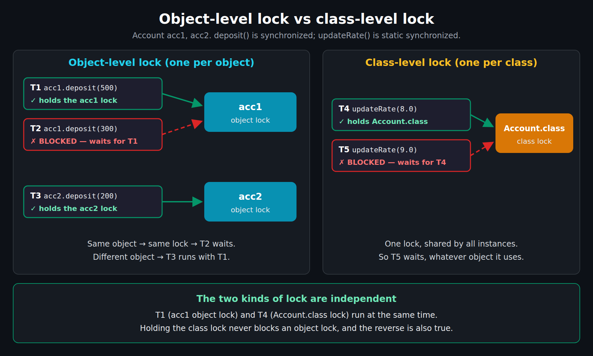

---

</details>

---

5. **📞 What will happen when the synchronized method is called? ⚡**

<!-- -->
<details>
<summary>Answer</summary>

**Answer:**

When a `synchronized` method is called, the following happens step by step:

**For instance `synchronized` method:**

| Step | What Happens |
|---|---|
| 1 | Thread attempts to **acquire the object-level lock** (`this`) |
| 2 | If lock is **available** → thread acquires it and enters the method |
| 2 | If lock is **held by another thread** → thread moves to `BLOCKED` state and waits |
| 3 | Thread **executes** the method body — object stays locked |
| 4 | Method completes (normal return or exception) → lock is **automatically released** |
| 5 | One of the waiting `BLOCKED` threads (if any) acquires the lock and enters |

**For static `synchronized` method:** Same flow, but the lock is on `ClassName.class` instead of `this`.

```java
class Account {
    public synchronized void deposit(double amount) {
        // Step 1: thread acquires lock on 'this' Account object
        // Step 2: executes method body
        balance += amount;
        // Step 3: method returns → lock auto-released
    }
}
```

```java
Account acc = new Account();

// T1 calls acc.deposit(500) → acquires lock, enters method
// T2 calls acc.deposit(300) → lock held by T1 → T2 goes to BLOCKED state
// T1 finishes → lock released → T2 acquires lock, enters method
```

💡 **Key point:** The lock is released even if the method throws an exception. The JVM guarantees this. That is the advantage of `synchronized` over `ReentrantLock`. With `ReentrantLock`, you must manually call `unlock()` in `finally`.

---

</details>

---

6. **🔓 What is the meaning of an object being locked and unlocked? ⚡**

<!-- -->
<details>
<summary>Answer</summary>

**Answer:**

Every Java object has an **intrinsic lock (monitor)**. The JVM manages it internally. Locking means acquiring this monitor. Unlocking means releasing it.

- 🔒 **Locked** — a thread has **acquired** the object's monitor. No other thread can enter any `synchronized` method/block on this object until the lock is released.
- 🔓 **Unlocked** — the monitor is **released** and free. Other waiting threads can now compete to acquire it.

**When does locking/unlocking happen?**

| Event | Lock State |
|---|---|
| Thread enters `synchronized` method/block | 🔒 Object **locked** |
| Thread exits `synchronized` method/block (normal completion) | 🔓 Object **unlocked** |
| Thread exits due to **exception** inside synchronized | 🔓 Object **unlocked** (auto-released) |
| Thread calls `wait()` on the object | 🔓 Object **unlocked** (released to allow other threads) |
| Thread wakes up from `wait()` and re-acquires the monitor | 🔒 Object **locked** again |

⚠️ **Important:** `sleep()` and `yield()` do **NOT** release the lock. Only `wait()` releases it. A sleeping thread inside a `synchronized` block holds the lock the entire time. Other threads stay blocked.

```java
synchronized (obj) {
    // 🔒 obj is LOCKED

    obj.wait();
    // 🔓 obj is UNLOCKED — released while waiting

    // 🔒 obj is LOCKED again — re-acquired after notify()
}
// 🔓 obj is UNLOCKED — exited the block
```

---

</details>

---

7. **🖥️ When a thread is called a monitor? ⚡**

<!-- -->
<details>
<summary>Answer</summary>

**Answer:**

The term "monitor" is used in two related ways in Java:

**1. Monitor (the concept):** Every Java object has a built-in **monitor**. It is the synchronization mechanism that includes the intrinsic lock + wait-set. When you use `synchronized`, you are using the object's monitor internally.

**2. Monitor owner:** A thread that **currently holds the lock** of an object is the **owner** of that object's monitor. Some old books loosely call this thread "the monitor". Strictly, a thread is never a monitor. The correct term is "monitor owner".

🔑 **Key rules:**

- Each object has **exactly one monitor** → only **one thread** can own it at a time
- A thread becomes the monitor owner when it enters a `synchronized` method/block
- It stops being the monitor owner when it exits the block or calls `wait()`

```java
Account acc = new Account();

synchronized (acc) {
    // Current thread is now the "monitor owner" of 'acc'
    // No other thread can enter any synchronized block on 'acc'
}
// Current thread is no longer the monitor owner
```

**What the monitor internally consists of:**

```
┌─────────────────────────────────┐
│        Object's Monitor         │
├─────────────────────────────────┤
│  🔒 Lock (intrinsic lock)      │  ← only one thread can hold this
│  📋 Entry Set (BLOCKED threads) │  ← threads waiting to acquire the lock
│  ⏳ Wait Set (WAITING threads)  │  ← threads that called wait()
└─────────────────────────────────┘
```

- **Entry Set:** Threads in `BLOCKED` state. They tried to enter `synchronized`, but the lock was held.
- **Wait Set:** Threads in `WAITING` state (`TIMED_WAITING` for `wait(ms)`). They called `wait()`, released the lock, and now wait for `notify()` or the timeout.

🎯 **Interview Tip:** If asked "what is a monitor in Java?", don't just say "a thread holding a lock." Explain the full structure: lock + entry set + wait set. That shows JVM-level understanding.

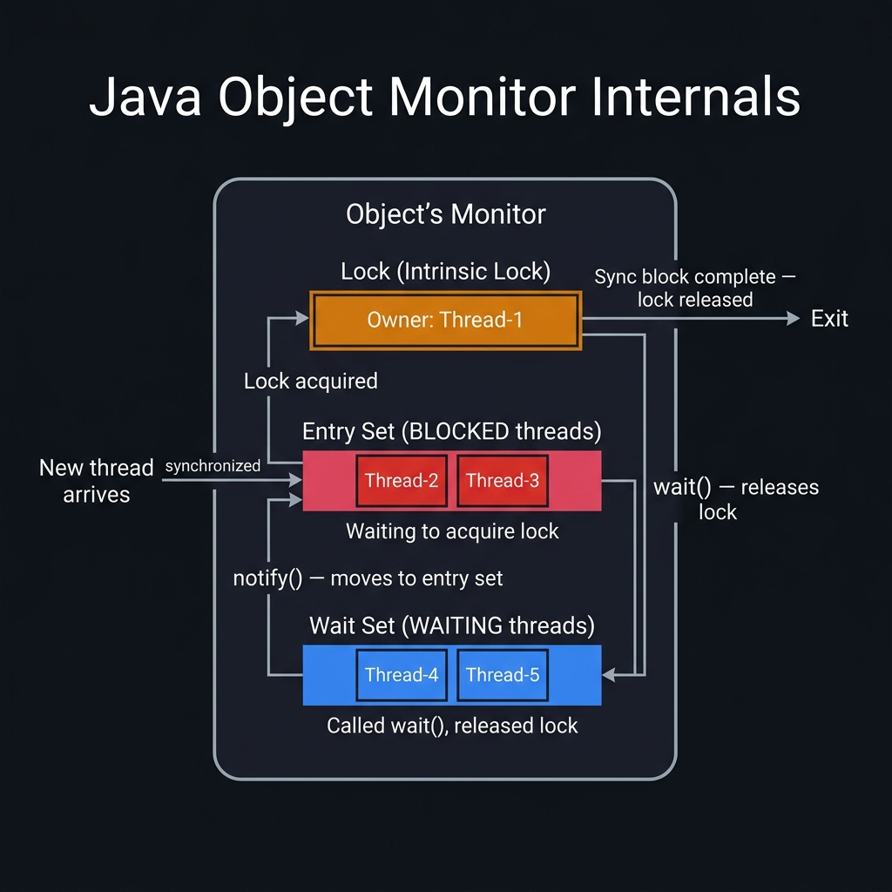

---

</details>

---

8. **🚧 While a thread is executing a synchronized method on the given object, are the other threads allowed to execute any other synchronized methods simultaneously on the same object? 🔥**

<!-- -->
<details>
<summary>Answer</summary>

**Answer:**

**No.** All `synchronized` instance methods on the same object share the **same single lock**. One thread may hold that lock. Then every other thread that tries to call **any** `synchronized` method on that object is `BLOCKED`.

```java
class Account {
    public synchronized void deposit(double amount) { /* ... */ }
    public synchronized void withdraw(double amount) { /* ... */ }
    public synchronized double getBalance() { /* ... */ }
    public void getAccountType() { /* ... */ } // non-synchronized
    public static synchronized void updateRate(double rate) { /* ... */ }
}
```

```java
Account acc = new Account();
Account acc2 = new Account();
```

**T1 is executing `acc.deposit(500)` — what can other threads do?**

| Thread | Calls | Result | Why |
|---|---|---|---|
| T2 | `acc.withdraw(200)` | ❌️ BLOCKED | Same object, `synchronized` — needs same lock |
| T3 | `acc.getBalance()` | ❌️ BLOCKED | Same object, `synchronized` — needs same lock |
| T4 | `acc.getAccountType()` | ✅ Runs freely | **Non-synchronized** — no lock needed |
| T5 | `acc2.deposit(100)` | ✅ Runs freely | **Different object** — different lock |
| T6 | `Account.updateRate(8.0)` | ✅ Runs freely | **Class lock** — independent from object lock |

🔑 **Key takeaway:** The lock is on the **object**, not the **method**. So `deposit()`, `withdraw()`, and `getBalance()` all compete for the exact same lock on `acc`. So synchronize only the methods that really need it. If you do more, you create unnecessary contention (threads waiting for the same lock).

---

</details>

---

9. **🟢 When an object is locked can another thread use it to execute a non-synchronized method? ⚡**

<!-- -->
<details>
<summary>Answer</summary>

**Answer:**

**Yes.** The lock only applies to `synchronized` methods/blocks. Non-synchronized methods **don't need any lock**. They run freely, whether the object is locked or not.

```java
class Account {
    public synchronized void deposit(double amount) {
        balance += amount; // needs sync — modifies shared state
    }

    public String getAccountType() {
        return "SAVINGS"; // no sync needed — returns constant, no shared state modified
    }
}
```

```java
// T1: acc.deposit(500)      → 🔒 holds lock on 'acc'
// T2: acc.getAccountType()  → ✅ runs freely — no lock needed
```

⚠️ **Caution:** Say a non-synchronized method **reads** shared mutable state. At the same time, another thread changes that state inside a `synchronized` method. Then you may see **stale/inconsistent data** (visibility problem). If a method reads shared state, think about making it `synchronized` too. Or use `volatile` for the field.

🧠 **Why this happens — the happens-before rule.** `synchronized` isn't only mutual exclusion. Also, **monitor unlock happens-before every subsequent lock of the same monitor**.

- A reader that never takes the lock never gets that edge.
- So the JMM (Java Memory Model) gives it **no guarantee** that it will ever see the writer's update.
- The value may stay in another core's cache. Or the JIT may keep it in a register forever ("hoisting").

Reading without the lock is not a small race problem. The JMM does not define what the reader will see.

The happens-before edges to memorise:

| Edge | Guarantee |
|---|---|
| 🔓 **Monitor unlock → subsequent lock** of the same monitor | Everything before the unlock is visible after the lock |
| 👁️ **`volatile` write → subsequent read** of the same field | Everything before the write is visible after the read (**§8 Q3**) |
| ▶️ **`Thread.start()`** | Everything the parent did before `start()` is visible to the new thread |
| 🏁 **`Thread.join()` / thread termination** | Everything the finished thread did is visible to the joiner |
| ❄️ **Final-field freeze** at constructor exit | A correctly published object's `final` fields are visible, no synchronization needed |
| 🔗 **Transitivity** | If A *hb* B and B *hb* C, then A *hb* C |

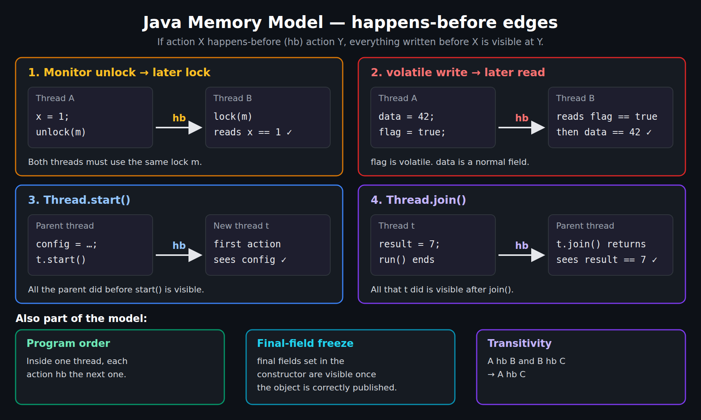

⚠️ **Both threads must synchronise.** A *pair* of actions creates a happens-before edge. If the writer synchronises and the reader does not, there is no edge. The reader may still see a stale value. *"only the writer needs the lock"* is a common wrong answer. It is the same mistake as the Caution above.

📎 The full JMM topic (reordering, safe publication, atomics) is in **[`05_Advanced_Concurrency_and_Async_Patterns`](05_Advanced_Concurrency_and_Async_Patterns_Interview_Questions.md) §4 (Memory Model and Atomics)**.

---

</details>

---

10. **🔀 If threads are using different objects, will the synchronized method execution be concurrent or sequential? ⚡**

<!-- -->
<details>
<summary>Answer</summary>

**Answer:**

**Concurrent.** Each object has its **own independent lock**. If threads use different objects, they acquire **different locks**. No thread blocks.

```java
Account acc1 = new Account();
Account acc2 = new Account();

// T1: acc1.deposit(500) → acquires lock on acc1
// T2: acc2.deposit(300) → acquires lock on acc2
// ✅ Both run concurrently — different objects, different locks
```

This is exactly why **object-level synchronization doesn't protect static variables**. Each object has its own lock. So two threads that use different objects can change a `static` field concurrently. They do not block each other. Use `static synchronized` (class-level lock) for static variables.

---

</details>

---

11. **📐 What is the difference between declaring the instance method and the static method as synchronized? 🔥**

<!-- -->
<details>
<summary>Answer</summary>

**Answer:**

| Feature | Instance `synchronized` 🔒 | Static `synchronized` 🔐 |
|---|---|---|
| **Lock acquired on** | `this` (current object instance) | `ClassName.class` (Class object) |
| **Protects** | Instance variables | Static variables |
| **Scope of blocking** | Only threads using the **same object** are blocked | All threads that need the **class lock** are blocked, whichever object they use. Instance `synchronized` calls are not blocked |
| **Equivalent block** | `synchronized(this) { }` | `synchronized(ClassName.class) { }` |
| **`this` keyword** | ✅ Available | ❌️ Not available |

```java
class Account {
    private double balance = 1000;              // instance state
    private static int totalAccounts = 0;       // class state

    // 🔒 Locks on 'this' — protects 'balance'
    public synchronized void deposit(double amount) {
        balance += amount;
    }

    // 🔐 Locks on Account.class — protects 'totalAccounts'
    public static synchronized void incrementCount() {
        totalAccounts++;
    }
}
```

**Why does it matter?**

```java
Account acc1 = new Account();
Account acc2 = new Account();

// Instance synchronized — different objects = different locks
// T1: acc1.deposit(500) → locks acc1
// T2: acc2.deposit(300) → locks acc2
// ✅ Concurrent — each object has its own lock

// Static synchronized — one class lock, blocks everyone
// T3: Account.incrementCount() → locks Account.class
// T4: Account.incrementCount() → ❌️ BLOCKED — same class lock
// (doesn't matter which object T3/T4 used)
```

⚠️ **Common mistake:** Using instance `synchronized` to protect a `static` variable. This is **not thread-safe**. Different objects have different locks, so two threads can change the static variable concurrently.

```java
// ❌️ WRONG — instance lock doesn't protect static state
public synchronized void incrementCount() {
    totalAccounts++; // static variable — needs class lock!
}

// ✅ CORRECT
public static synchronized void incrementCount() {
    totalAccounts++;
}
```

📝 **Note:** Inside a `static` method, `this` doesn't exist (there is no object). So in a static method, a synchronized block can lock `ClassName.class`, a `static` lock object, an argument, or any other object reference. You can never lock `this`.

---

</details>

---

<a id="7-synchronized-blocks"></a>
## 7. Synchronized Blocks ⚡

1. **🧱 What is a synchronized block? 🔥**

<!-- -->
<details>
<summary>Answer</summary>

**Answer:**

A block of code wrapped in the `synchronized` keyword is called a synchronized block.

```java
class Display {

   public void wish(String name) {

      // synchronized block
      synchronized(this) {
         // code
      }
   }
}
```

---

</details>

---

2. **💡 What is the need for a synchronized block? ⚡**

<!-- -->
<details>
<summary>Answer</summary>

**Answer:**

Assume we have an `m1()` method with 10k lines of code. It is a linking method: inside, it calls other methods. Out of these lines, only 10 lines need synchronization.

- If we declare the whole `m1()` method as synchronized, it is the worst kind of practice in Java programming.
- It increases the waiting time of threads and gives very poor performance.

So if only a few lines of code need synchronization, never declare the whole method as synchronized. Use a **synchronized block** for just those lines.

💡 **Pro Tip — but don't make the rule too strong.** Prefer a synchronized **block** when only part of the method is the critical section.

Sometimes the method's *whole body* is the critical section. Then `synchronized` on the method is clearer and **identical in cost**. The JVM takes the same monitor on `this` either way. The method form has no runtime penalty. Even then, there are two real reasons to prefer the block form:

1. 🔒 **`synchronized` on a public method publishes your lock.** Any outside code can do `synchronized (yourObject) { … }` and make your method wait. A block guarded by `private final Object lock = new Object();` is safe from this. No outside code can take that lock.
2. 🎯 **A block lets you lock something other than `this`.** It can be a different object. Or it can be one of several separate locks for independent state.

⚠️ And you can shrink the block only **down to the boundary of the invariant** (the rule that must always hold true). See the two-account transfer in **§7 Q7**. There, changing one method into two sequential blocks breaks atomicity, with no error to warn you.

---

</details>

---

3. **🆚 What is the difference between synchronized methods and blocks? 🔥**

<!-- -->
<details>
<summary>Answer</summary>

**Answer:**

| Feature | Synchronized Method 🅰️ | Synchronized Block 🅱️ |
|---------|------------------------|----------------------|
| **Scope** | Complete method logic is executed sequentially | Only statements inside the block are executed sequentially |
| **Lock Flexibility** | No choice: locks `this` (instance method) or `ClassName.class` (static method) | Can lock any object: `this`, an argument, a private lock object, or any `Class` object |
| **Granularity** | ⚠️ Coarse-grained (entire method) | ✅ Fine-grained (specific lines) |
| **Performance** | 🐢 More waiting time | ⚡ Less waiting time |

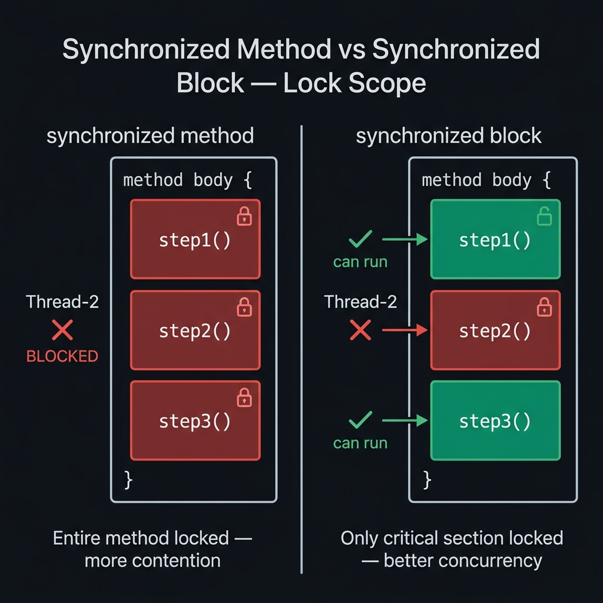

---

</details>

---

4. **⚡ What is the advantage of the synchronized block over the synchronized method? ⚡**

<!-- -->
<details>
<summary>Answer</summary>

**Answer:**

⚡ Threads wait less, and performance improves.

---

</details>

---

5. **🔗 Is it possible, a thread can acquire multiple locks simultaneously? ⚡**

<!-- -->
<details>
<summary>Answer</summary>

**Answer:**

Yes, a thread can acquire multiple locks simultaneously.

```java
class X {

   // x.m1() called
   public synchronized void m1() { // "x" locked

      Y y = new Y();
      synchronized(y) { // "y" locked

         Z z = new Z();
         synchronized(z) { // "z" locked

           // currently thread holds
           // "x", "y", and "z" objects lock
         }
      }
   }
}
```

We want to call the `m1()` method:

```java
X x = new X();
x.m1();
```

To execute a synchronized method, a thread must first acquire the lock of the current object. So to execute the `m1()` method, the thread must acquire the "x" object lock.

- To enter the 1st synchronized block, it needs the "y" object lock.
- To enter the 2nd synchronized block, it needs the "z" object lock.
- Inside the 2nd synchronized block, the thread holds the locks of "x", "y", and "z" objects.

---

</details>

---

6. **1️⃣ By how many threads an object can be locked at a time? 💤**

<!-- -->
<details>
<summary>Answer</summary>

**Answer:**

At a time, only one thread can get the lock of an object.

---

</details>

---

7. **🧩 When should we develop multiple synchronized blocks instead of declaring complete methods as synchronized? ⚡**

<!-- -->
<details>
<summary>Answer</summary>

**Answer:**

Use multiple synchronized blocks when **different parts of a method need to lock different objects**, or when **only some parts** need synchronization.

**Case 1: Only parts of the method need synchronization** — a **single-object** update

```java
// ❌️ Entire method locked — validation & logging don't need sync
public synchronized void deposit(double amount) {
    validate(amount);         // no shared state — doesn't need lock
    log("Deposit started");   // no shared state — doesn't need lock
    balance += amount;        // ⚠️ needs sync — modifies shared state
    log("Deposit done");      // no shared state — doesn't need lock
}

// ✅ Only the critical section locked — other threads can run validate/log concurrently
public void deposit(double amount) {
    validate(amount);           // 🔓 no lock
    log("Deposit started");     // 🔓 no lock

    synchronized (this) {
        balance += amount;      // 🔒 the whole invariant lives inside one block
    }

    log("Deposit done");        // 🔓 no lock
}
```

✅ This narrowing is safe **because the entire invariant is one field on one object**. But if an operation covers **two** objects, narrowing like this becomes a correctness bug. See the trap below.

🚨 **Case 2 — the trap: two *sequential* critical sections are NOT one atomic operation**

```java
// ❌️❌️ LOOKS like "fine-grained locking", is actually BROKEN
public void transferFunds(Account to, double amount) {
    synchronized (this) {
        balance -= amount;      // money leaves here...
    }
    // 💥 GAP: the thread holds NO lock at all.
    //    The system total is short by `amount`. Any concurrent reader sees
    //    money that exists nowhere. A crash/exception here loses it outright.
    synchronized (to) {
        to.balance += amount;   // ...and only arrives here
    }
}
```

Between the two blocks, the transfer is **half-applied and unprotected**. Test setup:

- 4 writer threads did 300,000 round-trip transfers.
- At the same time, one reader took a properly-ordered two-lock snapshot of `a.balance + b.balance`.

Results:

| Transfer implementation | Snapshots taken | Snapshots seeing a **wrong system total** |
|---|---|---|
| Two sequential blocks (above) | 2,967,042 | **2,273,591** ❌️ — 77% of reads |
| Both locks held, ordered (below) | 2,757,769 | **0** ✅ |

The result was the same across repeated runs. The sequential form was never below ~70% bad reads. The ordered form was always exactly **0**.

✅ **The fix — hold both locks for the whole operation. Acquire them in one fixed global order:**

```java
public static void transfer(Account from, Account to, long amount) {
    // Order by a STABLE key (account id / primary key) — never by hashCode(),
    // which can collide, and never by argument position, which flips per caller.
    Account first  = from.getId() < to.getId() ? from : to;
    Account second = (first == from) ? to : from;

    synchronized (first) {
        synchronized (second) {   // 🔒 both held — the transfer is atomic
            from.balance -= amount;
            to.balance   += amount;
        }
    }
}
```

⚠️ **Why the ordering matters:** just nesting `synchronized (from) { synchronized (to) { … } }` without sorting is the standard deadlock example.

- Thread A transfers 1→2. At the same time, thread B transfers 2→1.
- Each holds the lock the other needs, and they wait forever.

With sorting by a stable key, every thread takes the *lower* id first. So a cycle can never form.

🔑 **What makes a good ordering key:** it must be **stable** (it never changes while the lock is held) and **unique** (two accounts never have the same key). A database id is ideal. `hashCode()` fails the second rule — two objects can have the same value.

The other option is `tryLock()` + randomized backoff. See **§8 Q5**.

💡 **The rule to state in an interview:** *"Lock scope is bounded by the invariant, not by the line count. Shrink the critical section only down to the smallest region in which the invariant still holds — for a two-account transfer that region is the whole debit+credit pair."*

A single instance `synchronized` method can only lock `this` (a `static` one locks `ClassName.class`). With a synchronized method, you **can't** lock an argument object or a different object.

- Multiple blocks let you lock **different objects**.
- Nested blocks (in a fixed order) give you *multiple locks held at once*. A multi-object invariant needs exactly this.

**Summary — when to use multiple blocks:**

| Scenario | Why Multiple Blocks | ⚠️ Only if… |
|---|---|---|
| Only a few lines need sync in a large method | Reduces lock holding time → better concurrency | …those lines are the **whole** invariant |
| Different lines touch **independent** shared state | An instance `synchronized` method can only lock `this`. Separate locks let unrelated state run in parallel | …the two pieces of state really have **no** invariant linking them |
| Read-heavy method with a small write section | Only lock the write part, reads run freely | …readers also synchronize (or the field is `volatile`). If not, you removed a race but added a **visibility** bug (**§6 Q9**) |

🚫 **When NOT to split:** some pairs of updates must be all-or-nothing. Examples: transfer, swap, "move item from list A to list B", any check-then-act across two objects. Put them in **one** critical section that holds **all** the required locks. Never put them in two sequential blocks.

---

</details>

---

<a id="8-thread-safety-advanced-locking--concurrency-patterns"></a>
## 8. Thread Safety, Advanced Locking & Concurrency Patterns 🔥🔥

1. **🛡️ What is the meaning of thread-safe and non-thread-safe objects? 🔥**

<!-- -->
<details>
<summary>Answer</summary>

**Answer:**

- 🔒 **Thread-safe object:** an object that **works correctly when many threads use it, in any order the scheduler runs them. The caller does not need to add any synchronization** (Goetz, *Java Concurrency in Practice*). Its invariants always hold, and every thread sees a consistent state.
- 🔓 **Non-thread-safe object:** an object that is correct **only if the caller protects it**. The caller must keep it inside one thread, or put a lock around every access. If many threads use it without this, it can lose updates (`count++`), show half-finished state, or return stale values.

⚠️ Don't define it as "one thread's changes aren't visible to others". That is wrong. A thread-safe object **guarantees** that changes are visible — it does not hide them. `ArrayList` is the standard example of a non-thread-safe object. `ConcurrentHashMap`, `AtomicInteger` and any immutable object (`String`) are thread-safe.

---

</details>

---

2. **🏗️ How can we develop thread-safe objects? ⚡**

<!-- -->
<details>
<summary>Answer</summary>

**Answer:**

Four ways, simplest first:

- ❄️ **Immutability** — all fields `final`, no setters, and `this` does not escape the constructor. Nothing can change, so there is no race.
- 🧵 **Thread confinement** — never share the object. Use local variables (stack confinement) or one `ThreadLocal` copy per thread.
- ⚛️ **Delegate to thread-safe building blocks** — keep the state in `AtomicInteger`, `ConcurrentHashMap` or `CopyOnWriteArrayList`. This works only when no invariant links two fields.
- 🔒 **Guard every access with one lock** — put `synchronized` or a `ReentrantLock` around **both the mutators *and* the accessors**.

⚠️ **The common half-answer:** "make all mutator methods `synchronized`." This is not enough. If the getters are not synchronized, the reader has no happens-before edge with the writer. So the reader can see a **stale** value for ever. For non-volatile `long`/`double` it can even see a torn value. The rule: *every* access to shared mutable state must use the **same** lock — reads too.

---

</details>

---

3. **👁️ What does `volatile` guarantee — and what does it NOT? 🔥**

<!-- -->
<details>
<summary>Answer</summary>

**Answer:**

`volatile` is about **visibility and ordering**. It is never about **atomicity**. It gives you a few guarantees, and one important thing it does NOT give.

**✅ What `volatile` DOES guarantee**

1. 👁️ **Visibility.** When one thread writes a `volatile` field, every later read of that field by any other thread sees the new value. The JIT cannot keep the value in a register, and it cannot move the read out of a loop. The JVM also adds **memory barriers**. So neither the compiler nor the CPU (store buffers, out-of-order execution) can reorder code around the access. *(Don't say "it reads from main memory instead of the CPU cache". CPU caches are coherent. The stale value actually sits in registers and store buffers. An interviewer who knows this will question you on it.)*
2. 🔀 **Ordering (a happens-before edge).** Suppose thread A writes some fields and then writes a `volatile`. Thread B then reads that same volatile and sees A's value. Now B also sees everything A wrote *before* the volatile write. This is why the common pattern "publish an object through a volatile reference" is safe.
3. 🔢 **Atomic `long`/`double` access.** Without `volatile`, a 64-bit read or write may be split into two 32-bit halves (JLS §17.7). Declaring the field `volatile` stops this tearing.

**❌️ What `volatile` does NOT guarantee**

**Atomicity of compound operations.** `count++` is three steps — read, add, write. `volatile` protects each step alone, but not the three steps together. Two threads can read the same value, and both write back the same result.

```java
class Counter {
    volatile int v;
    void inc() {
        v++;            // read-modify-write — NOT atomic, volatile or not
    }
}
// 8 threads × 100,000 increments each — expected 800,000
```

📤 **Output — three runs in a row, all of them far from correct:**
```
volatile count++ : expected 800000, got 462481   <-- LOST UPDATES
volatile count++ : expected 800000, got 407648   <-- LOST UPDATES
volatile count++ : expected 800000, got 416695   <-- LOST UPDATES
```

About **half** the increments were lost. `volatile` made every thread see a *fresh* value. But it did nothing to stop two threads from using the same fresh value at the same time.

**🎯 Choosing between the three tools**

| | `volatile` | `AtomicInteger` | `synchronized` / `ReentrantLock` |
|---|---|---|---|
| **Visibility** | ✅ | ✅ | ✅ |
| **Ordering (happens-before)** | ✅ | ✅ | ✅ |
| **Atomic read-modify-write** | ❌️ | ✅ (single variable, via CAS) | ✅ (any number of variables) |
| **Multi-variable invariant** | ❌️ | ❌️ | ✅ |
| **Blocks the thread?** | ❌️ never | ❌️ lock-free (CAS retry loop) | ✅ yes |
| **Cost** | cheapest | cheap; degrades under heavy contention | highest |
| **Use it for** | a one-way status/stop **flag**, safe publication, DCL | a **counter** or single-variable CAS | a **multi-step** or multi-field invariant |

```java
// ✅ volatile — right choice: one writer, plain assignment, many readers
private volatile boolean shutdownRequested;

// ✅ AtomicInteger — read-modify-write on ONE variable
private final AtomicInteger requests = new AtomicInteger();
requests.incrementAndGet();

// ✅ synchronized — invariant covers TWO fields; the two above cannot help
synchronized void withdraw(long amt) {
    balance -= amt;
    lastTxnAt = System.currentTimeMillis();
}
```

⚠️ **The interview trap:** *"Can I just make the counter `volatile` instead of synchronizing?"* → **No.** `volatile` fixes stale values, not lost updates. For a counter, use `AtomicInteger`/`LongAdder`. When more than one field must change together, use a lock.

📎 **Deeper follow-ups** — the full happens-before rules, how CAS works, and `LongAdder` — are in **[`05` §4](05_Advanced_Concurrency_and_Async_Patterns_Interview_Questions.md)**.

<details>
<summary><strong>🤔 Doubt: If `volatile` isn't atomic, why does the double-checked-locking Singleton need it?</strong></summary>

---

</details>
<br/>

---

</details>

---

4. **🔐 What is ReentrantLock and how is it different from synchronized? 🔥**

<!-- -->
<details>
<summary>Answer</summary>

**Answer:**

`ReentrantLock` is a class in `java.util.concurrent.locks`. It implements the `Lock` interface. It gives the **same mutual exclusion** as `synchronized`, but with **more control and more options**.

**"Reentrant" means:** if a thread already holds the lock, it can **re-acquire** it without deadlocking itself (same as `synchronized`). An internal counter counts how many times the thread acquired the lock. The thread fully releases the lock only when it calls `unlock()` the same number of times.

**Side-by-side comparison:**

```java
// ✅ synchronized — implicit, automatic
public synchronized void deposit(double amount) {
    balance += amount;
}   // lock auto-released here — even on exception

// ✅ ReentrantLock — explicit, manual
private final ReentrantLock lock = new ReentrantLock();

public void deposit(double amount) {
    lock.lock();               // explicitly acquire
    try {
        balance += amount;
    } finally {
        lock.unlock();         // MUST release in finally
    }
}
```

**Where ReentrantLock is better — features `synchronized` doesn't have:**

**1. 🎯 Fairness** — `lock()` gives the lock to the thread that has **waited longest**. A newly arriving thread cannot "barge" (jump the queue):
```java
ReentrantLock lock = new ReentrantLock(true); // fair lock
// Without fairness: a newly arriving thread can "steal" the lock
// from threads that have been waiting longer — can cause starvation
```

⚠️ **"Fair" is not 100% fair — `tryLock()` barges even on a fair lock.** The Javadoc *says* that `tryLock()` without a timeout ignores the fairness setting. If the lock is free at that moment, it takes the lock at once and jumps the queue. Tested:

```java
ReentrantLock fair = new ReentrantLock(true);
fair.lock();
// ... start a second thread that blocks in fair.lock() and queues up ...
System.out.println("queued waiters: " + fair.getQueueLength());  // 1
fair.unlock();
System.out.println("tryLock() acquired: " + fair.tryLock());     // true — barged past the queued thread
```

📤 `queued waiters: 1` / `tryLock() acquired: true`

If you want fairness, use the timed form `tryLock(0, TimeUnit.SECONDS)`. It **does** respect fairness. Also, fairness reduces throughput. It forces a context switch on almost every handoff. That is why it is off by default.

**2. 🔄 tryLock()** — try to get the lock without blocking, or with a timeout. `synchronized` has nothing like this. Full answer and use cases: **Q5**.

**3. 🚫 lockInterruptibly()** — thread can be interrupted while waiting for the lock:
```java
try {
    lock.lockInterruptibly(); // can be interrupted while waiting
    try { /* do work */ }
    finally { lock.unlock(); }
} catch (InterruptedException e) {
    // thread was interrupted while waiting — handle it cleanly
}
```
With `synchronized`, a thread in `BLOCKED` state **cannot be interrupted**. It stays stuck until it gets the lock.

**4. 📡 Multiple Conditions** — many wait-sets on one lock (`notFull`, `notEmpty`). A `synchronized` object has only one. Full answer: **Q6**.

**5. 🔍 Introspection** — query lock state at runtime:
```java
lock.isLocked();          // is any thread holding this lock?
lock.isHeldByCurrentThread(); // does THIS thread hold it?
lock.getQueueLength();    // how many threads are waiting?
```

**Summary table:**

| Feature | `synchronized` | `ReentrantLock` |
|---|---|---|
| **Lock/unlock** | Implicit (JVM handles) | Explicit (`lock()` / `unlock()` in `finally`) |
| **Fairness** | ❌️ Always unfair | ✅ Optional FIFO ordering |
| **Try without blocking** | ❌️ Not possible | ✅ `tryLock()` / `tryLock(timeout)` |
| **Interruptible wait** | ❌️ BLOCKED = stuck | ✅ `lockInterruptibly()` |
| **Multiple conditions** | ❌️ One wait-set | ✅ Multiple via `newCondition()` |
| **Lock introspection** | ❌️ Not possible | ✅ `isLocked()`, `getQueueLength()` |
| **Risk of forgetting unlock** | ❌️ No risk (auto-release) | ⚠️ Must use `try-finally` — forgetting = permanent lock |
| **Reentrant** | ✅ Yes | ✅ Yes |
| **Performance** | Similar (Java 6+) | Similar |

**When to use which:**

| Choose | When |
|---|---|
| `synchronized` | Simple cases, fewer lines of code, no risk of forgetting unlock |
| `ReentrantLock` | Need fairness, tryLock, timeout, interruptible locking, multiple conditions, or lock introspection |

**💰 What does `synchronized` really cost?** This is the follow-up to "which is faster". The honest answer is *"it depends on contention, not on the keyword"*:

HotSpot upgrades a monitor **only when needed**. A **thin (lightweight)** lock is just a CAS on the object header. It is cheap when there is no contention. Only real contention **inflates** it into a heavyweight monitor. A heavyweight monitor parks threads through the OS. That context switch costs microseconds. So *uncontended* `synchronized` is not expensive — *contended* `synchronized` is. That is why the table above says performance is "similar". Both take the same fast path when no other thread is competing.

> ℹ️ **Biased locking** was an old third level. It let a single thread re-enter the lock without even a CAS. It was **disabled by default in JDK 15 (JEP 374)** and **removed in JDK 18**. Older articles say `synchronized` is "free after the first acquisition". That level does not exist any more.

⚠️ **Virtual threads (Java 21) — the modern reason to prefer `ReentrantLock`.** Earlier, a virtual thread that blocked inside a `synchronized` block would **pin** its carrier platform thread. The carrier could not be freed to run other virtual threads. The scheduler then runs out of carrier threads. Under load, it can deadlock a pool. `ReentrantLock` never had this problem — it unmounts the virtual thread correctly. **JDK 24 (JEP 491) removed most of this pinning.** But on a **Java 21 baseline the problem is still real**. So in code that runs on virtual threads, prefer `ReentrantLock` over `synchronized` around any blocking work.

🎯 **Interview Tip:** Use `synchronized` by default because it is simple. Use `ReentrantLock` only when you need a feature that `synchronized` does not have. But it needs extra work: you must unlock manually.

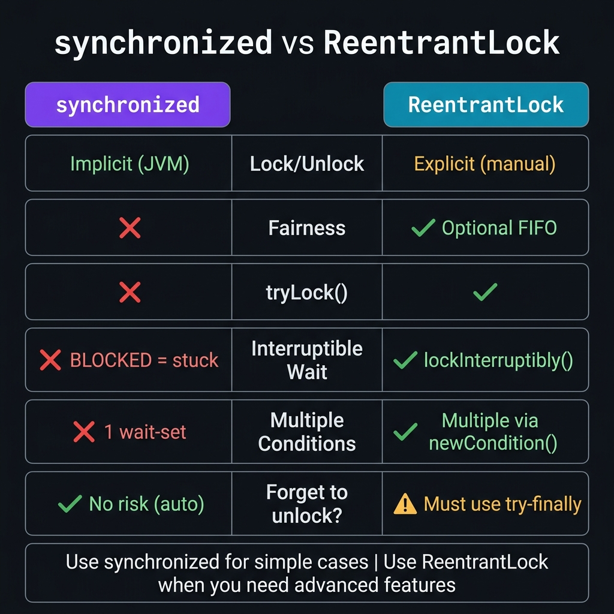

---

</details>

---

5. **🔄 What is tryLock() and why is it useful? ⚡**

<!-- -->
<details>
<summary>Answer</summary>

**Answer:**

`tryLock()` tries to acquire the lock **without blocking**. It returns `true` if it got the lock, and `false` if not. So the thread can **do something else** instead of waiting forever.

**Two variants:**

| Method | Behavior |
|---|---|
| `tryLock()` | Non-blocking — returns immediately |
| `tryLock(long time, TimeUnit unit)` | Waits up to the timeout, then gives up |

Compare with `synchronized`: once a thread reaches a `synchronized` block, it waits **forever** until it gets the lock. There is no timeout and no way out. `tryLock()` gives you a way out.

**Real-world use cases:**

**1. 💀 Deadlock prevention** — if you can't get both locks, release and retry:

```java
// Bank transfer: need to lock BOTH accounts
// Without tryLock → T1 locks acc1 waits for acc2, T2 locks acc2 waits for acc1 → DEADLOCK
// With tryLock → if can't get second lock, release first and retry → no deadlock possible

public boolean transfer(Account from, Account to, double amount)
        throws InterruptedException {        // Thread.sleep is a checked call
    while (true) {
        if (from.lock.tryLock()) {
            try {
                if (to.lock.tryLock()) {
                    try {
                        from.debit(amount);
                        to.credit(amount);
                        return true;
                    } finally { to.lock.unlock(); }
                }
            } finally { from.lock.unlock(); }
        }
        // Couldn't get both locks — back off and retry
        Thread.sleep(new Random().nextInt(50)); // random backoff avoids livelock
    }
}
```

**2. ⚡ Fast-fail API** — don't block the request thread; reply at once:

```java
// Payment service — if another thread is already processing THIS order, reject immediately
private final ConcurrentHashMap<String, ReentrantLock> orderLocks = new ConcurrentHashMap<>();

public PaymentResponse processPayment(Order order) {
    ReentrantLock lock = orderLocks.computeIfAbsent(order.getId(), id -> new ReentrantLock());
    if (lock.tryLock()) {
        try {
            return doPayment(order);
        } finally { lock.unlock(); }
    } else {
        return PaymentResponse.alreadyInProgress(); // fast fail — no waiting
    }
}
```

⚠️ **One lock per key, not one lock for the whole service.** With a single shared `orderLock`, a payment for order **B** would be rejected just because order **A** is still running. (This example never removes map entries. A real version needs Guava `Striped<Lock>` or some cleanup.) Also, it protects only **one JVM**. Suppose you run 3 replicas behind a load balancer. Then the production answer is an idempotency key with a unique DB constraint, or a distributed lock (Redis / DB row lock). Mention this before the interviewer asks.

**3. ⏱️ Timeout-based** — try for a fixed time, then throw:

```java
// DB connection pool — don't wait forever for a connection
if (poolLock.tryLock(2, TimeUnit.SECONDS)) {
    try {
        return pool.getConnection();
    } finally { poolLock.unlock(); }
} else {
    throw new TimeoutException("Could not acquire connection within 2s");
}
```

**4. ⏭️ Skip if busy** — several threads can start a job. It skips if a run is already going on:

```java
// Full sync can be started by the scheduler AND by an admin endpoint — never run two at once
public void syncInventory() {
    if (syncLock.tryLock()) {
        try {
            performFullSync(); // might take > 5 minutes
        } finally { syncLock.unlock(); }
    } else {
        log.info("Sync already running — skipping this trigger");
    }
}
```

⚠️ **Don't add this to a plain `@Scheduled` method and expect it to help.** Spring's scheduler already never runs the same `fixedRate` task twice at once. (`ScheduledExecutorService.scheduleAtFixedRate` guarantees that a late run starts *after* the previous one ends, never at the same time.) So the lock is dead code there. (Two exceptions, where runs can overlap: the method is also `@Async`, or Spring Boot 3.2+ runs with `spring.threads.virtual.enabled=true`. In both cases the scheduler only hands each run to another thread and does not wait for it to end.) The overlap that really causes bugs is **several app instances** running the same job. An in-JVM lock cannot see the other pods. That is what **ShedLock** (a DB/Redis-backed lock) is for.

**Summary — when to use `tryLock()`:**

| Pattern | Why `tryLock()` |
|---|---|
| Deadlock prevention | Release first lock if second unavailable — break circular wait |
| Fast-fail APIs | Don't block request threads — return error/fallback at once |
| Timeout-based resource access | Wait a limited time, then fail cleanly |
| Overlap protection (single JVM) | Skip a trigger if a run is already executing — multi-instance needs ShedLock |

🎯 **In short:** use `tryLock()` whenever **blocking forever is not acceptable**. You would rather fail fast, skip, retry, or do something else.

---

</details>

---

6. **📡 What is a Condition object and how does it replace wait()/notify()? ⚡**

<!-- -->
<details>
<summary>Answer</summary>

**Answer:**

You create a `Condition` from a `ReentrantLock` by calling `newCondition()`. It replaces `wait()`/`notify()`/`notifyAll()` with `await()`/`signal()`/`signalAll()`.

🔑 **Key advantage:** with `synchronized`, an object has only **one wait-set**. So `notifyAll()` wakes ALL waiters (producers AND consumers). With `Condition`, you can have **many wait-sets** on the same lock. You wake only the right group.

```java
class BoundedBuffer<T> {
    private final Queue<T> queue = new LinkedList<>();
    private final int capacity;
    private final ReentrantLock lock = new ReentrantLock();
    private final Condition notFull = lock.newCondition();
    private final Condition notEmpty = lock.newCondition();

    public BoundedBuffer(int capacity) {
        this.capacity = capacity;
    }

    public void put(T item) throws InterruptedException {
        lock.lock();
        try {
            while (queue.size() == capacity) {
                notFull.await(); // only producers wait here
            }
            queue.add(item);
            notEmpty.signal(); // wake only consumers
        } finally {
            lock.unlock();
        }
    }

    public T take() throws InterruptedException {
        lock.lock();
        try {
            while (queue.isEmpty()) {
                notEmpty.await(); // only consumers wait here
            }
            T item = queue.poll();
            notFull.signal(); // wake only producers
            return item;
        } finally {
            lock.unlock();
        }
    }
}
```

| `Object` methods | `Condition` methods |
|---|---|
| `wait()` | `await()` |
| `notify()` | `signal()` |
| `notifyAll()` | `signalAll()` |

---

</details>

---

7. **🧵 What is ThreadLocal and when should you use it? 🔥**

<!-- -->
<details>
<summary>Answer</summary>

**Answer:**

`ThreadLocal<T>` gives **each thread its own separate copy** of a variable. Each thread that uses a `ThreadLocal` gets its own instance. So no synchronization is needed.

**Key methods:** `get()`, `set()`, `remove()`, `withInitial(Supplier)`

**Common use cases in production:**

| Use Case | How ThreadLocal is used |
|---|---|
| 🔍 **MDC logging** | Store `requestId` per thread — SLF4J/Logback MDC uses `ThreadLocal` inside. Every log line in a request then includes the request ID automatically |
| 🔒 **Spring SecurityContextHolder** | Stores authentication context per thread (default `MODE_THREADLOCAL`) |
| 🌐 **Spring RequestContextHolder** | Stores HTTP request attributes per thread |
| 📅 **SimpleDateFormat** | Not thread-safe, so one instance per thread avoids synchronization |

```java
public class RequestContext {
    private static final ThreadLocal<String> requestId =
        ThreadLocal.withInitial(() -> UUID.randomUUID().toString());

    public static void set(String id) {
        requestId.set(id);
    }

    public static String getRequestId() {
        return requestId.get();
    }

    public static void clear() {
        requestId.remove(); // MUST call in finally / filter cleanup
    }
}
```

💡 `InheritableThreadLocal` — a child thread gets a copy of the parent's value **when the child is created**. So it does not work with thread pools. Pool threads are created once and then reused.

---

</details>

---

8. **⚠️ What is the memory leak risk with ThreadLocal in thread pools? 🔥**

<!-- -->
<details>
<summary>Answer</summary>

**Answer:**

> 📎 The only thread-pool fact you need here: a pool thread **lives for a long time and is reused for unrelated tasks**. Everything else about pools is in **[`05`, section 2](05_Advanced_Concurrency_and_Async_Patterns_Interview_Questions.md)**.

In a thread pool, **threads are reused**. They are NOT destroyed after each task. If you `set()` a value but never `remove()` it, the value stays with that thread for as long as the thread lives. This causes two different bugs. The **first one matters most in a normal app**:

⚠️ **Don't exaggerate the leak.** With the usual `private static final ThreadLocal`, each pool thread holds **at most one** value. So memory is limited to `poolSize × valueSize`. It does not grow with each request. The real `OutOfMemoryError` cases are:
- (a) a **non-static** `ThreadLocal` created per object, so every instance adds a new map entry.
- (b) the **classloader leak** on app-server redeploy (Tomcat). The pool thread lives longer than the webapp. Its value holds a class from the old webapp. That class holds the whole old classloader → `Metaspace` OOM after a few redeploys.

```java
// ❌️ WRONG — leaks in thread pools
public void handleRequest() {
    RequestContext.set(buildContext());
    processRequest();
    // forgot to remove — context stays for next request on this thread!
}

// ✅ CORRECT
public void handleRequest() {
    try {
        RequestContext.set(buildContext());
        processRequest();
    } finally {
        RequestContext.clear(); // always remove
    }
}
```

🎯 **Interview Tip:** in Spring apps, call `remove()` from a servlet `Filter` or `HandlerInterceptor.afterCompletion()`. This makes sure cleanup happens even if the handler throws an exception.

**🕳️ The other half of the problem: `ThreadLocal` values do NOT pass INTO a pool.**

The leak is about a *stale* value reaching the next task. The opposite bug is that a **fresh** value never arrives. When you give work to an executor, the pool thread has its own, empty `ThreadLocalMap`. Your tenant / MDC / `SecurityContext` is just gone.

```java
// ❌️ Null, with no error — the lambda runs on a POOL thread with an empty ThreadLocalMap
CompletableFuture.runAsync(() -> doWork(TenantContext.getTenant()), executor);

// ✅ Capture on the CALLING thread, pass explicitly into the task
Tenant tenant = TenantContext.getTenant();   // still the request thread here
CompletableFuture.runAsync(() -> doWork(tenant), executor);
```

📎 The other fixes — Spring `TaskDecorator`, Micrometer `ContextSnapshot`, `ScopedValue` — are in **[`05` section 3, Q9](05_Advanced_Concurrency_and_Async_Patterns_Interview_Questions.md)**. `InheritableThreadLocal` does not help here (see Q7): it copies the value when the pool thread is *created*, long before your request arrives.

---

</details>

---

9. **🔒 How do you create a thread-safe Singleton in Java? 🔥**

<!-- -->
<details>
<summary>Answer</summary>

**Answer:**

🎯 **One-line answer:** use the **holder idiom** by default. Use an **enum** when you also need serialization and reflection safety. Use **double-checked locking (DCL)** only when the instance needs runtime arguments. In that case, the field **must** be `volatile`.

| Approach | Lazy? | Thread-safe because… | Use when |
|---|---|---|---|
| Holder idiom | ✅ | the JVM initializes a class only once, under a lock | the default choice |
| Enum | ⚠️ on class init | same class-init guarantee | you need serialization / reflection safety |
| DCL + `volatile` | ✅ | lock on first creation + `volatile` read | the constructor needs runtime arguments |

```java
public class Singleton {
    private static volatile Singleton instance;   // volatile is MANDATORY

    private Singleton() {}

    public static Singleton getInstance() {
        if (instance == null) {                    // 1st check — no lock
            synchronized (Singleton.class) {
                if (instance == null) {            // 2nd check — with lock
                    instance = new Singleton();
                }
            }
        }
        return instance;
    }
}
```

<details>
<summary><strong>🤔 Doubt: Why is volatile mandatory in double-checked locking?</strong></summary>

Because the DCL bug is an **ordering** bug, not an atomicity bug.

`instance = new Singleton()` is three steps: (a) allocate memory, (b) run the constructor, (c) assign the reference. Without `volatile`, the JIT may **reorder** (b) and (c). Then a non-null reference points to a **half-constructed** object. A second thread reaches the first `if (instance == null)` and sees non-null. It skips the lock. It returns an object whose fields still have default values.

The `synchronized` block was never the problem. The problem is the **first** read. That read is not synchronized. `volatile` forbids the reordering and makes that read safe.

---

</details>
<br/>

---

</details>

---

<a id="9-inter-thread-communication"></a>
## 9. Inter-Thread Communication 🔥🔥

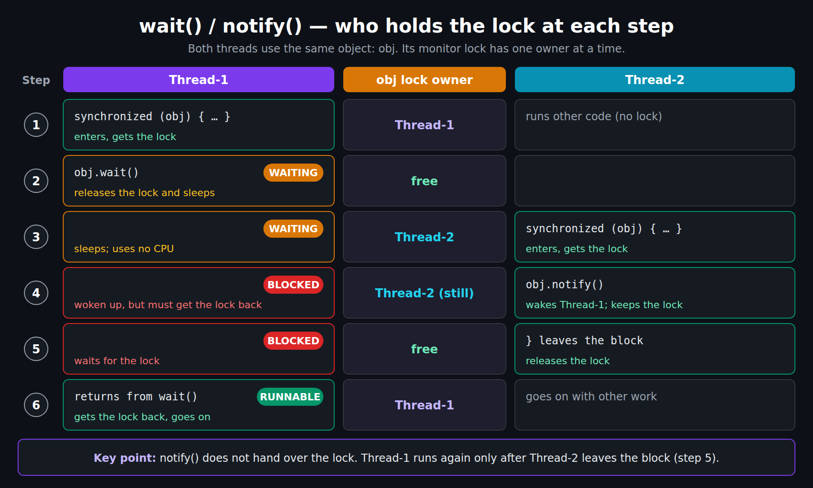

1. **📡 What is inter-thread communication? 🔥**

<!-- -->
<details>
<summary>Answer</summary>

**Answer:**

Inter-thread communication means two or more threads work on the same object by taking turns. They send signals to each other. So one thread writes data, and the other reads it at the right time. We use it when two tasks depend on each other. The two tasks must run one after the other, again and again, in two different threads on the same object.

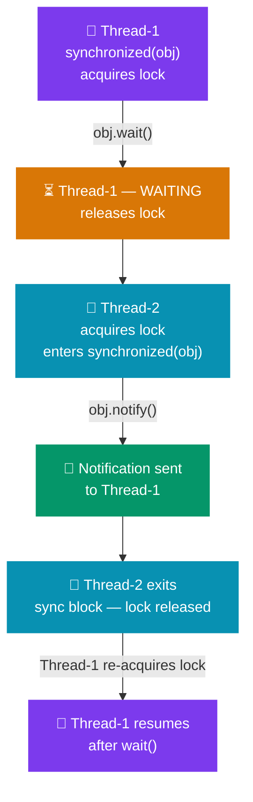

---

</details>

---

2. **💬 How can two threads communicate with each other? 🔥**

<!-- -->
<details>
<summary>Answer</summary>

**Answer:**

Two threads communicate with each other using the `wait()`, `notify()`, and `notifyAll()` methods.

---

</details>

---

3. **📍 In which class are the wait(), notify(), and notifyAll() methods defined? ⚡**

<!-- -->
<details>
<summary>Answer</summary>

**Answer:**

These methods are defined in the [java.lang.Object class](../java_tutorial/069_Object_Class_in_Java.md).

---

</details>

---

4. **🧠 Why are wait(), notify(), and notifyAll() defined in the java.lang.Object class and not in the Thread class or Runnable interface? 🔥**

<!-- -->
<details>
<summary>Answer</summary>

**Answer:**

A thread can call `wait()`, `notify()`, and `notifyAll()` on any Java object. To call a method on an object, the method must be in that object's class or a parent class. `java.lang.Object` is the superclass of all Java classes. So these methods are defined in the [java.lang.Object class](../java_tutorial/069_Object_Class_in_Java.md).

**The deeper reason — locks belong to objects, not threads:**

In Java, every object has an **intrinsic monitor lock** (also called an object monitor). When a thread enters a `synchronized` block, such as `synchronized(obj)`, it acquires the lock *on that object*. The lock is not on the thread.

`wait()`, `notify()`, and `notifyAll()` work on that object's monitor:
- `obj.wait()` → release the lock on `obj` and park this thread until notified
- `obj.notify()` → wake up one thread waiting on `obj`'s monitor

The **lock belongs to the object**. So the methods that manage it must be in `Object`, the root of all Java classes. Then they are available on every object.

**Why not Thread class?**
If these methods were in `Thread`, threads could only wait on *each other*, not on shared state. A producer and a consumer work together through the shared **buffer**. They wait on a condition such as "wait until this list is not empty". That condition belongs to the list's monitor, not to either thread.

**Why not Runnable?**
`Runnable` just describes a task. It knows nothing about a lock or monitor. It has no state that waiting could use.

🎯 **One-line interview answer:** in Java, locks belong to *objects*, not threads — so the lock-management methods belong in `Object`.

---

</details>

---

5. **🔒 From where must we call the wait(), notify(), and notifyAll() methods? 🔥**

<!-- -->
<details>
<summary>Answer</summary>

**Answer:**

We can call these methods only from a **synchronized area** (block/method). Otherwise we get `IllegalMonitorStateException` at runtime.

```java
public class Test {
    private static final Object LOCK = new Object();
    private static boolean workDone = false;          // the CONDITION — guarded by LOCK

    public static void main(String[] args) throws InterruptedException {
        Thread t1 = new Thread(() -> {
            synchronized (LOCK) {
                try {
                    while (!workDone) {               // check state, never just "wait for a notify"
                        System.out.println("Thread 1: waiting for the work.");
                        LOCK.wait();
                    }
                    System.out.println("Thread 1: work is done, resuming.");
                } catch (InterruptedException e) {
                    Thread.currentThread().interrupt();
                }
            }
        });

        Thread t2 = new Thread(() -> {
            synchronized (LOCK) {
                System.out.println("Thread 2: Work done. Notifying thread 1.");
                workDone = true;                      // change the state FIRST
                LOCK.notify();                        // then signal
            }
        });

        t1.start();
        t2.start();
    }
}
```

📤 **Output — either order is correct, and neither hangs:**

```
Thread 1: waiting for the work.            |  Thread 2: Work done. Notifying thread 1.
Thread 2: Work done. Notifying thread 1.   |  Thread 1: work is done, resuming.
Thread 1: work is done, resuming.          |
```

⚠️ **Lost notification — why the `workDone` flag is required.** `start()` does not decide which thread reaches `synchronized (LOCK)` first. Suppose `t2` gets there first. Then a plain `LOCK.notify()` runs while **nobody is waiting**. A notification is not stored anywhere. It is just lost. `t1` then calls `wait()` and sleeps **forever**. The fix: wait on a *condition* (a field guarded by the same lock), not on the notification itself. If the work is already done, `t1` never waits at all. This is the same `while` loop that §9 Q13 needs for spurious wakeups. One pattern fixes both bugs.

Now the part the question asks about — calling these **outside** the lock:

```java
Object lock = new Object();
lock.notify();   // 💥 IllegalMonitorStateException: current thread is not owner
```

---

</details>

---

6. **⏸️ What happens when a thread calls the wait() method on any object? ⚡**

<!-- -->
<details>
<summary>Answer</summary>

**Answer:**

When a thread calls `wait()` on an object, the thread at once releases the lock of that object. Then it goes into the waiting state.

📝 **Note:** the thread releases only the lock of that one object. The thread keeps the locks of other objects. Suppose the thread holds the locks of 10 objects when it calls `wait()`. It releases the lock of only the 1 object on which it called `wait()`. It keeps the locks of the other 9 objects.

---

</details>

---

7. **🔔 What happens when a thread calls notify() method on any object? ⚡**

<!-- -->
<details>
<summary>Answer</summary>

**Answer:**

When a thread calls `notify()` on an object, it sends a notification to **one** thread waiting on that object's monitor. But it does **NOT** release the lock at that moment. The notifying thread keeps running. It releases the lock only when it **exits the synchronized block/method**. The woken thread cannot continue until then. It must re-acquire the same monitor lock before it returns from `wait()`.

For example, Thread-1 calls `x.wait()`. It releases the lock and goes into the waiting state to wait for the notification.

Later, Thread-2 calls `x.notify()`. This only signals the waiting thread. Thread-2 keeps the lock and runs the rest of its synchronized block. Thread-2 releases the lock only when it leaves the synchronized block. Only then can Thread-1 re-acquire the lock and continue after `wait()`.

⚠️ **Common mistake:** "`notify()` releases the lock." It does not. See the separate question later in this section ("Which methods make a thread release the lock?").

---

</details>

---

8. **♾️ What happens if nobody calls notify() or notifyAll() for a waiting thread? ⚡**

<!-- -->
<details>
<summary>Answer</summary>

**Answer:**

That thread will be in the **waiting state forever**.

⚠️ **Result:** a **hung thread**, and a **thread leak**. A thread that never terminates is never garbage-collected. Every live thread is a GC root. So its stack, and everything that stack refers to, stays in memory. (The thread stays in memory because it is alive, not because it is in the wait set.) In a pool, each such hang removes one worker forever.

**`wait()` vs `wait(timeout)` — the key difference:**

| | `wait()` | `wait(long timeout)` |
|---|---|---|
| **Waits until** | notified (forever) | notified OR timeout expires |
| **Risk** | blocks with no end | limited |

A timeout limits the damage. It does not fix the logic. `wait(timeout)` returns **without telling you if you were notified or if the time ran out**. So you still need the `while (!condition)` loop. Add a deadline check too, if you want to give up instead of waiting again.

**Best practice:**
Use `java.util.concurrent` utilities instead of raw `wait()`/`notify()`. The signalling is built into them:
- `BlockingQueue.take()` / `poll(timeout, unit)` — no notify to forget; the timed form limits the wait
- `CountDownLatch.await(timeout, unit)` — limited wait
- `Semaphore.tryAcquire(timeout, unit)` — limited wait, but you can still forget `release()`. That is the same bug in a different form

---

</details>

---

9. **🔓 Which methods make a thread release the lock? ⚡**

<!-- -->
<details>
<summary>Answer</summary>

**Answer:**

A thread releases the lock in these ways:

| Mechanism | Releases Lock? | Notes |
|---|---|---|
| Exiting `synchronized` block/method | ✅ Yes | Main way — lock released automatically |
| `obj.wait()` | ✅ Yes | Releases the lock on `obj` and parks the thread |
| `Lock.unlock()` (`ReentrantLock`) | ✅ Yes | Explicit release — Java 5+ |
| `Condition.await()` | ✅ Yes | Equivalent of `wait()` for `ReentrantLock` |
| `obj.notify()` / `obj.notifyAll()` | ❌️ No | Only wakes up waiting thread(s) — the notifying thread **keeps the lock** until it exits the synchronized block |

🎯 **Interview Tip:** the old book answer "`wait()`/`notify()`/`notifyAll()` release the lock" is **wrong**, not just incomplete. Of those three, only `wait()` releases the lock. Since Java 5, `ReentrantLock.unlock()` and `Condition.await()` are the preferred explicit options.

---

</details>

---

10. **📢 What is the difference between notify() and notifyAll() method? 🔥**

<!-- -->
<details>
<summary>Answer</summary>

**Answer:**

| Feature | `notify()` 🅰️ | `notifyAll()` 🅱️ |
|---------|--------------|-----------------|
| **Threads Notified** | Only one waiting thread | All waiting threads |
| **Which Thread** | ⚠️ We can't predict which thread (depends on JVM) | ✅ All threads get notified |
| **Remaining Threads** | Have to wait for more notifications | Compete for the lock |

🎯 **When is `notify()` safe?** Only when **both** rules are true:

1. **Uniform waiters** — every waiting thread waits for the *same* condition, and does the same thing when it wakes.
2. **One-in, one-out** — one state change lets at most one waiter continue.

**Why breaking rule 1 hangs the program:** producers and consumers wait on one monitor. A consumer takes the last item and calls `notify()`. But the JVM picks **another consumer**. That consumer sees the buffer is still empty and goes back to waiting. The producer that *could* have made progress was never woken. The signal is lost, and every thread can end up waiting.

So use **`notifyAll()`** by default. It is correct, but it causes extra wake-ups. Or use `ReentrantLock` with two `Condition`s (§8 Q6), so `signal()` reaches only the right group.

---

</details>

---

11. **🚨 What is the exception we must handle while calling the wait() method? 💤**

<!-- -->
<details>
<summary>Answer</summary>

**Answer:**

`InterruptedException`

---

</details>

---

12. **🔄 What is the difference between sleep(100), join(100), and wait(100) method calls? ⚡**

<!-- -->
<details>
<summary>Answer</summary>

**Answer:**

- 😴 `sleep(100)` pauses the thread for 100 milliseconds. It does not depend on any other thread.
- ⏳ `join(100)` pauses the thread until the other thread finishes, or until 100 milliseconds pass. Whichever happens first, the thread continues at once.
- ⏸️ `wait(100)` pauses the thread until another thread calls `notify()`, or until 100 milliseconds pass. Whichever happens first, the thread must then get the lock back before it continues.

| Feature | `sleep(100)` 😴 | `join(100)` ⏳ | `wait(100)` ⏸️ |
|---------|-----------------|---------------|----------------|
| **Releases Lock** | ❌️ No | ❌️ No (only the `Thread` object's own monitor) | ✅ Yes |
| **Depends On** | Time only | Other thread or time | `notify()` or time |
| **Called From** | Anywhere | Anywhere | Synchronized block only |

---

</details>

---

13. **📜 What are the rules for using wait(), notify(), and notifyAll() methods? ⚡**

<!-- -->
<details>
<summary>Answer</summary>

**Answer:**

1. 🚨 `wait()` throws `InterruptedException`, which is a checked exception. So we must handle it every time we call `wait()`.
2. 🔒 We must call `wait()`, `notify()`, and `notifyAll()` only inside a synchronized method/block. Otherwise we get `IllegalMonitorStateException`.
3. ⚠️ If a thread calls the no-arg `wait()`, some other thread must later call `notify()`/`notifyAll()`. Otherwise the waiting thread stays in the WAITING state forever.
4. ⏱️ If the thread should continue after some time even without `notify()`, use `wait(long time)` or `wait(long ms, int ns)`.
5. 🔁 **Always call `wait()` inside a `while` loop that checks the condition again — never inside an `if`.** In practice this is the most important rule, and interviewers really do ask about it.

**🔁 Why `while`, never `if` — three separate reasons**

```java
// ❌️ WRONG — a single check
synchronized (lock) {
    if (queue.isEmpty()) {
        lock.wait();
    }
    return queue.remove();      // 💥 can throw / return garbage
}

// ✅ CORRECT — re-check after every wake-up
synchronized (lock) {
    while (queue.isEmpty()) {   // loop, not branch
        lock.wait();
    }
    return queue.remove();      // condition is guaranteed true here
}
```

| # | Reason the condition can be false after `wait()` returns | |
|---|---|---|
| 1 | 👻 **Spurious wakeup** | The JLS and the javadoc *allow* `wait()` to return without any `notify()` at all. It is rare, depends on the OS/futex, and you cannot test for it. So write safe code for it. Don't try to reproduce it. |
| 2 | 🏃 **Another thread got there first** | `notify()` only moves you from the wait set to the **entry set**. You still have to re-acquire the monitor (see **§2 Q11**). A third thread can take the lock first and use up the item you were woken for. |
| 3 | 📢 **`notifyAll()` woke you for another thread's condition** | With one monitor and two conditions (`notFull` / `notEmpty`), `notifyAll()` wakes producers *and* consumers. Most of them must go back to waiting at once. |

Reason **2** alone makes `if` wrong, even on a JVM that never has spurious wakeups. A senior interviewer wants to hear this reason.

💡 **`Condition` has the same rule.** `Condition.await()` has the same warning. `ReentrantLock`'s multiple wait-sets remove only reason **3**. Reasons 1 and 2 stay. So use the loop there too. (`Condition.awaitUninterruptibly()` also needs the loop.)

✅ **Best of all: don't write it yourself.** A `BlockingQueue` (**§9 Q14**) does the loop, the signalling, and the size limit for you, correctly. In an interview, use `wait`/`notify` to *show you know the mechanism*. In production, use `BlockingQueue`.

---

</details>

---

14. **📦 How to implement Producer-Consumer using BlockingQueue? 🔥**

<!-- -->
<details>
<summary>Answer</summary>

**Answer:**

`BlockingQueue` is the **modern replacement** for producer-consumer built on `wait()`/`notify()`. It does all the waiting inside. `put()` blocks when the queue is full. `take()` blocks when it is empty.

| Implementation | Bounded? | Best For |
|---|---|---|
| `ArrayBlockingQueue` | ✅ Fixed size | Known capacity, optional fairness |
| `LinkedBlockingQueue` | Optional (default unbounded) | High throughput |
| `SynchronousQueue` | Zero capacity | Direct handoff, no buffering |
| `PriorityBlockingQueue` | ❌️ Unbounded | Priority-ordered consumption |

```java
public class ProducerConsumerDemo {
    public static void main(String[] args) {
        BlockingQueue<Integer> queue = new ArrayBlockingQueue<>(5);

        // Producer
        Thread producer = new Thread(() -> {
            try {
                for (int i = 1; i <= 10; i++) {
                    queue.put(i); // blocks if queue is full
                    System.out.println("Produced: " + i);
                }
                queue.put(-1); // poison pill — signals consumer to stop
            } catch (InterruptedException e) {
                Thread.currentThread().interrupt();
            }
        });

        // Consumer
        Thread consumer = new Thread(() -> {
            try {
                while (true) {
                    int value = queue.take(); // blocks if queue is empty
                    if (value == -1) break;   // poison pill received
                    System.out.println("Consumed: " + value);
                }
            } catch (InterruptedException e) {
                Thread.currentThread().interrupt();
            }
        });

        producer.start();
        consumer.start();
    }
}
```

**Comparison with wait()/notify() approach:**

| Feature | `wait()`/`notify()` | `BlockingQueue` |
|---|---|---|
| Complexity | High — manual wait/notify/while loop | Low — `put()` and `take()` |
| Error-prone | ⚠️ Easy to miss `notify()` or use `if` instead of `while` | ✅ Handles internally |
| Production-ready | ❌️ Breaks easily | ✅ Well tested in production |

💡 **Poison pill pattern:** to shut down cleanly, the producer sends a special sentinel value (e.g., `-1` or a `null`-like value). It tells the consumer to exit its loop.

🎯 **Interview Tip:** if asked to implement producer-consumer, start with `BlockingQueue`. If the interviewer says "now do it without `BlockingQueue`", use the `wait()`/`notify()` version shown earlier in this file.

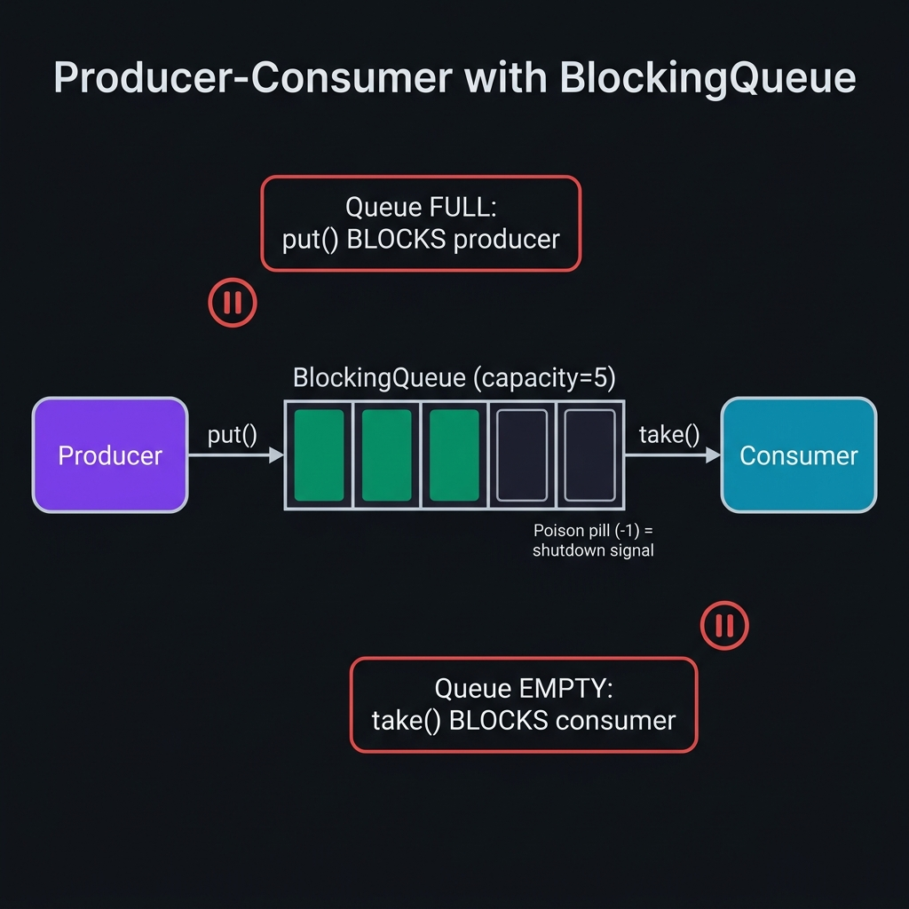

---

</details>

---

<a id="10-deadlock-and-starvation"></a>
## 10. Deadlock and Starvation 🔥

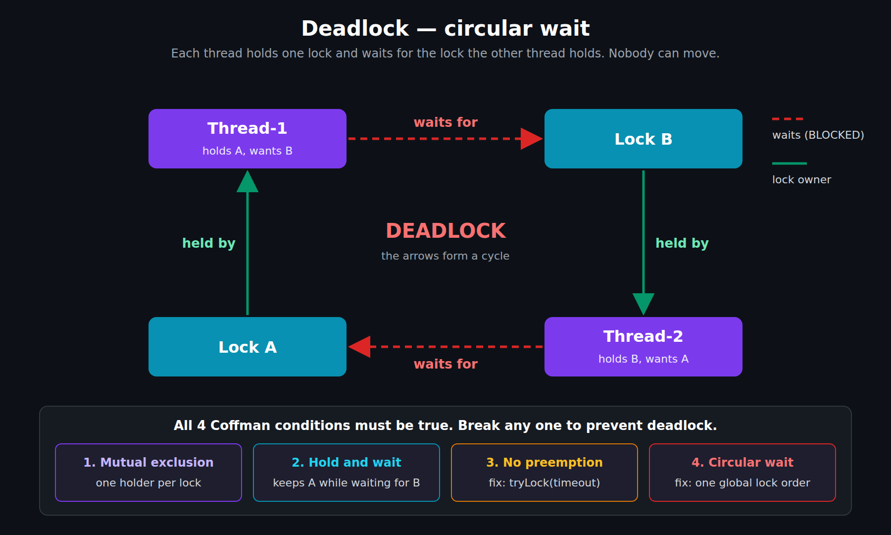

1. **💀 What is a deadlock in Java? 🔥**

<!-- -->
<details>
<summary>Answer</summary>

**Answer:**

A deadlock happens when **two or more threads are blocked forever. Each one waits for a resource (usually a lock) that another thread in the group holds**. No thread in the cycle can continue, and none will ever release what it holds. See more: [Deadlock in Java with example](../java_tutorial/187_Deadlock_in_Java_with_Example.md)

**🧩 The four conditions (Coffman, 1971)** — deadlock can happen **only if all four are true at the same time**. So to prevent it, break any one of them:

| # | Condition | Meaning | How Java code breaks it |
|---|---|---|---|
| 1 | **Mutual exclusion** | A lock can be held by only one thread | Lock-free structures (`AtomicInteger`, `ConcurrentHashMap` reads), immutability |
| 2 | **Hold and wait** | A thread keeps one lock while waiting for another | Acquire everything up front, or release before acquiring more |
| 3 | **No preemption** | A held lock can't be taken away; only the holder releases it | `tryLock(timeout)` — the thread gives back its own locks when it can't make progress |
| 4 | **Circular wait** | T1 waits on T2, which waits on T1 | **Lock ordering** — one global order for acquiring locks makes a cycle impossible |

🎯 Every technique in Q3 below breaks one of these four. Say which condition each fix breaks. That turns a list of tips into an answer the interviewer remembers.


---

</details>

---

2. **🗝️ What is the keyword that causes deadlock? ⚡**

<!-- -->
<details>
<summary>Answer</summary>

**Answer:**

In old Java (before Java 5), the answer is the `synchronized` keyword. It was the only locking mechanism, so deadlock could only come from it.

In modern Java, any **mutual exclusion mechanism** can cause deadlock:

| Mechanism | Can cause deadlock? |
|---|---|
| `synchronized` keyword | ✅ Yes |
| `ReentrantLock` | ✅ Yes |
| `ReadWriteLock` | ✅ Yes |
| `Semaphore` | ✅ Yes |

**The root cause is never the keyword itself. It is circular wait on locks** (Q1).

⚠️ The claim "if we don't use `synchronized`, we never get deadlock" is **wrong** in modern Java. `ReentrantLock`, with no `synchronized` keyword, can deadlock just as easily.

🎯 **Interview answer:** the `synchronized` keyword is the old standard answer. In modern Java, any locking primitive (`ReentrantLock`, `Semaphore`, etc.) can cause deadlock. The real condition is **circular wait**.

---

</details>

---

3. **🛡️ How to avoid a deadlock situation? 🔥**

<!-- -->
<details>
<summary>Answer</summary>

**Answer:**

We can avoid deadlock with these techniques:

**1. 🔢 Lock Ordering (most reliable)**
Always acquire multiple locks in **one fixed global order**. If every thread acquires Lock A before Lock B, circular wait cannot happen.

```java
// Both threads always acquire lockA first, then lockB — no circular wait
synchronized (lockA) {
    synchronized (lockB) {
        // safe
    }
}
```

Why the key must be stable and unique, and never `hashCode()`: see **§7 Q7**. With `System.identityHashCode()`, equal values need a third "tie-breaker" lock to stay safe. The same fix works in the DB: `SELECT … FOR UPDATE` both rows, ordered by id.

**2. ⏱️ Use `tryLock()` with timeout (`ReentrantLock`)**
Instead of waiting forever, the thread gives up if it can't get the lock within a time limit. This breaks the **no preemption** condition, because the thread gives up its own lock. On failure, wait for a **random** time and retry (full loop in §8 Q5). If both threads retry at exactly the same times, you get livelock (Q6).

```java
ReentrantLock lock1 = new ReentrantLock();
ReentrantLock lock2 = new ReentrantLock();

if (lock1.tryLock(100, TimeUnit.MILLISECONDS)) {
    try {
        if (lock2.tryLock(100, TimeUnit.MILLISECONDS)) {
            try {
                // critical section
            } finally {
                lock2.unlock();
            }
        }
    } finally {
        lock1.unlock();
    }
}
```

**3. 🚫 Avoid nested locks**
Don't acquire Lock B while you already hold Lock A, unless you really must. Each extra nested lock increases the chance of circular wait.

**4. 🔑 Minimize lock scope**
Hold locks for the shortest possible time. Release the lock before you call external methods or do I/O.

**5. 📦 Use `java.util.concurrent` utilities**
Higher-level classes remove the need for manual locking completely:

| Utility | Replaces |
|---|---|
| `ConcurrentHashMap` | `synchronized` map operations |
| `BlockingQueue` | manual `wait()`/`notify()` producer-consumer |
| `Semaphore` | counted access without nested locks |
| `AtomicInteger` / `AtomicReference` | `synchronized` for single-variable updates |

🎯 **Interview answer:** lock ordering + `tryLock()` with timeout are the two techniques Tier-1 interviewers expect. Mention `java.util.concurrent` as the modern best practice to complete the answer.

---

</details>

---

4. **💻 Write a Java program to demonstrate deadlock in Java. 🔥**

<!-- -->
<details>
<summary>Answer</summary>

**Answer:**

Standard deadlock: two threads acquire two locks in **opposite order**. This causes circular wait.

```java
public class DeadlockDemo {

    private static final Object LOCK_A = new Object();
    private static final Object LOCK_B = new Object();

    public static void main(String[] args) {
        Thread t1 = new Thread(() -> {
            synchronized (LOCK_A) {
                System.out.println("Thread-1: acquired Lock A, waiting for Lock B...");
                try { Thread.sleep(100); } catch (InterruptedException e) { Thread.currentThread().interrupt(); }
                synchronized (LOCK_B) {
                    System.out.println("Thread-1: acquired Lock B");
                }
            }
        }, "Thread-1");

        Thread t2 = new Thread(() -> {
            synchronized (LOCK_B) {
                System.out.println("Thread-2: acquired Lock B, waiting for Lock A...");
                try { Thread.sleep(100); } catch (InterruptedException e) { Thread.currentThread().interrupt(); }
                synchronized (LOCK_A) {
                    System.out.println("Thread-2: acquired Lock A");
                }
            }
        }, "Thread-2");

        t1.start();
        t2.start();
    }
}
```

📤 **Output (program hangs after these two lines):**

```
Thread-1: acquired Lock A, waiting for Lock B...
Thread-2: acquired Lock B, waiting for Lock A...
```

Each thread holds one lock and waits for the other — circular wait (Q1). The `Thread.sleep(100)` makes sure both threads get their first lock before either one tries for the second. So the deadlock happens every time and is easy to reproduce.

**Fix:** make `t2` take `LOCK_A` first too — one fixed lock order (Q3).

---

</details>

---

5. **⚖️ What is the difference between deadlock and starvation? ⚡**

<!-- -->
<details>
<summary>Answer</summary>

**Answer:**

| Feature | Deadlock 🔴 | Starvation 🟡 |
|---|---|---|
| **Definition** | Two or more threads wait for each other's locks forever — **no thread makes progress** | A thread waits for a very long time because other threads keep going first. **It may continue at some point** |
| **Threads involved** | Minimum 2 threads in circular wait | Can happen to a single thread |
| **Progress** | ❌️ None — all involved threads are stuck | ⚠️ Other threads progress; only the starved thread is blocked |
| **Resolution** | ❌️ Cannot fix itself — needs outside action (restart/timeout) | ✅ May fix itself once there is less competition |
| **Cause** | Circular lock dependency | Unfair lock barging, `notify()` waking other threads again and again, a lock held too long |
| **Thread state** | `BLOCKED` on a `synchronized` monitor · `WAITING` on a `ReentrantLock` / `Condition` | `BLOCKED` or `WAITING` (never selected) |
| **Fix** | Lock ordering, `tryLock()` with timeout | Fair locks (`new ReentrantLock(true)`), avoid strict priority scheduling |

**Starvation causes — what really starves a Java thread:**
- 🏃 **Barging on an unfair lock** — `synchronized` and the default `ReentrantLock` let a newly arriving thread take a just-released lock. It can get the lock before the threads already in the queue. Under constant contention, an unlucky waiter can lose every time.
- 🔔 **`notify()` never picks you** — the JVM chooses which waiter to wake. So one thread can be skipped again and again.
- 🐌 **A lock held too long** — one thread doing I/O inside a `synchronized` block makes everyone else wait.

⚠️ **Not thread priority — at least not on HotSpot/Linux.** The old book cause "high-priority threads take all the CPU" does not apply there by default. On Linux, HotSpot's default `-XX:ThreadPriorityPolicy=0` maps **all ten Java priorities to the same native priority** (§3 Q4). So `setPriority()` cannot starve anything there. (On Windows, HotSpot does map Java priorities to different OS priorities.) If you give that cause, an interviewer who knows §3 will catch it.

**Fixes:**
- **Deadlock** → one fixed lock order, `tryLock(timeout)`, fewer nested locks
- **Starvation** → use a fair `ReentrantLock`. `new ReentrantLock(true)` gives the lock in FIFO order. The one exception is an untimed `tryLock()`, which barges anyway (§8 Q4). Also keep critical sections short, and prefer `notifyAll()`.

```java
// Fair lock — threads acquire in the order they requested
ReentrantLock fairLock = new ReentrantLock(true);
```

🎯 **Quick difference:** in deadlock, *all* involved threads are stuck for ever. In starvation, *other* threads make progress — only one thread keeps getting skipped.

---

</details>

---

6. **🔄 What is livelock? ⚡**

<!-- -->
<details>
<summary>Answer</summary>

**Answer:**

A thread often reacts to what another thread does. If that other thread is also reacting to the first thread, livelock can happen. Like deadlock, livelocked threads cannot make any more progress.

🧠 **In Simple Words:** livelock is like two people meeting in a narrow corridor. Both step aside to let the other pass, but they keep stepping to the same side again and again. They are **not stuck** (like in deadlock), but they **can't make progress** either.

**Key difference from deadlock:**

| | Deadlock | Livelock |
|---|---|---|
| **Thread state** | `BLOCKED` (monitor deadlock) or `WAITING` (`java.util.concurrent` lock deadlock) — threads are idle either way | `RUNNABLE` — threads are actively executing |
| **CPU usage** | Low (threads are waiting) | High (threads keep retrying) |
| **Progress** | None | None — but threads *appear* busy |
| **Detection** | `jstack` shows the blocked/parked thread + lock info (Q7) | Harder — threads look normal in thread dumps |

**Code example:**

```java
// Two threads keep yielding to each other — neither makes progress
class Worker {
    private boolean isPolite = true;

    public void work(Worker other) throws InterruptedException {
        while (isPolite && other.isPolite) {
            System.out.println(Thread.currentThread().getName() + ": You go first!");
            Thread.yield(); // keeps giving way to the other thread
        }
    }
}
```

Both threads keep calling `yield()` because of the other. They are active, but stuck in a loop of being polite.

**Fix — randomized backoff:**
Make each thread wait a **random** time before it retries. Then the two threads no longer act at the same moment, and one thread goes first.

```java
// Random backoff breaks the symmetry
Thread.sleep(new Random().nextInt(100));
```

🎯 **One-line interview answer:** livelock = threads are running and using CPU, but making no real progress. In deadlock, they are idle and blocked.

---

</details>

---

7. **🔍 How do you detect deadlock in a production Java application? 🔥**

<!-- -->
<details>
<summary>Answer</summary>

**Answer:**

**1. Using `jstack` (most common):**
```
jstack <pid>
```
Look for the section `"Found one Java-level deadlock:"`. It shows which threads hold which locks, and which locks they are waiting for.

**2. Using `jcmd`:**
```
jcmd <pid> Thread.print
```

**3. Programmatic detection using `ThreadMXBean`:**

```java
import java.lang.management.ManagementFactory;
import java.lang.management.ThreadInfo;
import java.lang.management.ThreadMXBean;

ThreadMXBean bean = ManagementFactory.getThreadMXBean();
long[] deadlockedThreads = bean.findDeadlockedThreads();

if (deadlockedThreads != null) {
    ThreadInfo[] infos = bean.getThreadInfo(deadlockedThreads, true, true);
    for (ThreadInfo info : infos) {
        System.out.println("Deadlocked thread: " + info.getThreadName());
        System.out.println("  State: " + info.getThreadState());
        System.out.println("  Blocked on: " + info.getLockInfo());
        System.out.println("  Held j.u.c locks:");   // monitors: getLockedMonitors()
        for (var lock : info.getLockedSynchronizers()) {
            System.out.println("    " + lock);
        }
    }
}
```

💡 **Production tip:** run a `findDeadlockedThreads()` check on a schedule. Log or raise an alert if it finds a deadlock. This gives you an early warning.

⚠️ **Deadlocked threads are not always `BLOCKED` — that state applies only to `synchronized` monitors.** In a deadlock between two `ReentrantLock`s, the threads are parked with `LockSupport.park()`. So they show as **`WAITING`**, not `BLOCKED`. Tested side by side:

```java
// synchronized deadlock                    // ReentrantLock deadlock
t3: synchronized(m1){ ... synchronized(m2){} }   t1: A.lock(); ... B.lock();
t4: synchronized(m2){ ... synchronized(m1){} }   t2: B.lock(); ... A.lock();
```

📤 **Output:**
```
ReentrantLock deadlock states: t1=WAITING  t2=WAITING
synchronized  deadlock states: t3=BLOCKED  t4=BLOCKED
findMonitorDeadlockedThreads() = 2      ← only sees the synchronized pair
findDeadlockedThreads()        = 4      ← sees both
```

💡 **Practical lesson:** always use **`findDeadlockedThreads()`**, never `findMonitorDeadlockedThreads()`. The second one checks only monitors. It misses every `java.util.concurrent` lock deadlock, without any warning. Searching a thread dump only for `BLOCKED` has the same gap. Look for `parking to wait for` lines too.

**Thread states in a thread dump:**

| State in Dump | Meaning | Action |
|---|---|---|
| `RUNNABLE` | Actively running or ready | Normal |
| `BLOCKED` | Waiting to acquire a monitor lock | Check which thread holds the lock |
| `WAITING` | Waiting with no time limit — `wait()`, `join()`, **or `LockSupport.park()`** (a `ReentrantLock` / `Condition` waiter shows here with `parking to wait for <…ReentrantLock$NonfairSync>`) | Check if the notifier/joined thread is alive. Or check who owns the lock it is parked on. A **`ReentrantLock` deadlock shows here, not in `BLOCKED`** (see above) |
| `TIMED_WAITING` | `sleep(ms)`, `wait(ms)`, `join(ms)` | Usually normal |

🎯 **Interview Tip:** if asked "how would you find a deadlock in production?", say: "First, take a thread dump with `jstack <pid>`. Look for the `Found one Java-level deadlock` section. For automatic detection, call `ThreadMXBean.findDeadlockedThreads()` on a schedule."

---

</details>

---

<a id="11-daemon-thread"></a>
## 11. Daemon Thread 💤

1. **🔢 How many types of threads can be created in JVM? 💤**

<!-- -->
<details>
<summary>Answer</summary>

**Answer:**

We can create two types of threads:

- 🧵 **Non-daemon thread** — runs the main logic of the program.
- 👻 **Daemon thread** — runs in the background and provides services.

---

</details>

---

2. **👻 What is a daemon thread in Java? ⚡**

<!-- -->
<details>
<summary>Answer</summary>

**Answer:**

A daemon thread is a background **service** thread that **does not keep the JVM alive**. The JVM exits once every non-daemon thread has finished, even if the daemons are still working. That is the full definition. It has nothing to do with schedules or priority. The JVM's own support threads are daemons (examples below).

⚠️ **Wrong idea to avoid: "a daemon thread is a low-priority thread."** Daemon status and thread priority are **completely unrelated**. `setDaemon(true)` does not change priority at all. A daemon thread **gets its creator's priority**. So a daemon thread created from `main` has priority **5 (`NORM_PRIORITY`)**, not priority 1. Tested on JDK 17: `new Thread(...)` + `setDaemon(true)` → `getPriority()` returns `5`. Being a daemon changes only one thing: whether the JVM waits for it at shutdown.

💡 You must call `setDaemon(true)` **before** `start()`. Otherwise it throws `IllegalThreadStateException`.

⚠️ **Key behaviour:** when the JVM exits, it stops a running daemon thread suddenly. Its `finally` blocks do **not** run, and `try-with-resources` does **not** close.

✅ **But JVM shutdown hooks DO run.** `Runtime.getRuntime().addShutdownHook(...)` registers a thread that the JVM starts *during* shutdown. That is the whole purpose of the mechanism. It runs on a normal exit, on `System.exit()`, and on `SIGTERM`/`Ctrl-C`. Don't mix up "the daemon's own `finally` is skipped" with "shutdown hooks are skipped".

```java
public static void main(String[] args) throws Exception {
    Runtime.getRuntime().addShutdownHook(new Thread(
            () -> System.out.println("SHUTDOWN HOOK RAN")));

    Thread d = new Thread(() -> {
        try {
            while (true) {
                Thread.sleep(50);
            }
        } catch (InterruptedException e) {
            // ignored
        } finally {
            System.out.println("daemon finally RAN");   // never printed
        }
    });
    d.setDaemon(true);
    d.start();

    Thread.sleep(200);
    System.out.println("main ending; only the daemon is left");
}
```

📤 **Output** (same on every run):
```
main ending; only the daemon is left
SHUTDOWN HOOK RAN
```

The daemon's `finally` never printed. The shutdown hook did.

| Mechanism | Runs on normal JVM exit? |
|---|---|
| A daemon thread's own `finally` / `try-with-resources` | ❌️ No — the thread is killed in the middle of its work |
| `Runtime.addShutdownHook(...)` | ✅ **Yes** |
| Spring's `@PreDestroy` / `DisposableBean` | ✅ Yes — Spring Boot registers a shutdown hook to close the context |
| Anything at all, on `Runtime.halt()` or `SIGKILL` | ❌️ No — hooks are skipped entirely |

⚠️ Don't fully trust hooks. They run **concurrently** with each other, with no guaranteed order. `-XX:+ExitOnOutOfMemoryError` and `Runtime.halt()` exit without running them at all. The container's grace-period timeout (`terminationGracePeriodSeconds` in Kubernetes) can kill them before they finish. Keep them short: flush, deregister, close. Never do long work there.

🛠️ **Examples of daemon threads in Java:**

- 🧹 `Reference Handler` / `Finalizer` / `Common-Cleaner` — reference processing and cleanup
- 📡 `Attach Listener` — what `jstack` / `jcmd` connect to
- 📢 `Signal Dispatcher` — routes OS signals such as `SIGTERM` to shutdown hooks

*(GC worker threads are often listed here too. But they are native VM threads, not `java.lang.Thread` objects, so `isDaemon()` does not apply to them. They never stop the JVM from exiting.)*

**Creating a daemon thread:**

```java
Thread t = new Thread(() -> {
    while (true) {
        System.out.println("Daemon thread running...");
    }
});
t.setDaemon(true); // must be set before start()
t.start();
```

🏭 **Production view — which pool threads are daemons?** This decides whether running work survives after `main` returns:

| Where the thread comes from | Daemon? | Consequence |
|---|---|---|
| `Executors.newFixedThreadPool(...)` etc. (default thread factory) | ❌️ Non-daemon | JVM **won't exit** until you call `shutdown()` — the common "my program never ends" bug |
| `ForkJoinPool.commonPool()` — the default for `CompletableFuture.runAsync` / `supplyAsync` and parallel streams | ✅ Daemon | A `runAsync` task **dies with no error** when `main` returns — `join()` it or pass your own executor |
| Virtual threads (Java 21) | ✅ **Always** | `setDaemon(false)` throws `IllegalArgumentException`; the JVM never waits for them, so join them or use an executor you close |
| Spring's `ThreadPoolTaskExecutor` | ❌️ Non-daemon by default | No problem in a server — the web container keeps the JVM alive anyway |

---

</details>

---

3. **🧵 What is a non-daemon thread? 💤**

<!-- -->
<details>
<summary>Answer</summary>

**Answer:**

A thread that runs the main logic of the program/project is called a non-daemon thread. Example: the `main` thread.

---

</details>

---

4. **🤷 Why are most of the threads created as non-daemon threads? 💤**

<!-- -->
<details>
<summary>Answer</summary>

**Answer:**

A thread gets its daemon/non-daemon status from its parent thread. If the parent is a daemon thread, the child is also a daemon thread. If the parent is a non-daemon thread, the child is also a non-daemon thread.

The main thread creates most threads. The main thread is a non-daemon thread. So all child threads created from the main method are also non-daemon threads.

🔑 **Key Point:** the JVM exits when only daemon threads are left running. So if your main logic runs on non-daemon threads, the JVM stays alive until they finish.

---

</details>

---
