# Advanced Concurrency and Async Patterns Interview Questions

**Advanced Concurrency and Async Patterns Interview Questions** | This file covers advanced Java concurrency: Callable/Future, ExecutorService, CompletableFuture, the Java Memory Model, concurrent utilities, ForkJoinPool and Virtual Threads. Tier-1 product companies ask these often in SDE II interviews.

📊 **Question Count by Section**

| # | Section | Questions |
|---|---|---|
| 1 | [Callable and Future](#callable-and-future) | 4 |
| 2 | [ExecutorService](#executorservice) | 7 |
| 3 | [CompletableFuture](#completablefuture) | 9 |
| 4 | [Memory Model and Atomics](#memory-model-and-atomics) | 5 |
| 5 | [Concurrent Utilities](#concurrent-utilities) | 6 |
| 6 | [ForkJoinPool and Virtual Threads](#forkjoinpool-and-virtual-threads) | 5 |
| | **Total** | **36** |

> 🔥🔥 Very High — asked in almost every Tier-1 loop &nbsp;·&nbsp; 🔥 High — very frequent in Tier-1 interviews &nbsp;·&nbsp; ⚡ Medium — commonly asked &nbsp;·&nbsp; 💤 Low — good to know, rarely asked

> 🎯 **Why this file matters:** Companies like Razorpay, PhonePe and Atlassian ask a lot of advanced concurrency in SDE II interviews. Good answers on CompletableFuture, ExecutorService and the Java Memory Model show you are ready for a senior role. These topics match real work: calling many APIs in parallel, sizing thread pools, and non-blocking I/O.

<a id="callable-and-future"></a>

## 1. Callable and Future

1. **🔍 What is the difference between Callable and Runnable in Java? 🔥🔥**

<!-- -->
<details>
<summary>Answer</summary>

**Answer:**

`Callable` and `Runnable` both describe a task that a thread can run. They differ in these ways:

| Feature | Runnable | Callable |
|---|---|---|
| **Interface** | `java.lang.Runnable` | `java.util.concurrent.Callable<V>` |
| **Method** | `void run()` | `V call() throws Exception` |
| **Return value** | No return value | Returns a result of type `V` |
| **Exception handling** | Cannot throw checked exceptions | Can throw checked exceptions |
| **Introduced in** | Java 1.0 | Java 1.5 |
| **Used with** | `Thread`, `ExecutorService` | `ExecutorService` — or a plain `Thread` if you wrap it in a `FutureTask` (see Q3) |

```java
// Runnable — no return, no checked exception
Runnable runnable = () -> {
    System.out.println("Running in: " + Thread.currentThread().getName());
};

// Callable — returns a value, can throw checked exception
Callable<Integer> callable = () -> {
    Thread.sleep(1000);
    return 42;
};

ExecutorService executor = Executors.newSingleThreadExecutor();
executor.execute(runnable);            // fire-and-forget
Future<Integer> future = executor.submit(callable); // returns Future
System.out.println("Result: " + future.get());      // 42
executor.shutdown();
```

🔑 **Key Point:** Use `Runnable` for fire-and-forget tasks. Use `Callable` when you need a result back. Also use it when the caller must see the task's exception.

<details>
<summary><strong>🤔 Doubt: Can you explain this with a real-time use case?</strong></summary>

**Scenario: Loan Application Processing**

A user submits a loan application. Two tasks run after that:
1. Send a confirmation email. You don't need a result. Start it and move on.
2. Run a credit score check. You need the score to decide if the loan is allowed.

```java
ExecutorService executor = Executors.newFixedThreadPool(4);

// ✅ Runnable — fire-and-forget: send confirmation email
// You don't need a result, you don't care if it's done before moving on
Runnable emailTask = () -> emailService.sendConfirmation(userId);
executor.execute(emailTask);  // submit and forget

// ✅ Callable — need the result back: credit score check
// You MUST wait for the score before deciding loan approval
Callable<Integer> creditCheckTask = () -> {
    return creditBureau.fetchScore(userId);  // can throw IOException
};

Future<Integer> future = executor.submit(creditCheckTask);

int creditScore = future.get();  // blocks; throws ExecutionException if API failed

if (creditScore >= 700) {
    approveLoan(userId);
} else {
    rejectLoan(userId);
}
```

| | Runnable (email) | Callable (credit check) |
|---|---|---|
| **Need the result?** | No | Yes — `get()` returns it |
| **Checked exception support?** | No — you must catch it inside the task | Yes — it reaches the caller as `ExecutionException` |
| **Caller thread blocks?** | No — `execute()` is fire-and-forget | Yes — `future.get()` blocks until done |

**Why exception propagation matters:**
```java
// Runnable — checked exceptions cannot propagate
Runnable bad = () -> {
    // creditBureau.fetchScore(userId);  // ❌️ won't compile — throws IOException
};

// Callable — IOException propagates cleanly via ExecutionException
Callable<Integer> good = () -> creditBureau.fetchScore(userId);  // ✅ compiles fine

try {
    future.get();
} catch (ExecutionException e) {
    Throwable cause = e.getCause();  // your original IOException
}
```

💡 **Mental model:** `Runnable` = start the task and never look at the outcome. `Callable` = start the task, then come back later to read the result or the error.

---

</details>
<br/>

---

</details>

---

2. **📡 What is the Future API and what methods does it provide? ⚡**

<!-- -->
<details>
<summary>Answer</summary>

**Answer:**

`Future<V>` holds the result of a task that runs asynchronously (on another thread). Its methods let you check if the task is done, wait for the result, and cancel the task.

| Method | Description |
|---|---|
| `V get()` | Blocks until the result is ready, then returns it |
| `V get(long timeout, TimeUnit unit)` | Blocks up to the given time. Throws `TimeoutException` if the result is still not ready |
| `boolean cancel(boolean mayInterruptIfRunning)` | Tries to cancel the task |
| `boolean isDone()` | Returns `true` if the task finished (normally, with an exception, or by cancel) |
| `boolean isCancelled()` | Returns `true` if the task was cancelled before it finished |

```java
ExecutorService executor = Executors.newSingleThreadExecutor();

Future<String> future = executor.submit(() -> {
    Thread.sleep(2000);
    return "Hello from Callable";
});

// Check status without blocking
System.out.println("Done? " + future.isDone());       // false

// Block with timeout
try {
    String result = future.get(3, TimeUnit.SECONDS);
    System.out.println("Result: " + result);
} catch (TimeoutException e) {
    System.out.println("Task timed out!");
    future.cancel(true);  // cancel if timed out
}

System.out.println("Cancelled? " + future.isCancelled());
executor.shutdown();
```

🔑 **Key Point:** `get()` blocks the calling thread. If the task throws an exception, `get()` wraps it in an `ExecutionException`. Always handle `InterruptedException` and `ExecutionException` when you call `get()`.

---

</details>

---

3. **🧩 What is FutureTask and why is it called dual-natured? ⚡**

<!-- -->
<details>
<summary>Answer</summary>

**Answer:**

`FutureTask<V>` implements both `Runnable` and `Future<V>`. That is why it is called dual-natured. It has two sides:

- **The `Runnable` side — to run it.** Pass it to a `Thread`, or hand it to an executor with `executor.execute(futureTask)` or `executor.submit(futureTask)`. In both cases the executor sees a `Runnable`.
- **The `Future` side — to read the result.** Call `futureTask.get()`, `isDone()` or `cancel()` on the same object.

> ⚠️ Use `futureTask.get()` for the result. If you call `submit(futureTask)`, the executor wraps it in a *second* `FutureTask`. The `Future` that `submit()` returns gives `null`, not your result.

```java
// FutureTask wraps a Callable
FutureTask<Integer> futureTask = new FutureTask<>(() -> {
    System.out.println("Current Thread: " + Thread.currentThread().getName());
    Thread.sleep(1000);
    return 100;
});

// Use as Runnable with Thread
Thread thread = new Thread(futureTask);
thread.start();

// Use as Future to get result
Integer result = futureTask.get(); // blocks until done
System.out.println("Result: " + result); // 100
```

**Why is it useful?**

1. **Bridge between Thread and Callable:** You cannot pass a `Callable` straight to a `Thread`. `FutureTask` wraps the `Callable` and implements `Runnable`, so the `Thread` can run it.
2. **One-shot execution:** `FutureTask` runs the task only once, even if `run()` is called many times.
3. **Result caching:** After the task finishes, every later call to `get()` returns the stored result at once.

```java
// Can also wrap a Runnable with a preset result
FutureTask<String> task = new FutureTask<>(() -> {
    System.out.println("Running task...");
}, "DONE"); // preset result

new Thread(task).start();
System.out.println(task.get()); // "DONE"
```

<details>
<summary><strong>🤔 Doubt: If thread.start() runs the task and futureTask.get() waits for the result — why don't I see the print twice?</strong></summary>

`get()` does **not** run the task again. It only blocks the calling thread until the result is ready. Then it returns the stored value.

```java
FutureTask<Integer> futureTask = new FutureTask<>(() -> {
    System.out.println("Current Thread: " + Thread.currentThread().getName());
    Thread.sleep(1000);
    return 100;
});

Thread thread = new Thread(futureTask);
thread.start();          // ← runs the task on Thread-0 → prints "Current Thread: Thread-0"

Integer result = futureTask.get();  // ← just WAITS for the result, does NOT run again
System.out.println("Result: " + result);  // prints "Result: 100"
```

Output:
```
Current Thread: Thread-0
Result: 100
```

**This is the one-shot execution guarantee of FutureTask.** Inside, it keeps a state machine:

```
NEW → COMPLETING → NORMAL   (after first run)
```

Every later `run()` call checks this state and returns at once. The task body never runs again. A `get()` on a finished task also returns the stored result at once.

```java
// Even if you call run() manually a second time — it's a no-op
futureTask.run();  // silently skipped, state is already NORMAL
futureTask.get();  // returns cached 100 immediately
```

💡 To see two prints, you need two separate `FutureTask` objects. Each one has its own state machine.

---

</details>
<br/>

---

</details>

---

4. **⚠️ What are the limitations of Future that led to CompletableFuture? 🔥🔥**

<!-- -->
<details>
<summary>Answer</summary>

**Answer:**

`Future` has several limits. They make it hard to build complex async workflows:

| Limitation | Description |
|---|---|
| **Blocking `get()`** | You get no signal when the task finishes. You must block, or keep checking `isDone()` |
| **No chaining** | You cannot chain dependent async steps (e.g., "when done, then do X") |
| **No combining** | You cannot combine many Futures (e.g., "when all are done" or "when any is done") |
| **No exception handling** | There is no built-in way to handle exceptions inside the async pipeline |
| **No manual completion** | You cannot set the result yourself or complete the future by hand |
| **No callback support** | You cannot attach a callback that runs when the task finishes |

```java
// Problem: Blocking get() wastes the calling thread
ExecutorService executor = Executors.newFixedThreadPool(2);

Future<String> userFuture = executor.submit(() -> fetchUser());
Future<String> orderFuture = executor.submit(() -> fetchOrders());

// Both calls block sequentially on the calling thread!
String user = userFuture.get();     // blocks
String orders = orderFuture.get();  // blocks again

// No way to say "when both complete, combine results"
// No way to say "if userFuture fails, use default"
// No way to chain: fetchUser -> fetchOrders(userId) -> processResult
```

🔑 **Key Point:** Java 8 added `CompletableFuture` to fix all these limits. Its API is non-blocking, lets you compose steps, and works with callbacks.

---

</details>

---

<a id="executorservice"></a>

## 2. ExecutorService

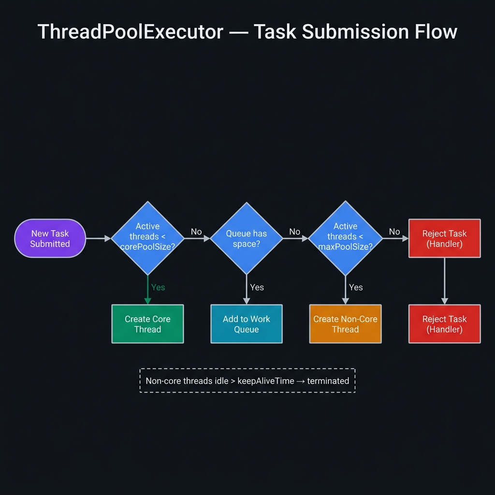

1. **🏭 What are the different types of ExecutorService available in Java? 🔥🔥**

<!-- -->
<details>
<summary>Answer</summary>

**Answer:**

The `Executors` factory class gives you several ready-made thread pools:

| ExecutorService Type | Pool Size | Queue | Use Case |
|---|---|---|---|
| `newFixedThreadPool(n)` | Fixed at `n` | Unbounded `LinkedBlockingQueue` | Known, steady workload |
| `newCachedThreadPool()` | 0 to `Integer.MAX_VALUE` | `SynchronousQueue` | Many short-lived tasks |
| `newSingleThreadExecutor()` | 1 | Unbounded `LinkedBlockingQueue` | Sequential task execution |
| `newScheduledThreadPool(n)` | Fixed core at `n` | `DelayedWorkQueue` | Delayed/periodic tasks |
| `newWorkStealingPool(n)` | Parallelism level `n` (default: CPU cores) | Work-stealing deques | CPU-bound parallel tasks (Java 8+) |
| `newVirtualThreadPerTaskExecutor()` | No pool — one new virtual thread per task (unbounded) | None | Many blocking I/O tasks (JDK 21+) |

```java
// Fixed thread pool — best for bounded, predictable workloads
ExecutorService fixed = Executors.newFixedThreadPool(4);

// Cached thread pool — creates threads on demand, reuses idle ones
ExecutorService cached = Executors.newCachedThreadPool();

// Single thread — guarantees sequential execution
ExecutorService single = Executors.newSingleThreadExecutor();

// Scheduled — for delayed and periodic tasks
ScheduledExecutorService scheduled = Executors.newScheduledThreadPool(2);
scheduled.scheduleAtFixedRate(() -> System.out.println("Tick"),
    0, 1, TimeUnit.SECONDS);

// Work-stealing — uses ForkJoinPool underneath
ExecutorService workStealing = Executors.newWorkStealingPool();

// Virtual threads (JDK 21+) — one new virtual thread per task, no pooling
ExecutorService virtual = Executors.newVirtualThreadPerTaskExecutor();
```

🔑 **Key Point:** In production, prefer to create a `ThreadPoolExecutor` directly. The `Executors` factory methods have no limit on one of two things:

- **Fixed / single:** the `LinkedBlockingQueue` has no size limit. Under load the queue keeps growing → `OutOfMemoryError`.
- **Cached:** the `SynchronousQueue` holds nothing, so every busy moment creates a new thread, up to `Integer.MAX_VALUE`. The risk is too many **threads**, not a big queue.

---

</details>

---

2. **⚙️ Explain ThreadPoolExecutor internals: corePoolSize, maxPoolSize, keepAliveTime, and work queue types. 🔥🔥**

<!-- -->
<details>
<summary>Answer</summary>

**Answer:**

`ThreadPoolExecutor` is the main class behind most `ExecutorService` types. You must know its parameters to tune a pool well.

**Constructor parameters:**
```java
ThreadPoolExecutor(
    int corePoolSize,        // min threads kept alive
    int maximumPoolSize,     // max threads allowed
    long keepAliveTime,      // idle time before non-core threads die
    TimeUnit unit,           // time unit for keepAliveTime
    BlockingQueue<Runnable> workQueue,  // queue for pending tasks
    ThreadFactory threadFactory,        // custom thread creation
    RejectedExecutionHandler handler    // rejection policy
)
```

| Parameter | Description |
|---|---|
| **corePoolSize** | The pool creates threads up to this number, even if some are idle. They stay alive unless you set `allowCoreThreadTimeOut(true)`. |
| **maximumPoolSize** | The upper limit on total threads. The pool creates extra (non-core) threads only when the queue is full. |
| **keepAliveTime** | How long an idle non-core thread waits before it ends. |
| **workQueue** | Holds tasks once the pool size (threads that exist) is ≥ `corePoolSize` — even if some core threads are idle. |

💡 Core threads are created lazily, one per submit, as tasks arrive. Call `prestartAllCoreThreads()` to create them all up front.

**Queue types and their behavior:**

| Queue Type | Behavior |
|---|---|
| `LinkedBlockingQueue` (unbounded) | Tasks wait in the queue with no limit. `maxPoolSize` is never reached |
| `ArrayBlockingQueue(capacity)` (bounded) | When it is full, the pool creates new threads up to `maxPoolSize` |
| `SynchronousQueue` | Has no capacity. Each insert waits for a thread to take it. This forces the pool to create threads |
| `PriorityBlockingQueue` | Orders tasks by priority (`Comparable` or `Comparator`). It is unbounded, so `maxPoolSize` is never used. ⚠️ `submit()` wraps each task in a `FutureTask`, which is not `Comparable` → `ClassCastException`. Use `execute()` with `Comparable` tasks |

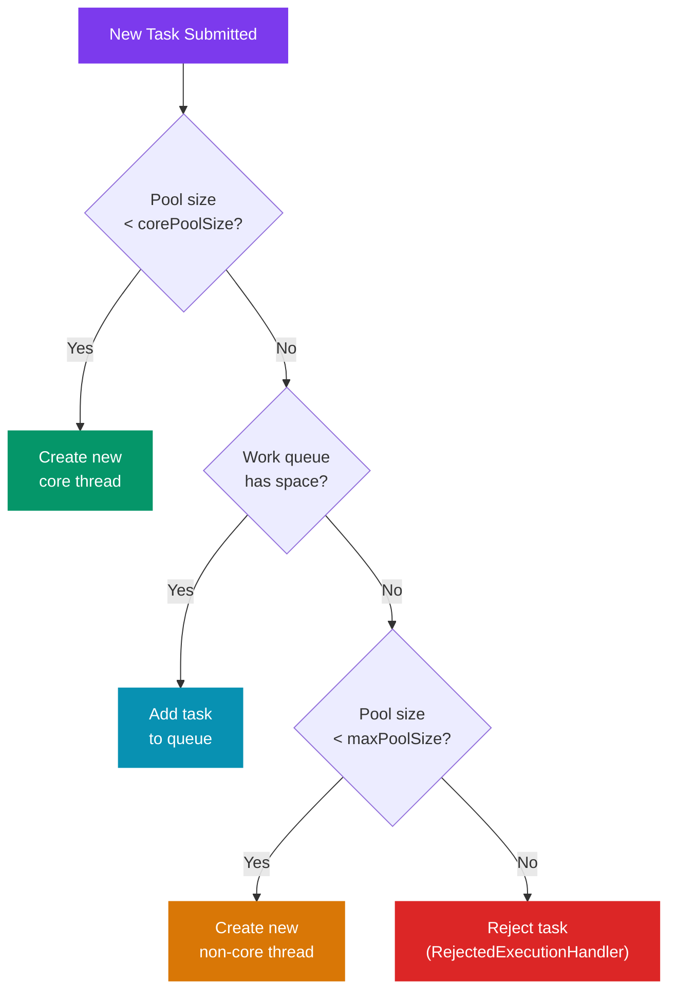

🔑 **Key Point:** The order is: **core threads → queue → non-core threads → rejection**. Interviewers ask this very often. The check uses **pool size** (threads that exist), not "busy threads".

---

</details>

---

3. **🚫 What are the four rejection policies in ThreadPoolExecutor? 🔥**

<!-- -->
<details>
<summary>Answer</summary>

**Answer:**

When both the thread pool and the work queue are full, the `RejectedExecutionHandler` decides what happens to a new task.

| Policy | Behavior | When to Use |
|---|---|---|
| **AbortPolicy** (default) | Throws `RejectedExecutionException` | When you cannot lose a task; fail fast |
| **CallerRunsPolicy** | Runs the task in the caller's thread | Back-pressure; slows down the submitter |
| **DiscardPolicy** | Drops the rejected task with no error | When losing a task is OK (metrics, logs) |
| **DiscardOldestPolicy** | Drops the oldest queued task, then tries again | When the latest data matters more than old data |

```java
// AbortPolicy — throws exception (default)
ThreadPoolExecutor abort = new ThreadPoolExecutor(
    2, 4, 60, TimeUnit.SECONDS,
    new ArrayBlockingQueue<>(10),
    new ThreadPoolExecutor.AbortPolicy()
);

// CallerRunsPolicy — submitting thread runs the task itself
ThreadPoolExecutor callerRuns = new ThreadPoolExecutor(
    2, 4, 60, TimeUnit.SECONDS,
    new ArrayBlockingQueue<>(10),
    new ThreadPoolExecutor.CallerRunsPolicy()
);

// DiscardPolicy — silently drops the task
ThreadPoolExecutor discard = new ThreadPoolExecutor(
    2, 4, 60, TimeUnit.SECONDS,
    new ArrayBlockingQueue<>(10),
    new ThreadPoolExecutor.DiscardPolicy()
);

// DiscardOldestPolicy — removes oldest from queue
ThreadPoolExecutor discardOldest = new ThreadPoolExecutor(
    2, 4, 60, TimeUnit.SECONDS,
    new ArrayBlockingQueue<>(10),
    new ThreadPoolExecutor.DiscardOldestPolicy()
);
```

🔑 **Key Point:** `CallerRunsPolicy` gives you back-pressure for free. When the pool is full, the calling thread (e.g., the HTTP request thread) must run the task itself. While it is busy, it cannot submit more tasks. So the submit rate slows down on its own.

---

</details>

---

4. **🛑 What is the difference between shutdown() and shutdownNow()? 🔥**

<!-- -->
<details>
<summary>Answer</summary>

**Answer:**

| Feature | `shutdown()` | `shutdownNow()` |
|---|---|---|
| **New tasks accepted?** | No | No |
| **Running tasks** | Allowed to finish | The pool tries to stop them with `Thread.interrupt()` |
| **Queued tasks** | Run before shutdown | Returned as `List<Runnable>` (not run) |
| **Return type** | `void` | `List<Runnable>` (tasks that never ran) |
| **Graceful?** | Yes | No |

```java
ExecutorService executor = Executors.newFixedThreadPool(3);

// Submit tasks
for (int i = 0; i < 10; i++) {
    final int taskId = i;
    executor.submit(() -> {
        try {
            Thread.sleep(1000);
            System.out.println("Task " + taskId + " completed");
        } catch (InterruptedException e) {
            System.out.println("Task " + taskId + " interrupted");
        }
    });
}

// Graceful shutdown — finish running + queued tasks
executor.shutdown();

// Or: Aggressive shutdown — interrupt running, return queued
// List<Runnable> pending = executor.shutdownNow();

// Wait for termination with timeout
if (!executor.awaitTermination(5, TimeUnit.SECONDS)) {
    executor.shutdownNow(); // force if not done
}
```

**Best practice pattern for shutdown:**
```java
executor.shutdown(); // stop accepting new tasks
try {
    if (!executor.awaitTermination(60, TimeUnit.SECONDS)) {
        executor.shutdownNow(); // force stop
        if (!executor.awaitTermination(60, TimeUnit.SECONDS)) {
            System.err.println("Pool did not terminate");
        }
    }
} catch (InterruptedException e) {
    executor.shutdownNow();
    Thread.currentThread().interrupt(); // preserve interrupt status
}
```

🔑 **Key Point:** The standard pattern is `shutdown()` + `awaitTermination()`. Call `shutdownNow()` only when the graceful shutdown times out.

---

</details>

---

5. **🔧 How would you configure a custom ThreadPoolExecutor for a production application? ⚡**

<!-- -->
<details>
<summary>Answer</summary>

**Answer:**

In production, always create a `ThreadPoolExecutor` directly. Do not use the `Executors` factory methods. Here is a well-configured example:

```java
import java.util.concurrent.*;
import java.util.concurrent.atomic.AtomicInteger;

public class ProductionThreadPool {

    public static ThreadPoolExecutor createPool() {
        int corePoolSize = 10;
        int maxPoolSize = 20;
        long keepAliveTime = 60L;
        int queueCapacity = 100;

        // Custom thread factory with meaningful names
        ThreadFactory threadFactory = new ThreadFactory() {
            private final AtomicInteger counter = new AtomicInteger(1);

            @Override
            public Thread newThread(Runnable r) {
                Thread t = new Thread(r, "order-processor-" + counter.getAndIncrement());
                t.setDaemon(false);
                t.setPriority(Thread.NORM_PRIORITY);
                return t;
            }
        };

        // Custom rejection handler with logging
        RejectedExecutionHandler rejectionHandler = (runnable, executor) -> {
            System.err.println("Task rejected! Queue size: " + executor.getQueue().size()
                + ", Active threads: " + executor.getActiveCount());
            // Option 1: Log and drop
            // Option 2: Persist to DB for retry
            // Option 3: throw new RejectedExecutionException("Pool saturated");
        };

        ThreadPoolExecutor executor = new ThreadPoolExecutor(
            corePoolSize,
            maxPoolSize,
            keepAliveTime,
            TimeUnit.SECONDS,
            new ArrayBlockingQueue<>(queueCapacity),  // bounded queue!
            threadFactory,
            rejectionHandler
        );

        // Optional: allow core threads to timeout too
        executor.allowCoreThreadTimeOut(true);

        return executor;
    }

    // Monitor pool health
    public static void printPoolStats(ThreadPoolExecutor pool) {
        System.out.printf("Pool: [Active: %d, Pool Size: %d, Core: %d, Max: %d, "
            + "Queue: %d, Completed: %d]%n",
            pool.getActiveCount(),
            pool.getPoolSize(),
            pool.getCorePoolSize(),
            pool.getMaximumPoolSize(),
            pool.getQueue().size(),
            pool.getCompletedTaskCount()
        );
    }
}
```

> ⚠️ **A handler that only logs can hang your caller.** With `submit()`, the pool passes the handler the `FutureTask`. If the handler only logs and returns, that `Future` never completes. A caller that calls `get()` with no timeout then waits forever. `DiscardPolicy` and `DiscardOldestPolicy` have the same problem.
>
> Fixes — pick one:
> - Throw `RejectedExecutionException` from the handler (the caller gets the error at once).
> - Cancel the `Future` in the handler: `if (r instanceof Future<?> f) f.cancel(false);` — then `get()` throws `CancellationException`.
> - Always call `get(timeout, unit)`, never plain `get()`.

**Why avoid `Executors` factory methods in production:**

| Factory Method | Problem |
|---|---|
| `newFixedThreadPool` | Uses an unbounded `LinkedBlockingQueue` → can cause OOM |
| `newCachedThreadPool` | Max threads = `Integer.MAX_VALUE` → can create too many threads |
| `newSingleThreadExecutor` | Unbounded queue → OOM risk |

🔑 **Key Point:** In production, always use a bounded queue, a useful rejection handler, and a thread factory that names threads. Interviewers at companies like Razorpay and PhonePe ask this very often.

---

</details>

---

6. **📐 How do you decide thread pool size for CPU-bound vs I/O-bound tasks? 🔥🔥**

<!-- -->
<details>
<summary>Answer</summary>

**Answer:**

The right pool size depends on the type of task:

**CPU-bound tasks** (heavy computation, no waiting):
```
Optimal threads = Number of CPU cores (or cores + 1)
```

**I/O-bound tasks** (network calls, DB queries, file I/O):
```
Optimal threads = Number of CPU cores × (1 + Wait time / Service time)
```

| Task Type | Formula | Example (8 cores) |
|---|---|---|
| **CPU-bound** | `cores` or `cores + 1` | 8–9 threads |
| **I/O-bound** (50% wait) | `cores × (1 + 1)` | 16 threads |
| **I/O-bound** (90% wait, e.g., HTTP calls) | `cores × (1 + 9)` | 80 threads |

```java
// CPU-bound pool
int cpuCores = Runtime.getRuntime().availableProcessors();
ExecutorService cpuPool = new ThreadPoolExecutor(
    cpuCores, cpuCores, 0L, TimeUnit.MILLISECONDS,
    new LinkedBlockingQueue<>(100)
);

// I/O-bound pool (e.g., calling external APIs)
int ioThreads = cpuCores * 10; // assuming 90% wait time
ExecutorService ioPool = new ThreadPoolExecutor(
    ioThreads, ioThreads, 60L, TimeUnit.SECONDS,
    new ArrayBlockingQueue<>(500)
);
```

**Brian Goetz's formula (from "Java Concurrency in Practice"):**
```
N_threads = N_cpu × U_cpu × (1 + W/C)

Where:
  N_cpu  = number of CPUs (Runtime.getRuntime().availableProcessors())
  U_cpu  = target CPU use (0 < U_cpu <= 1)
  W/C    = ratio of wait time to compute time
```

⚠️ **The real upper limit is often the downstream resource, not the formula.** Examples: the DB connection pool size, or an API rate limit. 80 threads that share a DB pool of 20 connections means 60 threads just wait for a connection.

🔑 **Key Point:** Too few threads → the CPU sits idle. Too many threads → too much context switching. Start with the formula. Then measure with a real workload and adjust based on the metrics.

---

</details>

---

7. **💥 What is the difference between execute() and submit()? 🔥**

<!-- -->
<details>
<summary>Answer</summary>

**Answer:**

Both hand a task to the pool. They differ in what they return and in **where an exception goes**.

| | `execute(Runnable)` | `submit(Runnable / Callable)` |
|---|---|---|
| **Declared in** | `Executor` | `ExecutorService` |
| **Returns** | `void` | `Future<?>` / `Future<T>` |
| **Accepts** | `Runnable` only | `Runnable` or `Callable` |
| **Task throws an exception** | The exception kills the worker thread. It goes to the thread's `UncaughtExceptionHandler` (by default, printed to stderr). The pool replaces the dead thread | The pool **catches** it and stores it inside the `Future`. The worker thread lives on |
| **How you see the error** | stderr / your `UncaughtExceptionHandler` | Only when someone calls `future.get()` → `ExecutionException` |
| **Risk** | Noisy, and a thread is created again after each failure | ⚠️ If nobody calls `get()`, the error is **lost with no trace** |

**The lost exception:**
```java
ExecutorService pool = Executors.newFixedThreadPool(2);

// execute(): the stack trace is printed to stderr — you see the failure
pool.execute(() -> {
    throw new IllegalStateException("boom-1");
});

// submit(): the exception is stored in the Future — nothing is printed
pool.submit(() -> {
    throw new IllegalStateException("boom-2");
});
// No get() call → "boom-2" is never seen. No log, no stack trace.
```

**Fixes:**

- **Call `get()`** on the `Future` and handle `ExecutionException` (use `get(timeout, unit)` to avoid waiting forever).
- **Wrap the task body in try/catch and log** the error inside the task.
- **Override `ThreadPoolExecutor.afterExecute(Runnable, Throwable)`.** For `execute()`, the `Throwable` is the exception. For `submit()`, the `Throwable` is `null` — the exception sits inside the `Future`, so you must unwrap it:

```java
class LoggingPool extends ThreadPoolExecutor {

    LoggingPool(int core, int max) {
        super(core, max, 60L, TimeUnit.SECONDS, new ArrayBlockingQueue<>(100));
    }

    @Override
    protected void afterExecute(Runnable r, Throwable t) {
        super.afterExecute(r, t);
        // submit() → t is null; the exception is stored inside the FutureTask
        if (t == null && r instanceof Future<?> f && f.isDone()) {
            try {
                f.get();
            } catch (CancellationException e) {
                t = e;
            } catch (ExecutionException e) {
                t = e.getCause();
            } catch (InterruptedException e) {
                Thread.currentThread().interrupt();
            }
        }
        if (t != null) {
            System.err.println("Task failed: " + t);
        }
    }
}
```

**Newer APIs (JDK 19+):**

| API | What it does |
|---|---|
| `Future.state()` | Returns `RUNNING`, `SUCCESS`, `FAILED` or `CANCELLED` |
| `Future.resultNow()` | Returns the result with no blocking. Throws `IllegalStateException` if the task did not succeed |
| `Future.exceptionNow()` | Returns the exception with no blocking. Throws `IllegalStateException` if the task did not fail |
| `ExecutorService` is `AutoCloseable` | `close()` shuts the pool down and **waits** for the tasks to finish. So you can use try-with-resources |

```java
try (ExecutorService pool = Executors.newFixedThreadPool(2)) {
    Future<Integer> f = pool.submit(() -> 42);
} // close() waits here for all tasks to finish
```

🔑 **Key Point:** `execute()` makes a failure loud. `submit()` makes it silent unless you read the `Future`. If you use `submit()` just to start a task and never check it, you will lose its errors.

---

</details>

---

<a id="completablefuture"></a>

## 3. CompletableFuture

1. **🚀 What is CompletableFuture and how does it differ from Future? 🔥🔥**

<!-- -->
<details>
<summary>Answer</summary>

**Answer:**

`CompletableFuture<T>` (Java 8) is a better `Future`. It supports async code that is non-blocking, can be chained, and uses callbacks.

| Feature | Future | CompletableFuture |
|---|---|---|
| **Blocking get** | Only way to get result | Supports callbacks (`thenApply`, `thenAccept`) |
| **Chaining** | Not possible | `thenApply`, `thenCompose`, `thenCombine` |
| **Combining** | Not possible | `allOf()`, `anyOf()` |
| **Exception handling** | Only via `try-catch` on `get()` | `exceptionally()`, `handle()`, `whenComplete()` |
| **Manual completion** | Not possible | `complete()`, `completeExceptionally()` |
| **Async execution** | Requires `ExecutorService.submit()` | Built-in `supplyAsync()`, `runAsync()` |
| **Non-blocking** | No | Yes (callback-based) |

```java
// Future — blocking approach
ExecutorService executor = Executors.newFixedThreadPool(2);
Future<String> future = executor.submit(() -> fetchData());
String result = future.get(); // BLOCKS the thread!

// CompletableFuture — non-blocking approach
CompletableFuture.supplyAsync(() -> fetchData())
    .thenApply(data -> transform(data))        // chain transformation
    .thenAccept(result -> saveToDb(result))     // consume result
    .exceptionally(ex -> {                      // handle errors
        log.error("Failed", ex);
        return null;
    });
```

🔑 **Key Point:** `CompletableFuture` implements two interfaces: `Future` and `CompletionStage`. `CompletionStage` is the one that gives all the chaining and combining methods.

---

</details>

---

2. **🔗 Explain the difference between thenApply, thenCompose, and thenCombine. 🔥🔥**

<!-- -->
<details>
<summary>Answer</summary>

**Answer:**

These are the three main methods to join steps in a `CompletableFuture`:

| Method | Input | Output | Analogy |
|---|---|---|---|
| `thenApply(Function<T,U>)` | `T` | `CompletableFuture<U>` | `map()` in Streams |
| `thenCompose(Function<T, CompletableFuture<U>>)` | `T` | `CompletableFuture<U>` | `flatMap()` in Streams |
| `thenCombine(CompletableFuture<U>, BiFunction<T,U,V>)` | `T` + `U` | `CompletableFuture<V>` | Combines two independent futures |

**thenApply — non-async transformation (like map):**
```java
CompletableFuture<String> nameFuture =
    CompletableFuture.supplyAsync(() -> getUserId())
        .thenApply(id -> "User-" + id);  // runs on whichever thread completed the previous stage
// If getUserId() returns 42 → result is "User-42"
```
⚠️ **"Non-async" ≠ "caller thread."** `thenApply` runs the function on the thread that *completed the previous stage*. This is often the `supplyAsync` pool thread. It is **not** always the thread that built the pipeline. Use `thenApplyAsync` to force the work onto an executor. Do not call it "synchronous" — that word wrongly suggests it runs on the calling thread.

**thenCompose — async chaining (like flatMap):**
```java
// Each step returns a CompletableFuture
CompletableFuture<Order> orderFuture =
    CompletableFuture.supplyAsync(() -> getUserId())
        .thenCompose(id -> fetchOrderAsync(id));  // returns CF<Order>
// Without thenCompose, thenApply would give CF<CF<Order>> — nested!
```

**thenCombine — combine two independent futures:**
```java
CompletableFuture<String> userFuture =
    CompletableFuture.supplyAsync(() -> fetchUser());
CompletableFuture<String> orderFuture =
    CompletableFuture.supplyAsync(() -> fetchOrders());

CompletableFuture<String> combined = userFuture.thenCombine(
    orderFuture,
    (user, orders) -> user + " has orders: " + orders
);
```

**Key difference between thenApply and thenCompose:**
```java
// thenApply — when the transformation returns a plain value (not a future)
.thenApply(id -> "prefix-" + id)  // Function<T, U>

// thenCompose — when transformation itself is async
.thenCompose(id -> fetchFromDbAsync(id))  // Function<T, CF<U>>
// Avoids CompletableFuture<CompletableFuture<U>> nesting
```

🔑 **Key Point:** `thenApply` is like `map()`. `thenCompose` is like `flatMap()`. If your function returns a `CompletableFuture`, use `thenCompose`. This avoids nested futures.

---

</details>

---

3. **🎯 How do allOf and anyOf work in CompletableFuture? ⚡**

<!-- -->
<details>
<summary>Answer</summary>

**Answer:**

`allOf` and `anyOf` let you wait on many `CompletableFuture` objects together.

**`CompletableFuture.allOf(CF... cfs)`** — completes when ALL futures complete:
```java
CompletableFuture<String> cf1 = CompletableFuture.supplyAsync(() -> fetchUser());
CompletableFuture<String> cf2 = CompletableFuture.supplyAsync(() -> fetchOrders());
CompletableFuture<String> cf3 = CompletableFuture.supplyAsync(() -> fetchPayments());

// Wait for all to complete
CompletableFuture<Void> allDone = CompletableFuture.allOf(cf1, cf2, cf3);

// Then collect results
allDone.thenRun(() -> {
    String user = cf1.join();      // non-blocking since already complete
    String orders = cf2.join();
    String payments = cf3.join();
    System.out.println(user + ", " + orders + ", " + payments);
});
```

⚠️ **`allOf` does NOT stop early on a failure.** Say `cf1` fails after 10 ms and `cf3` takes 5 s. `allOf` still waits for **all** futures to finish. Only then does it complete exceptionally (with a `CompletionException` holding one of the failures as its cause). If you need "fail fast", you must build it yourself — or use Structured Concurrency (§6 Q5).

**`CompletableFuture.anyOf(CF... cfs)`** — completes when ANY one future completes:
```java
CompletableFuture<String> primary = CompletableFuture.supplyAsync(() -> callPrimaryApi());
CompletableFuture<String> fallback = CompletableFuture.supplyAsync(() -> callFallbackApi());

// First future to FINISH wins — success OR failure
CompletableFuture<Object> fastest = CompletableFuture.anyOf(primary, fallback);
fastest.thenAccept(result -> System.out.println("Fastest: " + result));
```

⚠️ **The `anyOf` trap — it is "first to finish", not "first success".** `anyOf` takes the result of whichever future finishes first. **A failure counts as finishing.** So if `primary` fails fast, `anyOf` completes exceptionally (with a `CompletionException`). The `fallback` result arrives later and is lost. This breaks the whole idea of a fallback.

**✅ Fix — "first SUCCESS wins":**
```java
static <T> CompletableFuture<T> firstSuccess(List<CompletableFuture<T>> sources) {
    CompletableFuture<T> result = new CompletableFuture<>();
    AtomicInteger failures = new AtomicInteger();

    // ONE callback per source, so a success and a failure cannot race.
    for (CompletableFuture<T> f : sources) {
        f.whenComplete((value, ex) -> {
            if (ex == null) {
                result.complete(value);   // first success wins; later calls do nothing
            } else if (failures.incrementAndGet() == sources.size()) {
                result.completeExceptionally(ex);   // fail only when ALL sources failed
            }
        });
    }

    // ❌️ Do not use allOf(...).exceptionally(...) for the "all failed" case.
    // allOf fails if ANY source failed. If the last source to finish
    // succeeds, allOf's callback can run first and fail the result
    // (seen on JDK 17: primary fails, fallback succeeds → result still fails).

    return result;
}

// Usage
CompletableFuture<String> firstOk = firstSuccess(List.of(primary, fallback));
```

**Practical pattern — collect all results into a list:**
```java
List<CompletableFuture<String>> futures = List.of(
    CompletableFuture.supplyAsync(() -> callServiceA()),
    CompletableFuture.supplyAsync(() -> callServiceB()),
    CompletableFuture.supplyAsync(() -> callServiceC())
);

CompletableFuture<List<String>> allResults = CompletableFuture
    .allOf(futures.toArray(new CompletableFuture[0]))
    .thenApply(v -> futures.stream()
        .map(CompletableFuture::join)
        .toList()
    );
```

| Feature | `allOf` | `anyOf` |
|---|---|---|
| **Completes when** | ALL futures complete | ANY one completes (success **or** failure) |
| **On an early failure** | Still waits for all, then completes exceptionally | Completes exceptionally at once |
| **Return type** | `CompletableFuture<Void>` | `CompletableFuture<Object>` |
| **Use case** | Fan-out then aggregate | First-to-finish racing. For "first success wins", use the `firstSuccess` helper above |

🔑 **Key Point:** `allOf` returns `CompletableFuture<Void>`. So you must call `join()` on each future to collect the results. `anyOf` returns `CompletableFuture<Object>`, because the compiler cannot know the result type. `anyOf` takes the first future to *finish*, and a failure also counts.

---

</details>

---

4. **🛡️ How does exception handling work in CompletableFuture? 🔥**

<!-- -->
<details>
<summary>Answer</summary>

**Answer:**

`CompletableFuture` gives three methods to handle exceptions:

| Method | Receives | Returns | Handles Exception? | Handles Success? |
|---|---|---|---|---|
| `exceptionally(Function<Throwable, T>)` | Exception only | Recovery value | Yes | No |
| `handle(BiFunction<T, Throwable, U>)` | Both result and exception | Transformed value | Yes | Yes |
| `whenComplete(BiConsumer<T, Throwable>)` | Both result and exception | Same CF (no transform). ⚠️ If the action itself throws and the source succeeded, the returned stage completes exceptionally with that exception | Yes (side-effect) | Yes (side-effect) |

**exceptionally — recover from failure:**
```java
CompletableFuture<String> result = CompletableFuture
    .supplyAsync(() -> {
        if (true) throw new RuntimeException("API failed");
        return "Success";
    })
    .exceptionally(ex -> {
        System.err.println("Error: " + ex.getMessage());
        return "Default Value";  // recovery value
    });

System.out.println(result.get()); // "Default Value"
```

**handle — process both success and failure:**
```java
CompletableFuture<String> result = CompletableFuture
    .supplyAsync(() -> fetchData())
    .handle((data, ex) -> {
        if (ex != null) {
            log.error("Failed to fetch", ex);
            return "Fallback Data";
        }
        return data.toUpperCase();
    });
```

**whenComplete — side effects without transforming:**
```java
CompletableFuture<String> result = CompletableFuture
    .supplyAsync(() -> fetchData())
    .whenComplete((data, ex) -> {
        if (ex != null) {
            log.error("Failed", ex);
            alertOps(ex);  // side effect: send alert
        } else {
            log.info("Got data: {}", data);
            metrics.increment("fetch.success"); // side effect
        }
    });
// result still contains original value or original exception
```

**Exception propagation in chains:**
```java
CompletableFuture.supplyAsync(() -> "Step 1")
    .thenApply(s -> {
        throw new RuntimeException("Step 2 failed");
    })
    .thenApply(s -> s + " Step 3")  // SKIPPED due to exception
    .thenApply(s -> s + " Step 4")  // SKIPPED due to exception
    .exceptionally(ex -> "Recovered at end")
    .thenAccept(System.out::println); // "Recovered at end"
```

🔑 **Key Point:** An exception moves down the chain. It skips every `thenApply`/`thenCompose` stage until it reaches an exception handler (`exceptionally`, `handle`). This works like try-catch.

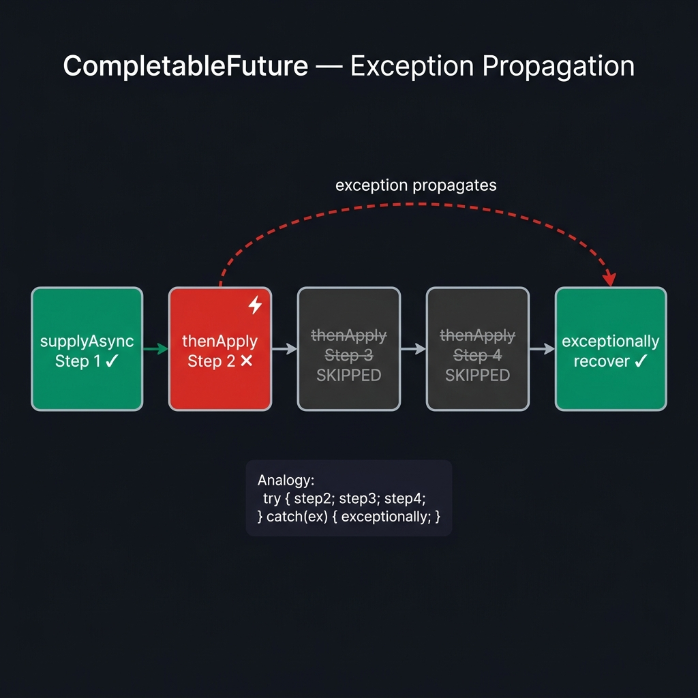

**⚠️ The wrapping trap — `CompletionException` vs `ExecutionException`:**

The `Throwable` your handler gets is almost never the exception your code threw. It is a **wrapper**. The wrapper type depends on *how* you read the failure:

| How you observe the failure | What you actually receive | Checked? |
|---|---|---|
| `Future.get()` / `CompletableFuture.get()` | `ExecutionException` wrapping the cause | ✅ **Checked** — must be caught or declared |
| `CompletableFuture.join()` | `CompletionException` wrapping the cause | ❌️ **Unchecked** |
| `exceptionally` / `handle` / `whenComplete` **inside a chain** | `CompletionException` wrapping the cause | ❌️ **Unchecked** |

🔸 **Why `join()` exists at all:**
- `get()` throws the *checked* `ExecutionException` (plus `InterruptedException`). So you cannot call it inside a lambda without a `try-catch`.
- `join()` throws only the *unchecked* `CompletionException`.
- That is why `join()` fits cleanly inside `thenApply`, an `allOf` collection step, or a stream pipeline.

**The common bug — a fallback branch that never runs:**
```java
class MyBusinessException extends RuntimeException {
    MyBusinessException(String message) {
        super(message);
    }
}

CompletableFuture.supplyAsync(() -> {
        throw new MyBusinessException("boom");
    })
    .exceptionally(ex -> {
        // Observed on JDK 17.0.11:
        //   ex.getClass()                               -> java.util.concurrent.CompletionException
        //   ex.getCause().getClass()                    -> MyBusinessException
        //   ex instanceof MyBusinessException           -> false   <-- the trap
        //   ex.getCause() instanceof MyBusinessException -> true
        if (ex instanceof MyBusinessException) {
            return "business fallback";   // ❌️ DEAD CODE — this branch never runs
        }
        return "generic fallback";
    });
```

`handle` and `whenComplete` behave the same way. Both were observed getting `java.util.concurrent.CompletionException` with `cause=MyBusinessException`.

**`join()` vs `get()` on the same failed future:**
```java
CompletableFuture<String> cf = CompletableFuture.supplyAsync(() -> {
    throw new MyBusinessException("boom");
});

try {
    cf.join();
} catch (CompletionException e) {
    // Observed: java.util.concurrent.CompletionException, cause = MyBusinessException
    // UNCHECKED — the compiler does not force this catch
}

try {
    cf.get();
} catch (ExecutionException e) {
    // Observed: java.util.concurrent.ExecutionException, cause = MyBusinessException
    // CHECKED — the compiler forces you to catch or declare it
} catch (InterruptedException e) {
    Thread.currentThread().interrupt();
}
```

A plain `Future` from `ExecutorService.submit(...)` behaves the same as `get()`. It was observed throwing `java.util.concurrent.ExecutionException` with `cause=MyBusinessException`.

**⚠️ The detail that breaks simple unwrapping — the exception is not *always* wrapped:**

Sometimes the exception comes from the **previous stage's own completion**. Example: you call `completeExceptionally(e)` directly on a future, and then attach `exceptionally()` to that same future. In this case the exception arrives **unwrapped**:
```java
CompletableFuture<String> direct = new CompletableFuture<>();
direct.completeExceptionally(new MyBusinessException("direct"));

direct.exceptionally(ex -> {
    // Observed on JDK 17.0.11:
    //   ex.getClass()                     -> MyBusinessException   <-- NOT wrapped
    //   ex.getCause()                     -> null
    //   ex instanceof MyBusinessException -> true
    return "fallback";
});

// ...but insert even ONE intermediate stage and the wrapper is back:
direct.thenApply(s -> s + "!")
      .exceptionally(ex -> {
          // Observed on JDK 17.0.11:
          //   ex.getClass()                     -> java.util.concurrent.CompletionException
          //   ex instanceof MyBusinessException -> false
          return "fallback";
      });
```

So calling `ex.getCause()` without a check returns `null` in the first case. Your handler then throws an NPE. **Unwrap only when the exception is a wrapper.**

**✅ The safe pattern — works in every case above:**
```java
.exceptionally(ex -> {
    Throwable root = (ex instanceof CompletionException || ex instanceof ExecutionException)
            && ex.getCause() != null ? ex.getCause() : ex;
    // Observed on JDK 17.0.11: root -> MyBusinessException in BOTH cases
    //   (wrapped supplyAsync failure AND unwrapped completeExceptionally)
    if (root instanceof MyBusinessException) {
        return "business fallback";   // ✅ now it actually fires
    }
    return "generic fallback";
})
```

🔑 **Key Point:**
- `get()` throws a checked exception (`ExecutionException`). `join()` throws an unchecked one (`CompletionException`). This one difference is why `join()` works inside lambdas.
- Inside a chain, `exceptionally`/`handle`/`whenComplete` all give you a `CompletionException`. So **`ex instanceof MyBusinessException` is `false`**, and you must use `ex.getCause()`.
- A future completed directly with `completeExceptionally` gives the exception *unwrapped*. So production code must unwrap **only when needed**, never blindly.

---

</details>

---

5. **⚡ What is the difference between supplyAsync and runAsync? ⚡**

<!-- -->
<details>
<summary>Answer</summary>

**Answer:**

| Feature | `supplyAsync` | `runAsync` |
|---|---|---|
| **Functional interface** | `Supplier<T>` | `Runnable` |
| **Returns** | `CompletableFuture<T>` | `CompletableFuture<Void>` |
| **Return value** | Yes (of type `T`) | No |
| **Use case** | When you need a result | Fire-and-forget tasks |

```java
// supplyAsync — returns a value
CompletableFuture<String> cf1 = CompletableFuture.supplyAsync(() -> {
    return fetchUserFromDb();  // returns String
});

// runAsync — no return value
CompletableFuture<Void> cf2 = CompletableFuture.runAsync(() -> {
    sendNotificationEmail();   // fire-and-forget
});
```

**Custom executor (important for production):**
```java
ExecutorService customPool = Executors.newFixedThreadPool(10);

// By default, uses ForkJoinPool.commonPool()
CompletableFuture<String> defaultPool =
    CompletableFuture.supplyAsync(() -> fetchData());

// With custom executor — recommended for production
CompletableFuture<String> customPoolCf =
    CompletableFuture.supplyAsync(() -> fetchData(), customPool);

CompletableFuture<Void> asyncTask =
    CompletableFuture.runAsync(() -> logEvent(), customPool);
```

🔑 **Key Point:** Always pass your own `ExecutorService` in production. The default `ForkJoinPool.commonPool()` is shared by the whole JVM. A slow task in one module can block tasks in another module (starvation). Every Async method (e.g., `thenApplyAsync`, `thenComposeAsync`) also has a version that takes an executor.

---

</details>

---

6. **🌐 Show a real-world example of CompletableFuture for API orchestration. 🔥**

<!-- -->
<details>
<summary>Answer</summary>

**Answer:**

Here is a real-world example. It collects data from several microservices to build a customer dashboard:

```java
import java.util.concurrent.*;

public class CustomerDashboardService {

    private final ExecutorService executor = new ThreadPoolExecutor(
        10, 20, 60, TimeUnit.SECONDS,
        new ArrayBlockingQueue<>(100),
        new ThreadPoolExecutor.CallerRunsPolicy()
    );

    public CompletableFuture<DashboardResponse> buildDashboard(String customerId) {

        // Fan-out: call 3 services in parallel.
        // Each call has its OWN timeout. Without it, one hung service
        // hangs the whole dashboard response.
        CompletableFuture<UserProfile> profileCf = CompletableFuture
            .supplyAsync(() -> userService.getProfile(customerId), executor)
            .orTimeout(2, TimeUnit.SECONDS)                 // Java 9+
            .exceptionally(ex -> UserProfile.defaultProfile());

        CompletableFuture<List<Order>> ordersCf = CompletableFuture
            .supplyAsync(() -> orderService.getRecentOrders(customerId), executor)
            .orTimeout(2, TimeUnit.SECONDS)
            .exceptionally(ex -> Collections.emptyList());

        // Alternative: completeOnTimeout gives the fallback value directly on timeout
        CompletableFuture<WalletBalance> walletCf = CompletableFuture
            .supplyAsync(() -> walletService.getBalance(customerId), executor)
            .completeOnTimeout(WalletBalance.zero(), 2, TimeUnit.SECONDS)
            .exceptionally(ex -> WalletBalance.zero());

        // Fan-in: aggregate results when all complete
        return CompletableFuture.allOf(profileCf, ordersCf, walletCf)
            .thenApply(v -> {
                UserProfile profile = profileCf.join();
                List<Order> orders = ordersCf.join();
                WalletBalance wallet = walletCf.join();
                return new DashboardResponse(profile, orders, wallet);
            });
    }

    // Sequential dependent calls using thenCompose
    public CompletableFuture<PaymentReceipt> processPayment(String orderId) {
        return CompletableFuture
            .supplyAsync(() -> orderService.getOrder(orderId), executor)
            .thenCompose(order ->
                CompletableFuture.supplyAsync(
                    () -> paymentService.charge(order.getAmount()), executor))
            .thenCompose(payment ->
                CompletableFuture.supplyAsync(
                    () -> receiptService.generate(payment), executor))
            .handle((receipt, ex) -> {
                if (ex != null) {
                    log.error("Payment failed for order: {}", orderId, ex);
                    throw new PaymentException("Payment processing failed", ex);
                }
                return receipt;
            });
    }
}
```

**Pattern breakdown:**

1. **Fan-out / Fan-in:** Call many services in parallel, then combine the results.
2. **Timeout per call:** `orTimeout` (or `completeOnTimeout`) on each call. Put it **before** `exceptionally`, so the timeout also goes to the fallback. Without a timeout, `allOf` waits forever for a hung service.
3. **Graceful degradation:** Each service has its own `exceptionally()` with a fallback.
4. **Sequential chaining:** Use `thenCompose` when each step needs the previous result.
5. **Custom executor:** Never use `ForkJoinPool.commonPool()` for I/O-bound HTTP calls.

⚠️ `orTimeout` only completes the *future*. The HTTP call itself keeps running on its thread. So also set a timeout on the HTTP client (connect + read timeout). See Q8.

🔑 **Key Point:** This fan-out/fan-in pattern is very common in microservices. Total latency = max(service1, service2, service3), not sum(service1 + service2 + service3). With a timeout per call, the worst case is capped at about 2 s.

---

</details>

---

7. **📊 Show how CompletableFuture stages chain together visually. 💤**

<!-- -->
<details>
<summary>Answer</summary>

**Answer:**

The picture below shows how `CompletableFuture` stages join together in a typical microservice flow:

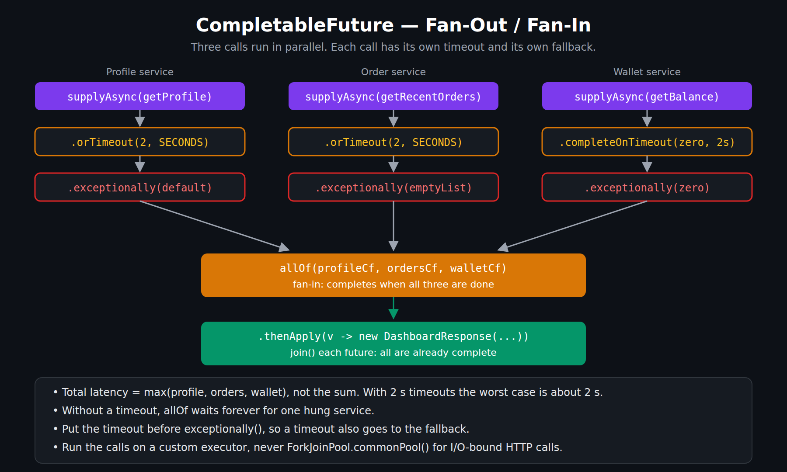

**Execution flow explained:**

| Stage | Method | Thread | Description |
|---|---|---|---|
| 1 | `supplyAsync` | Pool thread | Starts async computation |
| 2 | `thenApply` | Completing thread of the prior stage | Transformation on the completing thread |
| 3 | `thenCompose` | Completing thread of the prior stage | Chains another async operation (flatMap) |
| 4 | `thenCombine` | Whichever of the two finishes last | Combines two independent results |
| 5 | `thenAccept` | Completing thread | Consumes final result |
| E | `exceptionally` | Completing thread | Handles error at any stage |

⚠️ **`thenCompose` does *not* get a new pool thread.** The non-async form runs the function on the thread that completed the previous stage. If that stage was already complete when you attached the callback, it runs on the **calling thread**. Only `thenComposeAsync` sends the work to an executor. The same rule applies to `thenApply` (see Q2 of this section).

**Non-async vs async variants:**

| Non-async (completing thread) | Async (executor thread) |
|---|---|
| `thenApply` | `thenApplyAsync` |
| `thenCompose` | `thenComposeAsync` |
| `thenAccept` | `thenAcceptAsync` |
| `thenRun` | `thenRunAsync` |
| `thenCombine` | `thenCombineAsync` |

🔑 **Key Point:**
- The non-async variants (`thenApply`) run on the thread that completed the previous stage. If the stage was already complete, they run on the calling thread.
- **Never call them "synchronous".** That word wrongly suggests the calling thread.
- The async variants (`thenApplyAsync`) always give the work to an executor.
- For light CPU work, the non-async variants save a thread switch.

---

</details>

---

8. **⏱️ How do you add timeouts and cancellation to a CompletableFuture? 🔥**

<!-- -->
<details>
<summary>Answer</summary>

**Answer:**

There are three timeout tools. They do very different things:

| API | Since | What happens on timeout | Does the task stop? |
|---|---|---|---|
| `orTimeout(t, unit)` | Java 9 | Future completes exceptionally with `TimeoutException` (seen as a `CompletionException` wrapping it in later stages) | ❌️ No |
| `completeOnTimeout(value, t, unit)` | Java 9 | Future completes normally with the default `value` | ❌️ No |
| `get(t, unit)` | Java 8 | The **caller** stops waiting and gets `TimeoutException`. The future is not completed | ❌️ No |

```java
// 1. orTimeout — fail after 2 s
CompletableFuture<String> a = CompletableFuture
    .supplyAsync(() -> callSlowApi(), executor)
    .orTimeout(2, TimeUnit.SECONDS)
    .exceptionally(ex -> {
        Throwable root = ex instanceof CompletionException && ex.getCause() != null
                ? ex.getCause() : ex;
        if (root instanceof TimeoutException) {
            return "timed out";
        }
        return "other failure";
    });

// 2. completeOnTimeout — use a default value after 2 s
CompletableFuture<String> b = CompletableFuture
    .supplyAsync(() -> callSlowApi(), executor)
    .completeOnTimeout("default", 2, TimeUnit.SECONDS);

// 3. get(timeout) — only the caller stops waiting
try {
    String value = future.get(2, TimeUnit.SECONDS);
} catch (TimeoutException e) {
    // the task is STILL running in the pool
}
```

**⚠️ Key trap — `cancel(true)` does NOT interrupt the task.**

The javadoc of `CompletableFuture.cancel` says: *"mayInterruptIfRunning - this value has no effect in this implementation because interrupts are not used to control processing."*

So `cancel(true)` only does one thing: it completes the future with `CancellationException`.
- The `supplyAsync` body keeps running.
- It keeps holding its pool thread until it finishes.
- `orTimeout` is the same — the future fails, but the work is not stopped.

```java
CompletableFuture<String> cf = CompletableFuture.supplyAsync(() -> {
    return slowDbQuery();   // keeps running after cancel
}, executor);

cf.cancel(true);          // cf is now cancelled...
cf.isCancelled();         // true
// ...but slowDbQuery() is still running on the pool thread
```

**How to really stop the work:**

1. **`ExecutorService.submit()` + `Future.cancel(true)`** — this `Future` (a `FutureTask`) **does** interrupt the running thread. The task must respond to interrupts (blocking I/O, `sleep`, `wait`, or checks of `Thread.interrupted()`).
2. **Check a flag in the task** — e.g. an `AtomicBoolean cancelled`, or `Thread.currentThread().isInterrupted()` inside a loop.
3. **Set timeouts on the resource itself** — HTTP client read timeout, JDBC query timeout.
4. **Structured Concurrency (§6 Q5)** — when one subtask fails or the scope closes, it cancels the other subtasks by interrupting them.

```java
Future<String> f = executor.submit(() -> slowDbQuery());
try {
    return f.get(2, TimeUnit.SECONDS);
} catch (TimeoutException e) {
    f.cancel(true);   // ✅ interrupts the worker thread
    throw e;
}
```

**Delays without `Thread.sleep` — `delayedExecutor` (Java 9):**

`CompletableFuture.delayedExecutor(delay, unit)` returns an `Executor`. It submits the task to the pool only after the delay. No thread is blocked during the wait.

```java
Executor after5s = CompletableFuture.delayedExecutor(5, TimeUnit.SECONDS);
CompletableFuture<Void> retry = CompletableFuture.runAsync(() -> callApiAgain(), after5s);

// With your own pool as the target:
Executor after5sOnPool = CompletableFuture.delayedExecutor(5, TimeUnit.SECONDS, executor);
```

🔑 **Key Point:**
- `orTimeout` fails the future. `completeOnTimeout` gives a default value. `get(timeout)` only stops the caller waiting.
- **None of them stop the task.** `CompletableFuture.cancel(true)` does not interrupt either.
- To really stop work, use `ExecutorService.submit()` + `cancel(true)`, a flag check, resource timeouts, or Structured Concurrency.
- For a delay, use `delayedExecutor`, not `Thread.sleep` inside a pool task.

---

</details>

---

9. **🧵 How do you pass MDC / ThreadLocal context into async tasks? ⚡**

<!-- -->
<details>
<summary>Answer</summary>

**Answer:**

**The problem:**

A `ThreadLocal` value belongs to one thread. Common examples:
- MDC trace id (for logs)
- Tenant id (for multi-tenant DB queries)
- Spring `SecurityContext` (the logged-in user)

The calling thread has these values. A pool thread does **not**. So when you use `supplyAsync`, `@Async`, or `parallelStream()`:
- Logs lose the trace id. You cannot follow one request across threads.
- Tenant-based queries fail, or hit the wrong schema.
- Security checks see no user.

**⚠️ The worse problem — stale data.** Pool threads are reused. Say a task sets a `ThreadLocal` on a pool thread and does not clear it. The **next** task on that thread sees the old value. That can mean data from the wrong tenant.

(For `ThreadLocal` basics and memory leaks, see [04 Multithreading, section 8, Q7–Q8](04_Java_Multithreading_Interview_Questions.md#8-thread-safety-advanced-locking--concurrency-patterns).)

**Fixes:**

| Fix | Where | How |
|---|---|---|
| **Copy by hand** | Any executor | Capture the value in the caller. In the task, set it in `try` and clear it in `finally` |
| **`TaskDecorator`** | Spring `ThreadPoolTaskExecutor` | `setTaskDecorator(...)` wraps every task. Copy `MDC.getCopyOfContextMap()` in, clear after |
| **`DelegatingSecurityContextExecutor`** | Spring Security | Wraps an executor and copies the `SecurityContext` into each task |
| **Micrometer context-propagation** | Spring Boot 3 | `ContextSnapshot` captures all registered `ThreadLocal`s (MDC, tracing, security) and restores them in the task |
| **`ScopedValue`** | JDK 25+ (final; preview in 21–24) | Immutable, bound for one scope, no `remove()` to forget. Passes into Structured Concurrency subtasks, not into a normal pool — see §6 Q3 |

**1. Copy by hand (plain `CompletableFuture`):**
```java
Map<String, String> mdc = MDC.getCopyOfContextMap();   // captured on the caller thread

CompletableFuture.supplyAsync(() -> {
    if (mdc != null) {
        MDC.setContextMap(mdc);
    }
    try {
        return loadReport(id);
    } finally {
        MDC.clear();   // ✅ never leave stale data on a pool thread
    }
}, executor);
```

**2. Spring `TaskDecorator` (the standard fix):**
```java
public class MdcTaskDecorator implements TaskDecorator {

    @Override
    public Runnable decorate(Runnable task) {
        // Runs on the CALLER thread, at submit time
        Map<String, String> context = MDC.getCopyOfContextMap();

        return () -> {
            // Runs on the POOL thread
            if (context != null) {
                MDC.setContextMap(context);
            }
            try {
                task.run();
            } finally {
                MDC.clear();
            }
        };
    }
}

@Configuration
@EnableAsync
public class AsyncConfig {

    @Bean(name = "asyncExecutor")
    public ThreadPoolTaskExecutor asyncExecutor() {
        ThreadPoolTaskExecutor executor = new ThreadPoolTaskExecutor();
        executor.setCorePoolSize(8);
        executor.setMaxPoolSize(16);
        executor.setQueueCapacity(200);
        executor.setThreadNamePrefix("async-");
        executor.setTaskDecorator(new MdcTaskDecorator());
        executor.initialize();
        return executor;
    }
}
```

💡 `@Async` runs methods on the executor bean. So the decorator covers every `@Async` method that uses this executor too. You can also pass this bean to `supplyAsync(..., asyncExecutor)`.

**3. Spring Boot 3 — Micrometer context-propagation:**
```java
ContextSnapshot snapshot = ContextSnapshotFactory.builder().build().captureAll();

CompletableFuture.runAsync(snapshot.wrap(() -> {
    processEvent(event);   // MDC / tracing context restored here, then reset after
}), executor);
```

⚠️ **Things a decorator does NOT cover:**
- `parallelStream()` and `supplyAsync(...)` without an executor. They use `ForkJoinPool.commonPool()`, which has no decorator.
- A pool created with plain `Executors.newFixedThreadPool(...)`. Only Spring's `ThreadPoolTaskExecutor` has `setTaskDecorator`.

🔑 **Key Point:**
- `ThreadLocal` values (MDC, tenant, `SecurityContext`) do not move to pool threads by themselves.
- Capture in the caller. Set in the task. **Always clear in `finally`** — pool threads are reused, so a missing clear leaks data to the next task.
- In Spring, put a `TaskDecorator` on the executor bean. It covers `@Async` too. In Spring Boot 3, Micrometer context-propagation does this for many contexts at once.

---

</details>

---

<a id="memory-model-and-atomics"></a>

## 4. Memory Model and Atomics

1. **👁️ What is the volatile keyword and what guarantee does it provide? 🔥🔥**

<!-- -->
<details>
<summary>Answer</summary>

**Answer:**

The `volatile` keyword gives two guarantees:

1. **Visibility guarantee:** A write to a volatile variable is visible to every later read of that variable, in any thread (happens-before).
   - Without `volatile`, a thread may never see another thread's update.
   - The cause is **not** stale CPU caches. Hardware keeps CPU caches coherent (the MESI protocol).
   - The real causes are:
     - **JIT register caching:** the JIT compiler keeps the value in a register and moves (hoists) the read out of the loop. The loop never reads memory again.
     - **Store buffers:** a CPU puts a write in its store buffer first. Other cores see it only later.
     - **Reordering:** the compiler and the CPU may change the order of instructions.

2. **Happens-before relationship:** A write to a volatile variable happens-before every subsequent read of that variable by any thread. This stops instructions from being reordered across volatile accesses.

```java
public class VolatileExample {
    private volatile boolean running = true;  // visible to all threads
    private int counter = 0;

    public void producer() {
        counter = 42;           // (1) write to non-volatile
        running = false;        // (2) volatile write — publishes all earlier writes
    }

    public void consumer() {
        while (running) {       // (3) volatile read — sees latest value
            // busy wait
        }
        System.out.println(counter); // (4) guaranteed to see 42
        // Because (2) happens-before (3), and (1) happens-before (2)
    }
}
```

**What `volatile` does NOT guarantee:**
- **Atomicity:** `volatile int count; count++` is NOT atomic. It is three steps: read, modify, write.
- **Mutual exclusion:** Many threads can read and write the variable at the same time.

| Feature | volatile | synchronized |
|---|---|---|
| **Visibility** | Yes | Yes |
| **Atomicity** | No for compound actions (`count++`). Single reads and writes are atomic. Reads/writes of `volatile long` and `volatile double` are always atomic (JLS 17.7). A non-volatile `long`/`double` write may be split into two 32-bit halves. | Yes |
| **Mutual exclusion** | No | Yes |
| **Performance** | Faster (no locking) | Slower (lock acquisition) |
| **Use case** | Flags, status variables | Compound operations |

🔑 **Key Point:** Use `volatile` for simple flags or single-variable state. For compound operations like `check-then-act` or `read-modify-write`, use `synchronized` or the `Atomic` classes.

📎 A measured lost-update run with `volatile count++`, the DCL Singleton, and a `volatile` vs `AtomicInteger` vs lock table are in **[04 Multithreading, section 8, Q3](04_Java_Multithreading_Interview_Questions.md#8-thread-safety-advanced-locking--concurrency-patterns)**.

---

</details>

---

2. **📜 What are the happens-before rules in the Java Memory Model? 🔥🔥**

<!-- -->
<details>
<summary>Answer</summary>

**Answer:**

The Java Memory Model (JMM) defines **happens-before** relationships. They guarantee the visibility and order of memory operations across threads. If action A happens-before action B, then B sees the effects of A.

**Key happens-before rules:**

| Rule | Description |
|---|---|
| **Program order** | Within a single thread, each action happens-before every subsequent action |
| **Monitor lock** | An unlock on a monitor happens-before every subsequent lock on that same monitor |
| **Volatile variable** | A write to a volatile field happens-before every subsequent read of that field |
| **Thread start** | `thread.start()` happens-before any action in the started thread |
| **Thread join** | All actions in a thread happen-before `thread.join()` returns |
| **Thread interrupt** | `thread.interrupt()` happens-before the interrupted thread detects the interrupt |
| **Final fields** | After a constructor finishes, any thread that gets the object reference sees the correct values of its `final` fields, with no sync. This holds only if `this` did not escape during construction. |
| **Finalizer** 💤 | Completion of an object's constructor happens-before the start of its `finalize()` method. Low value: finalization is deprecated for removal (JEP 421, JDK 18). |
| **Transitivity** | If A happens-before B, and B happens-before C, then A happens-before C |

**Library rules** (from `java.util.concurrent` docs — asked often in interviews):

| Rule | Description |
|---|---|
| **Executor** | `executor.submit()` / `execute()` happens-before the task starts running |
| **CompletableFuture** | Completion of a stage happens-before its dependent stages run |
| **ConcurrentHashMap** | `put(key, v)` happens-before a later `get(key)` that returns that value |
| **CountDownLatch** | `countDown()` happens-before `await()` returns in another thread |

```java
// Example: Monitor lock rule
class SharedData {
    private int value;

    synchronized void write(int v) {   // acquires lock
        value = v;                      // write happens...
    }                                   // releases lock

    synchronized int read() {           // acquires same lock
        return value;                   // ...before this read
    }
}

// Example: Thread start rule
int[] data = new int[1];
data[0] = 42;                      // (1)
Thread t = new Thread(() -> {
    System.out.println(data[0]);    // (2) guaranteed to see 42
});
t.start();  // start() establishes happens-before between (1) and (2)
```

🔑 **Key Point:** Happens-before is about **visibility**, not **time**. Action A may run before action B by the clock. Without a happens-before link, B may still not see A's effects. The reasons are JIT register caching, store buffers and instruction reordering.

---

</details>

---

3. **⚛️ Explain AtomicInteger and the CAS (Compare-And-Swap) mechanism. 🔥🔥**

<!-- -->
<details>
<summary>Answer</summary>

**Answer:**

`AtomicInteger` and the other `Atomic*` classes give lock-free, thread-safe operations on a single variable. They use **CAS (Compare-And-Swap)**.

**CAS mechanism:**
```
CAS(memory_location, expected_value, new_value)   — one atomic CPU instruction
  1. Read the current value at memory_location
  2. Compare it with expected_value
  3. If they match   → write new_value, return true
  4. If they differ  → write nothing, return false

CAS itself never retries. The CALLER sees false and loops:
  do { read current; compute next } while (!CAS(loc, current, next))
```

```java
import java.util.concurrent.atomic.AtomicInteger;

AtomicInteger counter = new AtomicInteger(0);

// Atomic operations — thread-safe without locks
counter.incrementAndGet();      // ++counter (returns new value)
counter.getAndIncrement();      // counter++ (returns old value)
counter.addAndGet(5);           // counter += 5
counter.compareAndSet(6, 10);   // if counter == 6, set to 10
counter.updateAndGet(x -> x * 2); // atomic custom operation

// The CONCEPT of incrementAndGet as a CAS loop:
// do {
//     int current = get();
//     int next = current + 1;
// } while (!compareAndSet(current, next)); // caller-side retry loop
//
// Inside the JDK on HotSpot x86: getAndAdd / incrementAndGet are intrinsics.
// They compile to ONE `lock xadd` instruction — no retry loop at all.
// updateAndGet(fn) really does use a CAS loop, because fn can be any function.
```

**The ABA problem:**
- Thread 1 reads value `A`.
- Thread 2 changes it `A → B → A`.
- Thread 1 runs CAS(`A`, new). It succeeds, because the value is `A` again.
- But the state did change in between. For a lock-free stack, this can corrupt the structure.
- Fix: `AtomicStampedReference` stores a version stamp with the value. CAS checks both.

```java
AtomicStampedReference<String> ref = new AtomicStampedReference<>("A", 0);
int stamp = ref.getStamp();                          // 0
// ... another thread does A→B→A, stamp becomes 2 ...
boolean ok = ref.compareAndSet("A", "C", stamp, stamp + 1); // false — stamp changed
```

**Other Atomic classes:**

| Class | Description |
|---|---|
| `AtomicInteger` | Thread-safe `int` operations |
| `AtomicLong` | Thread-safe `long` operations |
| `AtomicBoolean` | Thread-safe `boolean` operations |
| `AtomicReference<V>` | Thread-safe reference operations |
| `AtomicIntegerArray` | Thread-safe `int[]` operations |
| `AtomicStampedReference<V>` | Solves ABA problem with version stamp |
| `LongAdder` | High-throughput counter (better than AtomicLong under contention). ⚠️ `sum()` is not an atomic snapshot — updates that run during `sum()` may or may not be counted. |

```java
// AtomicReference for thread-safe object updates
AtomicReference<String> ref = new AtomicReference<>("initial");
ref.compareAndSet("initial", "updated"); // true
ref.updateAndGet(s -> s.toUpperCase());  // "UPDATED"
```

🔑 **Key Point:** CAS is optimistic. It assumes no conflict, and the caller retries if there is one. Under low contention, CAS is faster than `synchronized`. Under very high contention, use `LongAdder` instead of `AtomicLong`. `LongAdder` spreads updates over several cells (striping).

---

</details>

---

4. **⚖️ When should you use AtomicInteger vs synchronized? ⚡**

<!-- -->
<details>
<summary>Answer</summary>

**Answer:**

| Feature | AtomicInteger (CAS) | synchronized |
|---|---|---|
| **Lock-free** | Yes (CAS or a single atomic instruction) | No (acquires monitor lock) |
| **Blocking** | Non-blocking | Blocking (thread waits for lock) |
| **Scope** | Single variable only | Any code block |
| **Performance (low contention)** | Faster | Slower (lock overhead) |
| **Performance (high contention)** | Still faster than a lock for a single-variable update. For a hot counter, use `LongAdder` (striped cells). | Not faster than atomics for a single variable. Threads park and wake up, which costs more. |
| **Compound operations** | Limited (`compareAndSet`, `updateAndGet`) | Any logic |
| **Deadlock risk** | None | Possible |
| **Fairness** | No fairness guarantee | No fairness option at all |

> 💡 **Fairness:** `synchronized` has no fairness setting. If you need fair (FIFO) lock order, use `new ReentrantLock(true)`.

**Use AtomicInteger when:**
```java
// Simple counters, accumulators
AtomicInteger requestCount = new AtomicInteger(0);
requestCount.incrementAndGet();

// Single-variable CAS updates
AtomicReference<Config> config = new AtomicReference<>(defaultConfig);
config.compareAndSet(oldConfig, newConfig);
```

**Use synchronized when:**
```java
// Multiple variables must be updated atomically
synchronized (this) {
    balance -= amount;
    transactionCount++;
    lastTransactionTime = System.currentTimeMillis();
}

// Check-then-act on compound state
synchronized (map) {
    if (!map.containsKey(key)) {
        map.put(key, computeValue());
    }
}
// With a ConcurrentHashMap, skip the lock: map.computeIfAbsent(key, k -> computeValue());
```

🔑 **Key Point:** Atomic classes give atomicity for one variable. `synchronized` gives atomicity for many variables or a complex rule between them. In real code, `AtomicInteger` / `LongAdder` count things and metrics. `synchronized` / `ReentrantLock` protect business logic that has several state variables.

---

</details>

---

5. **🔀 What is memory ordering and instruction reordering? ⚡**

<!-- -->
<details>
<summary>Answer</summary>

**Answer:**

The JVM and the CPU may **reorder instructions** to run faster. The rule is that one thread must still see the same result ("as-if-serial" semantics). With many threads, this reordering can cause bugs.

**Sources of reordering:**

| Level | Description |
|---|---|
| **Compiler** | `javac` does almost no reordering. The JIT compiler does — it moves, merges and removes loads and stores. |
| **CPU** | Out-of-order execution changes the order of instructions |
| **Memory system** | Store buffers may delay writes, so other cores see them in a different order |

```java
// Example of dangerous reordering
class ReorderingExample {
    int a = 0;
    boolean flag = false;

    // Thread 1
    void writer() {
        a = 42;         // (1) — may be reordered AFTER (2)!
        flag = true;    // (2)
    }

    // Thread 2
    void reader() {
        if (flag) {         // (3)
            System.out.println(a); // (4) — might print 0!
        }
    }
}

// Fix with volatile
class FixedExample {
    int a = 0;
    volatile boolean flag = false;  // prevents reordering

    void writer() {
        a = 42;         // (1) — guaranteed before (2) due to volatile
        flag = true;    // (2) volatile write — memory barrier
    }

    void reader() {
        if (flag) {         // (3) volatile read — memory barrier
            System.out.println(a); // (4) — guaranteed to see 42
        }
    }
}
```

**Memory barriers (fences):**

| Barrier | Effect |
|---|---|
| **StoreStore** | All stores before barrier are visible before stores after |
| **LoadLoad** | All loads before barrier complete before loads after |
| **StoreLoad** | Stores before barrier are visible before loads after (most expensive) |
| **LoadStore** | Loads before barrier complete before stores after |

A `volatile` write gets StoreStore + LoadStore barriers before it and a StoreLoad barrier after it. A `volatile` read gets LoadLoad + LoadStore barriers after it. This is the safe recipe from the JSR-133 Cookbook.

🔑 **Key Point:** You cannot see instruction reordering in single-threaded code. In multi-threaded code it can cause bugs. Use `volatile`, `synchronized` or `Atomic*` classes to set a correct memory order. This is one of the hardest topics in Java concurrency. Senior-level interviews ask it often.

---

</details>

---

<a id="concurrent-utilities"></a>

## 5. Concurrent Utilities

1. **⏳ What is CountDownLatch and how is it used? 🔥🔥**

<!-- -->
<details>
<summary>Answer</summary>

**Answer:**

`CountDownLatch` lets one or more threads wait until other threads finish a set of operations. You create it with a count. You cannot reset it.

```java
import java.util.concurrent.CountDownLatch;
import java.util.concurrent.ExecutorService;
import java.util.concurrent.Executors;
import java.util.concurrent.TimeUnit;

public class CountDownLatchExample {

    public static void main(String[] args) throws InterruptedException {
        int serviceCount = 3;
        CountDownLatch latch = new CountDownLatch(serviceCount);

        // Simulate 3 services starting up
        ExecutorService executor = Executors.newFixedThreadPool(3);

        executor.submit(() -> {
            try {
                System.out.println("Database connected");
            } finally {
                latch.countDown(); // count: 3 → 2 — runs even if the task throws
            }
        });

        executor.submit(() -> {
            try {
                System.out.println("Cache warmed up");
            } finally {
                latch.countDown(); // count: 2 → 1
            }
        });

        executor.submit(() -> {
            try {
                System.out.println("Message queue connected");
            } finally {
                latch.countDown(); // count: 1 → 0
            }
        });

        // Main thread waits for all services — never wait forever
        boolean ready = latch.await(30, TimeUnit.SECONDS);
        if (ready) {
            System.out.println("All services ready — starting application!");
        } else {
            System.out.println("Timed out — count still " + latch.getCount());
        }

        executor.shutdown();
    }
}
```

> ⚠️ **Why `finally`:** if `countDown()` sits after code that throws, it never runs. The count never reaches 0. A plain `await()` then blocks forever. Put `countDown()` in `finally`, and use `await(timeout, unit)`.

**Visibility:** `countDown()` happens-before `await()` returns. So the waiting thread sees every write the workers made before they counted down.

**Key characteristics:**

| Feature | Detail |
|---|---|
| **Initial count** | Set in constructor, cannot be changed |
| **countDown()** | Decrements count by 1 |
| **await()** | Blocks until count reaches 0 |
| **await(timeout)** | Blocks with timeout, returns `false` if timed out |
| **Reusable?** | No — once count reaches 0, it cannot be reset |
| **Thread-safe?** | Yes |

**Common use cases:**
1. **Service startup:** The main thread waits for all services to start.
2. **Test coordination:** Wait for all test setup to finish before the assertions.
3. **Parallel task completion:** Wait for all workers to finish.

🔑 **Key Point:** `CountDownLatch` is one-shot. Once the count reaches zero, every `await()` call returns at once, including future calls. If you need a barrier you can reset, use `CyclicBarrier`.

---

</details>

---

2. **🔄 What is CyclicBarrier and how is it used? ⚡**

<!-- -->
<details>
<summary>Answer</summary>

**Answer:**

`CyclicBarrier` lets a fixed number of threads wait for each other at a common point (the barrier). Unlike `CountDownLatch`, you can **reuse** it (cyclic).

```java
import java.util.concurrent.CyclicBarrier;
import java.util.concurrent.ExecutorService;
import java.util.concurrent.Executors;

public class CyclicBarrierExample {

    public static void main(String[] args) {
        int partySize = 3;

        // Optional barrier action — runs when all threads arrive
        CyclicBarrier barrier = new CyclicBarrier(partySize, () -> {
            System.out.println("--- All threads reached barrier, merging results ---");
        });

        ExecutorService executor = Executors.newFixedThreadPool(3);

        for (int i = 0; i < 3; i++) {
            final int threadId = i;
            executor.submit(() -> {
                try {
                    // Phase 1: fetch data
                    System.out.println("Thread " + threadId + ": fetching data...");
                    Thread.sleep((long) (Math.random() * 2000));
                    System.out.println("Thread " + threadId + ": data ready");

                    barrier.await(); // wait for all threads

                    // Phase 2: process data (runs after barrier)
                    System.out.println("Thread " + threadId + ": processing...");
                    Thread.sleep((long) (Math.random() * 1000));

                    barrier.await(); // barrier reused for phase 2!

                    System.out.println("Thread " + threadId + ": done!");
                } catch (Exception e) {
                    e.printStackTrace();
                }
            });
        }

        executor.shutdown();
    }
}
```

**Key characteristics:**

| Feature | Detail |
|---|---|
| **Parties** | Fixed number of threads that must call `await()` |
| **await()** | Blocks until all parties arrive, then all are released |
| **Barrier action** | Optional `Runnable` run by the last thread to arrive |
| **Reusable?** | Yes — resets on its own after all parties pass |
| **Broken barrier** | If any thread is interrupted or times out, the barrier breaks for all |

🔑 **Key Point:** `CyclicBarrier` fits iterative algorithms, for example parallel matrix computation. Threads must meet at the end of each phase before the next phase starts.

---

</details>

---

3. **📊 What is the difference between CountDownLatch and CyclicBarrier? 🔥**

<!-- -->
<details>
<summary>Answer</summary>

**Answer:**

| Feature | CountDownLatch | CyclicBarrier |
|---|---|---|
| **Reusable?** | No (one-shot) | Yes (cyclic) |
| **Who waits?** | One or more threads wait for others | All threads wait for each other |
| **count/parties** | Any thread can call `countDown()` | Only participating threads call `await()` |
| **Barrier action** | No | Yes (optional `Runnable`) |
| **Reset** | Cannot reset | Resets on its own; also has `reset()` |
| **Broken state** | No concept | `BrokenBarrierException` if a thread fails |
| **Use case** | "Wait for N events" | "All N threads synchronize together" |

**① `CountDownLatch` — N workers count down, a *different* thread is the one that unblocks:**

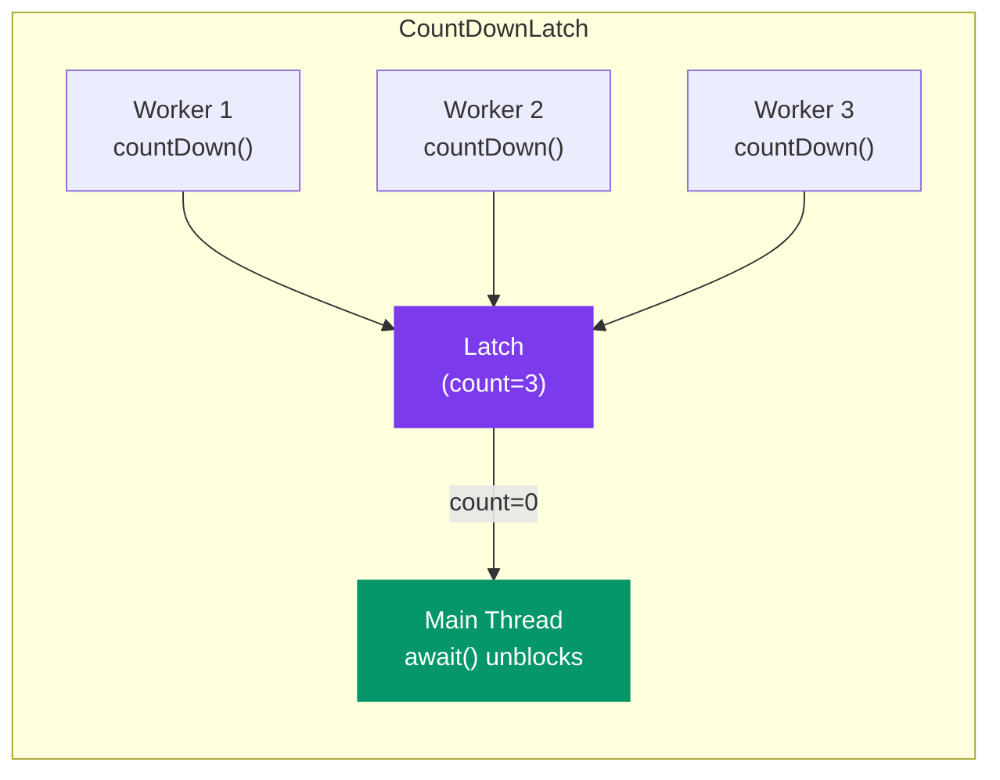

**② `CyclicBarrier` — the N arriving threads *are* the waiters, and the barrier resets:**

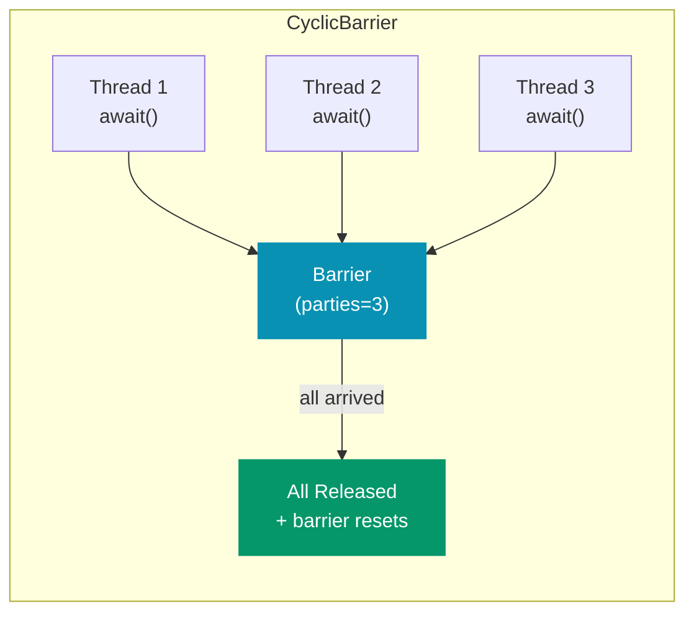

> The two diagrams look alike. The difference is *who waits*. In ①, the waiter (`M`) never counts down. In ②, every thread that arrives is also a thread the barrier releases. And you can reuse the barrier for the next phase.

**When to use which:**

- **CountDownLatch:** "Main thread, wait until 3 services are ready." The workers count down; the main thread waits.
- **CyclicBarrier:** "All 3 worker threads, meet at a checkpoint before the next phase." The workers wait for each other.

🔑 **Key Point:** In `CountDownLatch`, the thread that counts and the thread that waits can be different. In `CyclicBarrier`, the threads that call `await()` are the ones that wait. They are both the counters and the waiters.

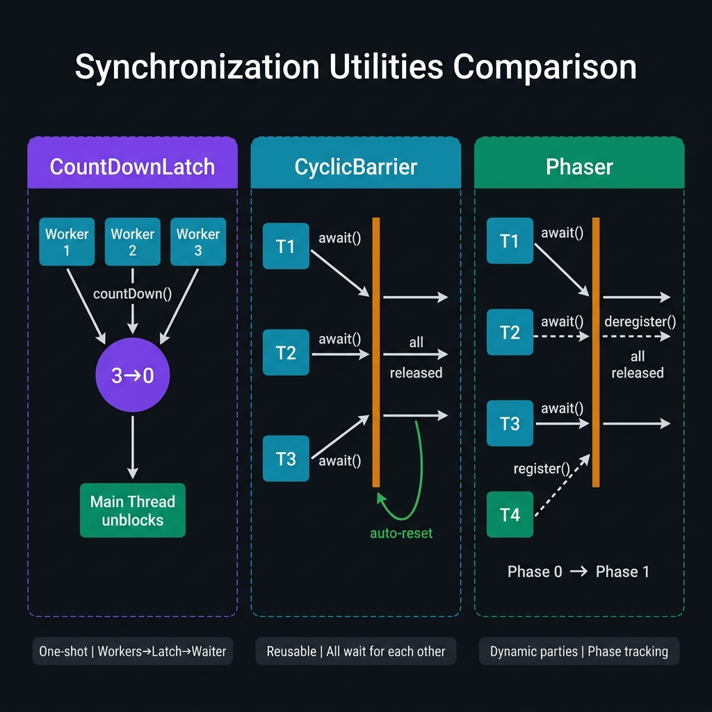

---

</details>

---

4. **🚦 What is Semaphore and how does it work? ⚡**

<!-- -->
<details>
<summary>Answer</summary>

**Answer:**

A `Semaphore` controls access to a shared resource with a set of **permits**. A thread must acquire a permit before it uses the resource. It releases the permit when it is done.

```java
import java.util.concurrent.Semaphore;

public class ConnectionPool {
    private final Semaphore semaphore;

    public ConnectionPool(int maxConnections) {
        // fair=true → threads acquire permits in FIFO order
        this.semaphore = new Semaphore(maxConnections, true);
    }

    public Connection getConnection() throws InterruptedException {
        semaphore.acquire();  // blocks if no permits available
        try {
            return createConnection();
        } catch (Exception e) {
            semaphore.release(); // release if connection creation fails
            throw e;
        }
    }

    public void releaseConnection(Connection conn) {
        closeConnection(conn);
        semaphore.release();  // return permit
    }
}

// Usage
ConnectionPool pool = new ConnectionPool(5); // max 5 connections

// 10 threads trying to get connections — only 5 at a time
ExecutorService executor = Executors.newFixedThreadPool(10);
for (int i = 0; i < 10; i++) {
    executor.submit(() -> {
        try {
            Connection conn = pool.getConnection();
            // use connection...
            Thread.sleep(1000);
            pool.releaseConnection(conn);
        } catch (InterruptedException e) {
            Thread.currentThread().interrupt();
        }
    });
}
```

**Key methods:**

| Method | Description |
|---|---|
| `acquire()` | Acquires a permit, blocking if none available |
| `acquire(int n)` | Acquires `n` permits |
| `tryAcquire()` | Non-blocking; returns `true` if permit acquired |
| `tryAcquire(timeout, unit)` | Tries to acquire with timeout |
| `release()` | Releases a permit |
| `availablePermits()` | Returns current number of available permits |

**Semaphore as a mutex (binary semaphore):**
```java
Semaphore mutex = new Semaphore(1); // binary semaphore

mutex.acquire();
try {
    // critical section — only one thread at a time
} finally {
    mutex.release();   // always release in finally
}
```

**Rule:** always follow `acquire()` with `try { ... } finally { release(); }`. Otherwise an exception leaks a permit, and the pool slowly shrinks to zero.

**⚠️ A Semaphore has no owner:**
- Any thread can call `release()`, even one that never called `acquire()`.
- `release()` without a matching `acquire()` **adds** a permit. The count can go above the start value.
- Common bug: releasing twice (for example, in both a `catch` and a `finally`). A limit of 5 silently becomes 6.

**⚠️ Concurrency limit, not rate limit:**
- A `Semaphore` limits how many tasks run **at the same time** (concurrency). This is the bulkhead pattern — for example, Resilience4j `SemaphoreBulkhead`.
- It does **not** limit how many calls happen **per second** (rate). If each call is fast, 5 permits can still allow thousands of calls per second.
- A rate limiter uses a token bucket — for example, Resilience4j `RateLimiter` or Guava `RateLimiter`.

🔑 **Key Point:** `synchronized` is reentrant, but a `Semaphore` is not. If a thread holds a permit and calls `acquire()` again without a release, it takes a second permit, or it blocks if none are left. Semaphores are used for connection pools and bulkheads (concurrency limits), not for rate limiting.

---

</details>

---

5. **🌀 What is Phaser and when would you use it over CyclicBarrier? 💤**

<!-- -->
<details>
<summary>Answer</summary>

**Answer:**

`Phaser` (Java 7) is a more flexible barrier. Parties can register and deregister at run time, and it supports many phases.

| Feature | CyclicBarrier | Phaser |
|---|---|---|
| **Fixed parties** | Yes (set at creation) | No (dynamic registration) |
| **Phases** | Resets automatically | Tracks phase number |
| **Dynamic join/leave** | Not supported | `register()`, `arriveAndDeregister()` |
| **Termination** | Manual | `onAdvance()` can terminate |
| **Tree structure** | No | Yes (tiered phasers for scalability) |

```java
import java.util.concurrent.Phaser;

public class PhaserExample {

    public static void main(String[] args) {
        // Main thread registers as a party
        Phaser phaser = new Phaser(1); // 1 = main thread

        for (int i = 0; i < 3; i++) {
            phaser.register(); // dynamically add party
            final int threadId = i;

            new Thread(() -> {
                // Phase 0: initialization
                System.out.println("Thread " + threadId + ": init");
                phaser.arriveAndAwaitAdvance(); // sync at phase 0

                // Phase 1: processing
                System.out.println("Thread " + threadId + ": processing");
                phaser.arriveAndAwaitAdvance(); // sync at phase 1

                // Thread is done — deregister
                phaser.arriveAndDeregister();
                System.out.println("Thread " + threadId + ": finished");
            }).start();
        }

        // Main thread controls phase advancement
        phaser.arriveAndAwaitAdvance(); // wait for phase 0
        System.out.println("Phase 0 complete");

        phaser.arriveAndAwaitAdvance(); // wait for phase 1
        System.out.println("Phase 1 complete");

        phaser.arriveAndDeregister(); // main thread done
    }
}
```

**When to use Phaser over CyclicBarrier:**
1. You do not know the number of threads in advance.
2. Threads can join or leave between phases.
3. You need to track the current phase number.
4. You need custom termination logic in `onAdvance()`.

🔑 **Key Point:** `Phaser` does everything `CyclicBarrier` does. It also adds dynamic party management and phase tracking. Use it for multi-phase workflows where the set of participants can change.

---

</details>

---

6. **🔐 What are ReadWriteLock and StampedLock? ⚡**

<!-- -->
<details>
<summary>Answer</summary>

**Answer:**

**ReadWriteLock** allows many readers at the same time, but only one writer. This gives more throughput when reads are much more common than writes.

```java
import java.util.concurrent.locks.ReentrantReadWriteLock;

public class Cache<K, V> {
    private final Map<K, V> map = new HashMap<>();
    private final ReentrantReadWriteLock rwLock = new ReentrantReadWriteLock();

    public V get(K key) {
        rwLock.readLock().lock();   // multiple readers allowed
        try {
            return map.get(key);
        } finally {
            rwLock.readLock().unlock();
        }
    }

    public void put(K key, V value) {
        rwLock.writeLock().lock();  // exclusive access
        try {
            map.put(key, value);
        } finally {
            rwLock.writeLock().unlock();
        }
    }
}
```

**StampedLock** (Java 8) adds an optimistic read mode on top of what `ReadWriteLock` offers:

```java
import java.util.concurrent.locks.StampedLock;

public class Point {
    private double x, y;
    private final StampedLock lock = new StampedLock();

    public void move(double deltaX, double deltaY) {
        long stamp = lock.writeLock();       // exclusive write
        try {
            x += deltaX;
            y += deltaY;
        } finally {
            lock.unlockWrite(stamp);
        }
    }

    public double distanceFromOrigin() {
        long stamp = lock.tryOptimisticRead(); // non-blocking!
        double currentX = x, currentY = y;

        if (!lock.validate(stamp)) {           // check if write occurred
            stamp = lock.readLock();           // fallback to read lock
            try {
                currentX = x;
                currentY = y;
            } finally {
                lock.unlockRead(stamp);
            }
        }

        return Math.sqrt(currentX * currentX + currentY * currentY);
    }
}
```

| Feature | ReentrantReadWriteLock | StampedLock |
|---|---|---|
| **Optimistic read** | No | Yes |
| **Reentrant** | Yes | No |
| **Condition support** | Write lock only (`writeLock().newCondition()`). `readLock().newCondition()` throws `UnsupportedOperationException`. | No |
| **Fairness option** | Yes | No |
| **Performance** | Good | Better (optimistic reads) |
| **Lock upgrade** | No (read → write deadlocks). **Downgrade is allowed:** hold the write lock, take the read lock, then release the write lock. | Yes (`tryConvertToWriteLock`) |

> ⚠️ **`StampedLock` is not reentrant.** If a thread holds `writeLock()` and calls `writeLock()` again, it deadlocks on itself. Never call a method that takes the lock from inside another method that already holds it.

🔑 **Key Point:** A `StampedLock` optimistic read does not take a lock. It only gets a stamp and checks it later with `validate()`. If no write happened, the read finishes with no locking cost. This makes it a good fit when reads are many and writes are rare.

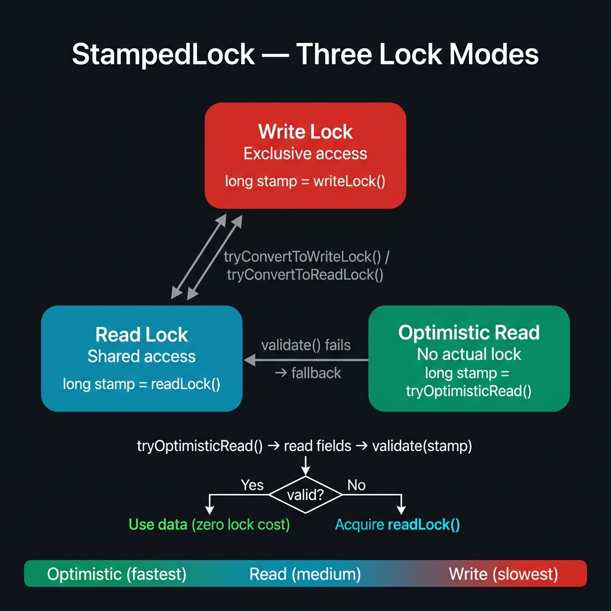

---

</details>

---

<a id="forkjoinpool-and-virtual-threads"></a>

## 6. ForkJoinPool and Virtual Threads

1. **🔱 What is ForkJoinPool and how does work-stealing work? ⚡**

<!-- -->
<details>
<summary>Answer</summary>

**Answer:**

`ForkJoinPool` (Java 7) is a special `ExecutorService` built for divide-and-conquer parallel tasks. It uses the **work-stealing algorithm**: idle threads steal tasks from the queues of busy threads.

**How work-stealing works:**

1. Each worker thread has its own **double-ended queue (deque)**
2. When a thread forks a task, it pushes the subtasks onto its own deque
3. The owning thread takes tasks from the **head** (LIFO — most recent first)
4. Idle threads steal from the **tail** of other threads' deques (FIFO — oldest first)
5. LIFO for the owner gives better cache locality. FIFO for stealing gives the thief the biggest chunk of work.

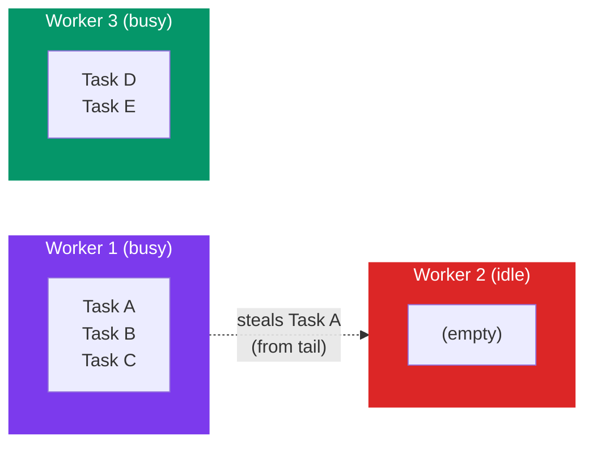

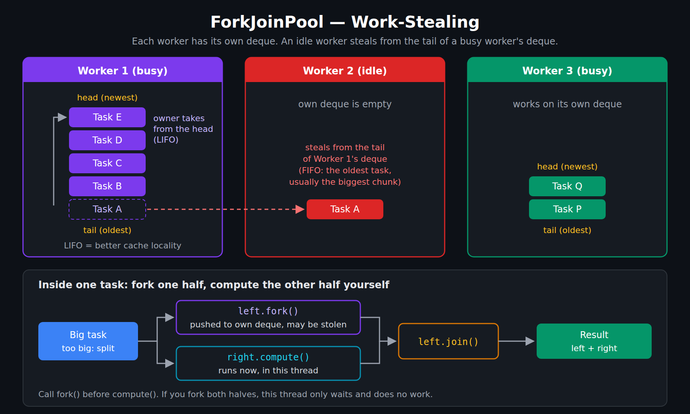

```java
ForkJoinPool pool = new ForkJoinPool(4); // 4 worker threads

// Or use the common pool
ForkJoinPool commonPool = ForkJoinPool.commonPool();

// Submit a recursive task
long result = pool.invoke(new SumTask(array, 0, array.length));
```

**Key characteristics:**

| Feature | Detail |
|---|---|
| **Algorithm** | Work-stealing (idle threads steal from busy threads) |
| **Task types** | `RecursiveTask<V>` (returns value), `RecursiveAction` (no return) |
| **Default pool** | `ForkJoinPool.commonPool()` — shared JVM-wide |
| **Parallelism** | `new ForkJoinPool()` → `availableProcessors()`. **Common pool → `availableProcessors() − 1`** (floored at 1) |
| **Best for** | CPU-bound, recursive, divide-and-conquer workloads |

⚠️ **The common pool has one worker less than the core count — and this has two effects.**

**Effect 1 — the caller helps.** `ForkJoinPool.getCommonPoolParallelism()` returns `availableProcessors() − 1`. That is **7 workers on an 8-core box, 11 on a 12-core box**. The pool is one short because the *submitting* thread also does work during `invoke()` or a terminal parallel-stream operation. So the threads that run your `parallelStream()` are `cores − 1` workers **plus the caller**.

**Effect 2 — small containers lose the pool.** `CompletableFuture` uses the common pool only when `ForkJoinPool.getCommonPoolParallelism() > 1`. At **`<= 1`** it quietly switches to a **thread-per-task executor**. That executor creates a new platform thread for *every* async stage. Parallelism is `cores − 1`, so a **2-vCPU pod already has parallelism 1** — not only a 1-vCPU pod.

**Which JDK versions do this?**

| JDK | Thread-per-task fallback? | Source |
|---|---|---|
| **17 / 21** | ✅ Yes. The javadoc says: *"unless it does not support a parallelism level of at least two, in which case, a new Thread is created to run each task"* | Javadoc + run on JDK 17 (below) |
| **25** | ❌️ No. The class javadoc says all async methods without an explicit `Executor` use `ForkJoinPool.commonPool()`. The source now uses `ForkJoinPool.asyncCommonPool()`, which raises parallelism 0 to 2, and has no thread-per-task executor | JDK 25 source (`CompletableFuture.ASYNC_POOL`), not run |

```java
// Verified on JDK 17:
//   java -XX:ActiveProcessorCount=8  →  parallelism 7, supplyAsync on "ForkJoinPool.commonPool-worker-1"
//   java -XX:ActiveProcessorCount=2  →  parallelism 1, supplyAsync on "Thread-0"  ← thread-per-task!
//   java -XX:ActiveProcessorCount=1  →  parallelism 1, supplyAsync on "Thread-0"
System.out.println(ForkJoinPool.getCommonPoolParallelism());
System.out.println(CompletableFuture.supplyAsync(
        () -> Thread.currentThread().getName()).join());
```

💡 **Practical takeaway:** on JDK 17/21, on a small pod, `supplyAsync()` without an executor is no longer bounded by a pool. It creates a new thread for every task. This is one more reason to always pass your own executor. You can also change the default with `-Djava.util.concurrent.ForkJoinPool.common.parallelism=N`.

🔑 **Key Point:** Work-stealing keeps all threads busy even when work is not evenly spread. `CompletableFuture.supplyAsync()` (by default) and parallel streams use this same pool.

---

</details>

---

2. **🧮 What is the difference between RecursiveTask and RecursiveAction? ⚡**

<!-- -->
<details>
<summary>Answer</summary>

**Answer:**

| Feature | RecursiveTask&lt;V&gt; | RecursiveAction |
|---|---|---|
| **Returns a value** | Yes (type `V`) | No (void) |
| **Method to override** | `V compute()` | `void compute()` |
| **Use case** | Sum, count, merge sort | Array transformation, side effects |

**RecursiveTask example — parallel sum:**
```java
import java.util.concurrent.RecursiveTask;
import java.util.concurrent.ForkJoinPool;

public class ParallelSum extends RecursiveTask<Long> {
    private static final int THRESHOLD = 10_000;
    private final long[] array;
    private final int start, end;

    public ParallelSum(long[] array, int start, int end) {
        this.array = array;
        this.start = start;
        this.end = end;
    }

    @Override
    protected Long compute() {
        int length = end - start;

        // Base case: compute directly
        if (length <= THRESHOLD) {
            long sum = 0;
            for (int i = start; i < end; i++) {
                sum += array[i];
            }
            return sum;
        }

        // Recursive case: fork and join
        int mid = start + length / 2;
        ParallelSum left = new ParallelSum(array, start, mid);
        ParallelSum right = new ParallelSum(array, mid, end);

        left.fork();                  // async execute left half
        long rightResult = right.compute(); // compute right in current thread
        long leftResult = left.join();      // wait for left result

        return leftResult + rightResult;
    }

    public static void main(String[] args) {
        long[] array = new long[1_000_000];
        for (int i = 0; i < array.length; i++) array[i] = i + 1;

        ForkJoinPool pool = new ForkJoinPool();
        long sum = pool.invoke(new ParallelSum(array, 0, array.length));
        System.out.println("Sum: " + sum); // 500000500000
    }
}
```

**RecursiveAction example — parallel array transformation:**
```java
public class ParallelTransform extends RecursiveAction {
    private static final int THRESHOLD = 10_000;
    private final int[] array;
    private final int start, end;

    public ParallelTransform(int[] array, int start, int end) {
        this.array = array;
        this.start = start;
        this.end = end;
    }

    @Override
    protected void compute() {
        if (end - start <= THRESHOLD) {
            for (int i = start; i < end; i++) {
                array[i] = array[i] * 2; // transform in place
            }
        } else {
            int mid = start + (end - start) / 2;
            invokeAll(
                new ParallelTransform(array, start, mid),
                new ParallelTransform(array, mid, end)
            );
        }
    }
}
```

🔑 **Key Point:** Fork one subtask (`left.fork()`) and compute the other in the current thread (`right.compute()`). If you fork both, the current thread only waits and does no work. Also, call `fork()` **before** `compute()`. Otherwise the two halves do not run in parallel.

---

</details>

---

3. **🧵 What are Virtual Threads in Java 21 and why are they important? 🔥🔥**

<!-- -->
<details>
<summary>Answer</summary>

**Answer:**

**Virtual Threads** (Java 21, JEP 444) are lightweight threads managed by the JVM. They let you write high-throughput concurrent code in the simple thread-per-request style. You do not pay the cost of an OS thread for each request.

| Feature | Platform Threads | Virtual Threads |
|---|---|---|
| **Managed by** | OS | JVM |
| **Memory** | ~1 MB stack per thread | ~1 KB initially (grows as needed) |
| **Creation cost** | Expensive (OS system call) | Cheap (JVM object allocation) |
| **Max count** | Thousands (limited by OS/memory) | Millions |
| **Scheduling** | OS scheduler | JVM scheduler (on carrier threads) |
| **Blocking** | Blocks OS thread | Unmounts from carrier (carrier can run other virtual threads) |
| **Best for** | CPU-bound, long-running tasks | I/O-bound, high-concurrency tasks |

```java
// Creating virtual threads (Java 21)

// Method 1: Thread.startVirtualThread
Thread vThread = Thread.startVirtualThread(() -> {
    System.out.println("Running on: " + Thread.currentThread());
});

// Method 2: Thread.ofVirtual()
Thread vThread2 = Thread.ofVirtual()
    .name("my-virtual-thread")
    .start(() -> {
        System.out.println("Hello from virtual thread");
    });

// Method 3: ExecutorService with virtual threads per task
try (ExecutorService executor = Executors.newVirtualThreadPerTaskExecutor()) {
    for (int i = 0; i < 100_000; i++) {
        executor.submit(() -> {
            // Each task gets its own virtual thread
            Thread.sleep(Duration.ofSeconds(1));
            return "done";
        });
    }
} // auto-shutdown on close

// Check if thread is virtual
System.out.println(Thread.currentThread().isVirtual()); // true/false
```

**How virtual threads work internally:**

1. Virtual threads run on **carrier threads** (platform threads in a `ForkJoinPool`). "Mounted" means a virtual thread is running on a carrier.
2. When a virtual thread blocks on I/O, it is **unmounted** from its carrier
3. The carrier is now free to run another virtual thread
4. When the I/O completes, the virtual thread is mounted again on any free carrier

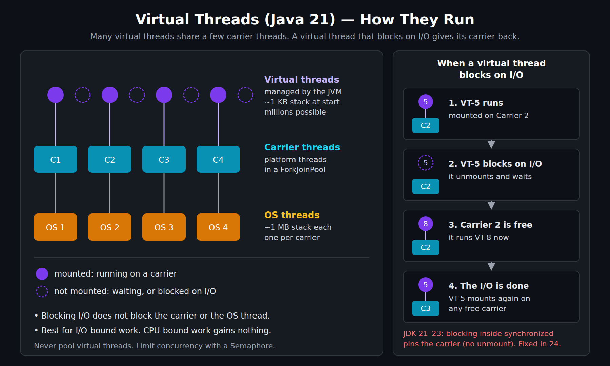

**When NOT to use virtual threads:**
- CPU-bound tasks — there is no I/O wait, so there is nothing to gain from unmounting
- Tasks that cache data in `ThreadLocal` — too many threads means too much memory. `ScopedValue` is the planned replacement. It became **final in JDK 25 (JEP 506)**.
- **On JDK 21–23 only:** tasks that block inside `synchronized` — see the pinning table below

**📏 Rules for virtual threads:**
1. **Never pool virtual threads.** Create one per task — they are cheap. To limit concurrency, use a `Semaphore`, not a small pool.
2. **Do not cache expensive objects in `ThreadLocal`** per thread. Millions of threads means millions of copies.
3. **Virtual threads are always daemon threads.** Their priority cannot be changed.
4. **`synchronized` pinning** — depends on the JDK. See the table below.

**⚠️ Pinning — always state the JDK, because the answer changed in JDK 24:**

"Pinning" means the virtual thread cannot unmount, so it blocks its carrier thread.

| JDK | Does blocking inside `synchronized` pin the carrier? | Guidance |
|---|---|---|
| **21 – 23** | **Yes.** The JVM tracks monitor ownership by *carrier*, so the virtual thread cannot unmount. Blocking on monitor entry and in `Object.wait()` also pin. | Move hot paths to `ReentrantLock`. `j.u.c.locks` never pinned. |
| **24 +** | **No.** [JEP 491](https://openjdk.org/jeps/491) "Synchronize Virtual Threads without Pinning" (Closed/Delivered, Release 24) changed how monitors are tracked. A virtual thread can now acquire, hold and release monitors without its carrier. This covers blocking on monitor entry and in `Object.wait()` and its timed variants. | Choose `synchronized` or `ReentrantLock` on merit only. JEP 491 says the old "move to `ReentrantLock`" advice no longer applies. It also says you do not need to revert code you already moved. |

**What still pins on JDK 24+** (from JEP 491 — none of it is `synchronized`):

JEP 491 lists three cases:
1. Blocking while **loading a class** during symbolic-reference resolution (a native frame is on the stack)
2. Blocking inside a **class initializer** (a native frame is on the stack)
3. **Waiting for another thread to initialize a class** (the thread blocks inside the JVM)

And, more generally:

4. **Native frames on the stack (JNI / FFM upcalls)** — native code calls back into Java, and that Java code then blocks

**🔎 How do you *find* a pinned virtual thread?** Use the JFR event **`jdk.VirtualThreadPinned`**. JEP 491 kept this event and improved it. It now reports the *reason* for pinning and the carrier thread. ⚠️ Do **not** use `-Djdk.tracePinnedThreads`. That JEP 444 system property was **removed in JDK 24**. Setting it now has no effect.

⚠️ **The limit interviewers ask about:** virtual threads remove the *thread* bottleneck. They do not remove any *downstream* bottleneck.
- `Executors.newVirtualThreadPerTaskExecutor()` is **unbounded by design**.
- 10,000 virtual threads that hit a 10-connection HikariCP pool only move the queue to the connection pool.
- The old fixed thread pool used to give backpressure (it limited how much work came in). That limit is now gone.
- ✅ Keep an explicit limiter in front of downstream resources: a `Semaphore`, a bounded connection pool, or a rate limiter.

🔑 **Key Point:** Virtual threads make "one thread per request" work for a very large number of concurrent requests. The limit becomes your downstream resources, not the thread count. They fit I/O-heavy server apps (web servers, microservices). Spring Boot 3.2+ turns them on with one property: `spring.threads.virtual.enabled=true`.

---

</details>

---

4. **⚡ How do Virtual Threads compare to reactive programming (e.g., WebFlux)? ⚡**

<!-- -->
<details>
<summary>Answer</summary>

**Answer:**

| Feature | Virtual Threads | Reactive (WebFlux, RxJava) |
|---|---|---|
| **Programming model** | Synchronous (blocking style) | Asynchronous (callback/operator chains) |
| **Code readability** | Simple, sequential | Complex, hard to learn |
| **Debugging** | Standard stack traces | Difficult (async stack traces) |
| **Backpressure** | Not built-in | Built-in (Reactive Streams) |
| **Ecosystem** | Works with all existing blocking libraries | Needs non-blocking drivers (R2DBC, reactive HTTP client) |
| **Scalability** | Millions of concurrent tasks | Millions of concurrent tasks |
| **Java version** | 21+ | Reactor itself: 8+. Spring WebFlux 6 (Spring Boot 3): 17+ |
| **Framework** | Spring MVC (unchanged) | Spring WebFlux |

**Virtual threads — two ways to write the same handler:**

- **(a) Sequential.** Inside a virtual-thread request handler, just call `userClient.getUser(id)` and then `orderClient.getOrders(id)` directly. Blocking is cheap, so you need no executor.
- **(b) Parallel.** To run both calls at the same time, **submit both first**, then call `get()` on each:

```java
// Virtual Threads approach (b) — both calls run in parallel
try (var executor = Executors.newVirtualThreadPerTaskExecutor()) {
    Future<String> userF = executor.submit(() -> userClient.getUser(id));
    Future<String> ordersF = executor.submit(() -> orderClient.getOrders(id));

    // Both tasks are already running; now wait for each result
    String user = userF.get();
    String orders = ordersF.get();
    return buildResponse(user, orders);
}

// Reactive approach — operator chains
return userClient.getUser(id)
    .flatMap(user -> orderClient.getOrders(id)
        .map(orders -> buildResponse(user, orders)))
    .onErrorResume(ex -> Mono.just(fallbackResponse()));
```

⚠️ **Common mistake:** `executor.submit(...).get()` and then a second `executor.submit(...).get()`. The first `get()` waits before the second task is even submitted. So the calls run one after the other, and the executor adds nothing.

**When to choose virtual threads:**

**When to choose reactive:**
1. Already using WebFlux / a reactive stack
2. Need built-in backpressure for streaming data
3. Need to target Java versions before 21
4. Event-driven architecture with complex data flows

🔑 **Key Point:** Virtual threads give **similar throughput to reactive for I/O-bound request/response work**, with a much simpler programming model. For most new projects on Java 21+, virtual threads + Spring MVC is the recommended choice over WebFlux. Reactive is still better for streaming and backpressure.

---

</details>

---

5. **🏗️ What is Structured Concurrency in Java? 💤**

<!-- -->
<details>
<summary>Answer</summary>

**Answer:**

**Structured Concurrency** treats a group of related concurrent tasks as a **single unit of work**. If one task fails, the others are cancelled automatically. It uses `StructuredTaskScope` from `java.util.concurrent`.

**⚠️ It is still a PREVIEW API — it has never been finalized.** If you say "it went final in Java 24" in an interview, that is a factual mistake. The real history:

| JDK | JEP | Status |
|---|---|---|
| 19 | 428 | Incubator |
| 20 | 437 | Incubator |
| **21** | **453** | First **preview** |
| 22 | 462 | Second preview |
| 23 | 480 | Third preview |
| **24** | **499** | Fourth preview — *not* final |
| **25** (LTS) | **505** | Fifth preview — the `open(...)` + `Joiner` reshape |
| 26 | 525 | Sixth preview |
| **27** | **533** | Seventh preview |

So:
- Java 21's JEP was **453**, not 462. (462 was JDK 22's *second* preview.)
- JDK 24 shipped a **fourth preview**, not a final API.
- As of JDK 27 (Sep 2026) it is still preview. You must compile and run with `--enable-preview`, and the API may change again.

⚠️ **API caveat — the shape changed in JDK 25:**
- The `new StructuredTaskScope.ShutdownOnFailure()` / `ShutdownOnSuccess<>()` **constructors** shown below are the **JDK 21–24** preview form.
- From **JDK 25 (JEP 505)**, static factories replace them:
  - `StructuredTaskScope.open()` — default policy: fail if any subtask fails.
  - `StructuredTaskScope.open(Joiner)` — with a policy such as `Joiner.allSuccessfulOrThrow()` or `Joiner.anySuccessfulResultOrThrow()`.
- `join()` now returns the result and throws on failure. There is no separate `throwIfFailed()`.
- The *concepts* are stable in every version: scope = unit of work, auto-cancel on failure, subtasks cannot outlive the scope.
- The method names keep changing (see the table below). Check them against your target JDK before you quote them.

**The JDK 25 form of the same two examples:**

```java
// All-or-nothing fan-out (replaces ShutdownOnFailure)
try (var scope = StructuredTaskScope.open()) {
    Subtask<Order> order = scope.fork(() -> orderService.getOrder(orderId));
    Subtask<Payment> payment = scope.fork(() -> paymentService.getPayment(orderId));
    scope.join();  // throws if any subtask failed; cancels the rest
    return new OrderResponse(order.get(), payment.get());
}

// First-wins race (replaces ShutdownOnSuccess)
// JDK 25 name; JDK 26+ renamed it Joiner.anySuccessfulOrThrow()
try (var scope = StructuredTaskScope.open(Joiner.<String>anySuccessfulResultOrThrow())) {
    scope.fork(() -> providerA.getPrice(item));
    scope.fork(() -> providerB.getPrice(item));
    return scope.join();  // first successful result; others cancelled
}
```

**API changes after JDK 25:**

| JDK | JEP | Change |
|---|---|---|
| 25 | 505 | `Joiner.anySuccessfulResultOrThrow()`. `allSuccessfulOrThrow()` makes `join()` return a `Stream<Subtask>`. `join()` throws `StructuredTaskScope.FailedException`. |
| 26 | 525 | Renamed to `Joiner.anySuccessfulOrThrow()`. `allSuccessfulOrThrow()` now makes `join()` return a `List` of results. |
| 27 | 533 | `join()` throws `ExecutionException` (was `StructuredTaskScope.FailedException` in 25/26). `awaitAll()` removed. |

**The problem it solves:**

- With `CompletableFuture.allOf()`, if one subtask fails and you want to cancel the others, you must write that code yourself.
- `CompletableFuture` cannot give real auto-cancel:
  - `cancel(true)` does **not** interrupt the running task. It only marks the future as cancelled.
  - `allOf()` waits for **all** futures, even after one has already failed.
- `StructuredTaskScope` cancels by **interrupting the subtask threads**.
- With structured concurrency you describe the rule (for example "fail if any fails"), and the scope does the cancelling for you.

**Two built-in policies (JDK 21–24 preview form):**

| Scope | Behavior | JDK 25+ equivalent |
|---|---|---|
| `ShutdownOnFailure` | If ANY subtask fails → cancel all others, propagate the exception | `open()` / `Joiner.allSuccessfulOrThrow()` |
| `ShutdownOnSuccess` | If ANY subtask succeeds → cancel the rest, return the first result | `Joiner.anySuccessfulResultOrThrow()` (JDK 25) / `Joiner.anySuccessfulOrThrow()` (JDK 26+) |

**Code example — ShutdownOnFailure, JDK 21–24 form (fan-out with all-or-nothing):**

```java
// Fetch order data from 3 services — if any fails, cancel all
OrderResponse fetchOrderDetails(long orderId) throws Exception {
    try (var scope = new StructuredTaskScope.ShutdownOnFailure()) {

        Subtask<Order> orderTask = scope.fork(() -> orderService.getOrder(orderId));
        Subtask<Payment> paymentTask = scope.fork(() -> paymentService.getPayment(orderId));
        Subtask<Shipping> shippingTask = scope.fork(() -> shippingService.getStatus(orderId));

        scope.join();           // wait for all subtasks
        scope.throwIfFailed();  // propagate first exception

        // All succeeded — combine results
        return new OrderResponse(
            orderTask.get(),
            paymentTask.get(),
            shippingTask.get()
        );
    }
    // scope.close() automatically cancels any incomplete subtasks
}
```

**Code example — ShutdownOnSuccess, JDK 21–24 form (first-wins):**

```java
// Try multiple providers — return first successful response
String fetchPrice(String item) throws Exception {
    try (var scope = new StructuredTaskScope.ShutdownOnSuccess<String>()) {

        scope.fork(() -> providerA.getPrice(item));
        scope.fork(() -> providerB.getPrice(item));
        scope.fork(() -> providerC.getPrice(item));

        scope.join();
        return scope.result();  // first successful result
    }
}
```

**Comparison with CompletableFuture:**

| Feature | `CompletableFuture` | `StructuredTaskScope` |
|---|---|---|
| Cancellation on failure | Manual | Automatic |
| Thread lifecycle visibility | Scattered | Contained in scope |
| Debugging / stack traces | Fragmented | Clear parent-child relationship |
| Thread leak risk | Possible (forgotten futures) | Very low — `close()` waits for every subtask. A subtask that ignores interrupts makes `close()` wait. |
| Requires virtual threads | No | Designed for virtual threads |

💡 **Works best with Virtual Threads** — you can fork thousands of subtasks without tuning a thread pool.

🔑 **Key Point:** Structured Concurrency is Java's version of Go's `errgroup` and Kotlin's `coroutineScope`. If one child task fails, the parent scope does the cleanup. The try-with-resources block is the scope boundary: no subtask can outlive it. This makes thread leaks very unlikely — the only exception is a subtask that ignores interrupts.

---

</details>

---
