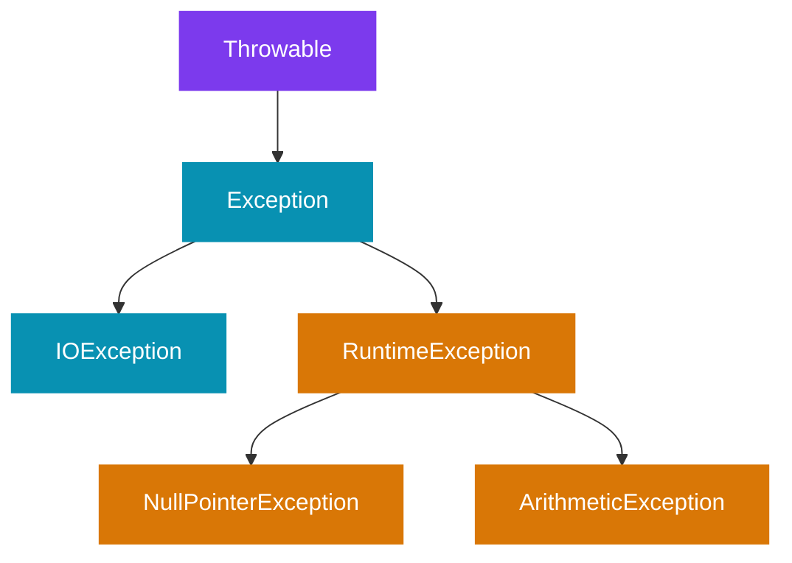
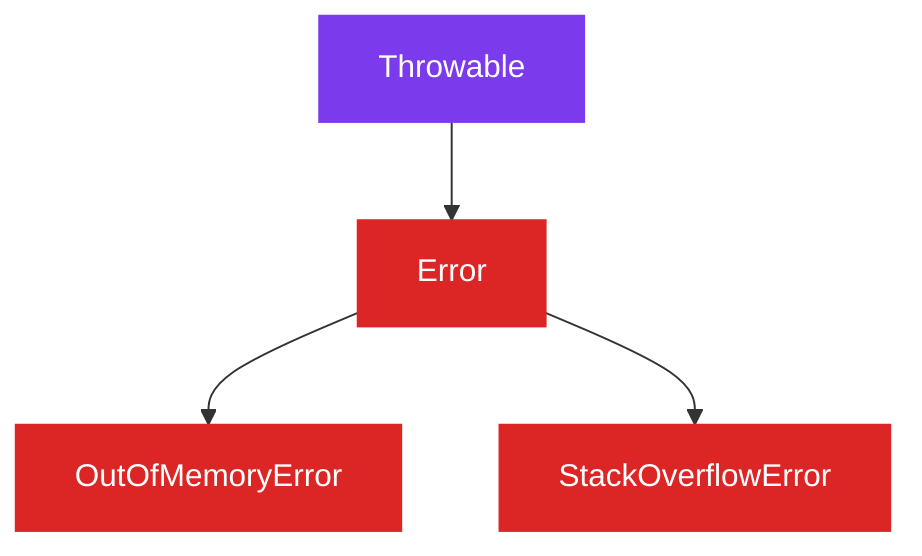
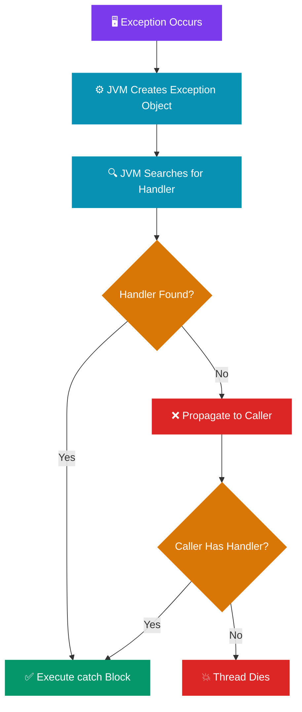
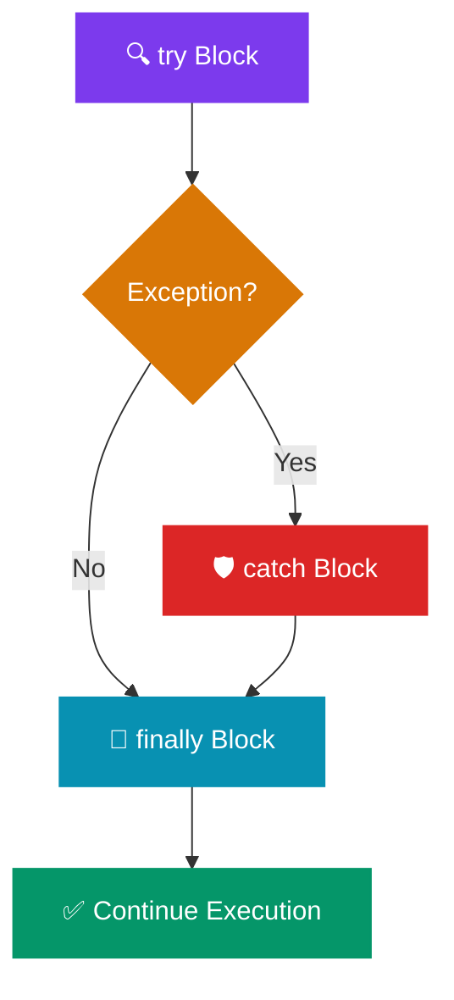
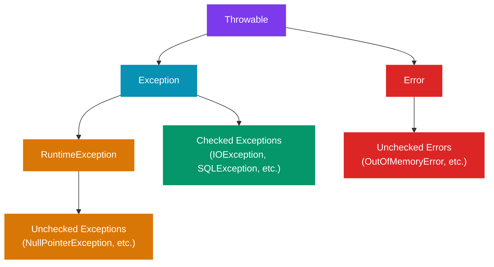
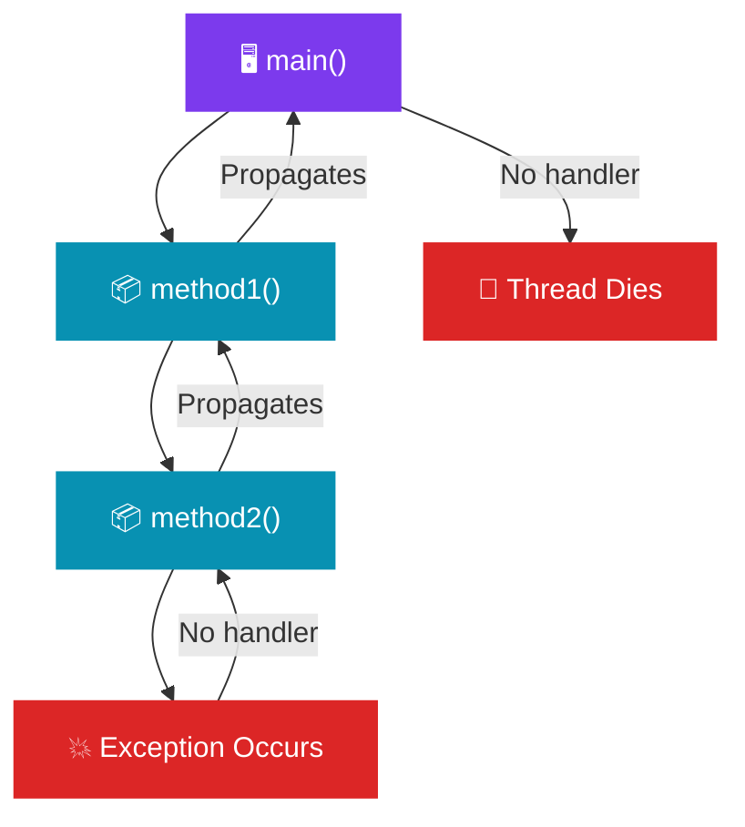
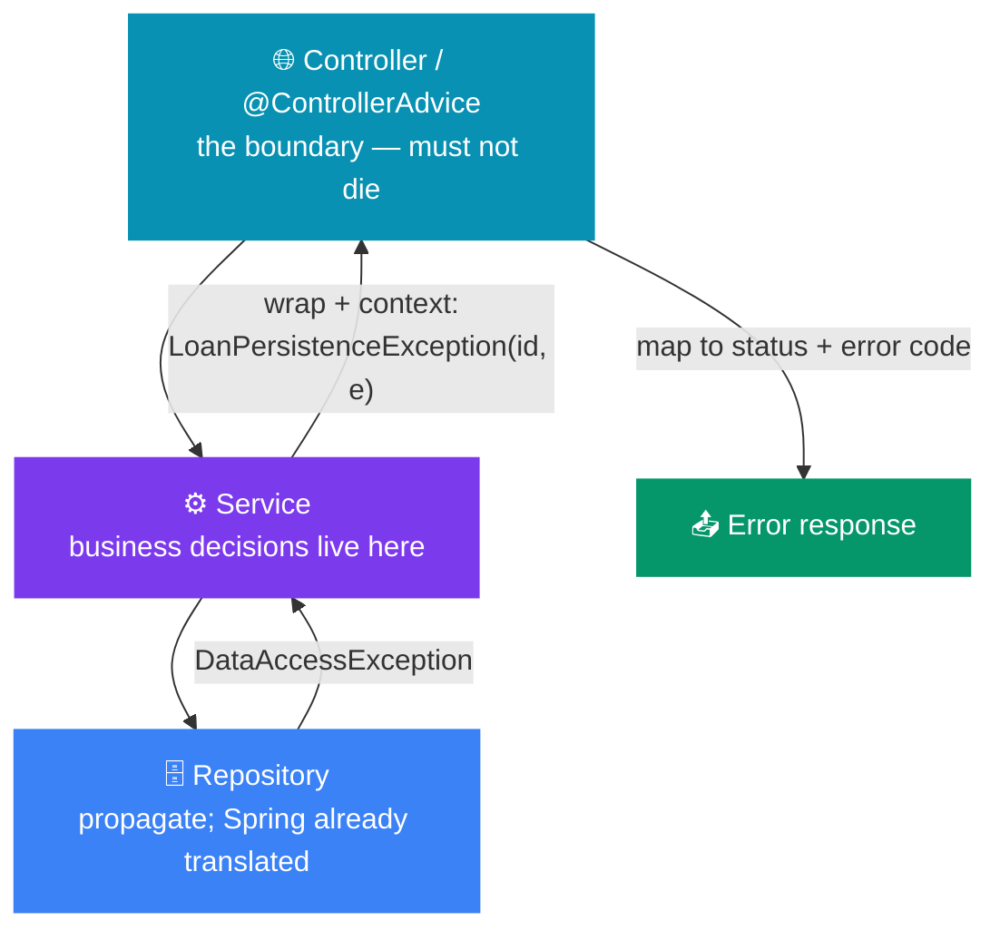

# Exception Handling Interview Questions in Java

**Exception Handling Interview Questions in Java** | This post lists exception handling interview questions in Java, with answers. It also shows which questions on exception handling in Java are asked most often.

📊 **Question Count by Section**

| # | Section | Questions |
|---|---|---|
| 1 | [Exception Handling](#1-exception-handling) | 14 |
| 2 | [try/catch/finally in Exception Handling](#2-trycatchfinally-in-exception-handling) | 14 |
| 3 | [Checked & Unchecked Exceptions](#3-checked--unchecked-exceptions) | 6 |
| 4 | [throw & throws](#4-throw--throws) | 4 |
| 5 | [Others](#5-others) | 15 |
| | **Total** | **53** |

> 🔥🔥 Very High — asked in almost every Tier-1 loop &nbsp;·&nbsp; 🔥 High — very frequent in Tier-1 interviews &nbsp;·&nbsp; ⚡ Medium — commonly asked &nbsp;·&nbsp; 💤 Low — good to know, rarely asked

---

## 1. Exception Handling

1. **🚨 What is an exception? ⚡**

<!-- -->
<details>
<summary>Answer</summary>

**Answer:**

- 📖 In Java, an exception is an object that is an instance of one of the subclasses of `java.lang.Throwable`.
- 🚨 An exception is an event that occurs while a program runs. It disturbs the normal flow of the program's instructions.
- ⚠️ It is a signal. It shows that some abnormal condition (such as an error) has occurred in a piece of code at run time.

🛠️ **Examples of exceptions:** `FileNotFoundException`, `ArrayIndexOutOfBoundsException`, `ClassCastException`, `NullPointerException`, etc.

**① The `Exception` branch — checked (cyan) vs unchecked (amber):**



**② The `Error` branch — JVM-level failures you do not catch:**



> Both diagrams start from the same `Throwable` root. Interviewers really test this split:
> - Everything under `Exception` (①) is your application's job to handle.
> - Everything under `Error` (②) means the JVM itself is in trouble.
>
> This is exactly why `catch (Throwable t)` is a code smell (a sign of bad code): it silently catches branch ② too.

---

</details>

---

2. **🛡️ What is exception handling? 🔥**

<!-- -->
<details>
<summary>Answer</summary>

**Answer:**

Exception handling does not mean repairing an exception. It means we give another way to run the rest of the program normally. This idea is called exception handling.

🧠 **In Simple Words:**

For example, our program must read data from a file at some location. At runtime, that file may not be available. Then our program should not end abnormally. We have to provide some local files, so the rest of the program runs normally. This way of defining alternatives is exception handling.

🎯 **Interview Tip:** Stress that exception handling is about *graceful recovery* (recovering cleanly). It is not about fixing the root cause of the error.

---

</details>

---

3. **🎯 What is the purpose of Exception Handling? ⚡**

<!-- -->
<details>
<summary>Answer</summary>

**Answer:**

The main goal of exception handling has two parts:

- **Keep the program running** when a recoverable failure occurs.
- When the program really cannot continue, fail in a controlled way that you can diagnose. Do not fail suddenly.

💡 **Key Insight:** An **unhandled** exception unwinds the stack up to the top of the *current thread*. Then it kills that thread. **Handling** it stops the unwind at your `catch` block. So the thread, and therefore the program, keeps running.

⚠️ **Be exact here.** The textbook phrase "graceful termination" is about the *unhandled* case. The JVM prints a stack trace and ends that thread cleanly. It does not corrupt state. This graceful termination is not the goal of writing a `catch` block.

Say "recover and continue, or fail loudly with a usable stack trace". Those are the two outcomes. If you mix them up, the answer sounds confused.

---

</details>

---

4. **🌳 Which class acts as a root for all Java exceptions Hierarchy? ⚡**

<!-- -->
<details>
<summary>Answer</summary>

**Answer:**

`Throwable` is the root class for the entire Java exception hierarchy.

🧠 **In Simple Words:** Every exception and error in Java finally extends from `java.lang.Throwable`.

---

</details>

---

5. **🏷️ Throwable is a class or interface? 💤**

<!-- -->
<details>
<summary>Answer</summary>

**Answer:**

`Throwable` is a **class**, not an interface.

---

</details>

---

6. **👶 Throwable class contains how many child classes? ⚡**

<!-- -->
<details>
<summary>Answer</summary>

**Answer:**

`Throwable` class contains two direct child classes:

- 🚨 `Exception` — represents recoverable conditions.
- 💥 `Error` — represents non-recoverable system-level problems.

---

</details>

---

7. **💥 What is Error? ⚡**

<!-- -->
<details>
<summary>Answer</summary>

**Answer:**

An `Error` signals a serious problem at the **JVM level**, such as running out of memory or stack space. It is not a normal condition that your code should handle. Errors are **not recoverable**.

- 💾 `OutOfMemoryError` — JVM runs out of heap memory.
- 📦 `StackOverflowError` — call stack exceeds its limit (e.g., infinite recursion).

⚠️ **Caution — do not say "OOM is the sysadmin's problem".** That is the most common wrong answer here. **Most production `OutOfMemoryError`s are application defects**, not machines that are too small. Common causes:

- an unbounded cache
- a leaked `ThreadLocal`
- a classloader kept alive across redeploys
- a query that streams an unbounded result set into a `List`

Raising `-Xmx` should be the *last* fix you try. It usually just moves the crash a few hours later. See **§1 Q14 — types of `OutOfMemoryError`** for the five common types and the different fix each one needs.

🧠 **What "not recoverable" really means:** the syntax lets you catch an `Error`. But in general you must not. After an `OutOfMemoryError` or `StackOverflowError`, the JVM is in an unknown state. Your handler itself may fail to allocate memory. The practical rule: never `catch (Throwable t)` in application code. It silently catches branch ② of the hierarchy in **§1 Q1**.

---

</details>

---

8. **⚖️ What is the difference between Error and Exception? 🔥🔥**

<!-- -->
<details>
<summary>Answer</summary>

**Answer:**

| Feature | Exception 🅰️ | Error 🅱️ |
|---------|-------------|----------|
| **Cause** | Problem in Java program logic (e.g., divide by zero) | Serious JVM-level problem (e.g., out of memory) — often caused by an application bug |
| **Recoverability** | ✅ Recoverable — can be caught/handled | ❌️ Not recoverable |
| **Handling** | ✅ Can catch via `catch` block or declare via `throws` | ❌️ Should not catch/handle |
| **Examples** | `ArithmeticException`, `NullPointerException` | `OutOfMemoryError`, `StackOverflowError` |
| **JVM Behavior** | Program can continue if handled | Thread dies; process usually unrecoverable |

🧠 **In Simple Words:**
- **Exception** 📝 is like a flat tire — you can fix it and keep driving.
- **Error** 🚨 is like the engine exploding — you can't continue.

🎯 **Interview Tip:** Always mention both points:

- `Error` subclasses are non-recoverable. They usually show JVM-level issues.
- `Exception` subclasses are recoverable application-level issues.

---

</details>

---

9. **⚡ What is the difference between RuntimeException and Exception? 🔥🔥**

<!-- -->
<details>
<summary>Answer</summary>

**Answer:**

| Feature | RuntimeException 🅰️ | Exception 🅱️ |
|---------|---------------------|--------------|
| **Type** | Unchecked exception | Checked exception (non-runtime subclasses) |
| **Cause** | Usually a programming bug (null access, bad index, bad cast) | Expected failure outside the program's control (file missing, network down) |
| **Compiler Check** | ❌️ Not checked by compiler | ✅ Checked by compiler |
| **Handling** | ⚠️ Optional | ✅ Mandatory (catch or declare) |

💡 **Pro Tip:** `RuntimeException` and its subclasses represent programming bugs (like `NullPointerException`). Checked exceptions represent recoverable conditions that the program should expect (like `IOException`).

---

</details>

---

10. **🔥 What will happen when an exception is raised in the program? ⚡**

<!-- -->
<details>
<summary>Answer</summary>

**Answer:**

Two things happen. Interviewers separate them on purpose:

**① Inside the current method — always:**

- ✅ Statements placed **before** the exception-causing statement have already executed.
- ❌️ Statements placed **after** it in the same block are **not executed** — control leaves immediately.

**② Beyond the method — depends on whether it is handled:**

- 🛡️ **Handled** (a matching `catch` exists somewhere up the stack) — the unwind stops at that `catch`. Execution continues normally after it. Nothing terminates.
- 💥 **Unhandled** — the exception unwinds to the top of the **current thread's** stack. The JVM passes it to `Thread.getUncaughtExceptionHandler()` (→ `ThreadGroup.uncaughtException` → the default handler → a stack trace on `stderr`). Then **that thread dies**.

⚠️ **The correction that matters:** an unhandled exception terminates a **thread**, not the program. The JVM keeps running until every **non-daemon** thread has finished.

That is why an exception in a Spring MVC handler does not crash your service. Tomcat's worker thread survives (the container catches it) and serves the next request. If you simply answer "the program terminates abnormally", the interviewer will correct you. See **§5 Q2 — how long an exception is propagated** for what happens at the top of the stack.

```java
// Verified on JDK 17 — the worker dies, main keeps going:
Thread t = new Thread(() -> { throw new IllegalStateException("worker boom"); }, "worker-1");
t.start();
t.join();
System.out.println("main is still alive");
// Exception in thread "worker-1" java.lang.IllegalStateException: worker boom
//     at ...
// main is still alive
```

---

</details>

---

11. **🖥️ What will JVM do when an exception (logical mistake) occurs in the program? ⚡**

<!-- -->
<details>
<summary>Answer</summary>

**Answer:**

JVM performs the following steps, **in this order**:

1. ⚙️ **Creates** an exception object for that condition. It also captures the stack trace at construction time (`fillInStackTrace()`), *not* at throw time.
2. 💥 **Throws** it — control transfers out of the current instruction.
3. 🔍 **Searches the current frame** for a `catch` whose parameter type is assignable from the thrown type.
4. 🚀 **Only if no handler matches in this frame** does the JVM discard (unwind) the frame and repeat step 3 in the caller's frame.

⚠️ **Order matters:** the JVM does *not* end the method first and then throw the exception. The JVM creates and throws the object. It unwinds the frame **only** when the search fails there. This is exactly why a `try/catch` inside the same method stops the exception without the method exiting. The `finally` block of each frame runs as that frame is unwound.



---

</details>

---

12. **🔧 How can we handle exceptions in Java? 🔥**

<!-- -->
<details>
<summary>Answer</summary>

**Answer:**

There are two ways to **deal with** an exception. But only one of them *handles* it:

- 🔧 **`try-catch` — handles it.** The `catch` block stops the stack unwind. It takes over control flow at the point where the exception occurred.
- 📤 **`throws` — declares it away.** It does not handle anything. It satisfies the compiler and passes the duty to the caller. At runtime it does nothing.

⚠️ **Say "handle or declare", not "two ways to handle".** Suppose you say "`throws` handles the exception". The standard follow-up is *"so what does `throws` do at runtime?"*. The answer is **nothing**. See **§2 Q2**.

---

</details>

---

13. **📚 Example of some predefined exception classes? 💤**

<!-- -->
<details>
<summary>Answer</summary>

**Answer:**

Here are commonly used predefined exception classes:

| # | Exception/Error Class | Type |
|---|----------------------|------|
| 1 | `NullPointerException` | ⚠️ Unchecked |
| 2 | `ClassCastException` | ⚠️ Unchecked |
| 3 | `IOException` | ✅ Checked |
| 4 | `FileNotFoundException` | ✅ Checked |
| 5 | `ClassNotFoundException` | ✅ Checked |
| 6 | `NegativeArraySizeException` | ⚠️ Unchecked |
| 7 | `ArrayIndexOutOfBoundsException` | ⚠️ Unchecked |
| 8 | `StringIndexOutOfBoundsException` | ⚠️ Unchecked |
| 9 | `IllegalArgumentException` | ⚠️ Unchecked |
| 10 | `NumberFormatException` | ⚠️ Unchecked |
| 11 | `IllegalThreadStateException` | ⚠️ Unchecked |
| 12 | `AssertionError` | 🚨 Error |
| 13 | `OutOfMemoryError` | 🚨 Error |
| 14 | `StackOverflowError` | 🚨 Error |
| 15 | `NoClassDefFoundError` | 🚨 Error |
| 16 | `ExceptionInInitializerError` | 🚨 Error |

---

</details>

---

14. **💥 What are the different types of OutOfMemoryError in Java? 🔥🔥**

<!-- -->
<details>
<summary>Answer</summary>

**Answer:**

`OutOfMemoryError` is a subclass of `java.lang.Error`. The JVM throws it when it cannot allocate the requested memory.

- **There is no fixed number of them. The *message string* tells you which subsystem ran out.**
- Each message has a different root cause and a different fix.
- Oracle's troubleshooting guide lists more messages, such as `Requested array size exceeds VM limit`, `Compressed class space`, and `Out of swap space?`. It does not list `unable to create new native thread` or `Direct buffer memory`, but you will see both in real services.

These five are the ones you will really meet in a Spring service:

| Type | Message | Root Cause |
|------|---------|------------|
| **Heap Space** | `Java heap space` | Object allocation failed — heap is full and GC cannot free enough memory |
| **GC Overhead Limit** | `GC overhead limit exceeded` | GC is spending >98% of time but recovering <2% of heap — app is in practice frozen. On JDK 17, only Parallel GC throws it. G1 (the default) added it in JDK 26 and in a recent JDK 21 update |
| **Metaspace** | `Metaspace` | Class metadata exhausted — usually a classloader leak (e.g., undeploy/redeploy cycles) |
| **Native Thread** | `unable to create new native thread` | OS cannot create more threads — too many threads created, OS limit reached |
| **Direct Buffer Memory** | `Direct buffer memory` | `ByteBuffer.allocateDirect()` exhausted off-heap memory (common in NIO/Netty apps) |

**How to diagnose each:**

```bash
# Heap dump on OOM — critical for heap space / GC overhead errors
-XX:+HeapDumpOnOutOfMemoryError -XX:HeapDumpPath=/tmp/

# Analyze with: Eclipse MAT, VisualVM, or IntelliJ heap dump analyzer
```

```bash
# Metaspace leak — classloader never GC'd
# Common in Spring apps with dynamic proxies or repeated context creation
# FIX:         close the ApplicationContext; find the retained classloader in a heap dump
# CONTAINMENT: -XX:MaxMetaspaceSize=256m  <-- this does NOT fix a leak. It converts a slow
#              degradation into a fast, reproducible, diagnosable failure. Useful, not a cure.

# Native thread OOM — diagnose with
jstack <pid>                      # count active threads
# FIX: reduce thread pool sizes, use virtual threads (Java 21)

# Direct buffer OOM — diagnose with Native Memory Tracking (NOT jmap)
java -XX:NativeMemoryTracking=summary -jar app.jar
jcmd <pid> VM.native_memory summary     # the "Other" category holds direct ByteBuffers
# ...or read the JMX bean java.nio:type=BufferPool,name=direct  (count / memoryUsed / totalCapacity)
# FIX: set -XX:MaxDirectMemorySize explicitly; make sure ByteBuffers become unreachable
```

⚠️ **Do not use `jmap -heap` here.** It reports only **Java heap** configuration and usage. It never showed `ByteBuffer.allocateDirect()` usage. Worse, since JDK 9 the `-heap` option is **removed from `jmap` entirely**. On a modern JDK it fails at once:

```
$ jmap -heap <pid>
Error: -heap option used
Cannot connect to core dump or remote debug server. Use jhsdb jmap instead
```

💡 **The direct-buffer trap that interviewers like to ask:** when `-XX:MaxDirectMemorySize` is **unset**, it defaults to **`Runtime.maxMemory()`**, which is about the **maximum heap size (`-Xmx`)**. Verified on JDK 17 with `-Xmx256m`: `Runtime.maxMemory()` and `VM.maxDirectMemory()` both report 268435456 bytes.

That is why direct-buffer OOM often appears for the first time right after someone *lowers* `-Xmx` to "save memory". Without noticing, they also halved the off-heap budget.

**Interview one-liner:** "OOM isn't one error — read the message. Heap space means objects, GC overhead means the GC is thrashing, Metaspace means a classloader leak, native thread means an OS limit, direct buffer means NIO memory. Same `Error` class, different subsystem, different fix."

🔑 **Production tip:** Always run with `-XX:+HeapDumpOnOutOfMemoryError` in production. The heap dump is the only file that tells you *which objects* used the memory. Without it, you are guessing.

---

</details>

---

## 2. try/catch/finally in Exception Handling

1. **🔑 How many keywords are given to work with exceptions? 💤**

<!-- -->
<details>
<summary>Answer</summary>

**Answer:**

There are **5 keywords** given to work with exceptions: `try`, `catch`, `finally`, `throw`, `throws`.

---

</details>

---

2. **🏗️ What are the keywords used for handling an exception? ⚡**

<!-- -->
<details>
<summary>Answer</summary>

**Answer:**

Only **one** keyword really *handles* an exception: `catch`. The others take part in the mechanism:

- 🛡️ `catch` — **the only handler.** It stops the stack unwind and takes over control flow.
- 📤 `throws` — ❌️ **does not handle anything.** It is a *compile-time declaration*. It says this method may let a checked exception escape. This satisfies the compiler and moves the duty to handle it onto the caller. At runtime, `throws` does nothing at all.
- 🧹 `finally` / try-with-resources — they run cleanup during the unwind. They do not stop it.

⚠️ **Why being exact matters:**

- Most candidates give the textbook line: "the handling keywords are `catch` and `throws`".
- The usual follow-up is *"so what does `throws` do at runtime?"* The answer is **nothing**.
- `javac` records it in the class file as an **`Exceptions` attribute**, with one entry per declared type.
- `javac` and reflection (`Method.getExceptionTypes()`) read this attribute. The **JVM never enforces** it.
- So reflection and bytecode manipulation can make a method throw a checked exception it never declared.

🧪 **Do not call this "erasure".** Checked exceptions are not a generics feature, and nothing is erased. *(Verified with `javap -v` on JDK 17:*

- *A non-generic `void f() throws IOException` emits an `Exceptions` attribute and **no `Signature` attribute at all**.*
- *`Signature` is emitted only for a **generic** method, and this does not depend on `throws`. `<T> void h(T t)` has one, with no `throws` clause anywhere.*
- *`throws` and `Signature` meet in exactly one case: throwing a *type variable*, `<T extends Exception> void j() throws T`. Here `Signature` carries a `^TT;` throws section, and `Exceptions` separately records the erasure `java/lang/Exception`.*)*

---

</details>

---

3. **📖 Explain when we will use try/catch/finally and throw/throws keywords? 🔥**

<!-- -->
<details>
<summary>Answer</summary>

**Answer:**

- 🔍 `try` — To hold code that can cause an exception.
- 🛡️ `catch` — To hold exception handling code.
- 🧹 `finally` — To hold cleanup code.
- 💥 `throw` — To hand our own exception object to the JVM manually.
- 📤 `throws` — To pass the duty of handling the exception to the caller method.



---

</details>

---

4. **🧹 Can finally catch an exception? ⚡**

<!-- -->
<details>
<summary>Answer</summary>

**Answer:**

❌️ No. The `finally` block holds **cleanup code**. It does not catch an exception. Only the `catch` block can catch exceptions.

⚠️ **But `finally` can *destroy* an exception. That is the real interview question.**

- A `return` or a `throw` inside `finally` **throws away the in-flight exception completely**.
- No `getCause()` and no `getSuppressed()` link points back to it.
- See **§2 Q14 — `return`/`throw` inside `finally`**. This is the trap, not the "can it catch" trivia.

---

</details>

---

5. **🎣 What is the parameter we must use to catch all exceptions using a single catch block? ⚡**

<!-- -->
<details>
<summary>Answer</summary>

**Answer:**

`java.lang.Exception`. But **it does not catch "all" `Throwable`s**, and that gap is the follow-up question.

```java
try {
    // risky code
} catch (Exception e) {
    // catches Exception + every RuntimeException.
    // Does NOT catch Error (OutOfMemoryError, StackOverflowError, NoClassDefFoundError)
    // and does NOT catch a bare `throw new Throwable()`.
}
```

To catch *really* everything, you need `catch (Throwable t)`. **And you should not do it.**

- It swallows branch ② of the hierarchy in **§1 Q1**.
- After an `OutOfMemoryError` or `StackOverflowError`, the JVM is in an unknown state.
- A handler that says it "recovers" from one cannot be trusted.

The anti-pattern is `catch (Exception e) { log.error(...); }` in the middle of the flow. It turns a failure into a wrong result that nobody notices.

📝 **Note:** See more — [Catch all Exceptions in Java](../java_tutorial/184_Catch_All_Exceptions_in_Java.md).

---

</details>

---

6. **🔀 When should we define multiple catch blocks to a single try block? 🔥**

<!-- -->
<details>
<summary>Answer</summary>

**Answer:**

We should define multiple catch blocks for a single try block in these cases:

- 📝 To print a message specific to an exception.
- ⚙️ To run some logic specific to an exception.

🛠️ **Example:**

```java
try {
    // risky code
} catch (FileNotFoundException e) {
    System.out.println("File not found: " + e.getMessage());
} catch (IOException e) {
    System.out.println("IO error: " + e.getMessage());
} catch (Exception e) {
    System.out.println("General error: " + e.getMessage());
}
```

---

</details>

---

7. **📊 Can we place multiple catch blocks in any order? 🔥**

<!-- -->
<details>
<summary>Answer</summary>

**Answer:**

❌️ No. We must follow these rules when we place multiple catch blocks:

- 🚫 Catch blocks should not be duplicated.
- 📊 A catch block with a super class parameter should not come before a catch block with a child class parameter.

⚠️ **Caution:** If you place `catch(Exception e)` before `catch(FileNotFoundException e)`, the compiler gives an error: *"exception FileNotFoundException has already been caught"*.

<details>
<summary><strong>🤔 Doubt: If parent-before-child is a compile error, why is a lone `catch (Exception e)` fully legal?</strong></summary>

Because the rule is about **reachability**, not breadth.

`javac` rejects a `catch` block that can *never* run.

- Put `catch (Exception e)` before `catch (FileNotFoundException e)`. Now the second block is unreachable.
- Every `FileNotFoundException` is already taken by the first block.
- Unreachable code is an error, not a warning.

A **lone** `catch (Exception e)`, with nothing after it, makes nothing unreachable. So it compiles cleanly. It may still be the wrong thing to write (§2 Q5). But that is a design choice, and the compiler does not check it.

🔑 **The takeaway:** the compiler protects you from **unreachable ordering**. It never protects you from **over-broad catching**. It catches only one of those two mistakes for you. So the ordering rule is a small fact to remember. The breadth rule needs your own judgement.

⚠️ Keep a related error separate: **duplicate** catch blocks (two catches of the same type) are also rejected, for the same reachability reason.

---

</details>
<br/>

---

</details>

---

8. **🪆 Can an exception be raised in a catch block, if so who will catch that exception? ⚡**

<!-- -->
<details>
<summary>Answer</summary>

**Answer:**

✅ Yes, an exception can be raised in a catch block. To catch such exceptions, we must write a `try-catch` inside the catch block.

- Otherwise it propagates out of the `try/catch` completely, exactly as if it had been thrown at that point.
- If nothing further up handles it, it **kills the current thread** (§1 Q10, §5 Q2).

⚠️ **Note the difference:** the other `catch` blocks of the *same* `try` do **not** get a chance at it.

- A `catch` is not protected by its own `try`.
- Only an inner `try` inside the `catch` body, or a handler further up the stack, can catch it.
- The `finally` block still runs.

🛠️ **Example:**

```java
try {
    // risky code
} catch (Exception e) {
    try {
        // code that may also throw exception
    } catch (Exception innerEx) {
        // handle inner exception
    }
}
```

---

</details>

---

9. **🔌 What is the use of finally block? 🔥**

<!-- -->
<details>
<summary>Answer</summary>

**Answer:**

As per coding standards, we should write **resource releasing logic** (or cleanup code) in the `finally` block.

- 🧹 Resource releasing means **explicitly closing** what the `try` block opened. It does not mean setting references to null. (Setting a local to null does not release a resource. The GC never runs your `close()`.)
- 🔌 Closing database connections, file streams, network connections, etc.

💡 **Pro Tip:** Since Java 7, prefer **try-with-resources** (`try(Resource r = ...)`) for automatic resource management. Do not close resources by hand in `finally`.

---

</details>

---

10. **🛑 When is the "finally" block not executed? 🔥🔥**

<!-- -->
<details>
<summary>Answer</summary>

**Answer:**

Usually the `finally` block runs after the try-catch block. But in some cases it never gets a chance:

- 🛑 **`System.exit(status)`** — starts JVM shutdown from inside the `try`. The frame is never unwound, so `finally` is skipped. *(Verified on JDK 17 — the `finally` print never appears.)*
- 🔨 **`Runtime.getRuntime().halt(status)`** — even harsher. It skips `finally` **and** skips registered shutdown hooks.
- 💥 **JVM crash** (SIGSEGV, `kill -9`, hardware fault) — the process dies. No Java-level code runs.
- 🔄 **The `try` block never finishes** — an infinite loop, a blocking call that never returns, or a deadlock. `finally` runs on *exit* from `try`. If you never exit, it never runs.
- 👻 **The thread is a daemon, and all non-daemon threads end** — the JVM exits without unwinding daemon stacks.
- ☠️ **The `finally` block itself throws or blocks** — the cleanup never completes. The code after the failing statement in `finally` is skipped.

⚠️ **`Thread.stop()` does *not* belong on this list. If you say it does, you state the opposite of the real danger.**

- `Thread.stop()` throws a `ThreadDeath` `Error` at the target thread.
- This unwinds the stack **normally**, so `finally` blocks **do** run. *(Verified on JDK 17: the worker prints `caught java.lang.ThreadDeath` and then `FINALLY RAN`.)*
- That is exactly **why** it was deprecated. Cleanup code and monitor releases run at a random point in the middle of an operation. This leaves objects in an inconsistent state.
- Timeline: deprecated since 1.2, **terminally deprecated in JDK 18**, and **degraded in JDK 20 to always throw `UnsupportedOperationException`**.

```java
// Verified on JDK 17 — prints "in try", then exits. "FINALLY RAN" is never printed.
try {
    System.out.println("in try");
    System.exit(0);
} finally {
    System.out.println("FINALLY RAN");
}
```

🎯 **Interview Tip:** Start with `System.exit()`, then add `halt()`. Mention that `halt()` also skips shutdown hooks. This detail shows that you understand the topic and did not just memorise it.

<details>
<summary><strong>🤔 Doubt: Is that list six separate things to memorise, or is there a pattern?</strong></summary>

There are only **two** categories. The interviewer is really testing whether you know which one you are in.

**① The JVM leaves without unwinding the stack.** This covers `System.exit()`, `Runtime.halt()`, a JVM crash, and daemon threads when the last non-daemon thread ends. No Java-level code gets a chance to run, because there is no orderly unwind at all.

**② Control never reaches `finally`.** This one follows directly from the definition: `finally` runs **on exit from `try`**.

- An infinite loop, a deadlock, or a blocking call that never returns means you never exit. So `finally` never runs.
- The edge case in this group is `finally` itself throwing or blocking. It starts, then leaves the rest of the cleanup undone.

🔑 **After `System.exit()`, category ② is the one to mention**, because you can work it out instead of memorising it.

- *"Something killed the process"* is the easy, obvious half.
- *"`finally` is tied to **leaving** the `try`, and you can simply never leave"* is the other half. It shows you understand the mechanism, not just the list.

⚠️ **Do not add `Thread.stop()` to either category.** See the caution above. It unwinds normally, so `finally` *does* run.

---

</details>
<br/>

---

</details>

---

11. **🔒 What are the differences between final, finally, and finalize? 🔥🔥**

<!-- -->
<details>
<summary>Answer</summary>

**Answer:**

| Feature | `final` 🔒 | `finally` 🧹 | `finalize()` 🗑️ |
|---------|-----------|-------------|-----------------|
| **Type** | Keyword (modifier) | Block | Method |
| **Purpose** | Restrict modification | Cleanup code execution | Pre-destruction cleanup |
| **Applied To** | Classes, methods, variables | try-catch blocks | Objects (called by GC) |
| **Execution** | Compile-time restriction | After try-catch — *unless the `try` never exits or the JVM does* | Before garbage collection — *if it ever runs at all* |

🔒 **`final`:**
- Applied to **classes** — cannot be extended (no inheritance).
- Applied to **methods** — cannot be overridden in a child class.
- Applied to **variables** — cannot be reassigned.

🧹 **`finally`:**
- A block linked to try-catch that holds cleanup code.
- It runs whether an exception is raised or not, and whether it is handled or not. But it does **not run "always"**: see §2 Q10 for the cases where it is skipped.

```java
try {
    // risky code
} catch (Exception e) {
    // handling code
} finally {
    // cleanup code
}
```

🗑️ **`finalize()`:**
- A method called on a dedicated **finalizer thread** (not by the collector itself) before an object is reclaimed.
- Used to do cleanup work related to the object.
- When `finalize()` completes, the object becomes **ready** for reclamation, but not in that cycle. It takes at least one *more* GC cycle to actually collect it. This is the added latency noted below.
- `finalize()` runs **at most once** per object. So an object that stores `this` somewhere is **resurrected**. When it becomes unreachable again, the GC collects it, but `finalize()` does **not** run a second time.

⚖️ **Key Difference:**
- The `finally` block does cleanup related to the **try block** (closing resources opened in try).
- The `finalize()` method does cleanup related to the **object** (freeing resources linked to the object before destruction).

🎯 **Interview Tip — get the deprecation timeline right.**

- `Object.finalize()` was **deprecated in Java 9**.
- It was then **deprecated for removal in Java 18 (JEP 421)**.
- JEP 421 also added `--finalization=disabled`, so you can turn the whole mechanism off and test without it.
- Say *"deprecated for removal since 18 — use `try-with-resources` for scoped resources and `java.lang.ref.Cleaner` for the last-resort safety net"*. This is correct no matter which JDK the interviewer has in mind.

⚠️ **Why it is being removed:** finalizers have four problems:

- They run on an unspecified thread at an unspecified time (possibly never).
- They can resurrect the object.
- They silently swallow any exception they throw.
- They add a GC cycle of latency to every finalizable object.

<details>
<summary><strong>🤔 Doubt: Does `finalize()` run inside the stop-the-world GC pause?</strong></summary>

**No.** This is worth getting right, because it changes *why* finalizers are bad.

`finalize()` runs on a **dedicated finalizer thread**. It does not run in the collector, and not inside the STW (stop-the-world) pause.

- The collector's only job is to notice the object is unreachable and hand it to the finalizer queue.
- The finalizer thread empties that queue later, on its own schedule.

If finalizers *did* run in the pause, the problem would be **pause length**. That is a throughput issue you could measure and tune.

But they run on a separate thread at an unspecified time. So the problem is that you have **no idea when, or whether, your cleanup happens at all**. That is a correctness issue you cannot tune.

That is why the fix was never *"make finalizers faster"*. It was *"stop using them"*:

- `try-with-resources` for scoped resources (deterministic, fires at the closing brace).
- `java.lang.ref.Cleaner` for the last-resort safety net.

⚠️ **A related trap: an explicit `close()` is *not* "finalize by another name".**

- They look alike. Both are cleanup methods you write.
- But `close()` is **deterministic**: you choose the moment it runs.
- `finalize()` is exactly the lack of that guarantee.
- The determinism *is* the difference. It is the whole reason one replaced the other.

---

</details>
<br/>

---

</details>

---

12. **🚪 How does try-with-resources work, and what is a suppressed exception? 🔥🔥**

<!-- -->
<details>
<summary>Answer</summary>

**Answer:**

**The contract.** Any resource declared in the `try (...)` header must implement `java.lang.AutoCloseable`. It can also implement its subinterface `java.io.Closeable`, which narrows `close()` to `throws IOException`.

The compiler generates the `finally` for you. This includes the null-check and the code that records suppressed exceptions. Hand-written `finally` blocks almost always get these wrong.

**Rule 1 — resources close in *reverse* declaration order.** Declared A then B ⇒ closed B then A. This is not just for looks. It is the only safe order when B was built on top of A (a `PreparedStatement` on a `Connection`, a `BufferedWriter` on a `FileWriter`).

**Rule 2 — when the body *and* `close()` both throw, the body's exception wins.** The exception from `close()` is not lost and not thrown. It is attached to the primary exception with `Throwable.addSuppressed()`. You read it back with `getSuppressed()`.

```java
static class Res implements AutoCloseable {
    private final String n; private final boolean failOnClose;
    Res(String n, boolean f) { this.n = n; this.failOnClose = f; System.out.println("open " + n); }

    @Override
    public void close() {
        System.out.println("close " + n);
        if (failOnClose) {
            throw new IllegalStateException("close failed: " + n);
        }
    }
}

// ① reverse close order
try (Res a = new Res("A", false); Res b = new Res("B", false)) {
    System.out.println("body");
}
// open A / open B / body / close B / close A     <-- B closed first

// ② body throws AND close throws
try (Res c = new Res("C", true)) {
    throw new RuntimeException("body boom");
} catch (Exception e) {
    System.out.println("primary    = " + e);
    for (Throwable s : e.getSuppressed()) {
        System.out.println("suppressed = " + s);
    }
}
// open C
// close C
// primary    = java.lang.RuntimeException: body boom
// suppressed = java.lang.IllegalStateException: close failed: C
```

**Rule 3 — if *only* `close()` throws, it propagates normally**, with an empty `getSuppressed()` array. There is no primary exception to attach it to. *(All three behaviours above were compiled and run on JDK 17. The comments are the real output.)*

**Java 9 improvement — effectively-final resources.** You no longer have to declare the variable inside the header:

```java
BufferedReader br = new BufferedReader(new FileReader(path));  // effectively final
try (br) {                 // Java 9+ — legal
    return br.readLine();
}
```

⚖️ **Why the old `finally` idiom caused so many bugs:**

- The classic `try { ... } finally { r.close(); }` does the *opposite*.
- If the body throws and `close()` also throws, the `close()` exception **replaces** the body's exception. The real cause disappears (see §2 Q14).
- try-with-resources exists exactly to reverse that.

<details>
<summary><strong>🤔 Doubt: If `close()` throws only a suppressed exception, will my logging framework show it?</strong></summary>

Yes. `printStackTrace()`, and every mainstream logger that delegates to it, shows suppressed exceptions in a `Suppressed:` block. The block is indented under the primary, in the same way as `Caused by:`:

```
Exception in thread "main" java.lang.RuntimeException: body boom
	at ...
	Suppressed: java.lang.IllegalStateException: close failed: C
		at ...
```

The trap is not the logging. The trap is code that catches the primary and logs only `e.getMessage()`.

- That string never mentions the suppressed exception.
- So a silent flush failure disappears.
- If you log exceptions by message instead of passing the `Throwable`, you lose both `Caused by:` and `Suppressed:`.

---

</details>
<br/>

---

</details>

---

13. **🎯 What is multi-catch, and what is "more precise rethrow"? 🔥**

<!-- -->
<details>
<summary>Answer</summary>

**Answer:**

**Multi-catch (Java 7)** lets one `catch` block handle several unrelated exception types. You do not need to widen to a common supertype:

```java
// Before — near-identical blocks, one per type (the shape shown in §2 Q6)
try {
    parse();
} catch (FileNotFoundException e) {
    log.error("input failed", e);
} catch (ParseException e) {
    log.error("input failed", e);
}

// After — one block, no widening to Exception
try {
    parse();
} catch (FileNotFoundException | ParseException e) {
    log.error("input failed", e);
}
```

**Three rules that get asked:**

1. 🔒 **The parameter is implicitly `final`.** You cannot reassign it.
   - Verified: `javac` rejects `e = null;` inside a multi-catch with *"multi-catch parameter e may not be assigned"*.
   - A single-type `catch` parameter **is** reassignable. So this is a real difference between the two, not a style guideline.
2. 🚫 **The alternatives may not be in a subclass relationship.** `catch (IOException | FileNotFoundException e)` is a compile error. The second type is already covered by the first. This is exactly like the ordering rule in §2 Q7.
3. 🧬 **The static type of `e` is the least upper bound** of the alternatives (the closest common supertype — here `Exception`). So you can only call methods that all of them share.

**More precise rethrow (also Java 7).** Say you catch a broad type but only *rethrow* it. The compiler then infers the **actual** checked types that can reach the `catch`. It does not use the declared type of the parameter:

```java
// Compiles: `throws IOException, ParseException` — NOT `throws Exception`
static void rethrow() throws IOException, ParseException {
    try {
        risky();                       // declares throws IOException, ParseException
    } catch (Exception e) {            // effectively final, only rethrown
        log.error("wrapping context", e);
        throw e;                       // <-- analysed precisely
    }
}
```

This lets you add a single logging point without adding `throws Exception` to your signature. It only works while the parameter stays effectively final. If you assign to `e`, the compiler falls back to the declared type.

<details>
<summary><strong>🤔 Doubt: Multi-catch's parameter is *implicitly* final. Precise rethrow needs it *effectively* final. Is that the same rule twice?</strong></summary>

It is the same basic requirement, but the compiler enforces it in two different ways. The difference in enforcement is where the bug shows up.

Both features depend on the parameter still holding what the compiler inferred for it. If you reassign `e`, its type is no longer limited to what the `try` can actually throw. Then both analyses become incorrect.

- **Multi-catch makes it *implicit*.** The language declares the parameter `final` for you. Assignment is a compile error — *"multi-catch parameter e may not be assigned"*.
- **Precise rethrow makes it *conditional*.** A single-type `catch` parameter **is** normally reassignable. So the compiler checks whether you left it unchanged.
  - If you did (effectively final), it analyses the rethrow precisely.
  - If you assigned to it, it falls back to the declared type.

⚠️ **The difference to remember: multi-catch stops you at the assignment. Precise rethrow stops you at the `throw`.**
- After you assign to `e`, `throw e` counts as throwing `Exception`.
- If the method declares only `IOException, ParseException`, `javac` fails at `throw e`: *"unreported exception Exception; must be caught or declared to be thrown"*.
- The error points at the `throw`, not at the assignment. The easy wrong fix is to add `throws Exception`, which widens the API for every caller.

---

</details>
<br/>

---

</details>

---

14. **💣 What happens if you `return` or `throw` inside a `finally` block? 🔥**

<!-- -->
<details>
<summary>Answer</summary>

**Answer:**

Both **discard whatever the `try` block was doing**. This includes an exception that is being thrown at that moment. This is the classic "what does this print?" whiteboard question.

```java
static int returnInFinally() {
    try {
        return 1;
    } finally {
        return 2;          // ⚠️ overrides the try's return value
    }
}
// → 2

static int swallow() {
    try {
        throw new RuntimeException("original");
    } finally {
        return 99;         // ⚠️ the exception is DESTROYED — silently
    }
}
// → 99, and no exception ever escapes

static void throwInFinally() {
    try {
        throw new IllegalStateException("original");
    } finally {
        throw new IllegalArgumentException("from finally");
    }
}
// → IllegalArgumentException escapes.
//   getCause() == null, getSuppressed().length == 0 — "original" is gone without trace.
```

*(All three were compiled and run on JDK 17. The arrows show the real output.)*

⚠️ **The critical detail:** a `finally` that throws gives you **no `addSuppressed()` link** to the original, unlike try-with-resources. So you have nothing to debug from at all. try-with-resources was designed to remove exactly this bug (§2 Q12).

🧠 **The detail that many people get wrong — `finally` cannot change a return value that is already computed:**

```java
static int mutateAfterReturn() {
    int x = 1;
    try {
        return x;          // the VALUE 1 is captured here
    } finally {
        x = 42;            // too late — mutating the variable, not the return slot
    }
}
// → 1, not 42
```

- The JVM evaluates the `return` expression and saves the value **before** `finally` runs.
- So changing a local variable in `finally` does nothing to the result.
- But an explicit `return` inside `finally` fully replaces the saved value.
- For a mutable *object* the result is different. The reference is saved, so `finally` **can** still change the object it points to.

✅ **The rule:** never put `return`, `throw`, `break`, or `continue` inside `finally`. Use it for cleanup only. Or better, use try-with-resources.
- `javac -Xlint:finally` flags it directly — *"warning: [finally] finally clause cannot complete normally"*.
- Common tools report it too, such as SonarQube, Error Prone and IntelliJ IDEA.

---

</details>

---

## 3. Checked & Unchecked Exceptions

1. **✅ What is a checked exception? 🔥🔥**

<!-- -->
<details>
<summary>Answer</summary>

**Answer:**

Checked exceptions are the exceptions that the **compiler checks**, so that the program runs smoothly.

- 🔍 The compiler verifies that these exceptions are either caught or declared.
- 🛠️ Examples: `FileNotFoundException`, `SQLException`, `IOException`, `ClassNotFoundException`.

🧠 **In Simple Words:** If you don't handle a checked exception, the compiler won't let you compile the code.

---

</details>

---

2. **⚠️ What is an unchecked exception? 🔥🔥**

<!-- -->
<details>
<summary>Answer</summary>

**Answer:**

Unchecked exceptions are the exceptions that the compiler does **not check**. It does not check whether programmers handle them or not.

- ⚡ Handling is optional. The code compiles without catch or throws.
- 🛠️ Examples: `ArithmeticException`, `NullPointerException`, `ArrayIndexOutOfBoundsException`.

🧠 **In Simple Words:** Unchecked exceptions (`RuntimeException` subclasses) usually represent programming bugs that careful code could prevent. `Error`s are also unchecked, but they signal JVM-level problems, not bugs in your logic.

---

</details>

---

3. **📋 What exceptions come under checked and unchecked exceptions? ⚡**

<!-- -->
<details>
<summary>Answer</summary>

**Answer:**

- ⚠️ **Unchecked:** `RuntimeException` with all its subclasses, and `Error` class with all its subclasses.
- ✅ **Checked:** Everything else. That means subclasses of `Exception` that are not `RuntimeException`, **plus `Throwable` itself**. (`throw new Throwable()` is checked. Separately, `catch (Exception e)` cannot catch it, because `Throwable` is not a subclass of `Exception` — §2 Q5.)



---

</details>

---

4. **🔍 Difference between checked vs unchecked exception? 🔥🔥**

<!-- -->
<details>
<summary>Answer</summary>

**Answer:**

| Feature | Checked Exception ✅ | Unchecked Exception ⚠️ |
|---------|---------------------|------------------------|
| **Compiler Check** | ✅ Checked at compile-time | ❌️ Not checked at compile-time |
| **Handling** | Mandatory (catch or declare with `throws`) | Optional |
| **Parent Classes** | `Throwable` and `Exception` and their subclasses, **excluding `Error` and `RuntimeException`** and theirs | `Error`, `RuntimeException` and their subclasses |
| **Compile Error** | ✅ Gives compile-time error if not handled | ❌️ No compile-time error |
| **Examples** | `IOException`, `SQLException`, `FileNotFoundException` | `NullPointerException`, `ArithmeticException` |

🔑 **Key Point:** The JVM or the developer throws an exception. If the compiler checks the handling of that exception, it is a **checked exception**. Otherwise it is an **unchecked exception**.

📝 **Note:** You must catch a checked exception with a `catch` block, or report it to the caller method with the `throws` keyword. If you do neither, the compiler gives a compile-time error: *"unreported exception FileNotFoundException; must be caught or declared to be thrown"*.

---

</details>

---

5. **🧬 What are the rules for exceptions when overriding a method? 🔥**

<!-- -->
<details>
<summary>Answer</summary>

**Answer:**

The rule applies to **checked exceptions only**. It exists to protect Liskov substitution (a subclass object must work wherever the parent type is expected). A caller holding the *parent* type must never get a checked exception it was not forced to handle.

| The overriding method… | Checked exceptions | Unchecked (`RuntimeException` / `Error`) |
|---|---|---|
| Declare a **broader** one (a supertype) | ❌️ Compile error | ✅ Allowed |
| Declare a **brand-new** one not in the parent | ❌️ Compile error | ✅ Allowed |
| Declare a **narrower** one (a subtype) | ✅ Allowed | ✅ Allowed |
| Declare **fewer**, or **none at all** | ✅ Allowed | ✅ Allowed |

```java
class Parent {
    void read() throws IOException { }
    void none() { }
}

class BadChild extends Parent {
    @Override void read() throws Exception { }        // ❌️ error: overridden method does not throw Exception
    @Override void none() throws IOException { }      // ❌️ error: overridden method does not throw IOException
}

class GoodChild extends Parent {
    @Override void read() throws FileNotFoundException { }  // ✅ narrower
    @Override void none() throws IllegalStateException { }  // ✅ unchecked — always free
}
```

*(Compiled on JDK 17. `javac` gives exactly the two errors shown, and `GoodChild` compiles with no errors.)*

🔑 **Also applies to:**
- **Interface implementations.** `Runnable.run()` declares nothing. This is why you cannot let a checked exception escape a lambda passed to it.
- **Constructors.** A subclass constructor **must** declare the checked exceptions of the `super()` it calls, or a superset of them.

💡 **Why this matters beyond the compiler:**
- This rule is one design reason Spring translates checked `SQLException` into the **unchecked** `DataAccessException` hierarchy.
- If `JdbcTemplate` methods declared `throws SQLException`, every implementation and every caller would be locked into that failure mode forever.
- Unchecked exceptions let an implementation change *how* it fails without breaking the interface contract.
- This is also one reason why many modern Java APIs return `Optional` or throw unchecked exceptions, instead of declaring checked ones.

<details>
<summary><strong>🤔 Doubt: Why is *narrowing* safe? Surely a caller written against the parent cannot handle the subtype.</strong></summary>

It can, because `catch` is **polymorphic**. This one point lets you rebuild the whole table above from memory. Getting it the wrong way round is the most common way to fail this question.

Think about the **caller**, never about the child. A caller holding a `Parent` reference was already forced to deal with `IOException`:

```java
Parent p = new GoodChild();       // the caller only knows the parent type
try {
    p.read();                     // declared: throws IOException
} catch (IOException e) {
    // GoodChild actually throws FileNotFoundException.
    // This handler catches it anyway - a catch of the supertype
    // catches every subtype. The narrowing is INVISIBLE here.
}
```

Now run the same test on widening:
- Suppose the child could declare `throws Exception`. The existing `catch (IOException e)` would **not** cover it.
- The caller was never forced to write a broader handler, because the parent never declared one.
- So the caller's code breaks, even though the caller changed nothing.

🔑 **The one question that regenerates the whole table:** *does the caller's existing handler still cover everything the child can throw?*

- Narrower → yes, a supertype catch covers subtypes → ✅ allowed
- Fewer / none → yes, trivially → ✅ allowed
- Broader → no → ❌️ rejected
- Brand-new checked type → no → ❌️ rejected
- Any unchecked type → the caller never had to handle it in the first place → ✅ always free

That is Liskov substitution in concrete terms: **a subtype may not put new obligations on existing callers.**

---

</details>
<br/>

---

</details>

---

6. **🔄 Does the checked/unchecked choice change anything at runtime — e.g. `@Transactional` rollback? 🔥🔥**

<!-- -->
<details>
<summary>Answer</summary>

**Answer:**

Yes. This answer turns a debate about compile-time rules into a real production problem.

**Spring's default rollback rule:**
- A `@Transactional` method rolls back when it propagates a **`RuntimeException` or an `Error`**.
- It **commits** when it propagates a **checked** exception.

The default is not "any exception". Spring chose on purpose to follow the unchecked/checked split.

```java
@Transactional
public void approveLoan(Long id) throws BusinessRuleException {   // CHECKED
    repository.updateStatus(id, "APPROVED");                       // written
    throw new BusinessRuleException("policy breach");              // ⚠️ transaction COMMITS
}

@Transactional
public void approveLoan2(Long id) {
    repository.updateStatus(id, "APPROVED");
    throw new IllegalStateException("policy breach");               // ✅ transaction ROLLS BACK
}

@Transactional(rollbackFor = BusinessRuleException.class)          // ✅ opt in explicitly
public void approveLoan3(Long id) throws BusinessRuleException { ... }
```

🔑 **The main point for this file:** "checked vs unchecked" is not only about whether the compiler complains.
- Say you use a checked exception for a business failure inside a transactional service.
- That silently changes your **data**, because the write commits.
- This one fact is why unchecked business exceptions are the usual default in a Spring service layer (§5 Q7).

📎 **More detail in other files.**
- **`12_Exception_Handling_Interview_Questions_in_Java_&_Spring.md`** covers the full rollback rules: `rollbackFor` / `noRollbackFor`, propagation, self-invocation bypassing the proxy, `rollback-only` marking, and how `@ControllerAdvice` works with them.
- `09_Spring_Core_Interview_Questions.md` covers the transaction proxy itself.

This question is here only to complete the plain-Java half: *the checked/unchecked decision has a runtime consequence.*

---

</details>

---

## 4. throw & throws

1. **💣 What is the purpose of the "throw" keyword? 🔥**

<!-- -->
<details>
<summary>Answer</summary>

**Answer:**

We use the `throw` keyword to **hand over an exception object we created to the JVM manually**. We can do this from a method, a constructor, or an initializer block.

- ⚙️ `throw` must be followed by a **single expression of a `Throwable` subtype**. This is an *object*, not a class name.
- ⚙️ `throw null;` compiles. At runtime it throws a `NullPointerException`.
- 🔀 **`throw` is completely unrelated to checked vs unchecked.** The keyword does not care. It simply transfers control. What differs is how the *compiler* reacts:
  - Throwing a checked type forces you to `catch` it, or to declare it with `throws` in the same method.
  - Throwing an unchecked type puts no rule on you at all.

⚠️ **Do not say "`throw` is mostly used for checked exceptions". In real code, the opposite is true.** The very large majority of explicit `throw` statements carry **unchecked** exceptions:

- guard clauses and validation (`IllegalArgumentException`, `IllegalStateException`, `Objects.requireNonNull` → `NullPointerException`)
- custom `RuntimeException` subclasses for business failures

Checked exceptions are far more often *propagated* from a library call than `throw`n by hand.

🛠️ **Example — note that this file's own example is unchecked:**

```java
throw new ArithmeticException("Cannot divide by zero");   // unchecked — no `throws` needed

if (amount.signum() < 0) {
    throw new IllegalArgumentException("amount must be non-negative");   // the typical case
}
```

---

</details>

---

2. **📤 What is the purpose of the "throws" keyword? 🔥**

<!-- -->
<details>
<summary>Answer</summary>

**Answer:**

We use the `throws` keyword to **report the raised exception to the method's caller**. If a checked exception is not caught, you must report it.

- 📤 Placed in the method signature (method prototype).
- 🔗 Delegates exception handling responsibility to the caller.

🛠️ **Example:**

```java
public void readFile() throws FileNotFoundException {
    // code that may throw FileNotFoundException
}
```

---

</details>

---

3. **📍 In a method where should we use "throw" and "throws" keywords? ⚡**

<!-- -->
<details>
<summary>Answer</summary>

**Answer:**

- 💥 `throw` — must be used **inside the method body** (method logic).
- 📤 `throws` — must be used **in the method prototype** (after the method signature).

🛠️ **Example:**

```java
// "throws" in method signature, "throw" in method body
public void validate(int age) throws InvalidAgeException {
    if (age < 0) {
        throw new InvalidAgeException("Age cannot be negative");
    }
}
```

---

</details>

---

4. **🆚 Difference between "throw", "throws" and "thrown"? 💤**

<!-- -->
<details>
<summary>Answer</summary>

**Answer:**

| Feature | `throw` 💥 | `throws` 📤 | `thrown` ❓ |
|---------|-----------|------------|-----------|
| **Type** | Keyword | Keyword | ❌️ Not a Java keyword |
| **Purpose** | Hand over exception object to JVM manually | Report exception to caller method | N/A |
| **Placement** | Inside method body (method logic) | In method prototype (after signature) | N/A |
| **Followed By** | Throwable type **object** | Throwable type **class name(s)** | N/A |
| **Runtime effect** | Real — transfers control | ❌️ **None** — a compile-time declaration only | N/A |
| **Checked Exception** | 🔀 **Unrelated** — carries checked *or* unchecked. In practice, mostly unchecked | ✅ Mandatory for checked exceptions that leave the method. **The compiler asks for nothing** for unchecked ones. But it is not pointless: it documents intent, drives `@throws` javadoc, and is required for generic throws inference (`<X extends Throwable> void f() throws X`) | N/A |

🛠️ **Example of `throw` & `throws`:**

```java
public static void m1() throws ArithmeticException {
    // throwing unchecked exception
    throw new ArithmeticException();
}

public static void m2() throws InterruptedException {
    // throwing checked exception
    throw new InterruptedException();
}
```

🔑 **Key Point:** `thrown` is NOT a keyword in Java. This is a common trick question in interviews!

---

</details>

---

## 5. Others

1. **🔄 What is exception propagation? 🔥**

<!-- -->
<details>
<summary>Answer</summary>

**Answer:**

Exception propagation is the process of sending an exception from the **called method to the caller method**.

- 🔄 The JVM unwinds each frame that has no matching handler, one by one. First the called method, then its caller, and so on.
- 🔄 As it leaves each frame, it runs that frame's `finally` block.
- 📤 The exception keeps propagating up the call stack until it finds a handler.



📝 **Note:** See more — [Exception Propagation in Java](../java_tutorial/182_Exception_Propagation_in_Java.md).

---

</details>

---

2. **⏳ How long an exception is propagated? 🔥**

<!-- -->
<details>
<summary>Answer</summary>

**Answer:**

Propagation stops at the **top of the current thread's stack**. This is `main()` only for the main thread. For any other thread, it is that thread's `run()` / task body.

**What happens at the top, in order:**

1. `Thread.getUncaughtExceptionHandler()` — the handler set on that one thread, if any.
2. Otherwise the thread's `ThreadGroup.uncaughtException(...)`.
3. Which delegates to `Thread.getDefaultUncaughtExceptionHandler()` if one is installed.
4. Otherwise the default: print `Exception in thread "<name>" <trace>` to `stderr`.

Then **that thread dies**. The JVM exits only when the last **non-daemon** thread has finished.

So "the JVM terminates the program" is only true for a single-threaded program whose one thread is `main`.

⚠️ **The two cases interviewers actually probe — `ExecutorService.submit()` vs `execute()`:**

```java
ExecutorService ex = Executors.newFixedThreadPool(1);

// submit() -> the exception is CAPTURED in the Future. Nothing is printed. Total silence.
Future<?> f = ex.submit(() -> { throw new IllegalStateException("submit boom"); });
// ...nothing on stderr...
f.get();   // NOW it surfaces, wrapped:
//   java.util.concurrent.ExecutionException
//     cause = java.lang.IllegalStateException: submit boom

// execute() -> no Future to hold it, so it goes to the uncaught handler and IS printed.
ex.execute(() -> { throw new IllegalStateException("execute boom"); });
//   Exception in thread "pool-1-thread-1" java.lang.IllegalStateException: execute boom
```

*(Both behaviours compiled and run on JDK 17 — the comments are the real output.)*

🔑 **Why this is the classic production bug:**

- Take a background task submitted with `submit()`. Nobody ever checks its `Future`.
- If it fails, it fails **completely silently**. No log line, no alert, no stack trace.
- `CompletableFuture` behaves the same way. An exception completes the future exceptionally. It only shows up at `join()`/`get()` or in an explicit `exceptionally()`/`whenComplete()`.

---

</details>

---

3. **🖨️ What are various methods given in the Throwable class to print exception messages? ⚡**

<!-- -->
<details>
<summary>Answer</summary>

**Answer:**

`Throwable` offers these methods. Note that only the first one actually **prints**. The rest *return* a `String`:

- 📋 `printStackTrace()` — **prints** name, message and full stack trace to `System.err`. It has three overloads: `()`, `(PrintStream)`, `(PrintWriter)`. Code that needs the trace as a string uses the `PrintWriter` one (with a `StringWriter`).
- 📝 `toString()` — **returns** `"<fully.qualified.Name>: <message>"`. When `getMessage()` is `null`, it returns just the class name. This is the header line of every stack trace (§5 Q4).
- 💬 `getMessage()` — **returns** the detail message only.
- 🌐 `getLocalizedMessage()` — **returns** a locale-specific message. The default implementation just calls `getMessage()`. Subclasses override it for i18n (translation into other languages).
- 🧵 `getStackTrace()` — **returns** the frames as a `StackTraceElement[]`. Your code can then read them, instead of printing them.

📝 **Note:** See more — Different ways to print exception messages in Java.

---

</details>

---

4. **📝 What is the exception message format printed by JVM? 💤**

<!-- -->
<details>
<summary>Answer</summary>

**Answer:**

It is **multi-line**, not one line.

- The header has the thread name, the fully-qualified exception class and the message.
- Then every stack frame follows on its own **tab-indented** line:

```
Exception in thread "<thread-name>" <fully.qualified.ExceptionName>: <message>
	at <class>.<method>(<file>:<line>)
	at <class>.<method>(<file>:<line>)
```

🛠️ **Example — real JDK 17 output, exactly as printed:**

```
Exception in thread "main" java.lang.ArithmeticException: / by zero
	at Fmt.div(Fmt.java:2)
	at Fmt.main(Fmt.java:3)
```

⚠️ **Two details people get wrong:**
- ❌️ There is **no space before the colon**. It is `ArithmeticException: / by zero`, not `ArithmeticException : / by zero`. The header is literally `Throwable.toString()`: the class name, then `": "` + message. When `getMessage()` is `null`, the colon is left out completely.
- ❌️ The frames are **not** on the header line. Each is a separate `\tat ...` line.

**With a cause, a `Caused by:` block is added at the end.** This is the form that actually matters when debugging:

```
Exception in thread "main" java.lang.RuntimeException: loan save failed
	at Chain2.main(Chain2.java:4)
Caused by: java.lang.IllegalStateException: db connection refused
	at Chain2.low(Chain2.java:2)
	... 1 more
```

The `... 1 more` means "the remaining frames are identical to the enclosing trace". See §5 Q8.

---

</details>

---

5. **🔬 What is the difference between printing exceptions by JVM and printStackTrace() method? 💤**

<!-- -->
<details>
<summary>Answer</summary>

**Answer:**

| Feature | JVM Exception Print 🖥️ | `printStackTrace()` 📋 |
|---------|------------------------|------------------------|
| **Thread Name** | ✅ Contains thread name | ❌️ Does not contain thread name |
| **Stack Trace** | ✅ Full stack trace | ✅ Full stack trace |
| **Exception Name** | ✅ Included | ✅ Included |

🔑 **Key Point:** There is only one difference. Exceptions printed by the JVM contain the **thread name**. The `printStackTrace()` method does not print it.

---

</details>

---

6. **🏭 Can we develop checked exceptions? ⚡**

<!-- -->
<details>
<summary>Answer</summary>

**Answer:**

✅ Yes — extend `java.lang.Exception`. Any class under `Exception` that is not under `RuntimeException` is checked.

⚠️ **Always provide the `(String, Throwable)` constructor.** A class with only the first two constructors below is the most common real-world exception bug:

- With no constructor that accepts a cause, callers simply *cannot* keep the root cause.
- The stack trace then stops at your wrapper.

🛠️ **Example — all four standard constructors:**

```java
// NegativeNumberException.java
public class NegativeNumberException extends Exception {

    private static final long serialVersionUID = 1L;   // Throwable is Serializable

    public NegativeNumberException() {
        super();
    }

    public NegativeNumberException(String msg) {
        super(msg);
    }

    // ✅ THE IMPORTANT ONE — preserves the root cause
    public NegativeNumberException(String msg, Throwable cause) {
        super(msg, cause);
    }

    public NegativeNumberException(Throwable cause) {
        super(cause);
    }
}
```

💡 **Carry a machine-readable error code, not just a message.**

- A `String` message is for humans who read logs.
- An API layer maps an `errorCode` field to an HTTP status or a client-facing message.
- Adding `private final String errorCode;` plus a getter costs nothing. A real platform exception looks like this. See the production note in §5 Q7.

- They define a checked `Fatal` / `NonFatal` pair. Both implement a shared interface that exposes `getErrorCode()`.
- But their constructors are only `(errorCode)` and `(errorCode, defaultMsg)`.
- **There is no `Throwable` overload.** So every wrap at that boundary drops the cause.

📝 **Note:** See more — [Develop User-defined Custom exception](../java_tutorial/185_Develop_User_defined_Custom_Exception_in_Java.md), [Java Custom Exception Example](../java_tutorial/186_Java_Custom_Exception_Example.md).

---

</details>

---

7. **🛠️ Can we develop unchecked exceptions — and should we? 🔥🔥**

<!-- -->
<details>
<summary>Answer</summary>

**Answer:**

✅ Yes — extend `java.lang.RuntimeException`. And **yes, you usually should**. For application code in a Spring service layer, a custom **unchecked** exception is the normal default. It is not a last resort.

🛠️ **Example:**

```java
public class InvalidInputException extends RuntimeException {

    private static final long serialVersionUID = 1L;

    private final String errorCode;

    public InvalidInputException(String errorCode, String msg) {
        super(msg);
        this.errorCode = errorCode;
    }

    public InvalidInputException(String errorCode, String msg, Throwable cause) {
        super(msg, cause);          // ✅ always offer the cause overload
        this.errorCode = errorCode;
    }

    public String getErrorCode() {
        return errorCode;
    }
}
```

**Why unchecked is the default for business failures:**

- 🔗 A checked exception forces **every intermediate frame** to either `catch` it or re-declare it. In a controller → service → repository chain, you end up with `throws` clauses that add no value. They also leak the lower layer's failure modes upward (see §3 Q5).
- 🏗️ **The whole Spring ecosystem goes this way.** `DataAccessException` exists only to translate checked `SQLException` into an unchecked hierarchy. `RestClientException`, `BeanCreationException`, `TransactionException` and Hibernate's `JDBCException` are all unchecked on purpose.
- ⚙️ By default, Spring's `@Transactional` **rolls back on unchecked and commits on checked**. So an unchecked business exception does the right thing without extra configuration (§3 Q6).
- 🎯 `@ControllerAdvice` / `@ExceptionHandler` catch by type, whether the exception is checked or not. So at an API boundary, the "checked forces the caller to handle it" argument gives you nothing.

✅ **When checked *is* right:** a truly recoverable condition at a **module boundary**. Here you want the compiler to force the caller to make a decision. Examples:

- a payment gateway timeout that the caller could retry against a fallback
- a file format that the caller could fall back from

The test is *"can the immediate caller do something other than log and rethrow?"* If not, checked is just extra code with no value.

**About 85% unchecked.** But the checked ones are the interesting part, and it would be dishonest to pretend otherwise.

This split is easy to defend, and the team chose it on purpose:

- **Checked at the infrastructure boundary.** Here the compiler should force every integration point to decide "is this fatal or retryable?"
- **Unchecked everywhere above it**, in business code.

It is the honest answer to "when would you ever use checked?" It is also a much better example than the simple two-constructor class in §5 Q6.

---

</details>

---

8. **⛓️ What is exception chaining, and why does `getCause()` matter? 🔥🔥**

<!-- -->
<details>
<summary>Answer</summary>

**Answer:**

**Exception chaining** = you catch a low-level exception and rethrow a higher-level one that **carries the original as its cause**. The abstraction changes, but the trail you use for debugging does not break.

```java
try {
    jdbc.update(sql, args);
} catch (SQLException e) {
    throw new LoanPersistenceException("saving loan " + id + " failed", e);   // ✅ cause preserved
}
```

**The API — three ways in, one way out:**

| Member | Purpose |
|---|---|
| `Throwable(String message, Throwable cause)` | ✅ The preferred form — set at construction |
| `Throwable(Throwable cause)` | Message becomes `cause.toString()` |
| `initCause(Throwable)` | For legacy classes with no cause constructor. **Works once**, and only if the cause was not already set |
| `getCause()` | Reads it back; walk it in a loop to find the root cause |

```java
// initCause() is one-shot — verified on JDK 17
RuntimeException r = new RuntimeException("late");
r.initCause(new IllegalArgumentException("root"));      // ok
r.initCause(new RuntimeException("second"));
// -> java.lang.IllegalStateException: Can't overwrite cause with java.lang.RuntimeException: second
```

**What the stack trace looks like when you get it right — real JDK 17 output:**

```
Exception in thread "main" java.lang.RuntimeException: loan save failed
	at Chain2.main(Chain2.java:4)
Caused by: java.lang.IllegalStateException: db connection refused
	at Chain2.low(Chain2.java:2)
	... 1 more
```

❌️ **And when you get it wrong** — with a wrapper class that only offers `(String)`:

```java
catch (RuntimeException e) {
    throw new LostException("loan save failed");   // ❌️ e is dropped on the floor
}
// getCause() == null. The trace ends at YOUR line. The real failure is unknowable.
```

*(Both paths were compiled and run. `getCause()` returns the `IllegalStateException` in the first and `null` in the second.)*

🔍 **Chaining vs suppression — the difference interviewers test:**
- **`getCause()`** — *"this failure was caused by that one."* One causal chain, rendered as `Caused by:`.
- **`getSuppressed()`** — *"this failure happened *alongside* the primary one."* try-with-resources uses it for `close()` failures (§2 Q12). Rendered as `Suppressed:`.

<details>
<summary><strong>🤔 Doubt: What does `... 1 more` at the end of a `Caused by:` block mean?</strong></summary>

It is **de-duplication**, not truncation (cutting off).

- When it prints a cause, `Throwable.printStackTrace()` compares the cause's frames with the enclosing exception's frames, from the bottom up.
- Frames that both have are collapsed into `... N more`.

So `... 1 more` means "the remaining 1 frame is identical to the frame at the same depth in the trace above".

- Nothing is lost. You rebuild it by reading the end of the enclosing trace.
- This is why deeply nested wrapping still gives short output. You do not get N copies of the same 40-frame Spring proxy stack.

⚠️ It also means a `Caused by:` block with only 1–2 frames is normal. It does not prove that a trace is missing.

---

</details>
<br/>

---

</details>

---

9. **🧵 What happens to an exception thrown inside a thread, and why must you restore the interrupt flag? 🔥**

<!-- -->
<details>
<summary>Answer</summary>

**Answer:**

| Launch mechanism | Where an unhandled exception goes |
|---|---|
| `new Thread(r).start()` | Uncaught handler → stack trace on `stderr`; **that thread dies**, the JVM does not |
| `executor.execute(r)` | Same — routed to the uncaught handler and printed |
| `executor.submit(c)` | ⚠️ **Captured in the `Future`. Silent.** Surfaces only at `get()`, wrapped in `ExecutionException` |
| `CompletableFuture.supplyAsync(...)` | Completes the future exceptionally. Silent until `join()`/`get()` or `exceptionally()`/`whenComplete()` |
| `parallelStream()` / `Stream` ops | Propagates to the *calling* thread at the terminal operation |

```java
// Install a safety net so nothing dies silently
Thread.setDefaultUncaughtExceptionHandler(
    (t, e) -> log.error("uncaught in thread {}", t.getName(), e));
```

**`InterruptedException` — every concurrency interview asks about this one.**

Blocking calls (`Thread.sleep`, `wait`, `join`, `BlockingQueue.take`, `Future.get`, `Lock.lockInterruptibly`) throw `InterruptedException` when the thread is interrupted.

- **Throwing it clears the thread's interrupt flag.**
- If you swallow the exception, the interrupt signal is gone.
- Then no code further up ever learns that someone asked for a shutdown.

```java
// ❌️ swallowed — the interrupt request vanishes
try {
    Thread.sleep(5000);
} catch (InterruptedException e) {
    // ignored
}
// Thread.currentThread().isInterrupted() -> false

// ✅ restored — callers up the stack can still see it
try {
    Thread.sleep(5000);
} catch (InterruptedException e) {
    Thread.currentThread().interrupt();
}
// Thread.currentThread().isInterrupted() -> true
```

*(Both were run on JDK 17. The flag really does read `false` in the first case and `true` in the second.)*

✅ **The rule:** when you catch `InterruptedException`, you have exactly two acceptable moves:

1. **Propagate it** (declare `throws InterruptedException`).
2. **Restore the flag** with `Thread.currentThread().interrupt()`, and then return quickly.

Never just log it.

⚠️ **Why this causes bugs in production. But be exact about *which* shutdown interrupts.**

- `ExecutorService.shutdownNow()` interrupts its workers.
- A pool whose tasks swallow `InterruptedException` will not stop. It uses up the whole termination timeout.
- Then it is killed. This cancels in-flight work in the middle of a transaction.

❌️ **Spring's *web* graceful shutdown does not interrupt anything.**

- `server.shutdown=graceful` is **on by default since Boot 3.4**. You disable it with `immediate`.
- It pauses the connector at the network layer. Then it **polls until in-flight requests drain**.
- `spring.lifecycle.timeout-per-shutdown-phase` sets the limit (**default 30s** in Boot).
- On timeout, Spring *gives up the phase and writes a log line*. The graceful phase itself never interrupts request threads. But the server stops right after. On Tomcat, stopping the connector calls `shutdownNow()` on its request thread pool, so requests still running then *are* interrupted.

Saying "graceful shutdown interrupts the request threads" is a confident wrong answer.

✅ **The interrupt happens in Spring's *task executors*.**

- Since Framework 6.1, `ExecutorConfigurationSupport` is a `SmartLifecycle`.
- It first gets a coordinated stop. This lets running tasks finish within that same timeout.
- Only then does it call `shutdownNow()`. This interrupts tasks that are still running and clears the queue.
- Set `waitForTasksToCompleteOnShutdown=true` (default `false`), and it switches to a plain `shutdown()` that **never** interrupts.
- `awaitTerminationSeconds` defaults to `0`. So Spring does not block for termination unless you set it.

---

</details>

---

10. **🌊 Why won't `paths.stream().map(Files::readString).toList()` compile, and how do you fix it? 🔥🔥**

<!-- -->
<details>
<summary>Answer</summary>

**Answer:**

A lambda or method reference **is** an implementation of the functional interface's single abstract method. And `Function.apply` declares **no** `throws` clause.

So this is nothing new. It is **§3 Q5's overriding rule**, applied to a lambda. That rule says: an override may not add a checked exception that the supertype did not declare.

```java
static List<String> readAll(List<Path> paths) {
    return paths.stream().map(Files::readString).toList();
}
// javac (JDK 17):
//   error: incompatible thrown types IOException in functional expression
```

Write the same thing as a lambda body. The error message uses different words, but the meaning is the same:

```java
return paths.stream().map(p -> Files.readString(p)).toList();
// error: unreported exception IOException; must be caught or declared to be thrown
```

🔑 **Which interfaces let a checked exception through — the test interviewers use to tell them apart:**

| Interface | SAM signature | Checked exception allowed? |
|---|---|---|
| `Function<T,R>` / `Supplier<T>` / `Consumer<T>` / `Predicate<T>` | `R apply(T)` etc. | ❌️ No `throws` |
| `java.lang.Runnable` | `void run()` | ❌️ No `throws` |
| `java.util.concurrent.Callable<V>` | `V call() throws Exception` | ✅ Yes |
| `AutoCloseable` | `void close() throws Exception` | ✅ Yes |

That is why `executor.submit(() -> Files.readString(p))` compiles without a problem: it binds to `Callable`. But `stream.map(...)` does not compile. The *stream pipeline* forbids checked exceptions, not lambdas in general.

**Fix ① — wrap in an unchecked exception inside the lambda:**

```java
static List<String> fix1(List<Path> paths) {
    return paths.stream()
                .map(p -> {
                    try {
                        return Files.readString(p);
                    } catch (IOException e) {
                        throw new UncheckedIOException("reading " + p, e);   // ✅ cause preserved
                    }
                })
                .toList();
}
// real JDK 17 output on a missing file:
//   java.io.UncheckedIOException: reading nope.txt
//     cause -> java.nio.file.NoSuchFileException: nope.txt
```

💡 **`UncheckedIOException` exists for exactly this problem.** It is not a workaround you invented. It is the JDK's own answer, added in Java 8 together with streams.

`Files.lines()` uses it internally:

- The `IOException` is checked when the stream is *opened*.
- But a read failure *during* traversal has nowhere to go. So it is rethrown unchecked.

```java
Files.write(Path.of("bad.txt"), new byte[] { (byte) 0xC3, (byte) 0x28, '\n' });
Files.lines(Path.of("bad.txt")).toList();
// -> java.io.UncheckedIOException
//      cause -> java.nio.charset.MalformedInputException: Input length = 1
```

**Fix ② — a `ThrowingFunction` adapter** (the reusable version of fix ①):

```java
@FunctionalInterface
interface ThrowingFunction<T, R, E extends Exception> {
    R apply(T t) throws E;
}

static <T, R> Function<T, R> unchecked(ThrowingFunction<T, R, IOException> f) {
    return t -> {
        try {
            return f.apply(t);
        } catch (IOException e) {
            throw new UncheckedIOException(e);
        }
    };
}

// call site stays readable:
return paths.stream().map(unchecked(Files::readString)).toList();
```

**Fix ③ — the honest one: do not use a stream for per-element I/O that can fail.**

```java
static List<String> fix3(List<Path> paths) throws IOException {
    List<String> out = new ArrayList<>();
    for (Path p : paths) {
        out.add(Files.readString(p));     // ✅ checked exception survives; caller must decide
    }
    return out;
}
```

*(All three compiled and ran on JDK 17. The outputs above are real.)*

⚖️ **Choosing between them:**

| Fix | Use when |
|---|---|
| ① inline wrap | One-off. Adds per-element context (`"reading " + p`). This usually gives the most useful trace |
| ② adapter | The same wrap appears in 5+ places. Costs a utility class and hides the `try` |
| ③ plain loop | The failure is **not** exceptional and rare. You need to skip, retry, collect partial results, or report which element failed. A stream can only abort the whole pipeline |

⚠️ **The trap answer: sneaky throws (and Lombok's `@SneakyThrows`).**

```java
@SuppressWarnings("unchecked")
static <E extends Throwable> void sneakyThrow(Throwable t) throws E {
    throw (E) t;                    // erasure deletes the cast; E infers to RuntimeException
}

static String read(Path p) {        // ⚠️ NO throws clause at all
    try {
        return Files.readString(p);
    } catch (IOException e) {
        sneakyThrow(e);
        return null;                // unreachable, but the compiler wants it
    }
}
```

It works because **the JVM never enforces `throws`**. The clause is only stored as a class-file `Exceptions` attribute, and only `javac` checks it (§2 Q2). But look at what it does to the caller:

```java
try {
    read(Path.of("nope.txt"));
} catch (IOException e) { ... }
// javac: error: exception IOException is never thrown in body of corresponding try statement
```

**The caller cannot catch what the signature does not declare.** Even trying is a compile error. And an undeclared checked exception really does escape `main`. Here is the exact output from the run:

```
Exception in thread "main" java.nio.file.NoSuchFileException: nope.txt
	at Q48Sneaky.read(Q48Sneaky.java:15)
	at Q48Sneaky.main(Q48Sneaky.java:36)
```

🎯 **Interview Tip:** mention sneaky-throws to show you know it exists. Then reject it: *"it defeats the only guarantee a checked exception offers, which is that the signature tells the truth. The caller can't write a `catch` for it. I'd wrap in `UncheckedIOException` instead: same runtime behaviour, honest signature."* Some candidates offer `@SneakyThrows` as **the** answer. This usually shows they have never had to debug someone else's use of it.

---

</details>

---

11. **🏛️ Where in a layered service should you catch exceptions, and where should you let them propagate? 🔥🔥**

<!-- -->
<details>
<summary>Answer</summary>

**Answer:**

One rule decides every case: **catch where you can add context or make a decision. Propagate everywhere else.** A `catch` block that does neither only does harm. It costs you a stack frame of information and gives nothing back.



**Layer by layer:**

| Layer | Default | Catch only to… |
|---|---|---|
| 🗄️ **Repository / DAO** | **Propagate.** | Nothing, usually. Spring already translates `SQLException` → the unchecked `DataAccessException` tree (§5 Q7). If you catch again just to log, you add a duplicate trace and no context |
| ⚙️ **Service** | **Propagate, or wrap-and-rethrow.** | ① Add domain context that the lower layer could not know (`"approving loan " + id`) · ② Make a real decision: fall back to a cached rate, skip a non-critical enrichment, or translate `DuplicateKeyException` into `LoanAlreadyExistsException` |
| 🌐 **Controller / boundary** | **Catch — but centrally, not per-method.** | Map exception type → HTTP status + error code. This is the one place where `catch (Exception e)` does real work and is not a code smell (§2 Q5) |

🧱 **The four boundaries that must not die.** Each is the top of a stack (§5 Q2). An exception that escapes there kills the thread or the request, not just the call:

- 🌐 `@ControllerAdvice` / `@ExceptionHandler` — without it, the container shows its own error page. Your error contract is not followed.
- 📨 A **message-listener loop** (Kafka/JMS) — an escaped exception can block the partition with a poison pill (a message that fails every time). Or it can start an infinite redelivery loop.
- ⏰ A **`@Scheduled` job** — Spring's default error handler for repeating tasks logs the exception and keeps the schedule running. A raw `ScheduledExecutorService.scheduleAtFixedRate()` task is different. One escaped exception silently *cancels all its future runs*, and nothing is logged.
- 🧵 A raw `Thread.run()` / `executor.submit()` task — see §5 Q9. `submit()` swallows it into the `Future`, with no sign at all.

**Wrap-and-rethrow is the pattern you use most. It is only correct when you pass the cause (§5 Q8):**

```java
public Loan approve(Long id) {
    try {
        return repository.markApproved(id);
    } catch (DataAccessException e) {
        throw new LoanPersistenceException("approving loan " + id, e);   // ✅ context + cause
    }
}
```

⚠️ **Caution — three rules that keep this pattern correct:**
- ❌️ **Do not log *and* rethrow.** Whoever finally handles it will log the same trace again. Log-and-rethrow at three layers gives three copies of one failure. The log then looks like three incidents (§5 Q12).
- ❌️ **Do not wrap without a cause.** `throw new LoanException("failed")` inside a `catch` is worse than not catching at all. The trace now stops at your line.
- ❌️ **Do not catch in the service just to convert an exception into `null` or an empty list.** This silently passes a wrong answer up to the caller. The caller cannot tell "no data" apart from "the database was down".

✅ **Two valid service-layer catches that are not rethrows:**
- 🔁 **Degrade deliberately** — a non-critical enrichment (a scoring API, an address lookup) fails. You log once at `WARN` **with the throwable**, and continue with a documented default. The decision is real and visible.
- 🧹 **`InterruptedException`** — never catch and swallow it in a pool worker. Either declare it and let it propagate, or restore the flag and return (§5 Q9).

📎 **Spring specifics live elsewhere.** `@ControllerAdvice` / `@ExceptionHandler` mechanics, handler ordering, `ResponseEntityExceptionHandler`, `ProblemDetail` (RFC 7807), and `@Transactional` rollback interaction belong to **`12_Exception_Handling_Interview_Questions_in_Java_&_Spring.md`**. This question covers the placement rule under them, which does not depend on any framework.

🎯 **Interview one-liner:** *"Repository propagates, service wraps with domain context and a cause, the boundary is the only place that catches broadly — and the boundary is centralised, so there is exactly one place that decides what the caller sees."*

---

</details>

---

12. **🔍 What exception-handling anti-patterns do you look for in code review? 🔥**

<!-- -->
<details>
<summary>Answer</summary>

**Answer:**

They are ranked by how much damage they do, not by how often blog posts mention them.

**① The empty catch — silent data corruption.**

```java
try {
    audit.record(event);
} catch (Exception e) {
    // TODO
}
```

No human, log or alert ever sees the failure. For them, it never happened. There is **no** acceptable version of this. If the failure really does not matter, say so in code: `catch (Exception e) { log.debug("audit best-effort failed", e); }`. It is one line, and now it is a decision, not an accident.

**② `catch (Exception e) { log.error(e); }` in the middle of business logic.**

It is worse than ①, because it *looks* responsible. The method continues past the failure. It returns a value computed from half-finished work. That is a **silently wrong result**, which is strictly harder to diagnose than a crash. Broad catches belong at boundaries or at a wrap-and-rethrow point, nowhere else (§2 Q5, §5 Q11).

**③ Logging `e.getMessage()` instead of passing the `Throwable`.**

This is the single most common one. It also costs the most for the smallest amount of code. `log.error("save failed: " + e.getMessage())` throws away the stack trace, the `Caused by:` chain **and** the `Suppressed:` block. Verified on JDK 17 — the same exception, logged two ways:

```
### what getMessage() gives you:
saving loan 42 failed

### what passing the Throwable gives you:
java.lang.RuntimeException: saving loan 42 failed
	at Q50Log.main(Q50Log.java:21)
Caused by: java.sql.SQLException: ORA-00001: unique constraint violated
	at Q50Log.boom(Q50Log.java:12)
	at Q50Log.main(Q50Log.java:19)
	Suppressed: java.lang.IllegalStateException: close failed
		at Q50Log$Res.close(Q50Log.java:6)
		... 1 more
```

The message told you *nothing*. The throwable told you two things: it was a unique-constraint violation, **and** the resource failed to close on the way out (§2 Q12).

```java
log.error("saving loan {} failed", id, e);   // ✅ SLF4J: trailing Throwable is NOT a {} placeholder
```

**④ Log-and-rethrow at every layer.**

```java
catch (SQLException e) {
    log.error("db error", e);
    throw e;                      // ❌️ the next layer logs it again, and the one above that
}
```

One incident gives three stack traces, three alerts and three on-call pages. **Log once — at the boundary that finally handles it.** Every layer below either wraps with context or does not touch it.

**⑤ `catch (Throwable t)` / `catch (Error e)`.**

It swallows `OutOfMemoryError`, `StackOverflowError`, `NoClassDefFoundError`. In these states, "recovery" is not real (§1 Q1, §2 Q5). The only valid use is a top-level supervisor that logs and then *deliberately terminates*.

**⑥ Exceptions as control flow.**

```java
try {
    return map.get(key).toUpperCase();
} catch (NullPointerException e) {
    return "UNKNOWN";                       // ❌️ a null check, spelled expensively
}
```

There are two objections, and the *second* is the one that matters. First, it costs ~650 ns–4 µs per throw, depending on stack depth (§5 Q13). Second, and far worse: that `catch` will also swallow an NPE thrown from *inside* `toUpperCase()`'s call tree, for a completely unrelated reason. The catch is not as narrow as it looks.

**⑦ Swallowing `InterruptedException`.**

```java
catch (InterruptedException e) {
    log.warn("interrupted");                // ❌️ flag already cleared, signal destroyed
}
```

Throwing it **clears the interrupt flag**. So if you swallow it, the shutdown request is lost, and the pool refuses to stop (§5 Q9). Only two moves are acceptable: propagate it, or call `Thread.currentThread().interrupt()` and return.

**⑧ Catching `NullPointerException` instead of fixing the null.**

An NPE is a **bug report**, not a condition. Catching it hides a bug that a one-line fix would solve, and the cause stays unknown. Fix the null: `Objects.requireNonNull` at the API entry, `Optional` for real absence (§5 Q15), or an actual `if`.

**⑨ `return` or `throw` inside `finally`.**

It silently discards the in-flight exception. The original failure is gone, replaced by whatever `finally` produced (§2 Q14). Tools like SonarQube and Error Prone also flag it. That is why it usually survives only in old code.

---

</details>

---

13. **⏱️ How expensive is throwing an exception in Java, and where does the cost actually come from? 🔥**

<!-- -->
<details>
<summary>Answer</summary>

**Answer:**

The cost is **not** in `throw`, **not** in `catch`, and **not** in the `try` block. Almost all of it is `fillInStackTrace()`. This is a native stack walk that runs in the `Throwable` **constructor**, before the exception is thrown at all.

📊 **Measured on this machine (JDK 17.0.11, Windows, 200k reps after 20k warm-up):**

| What | ns/op |
|---|---:|
| `try` block that never throws, depth 1 | **8** |
| Recursion baseline, depth 100, no exception | 304 |
| `new` + `throw` + `catch`, depth 100, trace *not* read | 4,425 |
| Same, but the handler calls `getStackTrace()` | **25,337** |
| Same, exception built with `writableStackTrace = false` | **322** |

The table shows two things:

- 🆓 **The `try` block itself is free.** It compiles to an entry in the method's exception table. The non-throwing path runs zero instructions for it. "Don't use try/catch, it's slow" is wrong. The cost is in *throwing*.
- 🔀 **The cost comes in two phases, and the second is the bigger one.**
  - First, `fillInStackTrace()` captures a compact internal backtrace at construction (~4.1 µs here at depth 100).
  - Second, the backtrace is converted into a `StackTraceElement[]`. `getStackTrace()`, `printStackTrace()` and every logger appender do this. It costs a further **~21 µs**.
  - So an exception you throw and swallow without printing is *much* cheaper than one you log.

📈 **It scales with stack depth.** That is why the same exception is cheap in a unit test and expensive inside a Spring proxy chain:

| Stack depth | Cost of `new` + `throw` + `catch`, over baseline |
|---:|---:|
| 1 | 652 ns |
| 10 | 1,032 ns |
| 50 | 2,175 ns |
| 100 | 3,999 ns |
| 250 | 11,128 ns |

⚠️ These are hand-rolled `System.nanoTime()` loops on one Windows machine, **not JMH**. Treat them as orders of magnitude (µs, not ns). Never quote them as precise benchmark figures.

**Three ways to avoid the cost, cheapest last:**

```java
// ① 4-arg Throwable constructor - the sanctioned way (Java 7+)
static class NoTrace extends RuntimeException {
    NoTrace(String m) {
        super(m, null, /* enableSuppression */ false, /* writableStackTrace */ false);
    }
}

// ② override fillInStackTrace() - the pre-Java-7 idiom, still seen
static class NoFill extends RuntimeException {
    NoFill(String m) {
        super(m);
    }

    @Override
    public synchronized Throwable fillInStackTrace() {
        return this;
    }
}

// ③ preallocate a static singleton and rethrow the same instance
static final Normal PRE = new Normal("preallocated");
// measured at depth 100: 330 ns/op - indistinguishable from the 304 ns baseline
```

*(Verified on JDK 17: both `new NoTrace("x").getStackTrace().length` and the `NoFill` equivalent return **0**.)*

⚠️ **What ③ costs you:** a singleton has **one** stack trace. It is the trace from where it was constructed — a static initialiser, not the failure site. So it is safe only for an exception used purely as a control-flow signal, when nothing will ever try to diagnose a problem from its trace. Netty and Reactor both use preallocated, trace-less exceptions for internal signals. Netty does it via `ThrowableUtil.unknownStackTrace(...)`.

🔬 **The JIT does this on its own — `OmitStackTraceInFastThrow`.**

HotSpot recompiles a hot, **implicitly thrown** exception (NPE, `ArrayIndexOutOfBounds`, `ArithmeticException`, `ClassCastException`) into a throw of a **shared, preallocated instance with an empty stack trace**. Real run: one million iterations of a loop that throws an NPE every time:

```
iteration 0     : frames=2  msg=Cannot invoke "String.length()" because "Q51Fast.s" is null
first EMPTY at  : iteration 6526  msg=null
iteration 999999: frames=0  msg=null

# with -XX:-OmitStackTraceInFastThrow:
iteration 999999: frames=2  msg=Cannot invoke "String.length()" because "Q51Fast.s" is null
```

🔑 **Note what vanished: the trace *and* the helpful-NPE message (§5 Q14).** This answers a classic production mystery: *"our logs show `java.lang.NullPointerException` with no stack trace and no message, but only in prod, and only after a few minutes of traffic."* It is not a logging bug. It is the JIT. It only appears under load, because it needs thousands of throws at the same site to trigger. `-XX:-OmitStackTraceInFastThrow` turns it off. The cost: you pay full price for every throw.

❌️ **When it is premature:** everywhere else. A business exception thrown once per failed request costs ~4 µs. The request itself costs milliseconds. Deleting its stack trace saves nothing measurable. It also destroys the only evidence you will have when you debug at 3 a.m. **The correct optimisation is almost always "throw fewer exceptions", not "throw cheaper ones".**

---

</details>

---

14. **🕵️ What is a helpful NullPointerException (JEP 358) and what are its limits? ⚡**

<!-- -->
<details>
<summary>Answer</summary>

**Answer:**

**Helpful NPEs** (JEP 358) make the JVM tell you *which expression was null*. Without them, you get only a bare `NullPointerException`. They shipped **off by default in JDK 14**, and are **on by default since JDK 15**.

```java
Customer c = new Customer();          // c.name is null
System.out.println(c.name.length());
// -> Cannot invoke "String.length()" because "c.name" is null
```

The JVM rebuilds the message from the bytecode of the failing instruction. So it names the *access path*, not just the type.

📊 **Real JDK 17 output for the common cases — the same program compiled two ways:**

| Expression | Compiled **without** `-g` | Compiled **with** `-g` |
|---|---|---|
| `c.name.length()` (local) | `... because "<local0>.name" is null` | `... because "c.name" is null` |
| `loan.customer.address.city` | `Cannot read field "city" because "<local0>.customer.address" is null` | `... because "loan.customer.address" is null` |
| `a[1].length()` | `... because "<local0>[1]" is null` | `... because "a[1]" is null` |
| `map.get("k").trim()` | `Cannot invoke "String.trim()" because the return value of "java.util.Map.get(Object)" is null` | identical |
| `int n = map.get("k")` (unboxing) | `Cannot invoke "java.lang.Integer.intValue()" because the return value of "java.util.Map.get(Object)" is null` | identical |

🔑 **Read the two verbs.** `Cannot **invoke**` = the *receiver* of a method call was null. `Cannot **read field**` = a field dereference failed. The unboxing row surprises people. An NPE that names `Integer.intValue()`, which you never wrote, means an autoboxed `Integer` was null.

⚠️ **The limits — this is the real focus of the question:**

- 🏷️ **Local variable *names* require `-g` (or at least `-g:vars`).** Without debug info, the compiler drops the `LocalVariableTable`, and you get `<local0>`, `<local1>`. Fields, methods and array indexes are named either way, because those come from the constant pool. Both Maven (`maven-compiler-plugin`'s `debug`) and Gradle (`options.debug`) default to **true**. So a normal Spring build does carry the names. But if a release pipeline strips debug info, every helpful NPE in production silently becomes less helpful.
- 🎯 **It cannot tell apart two identical calls in one expression.** Verified: `a.get(0).length() + a.get(1).length()` with a null at index 1 reports only *"the return value of `java.util.List.get(int)` is null"*. It does not say **which** `get`. In a lambda-heavy chain (`.map(x -> x.getA().getB())`) this is the common case. That is exactly where you wanted the help most.
- 🧭 **It describes the null's *access path*, not its *origin*.** `"loan.customer.address" is null` tells you where the null was **read**. It never tells you where it was **written**, or why it was allowed to be null. The bug is usually several layers away.
- 🕳️ **It disappears under load.** A hot implicit NPE gets the JIT fast-throw treatment. It then arrives with **`msg=null` and zero frames** (verified — see §5 Q13). So the question "helpful NPEs are on, why is prod showing a bare NPE?" has a real answer.
- 🚫 It says nothing about an NPE you construct yourself: `throw new NullPointerException()` gets no help, and neither does `Objects.requireNonNull(x)` without a message (§5 Q15).

⚙️ **The switch:** `-XX:+ShowCodeDetailsInExceptionMessages` / `-XX:-ShowCodeDetailsInExceptionMessages`. With it disabled, every message in the table above becomes literally `null` — verified. Some teams disable it. The reason: the message contains **source-level identifiers** (variable, field and method names). These can end up in a log or, worse, in an error response body. It exposes names, never values.

🎯 **Interview Tip:** the follow-up is usually *"so is this a reason to stop null-checking?"* — no. It shortens **diagnosis**, not prevention. For prevention, use `Objects.requireNonNull` at API entry and `Optional` for real absence (§5 Q15). Helpful NPEs just mean this: when one does escape, you get the answer in one log line instead of a debugger session.

---

</details>

---

15. **🎁 When should you return `Optional` instead of throwing, and when is throwing correct? ⚡**

<!-- -->
<details>
<summary>Answer</summary>

**Answer:**

The choice is not personal preference. It depends on one thing — **whether absence is expected**:

- 🎁 **`Optional`** — an **expected, legitimate** absence the caller will *branch on*. "No customer with that email." "No cached rate." The caller has a sensible next step for both outcomes.
- 💥 **Throw** — a **violated precondition** or a **broken invariant**. "Loan id was null." "Loan 42 must exist here, we just created it." The caller has no sensible other branch. Continuing would be a bug.

The test: *"is the caller going to write an `if` around this, or would they just rethrow?"* If they would rethrow, throwing was your job.

| Situation | Return | Why |
|---|---|---|
| `findByEmail(email)` — lookup that may legitimately miss | `Optional<Customer>` | Absence is a normal outcome |
| `getById(id)` — id came from a foreign key you control | throw `EntityNotFoundException` | Absence means the data is broken |
| Search / list query with no matches | **empty `List`**, never `Optional<List>` | An empty collection already *is* the empty case |
| Argument was `null` | throw `NullPointerException` via `requireNonNull` | Precondition violation, not absence |
| Parse a user-supplied string | `Optional<T>` or a result type | Invalid input is expected at a boundary |

**`orElseThrow` connects the two approaches.** The repository stays honest about absence. The caller decides whether absence is fatal *here*:

```java
Optional<Loan> findById(Long id);          // repository: absence is a fact

// caller A - absence is fine
repository.findById(id).ifPresentOrElse(this::render, this::renderNotFoundPage);

// caller B - absence is a bug at THIS call site
Loan loan = repository.findById(id)
        .orElseThrow(() -> new LoanNotFoundException("loan " + id + " missing after create"));
```

*(Verified on JDK 17: `Optional.empty().orElseThrow()` → `NoSuchElementException: No value present`; the supplier form throws exactly your exception.)*

💡 **Prefer `orElseThrow()` (no-arg) over `get()`.** They behave the same. `get()` simply has a bad name — it reads like a safe accessor. Java 10 added the no-arg `orElseThrow()` as a clearly named version of the same method.

⚠️ **Four rules that make `Optional` worth having:**

- ❌️ **Never return `null` from a method declared to return `Optional`.** It is the worst possible outcome. The caller stops null-checking *because* of the signature, so the NPE shows up far from the cause. (`Optional.of(null)` throws NPE immediately — verified. That is why `ofNullable` exists for the "might be null" source.)
- 🎯 **`Optional` is a *return type*.** Not a field, not a parameter. It is **not `Serializable`** (`Serializable.class.isAssignableFrom(Optional.class)` → `false`, verified), so an `Optional` field breaks serialization, JPA entity mapping and most caching layers. For an optional *parameter*, two overloads are clearer and cheaper.
- 📦 **Never `Optional<List<T>>` or `Optional<Collection<T>>`.** Return an empty collection. Do not use two different ways to say "nothing". Every caller then has to handle both.
- ⛓️ **Chain, don't unwrap-then-branch.** `opt.map(...).filter(...).orElse(default)` is the reason the type exists. `if (opt.isPresent()) { opt.get()... }` is a null check with an extra allocation. To drop empty values from a stream, use `.flatMap(Optional::stream)` (Java 9+). Verified: `[Optional[a], Optional.empty, Optional[b]]` → `[a, b]`.

🛡️ **Fail fast at the API entry with `Objects.requireNonNull`.** This is the *throwing* half of the same rule:

```java
public Loan approve(Long id, String approver) {
    Objects.requireNonNull(id, "id must not be null");
    Objects.requireNonNull(approver, "approver must not be null");
    // ...
}
// -> NullPointerException: id must not be null
```

Without the message, you get a bare `java.lang.NullPointerException` with no message — verified. The message turns an NPE 40 frames deep into a one-line diagnosis. It is the reason to write `requireNonNull`, even though the field access two lines later would have thrown an NPE anyway (§5 Q14).

🎯 **Interview one-liner:** *"`Optional` for absence the caller expects, an exception for a violated precondition, an empty collection for an empty result — and `orElseThrow` at the call site that decides which one this is."*

---

</details>

---
