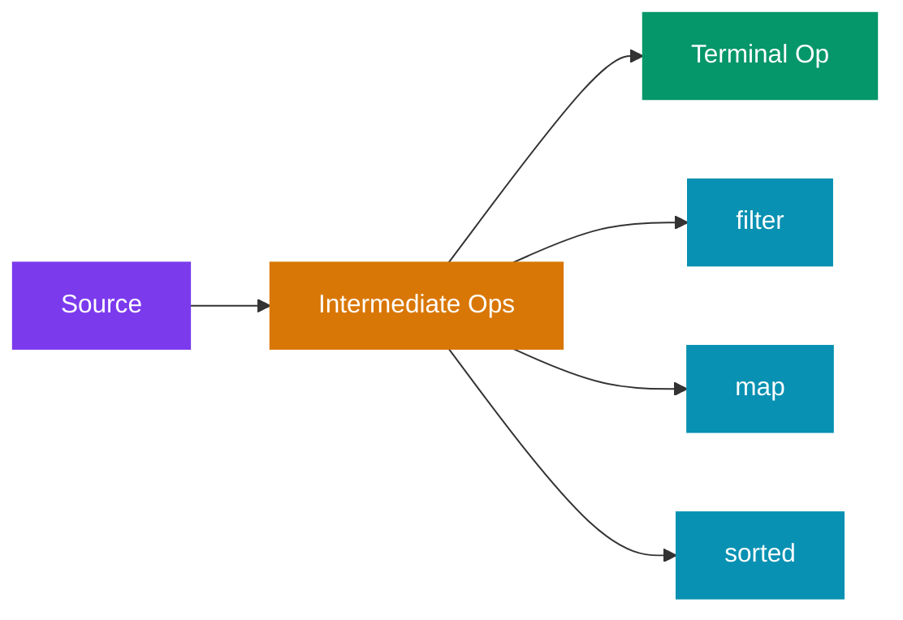
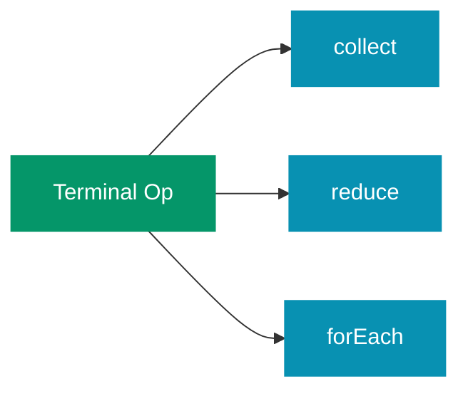
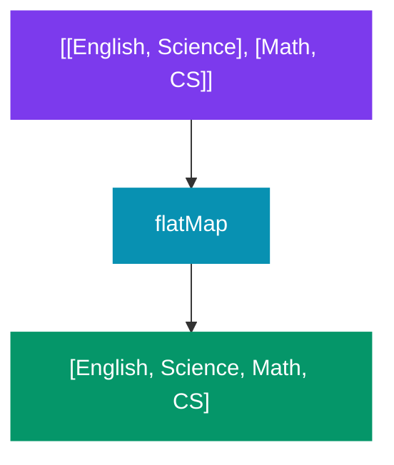
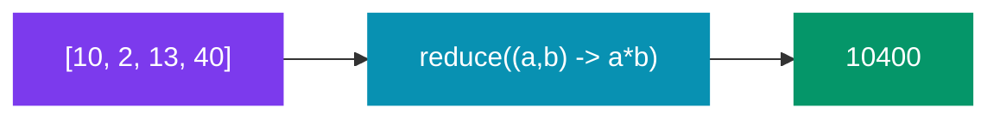
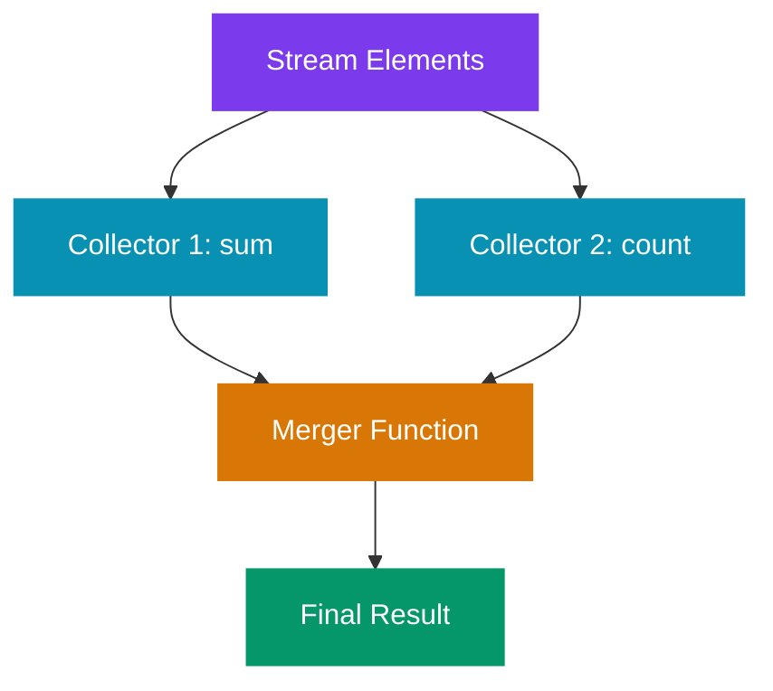

# Java 8 Stream Operations with Examples

**Java 8 Stream Operations with Examples** | This note shows the Java 8 Stream methods that people use most often in code. Also see:- [Java 8 Interview Questions](08_Java_8_Interview_Questions.md)

📊 **Question Count by Section**

| # | Section | Questions |
|---|---|---|
| 1 | [Basic Stream Operations](#basic-stream-operations) | 22 |
| 2 | [Complex Java 8 Stream Operations](#complex-java-8-stream-operations) | 15 |
| | **Total** | **37** |

> 🔥🔥 Very High — asked in almost every Tier-1 loop &nbsp;·&nbsp; 🔥 High — very frequent in Tier-1 interviews &nbsp;·&nbsp; ⚡ Medium — commonly asked &nbsp;·&nbsp; 💤 Low — good to know, rarely asked

**① Pipeline structure + the lazy intermediate operations (each returns a new Stream):**



**② The terminal operations — exactly one per pipeline, and it starts the whole pipeline:**



> 🟢 `Terminal Op` is the link between the two diagrams. It matters for two reasons:
> - Nothing in ① actually runs until you call an operation from ② (lazy evaluation).
> - After that call, the stream is consumed and cannot be reused.

<a id="basic-stream-operations"></a>

## 1. Basic Stream Operations

1. **🔍 What does `filter` do in Streams? 🔥🔥**

<!-- -->
<details>
<summary>Answer</summary>

**Answer:**

🔍 The `filter` method keeps the elements of a stream that match a given predicate. It is an **intermediate operation**. It returns a new stream that contains only the matching elements.

🛠️ **Example:** Fetch all numbers from a list that are greater than 5.

```java
List<Integer> numbers = Arrays.asList(1, 2, 3, 4, 5, 6, 7, 8, 9, 10);
List<Integer> result = numbers.stream()
                              .filter(n -> n > 5)
                              .collect(Collectors.toList());
System.out.println(result); // [6, 7, 8, 9, 10]
```

💡 **Pro Tip:** `filter` is lazy. It does not process any element until a terminal operation is called.

---

</details>

---

2. **🗺️ What does `map` do in Streams? 🔥🔥**

<!-- -->
<details>
<summary>Answer</summary>

**Answer:**

🔄 The `map` method applies a function to each element in a stream. It is an **intermediate operation**. It returns a new stream of the transformed elements.

🛠️ **Example:** Transform a list of strings into a list of their uppercase versions.

```java
List<String> words = Arrays.asList("apple", "banana", "cherry");
List<String> result = words.stream()
                           .map(str -> str.toUpperCase())
                           .collect(Collectors.toList());
System.out.println(result); // [APPLE, BANANA, CHERRY]
```

🎯 **Interview Tip:** Say that `map` does a one-to-one transformation. `flatMap` does a one-to-many transformation.

---

</details>

---

3. **📋 What does `flatMap` do in Streams? 🔥🔥**

<!-- -->
<details>
<summary>Answer</summary>

**Answer:**

🗂️ The `flatMap` method flattens nested structures. It maps each element to a stream. Then it merges all those streams into a single stream.

🛠️ **Example:** Given a list of lists of subjects, flatten them into a single list.

```java
List<List<String>> listOfLists = Arrays.asList(
    Arrays.asList("English", "Science"),
    Arrays.asList("Math", "Computer Science")
);
List<String> subjects = listOfLists.stream()
                                   .flatMap(subject -> subject.stream())
                                   .collect(Collectors.toList());
System.out.println(subjects); // [English, Science, Math, Computer Science]
```



🧠 **In Simple Words:** `map` wraps results in a stream. `flatMap` unwraps them and merges them.

---

</details>

---

4. **💎 What does `distinct` do in Streams? 🔥**

<!-- -->
<details>
<summary>Answer</summary>

**Answer:**

🎯 The `distinct` method removes duplicate elements from a stream. It uses `equals()` to decide if two elements are the same.

🛠️ **Example:** Remove duplicates from a list of integers.

```java
List<Integer> numbers = Arrays.asList(1, 2, 2, 3, 3, 4);
List<Integer> results = numbers.stream()
                               .distinct()
                               .collect(Collectors.toList());
System.out.println(results); // [1, 2, 3, 4]
```

⚠️ **Caution:** For custom objects, make sure you override `equals()` and `hashCode()`. If you don't, `distinct` won't work as expected.

---

</details>

---

5. **📊 What does `sorted` do in Streams? 🔥**

<!-- -->
<details>
<summary>Answer</summary>

**Answer:**

📊 The `sorted` method returns a stream with the elements sorted. It uses natural order, or a `Comparator` that you pass.

🛠️ **Example:** Sort a list of names in reverse alphabetical order.

```java
List<String> names = Arrays.asList("John", "Jane", "Alice", "Bob");
List<String> results = names.stream()
                            .sorted(Comparator.reverseOrder())
                            .collect(Collectors.toList());
System.out.println(results); // [John, Jane, Bob, Alice]
```

💡 **Pro Tip:** Instead of `sorted(Comparator.reverseOrder())` you can also use `sorted(Collections.reverseOrder())` or `sorted((a, b) -> b.compareTo(a))`.

---

</details>

---

6. **🪜 How do you sort a stream of objects by a field, then by a second field, with `Comparator.comparing`? 🔥🔥**

<!-- -->
<details>
<summary>Answer</summary>

**Answer:**

🪜 `Comparator.comparing(keyExtractor)` builds a comparator from a **field getter**. `.thenComparing(...)` adds a tie-breaker to it. This is the single most common sorting task in a live coding round. You can read the chain like a normal spoken sentence.

All the outputs below come from running this exact data:

```java
class Loan {
    private final String id;
    private final String status;
    private final BigDecimal amount;
    private final int tenureMonths;
    // constructor, getters; toString() returns the id
}

List<Loan> loans = Arrays.asList(
        new Loan("L3", "APPROVED", new BigDecimal("50000"),  24),
        new Loan("L1", "PENDING",  new BigDecimal("120000"), 36),
        new Loan("L2", "APPROVED", new BigDecimal("120000"), 12),
        new Loan("L4", "PENDING",  new BigDecimal("50000"),  12));
```

🛠️ **1 — one key, ascending.** The extracted key must be `Comparable` (`BigDecimal` is):

```java
loans.stream()
     .sorted(Comparator.comparing(Loan::getAmount))
     .collect(Collectors.toList());
// [L3, L4, L1, L2]
```

Note that `L3` comes before `L4`, and `L1` comes before `L2`. Both pairs have the same amount. **For an ordered stream (like this one, from a `List`), `sorted` is stable** (it does not reorder equal elements), so tied elements keep their original encounter order. An unordered stream gives no such promise. This stability makes `thenComparing` chains predictable.

🛠️ **2 — two keys, the second one descending.** Pass a key comparator as the second argument of `thenComparing`. This reverses **only that key**:

```java
loans.stream()
     .sorted(Comparator.comparing(Loan::getStatus)
                       .thenComparing(Loan::getAmount, Comparator.reverseOrder()))
     .collect(Collectors.toList());
// [L2, L3, L1, L4]
//  APPROVED: 120000, 50000  |  PENDING: 120000, 50000
```

🛠️ **3 — ⚠️ `.reversed()` reverses the *whole chain*, not the last key.** This is the common mistake:

```java
loans.stream()
     .sorted(Comparator.comparing(Loan::getStatus)
                       .thenComparing(Loan::getAmount)
                       .reversed())
     .collect(Collectors.toList());
// [L1, L4, L2, L3]
```

Compare it with the un-reversed chain, which gives `[L3, L2, L4, L1]`. The `.reversed()` result is that list read backwards: **status descending *and* amount descending**.

- `.reversed()` is a method on the *composed* `Comparator`.
- So when you call it, the whole chain is already one object.
- If you want "status ascending, amount descending", use example 2.

🛠️ **4 — `comparingInt` for primitive keys.**

- `comparing` takes a `Function<T, U extends Comparable>`. So an `int` field is **boxed to `Integer` on every key extraction**.
- `comparingInt` takes a `ToIntFunction<T>` and compares primitives. So nothing is boxed:

```java
loans.stream()
     .sorted(Comparator.comparingInt(Loan::getTenureMonths))
     .collect(Collectors.toList());
// [L2, L4, L3, L1]
```

The same applies to `comparingLong` / `comparingDouble`. In the chain position, use `thenComparingInt` / `thenComparingLong` / `thenComparingDouble`. On a small list, it makes no measurable difference. On a hot path (code that runs very often) over a large collection, the right choice costs nothing extra.

🛠️ **5 — ⚠️ a `null` key throws `NullPointerException`.** `comparing` calls `compareTo` on the extracted key. So one null field makes the whole sort fail:

```java
// one extra loan whose status is null
loans.stream().sorted(Comparator.comparing(Loan::getStatus)).collect(Collectors.toList());
// java.lang.NullPointerException
```

Wrap the **key comparator**, not the outer comparator:

```java
loans.stream()
     .sorted(Comparator.comparing(Loan::getStatus,
                                  Comparator.nullsLast(Comparator.naturalOrder())))
     .collect(Collectors.toList());
// [L3, L2, L1, L4, L5]   ← L5 (null status) sorted to the end
```

`Comparator.nullsFirst(...)` puts them at the front instead.

🎯 **Interview Tip — the 4 points to say in the interview:** *"`comparing` for the primary key; `thenComparing` for tie-breakers; `reversed()` flips the entire chain so use a key comparator when you only want one field descending; and `comparing` NPEs on a null key unless you wrap it in `nullsFirst`/`nullsLast`."* That is the whole answer.

<details>
<summary><strong>🤔 Doubt: If `.reversed()` flips the whole chain, how do I sort by status ascending and amount descending?</strong></summary>

There are three ways, from most readable to least readable:

**1. A key comparator on the descending field.** This is the standard answer (example 2 above):

```java
Comparator.comparing(Loan::getStatus)
          .thenComparing(Loan::getAmount, Comparator.reverseOrder())
```

**2. Reverse the key extractor's own comparator inline.** It does the same thing, written differently:

```java
Comparator.comparing(Loan::getStatus)
          .thenComparing(Comparator.comparing(Loan::getAmount).reversed())
```

This works because `.reversed()` now applies to the *inner* one-key comparator. It applies before you add that comparator to the chain. It does not apply to the composed chain.

**3. Negate a numeric key** — `comparing(l -> -l.getTenureMonths())`. ❌️ Avoid it. It breaks on `Integer.MIN_VALUE` without any error. It does not work at all for `String` or `BigDecimal`.

💡 Remember this model: `comparing(...).thenComparing(...)` returns **one** `Comparator` object. Every method you call after that point works on that whole object. It does not work on the last link you typed.

---

</details>
<br/>

---

</details>

---

7. **👀 What does `peek` do in Streams? 🔥**

<!-- -->
<details>
<summary>Answer</summary>

**Answer:**

🔍 You mainly use the `peek` method for **debugging**. It performs an action on each element without changing the stream itself. It is an intermediate operation.

🛠️ **Example:** Print each element in a list while converting them to uppercase.

```java
List<String> names = Arrays.asList("John", "Jane", "Alice", "Bob");
List<String> results = names.stream()
                             .map(name -> name.toUpperCase())
                             .peek(System.out::println)
                             .collect(Collectors.toList());
System.out.println(results);
```

📤 **Output:**

```
JOHN
JANE
ALICE
BOB
[JOHN, JANE, ALICE, BOB]
```

⚠️ **Caution — `peek` may never run at all.** It is meant for debugging only. Never put business logic in it.

- The obvious reason is short-circuiting (`findFirst`, `anyMatch`, `limit` stop early).
- The surprising reason is worth remembering:

```java
long n = Stream.of("x", "y", "z").peek(System.out::print).count();
System.out.println(n);
```

📤 **Output:**

```
3
```

The `peek` prints **nothing**. Since Java 9, `count()` may skip the pipeline entirely. This happens when both are true:

- It can read the element count directly from the source (a `SIZED` spliterator).
- No upstream operation can change that count.

So the stream skips (elides) the whole traversal, including `peek`. Nothing short-circuited here. The pipeline simply never ran. If you add any operation that can change the size, the output comes back:

```java
long n = Stream.of("x", "y", "z").peek(System.out::print).filter(s -> true).count();
// prints: xyz   then 3
```

🎯 **Interview Tip:** the honest one-line answer is *"`peek` is not guaranteed to be invoked — its execution depends on what the terminal operation needs, so it is a debugging tool, not an execution hook."*

---

</details>

---

8. **✂️ What does `limit` do in Streams? ⚡**

<!-- -->
<details>
<summary>Answer</summary>

**Answer:**

✂️ The `limit` method cuts the stream so it has no more than a given number of elements. It is a short-circuiting intermediate operation (it can stop the stream early).

🛠️ **Example:** Find the first 3 smallest numbers in a given list.

```java
List<Integer> numbers = Arrays.asList(10, 2, 13, 40, 5, 26, 77, 58, 91, 11);
List<Integer> results = numbers.stream()
                              .sorted()
                              .limit(3)
                              .collect(Collectors.toList());
System.out.println(results); // [2, 5, 10]
```

⚠️ **Caution — `limit` short-circuits, but a `sorted()` before it cancels that.** `sorted` is a **stateful barrier** operation. It must consume *every* element before it can emit the first one. So nothing upstream of it can stop early. We verified this by counting comparator calls on the 10-element list above:

```
sorted().limit(3)   →  22 comparator calls   (a full O(n log n) sort, then a truncate)
```

So this pipeline is *not* "find the 3 smallest with early exit". It is "sort all 10, then take 3". `limit` still short-circuits everything **downstream** of it (the `collect` only ever sees 3 elements). That is why `Stream.iterate(1, i -> i + 1).limit(5)` terminates on an infinite stream.

🧠 **In Simple Words — stateless vs stateful intermediate operations.** We built this table by counting how many source elements each pipeline actually pulls from a 10-element list:

| Operation | Kind | Elements pulled by `…(op).limit(3)` |
|---|---|---|
| `filter`, `map`, `flatMap`, `peek` | **stateless** — each element handled independently | 3 |
| `limit(3)` | **short-circuiting** — caps the count, source stops pulling | 3 |
| `distinct()` | **stateful but streaming** — keeps a seen-set, still emits as it goes | 3 |
| `sorted()` | **stateful barrier** — must consume everything before emitting anything | **10** |
| `skip(3)` | **stateful, *not* short-circuiting** — pulls and drops the first 3, then the later `limit` stops it | **6** |

⚠️ Note the last row. `skip` is stateful but does **not** short-circuit by itself. It must pull and drop the first *n*. After that, the downstream `limit(3)` stops the source, so 3 + 3 = 6 elements are pulled. With `skip(3)` alone, all 10 are pulled. Only `limit`, `takeWhile` (Java 9+) and the terminal ops `findFirst` / `findAny` / `*Match` actually stop the source.

💡 A practical test for "does this work on an infinite stream": `Stream.iterate(0, i -> (i + 1) % 4).distinct().limit(4)` **terminates** (verified → `[0, 1, 2, 3]`). It works because `distinct` emits elements as it goes. If you put a `sorted()` in that pipeline, it hangs forever.

---

</details>

---

9. **⏭️ What does `skip` do in Streams? ⚡**

<!-- -->
<details>
<summary>Answer</summary>

**Answer:**

⏭️ The `skip` method drops the first *n* elements of a stream. It returns the remaining elements.

🛠️ **Example:** Fetch all elements except the first 3 smallest numbers.

```java
List<Integer> numbers = Arrays.asList(10, 2, 13, 40, 5, 26, 77, 58, 91, 11);
List<Integer> results = numbers.stream()
                               .sorted()
                               .skip(3)
                               .collect(Collectors.toList());
System.out.println(results); // [11, 13, 26, 40, 58, 77, 91]
```

🧠 **In Simple Words:** `limit(n)` keeps the first *n*. `skip(n)` drops the first *n*. Together, you use them for pagination.

---

</details>

---

10. **🔁 What does `forEach` do in Streams? ⚡**

<!-- -->
<details>
<summary>Answer</summary>

**Answer:**

🔁 The `forEach` method is a **terminal operation** that performs an action on each element of the stream.

🛠️ **Example:** Print each element of a list with the prefix "Item: ".

```java
List<String> words = Arrays.asList("apple", "banana", "cherry");
words.stream()
     .forEach(word -> System.out.println("Item: " + word));
```

📤 **Output** — `println` inside `forEach` prints one line per element. It does not print one comma-joined line:

```
Item: apple
Item: banana
Item: cherry
```

⚠️ **Caution:** `forEach` does not guarantee order in parallel streams. Use `forEachOrdered` if order matters.

---

</details>

---

11. **📦 What does `collect` do in Streams? 🔥🔥**

<!-- -->
<details>
<summary>Answer</summary>

**Answer:**

📦 The `collect` method is a **terminal operation**. It uses a `Collector` to turn the elements of a stream into a different form. Usually this form is a `List`, `Set`, or `Map`.

🛠️ **Example:** Collect a list of integers into a `Set`.

```java
List<Integer> numbers = Arrays.asList(1, 2, 3, 4, 4, 5);
Set<Integer> result = numbers.stream()
                              .collect(Collectors.toSet());
// result: [1, 2, 3, 4, 5]
```

💡 **Pro Tip:** The `Collectors` utility class has many built-in collectors: `toList()`, `toSet()`, `toMap()`, `groupingBy()`, `joining()`, and more.

---

</details>

---

12. **⚙️ What does `reduce` do in Streams? 🔥🔥**

<!-- -->
<details>
<summary>Answer</summary>

**Answer:**

⚙️ The `reduce` method does a **reduction** on the elements of a stream. It combines them into a single result. It applies a binary operation (a function taking two arguments and returning one result) again and again, until it has processed all elements.



🛠️ **Example 1:** Compute the product of all numbers in a list.

```java
List<Integer> numbers = Arrays.asList(10, 2, 13, 40);
Integer results = numbers.stream()
                         .reduce((a, b) -> a * b)
                         .orElse(0);          // no identity -> Optional
System.out.println(results); // 10400
```

🛠️ **Example 2:** Compute the sum of all numbers in a list. This time we pass an identity, so there is no `Optional` to unwrap at all.

```java
List<Integer> numbers = Arrays.asList(10, 2, 13, 40);
int results = numbers.stream()
                     .reduce(0, Integer::sum);   // identity -> plain int
System.out.println(results); // 65
```

🎯 **Interview Tip:** `reduce` without an identity value returns an `Optional` (because the stream might be empty). With an identity value like `reduce(0, Integer::sum)`, it returns the type directly.

---

</details>

---

13. **✅ What does `allMatch` do in Streams? 🔥**

<!-- -->
<details>
<summary>Answer</summary>

**Answer:**

✅ The `allMatch` method checks if **all** elements in the stream satisfy a given predicate. It returns `true` if every element matches, and `false` otherwise. It is a short-circuiting terminal operation.

🛠️ **Example:** Check if all numbers in the list are positive.

```java
List<Integer> numbers = Arrays.asList(10, 2, 13, 40);
Boolean results = numbers.stream().allMatch(a -> a > 0);
System.out.println(results); // true
```

---

</details>

---

14. **🔎 What does `anyMatch` do in Streams? 🔥**

<!-- -->
<details>
<summary>Answer</summary>

**Answer:**

🔎 The `anyMatch` method checks whether **at least one element** in the stream matches a given predicate. It returns `true` as soon as it finds a matching element. Then it stops processing the rest. If no elements match, it returns `false`.

🛠️ **Example:** Check if any number in the list is greater than 10.

```java
List<Integer> numbers = Arrays.asList(5, 8, 12, 3);
boolean result = numbers.stream()
                       .anyMatch(n -> n > 10);
System.out.println(result); // true
```

⚡ **Performance:** `anyMatch` short-circuits. It stops processing as soon as it finds a match. This makes it efficient for large streams.

---

</details>

---

15. **🚫 What does `noneMatch` do in Streams? 🔥**

<!-- -->
<details>
<summary>Answer</summary>

**Answer:**

🚫 The `noneMatch` method checks if **no elements** in the stream match a given predicate. It returns `true` if none of the elements satisfy the predicate and `false` if at least one does.

🛠️ **Example:** Check if no elements in the list are negative.

```java
List<Integer> numbers = Arrays.asList(1, 2, 3, 4, 5);
boolean result = numbers.stream()
                       .noneMatch(n -> n < 0);
System.out.println(result); // true
```

| Method | Returns `true` when | Stops early at… | …and then returns |
|--------|---------------------|-----------------|-------------------|
| **`allMatch`** | All elements match | the first **non**-matching element | `false` |
| **`anyMatch`** | At least one matches | the first **matching** element | `true` |
| **`noneMatch`** | No elements match | the first **matching** element | `false` |

⚡ **All three short-circuit.** Once the answer is decided, none of them scans the rest of the stream. Verified:

- `Stream.of(1, -2, 3, 4, 5).peek(count).allMatch(x -> x > 0)` touches only **2** elements before returning `false`.
- The same stream with `.noneMatch(x -> x < 0)` also touches only 2 before returning `false`.

🧠 **In Simple Words:** on an **empty stream** the answers are `allMatch = true`, `anyMatch = false`, `noneMatch = true` (verified). `allMatch` returns `true` on an empty stream because of *vacuous truth*. The claim "every element matches" is true by default when there are no elements. This is a common trap question.

---

</details>

---

16. **🥇 What does `findFirst` do in Streams? 🔥**

<!-- -->
<details>
<summary>Answer</summary>

**Answer:**

🥇 The `findFirst` method gets the **first element** in a stream that matches a given condition. If there is no filter, it gets just the first element. It returns the result wrapped in an `Optional`.

🛠️ **Example:** Find the first element in a list that starts with the letter 'b'.

```java
List<String> words = Arrays.asList("apple", "banana", "cherry", "blackberry");
String result = words.stream()
                     .filter(s -> s.startsWith("b"))
                     .findFirst()
                     .orElse("no match");
System.out.println(result); // banana
```

⚠️ **Caution — never unwrap with `.get()`.** Calling `.get()` on an empty `Optional` throws `NoSuchElementException` with only the generic message `"No value present"`. At 3am, that error does not tell you what was missing. Use one of these:

| Form | Since | Use when |
|---|---|---|
| `.orElse(default)` | Java 8 | you have a sensible fallback value |
| `.orElseGet(() -> expensive())` | Java 8 | the fallback costs something to build |
| `.orElseThrow(() -> new XNotFoundException(id))` | Java 8 | absence is an error, and you want a *useful* message |
| `.ifPresent(x -> …)` | Java 8 | you only want the side effect |
| `.orElseThrow()` | **Java 10** | a short "can't be empty here" check. The no-arg form does **not** exist in Java 8 |

---

</details>

---

17. **🔀 What does `findAny` do in Streams? 🔥**

<!-- -->
<details>
<summary>Answer</summary>

**Answer:**

🔀 The `findAny` method gets **any** element from the stream that matches a given condition. It returns the element wrapped in an `Optional`.

🛠️ **Example:** Find any element in a list that starts with the letter 'b'.

```java
List<String> words = Arrays.asList("apple", "banana", "cherry", "blackberry");
String result = words.stream().filter(s -> s.startsWith("b")).findAny().orElse("no match");
System.out.println(result); // banana — on a sequential stream, in this implementation
```

| Feature | `findFirst` 🥇 | `findAny` 🔀 |
|---------|----------------|--------------|
| **Deterministic** | ✅ Always returns the first match | ❌️ May return any match |
| **Parallel Streams** | 🐢 Slower (must preserve order) | ⚡ Faster (no ordering constraint) |
| **Use Case** | When order matters | When any match is acceptable |

⚠️ **Careful how you phrase this.** It is easy to say *"in a sequential stream `findAny` behaves like `findFirst`"*. On HotSpot it does, and the snippet above prints `banana`. But the javadoc says it clearly: *"The behavior of this operation is explicitly nondeterministic; it is free to select any element in the stream."* So the correct answer is **"in practice it returns the first element on a sequential stream, but that is an implementation detail, not a guarantee — never rely on it."** If you say it is a guarantee, an interviewer can use that exact sentence as a trap question.

🎯 **Interview Tip:** The real difference shows in **parallel streams**:

- `findFirst` must wait for the split that holds the earliest matching element.
- `findAny` can return as soon as *any* split finds one.

If you need determinism (the same result on every run), use `findFirst`. It has a real cost, but it also gives you a correct result.

---

</details>

---

18. **📈 What do `max` and `min` do in Streams? 🔥**

<!-- -->
<details>
<summary>Answer</summary>

**Answer:**

📊 The `max` and `min` methods find the maximum and minimum elements in a stream. On a `Stream<T>` they always need a `Comparator`. Only `IntStream`, `LongStream` and `DoubleStream` have `max()` / `min()` with no argument. Both return an `Optional<T>`, so they can handle empty streams.

🛠️ **Example:** Find the maximum and minimum values from a list of integers.

```java
List<Integer> numbers = Arrays.asList(5, 1, 8, 3, 9);
Integer max = numbers.stream().max(Integer::compareTo)
                     .orElseThrow(() -> new NoSuchElementException("empty list"));
Integer min = numbers.stream().min(Integer::compareTo)
                     .orElseThrow(() -> new NoSuchElementException("empty list"));
System.out.println(max + " " + min); // 9 1
```

Or, with a lambda comparator and a default value (`orElse`) instead of an exception:

```java
Integer max = numbers.stream().max((a, b) -> a.compareTo(b)).orElse(Integer.MIN_VALUE);
Integer min = numbers.stream().min((a, b) -> a.compareTo(b)).orElse(Integer.MAX_VALUE);
```

💡 **Pro Tip:** for a stream of numbers, prefer the primitive form. It skips the boxing, *and* the empty result gets a clearer type name:

```java
OptionalInt max = numbers.stream().mapToInt(Integer::intValue).max();
System.out.println(max); // OptionalInt[9]
```

---

</details>

---

19. **🔲 What does `toArray` do in Streams? 💤**

<!-- -->
<details>
<summary>Answer</summary>

**Answer:**

📦 The `toArray` method converts a stream's elements into an array. You can pass a constructor reference to get a typed array instead of `Object[]`.

🛠️ **Example:** Convert a list of Strings into an array.

```java
List<String> words = Arrays.asList("apple", "banana", "cherry", "blackberry");

String[] result = words.stream().toArray(String[]::new);

System.out.println(Arrays.toString(result));
// [apple, banana, cherry, blackberry]
```

⚠️ **Don't confuse it with `Collection.toArray`.** Four calls look alike:

| Call | Since | Notes |
|---|---|---|
| `stream().toArray()` | Java 8 | returns `Object[]` — you lose the element type |
| `stream().toArray(String[]::new)` | Java 8 | `Stream.toArray(IntFunction)` — **this is the Stream API method** |
| `list.toArray(new String[0])` | Java 1.2 (generic since Java 5) | `Collection.toArray(T[])` — not a stream operation at all |
| `list.toArray(String[]::new)` | **Java 11** | `Collection.toArray(IntFunction)` — won't compile on Java 8 |

💡 **Pro Tip:** The `IntFunction` you pass is an *array constructor*, not an array. The stream calls it with the required size once it knows the size. That is why `String[]::new` works here and `new String[0]` does not:

- `Stream.toArray` wants a **factory**.
- `Collection.toArray` wants an **instance**.

---

</details>

---

20. **🔗 What does `joining` do in Streams? 💤**

<!-- -->
<details>
<summary>Answer</summary>

**Answer:**

🔗 `Collectors.joining` returns a collector. You pass it to `collect`, and it joins the elements of a stream into a single `String`. It supports optional delimiters, prefixes, and suffixes.

📑 **Method signature:** `joining(CharSequence delimiter, CharSequence prefix, CharSequence suffix)`

🛠️ **Example:** Concatenate all strings in a list separated by commas.

```java
List<String> words = Arrays.asList("apple", "banana", "cherry", "blackberry");

String result = words.stream().collect(Collectors.joining(", "));
System.out.println(result);
// apple, banana, cherry, blackberry

String concatenatedString = words.stream().collect(Collectors.joining(", ", "[", "]"));
System.out.println(concatenatedString); // [apple, banana, cherry, blackberry]
```

---

</details>

---

21. **🔢 What does `count` do in Streams? 🔥**

<!-- -->
<details>
<summary>Answer</summary>

**Answer:**

🔢 The `count` method returns the number of elements in a stream as a `long`. It is a **terminal operation**.

🛠️ **Example 1:** Count the number of strings in a list.

```java
List<String> words = Arrays.asList("apple", "banana", "cherry", "blackberry");
long count = words.stream().count();
System.out.println(count); // 4
```

🛠️ **Example 2:** Count the number of strings starting with "b" in a given list.

```java
List<String> words = Arrays.asList("apple", "banana", "cherry", "blackberry");
long count = words.stream().filter(s -> s.startsWith("b")).count();
System.out.println(count); // 2
```

---

</details>

---

22. **🧮 What does `counting` do in Streams? 💤**

<!-- -->
<details>
<summary>Answer</summary>

**Answer:**

🔢 The `counting` method is a **collector** that counts the number of elements in the stream. It is very similar to `count()`, but you use it inside `collect()`. People often use it together with other collectors to aggregate data.

📑 **Return Type:** `Collector<T, ?, Long>`

🛠️ **Example:** Count the number of strings starting with "b".

```java
List<String> words = Arrays.asList("apple", "banana", "cherry", "blackberry");
long count = words.stream()
    .filter(s -> s.startsWith("b")).collect(Collectors.counting());
System.out.println(count); // 2
```

🧠 **In Simple Words:** Use `count()` as a terminal operation directly. Use `Collectors.counting()` when you need counting as a downstream collector inside `groupingBy` or other compound collectors.

---

</details>

---

<a id="complex-java-8-stream-operations"></a>

## 2. Complex Java 8 Stream Operations

1. **🗂️ What does `groupingBy` do in Streams? 🔥🔥**

<!-- -->
<details>
<summary>Answer</summary>

**Answer:**

🗂️ The `groupingBy` method groups the elements of a stream. It uses a classifier function (a function that picks the group key for each element). It returns a `Map`:

- The keys are the results of the classifier.
- The values are lists of the items for each key.

🛠️ **Example:** Group a list of employees by their city.

```java
public class Employee {
    private String name;
    private String city;
    // setter, getter, constructor, toString
}

List<Employee> employees = Arrays.asList(
                new Employee("John", "New York"),
                new Employee("Jane", "London"),
                new Employee("Jack", "New York")
            );
Map<String, List<Employee>> employeeByCity = employees.stream()
                .collect(Collectors.groupingBy(Employee::getCity));
System.out.println(employeeByCity);

// or using a lambda:
employees.stream().collect(Collectors.groupingBy(e -> e.getCity()));
```

📤 **Output:**

```
{New York=[John, Jack], London=[Jane]}
```

⚠️ **Caution — the key order is *not* insertion order.** `groupingBy` collects into a plain `HashMap`. So the key hashes decide the iteration order. The contract **does not specify this order**. Never write a test that depends on it. If you need a fixed order, pass a map supplier with the 3-arg overload:

```java
Map<String, List<Employee>> sortedByCity = employees.stream()
        .collect(Collectors.groupingBy(Employee::getCity, TreeMap::new, Collectors.toList()));
System.out.println(sortedByCity);
// {London=[Jane], New York=[John, Jack]}
```

🎯 **Interview Tip:** the *values* inside each group **do** keep encounter order (`John` before `Jack`). The default downstream collector of `groupingBy` is `toList()`, and it adds items in stream order. Only the **keys** are unordered.

---

</details>

---

2. **⚖️ What does `partitioningBy` do in Streams? ⚡**

<!-- -->
<details>
<summary>Answer</summary>

**Answer:**

⚖️ The `partitioningBy` method splits the elements of a stream into **two groups**. A predicate (a true/false test) decides the group. It returns a `Map<Boolean, List<T>>` where:

- ✅ Key `true` contains elements that satisfy the predicate.
- ❌️ Key `false` contains elements that do not satisfy the predicate.

🛠️ **Example:** Partition a list of integers into even and odd numbers.

```java
List<Integer> numbers = Arrays.asList(1, 2, 3, 4, 5, 6);
Map<Boolean, List<Integer>> result = numbers.stream()
      .collect(Collectors.partitioningBy(n -> n % 2 == 0));
System.out.println(result);
// {false=[1, 3, 5], true=[2, 4, 6]}
```

🏢 **Real-World Use Case:** Split employees into groups by performance rating.

```java
Map<Boolean, List<Employee>> employeePartition = employeeList.stream()
    .collect(Collectors.partitioningBy(employee -> employee.getPerformanceRating() > 4.0));
```

- ✅ **True group:** High-performing employees (for rewards, promotions).
- ❌️ **False group:** Regular-performing employees (for additional training).

| Feature | `groupingBy` 🗂️ | `partitioningBy` ⚖️ |
|---------|-----------------|---------------------|
| **Groups** | Any number of groups | Exactly 2 groups |
| **Key type** | Any type | `Boolean` only |
| **Use case** | Group by category/city/type | Binary split (pass/fail) |

---

</details>

---

3. **📉 What does `summarizingInt` do in Streams? 💤**

<!-- -->
<details>
<summary>Answer</summary>

**Answer:**

📊 The `summarizingInt` method is a collector. It creates **summary statistics** for the elements of a stream: count, sum, min, average, and max.

📑 **Return Type:** `Collector<T, ?, IntSummaryStatistics>`. So `collect(...)` gives you an `IntSummaryStatistics`.

🛠️ **Example:** Generate summary statistics for a list of integers.

```java
List<Integer> numbers = Arrays.asList(1, 2, 3, 4, 5);

// IntSummaryStatistics stats = numbers.stream()
//         .mapToInt(x -> x).summaryStatistics();
IntSummaryStatistics stats = numbers.stream()
           .collect(Collectors.summarizingInt(Integer::intValue));

System.out.println(stats);
// IntSummaryStatistics{count=5, sum=15, min=1, average=3.000000, max=5}

System.out.println(stats.getAverage() + " " + stats.getSum()); // 3.0 15
```

💡 **Pro Tip:** Also available as `summarizingDouble` and `summarizingLong` for other numeric types.

---

</details>

---

4. **🔄 What does `mapping` do in Streams? 💤**

<!-- -->
<details>
<summary>Answer</summary>

**Answer:**

🔄 The `mapping` method applies a mapping function to stream elements. Then it collects the results with another collector. You use it as a **downstream collector** (a collector that runs inside another collector).

📑 **Return Type:** A `Collector` that applies a mapping function and collects the results.

🛠️ **Example:** Extract and collect the lengths of all strings in a list.

```java
List<String> words = Arrays.asList("apple", "banana", "cherry");
List<Integer> lengths = words.stream()
   .collect(Collectors.mapping(String::length, Collectors.toList()));
System.out.println(lengths); // [5, 6, 6]
```

🏢 **Real-World Use Case:** Extract customer email addresses from a list of orders.

```java
List<String> customerEmails = orderList.stream()
    .collect(Collectors.mapping(order -> order.getCustomer().getEmail(), Collectors.toList()));
```

⚠️ Note the `List<String>`, not a raw `List`. A raw type here compiles. javac warns only with `-Xlint:rawtypes`. It also removes all type checking in the code that uses the list later.

---

</details>

---

5. **🧵 What does `joining` with delimiter, prefix, and suffix do? 💤**

<!-- -->
<details>
<summary>Answer</summary>

**Answer:**

🔗 `Collectors.joining` returns a collector that joins stream elements into a single `String`. You can add an optional delimiter, prefix, and suffix.

📑 **Return Type:** A `Collector` that concatenates elements into a single `String`.

🛠️ **Example:** Concatenate all strings with commas, a prefix, and a suffix.

```java
List<String> words = Arrays.asList("apple", "banana", "cherry");
String result = words.stream()
                     .collect(Collectors.joining(", ", "[", "]"));
System.out.println(result); // [apple, banana, cherry]
```

---

</details>

---

6. **📂 What does `groupingBy` with a downstream collector do? 🔥🔥**

<!-- -->
<details>
<summary>Answer</summary>

**Answer:**

🗂️ The `groupingBy` method can also take a **downstream collector**. It applies this collector to each group. This lets you combine grouping with another aggregation.

📑 **Return Type:** `Map<K, D>` where `K` is the classifier type and `D` is the downstream result.

🛠️ **Example:** Group strings by their length and count the number of strings in each group.

```java
List<String> words = Arrays.asList("apple", "banana", "cherry", "blueberry");
Map<Integer, Long> groupedByLength = words.stream()
       .collect(Collectors.groupingBy(String::length, Collectors.counting()));
System.out.println(groupedByLength); // {5=1, 6=2, 9=1}
```

🏢 **Real-World Use Case:** Group orders by customer and count how many each customer placed.

```java
Map<Customer, Long> ordersByCustomer = orderList.stream()
    .collect(Collectors.groupingBy(Order::getCustomer, Collectors.counting()));
```

---

</details>

---

7. **🏗️ What does `filtering` do in Streams? 💤**

<!-- -->
<details>
<summary>Answer</summary>

**Answer:**

🔍 The `filtering` method (Java 9+) filters elements of a stream. Then it collects the results with another collector. It is especially useful as a **downstream collector** inside `groupingBy`.

📑 **Return Type:** A `Collector` that filters elements and collects the results.

🛠️ **Example:** Filter and collect only the even numbers from a list.

```java
List<Integer> numbers = Arrays.asList(1, 2, 3, 4, 5, 6, 7, 8, 9, 10);
List<Integer> evens = numbers.stream()
        .collect(Collectors.filtering(n -> n % 2 == 0, Collectors.toList()));
System.out.println(evens); // [2, 4, 6, 8, 10]
```

🧠 **In Simple Words:**

- `stream().filter()` filters *before* collecting.
- `Collectors.filtering()` filters *during* collection.

This matters when you use it as a downstream collector with `groupingBy`, because `groupingBy` **keeps the empty groups**. On their own (as above), the two give the same result. Inside `groupingBy`, they do not:

```java
List<String> words = Arrays.asList("apple", "avocado", "banana", "blueberry");

words.stream().collect(Collectors.groupingBy(s -> s.charAt(0),
        Collectors.filtering(s -> s.length() > 8, Collectors.toList())));
// {a=[], b=[blueberry]}          ← the 'a' group survives, empty

words.stream().filter(s -> s.length() > 8)
     .collect(Collectors.groupingBy(s -> s.charAt(0)));
// {b=[blueberry]}                ← the 'a' key never gets created
```

The right one depends on the question:

- *"how many long words does each letter have?"* needs the first (`a → 0`).
- *"which letters have a long word?"* needs the second.

---

</details>

---

8. **🎯 What does `collectingAndThen` do in Streams? 💤**

<!-- -->
<details>
<summary>Answer</summary>

**Answer:**

🏗️ The `collectingAndThen` method first runs a collector. Then it applies a **finishing function** to the result.

📑 **Return Type:** `Collector<T, A, R>` that collects elements and then transforms the result.

🛠️ **Example:** Convert a stream of strings into a set and then get its size.

```java
List<String> words = Arrays.asList("apple", "banana", "cherry", "banana");
int count = words.stream()
   .collect(Collectors.collectingAndThen(Collectors.toSet(), Set::size));
System.out.println(count); // 3
```

💡 **Pro Tip:** This is very useful for creating unmodifiable collections: `collectingAndThen(Collectors.toList(), Collections::unmodifiableList)`.

---

</details>

---

9. **🔃 What does `mapping` with a downstream collector do? 💤**

<!-- -->
<details>
<summary>Answer</summary>

**Answer:**

🔄 The `mapping` method transforms each element. Then it collects the transformed results with a **downstream collector**. This lets you combine two operations in one collector.

📑 **Return Type:** `Collector<T, A, R>` that applies a mapping function and collects the results.

🛠️ **Example:** Collect the lengths of all strings in a list and sum them.

```java
List<String> words = Arrays.asList("apple", "banana", "cherry");
int totalLength = words.stream()
    .collect(Collectors.mapping(String::length,
             Collectors.summingInt(Integer::intValue)));
System.out.println(totalLength); // 17
```

---

</details>

---

10. **🗺️ What does `toMap` do in Streams? 🔥🔥**

<!-- -->
<details>
<summary>Answer</summary>

**Answer:**

🗺️ The `toMap` method converts stream elements into a `Map` using a key mapping function and a value mapping function.

📑 **Return Type:** `Map<K, V>`

🛠️ **Example:** Convert a list of strings into a map where the key is the string and the value is its length.

```java
List<String> words = Arrays.asList("apple", "banana", "cherry");
Map<String, Integer> map = words.stream()
     .collect(Collectors.toMap(Function.identity(), String::length));
System.out.println(map); // {banana=6, apple=5, cherry=6}
```

🏢 **Real-World Use Case:** Build an id → entity lookup map. Then you can join a batch of rows in memory, instead of running one query per row. Money is `BigDecimal`, never `Integer` or `double`.

```java
Map<Long, BigDecimal> outstandingByLoanId = loanAccounts.stream()
   .collect(Collectors.toMap(LoanAccount::getId, LoanAccount::getOutstandingAmount));
```

⚠️ **Trap 1 — duplicate key throws `IllegalStateException`, it does not overwrite.** This is the most-asked `toMap` follow-up question. It is the opposite of `Map.put`, which replaces the old value without any error:

```java
List<String> words = Arrays.asList("apple", "banana", "avocado");
words.stream().collect(Collectors.toMap(s -> s.charAt(0), s -> s));
// java.lang.IllegalStateException:
//   Duplicate key a (attempted merging values apple and avocado)
// (Java 9+ text. Java 8 prints "Duplicate key apple" — the old value, not the key.)
```

The fix is the **3-arg merge overload**. You must say what happens when two keys collide:

```java
List<Payment> payments = List.of(
        new Payment("L1", new BigDecimal("100")),
        new Payment("L2", new BigDecimal("250")),
        new Payment("L1", new BigDecimal("400")));

// sum the collisions
Map<String, BigDecimal> totals = payments.stream()
    .collect(Collectors.toMap(Payment::loanId, Payment::amount, BigDecimal::add));
System.out.println(totals);                          // {L1=500, L2=250}

// or keep the first / keep the last
(existing, replacement) -> existing      // first wins
(existing, replacement) -> replacement   // last wins — this is Map.put semantics
```

⚠️ **Trap 2 — a `null` *value* throws `NullPointerException`.** This is also unlike `HashMap.put`, which stores a null without a problem:

```java
Map<String, String> src = new HashMap<>();
src.put("a", null);

src.entrySet().stream()
   .collect(Collectors.toMap(Map.Entry::getKey, Map.Entry::getValue));
// java.lang.NullPointerException

new HashMap<String, String>().put("a", null);        // perfectly legal
```

Why: in Java 8, `toMap` accumulates with `Map::merge`, and the contract of `merge` rejects null values. From Java 9, the 2-arg form checks for null itself (`Objects.requireNonNull`). The merge overloads still use `merge`. Either way, a null value throws. This bug shows up as soon as the value mapper reads a **nullable column**. The usual production fix is one of these:

- `toMap(k, v -> Optional.ofNullable(v.getX()).orElse(DEFAULT), merge)`
- a `filter` before the collect step

📑 **A 4th overload takes a map supplier.** Use it when the default `HashMap` is the wrong kind of map:

```java
Map<String, BigDecimal> ordered = payments.stream()
    .collect(Collectors.toMap(Payment::loanId, Payment::amount, BigDecimal::add,
                              LinkedHashMap::new));   // insertion-ordered
// TreeMap::new for sorted keys, EnumMap::new when the key is an enum
```

<details>
<summary><strong>🤔 Doubt: `toMap` throws on a duplicate key, but `groupingBy` never does — why the different design?</strong></summary>

Because they answer different questions.

- `groupingBy` is *defined* as "many elements per key". A collision is the normal case, so it adds the element to the group's list.
- `toMap` is *defined* as "one element per key". A collision means your assumption about the data was wrong. The collectors API chose to throw an error, instead of dropping a row with no warning.

The designers chose this on purpose. `Map.put` keeps the last value without any warning. If `toMap` did the same, it would lose data with no warning at all. The lost data would also depend on encounter order. Because you must supply the merge function, you must answer *"which one did I mean?"*. You can sum them, keep the first, keep the last, or throw.

💡 A useful way to say it in an interview: **`toMap` without a merge function is an implicit uniqueness assertion on your data.** If you are not sure the key is unique, use `groupingBy` or the merge overload.

---

</details>
<br/>

---

</details>

---

11. **🔒 What does `toConcurrentMap` do in Streams? 💤**

<!-- -->
<details>
<summary>Answer</summary>

**Answer:**

🔒 The `toConcurrentMap` method is similar to `toMap`, but it produces a `ConcurrentMap` for **thread-safe** operations. Use it when multiple threads might read or change the map at the same time.

📑 **Return Type:** `ConcurrentMap<K, V>`

🛠️ **Example:** Convert a list of strings into a concurrent map.

```java
List<String> words = Arrays.asList("apple", "banana", "cherry");
ConcurrentMap<String, Integer> map = words.stream()
   .collect(Collectors.toConcurrentMap(Function.identity(), String::length));
System.out.println(map); // {banana=6, apple=5, cherry=6}
```

| Feature | `toMap` 🅰️ | `toConcurrentMap` 🅱️ |
|---------|-----------|---------------------|
| **Safe in a parallel stream?** | ✅ Yes — each worker fills its own `HashMap`, then they are merged | ✅ Yes — all workers write one shared `ConcurrentMap` |
| **How it parallelises** | per-thread accumulate + `combiner()` merge | `CONCURRENT` collector — no merge step |
| **Return type** | `HashMap` (in practice) | `ConcurrentHashMap` (in practice) |
| **Which duplicate wins** | ✅ deterministic — merge sees values in encounter order | ❌️ arbitrary (`UNORDERED`) |
| **Returned map safe to mutate concurrently later?** | ❌️ No | ✅ Yes |

⚠️ **The `UNORDERED` row is the one that causes bugs.** Verified test: collect 20,000 elements that all share one key, with a *keep-the-first* merge function `(p, q) -> p`:

```java
xs.parallelStream().collect(Collectors.toMap(k -> "k", v -> v, (p, q) -> p));
// .get("k") -> 0 on every one of 50 runs — encounter order respected

xs.parallelStream().collect(Collectors.toConcurrentMap(k -> "k", v -> v, (p, q) -> p));
// .get("k") -> 6562, then 13125, then 11562, … — whichever thread got there first
```

⚠️ **Don't say "`toMap` is not thread-safe".** An interviewer will immediately ask *"so is `list.parallelStream().collect(toMap(...))` broken?"*. It is not broken. Verified: collecting 100,000 elements through `parallelStream().collect(Collectors.toMap(...))` produces all 100,000 correct entries.

- `toMap` is a **non-`CONCURRENT`** collector, so there is no race.
- Every worker thread accumulates into a map that only it owns.
- Then `combiner()` merges these maps.

The part of that claim that is true is the **last** row of the table. The `HashMap` you get back is an ordinary `HashMap`. So it is unsafe to change it from many threads *later*.

🎯 **Interview Tip:** `toConcurrentMap` is the *performance* choice, not the *correctness* choice. It skips the cost of one map per thread plus the merge. The cost is that it is `UNORDERED`:

- Do not use it where encounter order matters.
- On a **sequential** stream, it is strictly slower than `toMap`, with no benefit.

---

</details>

---

12. **🧬 What does `reducing` do in Streams? 💤**

<!-- -->
<details>
<summary>Answer</summary>

**Answer:**

⚙️ The `reducing` method is a **collector** version of `reduce`. It performs a reduction on stream elements. It uses an associative accumulation function (one where `(a op b) op c` gives the same result as `a op (b op c)`).

📑 **There are three overloads.** Pick one by what you have and what you want back:

| Overload | Signature | Returns |
|---|---|---|
| 1-arg | `reducing(BinaryOperator<T> op)` | `Optional<T>` — empty stream gives `Optional.empty()` |
| 2-arg | `reducing(T identity, BinaryOperator<T> op)` | `T` — empty stream gives the identity |
| 3-arg | `reducing(U identity, Function<T,U> mapper, BinaryOperator<U> op)` | `U` — maps each element **before** reducing |

🛠️ **Example:** all three, on the same data.

```java
List<Integer> numbers = Arrays.asList(1, 2, 3, 4, 5);

int sum = numbers.stream().collect(Collectors.reducing(0, Integer::sum));
System.out.println(sum);                                    // 15

Optional<Integer> maybeSum = numbers.stream().collect(Collectors.reducing(Integer::sum));
System.out.println(maybeSum);                               // Optional[15]

List<String> words = Arrays.asList("apple", "banana", "cherry");
int totalLength = words.stream()
        .collect(Collectors.reducing(0, String::length, Integer::sum));
System.out.println(totalLength);                            // 17
```

💡 **Pro Tip — the 3-arg form is the most useful one.** As a plain terminal operation, `stream().reduce()` is always simpler. `Collectors.reducing` exists so you can reduce *inside* another collector. There, the mapper form means you do not need to nest a `mapping(...)`:

```java
Map<Long, BigDecimal> totalPerCustomer = orderList.stream()
    .collect(Collectors.groupingBy(Order::getCustomerId,
             Collectors.reducing(BigDecimal.ZERO, Order::getAmount, BigDecimal::add)));
```

🧠 **In Simple Words:** Use `stream().reduce()` for simple reductions. Use `Collectors.reducing()` when you need reducing as a downstream collector inside `groupingBy` or other compound collectors.

---

</details>

---

13. **📜 What does `flatMapping` do in Streams? 💤**

<!-- -->
<details>
<summary>Answer</summary>

**Answer:**

🗂️ The `flatMapping` method (Java 9+) flattens a stream of collections. Then it applies a collector to the flattened elements. It is the collector version of `flatMap`.

📑 **Return Type:** A `Collector` that applies a flat-mapping function and collects the results.

🛠️ **Example:** Flatten a list of lists of integers and collect as a single list.

```java
List<List<Integer>> listOfLists = Arrays.asList(
    Arrays.asList(1, 2, 3),
    Arrays.asList(4, 5, 6),
    Arrays.asList(7, 8, 9)
);
List<Integer> flattenedList = listOfLists.stream()
         .collect(Collectors.flatMapping(Collection::stream, Collectors.toList()));
System.out.println(flattenedList); // [1, 2, 3, 4, 5, 6, 7, 8, 9]
```

---

</details>

---

14. **🔐 What does `groupingByConcurrent` do in Streams? 💤**

<!-- -->
<details>
<summary>Answer</summary>

**Answer:**

🔒 The `groupingByConcurrent` method is similar to `groupingBy` but returns a `ConcurrentMap` for **thread-safe** grouping operations.

📑 **Return Type:** `ConcurrentMap<K, List<T>>`

🛠️ **Example:** Group a list of strings by their length in a thread-safe manner.

```java
List<String> words = Arrays.asList("apple", "banana", "cherry", "date");
ConcurrentMap<Integer, List<String>> groupedByLength = words.stream()
           .collect(Collectors.groupingByConcurrent(String::length));
System.out.println(groupedByLength);
// {4=[date], 5=[apple], 6=[banana, cherry]}
```

⚠️ `groupingByConcurrent` is an **unordered** collector. In a parallel stream, the order inside each list is not guaranteed (you may get `6=[cherry, banana]`). Use `groupingBy` when you need encounter order.

💡 **Pro Tip:** Use `groupingByConcurrent` with parallel streams for better performance. With sequential streams, `groupingBy` is enough.

---

</details>

---

15. **🍵 What does `teeing` do in Streams? 💤**

<!-- -->
<details>
<summary>Answer</summary>

**Answer:**

🔀 The `teeing` method (Java 12+) combines **two collectors** into one. Each collector processes the stream independently. A finishing function then merges their results.

📑 **Return Type:** `Collector<T, ?, R>` that combines the results of two collectors.



🛠️ **Example:** Compute both the sum and the count of a list of integers.

```java
List<Integer> numbers = Arrays.asList(1, 2, 3, 4, 5);
Map<String, Integer> result = numbers.stream()
            .collect(
                 Collectors.teeing(
                    Collectors.summingInt(Integer::intValue),
                    Collectors.counting(),
                    (sum, count) -> Map.of("sum", sum, "count", count.intValue())
                 )
             );
System.out.println(result);
// prints {sum=15, count=5} OR {count=5, sum=15} — see the caution below
```

⚠️ **Caution — the printed order here changes between JVM runs.**

- `Map.of(...)` returns an immutable `MapN`.
- Its iteration start position comes from a **per-JVM random salt** (a random value that each JVM picks once at startup).
- The JDK does this on purpose, so that nobody writes code that depends on the order.

We ran the snippet above 30 times in 30 fresh JVMs. It printed `{sum=15, count=5}` 17 times and `{count=5, sum=15}` 13 times. The *values* are always right. Only the print order changes. If you want a stable printed result, build an ordered map in the merger:

```java
(sum, count) -> {
    Map<String, Integer> m = new LinkedHashMap<>();
    m.put("sum", sum);
    m.put("count", count.intValue());
    return m;
}
// always prints {sum=15, count=5}
```

🎯 **Interview Tip:** `teeing` is perfect when you need two different aggregations in a single pass over the data. You do not need to stream twice. In practice, a small record or a `Map.Entry` is a better merger result than a `Map`. It keeps the two results type-safe (`Integer` sum vs `Long` count). A `Map` forces them into one value type.

---

</details>

---
