# Java 8 Stream Operations with Examples

**Java 8 Streams** | This note owns **everything about the Stream API**: what a stream is, lazy evaluation, parallel streams, every operation and collector, and the stream coding problems. Java 8 *language* topics (lambdas, functional interfaces, default methods, `Optional`, `java.time`) are in [Java 8 Interview Questions](08_Java_8_Interview_Questions.md).

📊 **Question Count by Section**

| # | Section | Questions |
|---|---|---|
| 1 | [Stream Concepts & Parallel Streams](#qa-on-streams--parallel-streams) | 8 |
| 2 | [Intermediate Operations](#basic-stream-operations) | 9 |
| 3 | [Terminal Operations](#terminal-operations) | 9 |
| 4 | [Collectors](#complex-java-8-stream-operations) | 13 |
| 5 | [Different Ways to Find Duplicate Elements Using Java Stream](#different-ways-to-find-duplicate-elements-using-java-stream) | 1 |
| 6 | [Stream Coding — Employee List](#stream-qa) | 3 |
| 7 | [Java Arrays Coding Question using Stream](#java-arrays-coding-question-using-stream) | 8 |
| 8 | [More Stream Coding & Refactoring to Java 8](#coding-questions-on-java-8) | 3 |
| | **Total** | **54** |

> 🔥🔥 Very High — asked in almost every Tier-1 loop &nbsp;·&nbsp; 🔥 High — very frequent in Tier-1 interviews &nbsp;·&nbsp; ⚡ Medium — commonly asked &nbsp;·&nbsp; 💤 Low — good to know, rarely asked

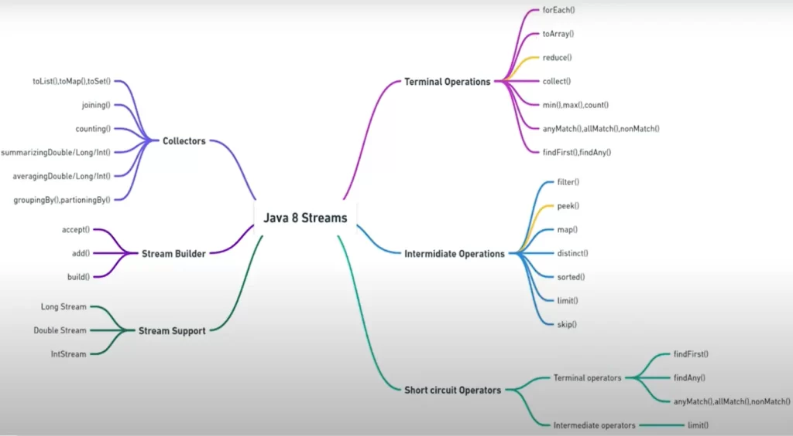

> 🖼️ *The whole Stream API on one page — §2 covers the intermediate operations, §3 the terminal ones, §4 the collectors.*

**① Pipeline structure + the lazy intermediate operations (each returns a new Stream):**

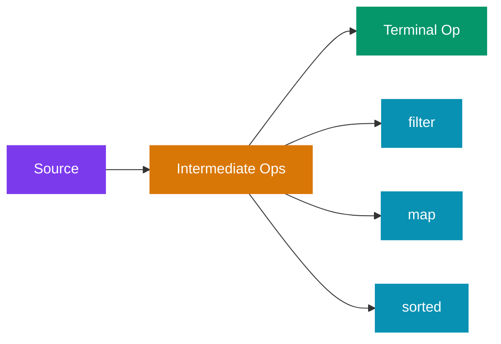

**② The terminal operations — exactly one per pipeline, and it starts the whole pipeline:**

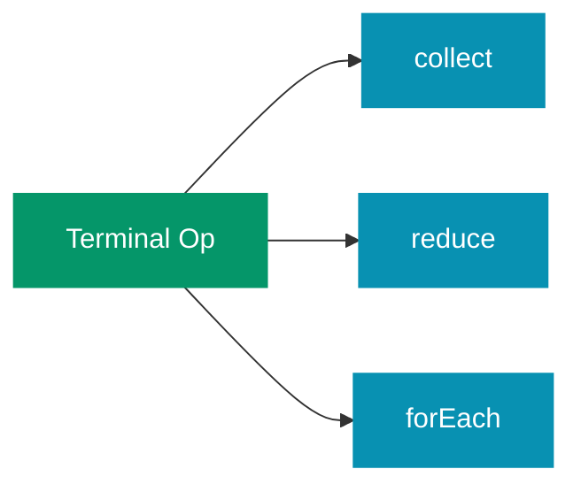

> 🟢 `Terminal Op` is the link between the two diagrams. It matters for two reasons:
> - Nothing in ① actually runs until you call an operation from ② (lazy evaluation).
> - After that call, the stream is consumed and cannot be reused.

<a id="qa-on-streams--parallel-streams"></a>

## 1. Stream Concepts & Parallel Streams

1. **🌊 What are streams? 🔥🔥**

<!-- -->
<details>
<summary>Answer</summary>

**Answer:**

- 🌊 Use streams when you want to process many objects of a collection.
- ⚙️ Streams give a way to work on a collection in Java 8.
- 🔄 `Stream<T>` is an **interface** (`java.util.stream.Stream`). It is not a class and not an `Iterator`.
  - It lets you process a *sequence of elements* in a functional style.
  - It does not store any data of its own.
  - It is **single-use**. After a terminal operation runs, using the same stream again throws `IllegalStateException: stream has already been operated upon or closed`.

🛠️ **Example:** Get all objects from the list whose value is greater than or equal to 15.

**Using Normal programming:**

```java
import java.util.ArrayList;
import java.util.Arrays;
import java.util.List;

public class Test {
    public static void main(String[] args) {
        List<Integer> list = Arrays.asList(10, 20, 12, 33, 9);
        System.out.println(findElements(list)); // [20, 33]
    }

    public static List<Integer> findElements(List<Integer> list) {
        List<Integer> newAl = new ArrayList<>();
        for (Integer i : list) {
            if (i >= 15) {
                newAl.add(i);
            }
        }
        return newAl;
    }
}
```

**Using Streams:**

```java
import java.util.Arrays;
import java.util.List;
import java.util.stream.Collectors;

public class Test {
    public static void main(String[] args) {
        List<Integer> list = Arrays.asList(10, 20, 12, 33, 9);
        List<Integer> newList = list.stream().filter(x -> x >= 15)
               .collect(Collectors.toList());
        newList.forEach(x -> System.out.println(x));
    }
}
```

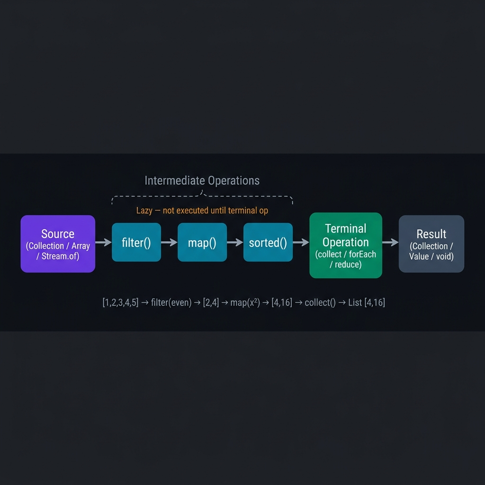

---

</details>

---

2. **❓ Why streams were introduced in Java 8 if we already had java.io.stream? 💤**

<!-- -->
<details>
<summary>Answer</summary>

**Answer:**

- 📁 The `java.io` streams are a sequence of bytes or characters. We use them to read and write data from an I/O source: a file, a network socket, or memory (`ByteArrayInputStream`).
- 🌊 Streams of Java 1.8 are not I/O streams. They process a sequence of elements from a source. The source is usually a collection, but it can also be an array or the lines of a file (`Files.lines()`).
- ⚖️ `java.io` streams move data in and out of a program. Java 8 streams process elements that are already in the program.
- ⚙️ So, if we need to do some operations on a collection, we should use streams.

---

</details>

---

3. **🔄 What is the difference between Java 8 streams and collections? 🔥🔥**

<!-- -->
<details>
<summary>Answer</summary>

**Answer:**

- Use a collection when you want to hold a group of items as one unit.
- Use streams when you want to do operations on many objects in a collection.

| Point | Collection | Stream |
|---|---|---|
| **Purpose** | stores elements | computes a result from elements |
| **Evaluation** | eager — every element exists in memory | lazy — elements are computed only when a terminal operation asks |
| **Iteration** | external — *you* write the loop (`for`, `Iterator`) | internal — the stream runs the loop for you |
| **Reuse** | read it as many times as you want | **single use** — a second terminal operation throws `IllegalStateException` |
| **Size** | always finite | can be infinite (`Stream.iterate`, `Stream.generate`) with `limit()` |
| **Changes the source?** | `add()` / `remove()` change it | never — it returns a new result |
| **Parallel** | you manage threads yourself | `parallelStream()` splits the work for you |

```java
Stream<Integer> s = Arrays.asList(1, 2, 3).stream();
s.forEach(System.out::println);
s.forEach(System.out::println);
// ❌️ IllegalStateException: stream has already been operated upon or closed

Stream.iterate(1, i -> i * 2).limit(5).forEach(System.out::println);  // 1 2 4 8 16 — infinite source, cut by limit()
```

🧠 **In Simple Words:** Collections are for *storing* data, Streams are for *processing* data. A stream is a one-time, lazy view over a source. It is not a container.

---

</details>

---

4. **🏭 How do you create a stream from values or an array with `Stream.of()`? ⚡**

<!-- -->
<details>
<summary>Answer</summary>

**Answer:**

- Streams do not work only with collections. They work with **any group of values**.
- You can use a stream even for arrays.
- The `Stream.of()` method can take any group of values and convert them to a stream.

```java
Stream<Integer> stream = Stream.of(15, 25, 52, 10, 8, 9, 21);
stream.forEach(n -> System.out.println(n));

String[] names = { "Know", "Program", "Java" };
Stream.of(names).filter(name -> name.length() > 4)
    .forEach(name -> System.out.println(name)); // Program
```

⚠️ **Trap — `Stream.of()` with a primitive array:**

```java
int[] nums = { 1, 2, 3 };
System.out.println(Stream.of(nums).count());      // 1  ← a Stream<int[]> with ONE element: the array
System.out.println(Arrays.stream(nums).count());  // 3  ← an IntStream of the numbers
System.out.println(IntStream.of(1, 2, 3).sum());  // 6
```

- `Stream.of(T... values)` takes objects. An `int[]` is one object, so it becomes one element.
- With an object array (`String[]`, `Integer[]`), `Stream.of(array)` spreads the elements as expected.
- For primitive arrays, use `Arrays.stream(array)` or `IntStream.of(...)`.

---

</details>

---

5. **🔧 What is an Intermediate operation? 🔥**

<!-- -->
<details>
<summary>Answer</summary>

**Answer:**

Intermediate operations are the operations that return another stream as their result.

💡 **Key Insight:** They are **lazy**. Examples: `filter()`, `map()`, `distinct()`, `sorted()`, `limit()`, `skip()`

```java
List<Integer> intList = Arrays.asList(1, 2, 3, 4, 5);

// Find even numbers, square them, and filter numbers greater than 10
intList.stream().filter(n -> n % 2 == 0)
   .map(n -> n * n).filter(n -> n > 10)
   .forEach(System.out::println); // 16
```

---

</details>

---

6. **🏁 What is Terminal Operation? 🔥**

<!-- -->
<details>
<summary>Answer</summary>

**Answer:**

Terminal operations are the operations that return a non-stream value (a primitive, an object or a collection) or return nothing.

You can chain many intermediate operations. None of them does anything until you call a terminal operation. At that point, all the intermediate operations you called earlier run together with the terminal operation.

🛠️ **Examples:** `forEach()`, `toArray()`, `reduce()`, `collect()`, `min()`, `max()`, `count()`, `anyMatch()`, `allMatch()`, `noneMatch()`, `findFirst()`, `findAny()`

```java
@Data
@AllArgsConstructor
public class Employee {
    private Integer id;
    private String name;

    public void printName() {
        System.out.println("In emp class: " + name);
    }
}
```

```java
import java.util.Arrays;
import java.util.List;

public class Test {
    public static void main(String[] args) {
        Employee e1 = new Employee(1, "A");
        Employee e2 = new Employee(2, "B");
        Employee e3 = new Employee(3, "C");
        Employee e4 = new Employee(4, "D");
        List<Employee> empList = Arrays.asList(e1, e2, e3, e4);

        // display name of those employees whose id is even and call printName() method
        // for them
        empList.stream().filter(e -> e.getId() % 2 == 0).map(e -> {
            e.printName();
            return e.getName();
        }).forEach(System.out::println);
    }
}
```

📤 **Output:**

```
In emp class: B
B
In emp class: D
D
```

What is the output in the case below?

```java
empList.stream().filter(e -> e.getId() % 2 == 0).map(e -> {
    e.printName();
    return e.getName();
});
```

It gives no output. Intermediate operations (like `map()`) are lazy. Without a terminal operator, it does not call the `printName()` method.

🔑 **Key Point:** The intermediate operation will never run if there is no terminal operation.

| Feature | Intermediate Operations 🅰️ | Terminal Operations 🅱️ |
|---------|---------------------------|------------------------|
| **Return Type** | ✅ They return stream | ❌️ They return non-stream values |
| **Chaining** | ✅ Can be chained together to form a pipeline | ❌️ Can't be chained together |
| **Pipeline Count** | Any number of intermediate operations | Maximum one terminal operation, at the end |
| **Loading** | ⏳ Lazily loaded | ⚡ Eagerly loaded |
| **Result** | ❌️ Don't produce end result | ✅ Produce end result |

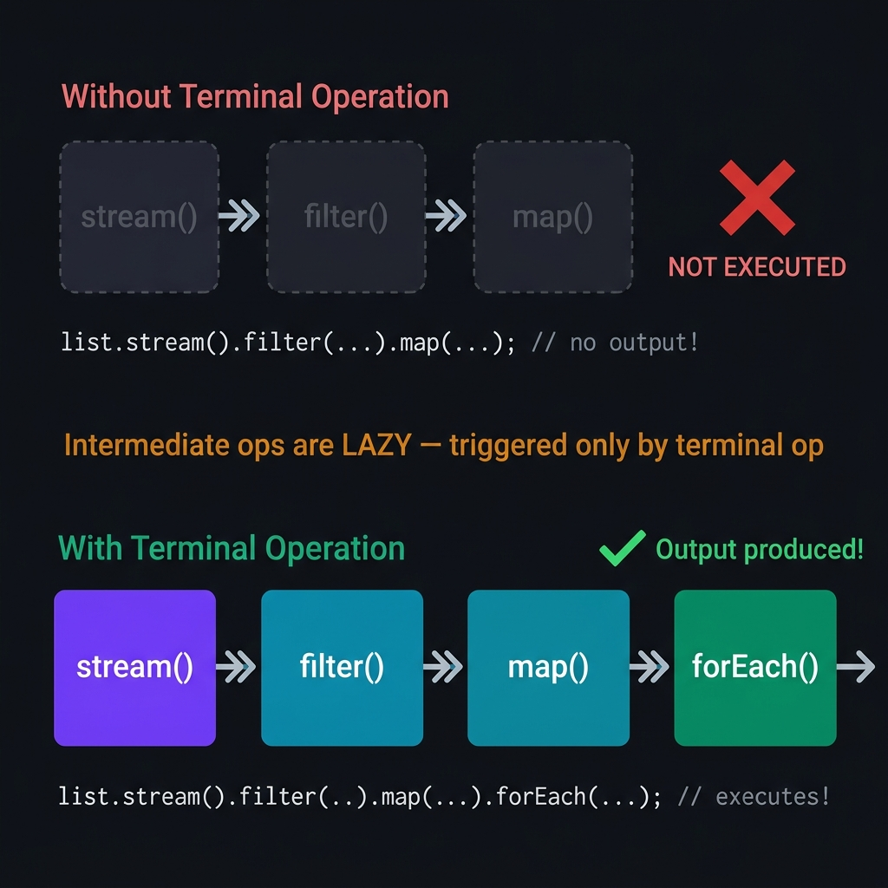

---

</details>

---

7. **🚀 What is a Parallel Stream? 🔥**

<!-- -->
<details>
<summary>Answer</summary>

**Answer:**

- 🚀 Java Parallel Streams came in Java 8 (1.8), together with the Stream API.
- ⚙️ They are meant to use multiple cores of the processor.
- 🔄 A normal (sequential) stream runs on one thread, one element after another.
- ⚡ A parallel stream is still **one** stream. Its source is split into chunks (by a `Spliterator`). Each chunk runs as a task on the threads of `ForkJoinPool.commonPool()`. At the end, the partial results are combined into one result.
- 🖥️ The OS decides which core runs each thread. So "one chunk per core" is the goal, not a promise.
- 🛠️ Create one with `list.parallelStream()` or `stream.parallel()`.

---

</details>

---

8. **⚡ Sequential VS Parallel Streams? 🔥**

<!-- -->
<details>
<summary>Answer</summary>

**Answer:**

The output of this sequential stream is T1, T2, T3, T4, in sequential order. Tasks run one after another, and the output of 1 can be input to another.

- 🔀 The output of this Parallel stream is T2, T4, T1, and T3 not in sequential order.
- ❌️ The order of execution is not under control.
- ⚠️ So use a parallel stream only when:
  - the order of execution of threads does not matter, and
  - the state of one element does not affect another.

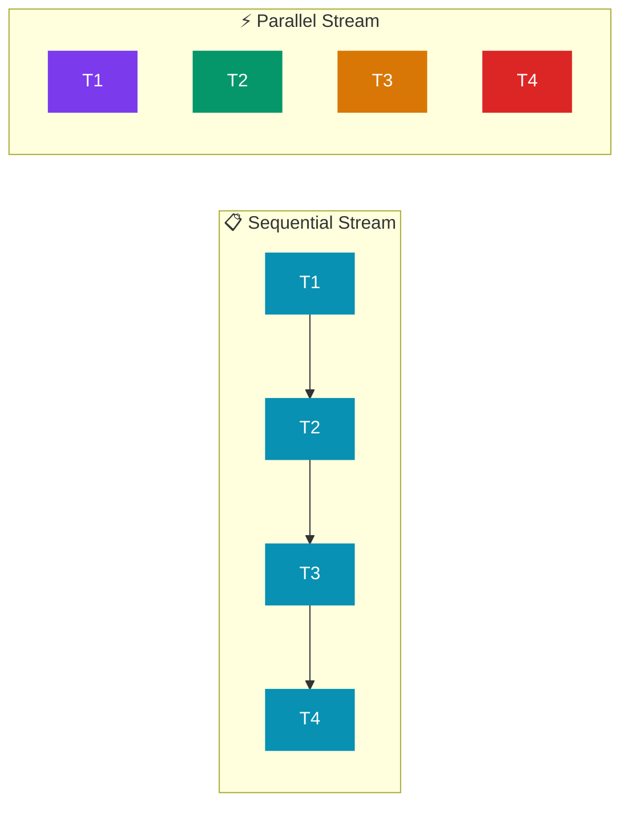

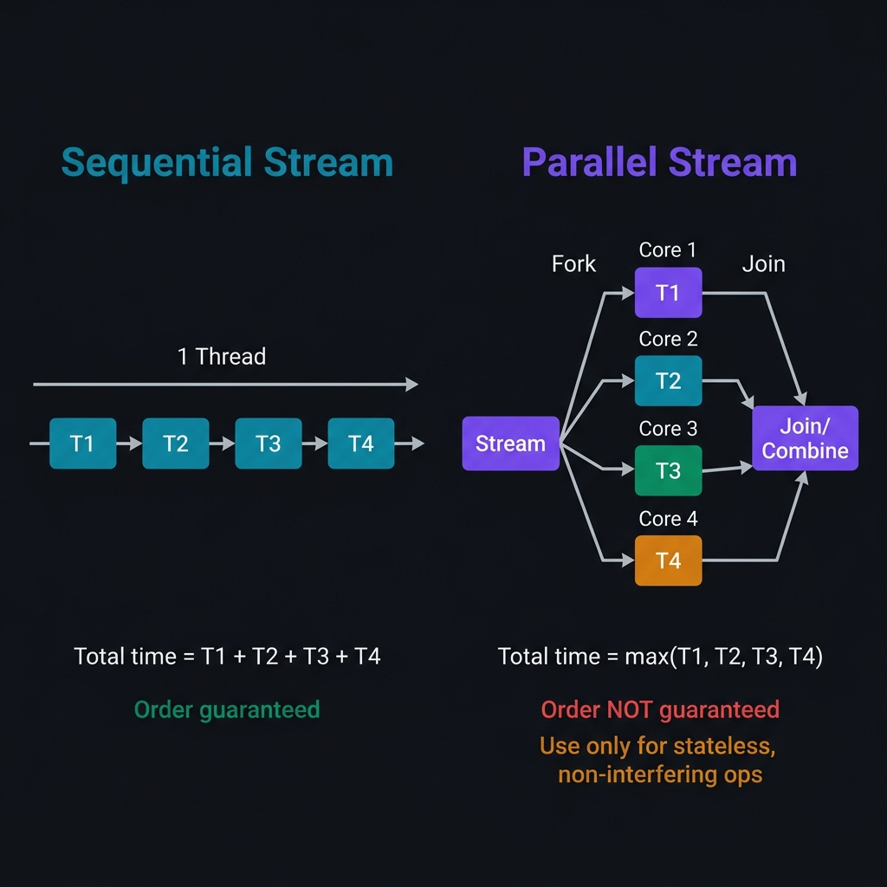

⚙️ **Where do the threads come from? (the follow-up question that shows deep knowledge)**

- 🧵 A parallel stream does **not** create its own threads. It submits work to the **shared `ForkJoinPool.commonPool()`**.
  - This is one pool for the whole JVM.
  - `CompletableFuture`'s default async methods and `Arrays.parallelSort` also use it.
- 🔢 Its default parallelism is **`Runtime.getRuntime().availableProcessors() - 1`** worker threads.
  - The *calling* thread also helps, so the real number of working threads is `availableProcessors()`.
  - On a 12-core machine: `ForkJoinPool.getCommonPoolParallelism()` → `11`.
  - To change it for the whole JVM, use `-Djava.util.concurrent.ForkJoinPool.common.parallelism=N`.
- 🚫 **Never put blocking I/O inside a parallel stream** (JDBC calls, HTTP calls, `Thread.sleep`).
  - The whole JVM shares the common-pool workers. If they are blocked, one slow batch leaves no free worker for every other parallel stream and `CompletableFuture` in the process.
  - Parallel streams are for **CPU-bound** work over large sources that are cheap to split (arrays, `ArrayList`, `IntStream.range`).
  - `LinkedList`, `Iterator`-backed and I/O-backed sources split badly.
- 🎛️ Need a private pool? Submit the terminal operation from inside your own `ForkJoinPool`: `myPool.submit(() -> list.parallelStream()...).get()`.
  - This trick works in practice. But the API does not guarantee it.
  - A dedicated `ExecutorService` is usually the cleaner design.
- 🔀 `forEach` on a parallel stream is **explicitly unordered**. If you need encounter order (the order of the source), use `forEachOrdered` (or `collect`). But you lose some of the parallelism you wanted.
- 📉 For small collections, the cost of splitting + merging + boxing usually makes the parallel version **slower** than the sequential one. Measure it; don't assume.

🎯 **Interview Tip:** Always say that you should use parallel streams only when operations are **stateless, non-interfering, associative**, and order doesn't matter. Also mention the common `ForkJoinPool` before the interviewer asks.

---

</details>

---

<a id="basic-stream-operations"></a>

## 2. Intermediate Operations

Intermediate operations return a new `Stream`. They are **lazy**: nothing runs until a terminal operation is called (see §1 Q5).

1. **🔍 What does `filter` do in Streams? 🔥🔥**

<!-- -->
<details>
<summary>Answer</summary>

**Answer:**

🔍 The `filter` method keeps the elements of a stream that match a given predicate. It is an **intermediate operation**. It returns a new stream that contains only the matching elements.

🛠️ **Example:** Fetch all numbers from a list that are greater than 5.

```java
List<Integer> numbers = Arrays.asList(1, 2, 3, 4, 5, 6, 7, 8, 9, 10);
List<Integer> result = numbers.stream()
                              .filter(n -> n > 5)
                              .collect(Collectors.toList());
System.out.println(result); // [6, 7, 8, 9, 10]
```

💡 **Pro Tip:** `filter` is lazy. It does not process any element until a terminal operation is called.

---

</details>

---

2. **🗺️ What does `map` do in Streams? 🔥🔥**

<!-- -->
<details>
<summary>Answer</summary>

**Answer:**

🔄 The `map` method applies a function to each element in a stream. It is an **intermediate operation**. It returns a new stream of the transformed elements.

🛠️ **Example:** Transform a list of strings into a list of their uppercase versions.

```java
List<String> words = Arrays.asList("apple", "banana", "cherry");
List<String> result = words.stream()
                           .map(str -> str.toUpperCase())
                           .collect(Collectors.toList());
System.out.println(result); // [APPLE, BANANA, CHERRY]
```

🎯 **Interview Tip:** Say that `map` does a one-to-one transformation. `flatMap` does a one-to-many transformation.

🔬 **`filter()` vs `map()` — a common comparison question:**

| | `filter()` | `map()` |
|---|---|---|
| **Takes** | a `Predicate` (true/false test) | a `Function` (transforms a value) |
| **Element count** | **at most** the original count — equal if all match, zero if none match | **exactly** the original count — one-to-one |
| **Element type** | unchanged | may change (`Stream<String>` → `Stream<Integer>`) |

---

</details>

---

3. **📋 What does `flatMap` do in Streams? 🔥🔥**

<!-- -->
<details>
<summary>Answer</summary>

**Answer:**

🗂️ The `flatMap` method flattens nested structures. It maps each element to a stream. Then it merges all those streams into a single stream.

🛠️ **Example:** Given a list of lists of subjects, flatten them into a single list.

```java
List<List<String>> listOfLists = Arrays.asList(
    Arrays.asList("English", "Science"),
    Arrays.asList("Math", "Computer Science")
);
List<String> subjects = listOfLists.stream()
                                   .flatMap(subject -> subject.stream())
                                   .collect(Collectors.toList());
System.out.println(subjects); // [English, Science, Math, Computer Science]
```

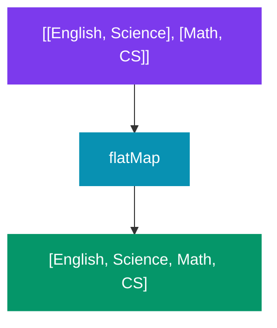

🧠 **In Simple Words:** `map` wraps results in a stream. `flatMap` unwraps them and merges them.

| Feature | `map()` | `flatMap()` |
|---|---|---|
| **Mapper returns** | one value per element | a `Stream` of values per element |
| **Mapping** | one-to-one | one-to-many |
| **Result for `List<List<T>>`** | `Stream<List<T>>` | `Stream<T>` |

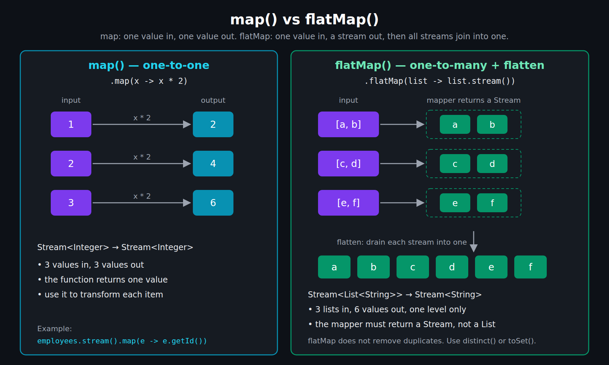

⚠️ **Traps interviewers check:**

- **The mapper must return a `Stream`, not a `List`.** Writing `emp -> emp.getCities()` instead of `emp -> emp.getCities().stream()` is the most common `flatMap` compile error.
- **`flatMap` does not remove duplicates.** If the result has no duplicates, that came from `toSet()` or `distinct()`, not from `flatMap`.
- **`flatMap` closes each inner stream** after it drains it. This matters when the inner stream holds a resource, like `Files.lines(path)`.

---

</details>

---

4. **💎 What does `distinct` do in Streams? 🔥**

<!-- -->
<details>
<summary>Answer</summary>

**Answer:**

🎯 The `distinct` method removes duplicate elements from a stream. It uses `equals()` to decide if two elements are the same.

🛠️ **Example:** Remove duplicates from a list of integers.

```java
List<Integer> numbers = Arrays.asList(1, 2, 2, 3, 3, 4);
List<Integer> results = numbers.stream()
                               .distinct()
                               .collect(Collectors.toList());
System.out.println(results); // [1, 2, 3, 4]
```

⚠️ **Caution:** For custom objects, make sure you override `equals()` and `hashCode()`. If you don't, `distinct` won't work as expected.

---

</details>

---

5. **📊 What does `sorted` do in Streams? 🔥**

<!-- -->
<details>
<summary>Answer</summary>

**Answer:**

📊 The `sorted` method returns a stream with the elements sorted. It uses natural order, or a `Comparator` that you pass.

🛠️ **Example:** Sort a list of names in reverse alphabetical order.

```java
List<String> names = Arrays.asList("John", "Jane", "Alice", "Bob");
List<String> results = names.stream()
                            .sorted(Comparator.reverseOrder())
                            .collect(Collectors.toList());
System.out.println(results); // [John, Jane, Bob, Alice]
```

💡 **Pro Tip:** Instead of `sorted(Comparator.reverseOrder())` you can also use `sorted(Collections.reverseOrder())` or `sorted((a, b) -> b.compareTo(a))`.

⚠️ **Do not reverse by negating `compareTo`** — `(a, b) -> -a.compareTo(b)`. It gives the right answer for `Integer`, but it is not safe in general:

- The comparator contract only promises a *negative / zero / positive* result. So a comparator may return `Integer.MIN_VALUE`.
- `-Integer.MIN_VALUE` overflows back to `Integer.MIN_VALUE`. So the "reversed" comparator reports the same order.
- Use `Comparator.reverseOrder()`, `.reversed()`, or swap the operands: `(a, b) -> b.compareTo(a)`.

---

</details>

---

6. **🪜 How do you sort a stream of objects by a field, then by a second field, with `Comparator.comparing`? 🔥🔥**

<!-- -->
<details>
<summary>Answer</summary>

**Answer:**

🪜 `Comparator.comparing(keyExtractor)` builds a comparator from a **field getter**. `.thenComparing(...)` adds a tie-breaker to it. This is the single most common sorting task in a live coding round. You can read the chain like a normal spoken sentence.

All the outputs below come from running this exact data:

```java
class Loan {
    private final String id;
    private final String status;
    private final BigDecimal amount;
    private final int tenureMonths;
    // constructor, getters; toString() returns the id
}

List<Loan> loans = Arrays.asList(
        new Loan("L3", "APPROVED", new BigDecimal("50000"),  24),
        new Loan("L1", "PENDING",  new BigDecimal("120000"), 36),
        new Loan("L2", "APPROVED", new BigDecimal("120000"), 12),
        new Loan("L4", "PENDING",  new BigDecimal("50000"),  12));
```

🛠️ **1 — one key, ascending.** The extracted key must be `Comparable` (`BigDecimal` is):

```java
loans.stream()
     .sorted(Comparator.comparing(Loan::getAmount))
     .collect(Collectors.toList());
// [L3, L4, L1, L2]
```

Note that `L3` comes before `L4`, and `L1` comes before `L2`. Both pairs have the same amount. **For an ordered stream (like this one, from a `List`), `sorted` is stable.** It does not reorder equal elements. So tied elements keep their original encounter order. An unordered stream gives no such promise. This stability makes `thenComparing` chains predictable.

🛠️ **2 — two keys, the second one descending.** Pass a key comparator as the second argument of `thenComparing`. This reverses **only that key**:

```java
loans.stream()
     .sorted(Comparator.comparing(Loan::getStatus)
                       .thenComparing(Loan::getAmount, Comparator.reverseOrder()))
     .collect(Collectors.toList());
// [L2, L3, L1, L4]
//  APPROVED: 120000, 50000  |  PENDING: 120000, 50000
```

🛠️ **3 — ⚠️ `.reversed()` reverses the *whole chain*, not the last key.** This is the common mistake:

```java
loans.stream()
     .sorted(Comparator.comparing(Loan::getStatus)
                       .thenComparing(Loan::getAmount)
                       .reversed())
     .collect(Collectors.toList());
// [L1, L4, L2, L3]
```

Compare it with the un-reversed chain, which gives `[L3, L2, L4, L1]`. The `.reversed()` result is that list read backwards: **status descending *and* amount descending**.

- `.reversed()` is a method on the *composed* `Comparator`.
- So when you call it, the whole chain is already one object.
- If you want "status ascending, amount descending", use example 2.

🛠️ **4 — `comparingInt` for primitive keys.**

- `comparing` takes a `Function<T, U extends Comparable>`. So an `int` field is **boxed to `Integer` on every key extraction**.
- `comparingInt` takes a `ToIntFunction<T>` and compares primitives. So nothing is boxed:

```java
loans.stream()
     .sorted(Comparator.comparingInt(Loan::getTenureMonths))
     .collect(Collectors.toList());
// [L2, L4, L3, L1]
```

The same applies to `comparingLong` / `comparingDouble`. In the chain position, use `thenComparingInt` / `thenComparingLong` / `thenComparingDouble`. On a small list, it makes no measurable difference. On a hot path (code that runs very often) over a large collection, the right choice costs nothing extra.

🛠️ **5 — ⚠️ a `null` key throws `NullPointerException`.** `comparing` calls `compareTo` on the extracted key. So one null field makes the whole sort fail:

```java
// one extra loan whose status is null
loans.stream().sorted(Comparator.comparing(Loan::getStatus)).collect(Collectors.toList());
// java.lang.NullPointerException
```

Wrap the **key comparator**, not the outer comparator:

```java
loans.stream()
     .sorted(Comparator.comparing(Loan::getStatus,
                                  Comparator.nullsLast(Comparator.naturalOrder())))
     .collect(Collectors.toList());
// [L3, L2, L1, L4, L5]   ← L5 (null status) sorted to the end
```

`Comparator.nullsFirst(...)` puts them at the front instead.

🎯 **Interview Tip — the 4 points to say in the interview:**

1. `comparing` for the primary key.
2. `thenComparing` for tie-breakers.
3. `reversed()` flips the entire chain. If you want only one field descending, use a key comparator.
4. `comparing` throws an NPE on a null key, unless you wrap it in `nullsFirst` / `nullsLast`.

That is the whole answer.

<details>
<summary><strong>🤔 Doubt: If `.reversed()` flips the whole chain, how do I sort by status ascending and amount descending?</strong></summary>

There are three ways, from most readable to least readable:

**1. A key comparator on the descending field.** This is the standard answer (example 2 above):

```java
Comparator.comparing(Loan::getStatus)
          .thenComparing(Loan::getAmount, Comparator.reverseOrder())
```

**2. Reverse the key extractor's own comparator inline.** It does the same thing, written differently:

```java
Comparator.comparing(Loan::getStatus)
          .thenComparing(Comparator.comparing(Loan::getAmount).reversed())
```

This works because `.reversed()` now applies to the *inner* one-key comparator. It applies before you add that comparator to the chain. It does not apply to the composed chain.

**3. Negate a numeric key** — `comparing(l -> -l.getTenureMonths())`. ❌️ Avoid it. It breaks on `Integer.MIN_VALUE` without any error. It does not work at all for `String` or `BigDecimal`.

💡 Remember this model: `comparing(...).thenComparing(...)` returns **one** `Comparator` object. Every method you call after that point works on that whole object. It does not work on the last link you typed.

---

</details>
<br/>

---

</details>

---

7. **👀 What does `peek` do in Streams? 🔥**

<!-- -->
<details>
<summary>Answer</summary>

**Answer:**

🔍 You mainly use the `peek` method for **debugging**. It performs an action on each element without changing the stream itself. It is an intermediate operation.

🛠️ **Example:** Print each element in a list while converting them to uppercase.

```java
List<String> names = Arrays.asList("John", "Jane", "Alice", "Bob");
List<String> results = names.stream()
                             .map(name -> name.toUpperCase())
                             .peek(System.out::println)
                             .collect(Collectors.toList());
System.out.println(results);
```

📤 **Output:**

```
JOHN
JANE
ALICE
BOB
[JOHN, JANE, ALICE, BOB]
```

⚠️ **Caution — `peek` may never run at all.** It is meant for debugging only. Never put business logic in it.

- The obvious reason is short-circuiting (`findFirst`, `anyMatch`, `limit` stop early).
- The surprising reason is worth remembering:

```java
long n = Stream.of("x", "y", "z").peek(System.out::print).count();
System.out.println(n);
```

📤 **Output:**

```
3
```

The `peek` prints **nothing**. Since Java 9, `count()` may skip the pipeline entirely. This happens when both are true:

- It can read the element count directly from the source (a `SIZED` spliterator).
- No upstream operation can change that count.

So the stream skips (elides) the whole traversal, including `peek`. Nothing short-circuited here. The pipeline simply never ran. If you add any operation that can change the size, the output comes back:

```java
long n = Stream.of("x", "y", "z").peek(System.out::print).filter(s -> true).count();
// prints: xyz   then 3
```

🎯 **Interview Tip:** the honest short answer is *"`peek` may not run. It depends on what the terminal operation needs. So it is a debugging tool, not a place for logic that must run."*

<details>
<summary><strong>🤔 Doubt: In what order do the operations run — all of `filter` first, then all of `map`?</strong></summary>

No. A stream runs **one element at a time, through the whole pipeline**. Element 1 goes through `filter`, then `map`, then the terminal operation. Only then does element 2 start. Verified:

```java
Stream.of("b", "a", "c")
      .filter(x -> { System.out.println("filter " + x); return true; })
      .map(x -> { System.out.println("map " + x); return x; })
      .forEach(x -> System.out.println("forEach " + x));
// filter b, map b, forEach b, filter a, map a, forEach a, filter c, map c, forEach c
```

A **stateful barrier** like `sorted()` breaks this. Everything before it runs for all elements first. Then the sorted elements flow on, one at a time:

```java
Stream.of("b", "a", "c").map(...).sorted().forEach(...);
// map b, map a, map c, forEach a, forEach b, forEach c
```

💡 This is why `filter` should come **before** `map` when you can. Elements that fail the filter never reach the more costly `map` call.

---

</details>
<br/>

---

</details>

---

8. **✂️ What does `limit` do in Streams? ⚡**

<!-- -->
<details>
<summary>Answer</summary>

**Answer:**

✂️ The `limit` method cuts the stream so it has no more than a given number of elements. It is a short-circuiting intermediate operation (it can stop the stream early).

🛠️ **Example:** Find the first 3 smallest numbers in a given list.

```java
List<Integer> numbers = Arrays.asList(10, 2, 13, 40, 5, 26, 77, 58, 91, 11);
List<Integer> results = numbers.stream()
                              .sorted()
                              .limit(3)
                              .collect(Collectors.toList());
System.out.println(results); // [2, 5, 10]
```

⚠️ **Caution — `limit` short-circuits, but a `sorted()` before it cancels that.** `sorted` is a **stateful barrier** operation. It must consume *every* element before it can emit the first one. So nothing upstream of it can stop early. We verified this by counting comparator calls on the 10-element list above:

```
sorted().limit(3)   →  22 comparator calls   (a full O(n log n) sort, then a truncate)
```

So this pipeline is *not* "find the 3 smallest with early exit". It is "sort all 10, then take 3". `limit` still short-circuits everything **downstream** of it (the `collect` only ever sees 3 elements). That is why `Stream.iterate(1, i -> i + 1).limit(5)` terminates on an infinite stream.

🧠 **In Simple Words — stateless vs stateful intermediate operations.** We built this table by counting how many source elements each pipeline actually pulls from a 10-element list:

| Operation | Kind | Elements pulled by `…(op).limit(3)` |
|---|---|---|
| `filter`, `map`, `flatMap`, `peek` | **stateless** — each element handled independently | 3 |
| `limit(3)` | **short-circuiting** — caps the count, source stops pulling | 3 |
| `distinct()` | **stateful but streaming** — keeps a seen-set, still emits as it goes | 3 |
| `sorted()` | **stateful barrier** — must consume everything before emitting anything | **10** |
| `skip(3)` | **stateful, *not* short-circuiting** — pulls and drops the first 3, then the later `limit` stops it | **6** |

⚠️ Note the last row. `skip` is stateful but does **not** short-circuit by itself. It must pull and drop the first *n*. After that, the downstream `limit(3)` stops the source, so 3 + 3 = 6 elements are pulled. With `skip(3)` alone, all 10 are pulled. Only `limit`, `takeWhile` (Java 9+) and the terminal ops `findFirst` / `findAny` / `*Match` actually stop the source.

💡 A practical test for "does this work on an infinite stream": `Stream.iterate(0, i -> (i + 1) % 4).distinct().limit(4)` **terminates** (verified → `[0, 1, 2, 3]`). It works because `distinct` emits elements as it goes. If you put a `sorted()` in that pipeline, it hangs forever.

📝 **Two more rules of `limit`:**

- A negative size throws `IllegalArgumentException` — `limit(-2)`.
- It is cheap on a sequential stream. On an **ordered parallel** stream it can be costly, because it must keep the *first* n elements in encounter order. If order does not matter, call `unordered()` first.

---

</details>

---

9. **⏭️ What does `skip` do in Streams? ⚡**

<!-- -->
<details>
<summary>Answer</summary>

**Answer:**

⏭️ The `skip` method drops the first *n* elements of a stream. It returns the remaining elements.

🛠️ **Example:** Fetch all elements except the first 3 smallest numbers.

```java
List<Integer> numbers = Arrays.asList(10, 2, 13, 40, 5, 26, 77, 58, 91, 11);
List<Integer> results = numbers.stream()
                               .sorted()
                               .skip(3)
                               .collect(Collectors.toList());
System.out.println(results); // [11, 13, 26, 40, 58, 77, 91]
```

🧠 **In Simple Words:** `limit(n)` keeps the first *n*. `skip(n)` drops the first *n*. Together, you use them for pagination. If *n* is larger than the stream, `skip(n)` gives an empty stream.

⚠️ **`skip` / `limit` on a `HashSet` need a `sorted()` first.** Say the question is "2nd and 3rd youngest age" and the ages are in a set:

```java
Set<Integer> uniqueAges = new HashSet<>(List.of(18, 24, 25));  // or collect(Collectors.toSet())
List<Integer> result = uniqueAges.stream()
        .sorted()        // MANDATORY
        .skip(1)
        .limit(2)
        .collect(Collectors.toList());
System.out.println(result); // [24, 25]
```

- A `HashSet` has **no defined encounter order**. Without `sorted()`, `skip(1)` drops whatever element the set happens to give first.
- With small `Integer`s it often *looks* sorted by chance. `Integer.hashCode()` is the value itself, and the bucket is `hash & 15` in a 16-slot table. So 18, 24 and 25 land in buckets 2, 8 and 9, which happens to be ascending order. This is an implementation detail, not a contract.
- Any "2nd smallest / top 3 / youngest" question needs an explicit `sorted()` (or a `TreeSet`).
- ⚠️ `Set.of(18, 24, 25)` is **not** a `HashSet`. Its order is random per JVM (verified: 4 different orders in 5 runs). So without `sorted()` it fails even on small numbers.

---

</details>

---

<a id="terminal-operations"></a>

## 3. Terminal Operations

Terminal operations end the pipeline. They start the work and return a result (or nothing). After one runs, the stream is used up (see §1 Q6).

1. **🔁 What does `forEach` do in Streams? ⚡**

<!-- -->
<details>
<summary>Answer</summary>

**Answer:**

🔁 The `forEach` method is a **terminal operation** that performs an action on each element of the stream.

🛠️ **Example:** Print each element of a list with the prefix "Item: ".

```java
List<String> words = Arrays.asList("apple", "banana", "cherry");
words.stream()
     .forEach(word -> System.out.println("Item: " + word));
```

📤 **Output** — `println` inside `forEach` prints one line per element. It does not print one comma-joined line:

```
Item: apple
Item: banana
Item: cherry
```

⚠️ **Caution:** `forEach` does not guarantee order in parallel streams. Use `forEachOrdered` if order matters.

---

</details>

---

2. **📦 What does `collect` do in Streams? 🔥🔥**

<!-- -->
<details>
<summary>Answer</summary>

**Answer:**

📦 The `collect` method is a **terminal operation**. It uses a `Collector` to turn the elements of a stream into a different form. Usually this form is a `List`, `Set`, or `Map`.

🛠️ **Example:** Collect a list of integers into a `Set`.

```java
List<Integer> numbers = Arrays.asList(1, 2, 3, 4, 4, 5);
Set<Integer> result = numbers.stream()
                              .collect(Collectors.toSet());
// result: [1, 2, 3, 4, 5]
```

💡 **Pro Tip:** The `Collectors` utility class has many built-in collectors: `toList()`, `toSet()`, `toMap()`, `groupingBy()`, `joining()`, and more.

---

</details>

---

3. **⚙️ What does `reduce` do in Streams? 🔥🔥**

<!-- -->
<details>
<summary>Answer</summary>

**Answer:**

⚙️ The `reduce` method does a **reduction** on the elements of a stream. It combines them into a single result. It applies a binary operation (a function taking two arguments and returning one result) again and again, until it has processed all elements.

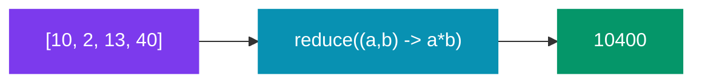

🛠️ **Example 1:** Compute the product of all numbers in a list.

```java
List<Integer> numbers = Arrays.asList(10, 2, 13, 40);
Integer results = numbers.stream()
                         .reduce((a, b) -> a * b)
                         .orElse(0);          // no identity -> Optional
System.out.println(results); // 10400
```

🛠️ **Example 2:** Compute the sum of all numbers in a list. This time we pass an identity, so there is no `Optional` to unwrap at all.

```java
List<Integer> numbers = Arrays.asList(10, 2, 13, 40);
int results = numbers.stream()
                     .reduce(0, Integer::sum);   // identity -> plain int
System.out.println(results); // 65
```

🎯 **Interview Tip:** `reduce` without an identity value returns an `Optional` (because the stream might be empty). With an identity value like `reduce(0, Integer::sum)`, it returns the type directly. On an empty stream, the 2-arg form returns the identity (`0`), not an exception.

🔢 **The 3rd overload — identity + accumulator + combiner.** Use it when the result type is different from the element type:

```java
int totalChars = Stream.of("aa", "bbb", "c")
    .reduce(0,                             // identity, type U = Integer
            (acc, s) -> acc + s.length(),  // accumulator: U × T → U
            Integer::sum);                 // combiner:    U × U → U
// 6
```

📏 **The two contracts you must state:**

- **Identity:** `accumulator.apply(identity, x)` must equal `x`. Use `0` for sum, `1` for product, `""` for concatenation. If you get it wrong, a *parallel* stream adds the identity once per split, with no error. A sum with identity `1` is off by 1 when sequential, and off by 4 over 4 parallel splits.
- **Associativity:** `(a op b) op c` must equal `a op (b op c)`. Subtraction and division are **not** associative. So `reduce((a, b) -> a - b)` gives a different answer under `.parallel()`.

🤝 **Why the combiner exists:** it merges the partial results of two parallel sub-tasks. In practice a sequential run does not call it (the spec does not promise this), but the compiler still requires it. So a wrong combiner shows up only when someone adds `.parallel()`.

🪣 **`reduce` vs `collect`:**

- `reduce` is for **immutable** reduction. Each step returns a *new* value.
- Adding into a mutable container with `reduce` (`(list, x) -> { list.add(x); return list; }`) is a bug. All splits share one container, and threads race on it under `.parallel()`.
- `collect()` is made for this case. It takes a supplier / accumulator / combiner, and each split gets its own container.

---

</details>

---

4. **✅ What do `allMatch`, `anyMatch` and `noneMatch` do in Streams? 🔥**

<!-- -->
<details>
<summary>Answer</summary>

**Answer:**

✅ All three take a `Predicate`, return a `boolean`, and are **short-circuiting terminal operations**:

- `allMatch` — `true` if **every** element matches.
- `anyMatch` — `true` if **at least one** element matches.
- `noneMatch` — `true` if **no** element matches.

🛠️ **Example:**

```java
List<Integer> numbers = Arrays.asList(10, 2, 13, 40);
System.out.println(numbers.stream().allMatch(n -> n > 0));    // true  — all are positive
System.out.println(numbers.stream().anyMatch(n -> n > 30));   // true  — 40 matches
System.out.println(numbers.stream().noneMatch(n -> n < 0));   // true  — no negatives
```

| Method | Returns `true` when | Stops early at… | …and then returns |
|--------|---------------------|-----------------|-------------------|
| **`allMatch`** | All elements match | the first **non**-matching element | `false` |
| **`anyMatch`** | At least one matches | the first **matching** element | `true` |
| **`noneMatch`** | No elements match | the first **matching** element | `false` |

⚡ **All three short-circuit.** Once the answer is decided, none of them scans the rest of the stream. Verified:

- `Stream.of(1, -2, 3, 4, 5).peek(count).allMatch(x -> x > 0)` touches only **2** elements before returning `false`.
- The same stream with `.noneMatch(x -> x < 0)` also touches only 2 before returning `false`.

🧠 **In Simple Words:** on an **empty stream** the answers are `allMatch = true`, `anyMatch = false`, `noneMatch = true` (verified). `allMatch` returns `true` on an empty stream because of *vacuous truth*. The claim "every element matches" is true by default when there are no elements. This is a common trap question.

---

</details>

---

5. **🥇 What does `findFirst` do in Streams? 🔥**

<!-- -->
<details>
<summary>Answer</summary>

**Answer:**

🥇 The `findFirst` method gets the **first element** in a stream that matches a given condition. If there is no filter, it gets just the first element. It returns the result wrapped in an `Optional`.

🛠️ **Example:** Find the first element in a list that starts with the letter 'b'.

```java
List<String> words = Arrays.asList("apple", "banana", "cherry", "blackberry");
String result = words.stream()
                     .filter(s -> s.startsWith("b"))
                     .findFirst()
                     .orElse("no match");
System.out.println(result); // banana
```

⚠️ **Caution — never unwrap with `.get()`.** Calling `.get()` on an empty `Optional` throws `NoSuchElementException` with only the generic message `"No value present"`. At 3am, that error does not tell you what was missing. Use one of these:

| Form | Since | Use when |
|---|---|---|
| `.orElse(default)` | Java 8 | you have a sensible fallback value |
| `.orElseGet(() -> expensive())` | Java 8 | the fallback costs something to build |
| `.orElseThrow(() -> new XNotFoundException(id))` | Java 8 | absence is an error, and you want a *useful* message |
| `.ifPresent(x -> …)` | Java 8 | you only want the side effect |
| `.orElseThrow()` | **Java 10** | a short "can't be empty here" check. The no-arg form does **not** exist in Java 8 |

---

</details>

---

6. **🔀 What does `findAny` do in Streams? 🔥**

<!-- -->
<details>
<summary>Answer</summary>

**Answer:**

🔀 The `findAny` method gets **any** element from the stream that matches a given condition. It returns the element wrapped in an `Optional`.

🛠️ **Example:** Find any element in a list that starts with the letter 'b'.

```java
List<String> words = Arrays.asList("apple", "banana", "cherry", "blackberry");
String result = words.stream().filter(s -> s.startsWith("b")).findAny().orElse("no match");
System.out.println(result); // banana — on a sequential stream, in this implementation
```

| Feature | `findFirst` 🥇 | `findAny` 🔀 |
|---------|----------------|--------------|
| **Deterministic** | ✅ Always returns the first match | ❌️ May return any match |
| **Parallel Streams** | 🐢 Slower (must preserve order) | ⚡ Faster (no ordering constraint) |
| **Use Case** | When order matters | When any match is acceptable |

⚠️ **Careful how you phrase this.** It is easy to say *"in a sequential stream `findAny` behaves like `findFirst`"*. On HotSpot it does, and the snippet above prints `banana`. But the javadoc says it clearly: *"The behavior of this operation is explicitly nondeterministic; it is free to select any element in the stream."* So the correct answer is: **"On a sequential stream it returns the first element in practice. That is how the JDK works today, not a guarantee. Never rely on it."** If you say it is a guarantee, an interviewer can use that exact sentence as a trap question.

🎯 **Interview Tip:** The real difference shows in **parallel streams**:

- `findFirst` must wait for the split that holds the earliest matching element.
- `findAny` can return as soon as *any* split finds one.

If you need determinism (the same result on every run), use `findFirst`. It has a real cost, but it also gives you a correct result.

---

</details>

---

7. **📈 What do `max` and `min` do in Streams? 🔥**

<!-- -->
<details>
<summary>Answer</summary>

**Answer:**

📊 The `max` and `min` methods find the maximum and minimum elements in a stream. On a `Stream<T>` they always need a `Comparator`. Only `IntStream`, `LongStream` and `DoubleStream` have `max()` / `min()` with no argument. Both return an `Optional<T>`, so they can handle empty streams.

🛠️ **Example:** Find the maximum and minimum values from a list of integers.

```java
List<Integer> numbers = Arrays.asList(5, 1, 8, 3, 9);
Integer max = numbers.stream().max(Integer::compareTo)
                     .orElseThrow(() -> new NoSuchElementException("empty list"));
Integer min = numbers.stream().min(Integer::compareTo)
                     .orElseThrow(() -> new NoSuchElementException("empty list"));
System.out.println(max + " " + min); // 9 1
```

Or, with a lambda comparator and a default value (`orElse`) instead of an exception:

```java
Integer max = numbers.stream().max((a, b) -> a.compareTo(b)).orElse(Integer.MIN_VALUE);
Integer min = numbers.stream().min((a, b) -> a.compareTo(b)).orElse(Integer.MAX_VALUE);
```

💡 **Pro Tip:** for a stream of numbers, prefer the primitive form. It skips the boxing, *and* the empty result gets a clearer type name:

```java
OptionalInt max = numbers.stream().mapToInt(Integer::intValue).max();
System.out.println(max); // OptionalInt[9]
```

<details>
<summary><strong>🤔 Doubt: What are primitive streams, and when do I use `mapToInt`, `boxed` and `mapToObj`?</strong></summary>

`IntStream`, `LongStream` and `DoubleStream` hold raw `int` / `long` / `double` values. A `Stream<Integer>` holds `Integer` objects. Primitive streams exist for two reasons:

- **No boxing.** Each `Integer` is an object on the heap. On a large stream, boxing costs memory and time.
- **Number methods.** Only primitive streams have `sum()`, `average()`, `summaryStatistics()`, and `max()` / `min()` with no comparator.

You move between the two kinds with three methods:

| Method | From → To | Example |
|---|---|---|
| `mapToInt(...)` (also `mapToLong`, `mapToDouble`) | `Stream<T>` → `IntStream` | `nums.stream().mapToInt(Integer::intValue).sum()` → `27` |
| `boxed()` | `IntStream` → `Stream<Integer>` | `IntStream.range(0, 3).boxed().collect(Collectors.toList())` → `[0, 1, 2]` |
| `mapToObj(...)` | `IntStream` → `Stream<T>` | `IntStream.rangeClosed(1, 3).mapToObj(i -> "#" + i)` → `[#1, #2, #3]` |

(The examples use `nums = List.of(4, 8, 15)`, and all outputs are verified.)

Points that interviewers check:

- **`range(a, b)` excludes `b`. `rangeClosed(a, b)` includes `b`.** `range(0, 3)` gives 0, 1, 2. You use it to loop over indexes in a stream.
- **`sum()` returns a plain number. `average()` returns an `OptionalDouble`.** On an empty stream, `sum()` is `0` but `average()` is `OptionalDouble.empty` — there is no average of nothing.
- **`IntStream` cannot be collected with `collect(Collectors.toList())`.** `IntStream.collect` takes three arguments, not a `Collector`. So call `boxed()` first. This is a common compile error in live rounds.

---

</details>
<br/>

---

</details>

---

8. **🔲 What does `toArray` do in Streams? 💤**

<!-- -->
<details>
<summary>Answer</summary>

**Answer:**

📦 The `toArray` method converts a stream's elements into an array. You can pass a constructor reference to get a typed array instead of `Object[]`.

🛠️ **Example:** Convert a list of Strings into an array.

```java
List<String> words = Arrays.asList("apple", "banana", "cherry", "blackberry");

String[] result = words.stream().toArray(String[]::new);

System.out.println(Arrays.toString(result));
// [apple, banana, cherry, blackberry]
```

⚠️ **Don't confuse it with `Collection.toArray`.** Four calls look alike:

| Call | Since | Notes |
|---|---|---|
| `stream().toArray()` | Java 8 | returns `Object[]` — you lose the element type |
| `stream().toArray(String[]::new)` | Java 8 | `Stream.toArray(IntFunction)` — **this is the Stream API method** |
| `list.toArray(new String[0])` | Java 1.2 (generic since Java 5) | `Collection.toArray(T[])` — not a stream operation at all |
| `list.toArray(String[]::new)` | **Java 11** | `Collection.toArray(IntFunction)` — won't compile on Java 8 |

💡 **Pro Tip:** The `IntFunction` you pass is an *array constructor*, not an array. The stream calls it with the required size once it knows the size. That is why `String[]::new` works here and `new String[0]` does not:

- `Stream.toArray` wants a **factory**.
- `Collection.toArray` wants an **instance**.

---

</details>

---

9. **🔢 What does `count` do in Streams? ⚡**

<!-- -->
<details>
<summary>Answer</summary>

**Answer:**

🔢 The `count` method returns the number of elements in a stream as a `long`. It is a **terminal operation**.

🛠️ **Example 1:** Count the number of strings in a list.

```java
List<String> words = Arrays.asList("apple", "banana", "cherry", "blackberry");
long count = words.stream().count();
System.out.println(count); // 4
```

🛠️ **Example 2:** Count the number of strings starting with "b" in a given list.

```java
List<String> words = Arrays.asList("apple", "banana", "cherry", "blackberry");
long count = words.stream().filter(s -> s.startsWith("b")).count();
System.out.println(count); // 2
```

---

</details>

---

<a id="complex-java-8-stream-operations"></a>

## 4. Collectors

Collectors are recipes you pass to `collect()`. They are ordered by interview priority. The last three are Java 9+ or parallel-only extras (💤).

1. **🗂️ What does `groupingBy` do in Streams? 🔥🔥**

<!-- -->
<details>
<summary>Answer</summary>

**Answer:**

🗂️ The `groupingBy` method groups the elements of a stream. It uses a classifier function (a function that picks the group key for each element). It returns a `Map`:

- The keys are the results of the classifier.
- The values are lists of the items for each key.

🛠️ **Example:** Group a list of employees by their city.

```java
public class Employee {
    private String name;
    private String city;
    // setter, getter, constructor, toString
}

List<Employee> employees = Arrays.asList(
                new Employee("John", "New York"),
                new Employee("Jane", "London"),
                new Employee("Jack", "New York")
            );
Map<String, List<Employee>> employeeByCity = employees.stream()
                .collect(Collectors.groupingBy(Employee::getCity));
System.out.println(employeeByCity);

// or using a lambda:
employees.stream().collect(Collectors.groupingBy(e -> e.getCity()));
```

📤 **Output:**

```
{New York=[John, Jack], London=[Jane]}
```

⚠️ **Caution — the key order is *not* insertion order.** `groupingBy` collects into a plain `HashMap`. So the key hashes decide the iteration order. The contract **does not specify this order**. Never write a test that depends on it. If you need a fixed order, pass a map supplier with the 3-arg overload:

```java
Map<String, List<Employee>> sortedByCity = employees.stream()
        .collect(Collectors.groupingBy(Employee::getCity, TreeMap::new, Collectors.toList()));
System.out.println(sortedByCity);
// {London=[Jane], New York=[John, Jack]}
```

🎯 **Interview Tip:** the *values* inside each group **do** keep encounter order (`John` before `Jack`). The default downstream collector of `groupingBy` is `toList()`, and it adds items in stream order. Only the **keys** are unordered.

🔀 **The three overloads call each other:**

| Overload | Same as |
|---|---|
| `groupingBy(classifier)` | `groupingBy(classifier, toList())` |
| `groupingBy(classifier, downstream)` | `groupingBy(classifier, HashMap::new, downstream)` |
| `groupingBy(classifier, mapFactory, downstream)` | the real implementation |

- The 2nd argument of the 3-arg form is a **map factory**. It does not sort by itself. `TreeMap::new` gives sorted keys only because a `TreeMap` keeps its keys sorted.
- Use `Collectors.toSet()` as the downstream to drop duplicate elements inside each group (this uses `equals()` / `hashCode()`).

⚠️ **Compile trap — keys in descending order:**

```java
Map<String, Set<Employee>> byCityDesc = employees.stream()
    .collect(Collectors.groupingBy(
        Employee::getCity,   // ✅ method reference
        () -> new TreeMap<>(Comparator.reverseOrder()),
        Collectors.toSet()));
```

Here the lambda `e -> e.getCity()` does **not** compile (verified on javac 17). The compiler cannot infer the key type for both the lambda and `new TreeMap<>(Comparator.reverseOrder())`. The method reference gives it the exact type. Another fix is a typed lambda: `(Employee e) -> e.getCity()`.

---

</details>

---

2. **📂 What does `groupingBy` with a downstream collector do? 🔥🔥**

<!-- -->
<details>
<summary>Answer</summary>

**Answer:**

🗂️ The `groupingBy` method can also take a **downstream collector**. It applies this collector to each group. This lets you combine grouping with another aggregation.

📑 **Return Type:** `Map<K, D>` where `K` is the classifier type and `D` is the downstream result.

🛠️ **Example:** Group strings by their length and count the number of strings in each group.

```java
List<String> words = Arrays.asList("apple", "banana", "cherry", "blueberry");
Map<Integer, Long> groupedByLength = words.stream()
       .collect(Collectors.groupingBy(String::length, Collectors.counting()));
System.out.println(groupedByLength); // {5=1, 6=2, 9=1}
```

🏢 **Real-World Use Case:** Group orders by customer and count how many each customer placed.

```java
Map<Customer, Long> ordersByCustomer = orderList.stream()
    .collect(Collectors.groupingBy(Order::getCustomer, Collectors.counting()));
```

🏆 **The coding-round classics — "per department" questions.** These are among the most asked stream questions in Indian interviews. All outputs below come from running this data:

```java
List<Employee> employees = List.of(
        new Employee("Alice", "IT", 90000), new Employee("Bob", "IT", 75000),
        new Employee("Carol", "IT", 82000), new Employee("Dan", "HR", 50000),
        new Employee("Eve", "HR", 61000));
```

**1 — Highest-paid employee in each department.** `maxBy` returns an `Optional`, so the map values are `Optional<Employee>`:

```java
Map<String, Optional<Employee>> topOpt = employees.stream()
    .collect(Collectors.groupingBy(Employee::getDept,
             Collectors.maxBy(Comparator.comparingDouble(Employee::getSalary))));
// {HR=Optional[Eve], IT=Optional[Alice]}
```

Unwrap it with `collectingAndThen`:

```java
Map<String, Employee> top = employees.stream()
    .collect(Collectors.groupingBy(Employee::getDept,
             Collectors.collectingAndThen(
                 Collectors.maxBy(Comparator.comparingDouble(Employee::getSalary)),
                 Optional::get)));
// {HR=Eve, IT=Alice}
```

🎯 **Why `Optional::get` is safe here:** `groupingBy` creates a group only when an element lands in it. So no group is ever empty, and `maxBy` always finds a value. Say this in the interview — it shows you thought about the `.get()`.

An equally good answer uses `toMap` with a merge function that keeps the larger salary:

```java
Map<String, Employee> top2 = employees.stream()
    .collect(Collectors.toMap(Employee::getDept, e -> e,
             BinaryOperator.maxBy(Comparator.comparingDouble(Employee::getSalary))));
// {HR=Eve, IT=Alice}
```

**2 — Average salary per department.** `averagingDouble` returns a `Double`, and `0.0` for an empty input:

```java
Map<String, Double> avg = employees.stream()
    .collect(Collectors.groupingBy(Employee::getDept,
             Collectors.averagingDouble(Employee::getSalary)));
// {HR=55500.0, IT=82333.33333333333}
```

**3 — Top 2 earners per department.** There is no built-in "top N" collector. Collect each group into a list, then sort and cut it in the finisher:

```java
Map<String, List<String>> top2PerDept = employees.stream()
    .collect(Collectors.groupingBy(Employee::getDept,
             Collectors.collectingAndThen(Collectors.toList(), list -> list.stream()
                 .sorted(Comparator.comparingDouble(Employee::getSalary).reversed())
                 .limit(2)
                 .map(Employee::getName)
                 .collect(Collectors.toList()))));
// {HR=[Eve, Dan], IT=[Alice, Carol]}
```

**4 — Second-highest salary (overall).** Use `distinct()` first, so two people with the top salary do not count as "first" and "second":

```java
Optional<Double> second = employees.stream()
    .map(Employee::getSalary)
    .distinct()
    .sorted(Comparator.reverseOrder())
    .skip(1)
    .findFirst();
// Optional[82000.0]
```

⚠️ The printed key order (`HR` before `IT`) is not promised, because `groupingBy` and `toMap` use a `HashMap`. Pass `TreeMap::new` as the map factory when the order matters (see §2 Q1).

---

</details>

---

3. **🗺️ What does `toMap` do in Streams? 🔥🔥**

<!-- -->
<details>
<summary>Answer</summary>

**Answer:**

🗺️ The `toMap` method converts stream elements into a `Map` using a key mapping function and a value mapping function.

📑 **Return Type:** `Map<K, V>`

🛠️ **Example:** Convert a list of strings into a map where the key is the string and the value is its length.

```java
List<String> words = Arrays.asList("apple", "banana", "cherry");
Map<String, Integer> map = words.stream()
     .collect(Collectors.toMap(Function.identity(), String::length));
System.out.println(map); // {banana=6, apple=5, cherry=6}
```

🏢 **Real-World Use Case:** Build an id → entity lookup map. Then you can join a batch of rows in memory, instead of running one query per row. Money is `BigDecimal`, never `Integer` or `double`.

```java
Map<Long, BigDecimal> outstandingByLoanId = loanAccounts.stream()
   .collect(Collectors.toMap(LoanAccount::getId, LoanAccount::getOutstandingAmount));
```

⚠️ **Trap 1 — duplicate key throws `IllegalStateException`, it does not overwrite.** This is the most-asked `toMap` follow-up question. It is the opposite of `Map.put`, which replaces the old value without any error:

```java
List<String> words = Arrays.asList("apple", "banana", "avocado");
words.stream().collect(Collectors.toMap(s -> s.charAt(0), s -> s));
// java.lang.IllegalStateException:
//   Duplicate key a (attempted merging values apple and avocado)
// (Java 9+ text. Java 8 prints "Duplicate key apple" — the old value, not the key.)
```

The fix is the **3-arg merge overload**. You must say what happens when two keys collide:

```java
List<Payment> payments = List.of(
        new Payment("L1", new BigDecimal("100")),
        new Payment("L2", new BigDecimal("250")),
        new Payment("L1", new BigDecimal("400")));

// sum the collisions
Map<String, BigDecimal> totals = payments.stream()
    .collect(Collectors.toMap(Payment::loanId, Payment::amount, BigDecimal::add));
System.out.println(totals);                          // {L1=500, L2=250}

// or keep the first / keep the last
(existing, replacement) -> existing      // first wins
(existing, replacement) -> replacement   // last wins — this is Map.put semantics
```

⚠️ **Trap 2 — a `null` *value* throws `NullPointerException`.** This is also unlike `HashMap.put`, which stores a null without a problem:

```java
Map<String, String> src = new HashMap<>();
src.put("a", null);

src.entrySet().stream()
   .collect(Collectors.toMap(Map.Entry::getKey, Map.Entry::getValue));
// java.lang.NullPointerException

new HashMap<String, String>().put("a", null);        // perfectly legal
```

Why: in Java 8, `toMap` accumulates with `Map::merge`, and the contract of `merge` rejects null values. From Java 9, the 2-arg form checks for null itself (`Objects.requireNonNull`). The merge overloads still use `merge`. Either way, a null value throws. This bug shows up as soon as the value mapper reads a **nullable column**. The usual production fix is one of these:

- `toMap(k, v -> Optional.ofNullable(v.getX()).orElse(DEFAULT), merge)`
- a `filter` before the collect step
- skip `toMap` and collect into a `HashMap` yourself, which allows null values:

```java
Map<Long, String> names = employees.stream()
    .collect(HashMap::new, (map, e) -> map.put(e.getId(), e.getName()), HashMap::putAll);
```

⚠️ This also removes the duplicate-key check. `map.put` keeps the last value, so a duplicate key overwrites the earlier one with no warning. That is the exact risk the doubt block below warns about. Use it only when the key is known to be unique.

📝 **Null *keys* are a separate case.** `toMap` accepts a `null` key into the default `HashMap`. Only values are checked. But a `null` key throws an NPE if you pass a `TreeMap::new` or `ConcurrentHashMap::new` map factory.

📑 **A 4th overload takes a map supplier.** Use it when the default `HashMap` is the wrong kind of map:

```java
Map<String, BigDecimal> ordered = payments.stream()
    .collect(Collectors.toMap(Payment::loanId, Payment::amount, BigDecimal::add,
                              LinkedHashMap::new));   // insertion-ordered
// TreeMap::new for sorted keys, EnumMap::new when the key is an enum
```

<details>
<summary><strong>🤔 Doubt: `toMap` throws on a duplicate key, but `groupingBy` never does — why the different design?</strong></summary>

Because they answer different questions.

- `groupingBy` is *defined* as "many elements per key". A collision is the normal case, so it adds the element to the group's list.
- `toMap` is *defined* as "one element per key". A collision means your assumption about the data was wrong. The collectors API chose to throw an error, instead of dropping a row with no warning.

The designers chose this on purpose. `Map.put` keeps the last value without any warning. If `toMap` did the same, it would lose data with no warning at all. The lost data would also depend on encounter order. Because you must supply the merge function, you must answer *"which one did I mean?"*. You can sum them, keep the first, keep the last, or throw.

💡 A useful way to say it in an interview: **`toMap` without a merge function is an implicit uniqueness assertion on your data.** If you are not sure the key is unique, use `groupingBy` or the merge overload.

---

</details>
<br/>

---

</details>

---

4. **⚖️ What does `partitioningBy` do in Streams? 🔥**

<!-- -->
<details>
<summary>Answer</summary>

**Answer:**

⚖️ The `partitioningBy` method splits the elements of a stream into **two groups**. A predicate (a true/false test) decides the group. It returns a `Map<Boolean, List<T>>` where:

- ✅ Key `true` contains elements that satisfy the predicate.
- ❌️ Key `false` contains elements that do not satisfy the predicate.

🛠️ **Example:** Partition a list of integers into even and odd numbers.

```java
List<Integer> numbers = Arrays.asList(1, 2, 3, 4, 5, 6);
Map<Boolean, List<Integer>> result = numbers.stream()
      .collect(Collectors.partitioningBy(n -> n % 2 == 0));
System.out.println(result);
// {false=[1, 3, 5], true=[2, 4, 6]}
```

🏢 **Real-World Use Case:** Split employees into groups by performance rating.

```java
Map<Boolean, List<Employee>> employeePartition = employeeList.stream()
    .collect(Collectors.partitioningBy(employee -> employee.getPerformanceRating() > 4.0));
```

- ✅ **True group:** High-performing employees (for rewards, promotions).
- ❌️ **False group:** Regular-performing employees (for additional training).

| Feature | `groupingBy` 🗂️ | `partitioningBy` ⚖️ |
|---------|-----------------|---------------------|
| **Groups** | Any number of groups | Exactly 2 groups |
| **Key type** | Any type | `Boolean` only |
| **Use case** | Group by category/city/type | Binary split (pass/fail) |

---

</details>

---

5. **🎯 What does `collectingAndThen` do in Streams? 💤**

<!-- -->
<details>
<summary>Answer</summary>

**Answer:**

🏗️ The `collectingAndThen` method first runs a collector. Then it applies a **finishing function** to the result.

📑 **Return Type:** `Collector<T, A, R>` that collects elements and then transforms the result.

🛠️ **Example:** Convert a stream of strings into a set and then get its size.

```java
List<String> words = Arrays.asList("apple", "banana", "cherry", "banana");
int count = words.stream()
   .collect(Collectors.collectingAndThen(Collectors.toSet(), Set::size));
System.out.println(count); // 3
```

💡 **Pro Tip:** In Java 8, this is the way to get an unmodifiable list: `collectingAndThen(Collectors.toList(), Collections::unmodifiableList)`. Newer Java versions have shorter forms. Know the differences — it is a common follow-up:

| Call | Since | Can you change the list? | Nulls allowed? |
|---|---|---|---|
| `collect(Collectors.toList())` | Java 8 | Not promised by the spec (an `ArrayList` in practice) | ✅ Yes |
| `collect(Collectors.toUnmodifiableList())` | Java 10 | ❌️ No — `UnsupportedOperationException` | ❌️ No — `NullPointerException` |
| `stream().toList()` | **Java 16** | ❌️ No — `UnsupportedOperationException` | ✅ Yes |

⚠️ So `stream().toList()` is **not** a drop-in replacement for `collect(Collectors.toList())`. Code that later calls `.add()` on the result breaks at runtime.

---

</details>

---

6. **🔄 What does `mapping` do in Streams? 💤**

<!-- -->
<details>
<summary>Answer</summary>

**Answer:**

🔄 The `mapping` method applies a mapping function to stream elements. Then it collects the results with another collector. You use it as a **downstream collector** (a collector that runs inside another collector).

📑 **Return Type:** A `Collector` that applies a mapping function and collects the results.

🛠️ **Example:** Extract and collect the lengths of all strings in a list.

```java
List<String> words = Arrays.asList("apple", "banana", "cherry");
List<Integer> lengths = words.stream()
   .collect(Collectors.mapping(String::length, Collectors.toList()));
System.out.println(lengths); // [5, 6, 6]
```

🏢 **Real-World Use Case:** Extract customer email addresses from a list of orders.

```java
List<String> customerEmails = orderList.stream()
    .collect(Collectors.mapping(order -> order.getCustomer().getEmail(), Collectors.toList()));
```

⚠️ Note the `List<String>`, not a raw `List`. A raw type here compiles. javac warns only with `-Xlint:rawtypes`. It also removes all type checking in the code that uses the list later.

🛠️ **The downstream collector does not have to be `toList()`.** Any collector works. Here it sums the lengths:

```java
int totalLength = words.stream()
    .collect(Collectors.mapping(String::length,
             Collectors.summingInt(Integer::intValue)));
System.out.println(totalLength); // 17
```

🎯 **Interview Tip — where `mapping` really belongs.** At the top level, the examples above are just a longer way to write `stream().map(...).collect(...)`. `mapping` earns its place **inside `groupingBy`**. There, you cannot call `map()`, because the elements are already split into groups:

```java
Map<String, List<String>> namesByDept = employees.stream()
    .collect(Collectors.groupingBy(Employee::getDept,
             Collectors.mapping(Employee::getName, Collectors.toList())));
// {HR=[Dan], IT=[Alice, Bob]}
```

Without `mapping`, the values would be `List<Employee>`, not the names.

---

</details>

---

7. **🔗 What does `joining` do in Streams? 💤**

<!-- -->
<details>
<summary>Answer</summary>

**Answer:**

🔗 `Collectors.joining` returns a collector. You pass it to `collect`, and it joins the elements of a stream into a single `String`. It supports optional delimiters, prefixes, and suffixes.

📑 **Method signature:** `joining(CharSequence delimiter, CharSequence prefix, CharSequence suffix)`

🛠️ **Example:** Concatenate all strings in a list separated by commas.

```java
List<String> words = Arrays.asList("apple", "banana", "cherry", "blackberry");

String result = words.stream().collect(Collectors.joining(", "));
System.out.println(result);
// apple, banana, cherry, blackberry

String concatenatedString = words.stream().collect(Collectors.joining(", ", "[", "]"));
System.out.println(concatenatedString); // [apple, banana, cherry, blackberry]
```

📑 **The three overloads:** `joining()` (no separator → `"abc"`), `joining(delimiter)`, and `joining(delimiter, prefix, suffix)`.

⚠️ **Edge case:** on an **empty** stream, the 3-arg form still returns the prefix and suffix — `"[]"`, not `""`. This is handy for JSON-like output, but a surprise if you test for an empty string.

---

</details>

---

8. **🧮 What does `counting` do in Streams? 💤**

<!-- -->
<details>
<summary>Answer</summary>

**Answer:**

🔢 The `counting` method is a **collector** that counts the number of elements in the stream. It is very similar to `count()`, but you use it inside `collect()`. People often use it together with other collectors to aggregate data.

📑 **Return Type:** `Collector<T, ?, Long>`

🛠️ **Example:** Count the number of strings starting with "b".

```java
List<String> words = Arrays.asList("apple", "banana", "cherry", "blackberry");
long count = words.stream()
    .filter(s -> s.startsWith("b")).collect(Collectors.counting());
System.out.println(count); // 2
```

🧠 **In Simple Words:** Use `count()` as a terminal operation directly. Use `Collectors.counting()` when you need counting as a downstream collector inside `groupingBy` or other compound collectors.

---

</details>

---

9. **📉 What does `summarizingInt` do in Streams? 💤**

<!-- -->
<details>
<summary>Answer</summary>

**Answer:**

📊 The `summarizingInt` method is a collector. It creates **summary statistics** for the elements of a stream: count, sum, min, average, and max.

📑 **Return Type:** `Collector<T, ?, IntSummaryStatistics>`. So `collect(...)` gives you an `IntSummaryStatistics`.

🛠️ **Example:** Generate summary statistics for a list of integers.

```java
List<Integer> numbers = Arrays.asList(1, 2, 3, 4, 5);

// IntSummaryStatistics stats = numbers.stream()
//         .mapToInt(x -> x).summaryStatistics();
IntSummaryStatistics stats = numbers.stream()
           .collect(Collectors.summarizingInt(Integer::intValue));

System.out.println(stats);
// IntSummaryStatistics{count=5, sum=15, min=1, average=3.000000, max=5}

System.out.println(stats.getAverage() + " " + stats.getSum()); // 3.0 15
```

💡 **Pro Tip:** Also available as `summarizingDouble` and `summarizingLong` for other numeric types.

---

</details>

---

10. **🧬 What does `reducing` do in Streams? 💤**

<!-- -->
<details>
<summary>Answer</summary>

**Answer:**

⚙️ The `reducing` method is a **collector** version of `reduce`. It performs a reduction on stream elements. It uses an associative accumulation function (one where `(a op b) op c` gives the same result as `a op (b op c)`).

📑 **There are three overloads.** Pick one by what you have and what you want back:

| Overload | Signature | Returns |
|---|---|---|
| 1-arg | `reducing(BinaryOperator<T> op)` | `Optional<T>` — empty stream gives `Optional.empty()` |
| 2-arg | `reducing(T identity, BinaryOperator<T> op)` | `T` — empty stream gives the identity |
| 3-arg | `reducing(U identity, Function<T,U> mapper, BinaryOperator<U> op)` | `U` — maps each element **before** reducing |

🛠️ **Example:** all three, on the same data.

```java
List<Integer> numbers = Arrays.asList(1, 2, 3, 4, 5);

int sum = numbers.stream().collect(Collectors.reducing(0, Integer::sum));
System.out.println(sum);                                    // 15

Optional<Integer> maybeSum = numbers.stream().collect(Collectors.reducing(Integer::sum));
System.out.println(maybeSum);                               // Optional[15]

List<String> words = Arrays.asList("apple", "banana", "cherry");
int totalLength = words.stream()
        .collect(Collectors.reducing(0, String::length, Integer::sum));
System.out.println(totalLength);                            // 17
```

💡 **Pro Tip — the 3-arg form is the most useful one.** As a plain terminal operation, `stream().reduce()` is always simpler. `Collectors.reducing` exists so you can reduce *inside* another collector. There, the mapper form means you do not need to nest a `mapping(...)`:

```java
Map<Long, BigDecimal> totalPerCustomer = orderList.stream()
    .collect(Collectors.groupingBy(Order::getCustomerId,
             Collectors.reducing(BigDecimal.ZERO, Order::getAmount, BigDecimal::add)));
```

🧠 **In Simple Words:** Use `stream().reduce()` for simple reductions. Use `Collectors.reducing()` when you need reducing as a downstream collector inside `groupingBy` or other compound collectors.

---

</details>

---

11. **🏗️ What do `filtering` and `flatMapping` do (Java 9 downstream collectors)? 💤**

<!-- -->
<details>
<summary>Answer</summary>

**Answer:**

🔍 The `filtering` method (Java 9+) filters elements of a stream. Then it collects the results with another collector. It is especially useful as a **downstream collector** inside `groupingBy`.

📑 **Return Type:** A `Collector` that filters elements and collects the results.

🛠️ **Example:** Filter and collect only the even numbers from a list.

```java
List<Integer> numbers = Arrays.asList(1, 2, 3, 4, 5, 6, 7, 8, 9, 10);
List<Integer> evens = numbers.stream()
        .collect(Collectors.filtering(n -> n % 2 == 0, Collectors.toList()));
System.out.println(evens); // [2, 4, 6, 8, 10]
```

🧠 **In Simple Words:**

- `stream().filter()` filters *before* collecting.
- `Collectors.filtering()` filters *during* collection.

This matters when you use it as a downstream collector with `groupingBy`, because `groupingBy` **keeps the empty groups**. On their own (as above), the two give the same result. Inside `groupingBy`, they do not:

```java
List<String> words = Arrays.asList("apple", "avocado", "banana", "blueberry");

words.stream().collect(Collectors.groupingBy(s -> s.charAt(0),
        Collectors.filtering(s -> s.length() > 8, Collectors.toList())));
// {a=[], b=[blueberry]}          ← the 'a' group survives, empty

words.stream().filter(s -> s.length() > 8)
     .collect(Collectors.groupingBy(s -> s.charAt(0)));
// {b=[blueberry]}                ← the 'a' key never gets created
```

The right one depends on the question:

- *"how many long words does each letter have?"* needs the first (`a → 0`).
- *"which letters have a long word?"* needs the second.

📜 **`flatMapping`:**

🗂️ The `flatMapping` method (Java 9+) flattens a stream of collections. Then it applies a collector to the flattened elements. It is the collector version of `flatMap`.

📑 **Return Type:** A `Collector` that applies a flat-mapping function and collects the results.

🛠️ **Example:** Flatten a list of lists of integers and collect as a single list.

```java
List<List<Integer>> listOfLists = Arrays.asList(
    Arrays.asList(1, 2, 3),
    Arrays.asList(4, 5, 6),
    Arrays.asList(7, 8, 9)
);
List<Integer> flattenedList = listOfLists.stream()
         .collect(Collectors.flatMapping(Collection::stream, Collectors.toList()));
System.out.println(flattenedList); // [1, 2, 3, 4, 5, 6, 7, 8, 9]
```

---

</details>

---

12. **🍵 What does `teeing` do in Streams? 💤**

<!-- -->
<details>
<summary>Answer</summary>

**Answer:**

🔀 The `teeing` method (Java 12+) combines **two collectors** into one. Each collector processes the stream independently. A finishing function then merges their results.

📑 **Return Type:** `Collector<T, ?, R>` that combines the results of two collectors.

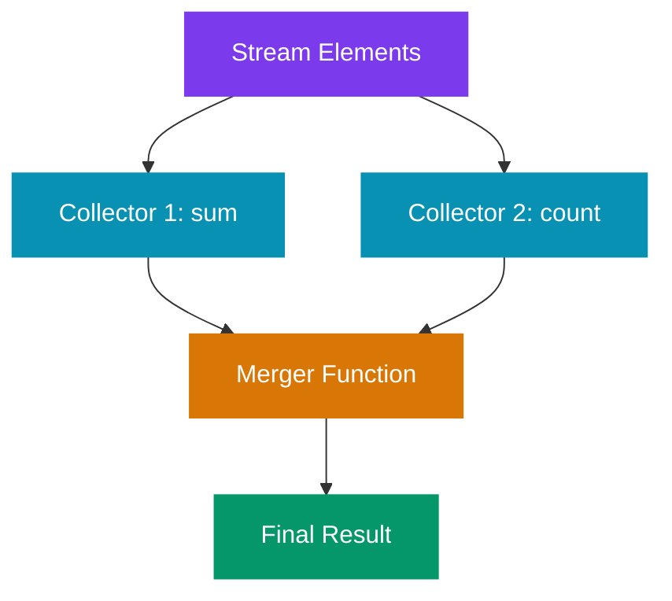

🛠️ **Example:** Compute both the sum and the count of a list of integers.

```java
List<Integer> numbers = Arrays.asList(1, 2, 3, 4, 5);
Map<String, Integer> result = numbers.stream()
            .collect(
                 Collectors.teeing(
                    Collectors.summingInt(Integer::intValue),
                    Collectors.counting(),
                    (sum, count) -> Map.of("sum", sum, "count", count.intValue())
                 )
             );
System.out.println(result);
// prints {sum=15, count=5} OR {count=5, sum=15} — see the caution below
```

⚠️ **Caution — the printed order here changes between JVM runs.**

- `Map.of(...)` returns an immutable `MapN`.
- Its iteration start position comes from a **per-JVM random salt** (a random value that each JVM picks once at startup).
- The JDK does this on purpose, so that nobody writes code that depends on the order.

We ran the snippet above 30 times in 30 fresh JVMs. It printed `{sum=15, count=5}` 17 times and `{count=5, sum=15}` 13 times. The *values* are always right. Only the print order changes. If you want a stable printed result, build an ordered map in the merger:

```java
(sum, count) -> {
    Map<String, Integer> m = new LinkedHashMap<>();
    m.put("sum", sum);
    m.put("count", count.intValue());
    return m;
}
// always prints {sum=15, count=5}
```

🎯 **Interview Tip:** `teeing` is perfect when you need two different aggregations in a single pass over the data. You do not need to stream twice. In practice, a small record or a `Map.Entry` is a better merger result than a `Map`. It keeps the two results type-safe (`Integer` sum vs `Long` count). A `Map` forces them into one value type.

---

</details>

---

13. **🔒 What do `toConcurrentMap` and `groupingByConcurrent` do? 💤**

<!-- -->
<details>
<summary>Answer</summary>

**Answer:**

🔒 The `toConcurrentMap` method is similar to `toMap`, but it collects into one shared `ConcurrentMap`. It is **not** needed for correctness — plain `toMap` is already safe in a parallel stream (see the table below). It is a **performance** choice for large parallel streams. The map it returns is also safe to change from many threads later.

📑 **Return Type:** `ConcurrentMap<K, V>`

🛠️ **Example:** Convert a list of strings into a concurrent map.

```java
List<String> words = Arrays.asList("apple", "banana", "cherry");
ConcurrentMap<String, Integer> map = words.stream()
   .collect(Collectors.toConcurrentMap(Function.identity(), String::length));
System.out.println(map); // {banana=6, apple=5, cherry=6}
```

| Feature | `toMap` 🅰️ | `toConcurrentMap` 🅱️ |
|---------|-----------|---------------------|
| **Safe in a parallel stream?** | ✅ Yes — each worker fills its own `HashMap`, then they are merged | ✅ Yes — all workers write one shared `ConcurrentMap` |
| **How it parallelises** | per-thread accumulate + `combiner()` merge | `CONCURRENT` collector — no merge step |
| **Return type** | `HashMap` (in practice) | `ConcurrentHashMap` (in practice) |
| **Which duplicate wins** | ✅ deterministic — merge sees values in encounter order | ❌️ arbitrary (`UNORDERED`) |
| **Returned map safe to mutate concurrently later?** | ❌️ No | ✅ Yes |

⚠️ **The `UNORDERED` row is the one that causes bugs.** Verified test: collect 20,000 elements that all share one key, with a *keep-the-first* merge function `(p, q) -> p`:

```java
xs.parallelStream().collect(Collectors.toMap(k -> "k", v -> v, (p, q) -> p));
// .get("k") -> 0 on every one of 50 runs — encounter order respected

xs.parallelStream().collect(Collectors.toConcurrentMap(k -> "k", v -> v, (p, q) -> p));
// .get("k") -> 6562, then 13125, then 11562, … — whichever thread got there first
```

⚠️ **Don't say "`toMap` is not thread-safe".** An interviewer will immediately ask *"so is `list.parallelStream().collect(toMap(...))` broken?"*. It is not broken. Verified: collecting 100,000 elements through `parallelStream().collect(Collectors.toMap(...))` produces all 100,000 correct entries.

- `toMap` is a **non-`CONCURRENT`** collector, so there is no race.
- Every worker thread accumulates into a map that only it owns.
- Then `combiner()` merges these maps.

The part of that claim that is true is the **last** row of the table. The `HashMap` you get back is an ordinary `HashMap`. So it is unsafe to change it from many threads *later*.

🎯 **Interview Tip:** `toConcurrentMap` is the *performance* choice, not the *correctness* choice. It skips the cost of one map per thread plus the merge. The cost is that it is `UNORDERED`:

- Do not use it where encounter order matters.
- On a **sequential** stream, it gives no benefit and is usually slower than `toMap` (a `ConcurrentHashMap` costs more per write than a `HashMap`).

🔐 **`groupingByConcurrent` — the same idea for grouping:**

🔒 The `groupingByConcurrent` method is similar to `groupingBy`, but all threads write into one shared `ConcurrentMap`. Like `toConcurrentMap`, it is a **performance** choice for parallel streams. Plain `groupingBy` is already safe in a parallel stream: each thread fills its own map, and the maps are merged at the end.

📑 **Return Type:** `ConcurrentMap<K, List<T>>`

🛠️ **Example:** Group a list of strings by their length in a thread-safe manner.

```java
List<String> words = Arrays.asList("apple", "banana", "cherry", "date");
ConcurrentMap<Integer, List<String>> groupedByLength = words.stream()
           .collect(Collectors.groupingByConcurrent(String::length));
System.out.println(groupedByLength);
// {4=[date], 5=[apple], 6=[banana, cherry]}
```

⚠️ `groupingByConcurrent` is an **unordered** collector. In a parallel stream, the order inside each list is not guaranteed (you may get `6=[cherry, banana]`). Use `groupingBy` when you need encounter order.

💡 **Pro Tip:** Use `groupingByConcurrent` with parallel streams for better performance. With sequential streams, `groupingBy` is enough.

---

</details>

---

<a id="different-ways-to-find-duplicate-elements-using-java-stream"></a>

## 5. Different Ways to Find Duplicate Elements Using Java Stream

The examples below use this `Employee(id, age)` class. `equals()` and `hashCode()` use **`id` only**, so two objects with the same `id` count as duplicates:

```java
public class Employee {
    private Integer id;
    private Integer age;

    public Employee(Integer id, Integer age) {
        this.id = id;
        this.age = age;
    }

    // getters

    @Override
    public String toString() {
        return "Employee [id=" + id + ", age=" + age + "]";
    }

    @Override
    public int hashCode() {
        return Objects.hash(id);
    }

    @Override
    public boolean equals(Object obj) {
        if (this == obj) {
            return true;
        }
        if (obj == null || getClass() != obj.getClass()) {
            return false;
        }
        return Objects.equals(id, ((Employee) obj).id);
    }
}
```

1. **🔎 How to find duplicate elements in a Stream in Java? 🔥🔥**

<!-- -->
<details>
<summary>Answer</summary>

**Answer:**

**Method-1: Using `Collections.frequency(list, i)`** — ⚠️ **O(n²), show it only as the simple, slow first version**

Count the frequency of each element with the `Collections.frequency()` method. Then check each element in the list. If its frequency is more than one, it is a duplicate element.

⚠️ **Complexity:**

- `Collections.frequency()` scans the whole list, and you call it once per element. So this is **O(n²)**.
- The code is easy to read and is fine for a few elements. On a real dataset it is the wrong answer.
- **Method-3 (`groupingBy` + `counting()`) is O(n). Give it first in an interview.** Keep this one as the example of "what not to do".

```java
stream().filter(i -> Collections.frequency(list, i) > 1).collect(Collectors.toSet());
```

```java
public class Test {
    public static void main(String[] args) {
        List<Employee> employees = Arrays.asList(new Employee(10, 18),
                new Employee(11, 25), new Employee(12, 24),
                new Employee(13, 25), new Employee(14, 18),
                new Employee(15, 25), new Employee(11, 25),
                new Employee(14, 18));

        Set<Employee> duplicateEmployees = employees.stream()
              .filter(emp -> Collections.frequency(employees, emp) > 1)
              .collect(Collectors.toSet());
        System.out.println("Duplicate employees: " + duplicateEmployees);
    }
}
```

**Method-2: Using Set**

```java
public class Test {
    public static void main(String[] args) {
        List<Integer> ages = Arrays.asList(18, 25, 24, 25, 18, 25, 25, 18);

        Set<Integer> uniqueAge = new HashSet<>();
        Set<Integer> duplicateAges = ages.stream()
                .filter(age -> !uniqueAge.add(age))
                .collect(Collectors.toSet());

        System.out.println(uniqueAge); // [18, 24, 25]
        System.out.println(duplicateAges); // [18, 25]
    }
}
```

⚠️ **This is a stateful lambda.**

- `!uniqueAge.add(age)` changes a `HashSet` that lives *outside* the pipeline. So the predicate is **not stateless and not thread-safe**.
- It is correct when the stream runs sequentially. It is a perfectly good answer.
- But the follow-up question is always *"now parallelise it"*. The honest reply is: **you can't, not as written.**
- With `.parallel()`, many threads change an unsynchronized `HashSet` at the same time. You get a wrong (and non-deterministic) result, with no error.
- The parallel-safe version is Method-3 below: `groupingBy(identity(), counting())`, then filter `> 1`. It is safe because `groupingBy` is a proper parallel-safe reduction with its own combiner (the function that merges partial results from different threads).

**Method-3: Using `Collectors.groupingBy()`**

The `groupingBy()` method of the Collectors class in Java groups objects by some property. Here we group by the element itself to count repeats. Then we collect the result in a Set.

Use the `Collectors.groupingBy()` method to put each element and its frequency in a map. Then check each entry in the map. If the frequency is more than one, that element is a duplicate element.

```java
public class Test {
    public static void main(String[] args) {
        List<Integer> ages = Arrays.asList(18, 25, 24, 25, 18, 25, 25, 18);

        Map<Integer, Long> agesCount = ages.stream()
                .collect(
                        Collectors.groupingBy(
                                Function.identity(),
                                Collectors.counting()
                         )
                  );
        System.out.println(agesCount); // {18=3, 24=1, 25=4}  (HashMap — order not guaranteed)

        Set<Integer> duplicateAges = agesCount.entrySet()
                .stream()
                .filter(entry -> entry.getValue() > 1)
                .map(entry -> entry.getKey())
                .collect(Collectors.toSet());
        System.out.println(duplicateAges); // [18, 25]

    }
}
```

```java
import java.util.Arrays;
import java.util.List;
import java.util.Map;
import java.util.Set;
import java.util.function.Function;
import java.util.stream.Collectors;

public class Test {
    public static void main(String[] args) {
        List<Employee> employees = Arrays.asList(new Employee(10, 18),
                         new Employee(11, 25), new Employee(12, 24),
                         new Employee(13, 25), new Employee(14, 18),
                         new Employee(15, 25), new Employee(11, 25),
                         new Employee(14, 18));

        Map<Employee, Long> employeesCount = employees.stream()
              .collect(Collectors.groupingBy(Function.identity(), Collectors.counting()));
        System.out.println(employeesCount);

        Set<Employee> duplicateEmployees = employeesCount.entrySet().stream()
              .filter(entry -> entry.getValue() > 1)
              .map(entry -> entry.getKey()).collect(Collectors.toSet());
        System.out.println(duplicateEmployees);
        // [Employee [id=11, age=25], Employee [id=14, age=18]]
    }
}
```

You can write it in a single line like this:

```java
public class Test {
    public static void main(String[] args) {
        List<Employee> employees = Arrays.asList(new Employee(10, 18),
                new Employee(11, 25), new Employee(12, 24),
                new Employee(13, 25), new Employee(15, 24), new Employee(11, 25));
        System.out.println(employees);

        Set<Employee> duplicateEmployees = employees.stream()
              .collect(Collectors.groupingBy(Function.identity(), Collectors.counting()))
              // convert this map into a stream
              .entrySet().stream()
              // check if frequency > 1 for duplicate elements, find such elements
              .filter(m -> m.getValue() > 1).map(Map.Entry::getKey)
              // collect them in a set
              .collect(Collectors.toSet());

        System.out.println(duplicateEmployees);
        // [Employee [id=11, age=25]]
    }
}
```

📝 Note: this shorter list is **not** the 8-element list used above. It is `(10,18) (11,25) (12,24) (13,25) (15,24) (11,25)`. Only `id=11` repeats in it. So the output is a single-element set.

---

</details>

---

<a id="stream-qa"></a>

## 6. Stream Coding — Employee List

The sorting tools used here are explained in §2 Q5 (`sorted`) and §2 Q6 (`Comparator.comparing`).

1. **💰 Given an Employee list, sort employees based on their salaries in descending order using Java stream? ⚡**

<!-- -->
<details>
<summary>Answer</summary>

**Answer:**

```java
public class Employee {
    private Integer id;
    private String name;
    private Double salary;

    // getter and setter

    public Employee(Integer id, String name, Double salary) {
        this.id = id;
        this.name = name;
        this.salary = salary;
    }

    @Override
    public String toString() {
        return "Employee [id=" + id + ", name=" + name + ", salary=" + salary + "]";
    }
}
```

```java
public class Test {
    public static void main(String[] args) {
        List<Employee> employees = Arrays.asList(
                new Employee(10, "Ram", 5000.0),
                new Employee(15, "Krishna", 4803.0),
                new Employee(2, "Amlesh", 15000.0));

        List<Employee> sortedEmployees = employees.stream()
                .sorted(Comparator.comparing(Employee::getSalary).reversed())
                .collect(Collectors.toList());
        System.out.println(sortedEmployees);

        // if we want to sort the original list without creating separate another list
        employees.sort(Comparator.comparing(Employee::getSalary).reversed());
    }
}
```

📤 **Output:**

```
[Employee [id=2, name=Amlesh, salary=15000.0], Employee [id=10, name=Ram, salary=5000.0], Employee [id=15, name=Krishna, salary=4803.0]]
```

💡 Give `Comparator.comparing(Employee::getSalary).reversed()` as your answer. Do not give `(e1, e2) -> -e1.getSalary().compareTo(e2.getSalary())`.

- See §2 Q5 for why negating `compareTo` is unsafe.
- See §2 Q6 for `thenComparing()` tie-breakers, and for `comparingDouble` to avoid boxing.

---

</details>

---

2. **🥇 Given an Employee list, Fetch the Top 3 salaried Employees using Java stream? ⚡**

<!-- -->
<details>
<summary>Answer</summary>

**Answer:**

Sort the data first. Then use the `limit()` method.

```java
public class Test {
    public static void main(String[] args) {
        List<Employee> employees = Arrays.asList(
           new Employee(10, "Ram", 5000.0),
           new Employee(15, "Krishna", 4803.0),
           new Employee(2, "Amlesh", 15000.0),
           new Employee(9, "Rakesh", 5100.0));

        List<Employee> sortedEmployees = employees.stream()
           .sorted(Comparator.comparing(Employee::getSalary).reversed())
           .limit(3)
           .collect(Collectors.toList());
        System.out.println(sortedEmployees);
    }
}
```

📤 **Output:**

```
[Employee [id=2, name=Amlesh, salary=15000.0], Employee [id=9, name=Rakesh, salary=5100.0], Employee [id=10, name=Ram, salary=5000.0]]
```

---

</details>

---

3. **⏭️ Given an Employee list, Fetch all employees with a salary less than the 3rd highest using Java Stream? ⚡**

<!-- -->
<details>
<summary>Answer</summary>

**Answer:**

Here we can use the `skip()` method. `skip(N)` skips the first N entries of the stream.

```java
public class Test {
    public static void main(String[] args) {
        List<Employee> employees = Arrays.asList(
           new Employee(10, "Ram", 5000.0),
           new Employee(15, "Krishna", 4803.0),
           new Employee(2, "Amlesh", 15000.0),
           new Employee(9, "Rakesh", 5100.0));
        List<Employee> sortedEmployees = employees.stream()
           .sorted(Comparator.comparing(Employee::getSalary).reversed())
           .skip(3)
           .collect(Collectors.toList());
        System.out.println(sortedEmployees);
    }
}
```

📤 **Output:**

```
[Employee [id=15, name=Krishna, salary=4803.0]]
```

---

</details>

---

<a id="java-arrays-coding-question-using-stream"></a>

## 7. Java Arrays Coding Question using Stream

1. **🔢 Given an array of integers, write a Java 8 program to find the second smallest element? ⚡**

<!-- -->
<details>
<summary>Answer</summary>

**Answer:**

📥 **Input:** `int[] numbers = {5, 2, 8, 3, 1};`

```java
int secondSmallest = Arrays.stream(numbers)
   .sorted()
   .skip(1)
   .findFirst()
   .orElseThrow(() -> new IllegalArgumentException(
         "Array don't have second smallest element"));
System.out.println(secondSmallest); // 2
```

---

</details>

---

2. **🔁 The array contains duplicate elements, now find the second smallest number? ⚡**

<!-- -->
<details>
<summary>Answer</summary>

**Answer:**

📥 **Input:** `int[] numbers = {5, 2, 8, 3, 1, 1, 2, 8};`

Before sorting, remove the duplicate elements with the `distinct()` method.

```java
Arrays.stream(numbers)
   .distinct()
   .sorted()
   .skip(1)
   .findFirst()
   .orElseThrow(() -> new IllegalArgumentException(
        "Array don't have second smallest element"));
```

---

</details>

---

3. **🤝 Given two arrays of integers, write a Java 8 program to find the common elements between them? ⚡**

<!-- -->
<details>
<summary>Answer</summary>

**Answer:**

📥 **Input:**
`int[] array1 = {1, 2, 3, 4, 5};`
`int[] array2 = {4, 5, 6, 7, 8};`

```java
List<Integer> commonElements = Arrays.stream(array1)
   .filter(n1 -> Arrays.stream(array2).anyMatch(n2 -> n2 == n1))
   .boxed()
   .collect(Collectors.toList());
System.out.println(commonElements); // [4, 5]
```

---

</details>

---

4. **🔃 Write a Java 8 program to reverse an array of integers in place? ⚡**

<!-- -->
<details>
<summary>Answer</summary>

**Answer:**

📥 **Input:** `int[] numbers = {1, 2, 3, 4, 5};`

In-place means you do not create a new array. Swap 5 with 1, and 4 with 2.

```java
import java.util.Arrays;
import java.util.stream.IntStream;

public class Test {
    public static void main(String[] args) {
        int[] numbers = { 1, 2, 3, 4, 5 };
        // iterate till the middle length of the array
        IntStream.range(0, numbers.length / 2).forEach(i -> {
            int temp = numbers[i];
            numbers[i] = numbers[numbers.length - i - 1];
            numbers[numbers.length - i - 1] = temp;
        });
        System.out.println(Arrays.toString(numbers)); // [5, 4, 3, 2, 1]
    }
}
```

⚠️ **Say clearly what this is:**

- The lambda changes an array captured from the outer scope.
- So it is a **side-effecting, stateful consumer**. This is the one thing the Stream API tells you not to write.
- It is safe here *only* for two reasons: the stream is sequential, and each index `i` touches its own separate pair of slots.
- Under `.parallel()`, it still happens to work for this particular swap (disjoint writes, no shared accumulator). But that comes from this algorithm, not from the pattern.
- An interviewer may ask "is that stream code?". The real question is: do you know that a plain `for` loop is the clearer answer for an in-place change?

---

</details>

---

5. **📏 Given an array of strings, write a Java 8 program to find the length of the longest string? ⚡**

<!-- -->
<details>
<summary>Answer</summary>

**Answer:**

📥 **Input:** `String[] strings = {"Apple", "Banana", "Avocado", "Apricot", "Grapes"};`

```java
import java.util.Arrays;

public class Test {
    public static void main(String[] args) {
        String[] strings = { "Apple", "Banana", "Avocado", "Apricot", "Grapes" };

        // map string to its length
        int maxLength = Arrays.stream(strings)
            .mapToInt(string -> string.length()).max().orElse(0);
        System.out.println(maxLength); // 7

        // using method reference
        int maxLength1 = Arrays.stream(strings)
             .mapToInt(String::length).max().orElse(0);
        System.out.println(maxLength1); // 7
    }
}
```

---

</details>

---

6. **📜 In the above question also display the longest string along with its length? ⚡**

<!-- -->
<details>
<summary>Answer</summary>

**Answer:**

```java
import java.util.Arrays;

public class Test {
    public static void main(String[] args) {
        String[] strings = { "Apple", "Banana", "Avocado", "Apricot", "Grapes" };
        String longestString = Arrays.stream(strings)
           .max((s1, s2) -> Integer.compare(s1.length(), s2.length()))
           .orElse("");   // not orElse(null): .length() on null would throw NPE for an empty array
        System.out.println(longestString + ": " + longestString.length()); // Avocado: 7
    }
}
```

---

</details>

---

7. **🧹 Write a Java 8 program to remove duplicates from an array of strings while preserving the original order? ⚡**

<!-- -->
<details>
<summary>Answer</summary>

**Answer:**

📥 **Input:** `String[] strings = {"Apple", "Banana", "Apple", "Grapes", "Banana"};`

```java
import java.util.Arrays;
import java.util.List;
import java.util.stream.Collectors;

public class Test {
    public static void main(String[] args) {
        String[] strings = { "Apple", "Banana", "Apple", "Grapes", "Banana" };
        List<String> uniqueStrings = Arrays.stream(strings)
          .distinct()
          .collect(Collectors.toList());
        String[] uniqueStringArray = uniqueStrings.toArray(new String[0]);
        System.out.println(Arrays.toString(uniqueStringArray)); // [Apple, Banana, Grapes]
    }
}
```

---

</details>

---

8. **✖️ Given an array of integers, write a Java 8 program to find the product of all the elements except the given element? ⚡**

<!-- -->
<details>
<summary>Answer</summary>

**Answer:**

📥 **Input:** `int[] numbers = {2, 4, 6, 8};`, Element to exclude = 4

```java
int except = 4;
int res = Arrays.stream(numbers)
    .filter(n -> n != except)
    .reduce(1, (n1, n2) -> n1 * n2);
System.out.println(res); // 96
```

⚠️ `filter(n -> n != except)` removes **every** copy of the element. For `{2, 4, 4, 6}` it drops both 4s. If you must skip only one copy, compute the full product and divide by the element once (this fails if the element is `0`).

---

</details>

---

<a id="coding-questions-on-java-8"></a>
<a id="refactoring-code-to-java-8"></a>

## 8. More Stream Coding & Refactoring to Java 8

1. **🔤 Count the number of occurrences of words in a given string using Java 8? ⚡**

<!-- -->
<details>
<summary>Answer</summary>

**Answer:**

📥 **Input:** `"welcome to know program and know program welcome you"`
📤 **Output:** `{and=1, know=2, program=2, to=1, welcome=2, you=1}`

```java
String word = "welcome to know program and know program welcome you";
List<String> list = Arrays.asList(word.split(" "));
Map<String, Long> wordCount = list.stream()
      .collect(Collectors.groupingBy(Function.identity(), Collectors.counting()));
System.out.println(wordCount);
// {and=1, know=2, program=2, to=1, welcome=2, you=1}
```

---

</details>

---

2. **🔢 Refactor the given isPrime(int num) to Java 8? 💤**

<!-- -->
<details>
<summary>Answer</summary>

**Answer:**

🛠️ **Original code:**

```java
public static boolean isPrime(int number) {
    boolean isDivisible = false;

    for (int i = 2; i < number; i++) {
        if (number % i == 0) {
        isDivisible = true;
        break;
        }
    }
    return number > 1 && !isDivisible;
}
```

🛠️ **In Java 8:**

```java
public static boolean isPrime(int number) {
    return number > 1 &&
      IntStream.range(2, number)
               .noneMatch(n -> number % n == 0);
}
```

💡 **Pro Tip:** To test whether N is prime, we don't have to check divisors all the way to N. Stopping at **√N** is enough.

- The reason: every factor pairs up as `d × (N / d)`.
- If both factors in a pair were greater than √N, their product would be more than N.
- So **at least one factor of every pair is ≤ √N**.
- So if N has no divisor ≤ √N, it has no divisor at all.

This cuts the work from O(N) to O(√N).

```java
return number > 1 && IntStream.rangeClosed(2, (int) Math.sqrt(number))
      .noneMatch(n -> number % n == 0);
```

---

</details>

---

3. **♻️ Convert the given code in Java 8? 💤**

<!-- -->
<details>
<summary>Answer</summary>

**Answer:**

🛠️ **Original code:**

```java
public static void main(String[] args) {
    // square root of first 10 prime numbers
    List<Double> sqrtOf10Prime = new ArrayList<>(10);

    int index = 1;
    while (sqrtOf10Prime.size() < 10) {
        if (isPrime(index)) {
        sqrtOf10Prime.add(Math.sqrt(index));
        }
        index++;
    }
    System.out.println(sqrtOf10Prime);
}
```

🛠️ **In Java 8:**

```java
// Test::isPrime is the isPrime() method from Q2, declared in class Test
List<Double> sqrtOf10Prime = Stream.iterate(1, i -> i + 1)
        .filter(Test::isPrime)
        .map(Math::sqrt)
        .limit(10)
        .collect(Collectors.toList());
System.out.println(sqrtOf10Prime);
```

---

</details>

---
