# Java 8 Interview Questions

**Java 8 Interview Questions** | This note covers the important Java 8 questions. It starts with why Java 8 was introduced. Then it covers functional interfaces, lambda expressions, method references, and many more topics. Also see:- [Java 8 Stream All Operations with Examples](07_Java_8_Stream_Operations_with_Examples.md)

📊 **Question Count by Section**

| # | Section | Questions |
|---|---|---|
| 1 | [Java 8 QA](#java-8-qa) | 8 |
| 2 | [QA on Default & Static Methods in Interface](#qa-on-default--static-methods-in-interface) | 8 |
| 3 | [QA on Predicate, Function, Consumer, Supplier](#qa-on-predicate-function-consumer-supplier) | 14 |
| 4 | [QA on Streams & Parallel Streams](#qa-on-streams--parallel-streams) | 6 |
| 5 | [Processing Of Streams](#processing-of-streams) | 11 |
| 6 | [Java 8 Grouping By Scenarios](#java-8-grouping-by-scenarios) | 8 |
| 7 | [Java 8 Statistics Example](#java-8-statistics-example) | 3 |
| 8 | [Different Ways to Find Duplicate Elements Using Java Stream](#different-ways-to-find-duplicate-elements-using-java-stream) | 1 |
| 9 | [Java 8 Optional QA \| Scenario Based](#java-8-optional-qa--scenario-based) | 2 |
| 10 | [Stream QA](#stream-qa) | 3 |
| 11 | [Java 8 Short Circuit Operations](#java-8-short-circuit-operations) | 0 |
| 12 | [Map Vs FlatMap](#map-vs-flatmap) | 2 |
| 13 | [Java Arrays Coding Question using Stream](#java-arrays-coding-question-using-stream) | 8 |
| 14 | [Reduce and Peek Operations](#reduce-and-peek-operations) | 4 |
| 15 | [Coding Questions on Java 8](#coding-questions-on-java-8) | 4 |
| 16 | [Refactoring Code to Java 8](#refactoring-code-to-java-8) | 2 |
| | **Total** | **84** |

> 🔥🔥 Very High — asked in almost every Tier-1 loop &nbsp;·&nbsp; 🔥 High — very frequent in Tier-1 interviews &nbsp;·&nbsp; ⚡ Medium — commonly asked &nbsp;·&nbsp; 💤 Low — good to know, rarely asked

<a id="java-8-qa"></a>

## 1. Java 8 QA

1. **🎯 Why Java 8 was introduced? What was the main agenda behind the Java 8? 💤**

<!-- -->
<details>
<summary>Answer</summary>

**Answer:**

- 🎯 The main reason for Java 8 was to make code **concise** (short and to the point).
- ⚙️ Java 8 brings in Functional programming. Lambda expressions make this possible. They are a strong tool for writing concise code.
- 📜 In Python and Scala, we can do the same thing in very few LOC (lines of code).
- 📜 By around 2010, many developers liked these shorter languages, and Java looked old next to them.
- 📜 To stop losing more users, Java stopped being only an OOPs language. It added some Functional programming ideas to make code concise.

🧠 **In Simple Words:** Java 8 came to make Java code shorter and clearer. It took functional programming ideas from languages like Scala and Python.

---

</details>

---

2. **✨ What are the new features introduced in Java 8? ⚡**

<!-- -->
<details>
<summary>Answer</summary>

**Answer:**

Java 8 added many new features. Here are the important ones that interviewers ask about most:

- 🔗 Lambda Expression
- 🌊 Stream API
- 📑 Functional Interface
- 🛠️ Default & Static methods in the interface
- 🛡️ Optional class
- 🔄 Method references & Constructor references
- 📅 Date API

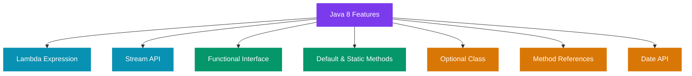

---

</details>

---

3. **💪 What are the main advantages of using Java 8? 💤**

<!-- -->
<details>
<summary>Answer</summary>

**Answer:**

- ✂️ More compact code (Less boilerplate code)
- 📖 More readable and reusable code
- 🧪 More testable code
- ⚡ Parallel operations

---

</details>

---

4. **🔮 What is Lambda Expression? 🔥🔥**

<!-- -->
<details>
<summary>Answer</summary>

**Answer:**

A lambda expression is an anonymous function. It has no name, no declared return type (the compiler infers it), and no access modifier. It has one lambda (`->`) symbol.

🛠️ **Normal programming technique:**

```java
public class Test {
    public static void main(String[] args) {
        Test test = new Test();
        test.add(10, 5); // 15
    }

    public void add(Integer a, Integer b) {
        System.out.println(a + b);
    }
}
```

🛠️ **Equivalent Lambda expression:**

```java
import java.util.function.BiConsumer;
public class Test {
    public static void main(String[] args) {
        BiConsumer<Integer, Integer> biConsumer = (a, b) -> System.out.println(a + b);
        biConsumer.accept(10, 5); // 15
    }
}
```

---

</details>

---

5. **📑 What are [functional interfaces](../java_tutorial/212_Functional_Interface_In_Java.md)? 🔥🔥**

<!-- -->
<details>
<summary>Answer</summary>

**Answer:**

- 📑 A functional interface is an interface that has **only one abstract method**.
- 🔢 It can have any number of static methods or default methods.
- 📜 Java already has many functional interfaces, such as: `Comparable`, `Comparator`, and `Runnable`.
- 💡 `Comparable` has one abstract method, so it is a functional interface. But it is not marked with `@FunctionalInterface`. `Comparator` and `Runnable` are marked.

```java
@FunctionalInterface
public interface Runnable {
    public abstract void run();
}
```

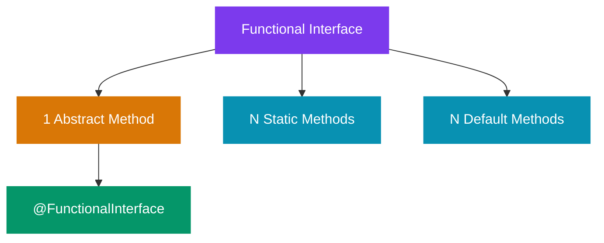

---

</details>

---

6. **🔗 How lambda expression and functional interfaces are related? 🔥🔥**

<!-- -->
<details>
<summary>Answer</summary>

**Answer:**

- 🔗 A functional interface gives a lambda expression its type, so we can hold the lambda in a reference.
- ⚙️ We can use a lambda expression only to implement the abstract method of a functional interface.

```java
Comparator<String> c = (s1, s2) -> s1.compareTo(s2);
```

| Component | Description |
|-----------|-------------|
| `(s1, s2) -> s1.compareTo(s2)` | Lambda Expression |
| `Comparator<String> c` | Functional Interface |

So, to call a lambda expression, we need a functional interface.

---

</details>

---

7. **🏗️ Can we create our own [functional interface](../java_tutorial/212_Functional_Interface_In_Java.md)? ⚡**

<!-- -->
<details>
<summary>Answer</summary>

**Answer:**

Yes. A Functional interface has exactly one abstract method. It can also have many static or default methods. To create our own Functional interface, follow these steps:

- 📑 Create an interface
- 🏷️ Annotate that with `@FunctionalInterface`
- ✏️ Define exactly one abstract method
- 🔓 There is no restriction on the number of [static methods](../java_tutorial/211_Static_Methods_In_Interface_In_Java.md) and [default methods](../java_tutorial/210_Default_Methods_In_Interface_In_Java.md) defined in such an interface

Java can identify functional interfaces on its own. Still, we can add the `@FunctionalInterface` annotation. It keeps us safe. If we add 2 abstract methods by mistake, the compiler gives a compile time error.

```java
interface Inf {
   public void m1();
   // default method
   default void m2() { }
   // static method
   public static void m3() { }
}
```

💡 **Pro Tip:** Always use `@FunctionalInterface` annotation for safety — the compiler then checks the rule for you.

---

</details>

---

8. **🔄 What is method reference in Java 8? 🔥🔥**

<!-- -->
<details>
<summary>Answer</summary>

**Answer:**

- 🔄 Method reference is a short form of a lambda expression. It connects the method of a Functional interface to a method that already exists. It is mainly used for code reuse.
- 🔗 We use the double colon operator (`::`) to connect the Functional Interface's abstract method to one existing method. This is a Method reference.
- ⚖️ So a Method reference is an alternative to Lambda expressions.
- 💡 If an existing method already implements the abstract method of our Functional interface, use a method reference. If no such method exists, use a lambda expression.

In Java 8, method references give a short way to point to methods or constructors without calling them. They are often used with functional interfaces. You can pass a method reference as an argument or assign it to a variable.

There are different types of method references in Java:

- 🏗️ **Reference to a static method**: `ContainingClass::staticMethodName`
- 📌 **Reference to an instance method of a particular object**: `containingObject::instanceMethodName`
- 🔀 **Reference to an instance method of an arbitrary object of a particular type**: `ContainingType::methodName`
- ➕ **Reference to a constructor**: `ClassName::new`

*When the lambda body only calls an existing method, you can write a method reference instead, as a short form. Method references make code easier to read, shorter, and clearer.*

🛠️ **Example:**

```java
import java.util.Arrays;
import java.util.List;

public class MethodReferenceExample {
    public static void main(String[] args) {
        List<String> names = Arrays.asList("Alice", "Bob", "Charlie");

        // Using lambda expression
        names.forEach(name -> System.out.println(name));

        // Using method reference
        names.forEach(System.out::println);
    }
}
```

📌 `System.out::println` is a **reference to an instance method of a particular object** — the object is `System.out`. The examples below show the other 3 kinds.

1. ⚡ **Reference to a static method:**

```java
import java.util.Arrays;
public class Test {
    public static void main(String[] args) {
        String[] names = { "Alice", "Bob", "Charlie", "David" };

        // using lambda expression
        // Arrays.sort(names, (a, b) -> Test.compareNames(a, b));

        // using static method reference
        Arrays.sort(names, Test::compareNames);

        System.out.println(Arrays.toString(names));
    }

    public static int compareNames(String a, String b) {
        return b.compareTo(a);
    }
}
```

```java
import java.util.Arrays;
import java.util.List;

public class Test1 {
    public static void main(String[] args) {
        Integer[] numbers = { 4, 2, 1, 6, 5 };

        // using lambda expression
        // Arrays.sort(numbers, (a, b) -> Integer.compare(a, b));

        // using method reference
        Arrays.sort(numbers, Integer::compare);

        System.out.println(Arrays.toString(numbers));

        List<Integer> list = Arrays.asList(numbers);
        list.forEach(System.out::println);
    }
}
```

2. 📌 **Reference to an instance method of an arbitrary object of a particular type:**

```java
import java.util.function.BiFunction;

public class Test1 {
    public static void main(String[] args) {
        // using arbitrary object lambda expression
        BiFunction<String, String, Boolean> biFunctionLambda = (str1, str2) -> str1.equals(str2);
        System.out.println(biFunctionLambda.apply("hello", "hello"));

        // using arbitrary object method reference
        BiFunction<String, String, Boolean> biFunctionMethodReference = String::equals;
        System.out.println(biFunctionMethodReference.apply("hello", "hello"));
    }
}
```

3. 🏭 **Reference to a constructor:**

```java
import java.util.function.Function;

public class Test1 {
    public static void main(String[] args) {
        // Using lambda expression
        // Function<String, Person> fun = name -> new Person(name);

        // using method reference
        Function<String, Person> fun = Person::new;

        Person person = fun.apply("Alice");
        System.out.println(person.getName());
    }
}

class Person {
    private String name;
    public Person(String name) {
        this.name = name;
    }
    public String getName() {
        return name;
    }
}
```

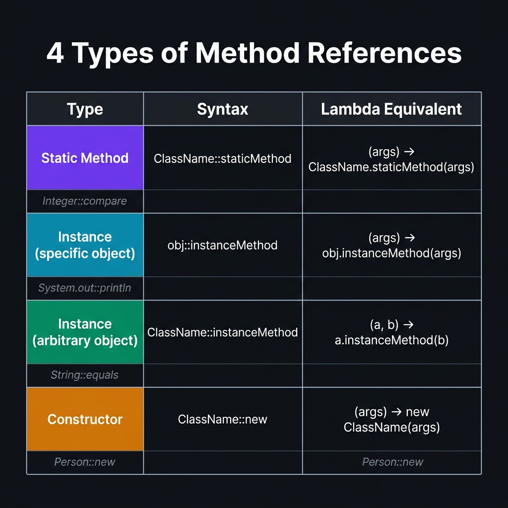

---

</details>

---

<a id="qa-on-default--static-methods-in-interface"></a>

## 2. QA on Default & Static Methods in Interface

Before Java 8, an interface could have only method declarations. This caused a problem:

- If we changed or added a method in the interface, we had to change all implementing classes.
- From Java 8, an interface can also have default methods and static methods.
- We can use them to add new features to the interface without changing the implementing classes.

To create a default method in a Java interface, put the `default` keyword in the method signature.

```java
default void myAbstractMeth2() {
    System.out.println("New Default Method");
}
```

The benefit: child classes no longer have to provide an implementation of this method. The interface already has one by default.

1. **🛡️ What are default methods? 🔥**

<!-- -->
<details>
<summary>Answer</summary>

**Answer:**

A default method is a way to add new methods to an interface without affecting the implementing classes. So with this feature, Java avoided many compile-time errors. These errors could come from interface methods that a class did not implement.

Default methods give **"Backward Compatibility"**. Without them, if the JDK changes any Interface, the classes that implement this Interface will break.

But if you add a default method to an Interface, you can provide a default implementation. This won't affect the implementing classes.

🧠 **In Simple Words:** Default methods let you add new methods to interfaces without breaking existing code that implements those interfaces.

---

</details>

---

2. **🔀 Is it necessary to override the default methods of the interface in Java 8? ⚡**

<!-- -->
<details>
<summary>Answer</summary>

**Answer:**

- ❌️ No. Default methods have dummy implementations.
- ✅ If the dummy implementation is good enough for an implementing class, the class just uses it.
- 🔄 If not, it can override the method and provide its own implementation.

---

</details>

---

3. **🔑 Is the default keyword one of the access modifiers? 💤**

<!-- -->
<details>
<summary>Answer</summary>

**Answer:**

No, `default` is not an access modifier like `public`, `protected`, or `private`. For the default access level, we do not write any keyword.

Until version 1.8, the `default` keyword had only two uses: the default case of a `switch`, and the default value of an annotation element (`String value() default "";`). It was never used for interface methods. Now it is also used for default methods in an interface. A default method gives a default implementation that all implementing classes can use.

📝 **Note:** In **Java 8**, every method declared in an interface is implicitly `public`. This is true for abstract, `default` and `static` methods. ⚠️ This is **no longer always true**. **Java 9** (JEP 213) added `private` and `private static` interface methods. They let `default` methods share code without showing that code in the API. So "can an interface have a private method?" → *yes, since Java 9*.

```java
@FunctionalInterface
public interface FunctionalInterfaceDemo {
    void singleAbstractMethod();

    // Has public accessibility
    default void test() {
        System.out.println("FunctionalInterfaceDemo.test()");
    }
}
```

---

</details>

---

4. **✏️ How to override default methods? ⚡**

<!-- -->
<details>
<summary>Answer</summary>

**Answer:**

- ✏️ We can override the default method by **keeping the same method signature (name + arguments)**
- 🚫 **Remove the `default` keyword** from the method. In a class, the `default` keyword is used only in a switch. There it marks the default case, which runs if no earlier case matches. So **we can't use the `default` keyword on a method inside a Class.**
- 🔓 Add `public` as the access modifier. In Java 8, all interface methods are public by default. When the child class gives its own implementation, it can't reduce the visibility of the overridden default method. So the **overridden method must be `public`.**

---

</details>

---

5. **#️⃣ Can we use hashCode() default implementation in interface? 💤**

<!-- -->
<details>
<summary>Answer</summary>

**Answer:**

- ❌️ We can't give a default implementation of `hashCode()` in an interface for all implementing classes to use.
- 🚨 We can't override Object class methods as default methods in an interface. If we try, we get a compile-time error. `javac` says: **default method equals in interface FunctionalInterfaceDemo overrides a member of java.lang.Object**. (Eclipse says: *A default method cannot override a method from java.lang.Object*.)
- ✅ All implementing classes by default have access to all methods of the Object class.

```java
@FunctionalInterface
public interface FunctionalInterfaceDemo {
    void singleAbstractMethod();

    // Error:- A default method cannot override a method from java.lang.Object
    default boolean equals(Object obj) {
        return true;
    }
}
```

---

</details>

---

6. **💎 How do default methods in the interface cope with the diamond problem? 💤**

<!-- -->
<details>
<summary>Answer</summary>

**Answer:**

The diamond problem can happen in Java when a class implements multiple interfaces:

- One class implements two interfaces.
- Both interfaces have a common method.
- The class cannot tell which parent method to choose. This is the diamond problem.

For default methods of an interface: if 2 implemented interfaces contain the same default method, that's the diamond problem.

⚠️ **Caution:** In this case, the Java code will not compile. The solution to the diamond problem: Use `interfaceName.super.methodName()`

📐 **The real rules the compiler applies, in order.** A real ambiguity error happens only when all three rules fail to pick a winner:

1. **Class wins over interface.** A method inherited from a **superclass** always wins over a `default` method of any implemented interface. No ambiguity. This holds even when the superclass method is `abstract`: the default is ignored, so the class must implement the method itself.
2. **Most-specific interface wins.** If one interface **extends** the other, the *sub*-interface's `default` wins. `interface B extends A` → `class C implements A, B` compiles fine and uses `B`'s version.
3. **Otherwise → compile error.** You must choose one explicitly with `A.super.m()`. This is the case above: `DiamondProblemInterf1` and `DiamondProblemInterf2` are unrelated, so neither is more specific.

📝 Note: `A.super.m()` is only legal inside a class (or interface) that **directly implements** (or extends) `A`. You can call it from any instance method of that class, not only from the override.

```java
public interface DiamondProblemInterf1 {
    default void add() {
        System.out.println("DiamondProblemInterf1.add()");
    }
}

public interface DiamondProblemInterf2 {
    default void add() {
        System.out.println("DiamondProblemInterf2.add()");
    }
}

public class DiamondProblemClass implements DiamondProblemInterf1, DiamondProblemInterf2 {

    public static void main(String[] args) {
        DiamondProblemClass dpc = new DiamondProblemClass();
        dpc.add();
    }

    // own implementation
    @Override
    public void add() {
        System.out.println("DiamondProblemClass.add()");
    }

    // DiamondProblemInterf2 implementation
    // @Override
    // public void add() {
    //     DiamondProblemInterf2.super.add();
    // }

    // DiamondProblemInterf1 implementation
    // @Override
    // public void add() {
    //     DiamondProblemInterf1.super.add();
    // }

}
```

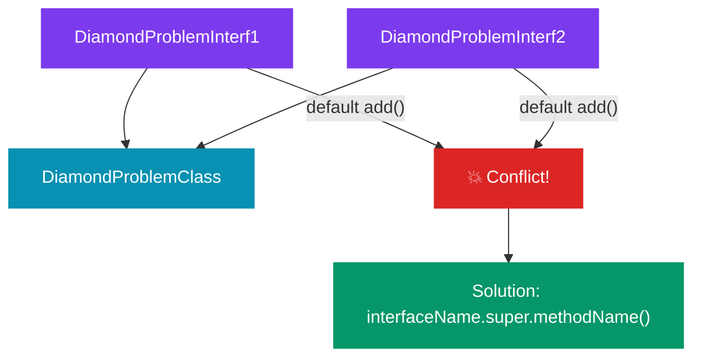

---

</details>

---

**Static Methods in Interface**

These are like default methods, but they are static. So child classes cannot change their implementation. An implementing class does not need to change the definition, and it cannot.

Static methods of an interface cannot be overridden. Like static methods of a class, you should call them through the interface name. Example: `InterfaceName.staticMethodName()`

**Why do we need static methods in the interface?**

- 🛡️ Interface static methods are safe from change, because implementation classes cannot override them.
- 🔧 Interface static methods are good for utility methods whose definition will never change. For example, null checking.

7. **🔧 Why Static methods were introduced in Java 8? ⚡**

<!-- -->
<details>
<summary>Answer</summary>

**Answer:**

- 🎯 The main reason for adding static methods to interfaces: you can keep helper methods next to the interface and call them with just the interface name. You don't need to create a class and then its object.
- 💾 An Interface can never contain:
  - Constructors
  - Static blocks
  - Instance variables (only `public static final` constants are allowed)
- ⚡ We don't need to create an object. So if everything is static, use an interface instead of a class. We have this choice only after Java 8. Before that, you needed to create a class.

```java
public interface Inter1 {
    public static void show() {
        System.out.println("Inter1.show()");
    }
}

public class Test {
    public static void main(String[] args) {
        Inter1.show();
    }
}
```

---

</details>

---

8. **🚪 Are Static Methods available to implementation classes by default? 💤**

<!-- -->
<details>
<summary>Answer</summary>

**Answer:**

Static methods are **not** available for implementing classes. They are not default methods. They are static.

Implementing classes can't access these methods directly. So, inside implementing classes, we must call these methods with the Interface name.

⚠️ **Caution:** The problem with interface static methods: they are not directly available to implementation classes. You must use the interface name to call them.

---

</details>

---

<a id="qa-on-predicate-function-consumer-supplier"></a>

## 3. QA on Predicate, Function, Consumer, Supplier

1. **🔍 What are predicates? 🔥**

<!-- -->
<details>
<summary>Answer</summary>

**Answer:**

`Predicate` is a predefined functional interface. It has only 1 abstract method, `test(T t)`:

```java
public boolean test(T t);
```

Use `Predicate` whenever you want to check a boolean condition.

---

</details>

---

2. **🧪 How to use Predicates? 🔥**

<!-- -->
<details>
<summary>Answer</summary>

**Answer:**

Say we need to test if the length of a given string is greater than or equal to 9. When we need to test a condition like this, we use the `test()` method of predicate.

🛠️ **Normal Programming:**

```java
public class Test {
    public static void main(String[] args) {
        Test test = new Test();
        System.out.println(test.testStringLength("Know Program")); // true
        System.out.println(test.testStringLength("Java")); // false
    }

    public boolean testStringLength(String string) {
        if (string.length() >= 9) {
            return true;
        }
        return false;
    }
}
```

🛠️ **Using Predicate:**

```java
import java.util.function.Predicate;

public class Test {
    public static void main(String[] args) {
        Predicate<String> checkLength = str -> str.length() >= 9;
        System.out.println(checkLength.test("Know Program")); // true
        System.out.println(checkLength.test("Java")); // false
    }
}
```

---

</details>

---

3. **🏷️ What are the Type parameter and return types of Predicates? ⚡**

<!-- -->
<details>
<summary>Answer</summary>

**Answer:**

The input to a predicate can be any type, for example:

- `Predicate<String>`
- `Predicate<Integer>`
- `Predicate<Employee>`

So a predicate needs only 1 type-argument: the input type. It does not need a return type, because the return type is always primitive **`boolean`**.

---

</details>

---

4. **🏆 What are the advantages of Predicates? 💤**

<!-- -->
<details>
<summary>Answer</summary>

**Answer:**

- 🔄 Code Reusability.
- ✂️ Say a program uses the same condition 100 times. We write it once. Then we use it 100 times with `checkLength.test(different string to be tested)`.
- 📑 We can store a condition in a variable, pass it to other methods, and join it with other conditions (`and()`, `or()`, `negate()`).

---

</details>

---

5. **🔗 What is Predicate joining? ⚡**

<!-- -->
<details>
<summary>Answer</summary>

**Answer:**

We can combine predicates into a chain of predicates. There are three ways to join them:

- 🔗 **And**
- 🔀 **Or**
- 🚫 **Negate**

If you want to test 2 conditions:

- To check the length of the string
- To check if the length is even

```java
import java.util.function.Predicate;

public class Test {
    public static void main(String[] args) {

        // check string length is >= 9
        Predicate<String> checkLength = str -> str.length() >= 9;
        System.out.println(checkLength.test("Know Program")); // true

        // Check string length is even or not
        Predicate<String> checkEvenLength = str -> str.length() % 2 == 0;
        System.out.println(checkEvenLength.test("Know Program")); // true

        // Join with and()
        // Check string length is >= 9 AND length is even
        System.out.println(checkLength.and(checkEvenLength).test("KnowProgram")); // false

        // Join with or()
        // Check string length is >= 9 OR length is even
        System.out.println(checkLength.or(checkEvenLength).test("Java")); // true

        // check string length is < 9 (Opposite of predicate checkLength)
        System.out.println(checkLength.negate().test("Java")); // true

        // Check string length is odd or not
        System.out.println(checkEvenLength.negate().test("Know Program")); // false
    }
}
```

---

</details>

---

6. **⚙️ What are Functions? 🔥**

<!-- -->
<details>
<summary>Answer</summary>

**Answer:**

The `Function` is a predefined Functional Interface that has only 1 abstract method `apply(T t)`:

```java
R apply(T t);
```

It takes some input and does some operation on it. Then it produces/returns the result. The result does not have to be a boolean value.

It takes 1 input and returns one output.

- `Predicate` takes 1 input, and the return type is always boolean.
- In `Function`, the return type is not fixed. So we declare both the input type and the return type.

🛠️ **Normal Programming:**

```java
public class Test {
    public static void main(String[] args) {
        Test test = new Test();
        System.out.println(test.square(5)); // 25
    }
    public int square(int i) {
        return i*i;
    }
}
```

🛠️ **Using Function:**

```java
import java.util.function.Function;

public class Test {
    public static void main(String[] args) {
        Function<Integer, Integer> square = i -> i * i;
        System.out.println(square.apply(9)); // 81
    }
}
```

---

</details>

---

7. **⚖️ Difference between Predicate and Function? ⚡**

<!-- -->
<details>
<summary>Answer</summary>

**Answer:**

| Feature | Predicate 🅰️ | Function 🅱️ |
|---------|-------------|-------------|
| **Return Type** | ✅ Always `boolean`. Used for conditional checks. | 🔄 Any Object type. Used to perform operations and return results. |
| **Type Parameter** | `Predicate<T>` — accepts a single argument | `Function<T, R>` — accepts a single argument but returns any type denoted by R |
| **Abstract Method** | `test()` | `apply()` |

---

</details>

---

8. **⛓️ What is Functional chaining? ⚡**

<!-- -->
<details>
<summary>Answer</summary>

**Answer:**

We can combine / chain multiple functions with `andThen()` or `compose()`:

- ➡️ `f1.andThen(f2).apply(Input)`: first f1 then f2
- ⬅️ `f1.compose(f2).apply(Input)`: first f2 then f1

Multiple functions can be chained together like: `f1.andThen(f2).andThen(f3).andThen(f4).apply(Inputs);`

```java
import java.util.function.Function;

public class Test {
    public static void main(String[] args) {
        Function<Integer, Integer> doubleVal = i -> 2 * i;
        System.out.println(doubleVal.apply(9)); // 18

        Function<Integer, Integer> cube = i -> i * i * i;
        System.out.println(cube.apply(2)); // 8

        // First double the value then cube it
        System.out.println(doubleVal.andThen(cube).apply(2)); // 64

        // First cube the value then double it
        System.out.println(cube.andThen(doubleVal).apply(2)); // 16
        System.out.println(doubleVal.compose(cube).apply(2)); // 16

        // Cube two times then double two times
        System.out.println(cube.andThen(cube).andThen(doubleVal)
                        .andThen(doubleVal).apply(2));
        // 2048
    }
}
```

---

</details>

---

9. **📥 What is Consumer Functional Interface? 🔥**

<!-- -->
<details>
<summary>Answer</summary>

**Answer:**

It consumes the item. A consumer never returns anything (it never supplies). It only consumes.

🛠️ **Example usages:** Take any object, save its details in the Database, and return nothing. It has only one abstract method, `accept()`.

```java
@FunctionalInterface
public interface Consumer<T> {
    void accept(T t);
}
```

🛠️ **Normal Programming:**

```java
public class Test {
    public static void main(String[] args) {
        Test test = new Test();
        test.squareInt(9);
    }

    public void squareInt(int i) {
        int squareValue = i * i;
        System.out.println("Square value: " + squareValue);
    }
}
```

🛠️ **Using Consumer:**

```java
import java.util.function.Consumer;

public class Test {
    public static void main(String[] args) {
        Consumer<Integer> square = i -> System.out.println("Square Value: " + i * i);
        square.accept(9);
    }
}
```

---

</details>

---

10. **🔗 What is Consumer chaining? ⚡**

<!-- -->
<details>
<summary>Answer</summary>

**Answer:**

We can combine / chain multiple consumers with `andThen()`:

- ➡️ `c1.andThen(c2).accept(Input);` – first c1 then c2

📝 **Note:** No `compose()` in Consumer Functional Interface.

Multiple consumers can be chained together like: `c1.andThen(c2).andThen(c3).andThen(c4).accept(Inputs);`

```java
import java.util.function.Consumer;

public class Test {
    public static void main(String[] args) {
        Consumer<Integer> square = i -> System.out.println("Square Value: " + i * i);
        square.accept(9);

        Consumer<Integer> doubleVal = i -> System.out.println("Double Value: " + i * 2);
        doubleVal.accept(9);

        square.andThen(doubleVal).accept(9);
    }
}
```

---

</details>

---

11. **📤 What is the Supplier Functional Interface? 🔥**

<!-- -->
<details>
<summary>Answer</summary>

**Answer:**

- 📤 It only supplies the required objects. It does not take any input. It always supplies and never consumes/takes any input.
- ⚙️ It has only one abstract method `get()`.
- 🚫 It does not have any static and default methods.
- 🔗 You cannot chain Suppliers, because a Supplier does not take any input.

```java
@FunctionalInterface
public interface Supplier<T> {
    T get();
}
```

🛠️ **Example:** always supply the current date.

**Normal Programming:**

```java
import java.util.Date;

public class Test {
    public static void main(String[] args) {
        Test test = new Test();
        System.out.println(test.getCurrentDate());
    }

    public Date getCurrentDate() {
        return new Date();
    }
}
```

**Using Supplier:**

```java
import java.util.Date;
import java.util.function.Supplier;

public class Test {
    public static void main(String[] args) {
        Supplier<Date> currentDate = () -> new Date();
        System.out.println(currentDate.get());
    }
}
```

---

</details>

---

12. **🌟 Advantages of Supplier Function? 💤**

<!-- -->
<details>
<summary>Answer</summary>

**Answer:**

- ✏️ Write once, and use anywhere.
- 🔄 Code Reusability.

**Summary on Predicate, Function, Consumer, Supplier:**

- 🔍 `Predicate<T>` => `test()` => Accepts T, Return boolean
- ⚙️ `Function<T, R>` => `apply()` => Accepts T, return R (anything)
- 📥 `Consumer<T>` => `accept()` => Accepts T, return nothing
- 📤 `Supplier<T>` => `get()` => Accepts nothing, Return T (anything)

| Interface | Abstract Method | Default Method(s) |
|-----------|----------------|-------------------|
| `Predicate<T>` | `boolean test(T t);` | `and()`, `or()`, `negate()` |
| `Function<T, R>` | `R apply(T t);` | `andThen()`, `compose()` |
| `Consumer<T>` | `void accept(T t);` | `andThen()` |
| `Supplier<T>` | `T get();` | Doesn't have any default methods |

**① The four core interfaces — takes input vs produces output:**

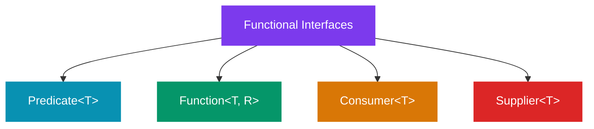

**② Each one's abstract method signature:**

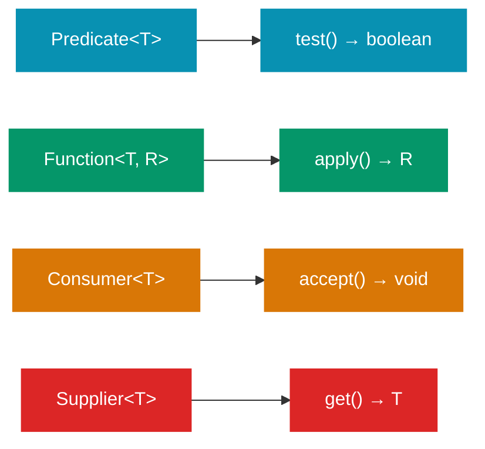

> Both diagrams use the same colours: cyan = `Predicate`, green = `Function`, amber = `Consumer`, red = `Supplier`.


---

</details>

---

13. **👥 Use of BiConsumer, BiFunction, BiPredicate, and why no BiSupplier? ⚡**

<!-- -->
<details>
<summary>Answer</summary>

**Answer:**

What if the operation needs 2 arguments? Then we need the BiXYZ Functional Interfaces. A Supplier takes no input, so it never needs 1 or 2 input arguments. That is why there is no `BiSupplier`.

🛠️ **Example:**

- 🔍 **BiPredicate:** Take two numbers and check whether the sum of them is >= 9.
- ⚙️ **BiFunction:** Take two numbers and return the multiplication.
- 📥 **BiConsumer:** Take two numbers and display their sum.

```java
import java.util.function.BiConsumer;
import java.util.function.BiFunction;
import java.util.function.BiPredicate;

public class Test {
    public static void main(String[] args) {

        // Take two numbers and check whether the sum of them is >= 9
        BiPredicate<Integer, Integer> checkSumOfTwo = (a, b) -> a + b >= 9;
        System.out.println(checkSumOfTwo.test(2, 5)); // false
        System.out.println(checkSumOfTwo.test(7, 5)); // true

        BiFunction<Integer, Integer, Integer> multiply = (a, b) -> a * b;
        System.out.println(multiply.apply(2, 5)); // 10
        System.out.println(multiply.apply(7, 5)); // 35

        BiConsumer<Integer, Integer> sum = (a, b) -> System.out.println(a + b);
        sum.accept(10, 20); // 30
    }
}
```

| Interface | Abstract Method | Default Method(s) |
|-----------|----------------|-------------------|
| `BiPredicate<T, U>` | `boolean test(T t, U u);` | `and()`, `or()`, `negate()` |
| `BiFunction<T, U, R>` | `R apply(T t, U u);` | `andThen()` only — ⚠️ **no `compose()`** |
| `BiConsumer<T, U>` | `void accept(T t, U u);` | `andThen()` |

⚠️ **Trap:** `BiFunction` has **no `compose()`**.

- The JDK declares exactly one default method on it: `default <V> BiFunction<T,U,V> andThen(Function<? super R,? extends V> after)`.
- `compose()` cannot exist here. It would have to pass the single output of a *unary* (one-argument) function into a *two-argument* input.
- Only `Function<T,R>` has both `andThen()` and `compose()`.

---

</details>

---

14. **🔢 If we want to operate on 3 arguments then can we use TriPredicate? 💤**

<!-- -->
<details>
<summary>Answer</summary>

**Answer:**

There is no `TriPredicate` or `TriFunction` etc. In the same way, Java does not give `QuadPredicate` or `QuadFunction`. The inbuilt Functional interfaces in Java 8 take at most 2 arguments (for example, `Supplier` takes 0).

💡 **Pro Tip:** If you need more than 2 arguments, create your own custom functional interface.

---

</details>

---

<a id="qa-on-streams--parallel-streams"></a>

## 4. QA on Streams & Parallel Streams

1. **🌊 What are streams? 🔥🔥**

<!-- -->
<details>
<summary>Answer</summary>

**Answer:**

- 🌊 Use streams when you want to process many objects of a collection.
- ⚙️ Streams give a way to work on a collection in Java 8.
- 🔄 `Stream<T>` is an **interface** (`java.util.stream.Stream`). It is not a class and not an `Iterator`.
  - It lets you process a *sequence of elements* in a functional style.
  - It does not store any data of its own.
  - It is **single-use**. After a terminal operation runs, using the same stream again throws `IllegalStateException: stream has already been operated upon or closed`.

🛠️ **Example:** Get all objects from the list whose value is greater than or equal to 15.

**Using Normal programming:**

```java
import java.util.ArrayList;
import java.util.Arrays;
import java.util.List;

public class Test {
    public static void main(String[] args) {
        List<Integer> list = Arrays.asList(10, 20, 12, 33, 9);
        System.out.println(findElements(list)); // [20, 33]
    }

    public static List<Integer> findElements(List<Integer> list) {
        List<Integer> newAl = new ArrayList<>();
        for (Integer i : list) {
            if (i >= 15) {
                newAl.add(i);
            }
        }
        return newAl;
    }
}
```

**Using Streams:**

```java
import java.util.Arrays;
import java.util.List;
import java.util.stream.Collectors;

public class Test {
    public static void main(String[] args) {
        List<Integer> list = Arrays.asList(10, 20, 12, 33, 9);
        List<Integer> newList = list.stream().filter(x -> x >= 15)
               .collect(Collectors.toList());
        newList.forEach(x -> System.out.println(x));
    }
}
```

---

</details>

---

2. **❓ Why streams were introduced in Java 8 if we already had java.io.stream? ⚡**

<!-- -->
<details>
<summary>Answer</summary>

**Answer:**

- 📁 The `java.io.streams` are a sequence of characters or binary data. We use them to write data to a file or read data from a file.
- 🌊 Streams of Java 1.8 are not I/O streams. They process a sequence of elements from a source. The source is usually a collection, but it can also be an array or the lines of a file (`Files.lines()`).
- ⚖️ The `java.io.streams` are related to files. Java 8 streams are related to collection objects.
- ⚙️ So, if we need to do some operations on a collection, we should use streams.

---

</details>

---

3. **🔄 What is the difference between Java 8 streams and collections? 🔥🔥**

<!-- -->
<details>
<summary>Answer</summary>

**Answer:**

- Use a collection when you want to hold a group of items as one unit.
- Use streams when you want to do operations on many objects in a collection.

🧠 **In Simple Words:** Collections are for *storing* data, Streams are for *processing* data.

---

</details>

---

4. **📋 Steps to create and process stream? ⚡**

<!-- -->
<details>
<summary>Answer</summary>

**Answer:**

We can get stream objects by: `Stream s = collectionObject.stream();`

```java
import java.util.Arrays;
import java.util.List;
import java.util.stream.Stream;

public class Test {
    public static void main(String[] args) {
        List<Integer> list = Arrays.asList(10, 20, 12, 33, 9);
        Stream<Integer> stream = list.stream();
        stream.forEach(System.out::println);
    }
}
```

After we get the stream object, we can process the objects of the collection. Processing the stream has 2 steps/stages:

- 🔧 Set up the stream with `map()` or `filter()`
- ⚡ Processing that configuration

🛠️ **Filter even elements from the list using stream:**

```java
import java.util.Arrays;
import java.util.List;
import java.util.stream.Stream;

public class Test {
    public static void main(String[] args) {
        List<Integer> list = Arrays.asList(10, 20, 12, 33, 9);
        // Filter even elements from list
        Stream<Integer> stream = list.stream().filter(x -> x % 2 == 0);
        stream.forEach(x -> System.out.println(x));

        // list.stream().filter(x -> x % 2 == 0).forEach(System.out::println);
    }
}
```

🛠️ **Filter even elements from the list and store them in a new list:**

```java
import java.util.Arrays;
import java.util.List;
import java.util.stream.Collectors;

public class Test {
    public static void main(String[] args) {
        List<Integer> list = Arrays.asList(10, 20, 12, 33, 9);
        // Filter even elements from the list and store them in a new list
        List<Integer> evenList = list.stream()
             .filter(x -> x % 2 == 0).collect(Collectors.toList());
        System.out.println(evenList); // [10, 20, 12]
    }
}
```


---

</details>

---

5. **🗺️ When to use map() on the stream objects? 🔥**

<!-- -->
<details>
<summary>Answer</summary>

**Answer:**

Use `map()` when you do not want to filter. Instead, you want to create a new object for each object in the stream. A function decides the new object.

🛠️ **Example:** For each object in the stream, create a new object by squaring its value.

```java
import java.util.Arrays;
import java.util.List;
import java.util.stream.Collectors;

public class Test {
    public static void main(String[] args) {
        List<Integer> list = Arrays.asList(10, 20, 12, 33, 9);
        // create another list with the square of each element
        List<Integer> squaredList = list.stream()
           .map(x -> x * x).collect(Collectors.toList());
        System.out.println(squaredList); // [100, 400, 144, 1089, 81]

        // the doubling variant, for contrast
        List<Integer> doubledList = list.stream()
           .map(x -> 2 * x).collect(Collectors.toList());
        System.out.println(doubledList); // [20, 40, 24, 66, 18]
    }
}
```

---

</details>

---

6. **🔬 What is the difference between filter() and map() in Java 8 stream? ⚡**

<!-- -->
<details>
<summary>Answer</summary>

**Answer:**

- Use `filter()` to fetch/filter objects from a collection. For example, keep only the even numbers from an array list collection. `filter()` configures the stream.
- Use `map()` to do an operation on each object of the collection. For each object, it creates a new mapped object with the new value.

🔑 **Key Point:**
- In `filter()`, the filtered list has **at most** as many objects as the original list. It is equal if every element matches, and zero if none match.
- In `map()`, the new list always has **exactly the same** number of objects as the original. `map()` is one-to-one.

---

</details>

---

<a id="processing-of-streams"></a>

## 5. Processing Of Streams

1. **📦 How to process elements using collect()? 🔥🔥**

<!-- -->
<details>
<summary>Answer</summary>

**Answer:**

Use the `collect()` method to collect the stream's elements after filtering or mapping. It adds them to the collection you need.

```java
import java.util.Arrays;
import java.util.List;
import java.util.Set;
import java.util.stream.Collectors;

public class Test {
    public static void main(String[] args) {
        List<Integer> list = Arrays.asList(15, 25, 52, 10, 8, 9, 25);
            // filter numbers > 20 and store it in a list
        List<Integer> newlist = list.stream()
              .filter(num -> num > 20)
              .collect(Collectors.toList());
        System.out.println(newlist); // [25, 52, 25]

            // filter numbers > 20 and get unique elements
        Set<Integer> newSet = list.stream()
               .filter(num -> num > 20)
               .collect(Collectors.toSet());
        System.out.println(newSet); // [52, 25]
    }
}
```

---

</details>

---

2. **🔢 How to process elements using count()? ⚡**

<!-- -->
<details>
<summary>Answer</summary>

**Answer:**

Use the `count()` method to count how many elements in the collection match a given condition.

```java
List<Integer> list = Arrays.asList(15, 25, 52, 10, 8, 9, 25);
long count = list.stream().filter(num -> num > 20).count();
System.out.println(count); // 3
```

---

</details>

---

3. **📊 How to process elements using sorted()? ⚡**

<!-- -->
<details>
<summary>Answer</summary>

**Answer:**

- Use the `sorted()` method to sort elements inside a stream.
- With no argument, it sorts in the default natural sorting order.
- To sort in a custom sorting order, pass a comparator.

```java
List<Integer> list = Arrays.asList(15, 25, 52, 10, 8, 9, 21);
Stream<Integer> sortedList = list.stream().sorted();
sortedList.forEach(System.out::println);

// sort and store to the list
List<Integer> sortedList2 = list.stream().sorted().collect(Collectors.toList());
System.out.println(sortedList2); // [8, 9, 10, 15, 21, 25, 52]

// sort and filter
Stream<Integer> filteredSortedStream = list.stream()
               .filter(num -> num > 20)
               .sorted();
filteredSortedStream.forEach(x -> System.out.println(x)); // 21 25 52
```

---

</details>

---

4. **⬇️ How to sort elements in descending order? ⚡**

<!-- -->
<details>
<summary>Answer</summary>

**Answer:**

Use a `Comparator`. ✅ **The standard Java 8 way is `Comparator.reverseOrder()` (or `.reversed()` on an existing comparator):**

```java
List<Integer> list = Arrays.asList(15, 25, 52, 10, 8, 9, 21);
List<Integer> sortedList = list.stream()
               .sorted(Comparator.reverseOrder())
               .collect(Collectors.toList());
System.out.println(sortedList); // [52, 25, 21, 15, 10, 9, 8]
```

`Collections.reverseOrder()` does the same thing. It is the pre-Java-8 way, and it still works:

```java
List<Integer> list2 = Arrays.asList(10, 20, 12, 33, 9);
List<Integer> sortedList2 = list2.stream()
               .sorted(Collections.reverseOrder())
               .collect(Collectors.toList());
System.out.println(sortedList2); // [33, 20, 12, 10, 9]
```

⚠️ **A bad pattern interviewers ask about — negating `compareTo`:**

```java
.sorted((i1, i2) -> -i1.compareTo(i2))   // ❌️ works here, but is a bug waiting to happen
```

It gives the right answer for `Integer`. But **negation is not a safe way to reverse a comparator**.

- The comparator contract only says: return a value that is *negative / zero / positive*.
- So a comparator may legally return `Integer.MIN_VALUE`.
- `-Integer.MIN_VALUE` overflows back to `Integer.MIN_VALUE`.
- So the "reversed" comparator reports the same order. This breaks the `sgn(compare(x,y)) == -sgn(compare(y,x))` contract.

Prefer `.reversed()` / `Comparator.reverseOrder()`. Swapping the operands (`(i1, i2) -> i2.compareTo(i1)`) is also safe.

---

</details>

---

5. **📈 How to process elements using min() and max() methods? ⚡**

<!-- -->
<details>
<summary>Answer</summary>

**Answer:**

- 📉 `min(Comparator)` will return the minimum value based on the defined comparator.
- 📈 `max(Comparator)` will return the maximum value based on the defined comparator.

The `min()` and `max()` methods take a comparator. The comparator decides the order. They do not sort the stream. They do one pass (a reduce) and keep the smaller/larger value. The result is an `Optional`.

```java
List<Integer> list = Arrays.asList(15, 25, 52, 10, 8, 9, 21);
Integer min = list.stream().filter(n -> n > 20)
               .min((i1, i2) -> i1.compareTo(i2)).get();
System.out.println(min);

System.out.println(list.stream()
               .min((i1, i2) -> i1.compareTo(i2)).get()); // 8
System.out.println(list.stream()
               .min((i1, i2) -> -i1.compareTo(i2)).get()); // 52
System.out.println(list.stream()
               .min((i1, i2) -> i2.compareTo(i1)).get()); // 52

Integer max = list.stream().max((i1, i2) -> i1.compareTo(i2)).get();
System.out.println(max); // 52

Integer min2 = list.stream().max((i1, i2) -> -i1.compareTo(i2)).get();
System.out.println(min2); // 8
```

---

</details>

---

6. **🔁 How to process elements using forEach()? 🔥**

<!-- -->
<details>
<summary>Answer</summary>

**Answer:**

- All the methods above return something. This method does not return anything.
- It takes a lambda expression as an argument.
- It applies that lambda expression to each element in the stream.

```java
List<Integer> list = Arrays.asList(15, 25, 52, 10, 8, 9, 21);
list.stream().forEach(n -> System.out.println(n));
list.stream().forEach(System.out::println);
```

---

</details>

---

7. **🗃️ How do elements be processed using the toArray() method? 💤**

<!-- -->
<details>
<summary>Answer</summary>

**Answer:**

It **copies** the elements in the stream into an array.

📝 **Note:** The no-argument `toArray()` always returns `Object[]`.

```java
List<Integer> list = Arrays.asList(15, 25, 52, 10, 8, 9, 21);
Object[] arr1 = list.toArray();
System.out.println(Arrays.toString(arr1));
Object[] arr2 = list.stream().filter(n -> n > 20).toArray();
System.out.println(Arrays.toString(arr2)); // [25, 52, 21]
```

But we can convert it to an `Integer` array like this:

```java
Integer[] arr1 = list.toArray(new Integer[0]);                     // any Java version
Integer[] arr2 = list.stream().toArray(Integer[]::new);            // Java 8 (Stream.toArray)
Integer[] arr3 = list.toArray(Integer[]::new);                     // Java 11+ (Collection.toArray)
```

---

</details>

---

8. **🏭 How do elements be processed using the Stream.of() method? ⚡**

<!-- -->
<details>
<summary>Answer</summary>

**Answer:**

- The stream concept does not work only with collections. It also works with **"ANY GROUP OF VALUE"**.
- You can use a stream even for arrays.
- The `Stream.of()` method can take any group of values and convert them to a stream.

```java
Stream<Integer> stream = Stream.of(15, 25, 52, 10, 8, 9, 21);
stream.forEach(n -> System.out.println(n));

String[] names = { "Know", "Program", "Java" };
Stream.of(names).filter(name -> name.length() > 4)
    .forEach(name -> System.out.println(name)); // Program
```

---

</details>

---

9. **🚀 What is a Parallel Stream? 🔥**

<!-- -->
<details>
<summary>Answer</summary>

**Answer:**

- 🚀 Java Parallel Streams came in Java 8 (1.8), together with the Stream API.
- ⚙️ They are meant to use multiple cores of the processor.
- 🔄 Before this, our Java code had 1 stream of processing. It runs sequentially.
- ⚡ With parallel streams, we divide the work into multiple streams. They run in parallel on separate cores. The final result combines the results from each core.

---

</details>

---

10. **⚡ Sequential VS Parallel Streams? 🔥**

<!-- -->
<details>
<summary>Answer</summary>

**Answer:**

The output of this sequential stream is T1, T2, T3, T4, in sequential order. Tasks run one after another, and the output of 1 can be input to another.

- 🔀 The output of this Parallel stream is T2, T4, T1, and T3 not in sequential order.
- ❌️ The order of execution is not under control.
- ⚠️ So use a parallel stream only when:
  - the order of execution of threads does not matter, and
  - the state of one element does not affect another.

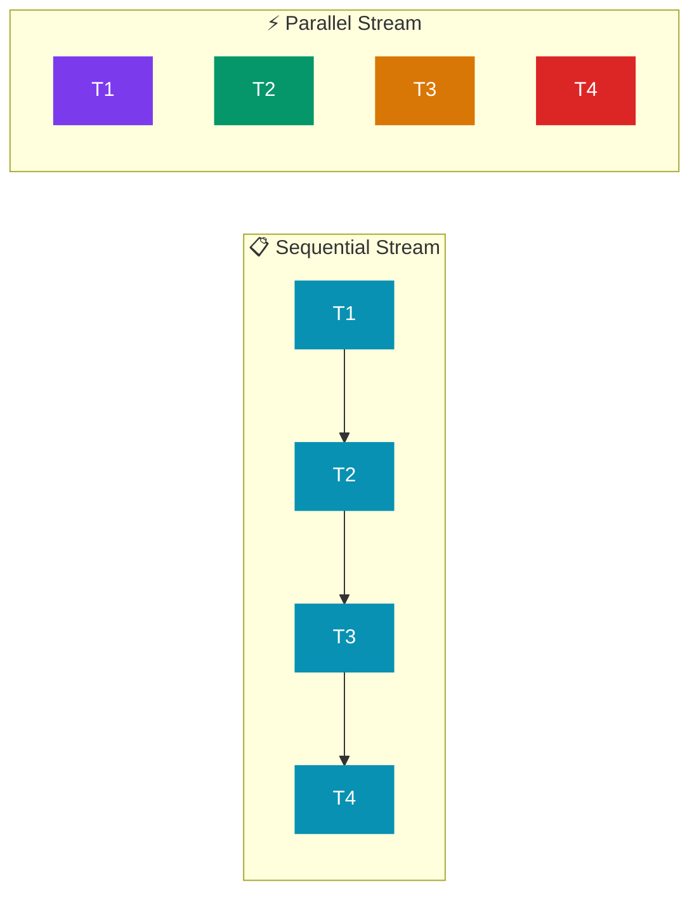

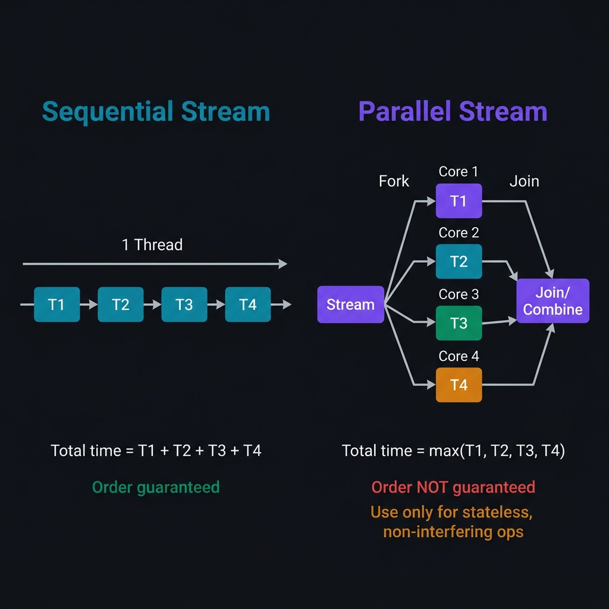

⚙️ **Where do the threads come from? (the follow-up question that shows deep knowledge)**

- 🧵 A parallel stream does **not** create its own threads. It submits work to the **shared `ForkJoinPool.commonPool()`**.
  - This is one pool for the whole JVM.
  - `CompletableFuture`'s default async methods and `Arrays.parallelSort` also use it.
- 🔢 Its default parallelism is **`Runtime.getRuntime().availableProcessors() - 1`** worker threads.
  - The *calling* thread also helps, so the real number of working threads is `availableProcessors()`.
  - On a 12-core machine: `ForkJoinPool.getCommonPoolParallelism()` → `11`.
  - To change it for the whole JVM, use `-Djava.util.concurrent.ForkJoinPool.common.parallelism=N`.
- 🚫 **Never put blocking I/O inside a parallel stream** (JDBC calls, HTTP calls, `Thread.sleep`).
  - The whole JVM shares the common-pool workers. If they are blocked, one slow batch leaves no free worker for every other parallel stream and `CompletableFuture` in the process.
  - Parallel streams are for **CPU-bound** work over large sources that are cheap to split (arrays, `ArrayList`, `IntStream.range`).
  - `LinkedList`, `Iterator`-backed and I/O-backed sources split badly.
- 🎛️ Need a private pool? Submit the terminal operation from inside your own `ForkJoinPool`: `myPool.submit(() -> list.parallelStream()...).get()`.
  - This trick works in practice. But the API does not guarantee it.
  - A dedicated `ExecutorService` is usually the cleaner design.
- 🔀 `forEach` on a parallel stream is **explicitly unordered**. If you need encounter order (the order of the source), use `forEachOrdered` (or `collect`). But you lose some of the parallelism you wanted.
- 📉 For small collections, the cost of splitting + merging + boxing usually makes the parallel version **slower** than the sequential one. Measure it; don't assume.

This is exactly the kind of code where an interviewer asks the common-pool question: *"those lambdas hit the database — what happens to every other parallel stream in the JVM while that batch runs?"*

🎯 **Interview Tip:** Always say that you should use parallel streams only when operations are **stateless, non-interfering, associative**, and order doesn't matter. Also mention the common `ForkJoinPool` before the interviewer asks.

---

</details>

---

11. **🔤 How do you sort by multiple fields with `Comparator.comparing()` and `thenComparing()`? 🔥🔥**

<!-- -->
<details>
<summary>Answer</summary>

**Answer:**

`Comparator.comparing(keyExtractor)` builds a comparator from a **key extractor**. You write no `compare()` method by hand, and no negated `compareTo`. You can combine it with `thenComparing()` (to break ties when the first key is equal) and `reversed()`.

```java
List<Employee> sorted = employees.stream()
    .sorted(Comparator.comparing(Employee::getDepartment)          // primary key
                      .thenComparing(Employee::getSalary)          // tie-breaker
                      .thenComparing(Employee::getName))           // second tie-breaker
    .collect(Collectors.toList());
```

⚠️ **The #1 trap — `.reversed()` reverses the WHOLE chain, not just the last key.**

```java
Comparator.comparing(Employee::getDepartment).thenComparing(Employee::getSalary).reversed()
// ❌️ NOT "dept ascending, salary descending" — it is "dept DESCENDING, salary DESCENDING"
```

To reverse only one key, reverse that key's comparator instead of the chain:

```java
Comparator.comparing(Employee::getDepartment)                                    // dept ↑
          .thenComparing(Comparator.comparing(Employee::getSalary).reversed())  // salary ↓
```

🔢 **`comparingInt` / `comparingLong` / `comparingDouble` avoid boxing.**

- `Comparator.comparing(Employee::getAge)` on an `int` getter boxes every element into an `Integer` on every comparison. There are O(n log n) of them.
- `Comparator.comparingInt(Employee::getAge)` takes a `ToIntFunction` extractor and compares primitives.
- Same result, but no boxing. (Boxing reuses cached `Integer`s only for -128..127; other values make new objects.)

🕳️ **Nulls:** if a key extractor can return `null`, the sort throws an NPE. Wrap it with `Comparator.nullsFirst(Comparator.naturalOrder())` / `nullsLast(...)`. For example: `Comparator.comparing(Employee::getName, Comparator.nullsLast(Comparator.naturalOrder()))`.

📌 **Also useful:** `Comparator.naturalOrder()` / `reverseOrder()` for the no-key case, and `list.sort(cmp)` when you want to sort **in place** instead of building a new list through a stream.

- It is in report data services, list/detail response processors, batch tasklets and PDF generation.
- That is, in every place where rows must come out in a fixed order that the business defines.
- `.reversed()` is used a few times, and `thenComparing` is **never** used.
- So practise multi-key ordering on purpose for interviews. Day-job code rarely makes you do it.

📖 **Worked examples:** see [Java 8 Stream All Operations with Examples](07_Java_8_Stream_Operations_with_Examples.md) for the full end-to-end sorting walkthroughs.

---

</details>

---

<a id="java-8-grouping-by-scenarios"></a>

## 6. Java 8 Grouping By Scenarios

Many of the questions and examples below use this setup:

```java
import java.util.Objects;
public class Employee {
    private Integer id;
    private Integer age;

    public Employee(Integer id, Integer age) {
        this.id = id;
        this.age = age;
    }

    // getter and setter

    @Override
    public String toString() {
        return "Employee [id=" + id + ", age=" + age + "]";
    }

    // hashCode based on id only
    @Override
    public int hashCode() {
        return Objects.hash(id);
    }

    // equals based on id only
    @Override
    public boolean equals(Object obj) {
        if (this == obj)
            return true;
        if (obj == null)
            return false;
        if (getClass() != obj.getClass())
            return false;
        Employee other = (Employee) obj;
        return Objects.equals(id, other.id);
    }
}
```

```java
import java.util.Arrays;
import java.util.List;

public class Test {
    public static void main(String[] args) {
        List<Employee> employees = Arrays.asList(new Employee(10, 18),
                new Employee(11, 25), new Employee(12, 24),
                new Employee(13, 25), new Employee(14, 18),
                new Employee(15, 25), new Employee(11, 25),
                new Employee(14, 18));
        employees.stream().forEach(System.out::println);
    }
}
```

1. **🤔 Why do we need a Grouping Collector? 🔥**

<!-- -->
<details>
<summary>Answer</summary>

**Answer:**

Sometimes you have a stream of objects and need to put them into groups. Each group is based on one property that the objects have.

🛠️ **Example:** Create a map with the key as Age and value as a list of employees in that age group.

This idea is the same as the `GROUP BY` clause in SQL.

- `GROUP BY` takes an attribute, or a value calculated from attribute(s).
- It uses that value to split the fetched records into separate groups.

Before Java 8, we usually grouped objects like this:

1. Loop over each object.
2. Check which group the current object belongs to.
3. Add the object to that group.

Each group is held in a `Collection` instance.

---

</details>

---

2. **⚙️ How Grouping Collector Works? 🔥**

<!-- -->
<details>
<summary>Answer</summary>

**Answer:**

Grouping collectors use a classification function (the function that picks the group). It is an instance of `Function<T, K>`.

- 🏷️ `T` — Type of the object in the stream
- 🔑 `K` — The "group names" or "group keys"

For every value of K, there is a collection of objects. For each of these objects, the classification function returns that same value of K.

The grouping collector stores all these K-values and their Collections of stream objects in a `Map<K, List<T>>` (or `Map<K, D>` when you pass a downstream collector).

---

</details>

---

3. **1️⃣ Grouping collector with a single parameter? 🔥**

<!-- -->
<details>
<summary>Answer</summary>

**Answer:**

```java
Map<Integer, List<Employee>> grouppedEmp = employees.stream()
   .collect(Collectors.groupingBy(emp -> emp.getAge()));
System.out.println(grouppedEmp);
```

📤 **Output:**

```
{
    18=[
        Employee[id=10,age=18],
        Employee[id=14,age=18],
        Employee[id=14,age=18],
    ],
    24=[
        Employee[id=12,age=24],
    ],
    25=[
        Employee[id=11,age=25],
        Employee[id=13,age=25],
        Employee[id=15,age=25],
        Employee[id=11,age=25],
    ]
}
```

📝 The outputs in this section are re-formatted to be easy to read. The real `println` prints one line that uses `toString()`, like `{18=[Employee [id=10, age=18], ...], 24=[...], 25=[...]}`.

The classification function passed to `groupingBy()` is the age getter.

- Above, it is written as the lambda `emp -> emp.getAge()`.
- You can write the same thing as the method reference `Employee::getAge`.

The end result we want is a Map. Each key is an age. Each value is a List of employees of that age.

---

</details>

---

4. **2️⃣ 2 parameter Collectors.groupingBy()? 💤**

<!-- -->
<details>
<summary>Answer</summary>

**Answer:**

We can also pass our own Collector to collect the grouped elements.

- The 1st variant of `groupingBy()` always returns a List with the elements of a group.
- The 2nd variant of `groupingBy()` takes a second parameter, which is a `Collector`. This lets you choose how the grouped elements are collected.

So, instead of storing the groups in the result Map as Lists, we can store them as Sets, for example: `Collectors.groupingBy(Employee::getAge, Collectors.toSet())`.

⚠️ Note: it must be the method **reference** `Employee::getAge` (or the lambda `emp -> emp.getAge()`). `Employee.getAge()` would be an instance-method call on the class. It does not compile.

🛠️ **Example:** Group all employees by age as key-value pairs. The list of employees for each age should have no duplicates:

```java
Map<Object, Set<Employee>> employees = employeeService.findAll().stream()
    .collect(Collectors.groupingBy(emp -> emp.getAge(), Collectors.toSet()));
```

📤 **Output:**

```
{
    18=[
        Employee[id=10,age=18],
        Employee[id=14,age=18],
    ],
    24=[
        Employee[id=12,age=24],
    ],
    25=[
        Employee[id=11,age=25],
        Employee[id=13,age=25],
        Employee[id=15,age=25],
    ]
}
```

---

</details>

---

5. **3️⃣ 3 Parameter Collectors.groupingBy()? 💤**

<!-- -->
<details>
<summary>Answer</summary>

**Answer:**

Here, the 2nd parameter is a **map factory** (a `Supplier` that creates the result map). It does not sort by itself. If you pass `TreeMap::new`, the result is sorted **by key**, because a `TreeMap` keeps its keys sorted.

Task: group all employees by age as key-value pairs.

- The list of employees for each age should have no duplicates.
- The key-value pairs should be sorted by age in ascending order.

```java
Map<Object, Set<Employee>> grouppedSortedSet = employees.stream()
 .collect(Collectors.groupingBy(emp -> emp.getAge(), TreeMap::new, Collectors.toSet()));
```

📤 **Output:**

```
{
    18=[
        Employee[id=10,age=18],
        Employee[id=14,age=18],
    ],
    24=[
        Employee[id=12,age=24],
    ],
    25=[
        Employee[id=11,age=25],
        Employee[id=13,age=25],
        Employee[id=15,age=25],
    ]
}
```

The same can be written as:

```java
.collect(Collectors.groupingBy(emp -> emp.getAge(),
            () -> new TreeMap<>(), Collectors.toSet()));
```

To sort in descending order of the key (ages):

```java
Map<Integer, Set<Employee>> groupedSortedSet = employees.stream()
    .collect(Collectors.groupingBy(
        Employee::getAge,   // method ref: the lambda emp -> emp.getAge() does not compile here
        () -> new TreeMap<>(Comparator.reverseOrder()),
        Collectors.toSet()
    ));
System.out.println(groupedSortedSet);
```

📤 **Output:**

```
{
    25=[
        Employee[id=11,age=25],
        Employee[id=13,age=25],
        Employee[id=15,age=25],
    ],
    24=[
        Employee[id=12,age=24],
    ],
    18=[
        Employee[id=10,age=18],
        Employee[id=14,age=18],
    ]
}
```

---

</details>

---

6. **🔀 Difference between different parameterized Collectors.groupingBy()? 💤**

<!-- -->
<details>
<summary>Answer</summary>

**Answer:**

How variant #1 and variant #2 of the grouping collector are linked:

Look at the code of the `Collectors` class.

- The first variant takes only the classification function as input.
- It does not build the Collector that processes the Stream elements by itself.
- Instead, it calls the second variant: `groupingBy(classifier, toList())`.

So the first variant is just a short way to call the second variant. Its downstream collector (the collector for the values of each group) is fixed as a List.

🧠 **In Simple Words:** The 1-parameter method calls the 2-parameter method. The 2-parameter method calls the 3-parameter method.

```java
public static <T, K> Collector<T, ?, Map<K, List<T>>>
  groupingBy(Function<? super T, ? extends K> classifier) {
    return groupingBy(classifier, toList());
}

public static <T, K, A, D>
    Collector<T, ?, Map<K, D>> groupingBy(Function<? super T, ? extends K> classifier,
              Collector<? super T, A, D> downstream) {
    return groupingBy(classifier, HashMap::new, downstream);
}

public static <T, K, D, A, M extends Map<K, D>>
    Collector<T, ?, M> groupingBy(Function<? super T, ? extends K> classifier,
        Supplier<M> mapFactory,
        Collector<? super T, A, D> downstream) {
    // code
}
```

---

</details>

---

7. **🗺️ What is `Collectors.toMap()` and why does it blow up on duplicate keys? 🔥🔥**

<!-- -->
<details>
<summary>Answer</summary>

**Answer:**

`Collectors.toMap(keyMapper, valueMapper)` turns a stream into a `Map`.

- `toMap()` makes one entry per element.
- `groupingBy()` makes one entry per *group*. Its value is a collection of elements.

```java
Map<Integer, Integer> idToAge = employees.stream()
    .collect(Collectors.toMap(Employee::getId, Employee::getAge));
```

💥 **The 2-arg form throws `IllegalStateException` as soon as two elements produce the same key.** Here we use the 8-element list from this section (ages 18, 25, 24, 25, 18, 25, 25, 18) and use *age* as the key:

```java
employees.stream().collect(Collectors.toMap(Employee::getAge, Employee::getId));
// Java 9+: java.lang.IllegalStateException: Duplicate key 25 (attempted merging values 11 and 13)
// Java 8:  java.lang.IllegalStateException: Duplicate key 11   ← prints the old VALUE, not the key
```

⚠️ Note: this is a **runtime** failure, not a compile-time one. In a batch job, you usually see it only on the one day the input data really has a duplicate.

Pass a **merge function** (the 3-arg overload) to say clearly what happens on a duplicate key:

```java
// keep the first winner
Map<Integer, Integer> firstWins = employees.stream()
    .collect(Collectors.toMap(Employee::getAge, Employee::getId, (existing, replacement) -> existing));
// {18=10, 24=12, 25=11}

// last-write-wins (this is what HashMap.put would have done)
Collectors.toMap(Employee::getAge, Employee::getId, (existing, replacement) -> replacement);

// or accumulate instead of discarding
Collectors.toMap(Employee::getAge, e -> new ArrayList<>(Collections.singletonList(e.getId())),
                 (a, b) -> { a.addAll(b); return a; });
```

🧺 **The 4-arg overload adds a map supplier.** Use it when you need a specific `Map` implementation or a defined iteration order. (`toMap()` returns a `HashMap`, and its order is not defined.)

```java
Map<Integer, Integer> ordered = employees.stream()
    .collect(Collectors.toMap(Employee::getAge, Employee::getId, (a, b) -> a, LinkedHashMap::new));
```

📖 **Worked examples:** see [Java 8 Stream All Operations with Examples](07_Java_8_Stream_Operations_with_Examples.md).

---

</details>

---

8. **🕳️ Why does `Collectors.toMap()` throw a `NullPointerException` where `HashMap.put()` is fine? 🔥**

<!-- -->
<details>
<summary>Answer</summary>

**Answer:**

Because `toMap()` checks every value, and a `null` value fails that check.

- In Java 8, `toMap()` is built on top of **`Map.merge()`**. `merge()` throws an NPE when the new value is `null`.
- From Java 9, the 2-arg `toMap()` uses a different path (`putIfAbsent` + a duplicate check). But it calls `Objects.requireNonNull` on each value first, so it still throws an NPE.
- The 3-arg and 4-arg forms still use `merge()` in every version.
- `HashMap.put(k, null)` is fully legal.

```java
Map<String, String> m = new HashMap<>();
m.put("a", null);           // ✅ fine → {a=null}

Stream.of("a").collect(Collectors.toMap(s -> s, s -> null));
// ❌️ java.lang.NullPointerException
```

⚠️ So one nullable column is enough to make `toMap()` fail at runtime on real data. Examples: `employee.getManagerId()`, an optional address, an unset flag. The same code may have passed every test that used hand-made test data.

Ways to protect against it (these examples assume `Employee` also has a `String name` field with `getName()`):

```java
// 1. substitute a sentinel in the value mapper
Collectors.toMap(Employee::getId, e -> Optional.ofNullable(e.getName()).orElse(""))

// 2. filter the nulls out first, if dropping them is correct
employees.stream().filter(e -> e.getName() != null)
         .collect(Collectors.toMap(Employee::getId, Employee::getName))

// 3. or don't use toMap — collect into a HashMap yourself
employees.stream().collect(HashMap::new,
        (map, e) -> map.put(e.getId(), e.getName()), HashMap::putAll);
```

📝 **Null keys** are a separate case.

- `toMap()` accepts a `null` *key* for a `HashMap`. Only the value is checked.
- But a `null` key will throw an NPE if you supply a `TreeMap::new` or `ConcurrentHashMap::new` map factory.

---

</details>

---

<a id="java-8-statistics-example"></a>

## 7. Java 8 Statistics Example

1. **📊 Java 8 Statistics Example: Get count, min, max, sum, and the average for numbers? ⚡**

<!-- -->
<details>
<summary>Answer</summary>

**Answer:**

Example: you have an employee DB. Fetch the employee with the max age and the employee with the min age. Find the average age of all employees in an organization, and so on.

```java
stream().mapToInt(x -> x).summaryStatistics();
```

These statistics operations work on numbers. So you must first call `mapToInt()` to get an `IntStream`. Then `summaryStatistics()` returns an `IntSummaryStatistics` object. That object has the getters `getMin()`, `getMax()`, `getCount()`, `getSum()` and `getAverage()`.

These general-purpose methods make many tasks easy. Before Java 8, the same tasks needed a lot of code.

```java
import java.util.Arrays;
import java.util.IntSummaryStatistics;
import java.util.List;
import java.util.stream.Collectors;

public class Test {
    public static void main(String[] args) {
        List<Employee> employees = Arrays.asList(new Employee(10, 18),
                new Employee(11, 25), new Employee(12, 24),
                new Employee(13, 25), new Employee(14, 18),
                new Employee(15, 25), new Employee(11, 25),
                new Employee(14, 18));

        List<Integer> ages = employees.stream()
              .map(emp -> emp.getAge())
              .collect(Collectors.toList());
        System.out.println("Ages: " + ages);
        // Ages: [18, 25, 24, 25, 18, 25, 25, 18]

        IntSummaryStatistics summary = ages.stream()
                .mapToInt(x -> x)
                .summaryStatistics();

        System.out.println(summary);
        System.out.println(summary.getMin() + ", "
                + summary.getMax() + ", "
                + summary.getCount() + ", "
                + summary.getAverage() + ", "
                + summary.getSum()); // 18, 25, 8, 22.25, 178
    }
}
```

---

</details>

---

2. **✂️ How to get a slice of a stream in Java? ⚡**

<!-- -->
<details>
<summary>Answer</summary>

**Answer:**

📥 **Input:** `[1, 2, 3, 4, 5, 6, 7, 8, 9]`
📤 **Output:** `[2, 3, 4]`

**Explanation:** The output contains a slice of the stream from index 1 to 3.

Use `skip()` and `limit()`. The Java Stream API gives you both:

- The `skip()` method drops the elements you do not need from the start of the stream.
- The `limit()` function returns a new stream that stops at the given limit. It keeps the encounter order (the order in which the stream gives its elements).

- `stream.skip(startIndex);` — Specify the number of elements to skip
- `limit(endIndex - startIndex + 1);` — Specify the number of elements the stream should keep

```java
public class Test {
    public static void main(String[] args) {
        List<Employee> employees = Arrays.asList(new Employee(10, 18),
                new Employee(11, 25), new Employee(12, 24),
                new Employee(13, 25), new Employee(14, 18),
                new Employee(15, 25), new Employee(11, 25),
                new Employee(14, 18));

        // get all unique ages
        Set<Integer> uniqueAges = employees.stream()
              .map(emp -> emp.getAge())
              .collect(Collectors.toSet());
        System.out.println("Ages: " + uniqueAges);
        // Ages: [18, 24, 25]

        // 2nd & 3rd youngest age — .sorted() is MANDATORY here
        List<Integer> secondAndThirdYoungestAges = uniqueAges
                .stream()
                .sorted()
                .skip(1)
                .limit(2)
                .collect(Collectors.toList());
        System.out.println(secondAndThirdYoungestAges); // [24, 25]
    }
}
```

⚠️ **Why `.sorted()` is not optional.**

- `Collectors.toSet()` returns a `HashSet`. A `HashSet` has **no defined encounter order**.
- Its iteration order depends on hash values and table capacity. It does not depend on insertion order or on the size of the values.
- So `skip(1).limit(2)` directly on that set means "drop whatever element `HashSet` happens to iterate first". That is a different question from "2nd and 3rd youngest".
- It *looks* right for small `Integer`s only by chance. `Integer.hashCode()` is the value itself, so ints smaller than the table size (16 by default) go into buckets in ascending order. Here 18, 24 and 25 land in buckets 2, 8 and 9, so the order still looks sorted. This is an implementation detail, not a contract.
- Any question like "2nd smallest / top 3 / youngest" needs an explicit `.sorted()` (or `TreeSet::new` via `Collectors.toCollection`).

📝 The same warning applies to every `HashSet`/`HashMap` output printed elsewhere in this file. The bracket order shown is what one JVM run produced. The API does not guarantee it.

---

</details>

---

3. **🔠 Convert Strings to uppercase and Join them with a comma? ⚡**

<!-- -->
<details>
<summary>Answer</summary>

**Answer:**

Example: you have a list of employee names. Convert each name to upper case. Join all the names with a comma between them, using Java 8.

```java
String listOfNames = list.stream().map(x -> x.toUpperCase())
       .collect(Collectors.joining(", "));
```

We joined all Strings with the `Collectors.joining(", ")` method. It is another utility method from Java 8. It joins Strings with a given delimiter. It also has a 3-arg overload that adds a prefix and suffix: `Collectors.joining(", ", "[", "]")`.

```java
import java.util.stream.Collectors;
import java.util.stream.Stream;

public class Test {
    public static void main(String[] args) {
        Stream<String> names = Stream.of("Hello", "World");
        String string = names.map(name -> name.toUpperCase())
                    .collect(Collectors.joining(", "));

        System.out.println(string); // HELLO, WORLD
    }
}
```

---

</details>

---

<a id="different-ways-to-find-duplicate-elements-using-java-stream"></a>

## 8. Different Ways to Find Duplicate Elements Using Java Stream

1. **🔎 How to find duplicate elements in a Stream in Java? 🔥🔥**

<!-- -->
<details>
<summary>Answer</summary>

**Answer:**

**Method-1: Using `Collections.frequency(list, i)`** — ⚠️ **O(n²), show it only as the simple, slow first version**

Count the frequency of each element with the `Collections.frequency()` method. Then check each element in the list. If its frequency is more than one, it is a duplicate element.

⚠️ **Complexity:**

- `Collections.frequency()` scans the whole list, and you call it once per element. So this is **O(n²)**.
- The code is easy to read and is fine for a few elements. On a real dataset it is the wrong answer.
- **Method-3 (`groupingBy` + `counting()`) is O(n). Give it first in an interview.** Keep this one as the example of "what not to do".

```java
stream().filter(i -> Collections.frequency(list, i) > 1).collect(Collectors.toSet());
```

```java
public class Test {
    public static void main(String[] args) {
        List<Employee> employees = Arrays.asList(new Employee(10, 18),
                new Employee(11, 25), new Employee(12, 24),
                new Employee(13, 25), new Employee(14, 18),
                new Employee(15, 25), new Employee(11, 25),
                new Employee(14, 18));

        Set<Employee> duplicateEmployees = employees.stream()
              .filter(emp -> Collections.frequency(employees, emp) > 1)
              .collect(Collectors.toSet());
        System.out.println("Duplicate employees: " + duplicateEmployees);
    }
}
```

**Method-2: Using Set**

```java
public class Test {
    public static void main(String[] args) {
        List<Integer> ages = Arrays.asList(18, 25, 24, 25, 18, 25, 25, 18);

        Set<Integer> uniqueAge = new HashSet<>();
        Set<Integer> duplicateAges = ages.stream()
                .filter(age -> !uniqueAge.add(age))
                .collect(Collectors.toSet());

        System.out.println(uniqueAge); // [18, 24, 25]
        System.out.println(duplicateAges); // [18, 25]
    }
}
```

⚠️ **This is a stateful lambda.**

- `!uniqueAge.add(age)` changes a `HashSet` that lives *outside* the pipeline. So the predicate is **not stateless and not thread-safe**.
- It is correct when the stream runs sequentially. It is a perfectly good answer.
- But the follow-up question is always *"now parallelise it"*. The honest reply is: **you can't, not as written.**
- With `.parallel()`, many threads change an unsynchronized `HashSet` at the same time. You get a wrong (and non-deterministic) result, with no error.
- The parallel-safe version is Method-3 below: `groupingBy(identity(), counting())`, then filter `> 1`. It is safe because `groupingBy` is a proper parallel-safe reduction with its own combiner (the function that merges partial results from different threads).

**Method-3: Using `Collectors.groupingBy()`**

The `groupingBy()` method of the Collectors class in Java groups objects by some property. Here we group by the element itself to count repeats. Then we collect the result in a Set.

Use the `Collectors.groupingBy()` method to put each element and its frequency in a map. Then check each entry in the map. If the frequency is more than one, that element is a duplicate element.

```java
public class Test {
    public static void main(String[] args) {
        List<Integer> ages = Arrays.asList(18, 25, 24, 25, 18, 25, 25, 18);

        Map<Integer, Long> agesCount = ages.stream()
                .collect(
                        Collectors.groupingBy(
                                Function.identity(),
                                Collectors.counting()
                         )
                  );
        System.out.println(agesCount); // {18=3, 24=1, 25=4}  (HashMap — order not guaranteed)

        Set<Integer> duplicateAges = agesCount.entrySet()
                .stream()
                .filter(entry -> entry.getValue() > 1)
                .map(entry -> entry.getKey())
                .collect(Collectors.toSet());
        System.out.println(duplicateAges); // [18, 25]

    }
}
```

```java
import java.util.Arrays;
import java.util.List;
import java.util.Map;
import java.util.Set;
import java.util.function.Function;
import java.util.stream.Collectors;

public class Test {
    public static void main(String[] args) {
        List<Employee> employees = Arrays.asList(new Employee(10, 18),
                         new Employee(11, 25), new Employee(12, 24),
                         new Employee(13, 25), new Employee(14, 18),
                         new Employee(15, 25), new Employee(11, 25),
                         new Employee(14, 18));

        Map<Employee, Long> employeesCount = employees.stream()
              .collect(Collectors.groupingBy(Function.identity(), Collectors.counting()));
        System.out.println(employeesCount);

        Set<Employee> duplicateEmployees = employeesCount.entrySet().stream()
              .filter(entry -> entry.getValue() > 1)
              .map(entry -> entry.getKey()).collect(Collectors.toSet());
        System.out.println(duplicateEmployees);
        // [Employee [id=11, age=25], Employee [id=14, age=18]]
    }
}
```

You can write it in a single line like this:

```java
public class Test {
    public static void main(String[] args) {
        List<Employee> employees = Arrays.asList(new Employee(10, 18),
                new Employee(11, 25), new Employee(12, 24),
                new Employee(13, 25), new Employee(15, 24), new Employee(11, 25));
        System.out.println(employees);

        Set<Employee> duplicateEmployees = employees.stream()
              .collect(Collectors.groupingBy(Function.identity(), Collectors.counting()))
              // convert this map into a stream
              .entrySet().stream()
              // check if frequency > 1 for duplicate elements, find such elements
              .filter(m -> m.getValue() > 1).map(Map.Entry::getKey)
              // collect them in a set
              .collect(Collectors.toSet());

        System.out.println(duplicateEmployees);
        // [Employee [id=11, age=25]]
    }
}
```

📝 Note: this shorter list is **not** the 8-element list used above. It is `(10,18) (11,25) (12,24) (13,25) (15,24) (11,25)`. Only `id=11` repeats in it. So the output is a single-element set.

---

</details>

---

<a id="java-8-optional-qa--scenario-based"></a>

## 9. Java 8 Optional QA | Scenario Based

1. **🛡️ What is Optional? Why and how can you use it? 🔥🔥**

<!-- -->
<details>
<summary>Answer</summary>

**Answer:**

The Java `Optional` class gives you a way to deal with null values. It shows whether a value is present or not. Java 8 added this new class `Optional`. It is in the `java.util` package. Java 8 added it to help avoid `NullPointerException` in Java.

Think of Optional as a container for a single value. It either holds a value or it does not. When it holds nothing, we call it "empty".

✅ **What Optional really gives you:**

- 📢 **Absence becomes part of the type.** `Optional<Employee> findById(...)` tells the caller at compile time that "not found" is a possible result. A plain `Employee` return does not tell the caller this.
- 🚫 A **composable** chain (calls you can join one after another) replaces the many `if (x != null)` checks spread across the code. The chain is `map` / `flatMap` / `filter` / `orElseThrow`.
- ✂️ Cleaner APIs, and less boilerplate code where you call the method.

⚠️ **What it does NOT do. Say this before the interviewer does.** `Optional` **does not remove `NullPointerException`**. It *moves* the failure to another place and makes it clear:

- `Optional.of(null)` throws NPE at once. That is the goal: fail at the place where the value comes in.
- `opt.get()` on an empty Optional throws `NoSuchElementException`, not NPE. You still get an exception, just a different one.
- An `Optional` **reference itself** can be null (`Optional<Foo> o = null;`). This is why a method must never *return* `null` in place of an empty `Optional`.

🚫 **Where `Optional` must not go** (a common Tier-1 follow-up question):

- ❌️ **Not an entity/DTO field.** `Optional` is **not `Serializable`**, and this is on purpose. So it breaks Java serialization. JPA also does not map it as an entity field. Jackson needs the `jackson-datatype-jdk8` module for it (Spring Boot adds this module for you).
- ❌️ **Not a method parameter.** It forces every caller to wrap the value. It also still allows three states (`null`, empty, present). Use an overload instead.
- ❌️ **Not a constructor argument**, and ❌️ not a collection element (`List<Optional<T>>` — use an empty list, or filter).
- ✅ It was designed to be a **return type**, for a method that may really have nothing to return.

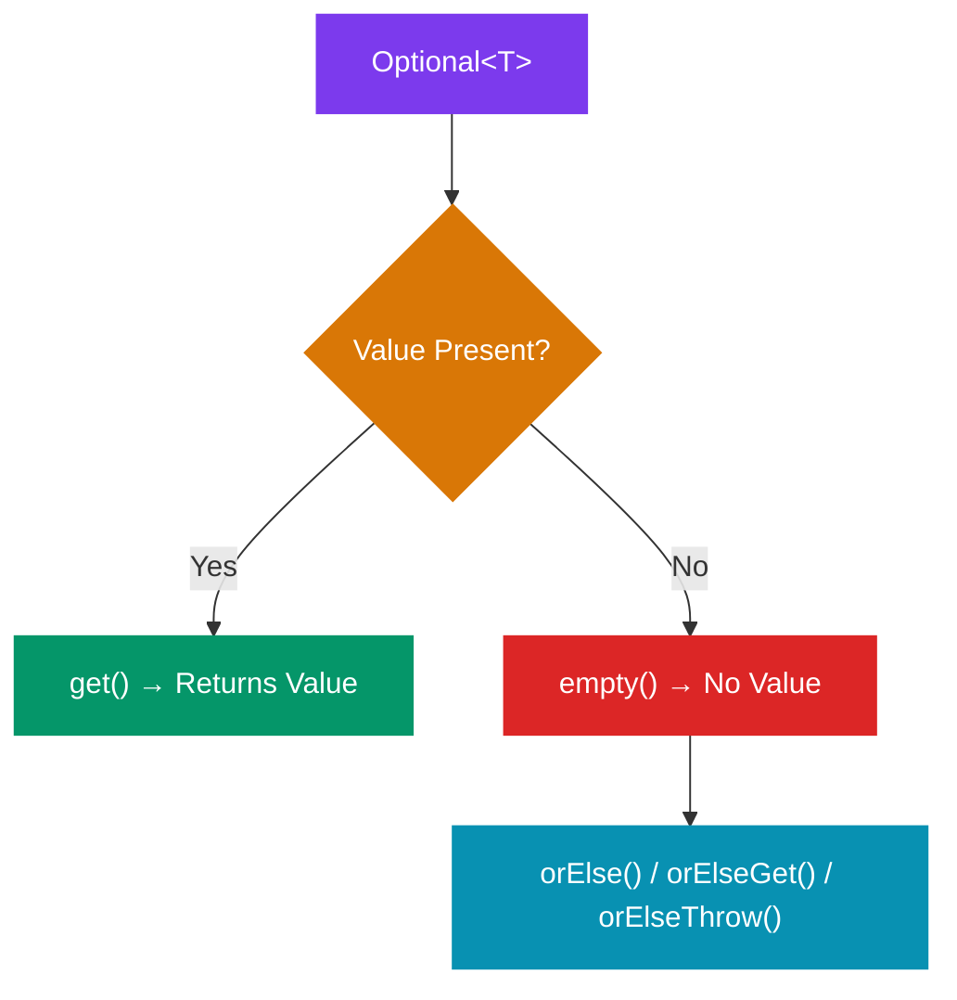

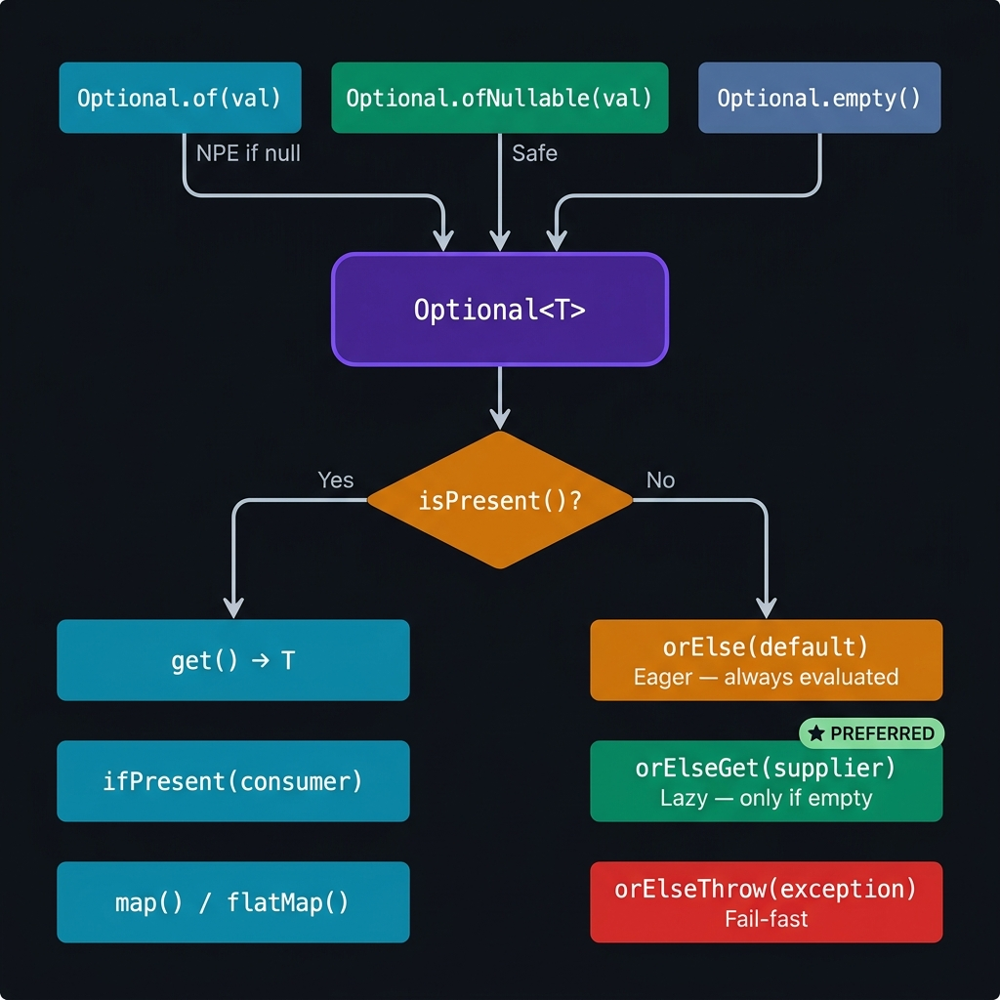

To show it, let us create a Spring starter project with these dependencies: Lombok, Spring Data JPA, MySQL Driver, Spring Web, and Spring Boot DevTools.

In `application.properties`:

```properties
spring.application.name=demo
spring.datasource.url=jdbc:mysql://localhost:3306/test?useSSL=false
spring.datasource.username=root
spring.datasource.password=root
spring.jpa.hibernate.ddl-auto=update
```

```java
@Data
@AllArgsConstructor
@NoArgsConstructor
@Entity
@Table(name="emp")
public class Employee {
    @Id
    @GeneratedValue(strategy = GenerationType.IDENTITY)
    private Integer id;
    private String name;
}
```

```java
@Repository
public interface EmployeeRepository extends JpaRepository<Employee, Integer> { }
```

DB Queries:

```sql
use test;
INSERT INTO `emp` (`id`, `name`) VALUES ('1', 'Ramesh');
INSERT INTO `emp` (`id`, `name`) VALUES ('2', 'Rakesh');
INSERT INTO `emp` (`id`, `name`) VALUES ('3', 'Krishna');
INSERT INTO `emp` (`id`) VALUES ('4');
INSERT INTO `emp` (`id`) VALUES ('5');
```

---

</details>

---

1.a) **📬 Returning Value With get()? 🔥**

<!-- -->
<details>
<summary>Answer</summary>

**Answer:**

`get()` can return a value only if the wrapped object is not null. Otherwise, it throws a NoSuchElementException.

⚠️ **Caution:** This is the main weakness of the `get()` method. `Optional` should help us avoid such unexpected exceptions. So calling `get()` without checking first goes against the goals of `Optional`.

📝 **Version note (get the history right).** People proposed deprecating `Optional.get()`, but it **never happened**. It is *not* deprecated, even in current JDKs. What Java did ship is the **no-arg `orElseThrow()` in Java 10**. It has exactly the same behaviour, but it is the preferred name because the name says what it does. (It also throws `NoSuchElementException` when empty.) So the correct advice is "prefer `orElseThrow()` over `get()`", not "`get()` is deprecated".

```java
@RestController
@RequestMapping("/api/employee")
public class EmployeeController {
    @Autowired
    EmployeeRepository employeeRepository;

    @GetMapping("/{id}")
    public ResponseEntity<?> findById(@PathVariable Integer id) {
        Employee employee = employeeRepository.findById(id).get();
        return ResponseEntity.ok(employee);
    }

    @GetMapping
    public ResponseEntity<List<Employee>> findAll() {
        return ResponseEntity.ok(employeeRepository.findAll());
    }
}
```

---

</details>

---

1.b) **✅ Checking Value Presence? 🔥**

<!-- -->
<details>
<summary>Answer</summary>

**Answer:**

- ✅ We may get an Optional object from a method, or create one ourselves. Either way, the `isPresent()` method checks if there is a value in it.
- 🔍 This method returns true if the wrapped value is not null.

```java
@GetMapping("/{id}")
public ResponseEntity<?> findById(@PathVariable Integer id) {
    Optional<Employee> emp = employeeRepository.findById(id);
    if (emp.isPresent()) {
        return new ResponseEntity<>(emp.get(), HttpStatus.OK);
    }
    return new ResponseEntity<>("Employee with Given ID is not Present",
            HttpStatus.NOT_FOUND);
}
```

The `isEmpty()` method does the opposite check. Java 11 added the `isEmpty()` method.

```java
@GetMapping("/{id}")
public ResponseEntity<?> getEmployeeById(@PathVariable Integer id) {
    Optional<Employee> emp = employeeRepository.findById(id);
    if (emp.isEmpty()) {
        return new ResponseEntity<>("Not Found", HttpStatus.NOT_FOUND);
    }
    return ResponseEntity.ok(emp.get());
}
```

---

</details>

---

1.c) **🏗️ Creating Optional Objects? 🔥**

<!-- -->
<details>
<summary>Answer</summary>

**Answer:**

- ⚙️ We can create an optional object with Optional's static method – `of()`
- 🚨 The argument passed to the `of()` method can't be null. Otherwise, we'll get a **NullPointerException**.
- 🛡️ If we expect some null values, we can use the `ofNullable()` method instead.
- ✅ With it, a null reference does not throw an exception. It returns an empty Optional object instead.

🛠️ **Return employeeName by Id:**

```java
@GetMapping("/{id}")
public ResponseEntity<?> findById(@PathVariable Integer id) {
    Optional<Employee> emp = employeeRepository.findById(id);
    if (emp.isPresent()) {
        // In the below line, Optional.of() will give NullPointerException if passed
        // parameter is null
        // Optional<String> name = Optional.of(emp.get().getName());
        Optional<String> name = Optional.ofNullable(emp.get().getName());

        if (name.isPresent()) {
            return new ResponseEntity<>(name.get().toUpperCase(), HttpStatus.OK);
        }
        return new ResponseEntity<>("Name is null", HttpStatus.NOT_FOUND);
    }
    return new ResponseEntity<>("Employee with Given ID is not Present",
         HttpStatus.NOT_FOUND);
}
```

---

</details>

---

1.d) **🎬 Conditional Action With `ifPresent()`? 🔥**

<!-- -->
<details>
<summary>Answer</summary>

**Answer:**

The `ifPresent()` method lets us run some code on the wrapped value if the value is non-null. Before Optional, we would write:

```java
if(name != null) {
    System.out.println(name.length());
}
```

This code checks if the name variable is null before it runs some code on it. This way is long. It also has a second problem: it is easy to make mistakes.

For example, after we print that variable, we may use it again. Nothing stops us from forgetting the null check that time.

If a null value then reaches that code, we get a `NullPointerException` at runtime. When a program fails because of bad input, the cause is often poor programming practice. Optional makes us handle nullable values explicitly. In this way, it forces good programming practice.

🛠️ **Example:** Given an employee table, fetch the employee with the given ID and print its name in upper case. If the name is null, print "The name is null". Use Java 8.

In Java 8 there is no `ifPresentOrElse()`. Use `map()` + `orElse()`, or `ifPresent()` with an `isPresent()` check:

```java
Optional<String> nullableEmpName = Optional.ofNullable(employee.getName());

// Java 8
System.out.println(nullableEmpName.map(String::toUpperCase).orElse("The name is null"));

// Java 8, with ifPresent()
nullableEmpName.ifPresent(name -> System.out.println(name.toUpperCase()));
if (!nullableEmpName.isPresent()) {
    System.out.println("The name is null");
}
```

If you use Java 9+, you can use the `ifPresentOrElse()` method:

```java
nullableEmpName.ifPresentOrElse(name -> System.out.println(name.toUpperCase()),
  () -> System.out.println("The name is null"));
```

---

</details>

---

1.e) **🔄 Default Value With orElse()? 🔥**

<!-- -->
<details>
<summary>Answer</summary>

**Answer:**

Given an employee DB, fetch the employee by ID and return the name of the employee. If the name is not present, return the default name. Use Java 8.

The `orElse()` method gets the value wrapped inside an Optional instance. It takes one parameter, which acts as a default value. The `orElse()` method returns the wrapped value if it is present. Otherwise, it returns its argument:

```java
String name = Optional.ofNullable(nullName).orElse("Anonymous");
```

```java
Optional<Employee> e = repo.findById(id);
if(e.isPresent()) {
   String name = Optional.ofNullable(e.get().getName())
                         .orElse("Anonymous");
   return new ResponseEntity<>(name, HttpStatus.OK);
}
```

---

</details>

---

1.f) **🎁 Default Value With orElseGet()? 🔥**

<!-- -->
<details>
<summary>Answer</summary>

**Answer:**

The `orElseGet()` method is similar to `orElse()`. But it does not take a value to return when the Optional value is not present. Instead, it takes a supplier functional interface. It calls the supplier and returns the result:

```java
String name = Optional.ofNullable(nullName)
                      .orElseGet(() -> "Anonymous");
```

```java
Optional<Employee> e = repo.findById(id);
if(e.isPresent()) {
   String name = Optional.ofNullable(e.get().getName())
                         .orElseGet(() -> "Anonymous");
   return new ResponseEntity<>(name, HttpStatus.OK);
}
```

---

</details>

---

1.g) **⚖️ Difference between orElse() and orElseGet() method of Optional class? 🔥**

<!-- -->
<details>
<summary>Answer</summary>

**Answer:**

```java
Optional<Employee> e = repo.findById(id);
if(e.isPresent()) {
   // String name = Optional.ofNullable(e.get().getName())
   //                      .orElse(callMe());
   String name = Optional.ofNullable(e.get().getName())
                         .orElseGet(() -> callMe());
   return new ResponseEntity<>(name, HttpStatus.OK);
}
```

⚠️ **Caution:** With `orElse()`, the argument is computed whether the wrapped value is present or not. So the `callMe()` method is always called, and "Getting Default Value" is always printed. With `orElseGet()`, the `callMe()` method is not invoked if the Optional already holds a value.

So with `orElse()`, the method is still called, and its result is never used, because the Optional already holds a value. But `orElseGet()` works fine here. It does not call the supplier at all.

In this simple example, the extra call costs very little. `callMe()` only prints a line and returns a string literal (no new object). But a method like `callMe()` may make a web service call or even query a database. Then the extra cost is large.

💡 **Pro Tip — the correct rule, not one rule for every case.** "Never use `orElse()`" is wrong, and an interviewer will say so. Both have a place:

- ✅ **`orElse(value)`** when the default is a **constant or a value you already have** — `orElse("Anonymous")`, `orElse(BigDecimal.ZERO)`, `orElse(Collections.emptyList())`. Here a `Supplier` only adds cost (an indirect call, and an extra object if the lambda captures a variable) and gives no benefit.
- ✅ **`orElseGet(supplier)`** when making the default is **expensive or has side effects** — a DB lookup, an HTTP call, a heavy allocation.
  - `orElse(callMe())` runs `callMe()` **eagerly, even when the value is present**, because it is an ordinary argument, and Java computes it before the call.
  - `orElseGet(() -> callMe())` runs it only when the Optional is empty.

🧠 One-liner: *`orElse` takes a value, `orElseGet` takes a function that makes the value — use the function when making the value is expensive.*

---

</details>

---

1.h) **💥 Exceptions with orElseThrow()? 🔥**

<!-- -->
<details>
<summary>Answer</summary>

**Answer:**

Given an employee table, fetch the employee object by Id and return the name in upper case. If the name is not present, throw an exception to stop the program. Use Java 8.

The `orElseThrow()` method is like `orElse()` and `orElseGet()`. It adds a new way to handle a missing value.

When the wrapped value is not present, it does not return a default value. It throws an exception instead:

```java
String name = Optional.ofNullable(e.get().getName())
 .orElseThrow(() -> new IllegalArgumentException("The id sent has no name"));
```

🎯 **Interview Tip:** Know all three fallback strategies: `orElse()` (eager), `orElseGet()` (lazy), and `orElseThrow()` (fail-fast). Mention that `orElseGet()` is preferred when the default is expensive to compute.

---

</details>

---

2. **⛓️ How do you chain `Optional` with `map()`, `flatMap()` and `filter()` instead of `isPresent()` / `get()`? 🔥🔥**

<!-- -->
<details>
<summary>Answer</summary>

**Answer:**

Every `isPresent()` → `get()` pair is just the null-check that `Optional` was built to remove. The usual Java style chains calls instead of using `if` branches.

❌️ **What most candidates write:**

```java
Optional<Employee> emp = repo.findById(id);
if (emp.isPresent()) {
    String name = emp.get().getName();
    if (name != null) {
        return name.toUpperCase();
    }
}
throw new EmployeeNotFoundException(id);
```

✅ **What the interviewer is waiting for:**

```java
return repo.findById(id)
           .map(Employee::getName)          // Optional<Employee> → Optional<String>, empty stays empty
           .map(String::toUpperCase)
           .orElseThrow(() -> new EmployeeNotFoundException(id));
```

🔑 **The three operators:**

| Method | Mapper returns | Result | Use for |
|---|---|---|---|
| `map(Function<T,U>)` | a plain `U` | `Optional<U>` — auto-wrapped, and **`null` becomes empty** rather than NPE-ing | reading a field / transforming a value |
| `flatMap(Function<T,Optional<U>>)` | an `Optional<U>` | `Optional<U>` — **not** `Optional<Optional<U>>` | calling another method that itself returns `Optional` |
| `filter(Predicate<T>)` | — | the same Optional, or **empty** if the predicate fails | turning a business condition into "absent" |

```java
// filter: an inactive employee is treated as "not there"
repo.findById(id)
    .filter(Employee::isActive)
    .map(Employee::getName)
    .orElse("UNKNOWN");

// flatMap: getManager() itself returns Optional<Employee>
repo.findById(id)
    .flatMap(Employee::getManager)   // map() here would give Optional<Optional<Employee>>
    .map(Employee::getName);
```

🆕 **Additions after Java 8 that you should name** (this file is based on Java 8, but interviews use 17/21):

- `ifPresentOrElse(consumer, runnable)` — Java 9
- `or(Supplier<Optional<T>>)` — Java 9. It falls back to *another* Optional instead of a value
- `stream()` — Java 9. It turns `Optional<T>` into a 0-or-1 element stream. So `list.stream().map(this::find).flatMap(Optional::stream)` drops the empty ones
- `isEmpty()` — Java 11
- `orElseThrow()` no-arg — Java 10

---

</details>

---

<a id="stream-qa"></a>

## 10. Stream QA

See in detail: [Java 8 Stream All Operations with Examples](07_Java_8_Stream_Operations_with_Examples.md)

1. **💰 Given an Employee list, sort employees based on their salaries in descending order using Java stream? ⚡**

<!-- -->
<details>
<summary>Answer</summary>

**Answer:**

```java
public class Employee {
    private Integer id;
    private String name;
    private Double salary;

    // getter and setter

    public Employee(Integer id, String name, Double salary) {
        this.id = id;
        this.name = name;
        this.salary = salary;
    }

    @Override
    public String toString() {
        return "Employee [id=" + id + ", name=" + name + ", salary=" + salary + "]";
    }
}
```

```java
public class Test {
    public static void main(String[] args) {
        List<Employee> employees = Arrays.asList(
                new Employee(10, "Ram", 5000.0),
                new Employee(15, "Krishna", 4803.0),
                new Employee(2, "Amlesh", 15000.0));

        List<Employee> sortedEmployees = employees.stream()
                .sorted(Comparator.comparing(Employee::getSalary).reversed())
                .collect(Collectors.toList());
        System.out.println(sortedEmployees);

        // if we want to sort the original list without creating separate another list
        employees.sort(Comparator.comparing(Employee::getSalary).reversed());
    }
}
```

📤 **Output:**

```
[Employee [id=2, name=Amlesh, salary=15000.0], Employee [id=10, name=Ram, salary=5000.0], Employee [id=15, name=Krishna, salary=4803.0]]
```

💡 Give `Comparator.comparing(Employee::getSalary).reversed()` as your answer. Do not give `(e1, e2) -> -e1.getSalary().compareTo(e2.getSalary())`.

- See §5 Q4 for why negating `compareTo` is unsafe.
- See §5 Q11 for `thenComparing()` tie-breakers, and for `comparingDouble` to avoid boxing.

---

</details>

---

2. **🥇 Given an Employee list, Fetch the Top 3 salaried Employees using Java stream? ⚡**

<!-- -->
<details>
<summary>Answer</summary>

**Answer:**

Sort the data first. Then use the `limit()` method.

```java
public class Test {
    public static void main(String[] args) {
        List<Employee> employees = Arrays.asList(
           new Employee(10, "Ram", 5000.0),
           new Employee(15, "Krishna", 4803.0),
           new Employee(2, "Amlesh", 15000.0),
           new Employee(9, "Rakesh", 5100.0));

        List<Employee> sortedEmployees = employees.stream()
           .sorted(Comparator.comparing(Employee::getSalary).reversed())
           .limit(3)
           .collect(Collectors.toList());
        System.out.println(sortedEmployees);
    }
}
```

📤 **Output:**

```
[Employee [id=2, name=Amlesh, salary=15000.0], Employee [id=9, name=Rakesh, salary=5100.0], Employee [id=10, name=Ram, salary=5000.0]]
```

---

</details>

---

3. **⏭️ Given an Employee list, Fetch all employees with a salary less than the 3rd highest using Java Stream? ⚡**

<!-- -->
<details>
<summary>Answer</summary>

**Answer:**

Here we can use the `skip()` method. `skip(N)` skips the first N entries of the stream.

```java
public class Test {
    public static void main(String[] args) {
        List<Employee> employees = Arrays.asList(
           new Employee(10, "Ram", 5000.0),
           new Employee(15, "Krishna", 4803.0),
           new Employee(2, "Amlesh", 15000.0),
           new Employee(9, "Rakesh", 5100.0));
        List<Employee> sortedEmployees = employees.stream()
           .sorted(Comparator.comparing(Employee::getSalary).reversed())
           .skip(3)
           .collect(Collectors.toList());
        System.out.println(sortedEmployees);
    }
}
```

📤 **Output:**

```
[Employee [id=15, name=Krishna, salary=4803.0]]
```

---

</details>

---

<a id="java-8-short-circuit-operations"></a>

## 11. Java 8 Short Circuit Operations

Java 8 short-circuiting operations are just like boolean short-circuit evaluations in Java.

Boolean short-circuit logic works like this:

- In `(firstBoolean && secondBoolean)`, if `firstBoolean` is false, Java skips the rest of the expression. We say the operation is short-circuited. The rest cannot change the result, so evaluating it is not needed.
- In `firstBoolean || secondBoolean`, if `firstBoolean` is true, Java short-circuits the rest in the same way.

Java 8 Stream short-circuit operations are not limited to boolean types. Java gives a fixed set of short-circuiting operations.

In Java 8, both intermediate and terminal stream operations can be short-circuiting.

- 🔧 **Intermediate** – `limit()`
- ⚡ **Terminal** – `findFirst()`, `findAny()`, `anyMatch()`, `allMatch()`, `noneMatch()`

**Intermediate short-circuiting methods**

This method (`limit()`) takes one argument (`long N`). It returns a stream with at most N elements.

`Stream limit(long N)` – N is the maximum number of elements the stream should keep. The method returns a new stream as output.

- Use the Java 8 `Stream.limit()` method to get only the first n objects. It sets the maximum size.
- It ignores the remaining values after size n.
- `Stream.limit(long maxSize)` returns a Stream of objects.
- As soon as `limit()` reaches the maximum number of items, it stops reading more items. It just returns the resulting stream.
- This is why we call `limit()` a short-circuiting operation.

`limit()` returns the **first n elements** in the encounter order and **not just any n elements**. This is an intermediate operation.

```java
@GetMapping
public ResponseEntity<List<Employee>> findAll() {
    return new ResponseEntity<List<Employee>>(
        employeeRepository.findAll()
                          .stream()
                          .limit(3)
                          .collect(Collectors.toList()), HttpStatus.OK);
}
```

**Rules of limit()**

- 🔧 It is an intermediate operation.
- 🌊 It is a good choice for infinite streams or infinite values.
- ⚙️ `limit()` comes **before** the terminal operation in the pipeline (`...stream().limit(3).collect(...)`). Like every intermediate op, it does nothing on its own. The **terminal** operation (`collect()`, `count()`, `forEach()`) starts the traversal. The traversal then stops as soon as `limit()` has seen N elements.
- 📐 It returns a stream of elements, up to the given size (max limit).
- ⚠️ It is cheap in sequential streams. On an **ordered** parallel stream it can be expensive, because it must keep the *first* N elements in encounter order. If order does not matter, call `unordered()` first.
- 🚨 **maxSize can not be negative**. If it is negative, it throws `IllegalArgumentException`.

```java
limit(-2) // => IllegalArgumentException
```

**findFirst()**

- 🔍 `Optional<T> findFirst()`: It returns the first element of this stream (in encounter order), wrapped in an Optional object. It takes no argument. To add a condition, put a `filter()` before it. It does not traverse the other elements.
- ⚡ This terminal operation stops when it finds the first element. So it is short-circuited.

```java
@GetMapping
public ResponseEntity<?> findAll() {
    Employee emp = employeeRepository.findAll().stream()
          .filter(e -> e.getName().contains("Ra")).findFirst().get();
    return new ResponseEntity<>(emp, HttpStatus.OK);
}
```

**findAny()**

- 🔀 `Optional<T> findAny()`: It returns an Optional instance that wraps any one element of the stream, and only one.
- ⚡ This operation is explicitly nondeterministic (the result can change from run to run). It is free to pick any element in the stream.
  - The reason: this gives the best performance in parallel operations.
  - The cost: many calls on the same source may not return the same result.
  - If you want a stable result, use `findFirst()` instead.

📝 **Note:**

- For a sequential stream, `findAny()` returns the first element in practice. But the spec does not promise this, so use `findFirst()` when you need the first one.
- For a parallel stream, `findAny()` returns "any" element. It does not wait for the "first" element.
- To get a parallel stream, call `parallel()` after `stream()`.

```java
@GetMapping
public ResponseEntity<?> findAll() {
    Employee emp = employeeRepository.findAll()
          .stream().parallel()
          .filter(e -> e.getName() != null && e.getName().contains("Ra"))
          .findAny().get();
    return new ResponseEntity<>(emp, HttpStatus.OK);
}
```

**anyMatch()**

- 🔍 `boolean anyMatch(Predicate<? super T> predicate)`
- ✅ It tests whether any element of this stream matches the given predicate. This terminal method returns as soon as it finds a match. It does not traverse the remaining elements to apply the predicate.

```java
@GetMapping
public ResponseEntity<?> findAll() {
    boolean itContains = employeeRepository.findAll().stream()
       .anyMatch(e -> e.getName().contains("Ra"));
    return new ResponseEntity<>(itContains, HttpStatus.OK);
}
```

**allMatch()**

- 🔍 `boolean allMatch(Predicate<? super T> predicate)`
- ✅ Tests whether all elements match the given predicate. It may return false early, as soon as one element does not match.

```java
@GetMapping
public ResponseEntity<?> findAll() {
    boolean itContains = employeeRepository.findAll().stream()
           .allMatch(e -> e.getName().contains("Ra"));
    return new ResponseEntity<>(itContains, HttpStatus.OK);
}
```

**noneMatch()**

- 🔍 `boolean noneMatch(Predicate<? super T> predicate)`
- ❌️ Tests whether no element of this stream matches the given predicate. It may return false early, as soon as one element matches the predicate.

```java
@GetMapping
public ResponseEntity<?> findAll() {
    boolean itContains = employeeRepository.findAll().stream()
          .noneMatch(e -> e.getName() != null && e.getName().length() > 20);
    return new ResponseEntity<>(itContains, HttpStatus.OK);
}
```

⚠️ **Empty-stream trap (asked more often than people expect).** On an **empty** stream, the predicate never runs. `allMatch()` and `noneMatch()` return *vacuously true* (true because there is nothing to check). `anyMatch()` returns `false`:

```java
Stream.<Integer>empty().allMatch(x -> false);   // true  ✅ not false
Stream.<Integer>empty().noneMatch(x -> true);   // true
Stream.<Integer>empty().anyMatch(x -> true);    // false
```

So `allMatch(Employee::isVerified)` returning `true` does **not** mean "there is at least one verified employee". It may mean there are no employees at all. If this difference matters, check for emptiness separately.

<a id="map-vs-flatmap"></a>

## 12. Map Vs FlatMap

```java
public class Test {
    public static void main(String[] args) {
        List<Integer> list = Arrays.asList(1, 2, 3);
        List<Integer> doubleList = list.stream()
           .map(n -> n * 2).collect(Collectors.toList());
        System.out.println(doubleList); // [2, 4, 6]

        List<List<String>> studentSubjects = Arrays.asList(
            Arrays.asList("Math", "Science"),
            Arrays.asList("History", "Geography"),
            Arrays.asList("English", "Art"));

        // get name of all subjects
        List<String> subjects = studentSubjects.stream()
                .flatMap(subject -> subject.stream())
                .collect(Collectors.toList());

        System.out.println(subjects);
        // [Math, Science, History, Geography, English, Art]
    }
}
```

1. **🗺️ How does Map work? 🔥🔥**

<!-- -->
<details>
<summary>Answer</summary>

**Answer:**

- ⚙️ The `Stream.map()` function does a map operation. It takes a Stream and transforms it into a new Stream.
- 🔄 It applies a function to each element of the Stream. It stores each return value in the new Stream.
- 📑 The map operation takes a `Function`. Java calls it for each value in the input stream. Each call produces one result value, and that value goes to the output stream.

Say we have a list of employees. We need the list of cities where they worked in past years. How do we get the names of all the cities where the employees have worked?

```java
public class Employee {
    private Integer id;
    private String name;
    private List<String> cities;

    // all argument constructor
    // getter and setter methods
    // toString() method
}
```

```java
public class Test {
    public static void main(String[] args) {
        List<String> citiesWorked1 = Arrays.asList("Boston", "Seattle", "Phoenix");
        Employee emp1 = new Employee(1, "Jerry", citiesWorked1);
        Employee emp2 = new Employee(2, "William",
                Arrays.asList("Dallas", "Seattle", "Austin"));
        Employee emp3 = new Employee(3, "Rocco",
                Arrays.asList("Seattle", "Austin", "Boston", "Dallas"));

        List<Employee> employees = Arrays.asList(emp1, emp2, emp3);

        // all IDs of employees
        // name of unique cities where all employees have worked
    }
}
```

To get all IDs of employees:

```java
List<Integer> employeeIds = employees.stream()
   .map(e -> e.getId())
   .collect(Collectors.toList());
System.out.println(employeeIds);
```

To get names of unique cities where all employees have worked:

```java
Set<String> uniqueCities = employees.stream()
    .flatMap(emp -> emp.getCities().stream())
    .collect(Collectors.toSet());
System.out.println(uniqueCities);
// [Seattle, Phoenix, Austin, Dallas, Boston]
```

---

</details>

---

2. **🫓 How does FlatMap work? 🔥🔥**

<!-- -->
<details>
<summary>Answer</summary>

**Answer:**

- 🔗 It is the combination of a map and a flat operation. We first apply the map function, then flatten the result.
- 🔑 The key difference: here the mapping function returns a Stream of values, not a single value. That is why we need flattening. When we flatten a Stream of Streams, it becomes a Stream of values.
- 🏗️ What does flattening a stream mean? Take a structure like `[ [1,2,3],[4,5,6],[7,8,9] ]`. It has "two levels": a list that contains three more Lists. Flattening turns it into a "one level" structure, e.g. `[ 1,2,3,4,5,6,7,8,9 ]`. That is just one list.

🧠 **In Simple Words:**
- Before flattening: Stream of List of Integer
- After flattening: Stream of Integer

- ⚙️ `emp -> emp.getCities().stream()` is the mapper function. It produces many values for each single input: many cities for each employee.
  - ⚠️ Note the trailing **`.stream()`**. `flatMap` requires the mapper to return a **`Stream`**, not a `List`.
  - Writing `emp -> emp.getCities()` is the single most common `flatMap` compile error.
- 🔀 `flatMap()` flattens those many values into one single stream.
  - ⚠️ **`flatMap()` does not remove duplicates.** In the example above, the de-duplication comes entirely from `Collectors.toSet()`.
  - If you collect to a `List` instead, every repeated city appears once per employee.
  - Use `.distinct()` if you want de-duplication inside the pipeline itself.
- 🔒 `flatMap()` **closes each inner stream after its elements are drained** into the output stream. This matters when the inner stream holds a resource (e.g. `Files.lines(path)`).
- 💡 This is the best explanation of flatMap:
  - The mapper returns a stream. Its values are drained from that stream and passed to the output stream.
  - Each call to the mapper returns a group of values. The output stream does not keep these groups apart at all.
  - So we say the output has been "flattened".

| Feature | map() 🅰️ | flatMap() 🅱️ |
|---------|----------|-------------|
| **Return Type** | Returns a single value per element | Returns a Stream of values per element (combination of map + flat) |
| **Usage** | Used for transformation only | Used for both transformation and flattening |
| **Mapping** | One-to-one mapping | One-to-many mapping |

🔑 **Key Differences:**

- 🗺️ **Map:** It is like applying a rule to each item of a collection, one by one.
- 🔀 **FlatMap:** It is like applying a rule to each item too. But it also handles nested collections. It combines their results into a single flat collection.
- ⚖️ Map produces a one-to-one mapping, while FlatMap can produce a one-to-many mapping.


---

</details>

---

<a id="java-arrays-coding-question-using-stream"></a>

## 13. Java Arrays Coding Question using Stream

1. **🔢 Given an array of integers, write a Java 8 program to find the second smallest element? ⚡**

<!-- -->
<details>
<summary>Answer</summary>

**Answer:**

📥 **Input:** `int[] numbers = {5, 2, 8, 3, 1};`

```java
int secondSmallest = Arrays.stream(numbers)
   .sorted()
   .skip(1)
   .findFirst()
   .orElseThrow(() -> new IllegalArgumentException(
         "Array don't have second smallest element"));
System.out.println(secondSmallest); // 2
```

---

</details>

---

2. **🔁 The array contains duplicate elements, now find the second smallest number? ⚡**

<!-- -->
<details>
<summary>Answer</summary>

**Answer:**

📥 **Input:** `int[] numbers = {5, 2, 8, 3, 1, 1, 2, 8};`

Before sorting, remove the duplicate elements with the `distinct()` method.

```java
Arrays.stream(numbers)
   .distinct()
   .sorted()
   .skip(1)
   .findFirst()
   .orElseThrow(() -> new IllegalArgumentException(
        "Array don't have second smallest element"));
```

---

</details>

---

3. **🤝 Given two arrays of integers, write a Java 8 program to find the common elements between them? ⚡**

<!-- -->
<details>
<summary>Answer</summary>

**Answer:**

📥 **Input:**
`int[] array1 = {1, 2, 3, 4, 5};`
`int[] array2 = {4, 5, 6, 7, 8};`

```java
List<Integer> commonElements = Arrays.stream(array1)
   .filter(n1 -> Arrays.stream(array2).anyMatch(n2 -> n2 == n1))
   .boxed()
   .collect(Collectors.toList());
System.out.println(commonElements); // [4, 5]
```

---

</details>

---

4. **🔃 Write a Java 8 program to reverse an array of integers in place? ⚡**

<!-- -->
<details>
<summary>Answer</summary>

**Answer:**

📥 **Input:** `int[] numbers = {1, 2, 3, 4, 5};`

In-place means you do not create a new array. Swap 5 with 1, and 4 with 2.

```java
import java.util.Arrays;
import java.util.stream.IntStream;

public class Test {
    public static void main(String[] args) {
        int[] numbers = { 1, 2, 3, 4, 5 };
        // iterate till the middle length of the array
        IntStream.range(0, numbers.length / 2).forEach(i -> {
            int temp = numbers[i];
            numbers[i] = numbers[numbers.length - i - 1];
            numbers[numbers.length - i - 1] = temp;
        });
        System.out.println(Arrays.toString(numbers)); // [5, 4, 3, 2, 1]
    }
}
```

⚠️ **Say clearly what this is:**

- The lambda changes an array captured from the outer scope.
- So it is a **side-effecting, stateful consumer**. This is the one thing the Stream API tells you not to write.
- It is safe here *only* for two reasons: the stream is sequential, and each index `i` touches its own separate pair of slots.
- Under `.parallel()`, it still happens to work for this particular swap (disjoint writes, no shared accumulator). But that comes from this algorithm, not from the pattern.
- An interviewer may ask "is that stream code?". The real question is: do you know that a plain `for` loop is the clearer answer for an in-place change?

---

</details>

---

5. **📏 Given an array of strings, write a Java 8 program to find the length of the longest string? ⚡**

<!-- -->
<details>
<summary>Answer</summary>

**Answer:**

📥 **Input:** `String[] strings = {"Apple", "Banana", "Avocado", "Apricot", "Grapes"};`

```java
import java.util.Arrays;

public class Test {
    public static void main(String[] args) {
        String[] strings = { "Apple", "Banana", "Avocado", "Apricot", "Grapes" };

        // map string to its length
        int maxLength = Arrays.stream(strings)
            .mapToInt(string -> string.length()).max().orElse(0);
        System.out.println(maxLength); // 7

        // using method reference
        int maxLength1 = Arrays.stream(strings)
             .mapToInt(String::length).max().orElse(0);
        System.out.println(maxLength1); // 7
    }
}
```

---

</details>

---

6. **📜 In the above question also display the longest string along with its length? ⚡**

<!-- -->
<details>
<summary>Answer</summary>

**Answer:**

```java
import java.util.Arrays;

public class Test {
    public static void main(String[] args) {
        String[] strings = { "Apple", "Banana", "Avocado", "Apricot", "Grapes" };
        String longestString = Arrays.stream(strings)
           .max((s1, s2) -> Integer.compare(s1.length(), s2.length()))
           .orElse("");   // not orElse(null): .length() on null would throw NPE for an empty array
        System.out.println(longestString + ": " + longestString.length()); // Avocado: 7
    }
}
```

---

</details>

---

7. **🧹 Write a Java 8 program to remove duplicates from an array of strings while preserving the original order? ⚡**

<!-- -->
<details>
<summary>Answer</summary>

**Answer:**

📥 **Input:** `String[] strings = {"Apple", "Banana", "Apple", "Grapes", "Banana"};`

```java
import java.util.Arrays;
import java.util.List;
import java.util.stream.Collectors;

public class Test {
    public static void main(String[] args) {
        String[] strings = { "Apple", "Banana", "Apple", "Grapes", "Banana" };
        List<String> uniqueStrings = Arrays.stream(strings)
          .distinct()
          .collect(Collectors.toList());
        String[] uniqueStringArray = uniqueStrings.toArray(new String[0]);
        System.out.println(Arrays.toString(uniqueStringArray)); // [Apple, Banana, Grapes]
    }
}
```

---

</details>

---

8. **✖️ Given an array of integers, write a Java 8 program to find the product of all the elements except the given element? ⚡**

<!-- -->
<details>
<summary>Answer</summary>

**Answer:**

📥 **Input:** `int[] numbers = {2, 4, 6, 8};`, Element to exclude = 4

```java
int except = 4;
int res = Arrays.stream(numbers)
    .filter(n -> n != except)
    .reduce(1, (n1, n2) -> n1 * n2);
System.out.println(res); // 96
```

⚠️ `filter(n -> n != except)` removes **every** copy of the element. For `{2, 4, 4, 6}` it drops both 4s. If you must skip only one copy, compute the full product and divide by the element once (this fails if the element is `0`).

---

</details>

---

<a id="reduce-and-peek-operations"></a>

## 14. Reduce and Peek Operations

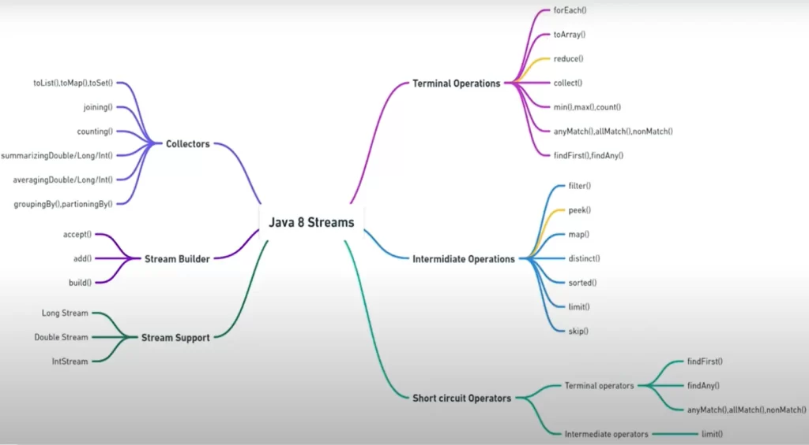

1. **🔧 What is an Intermediate operation? ⚡**

<!-- -->
<details>
<summary>Answer</summary>

**Answer:**

Intermediate operations are the operations that return another stream as their result.

💡 **Key Insight:** They are **lazy**. Examples: `filter()`, `map()`, `distinct()`, `sorted()`, `limit()`, `skip()`

```java
List<Integer> intList = Arrays.asList(1, 2, 3, 4, 5);

// Find even numbers, square them, and filter numbers greater than 10
intList.stream().filter(n -> n % 2 == 0)
   .map(n -> n * n).filter(n -> n > 10)
   .forEach(System.out::println); // 16
```

---

</details>

---

2. **🏁 What is Terminal Operation? ⚡**

<!-- -->
<details>
<summary>Answer</summary>

**Answer:**

Terminal operations are the operations that return a non-stream value (a primitive, an object or a collection) or return nothing.

You can chain many intermediate operations. None of them does anything until you call a terminal operation. At that point, all the intermediate operations you called earlier run together with the terminal operation.

🛠️ **Examples:** `forEach()`, `toArray()`, `reduce()`, `collect()`, `min()`, `max()`, `count()`, `anyMatch()`, `allMatch()`, `noneMatch()`, `findFirst()`, `findAny()`

```java
@Data
@AllArgsConstructor
public class Employee {
    private Integer id;
    private String name;

    public void printName() {
        System.out.println("In emp class: " + name);
    }
}
```

```java
import java.util.Arrays;
import java.util.List;

public class Test {
    public static void main(String[] args) {
        Employee e1 = new Employee(1, "A");
        Employee e2 = new Employee(2, "B");
        Employee e3 = new Employee(3, "C");
        Employee e4 = new Employee(4, "D");
        List<Employee> empList = Arrays.asList(e1, e2, e3, e4);

        // display name of those employees whose id is even and call printName() method
        // for them
        empList.stream().filter(e -> e.getId() % 2 == 0).map(e -> {
            e.printName();
            return e.getName();
        }).forEach(System.out::println);
    }
}
```

📤 **Output:**

```
In emp class: B
B
In emp class: D
D
```

What is the output in the case below?

```java
empList.stream().filter(e -> e.getId() % 2 == 0).map(e -> {
    e.printName();
    return e.getName();
});
```

It gives no output. Intermediate operations (like `map()`) are lazy. Without a terminal operator, it does not call the `printName()` method.

🔑 **Key Point:** The intermediate operation will never run if there is no terminal operation.

| Feature | Intermediate Operations 🅰️ | Terminal Operations 🅱️ |
|---------|---------------------------|------------------------|
| **Return Type** | ✅ They return stream | ❌️ They return non-stream values |
| **Chaining** | ✅ Can be chained together to form a pipeline | ❌️ Can't be chained together |
| **Pipeline Count** | Any number of intermediate operations | Maximum one terminal operation, at the end |
| **Loading** | ⏳ Lazily loaded | ⚡ Eagerly loaded |
| **Result** | ❌️ Don't produce end result | ✅ Produce end result |


---

</details>

---

3. **👀 What is peek()? 🔥**

<!-- -->
<details>
<summary>Answer</summary>

**Answer:**

- 🔧 The `peek()` method is an intermediate operation.
- 📥 It takes a consumer object as input. It returns a Stream with the elements of the current stream.
- ⚙️ It also runs the given action on each element.

**Use of Peek:**

- 🐛 `peek()` exists mainly to help with debugging. You use it to see the elements as they pass a certain point in a pipeline.
- ⚖️ It is similar to `map()`. The difference is in its argument: the **`Consumer`** returns nothing. `peek()` itself **returns `Stream<T>`**, unchanged. `map()` takes a `Function`, so it returns a stream of *transformed* elements.

```java
List<Integer> intList = Arrays.asList(1, 2, 3, 4, 5);
intList.stream().filter(n -> n % 2 == 0).peek(System.out::println)
       .map(n -> n * n).peek(System.out::println)
       .filter(n -> n > 10).forEach(System.out::println);
// 2, 4, 4, 16, 16 — interleaved, one element at a time through the whole pipeline
```

⚠️ **The classic trap: `peek()` is not guaranteed to run at all.**

- It is an intermediate op. Like every intermediate op, it runs only for the elements the terminal op actually pulls.
- **Since Java 9**, `count()` may skip the pipeline completely. It does this when it can compute the size from the source without traversing it:

```java
Stream.of(1, 2, 3).peek(System.out::println).count();
// prints NOTHING — the source is SIZED, so count() never traverses

Stream.of(1, 2, 3).filter(x -> x > 0).peek(System.out::println).count();
// prints 1, 2, 3 — filter() destroys the SIZED flag, so traversal is required

Stream.of(1, 2, 3).peek(System.out::println).findFirst();
// prints only 1 — short-circuited
```

🐛 That is why `peek()` is a **debugging aid only**. Never put logic with side effects (an audit write, a counter increment, a metric) inside it.

---

</details>

---

4. **🔻 What is reduce()? 🔥🔥**

<!-- -->
<details>
<summary>Answer</summary>

**Answer:**

- 🔗 `Stream.reduce()` combines the elements of a stream and produces a single value.
- ⚙️ The reduce operation applies a binary operator to each element in the stream.
  - The first argument to the operator is the return value of the previous call.
  - The second argument is the current stream element.

```java
List<Integer> intList = Arrays.asList(1, 2, 3, 4, 5);
// sum of elements
int sum = intList.stream().reduce((a, b) -> a + b).get();
System.out.println(sum); // 15
```

🔢 **The three overloads. Know all of them — the follow-up questions come from here:**

```java
// 1-arg — no identity, so the stream may be empty → returns Optional<T>
Optional<Integer> sum1 = intList.stream().reduce((a, b) -> a + b);

// 2-arg — identity + accumulator → returns T (never empty; returns identity for an empty stream)
Integer sum2 = intList.stream().reduce(0, (a, b) -> a + b);              // 15
Integer emptySum = Stream.<Integer>empty().reduce(0, (a, b) -> a + b);   // 0, not an exception

// 3-arg — identity + accumulator + COMBINER → returns U (a different type from the elements)
int totalChars = Stream.of("aa", "bbb", "c")
    .reduce(0,                          // identity, type U = Integer
            (acc, s) -> acc + s.length(),  // accumulator: U × T → U
            Integer::sum);                 // combiner:    U × U → U
// 6
```

📏 **The two contracts you must state:**

- **Identity:** `accumulator.apply(identity, x)` must equal `x` for every `x`. `0` for sum, `1` for product, `""` for concatenation. If you get this wrong, a *parallel* stream adds the identity once per split, with no error. A sum with identity `1` is off by 1 in a sequential run, and off by 4 over 4 parallel splits. The sequential error is small, so it is easy to miss in a test.
- **Associativity:** `(a op b) op c` must equal `a op (b op c)`. Subtraction and division are **not** associative, so `reduce((a,b) -> a - b)` gives a different answer under `.parallel()`.

🤝 **Why the combiner is needed:** it is used **only in parallel execution**. It merges the partial results of two sub-tasks. In a sequential run it is mostly unused, but the compiler still requires it. If you get it wrong, the bug only appears when someone adds `.parallel()`.

🪣 **`reduce` vs `collect` (mutable reduction):**

- `reduce` is for **immutable** reduction. Each step returns a *new* value.
- Adding into a mutable container with `reduce` (`(list, x) -> { list.add(x); return list; }`) is a bug. It shares one container across splits, and threads race on it under parallelism.
- **`collect()`** exists for exactly this case. It takes a supplier/accumulator/combiner triple and gives each split its own container.

---

</details>

---

<a id="coding-questions-on-java-8"></a>

## 15. Coding Questions on Java 8

1. **🔎 Find the duplicate elements in a given integers list in Java using Stream functions? ⚡**

<!-- -->
<details>
<summary>Answer</summary>

**Answer:**

📥 **Input:** `[10, 28, 87, 10, 20, 76, 28, 80]`
📤 **Output:** `10, 28`

**Option A — `groupingBy` + `counting()`, O(n). Lead with this one.**

```java
List<Integer> numbers = Arrays.asList(10, 28, 87, 10, 20, 76, 28, 80);
Set<Integer> duplicateNumbers = numbers.stream()
    .collect(Collectors.groupingBy(Function.identity(), Collectors.counting()))
    .entrySet().stream()
    .filter(e -> e.getValue() > 1)
    .map(Map.Entry::getKey)
    .collect(Collectors.toSet());
System.out.println(duplicateNumbers); // [10, 28]
```

**Option B — `Collections.frequency()`. ⚠️ O(n²). Give it as the simple, slow first version, not as the answer.**

```java
List<Integer> numbers = Arrays.asList(10, 28, 87, 10, 20, 76, 28, 80);
Set<Integer> duplicateNumbers = numbers.stream()
    .filter(num -> Collections.frequency(numbers, num) > 1)  // ⚠️ O(n) scan, once per element
    .collect(Collectors.toSet());
System.out.println(duplicateNumbers); // [10, 28]
```

**Option C — the `Set.add()` trick. ⚠️ Correct sequentially, breaks under `.parallel()`.**

```java
List<Integer> numbers = Arrays.asList(10, 28, 87, 10, 20, 76, 28, 80);
Set<Integer> uniqueNumbers = new HashSet<>();
Set<Integer> duplicateNumbers = numbers.stream()
    .filter(num -> !uniqueNumbers.add(num))
    .collect(Collectors.toSet());
System.out.println(uniqueNumbers); // [80, 20, 87, 10, 28, 76] — HashSet order, not contractual
System.out.println(duplicateNumbers); // [10, 28]
```

⚠️ **Stateful lambda.** The predicate changes a `HashSet` that is declared outside the pipeline.
So it is not stateless, and it is not thread-safe.

- It is the shortest correct *sequential* answer.
- But state this warning yourself, before the interviewer asks "now run it in parallel".
- In parallel, the threads race on the set and the result is wrong.
- Option A runs safely in parallel.

---

</details>

---

2. **✖️ Write a program to multiply 2 numbers using the Functional interface? ⚡**

<!-- -->
<details>
<summary>Answer</summary>

**Answer:**

```java
@FunctionalInterface
public interface FunctionalInterfaceDemo {
    int multiply(int a, int b);
}
```

```java
public class Test {
    public static void main(String[] args) {
        FunctionalInterfaceDemo total = (a, b) -> a * b;
        System.out.println(total.multiply(10, 2));
    }
}
```

---

</details>

---

3. **⏩ What's the difference between limit() and skip()? Explain using examples? ⚡**

<!-- -->
<details>
<summary>Answer</summary>

**Answer:**

- 📐 **Limit:** The `limit(n)` method is an intermediate operation. It returns a stream that is not longer than the requested size. As before, the n parameter can't be negative.
- ⏭️ **Skip:** The `skip(n)` method is another intermediate operation. It drops the first n elements of a stream. The n parameter can't be negative. If n is higher than the size of the stream, `skip()` returns an empty stream.

```java
List<Integer> list = Arrays.asList(1, 2, 3, 4, 5);
System.out.println(list.stream().limit(2).collect(Collectors.toList()));  // [1, 2]
System.out.println(list.stream().skip(2).collect(Collectors.toList()));   // [3, 4, 5]
System.out.println(list.stream().skip(10).collect(Collectors.toList()));  // []
```

---

</details>

---

4. **🔤 Count the number of occurrences of words in a given string using Java 8? ⚡**

<!-- -->
<details>
<summary>Answer</summary>

**Answer:**

📥 **Input:** `"welcome to know program and know program welcome you"`
📤 **Output:** `{and=1, know=2, program=2, to=1, welcome=2, you=1}`

```java
String word = "welcome to know program and know program welcome you";
List<String> list = Arrays.asList(word.split(" "));
Map<String, Long> wordCount = list.stream()
      .collect(Collectors.groupingBy(Function.identity(), Collectors.counting()));
System.out.println(wordCount);
// {and=1, know=2, program=2, to=1, welcome=2, you=1}
```

---

</details>

---

<a id="refactoring-code-to-java-8"></a>

## 16. Refactoring Code to Java 8

1. **🔢 Refactor the given isPrime(int num) to Java 8? 💤**

<!-- -->
<details>
<summary>Answer</summary>

**Answer:**

🛠️ **Original code:**

```java
public static boolean isPrime(int number) {
    boolean isDivisible = false;

    for (int i = 2; i < number; i++) {
        if (number % i == 0) {
        isDivisible = true;
        break;
        }
    }
    return number > 1 && !isDivisible;
}
```

🛠️ **In Java 8:**

```java
public static boolean isPrime(int number) {
    return number > 1 &&
      IntStream.range(2, number)
               .noneMatch(n -> number % n == 0);
}
```

💡 **Pro Tip:** To test whether N is prime, we don't have to check divisors all the way to N. Stopping at **√N** is enough.

- The reason: every factor pairs up as `d × (N / d)`.
- If both factors in a pair were greater than √N, their product would be more than N.
- So **at least one factor of every pair is ≤ √N**.
- So if N has no divisor ≤ √N, it has no divisor at all.

This cuts the work from O(N) to O(√N).

```java
return number > 1 && IntStream.rangeClosed(2, (int) Math.sqrt(number))
      .noneMatch(n -> number % n == 0);
```

---

</details>

---

2. **♻️ Convert the given code in Java 8? 💤**

<!-- -->
<details>
<summary>Answer</summary>

**Answer:**

🛠️ **Original code:**

```java
public static void main(String[] args) {
    // square root of first 10 prime numbers
    List<Double> sqrtOf10Prime = new ArrayList<>(10);

    int index = 1;
    while (sqrtOf10Prime.size() < 10) {
        if (isPrime(index)) {
        sqrtOf10Prime.add(Math.sqrt(index));
        }
        index++;
    }
    System.out.println(sqrtOf10Prime);
}
```

🛠️ **In Java 8:**

```java
// Test::isPrime is the isPrime() method from Q1, declared in class Test
List<Double> sqrtOf10Prime = Stream.iterate(1, i -> i + 1)
        .filter(Test::isPrime)
        .map(Math::sqrt)
        .limit(10)
        .collect(Collectors.toList());
System.out.println(sqrtOf10Prime);
```

---

</details>

---
