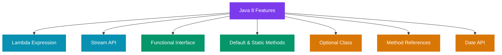
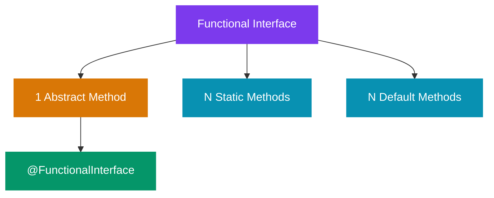
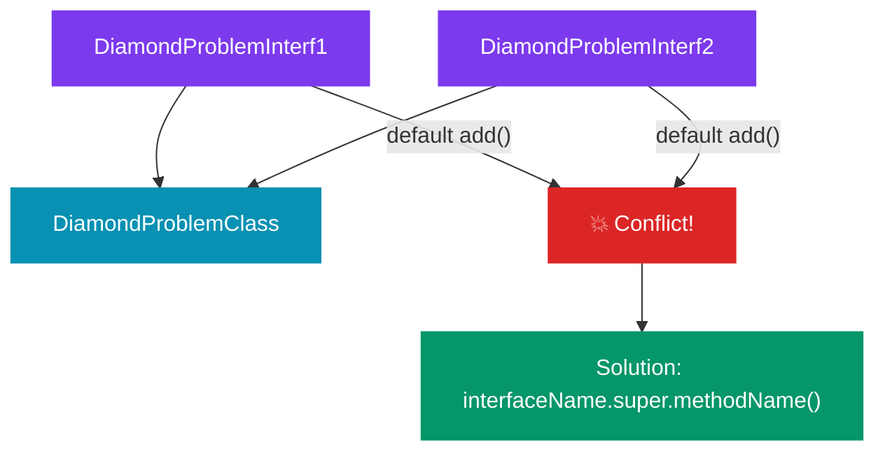
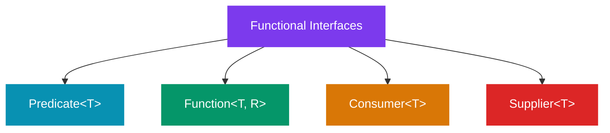
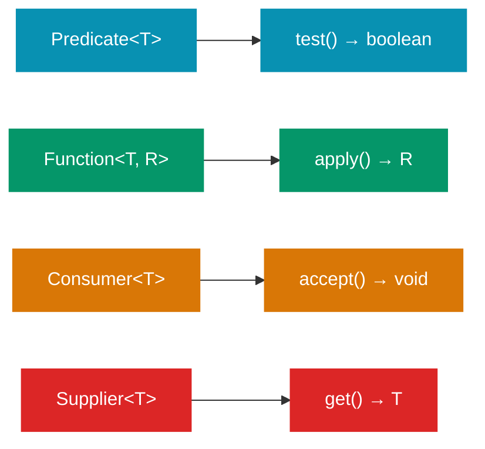
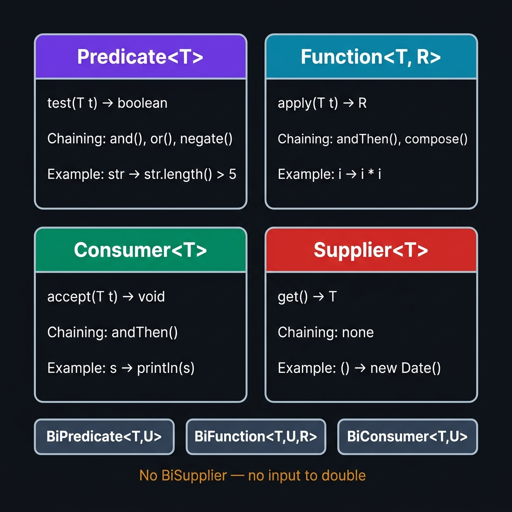
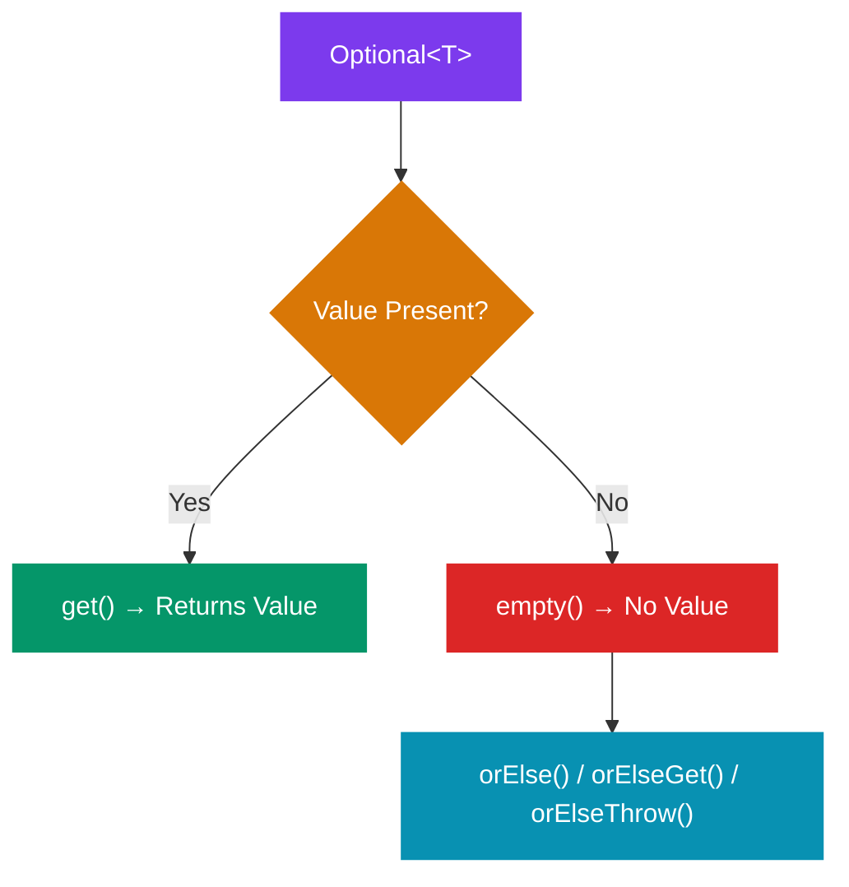

# Java 8 Interview Questions

**Java 8 Interview Questions** | This note covers the Java 8 *language*: lambdas, functional interfaces, method references, default and static interface methods, `java.util.function`, `Optional` and the `java.time` API.

📖 **Everything about the Stream API is in [Java 8 Stream Operations with Examples](07_Java_8_Stream_Operations_with_Examples.md).** That includes what a stream is, parallel streams, every operation and collector, and the stream coding problems.
📖 **Checked exceptions inside lambdas** are in [Exception Handling — Q10](06_Exception_Handling_Interview_Questions_in_Java.md) ("Why won't `paths.stream().map(Files::readString).toList()` compile?").

📊 **Question Count by Section**

| # | Section | Questions |
|---|---|---|
| 1 | [Java 8 QA](#java-8-qa) | 12 |
| 2 | [QA on Default & Static Methods in Interface](#qa-on-default--static-methods-in-interface) | 8 |
| 3 | [QA on Predicate, Function, Consumer, Supplier](#qa-on-predicate-function-consumer-supplier) | 15 |
| 4 | [Java 8 Optional QA \| Scenario Based](#java-8-optional-qa--scenario-based) | 2 |
| | **Total** | **37** |

> 🔥🔥 Very High — asked in almost every Tier-1 loop &nbsp;·&nbsp; 🔥 High — very frequent in Tier-1 interviews &nbsp;·&nbsp; ⚡ Medium — commonly asked &nbsp;·&nbsp; 💤 Low — good to know, rarely asked

<a id="java-8-qa"></a>

## 1. Java 8 QA

1. **🎯 Why Java 8 was introduced? What was the main agenda behind the Java 8? 💤**

<!-- -->
<details>
<summary>Answer</summary>

**Answer:**

- 🎯 The main reason for Java 8 was to make code **concise** (short and to the point).
- ⚙️ Java 8 brings in Functional programming. Lambda expressions make this possible. They are a strong tool for writing concise code.
- 📜 In Python and Scala, we can do the same thing in very few LOC (lines of code).
- 📜 By around 2010, many developers liked these shorter languages, and Java looked old next to them.
- 📜 To stop losing more users, Java stopped being only an OOPs language. It added some Functional programming ideas to make code concise.

🧠 **In Simple Words:** Java 8 came to make Java code shorter and clearer. It took functional programming ideas from languages like Scala and Python.

---

</details>

---

2. **✨ What are the new features introduced in Java 8? ⚡**

<!-- -->
<details>
<summary>Answer</summary>

**Answer:**

Java 8 added many new features. Here are the important ones that interviewers ask about most:

- 🔗 Lambda Expression
- 🌊 Stream API
- 📑 Functional Interface
- 🛠️ Default & Static methods in the interface
- 🛡️ Optional class
- 🔄 Method references & Constructor references
- 📅 Date API



---

</details>

---

3. **💪 What are the main advantages of using Java 8? 💤**

<!-- -->
<details>
<summary>Answer</summary>

**Answer:**

- ✂️ More compact code (Less boilerplate code)
- 📖 More readable and reusable code
- 🧪 More testable code
- ⚡ Parallel operations

---

</details>

---

4. **🔮 What is Lambda Expression? 🔥🔥**

<!-- -->
<details>
<summary>Answer</summary>

**Answer:**

A lambda expression is an anonymous function. It has no name, no declared return type (the compiler infers it), and no access modifier. It has one lambda (`->`) symbol.

🛠️ **Normal programming technique:**

```java
public class Test {
    public static void main(String[] args) {
        Test test = new Test();
        test.add(10, 5); // 15
    }

    public void add(Integer a, Integer b) {
        System.out.println(a + b);
    }
}
```

🛠️ **Equivalent Lambda expression:**

```java
import java.util.function.BiConsumer;
public class Test {
    public static void main(String[] args) {
        BiConsumer<Integer, Integer> biConsumer = (a, b) -> System.out.println(a + b);
        biConsumer.accept(10, 5); // 15
    }
}
```

---

</details>

---

5. **📑 What are functional interfaces? 🔥🔥**

<!-- -->
<details>
<summary>Answer</summary>

**Answer:**

- 📑 A functional interface is an interface that has **only one abstract method**.
- 🔢 It can have any number of static methods or default methods.
- 📜 Java already has many functional interfaces, such as: `Comparable`, `Comparator`, and `Runnable`.
- 💡 `Comparable` has one abstract method, so it is a functional interface. But it is not marked with `@FunctionalInterface`. `Comparator` and `Runnable` are marked.

⚠️ **Trap question: "`Comparator` declares two abstract methods, `compare()` and `equals()`. How can it be a functional interface?"**

- An abstract method that matches a **public method of `Object`** (`equals`, `hashCode`, `toString`) does **not** count.
- Every class already inherits that method from `Object`, so no lambda ever needs to implement it.
- So `Comparator` has only one abstract method that counts: `compare()`.

```java
@FunctionalInterface
interface MyComparator<T> {
    int compare(T a, T b);
    boolean equals(Object o);   // ✅ does not count — it is Object's method
    String toString();          // ✅ does not count either
}
```

But `int hashCode(long x)` *would* count, because its signature is different from `Object.hashCode()`. Then `@FunctionalInterface` gives a compile error.

```java
@FunctionalInterface
public interface Runnable {
    public abstract void run();
}
```



---

</details>

---

6. **🔗 How lambda expression and functional interfaces are related? 🔥🔥**

<!-- -->
<details>
<summary>Answer</summary>

**Answer:**

- 🔗 A functional interface gives a lambda expression its type, so we can hold the lambda in a reference.
- ⚙️ We can use a lambda expression only to implement the abstract method of a functional interface.

```java
Comparator<String> c = (s1, s2) -> s1.compareTo(s2);
```

| Component | Description |
|-----------|-------------|
| `(s1, s2) -> s1.compareTo(s2)` | Lambda Expression |
| `Comparator<String> c` | Functional Interface |

So, to call a lambda expression, we need a functional interface.

---

</details>

---

7. **🏗️ Can we create our own functional interface? ⚡**

<!-- -->
<details>
<summary>Answer</summary>

**Answer:**

Yes. A Functional interface has exactly one abstract method. It can also have many static or default methods. To create our own Functional interface, follow these steps:

- 📑 Create an interface
- 🏷️ Annotate that with `@FunctionalInterface`
- ✏️ Define exactly one abstract method
- 🔓 There is no restriction on the number of static methods and default methods defined in such an interface

Java can identify functional interfaces on its own. Still, we can add the `@FunctionalInterface` annotation. It keeps us safe. If we add 2 abstract methods by mistake, the compiler gives a compile time error.

```java
interface Inf {
   public void m1();
   // default method
   default void m2() { }
   // static method
   public static void m3() { }
}
```

💡 **Pro Tip:** Always use `@FunctionalInterface` annotation for safety — the compiler then checks the rule for you.

---

</details>

---

8. **🔄 What is method reference in Java 8? 🔥🔥**

<!-- -->
<details>
<summary>Answer</summary>

**Answer:**

- 🔄 Method reference is a short form of a lambda expression. It connects the method of a Functional interface to a method that already exists. It is mainly used for code reuse.
- 🔗 We use the double colon operator (`::`) to connect the Functional Interface's abstract method to one existing method. This is a Method reference.
- ⚖️ So a Method reference is an alternative to Lambda expressions.
- 💡 If an existing method already implements the abstract method of our Functional interface, use a method reference. If no such method exists, use a lambda expression.

In Java 8, method references give a short way to point to methods or constructors without calling them. They are often used with functional interfaces. You can pass a method reference as an argument or assign it to a variable.

There are different types of method references in Java:

- 🏗️ **Reference to a static method**: `ContainingClass::staticMethodName`
- 📌 **Reference to an instance method of a particular object**: `containingObject::instanceMethodName`
- 🔀 **Reference to an instance method of an arbitrary object of a particular type**: `ContainingType::methodName`
- ➕ **Reference to a constructor**: `ClassName::new`

*When the lambda body only calls an existing method, you can write a method reference instead, as a short form. Method references make code easier to read, shorter, and clearer.*

🛠️ **Example:**

```java
import java.util.Arrays;
import java.util.List;

public class MethodReferenceExample {
    public static void main(String[] args) {
        List<String> names = Arrays.asList("Alice", "Bob", "Charlie");

        // Using lambda expression
        names.forEach(name -> System.out.println(name));

        // Using method reference
        names.forEach(System.out::println);
    }
}
```

📌 `System.out::println` is a **reference to an instance method of a particular object** — the object is `System.out`. The examples below show the other 3 kinds.

1. ⚡ **Reference to a static method:**

```java
import java.util.Arrays;
public class Test {
    public static void main(String[] args) {
        String[] names = { "Alice", "Bob", "Charlie", "David" };

        // using lambda expression
        // Arrays.sort(names, (a, b) -> Test.compareNames(a, b));

        // using static method reference
        Arrays.sort(names, Test::compareNames);

        System.out.println(Arrays.toString(names));
    }

    public static int compareNames(String a, String b) {
        return b.compareTo(a);
    }
}
```

```java
import java.util.Arrays;
import java.util.List;

public class Test1 {
    public static void main(String[] args) {
        Integer[] numbers = { 4, 2, 1, 6, 5 };

        // using lambda expression
        // Arrays.sort(numbers, (a, b) -> Integer.compare(a, b));

        // using method reference
        Arrays.sort(numbers, Integer::compare);

        System.out.println(Arrays.toString(numbers));

        List<Integer> list = Arrays.asList(numbers);
        list.forEach(System.out::println);
    }
}
```

2. 📌 **Reference to an instance method of an arbitrary object of a particular type:**

```java
import java.util.function.BiFunction;

public class Test1 {
    public static void main(String[] args) {
        // using arbitrary object lambda expression
        BiFunction<String, String, Boolean> biFunctionLambda = (str1, str2) -> str1.equals(str2);
        System.out.println(biFunctionLambda.apply("hello", "hello"));

        // using arbitrary object method reference
        BiFunction<String, String, Boolean> biFunctionMethodReference = String::equals;
        System.out.println(biFunctionMethodReference.apply("hello", "hello"));
    }
}
```

3. 🏭 **Reference to a constructor:**

```java
import java.util.function.Function;

public class Test1 {
    public static void main(String[] args) {
        // Using lambda expression
        // Function<String, Person> fun = name -> new Person(name);

        // using method reference
        Function<String, Person> fun = Person::new;

        Person person = fun.apply("Alice");
        System.out.println(person.getName());
    }
}

class Person {
    private String name;
    public Person(String name) {
        this.name = name;
    }
    public String getName() {
        return name;
    }
}
```


---

</details>

---

9. **🔒 Why must a local variable used inside a lambda be effectively final? 🔥🔥**

<!-- -->
<details>
<summary>Answer</summary>

**Answer:**

A lambda can read a local variable of the enclosing method only if that variable is `final` or **effectively final**. Effectively final means: the code never assigns it again after the first value.

```java
List<Integer> list = Arrays.asList(1, 2, 3);
int count = 0;
list.forEach(x -> count++);
// ❌️ compile error: local variables referenced from a lambda expression
//    must be final or effectively final
```

The rule also fails if the change comes *after* the lambda:

```java
int y = 1;
Runnable r = () -> System.out.println(y);
y = 2;   // ❌️ same compile error — y is no longer effectively final
```

🧠 **Why Java has this rule:**

- A lambda **copies the value** of the local variable. It does not hold the variable itself.
- A local variable lives on the stack of the thread that runs the method. The lambda may run later, after the method has returned, or on another thread.
- If Java allowed changes, the copy and the original could hold different values. With many threads, this would also be a data race.
- So Java allows only values that can never change. Then the copy is always correct.

📝 **Fields are different.** A lambda can read and change instance fields and static fields. It reaches an instance field through the captured `this`, and fields live on the heap. But then thread safety is your job.

⚠️ **The common workaround is a smell.** People wrap the counter in a one-element array or an `AtomicInteger` to get around the rule. It compiles, but it is a stateful lambda. Use `count()`, `sum()` or `reduce()` instead.

🧠 **In Simple Words:** a lambda takes a copy of local variables, so Java makes sure they can never change.

📝 Anonymous inner classes follow the same rule. Before Java 8 they needed the variable to be declared `final`. Since Java 8, effectively final is enough for both.

---

</details>

---

10. **🆚 What is the difference between a lambda and an anonymous inner class? 🔥**

<!-- -->
<details>
<summary>Answer</summary>

**Answer:**

| Point | Anonymous inner class | Lambda |
|---|---|---|
| **What it can implement** | Any interface (with any number of methods) or a class | Only a functional interface |
| **`this` means** | the anonymous class object | the **enclosing** object |
| **Own state (fields)** | ✅ Can declare fields | ❌️ No fields |
| **Compiled to** | a separate class file (`Outer$1.class`) | no class file on disk — `invokedynamic` creates it at runtime |
| **Shadowing** | Can declare a variable with the same name as an outer local | ❌️ A lambda parameter cannot reuse an outer local's name (compile error) |

🛠️ **The `this` difference:**

```java
public class Demo {
    @Override
    public String toString() {
        return "Demo";
    }

    void run() {
        Runnable anon = new Runnable() {
            @Override
            public void run() {
                System.out.println(this);   // Demo$1@7344699f  (the anonymous object)
            }
        };
        Runnable lambda = () -> System.out.println(this);   // Demo  (the enclosing object)
        anon.run();
        lambda.run();
    }
}
```

Compiling this class creates `Demo.class` and `Demo$1.class`. The lambda adds no class file.

⚙️ **Why `invokedynamic` matters:** the JVM builds the lambda's class at runtime, the first time that line runs (through `LambdaMetafactory`). So lambdas do not fill the JAR with extra class files. A lambda that captures nothing is usually created once and reused, but this is a JVM detail, not a promise.

🎯 **Interview Tip:** use a lambda when you implement one method and need no state. Use an anonymous class when you need fields, more than one method, or to extend a class.

---

</details>

---

11. **📅 What is the Java 8 Date/Time API, and why did it replace `Date` and `SimpleDateFormat`? ⚡**

<!-- -->
<details>
<summary>Answer</summary>

**Answer:**

Java 8 added the `java.time` package. It replaces `java.util.Date`, `Calendar` and `SimpleDateFormat`.

❌️ **Problems with the old classes:**

- **Mutable.** You can change a `Date` object after you create it. So sharing one between methods or threads is risky.
- **Not thread-safe.** `SimpleDateFormat` keeps its state in fields. When two threads share one instance, they get wrong results or exceptions. This is a well-known production bug.
- **Confusing API.** Months start at 0. `new Date(0).getYear()` returns `70`, because the year is counted from 1900.
- **No clear types.** `Date` mixes a date, a time and an instant in one class.

✅ **The `java.time` types:**

| Type | Holds | Example |
|---|---|---|
| `LocalDate` | a date, no time, no zone | a birthday, an EMI due date |
| `LocalTime` | a time of day | an office opening time |
| `LocalDateTime` | date + time, no zone | a meeting in "local" time |
| `ZonedDateTime` | date + time + zone | a flight departure |
| `Instant` | a point on the UTC timeline | a log or audit timestamp |
| `Period` / `Duration` | an amount of time (date-based / time-based) | "2 months 5 days" / "90 minutes" |
| `DateTimeFormatter` | format and parse | the **thread-safe** replacement for `SimpleDateFormat` |

All of them are **immutable and thread-safe**. Every "change" returns a new object:

```java
LocalDate d = LocalDate.of(2024, 1, 31);
System.out.println(d.plusMonths(1));   // 2024-02-29 — clamped to the last valid day
System.out.println(d);                 // 2024-01-31 — the original is unchanged

System.out.println(Period.between(LocalDate.of(2024, 1, 15), LocalDate.of(2024, 3, 20))); // P2M5D
System.out.println(Duration.ofMinutes(90));                                               // PT1H30M
```

🎯 **Interview Tip:** say three things. The old classes are mutable and not thread-safe. `java.time` types are immutable and thread-safe. Store an `Instant` (or UTC) in the database, and convert to a `ZonedDateTime` only to show it to a user.

---

</details>

---

12. **✖️ Write a program to multiply 2 numbers using the Functional interface? ⚡**

<!-- -->
<details>
<summary>Answer</summary>

**Answer:**

```java
@FunctionalInterface
public interface FunctionalInterfaceDemo {
    int multiply(int a, int b);
}
```

```java
public class Test {
    public static void main(String[] args) {
        FunctionalInterfaceDemo total = (a, b) -> a * b;
        System.out.println(total.multiply(10, 2));
    }
}
```

---

</details>

---

<a id="qa-on-default--static-methods-in-interface"></a>

## 2. QA on Default & Static Methods in Interface

Before Java 8, an interface could have only method declarations. This caused a problem:

- If we changed or added a method in the interface, we had to change all implementing classes.
- From Java 8, an interface can also have default methods and static methods.
- We can use them to add new features to the interface without changing the implementing classes.

To create a default method in a Java interface, put the `default` keyword in the method signature.

```java
default void myAbstractMeth2() {
    System.out.println("New Default Method");
}
```

The benefit: child classes no longer have to provide an implementation of this method. The interface already has one by default.

1. **🛡️ What are default methods? 🔥**

<!-- -->
<details>
<summary>Answer</summary>

**Answer:**

A default method is a way to add new methods to an interface without affecting the implementing classes. So with this feature, Java avoided many compile-time errors. These errors could come from interface methods that a class did not implement.

Default methods give **"Backward Compatibility"**. Without them, if the JDK changes any Interface, the classes that implement this Interface will break.

But if you add a default method to an Interface, you can provide a default implementation. This won't affect the implementing classes.

🧠 **In Simple Words:** Default methods let you add new methods to interfaces without breaking existing code that implements those interfaces.

---

</details>

---

2. **🔀 Is it necessary to override the default methods of the interface in Java 8? ⚡**

<!-- -->
<details>
<summary>Answer</summary>

**Answer:**

- ❌️ No. A default method already has a real implementation in the interface.
- ✅ If the default implementation is good enough for an implementing class, the class just uses it.
- 🔄 If not, it can override the method and provide its own implementation.

---

</details>

---

3. **🔑 Is the default keyword one of the access modifiers? 💤**

<!-- -->
<details>
<summary>Answer</summary>

**Answer:**

No, `default` is not an access modifier like `public`, `protected`, or `private`. For the default access level, we do not write any keyword.

Until version 1.8, the `default` keyword had only two uses: the default case of a `switch`, and the default value of an annotation element (`String value() default "";`). It was never used for interface methods. Now it is also used for default methods in an interface. A default method gives a default implementation that all implementing classes can use.

📝 **Note:** In **Java 8**, every method declared in an interface is implicitly `public`. This is true for abstract, `default` and `static` methods. ⚠️ This is **no longer always true**. **Java 9** (JEP 213) added `private` and `private static` interface methods. They let `default` methods share code without showing that code in the API. So "can an interface have a private method?" → *yes, since Java 9*.

```java
@FunctionalInterface
public interface FunctionalInterfaceDemo {
    void singleAbstractMethod();

    // Has public accessibility
    default void test() {
        System.out.println("FunctionalInterfaceDemo.test()");
    }
}
```

---

</details>

---

4. **✏️ How to override default methods? ⚡**

<!-- -->
<details>
<summary>Answer</summary>

**Answer:**

- ✏️ We can override the default method by **keeping the same method signature (name + arguments)**
- 🚫 **Remove the `default` keyword** from the method. In a class, the `default` keyword is used only in a switch. There it marks the default case, which runs if no earlier case matches. So **we can't use the `default` keyword on a method inside a Class.**
- 🔓 Add `public` as the access modifier. In Java 8, all interface methods are public by default. When the child class gives its own implementation, it can't reduce the visibility of the overridden default method. So the **overridden method must be `public`.**

---

</details>

---

5. **#️⃣ Can we use hashCode() default implementation in interface? 💤**

<!-- -->
<details>
<summary>Answer</summary>

**Answer:**

- ❌️ We can't give a default implementation of `hashCode()` in an interface for all implementing classes to use.
- 🚨 We can't override Object class methods as default methods in an interface. If we try, we get a compile-time error. `javac` says: **default method equals in interface FunctionalInterfaceDemo overrides a member of java.lang.Object**. (Eclipse says: *A default method cannot override a method from java.lang.Object*.)
- ✅ All implementing classes by default have access to all methods of the Object class.

```java
@FunctionalInterface
public interface FunctionalInterfaceDemo {
    void singleAbstractMethod();

    // Error:- A default method cannot override a method from java.lang.Object
    default boolean equals(Object obj) {
        return true;
    }
}
```

---

</details>

---

6. **💎 How do default methods in the interface cope with the diamond problem? ⚡**

<!-- -->
<details>
<summary>Answer</summary>

**Answer:**

The diamond problem can happen in Java when a class implements multiple interfaces:

- One class implements two interfaces.
- Both interfaces have a common method.
- The class cannot tell which parent method to choose. This is the diamond problem.

For default methods of an interface: if 2 implemented interfaces contain the same default method, that's the diamond problem.

⚠️ **Caution:** In this case, the Java code will not compile. The solution to the diamond problem: Use `interfaceName.super.methodName()`

📐 **The real rules the compiler applies, in order.** A real ambiguity error happens only when all three rules fail to pick a winner:

1. **Class wins over interface.** A method inherited from a **superclass** always wins over a `default` method of any implemented interface. No ambiguity. This holds even when the superclass method is `abstract`: the default is ignored, so the class must implement the method itself.
2. **Most-specific interface wins.** If one interface **extends** the other, the *sub*-interface's `default` wins. `interface B extends A` → `class C implements A, B` compiles fine and uses `B`'s version.
3. **Otherwise → compile error.** You must choose one explicitly with `A.super.m()`. This is the case above: `DiamondProblemInterf1` and `DiamondProblemInterf2` are unrelated, so neither is more specific.

📝 Note: `A.super.m()` is only legal inside a class (or interface) that **directly implements** (or extends) `A`. You can call it from any instance method of that class, not only from the override.

```java
public interface DiamondProblemInterf1 {
    default void add() {
        System.out.println("DiamondProblemInterf1.add()");
    }
}

public interface DiamondProblemInterf2 {
    default void add() {
        System.out.println("DiamondProblemInterf2.add()");
    }
}

public class DiamondProblemClass implements DiamondProblemInterf1, DiamondProblemInterf2 {

    public static void main(String[] args) {
        DiamondProblemClass dpc = new DiamondProblemClass();
        dpc.add();
    }

    // own implementation
    @Override
    public void add() {
        System.out.println("DiamondProblemClass.add()");
    }

    // DiamondProblemInterf2 implementation
    // @Override
    // public void add() {
    //     DiamondProblemInterf2.super.add();
    // }

    // DiamondProblemInterf1 implementation
    // @Override
    // public void add() {
    //     DiamondProblemInterf1.super.add();
    // }

}
```



---

</details>

---

7. **🔧 Why Static methods were introduced in Java 8? ⚡**

<!-- -->
<details>
<summary>Answer</summary>

**Answer:**

- 🎯 The main reason: static methods let you keep helper methods inside the interface. You call them with the interface name, with no extra class or object.
- 🛡️ They are safe from change. An implementing class cannot override a static interface method, so its behaviour is always the one the interface defined.
- 💾 An Interface can never contain:
  - Constructors
  - Static blocks
  - Instance variables (only `public static final` constants are allowed)
- ⚠️ This does **not** mean "put all utility methods in an interface". Anyone can implement the interface, and every member is `public`. For a pure utility class, the standard way is still a `final` class with a `private` constructor. Interface static methods are for helpers that belong to that interface, like `Comparator.comparing()` or `Map.of()`.

```java
public interface Inter1 {
    public static void show() {
        System.out.println("Inter1.show()");
    }
}

public class Test {
    public static void main(String[] args) {
        Inter1.show();
    }
}
```

---

</details>

---

8. **🚪 Are Static Methods available to implementation classes by default? 💤**

<!-- -->
<details>
<summary>Answer</summary>

**Answer:**

No. Static interface methods are **not inherited** by implementing classes. This is different from static methods of a superclass, which a subclass does inherit.

- You **must** call them through the interface name: `InterfaceName.staticMethodName()`. This is true even inside the implementing class.
- Calling one through the implementing class name or through an object does not compile.
- They also cannot be overridden. An implementing class can declare a method with the same signature, but that is a new, unrelated method.

```java
public interface Inter1 {
    static void show() {
        System.out.println("Inter1.show()");
    }
}

public class Impl implements Inter1 {
    void test() {
        Inter1.show();   // ✅ through the interface name
        // show();       // ❌️ compile error — not inherited
        // Impl.show();  // ❌️ compile error
    }
}
```

---

</details>

---

<a id="qa-on-predicate-function-consumer-supplier"></a>

## 3. QA on Predicate, Function, Consumer, Supplier

1. **🔍 What are predicates? 🔥**

<!-- -->
<details>
<summary>Answer</summary>

**Answer:**

`Predicate` is a predefined functional interface. It has only 1 abstract method, `test(T t)`:

```java
public boolean test(T t);
```

Use `Predicate` whenever you want to check a boolean condition.

---

</details>

---

2. **🧪 How to use Predicates? 🔥**

<!-- -->
<details>
<summary>Answer</summary>

**Answer:**

Say we need to test if the length of a given string is greater than or equal to 9. When we need to test a condition like this, we use the `test()` method of predicate.

🛠️ **Normal Programming:**

```java
public class Test {
    public static void main(String[] args) {
        Test test = new Test();
        System.out.println(test.testStringLength("Know Program")); // true
        System.out.println(test.testStringLength("Java")); // false
    }

    public boolean testStringLength(String string) {
        if (string.length() >= 9) {
            return true;
        }
        return false;
    }
}
```

🛠️ **Using Predicate:**

```java
import java.util.function.Predicate;

public class Test {
    public static void main(String[] args) {
        Predicate<String> checkLength = str -> str.length() >= 9;
        System.out.println(checkLength.test("Know Program")); // true
        System.out.println(checkLength.test("Java")); // false
    }
}
```

---

</details>

---

3. **🏷️ What are the Type parameter and return types of Predicates? ⚡**

<!-- -->
<details>
<summary>Answer</summary>

**Answer:**

The input to a predicate can be any type, for example:

- `Predicate<String>`
- `Predicate<Integer>`
- `Predicate<Employee>`

So a predicate needs only 1 type-argument: the input type. It does not need a return type, because the return type is always primitive **`boolean`**.

---

</details>

---

4. **🏆 What are the advantages of Predicates? 💤**

<!-- -->
<details>
<summary>Answer</summary>

**Answer:**

- 🔄 Code Reusability.
- ✂️ Say a program uses the same condition 100 times. We write it once. Then we use it 100 times with `checkLength.test(different string to be tested)`.
- 📑 We can store a condition in a variable, pass it to other methods, and join it with other conditions (`and()`, `or()`, `negate()`).

---

</details>

---

5. **🔗 What is Predicate joining? ⚡**

<!-- -->
<details>
<summary>Answer</summary>

**Answer:**

We can combine predicates into a chain of predicates. There are three ways to join them:

- 🔗 **And**
- 🔀 **Or**
- 🚫 **Negate**

If you want to test 2 conditions:

- To check the length of the string
- To check if the length is even

```java
import java.util.function.Predicate;

public class Test {
    public static void main(String[] args) {

        // check string length is >= 9
        Predicate<String> checkLength = str -> str.length() >= 9;
        System.out.println(checkLength.test("Know Program")); // true

        // Check string length is even or not
        Predicate<String> checkEvenLength = str -> str.length() % 2 == 0;
        System.out.println(checkEvenLength.test("Know Program")); // true

        // Join with and()
        // Check string length is >= 9 AND length is even
        System.out.println(checkLength.and(checkEvenLength).test("KnowProgram")); // false

        // Join with or()
        // Check string length is >= 9 OR length is even
        System.out.println(checkLength.or(checkEvenLength).test("Java")); // true

        // check string length is < 9 (Opposite of predicate checkLength)
        System.out.println(checkLength.negate().test("Java")); // true

        // Check string length is odd or not
        System.out.println(checkEvenLength.negate().test("Know Program")); // false
    }
}
```

---

</details>

---

6. **⚙️ What are Functions? 🔥**

<!-- -->
<details>
<summary>Answer</summary>

**Answer:**

The `Function` is a predefined Functional Interface that has only 1 abstract method `apply(T t)`:

```java
R apply(T t);
```

It takes some input and does some operation on it. Then it produces/returns the result. The result does not have to be a boolean value.

It takes 1 input and returns one output.

- `Predicate` takes 1 input, and the return type is always boolean.
- In `Function`, the return type is not fixed. So we declare both the input type and the return type.

🛠️ **Normal Programming:**

```java
public class Test {
    public static void main(String[] args) {
        Test test = new Test();
        System.out.println(test.square(5)); // 25
    }
    public int square(int i) {
        return i*i;
    }
}
```

🛠️ **Using Function:**

```java
import java.util.function.Function;

public class Test {
    public static void main(String[] args) {
        Function<Integer, Integer> square = i -> i * i;
        System.out.println(square.apply(9)); // 81
    }
}
```

---

</details>

---

7. **⚖️ Difference between Predicate and Function? ⚡**

<!-- -->
<details>
<summary>Answer</summary>

**Answer:**

| Feature | Predicate 🅰️ | Function 🅱️ |
|---------|-------------|-------------|
| **Return Type** | ✅ Always `boolean`. Used for conditional checks. | 🔄 Any Object type. Used to perform operations and return results. |
| **Type Parameter** | `Predicate<T>` — accepts a single argument | `Function<T, R>` — accepts a single argument but returns any type denoted by R |
| **Abstract Method** | `test()` | `apply()` |

---

</details>

---

8. **⛓️ What is Functional chaining? ⚡**

<!-- -->
<details>
<summary>Answer</summary>

**Answer:**

We can combine / chain multiple functions with `andThen()` or `compose()`:

- ➡️ `f1.andThen(f2).apply(Input)`: first f1 then f2
- ⬅️ `f1.compose(f2).apply(Input)`: first f2 then f1

Multiple functions can be chained together like: `f1.andThen(f2).andThen(f3).andThen(f4).apply(Inputs);`

```java
import java.util.function.Function;

public class Test {
    public static void main(String[] args) {
        Function<Integer, Integer> doubleVal = i -> 2 * i;
        System.out.println(doubleVal.apply(9)); // 18

        Function<Integer, Integer> cube = i -> i * i * i;
        System.out.println(cube.apply(2)); // 8

        // First double the value then cube it
        System.out.println(doubleVal.andThen(cube).apply(2)); // 64

        // First cube the value then double it
        System.out.println(cube.andThen(doubleVal).apply(2)); // 16
        System.out.println(doubleVal.compose(cube).apply(2)); // 16

        // Cube two times then double two times
        System.out.println(cube.andThen(cube).andThen(doubleVal)
                        .andThen(doubleVal).apply(2));
        // 2048
    }
}
```

---

</details>

---

9. **📥 What is Consumer Functional Interface? 🔥**

<!-- -->
<details>
<summary>Answer</summary>

**Answer:**

It consumes the item. A consumer never returns anything (it never supplies). It only consumes.

🛠️ **Example usages:** Take any object, save its details in the Database, and return nothing. It has only one abstract method, `accept()`.

```java
@FunctionalInterface
public interface Consumer<T> {
    void accept(T t);
}
```

🛠️ **Normal Programming:**

```java
public class Test {
    public static void main(String[] args) {
        Test test = new Test();
        test.squareInt(9);
    }

    public void squareInt(int i) {
        int squareValue = i * i;
        System.out.println("Square value: " + squareValue);
    }
}
```

🛠️ **Using Consumer:**

```java
import java.util.function.Consumer;

public class Test {
    public static void main(String[] args) {
        Consumer<Integer> square = i -> System.out.println("Square Value: " + i * i);
        square.accept(9);
    }
}
```

---

</details>

---

10. **🔗 What is Consumer chaining? ⚡**

<!-- -->
<details>
<summary>Answer</summary>

**Answer:**

We can combine / chain multiple consumers with `andThen()`:

- ➡️ `c1.andThen(c2).accept(Input);` – first c1 then c2

📝 **Note:** No `compose()` in Consumer Functional Interface.

Multiple consumers can be chained together like: `c1.andThen(c2).andThen(c3).andThen(c4).accept(Inputs);`

```java
import java.util.function.Consumer;

public class Test {
    public static void main(String[] args) {
        Consumer<Integer> square = i -> System.out.println("Square Value: " + i * i);
        square.accept(9);

        Consumer<Integer> doubleVal = i -> System.out.println("Double Value: " + i * 2);
        doubleVal.accept(9);

        square.andThen(doubleVal).accept(9);
    }
}
```

---

</details>

---

11. **📤 What is the Supplier Functional Interface? 🔥**

<!-- -->
<details>
<summary>Answer</summary>

**Answer:**

- 📤 It only supplies the required objects. It does not take any input. It always supplies and never consumes/takes any input.
- ⚙️ It has only one abstract method `get()`.
- 🚫 It does not have any static and default methods.
- 🔗 You cannot chain Suppliers, because a Supplier does not take any input.

```java
@FunctionalInterface
public interface Supplier<T> {
    T get();
}
```

🛠️ **Example:** always supply the current date.

**Normal Programming:**

```java
import java.util.Date;

public class Test {
    public static void main(String[] args) {
        Test test = new Test();
        System.out.println(test.getCurrentDate());
    }

    public Date getCurrentDate() {
        return new Date();
    }
}
```

**Using Supplier:**

```java
import java.util.Date;
import java.util.function.Supplier;

public class Test {
    public static void main(String[] args) {
        Supplier<Date> currentDate = () -> new Date();
        System.out.println(currentDate.get());
    }
}
```

---

</details>

---

12. **🌟 Advantages of Supplier Function? 💤**

<!-- -->
<details>
<summary>Answer</summary>

**Answer:**

- ✏️ Write once, and use anywhere.
- 🔄 Code Reusability.

**Summary on Predicate, Function, Consumer, Supplier:**

- 🔍 `Predicate<T>` => `test()` => Accepts T, Return boolean
- ⚙️ `Function<T, R>` => `apply()` => Accepts T, return R (anything)
- 📥 `Consumer<T>` => `accept()` => Accepts T, return nothing
- 📤 `Supplier<T>` => `get()` => Accepts nothing, Return T (anything)

| Interface | Abstract Method | Default Method(s) |
|-----------|----------------|-------------------|
| `Predicate<T>` | `boolean test(T t);` | `and()`, `or()`, `negate()` |
| `Function<T, R>` | `R apply(T t);` | `andThen()`, `compose()` |
| `Consumer<T>` | `void accept(T t);` | `andThen()` |
| `Supplier<T>` | `T get();` | Doesn't have any default methods |

**① The four core interfaces — takes input vs produces output:**



**② Each one's abstract method signature:**



> Both diagrams use the same colours: cyan = `Predicate`, green = `Function`, amber = `Consumer`, red = `Supplier`.



---

</details>

---

13. **👥 Use of BiConsumer, BiFunction, BiPredicate, and why no BiSupplier? ⚡**

<!-- -->
<details>
<summary>Answer</summary>

**Answer:**

What if the operation needs 2 arguments? Then we need the BiXYZ Functional Interfaces. A Supplier takes no input, so it never needs 1 or 2 input arguments. That is why there is no `BiSupplier`.

🛠️ **Example:**

- 🔍 **BiPredicate:** Take two numbers and check whether the sum of them is >= 9.
- ⚙️ **BiFunction:** Take two numbers and return the multiplication.
- 📥 **BiConsumer:** Take two numbers and display their sum.

```java
import java.util.function.BiConsumer;
import java.util.function.BiFunction;
import java.util.function.BiPredicate;

public class Test {
    public static void main(String[] args) {

        // Take two numbers and check whether the sum of them is >= 9
        BiPredicate<Integer, Integer> checkSumOfTwo = (a, b) -> a + b >= 9;
        System.out.println(checkSumOfTwo.test(2, 5)); // false
        System.out.println(checkSumOfTwo.test(7, 5)); // true

        BiFunction<Integer, Integer, Integer> multiply = (a, b) -> a * b;
        System.out.println(multiply.apply(2, 5)); // 10
        System.out.println(multiply.apply(7, 5)); // 35

        BiConsumer<Integer, Integer> sum = (a, b) -> System.out.println(a + b);
        sum.accept(10, 20); // 30
    }
}
```

| Interface | Abstract Method | Default Method(s) |
|-----------|----------------|-------------------|
| `BiPredicate<T, U>` | `boolean test(T t, U u);` | `and()`, `or()`, `negate()` |
| `BiFunction<T, U, R>` | `R apply(T t, U u);` | `andThen()` only — ⚠️ **no `compose()`** |
| `BiConsumer<T, U>` | `void accept(T t, U u);` | `andThen()` |

⚠️ **Trap:** `BiFunction` has **no `compose()`**.

- The JDK declares exactly one default method on it: `default <V> BiFunction<T,U,V> andThen(Function<? super R,? extends V> after)`.
- `compose()` cannot exist here. It would have to pass the single output of a *unary* (one-argument) function into a *two-argument* input.
- Only `Function<T,R>` has both `andThen()` and `compose()`.

---

</details>

---

14. **🔢 If we want to operate on 3 arguments then can we use TriPredicate? 💤**

<!-- -->
<details>
<summary>Answer</summary>

**Answer:**

There is no `TriPredicate` or `TriFunction` etc. In the same way, Java does not give `QuadPredicate` or `QuadFunction`. The inbuilt Functional interfaces in Java 8 take at most 2 arguments (for example, `Supplier` takes 0).

💡 **Pro Tip:** If you need more than 2 arguments, create your own custom functional interface.

---

</details>

---

15. **🧩 What are `UnaryOperator`, `BinaryOperator` and the primitive functional interfaces like `IntPredicate`? ⚡**

<!-- -->
<details>
<summary>Answer</summary>

**Answer:**

**`UnaryOperator<T>` and `BinaryOperator<T>`** are short forms for the case where the input and output types are the **same**:

| Interface | Same as | Abstract method |
|---|---|---|
| `UnaryOperator<T>` | `Function<T, T>` | `T apply(T t)` |
| `BinaryOperator<T>` | `BiFunction<T, T, T>` | `T apply(T t1, T t2)` |

```java
UnaryOperator<String> upper = String::toUpperCase;
System.out.println(upper.apply("java"));      // JAVA

BinaryOperator<Integer> add = Integer::sum;
System.out.println(add.apply(2, 3));          // 5

BinaryOperator<Integer> max = BinaryOperator.maxBy(Comparator.naturalOrder());
System.out.println(max.apply(4, 9));          // 9
```

You see them in the JDK: `List.replaceAll(UnaryOperator)`, and `Stream.reduce(BinaryOperator)`.

**Primitive functional interfaces** exist to **avoid boxing**. `Predicate<Integer>` turns every `int` into an `Integer` object. `IntPredicate` works on the `int` directly:

| Generic (boxes) | Primitive version (no boxing) |
|---|---|
| `Predicate<Integer>` | `IntPredicate` — `boolean test(int)` |
| `Function<String, Integer>` | `ToIntFunction<String>` — `int applyAsInt(String)` |
| `Function<Integer, R>` | `IntFunction<R>` — `R apply(int)` |
| `Supplier<Integer>` | `IntSupplier` — `int getAsInt()` |
| `Consumer<Integer>` | `IntConsumer` — `void accept(int)` |
| `BinaryOperator<Integer>` | `IntBinaryOperator` — `int applyAsInt(int, int)` |

The same set exists for `long` and `double` (`LongPredicate`, `ToDoubleFunction`, …).

```java
IntPredicate even = n -> n % 2 == 0;
System.out.println(even.test(4));             // true

ToIntFunction<String> len = String::length;
System.out.println(len.applyAsInt("hello"));  // 5
```

🎯 **Interview Tip:** `IntStream`, `mapToInt()` and `Comparator.comparingInt()` all use these primitive interfaces. That is why they are faster than the boxed versions on large data.

---

</details>

---

<a id="java-8-optional-qa--scenario-based"></a>

## 4. Java 8 Optional QA | Scenario Based

1. **🛡️ What is Optional? Why and how can you use it? 🔥🔥**

<!-- -->
<details>
<summary>Answer</summary>

**Answer:**

The Java `Optional` class gives you a way to deal with null values. It shows whether a value is present or not. Java 8 added this new class `Optional`. It is in the `java.util` package. Java 8 added it to help avoid `NullPointerException` in Java.

Think of Optional as a container for a single value. It either holds a value or it does not. When it holds nothing, we call it "empty".

✅ **What Optional really gives you:**

- 📢 **Absence becomes part of the type.** `Optional<Employee> findById(...)` tells the caller at compile time that "not found" is a possible result. A plain `Employee` return does not tell the caller this.
- 🚫 A **composable** chain (calls you can join one after another) replaces the many `if (x != null)` checks spread across the code. The chain is `map` / `flatMap` / `filter` / `orElseThrow`.
- ✂️ Cleaner APIs, and less boilerplate code where you call the method.

⚠️ **What it does NOT do. Say this before the interviewer does.** `Optional` **does not remove `NullPointerException`**. It *moves* the failure to another place and makes it clear:

- `Optional.of(null)` throws NPE at once. That is the goal: fail at the place where the value comes in.
- `opt.get()` on an empty Optional throws `NoSuchElementException`, not NPE. You still get an exception, just a different one.
- An `Optional` **reference itself** can be null (`Optional<Foo> o = null;`). This is why a method must never *return* `null` in place of an empty `Optional`.

🚫 **Where `Optional` must not go** (a common Tier-1 follow-up question):

- ❌️ **Not an entity/DTO field.** `Optional` is **not `Serializable`**, and this is on purpose. So it breaks Java serialization. JPA also does not map it as an entity field. Jackson needs the `jackson-datatype-jdk8` module for it (Spring Boot adds this module for you).
- ❌️ **Not a method parameter.** It forces every caller to wrap the value. It also still allows three states (`null`, empty, present). Use an overload instead.
- ❌️ **Not a constructor argument**, and ❌️ not a collection element (`List<Optional<T>>` — use an empty list, or filter).
- ✅ It was designed to be a **return type**, for a method that may really have nothing to return.




To show this, create a Spring starter project. Add these dependencies: Lombok, Spring Data JPA, MySQL Driver, Spring Web and Spring Boot DevTools.

In `application.properties`:

```properties
spring.application.name=demo
spring.datasource.url=jdbc:mysql://localhost:3306/test?useSSL=false
spring.datasource.username=root
spring.datasource.password=root
spring.jpa.hibernate.ddl-auto=update
```

```java
@Data
@AllArgsConstructor
@NoArgsConstructor
@Entity
@Table(name="emp")
public class Employee {
    @Id
    @GeneratedValue(strategy = GenerationType.IDENTITY)
    private Integer id;
    private String name;
}
```

```java
@Repository
public interface EmployeeRepository extends JpaRepository<Employee, Integer> { }
```

DB Queries:

```sql
use test;
INSERT INTO `emp` (`id`, `name`) VALUES ('1', 'Ramesh');
INSERT INTO `emp` (`id`, `name`) VALUES ('2', 'Rakesh');
INSERT INTO `emp` (`id`, `name`) VALUES ('3', 'Krishna');
INSERT INTO `emp` (`id`) VALUES ('4');
INSERT INTO `emp` (`id`) VALUES ('5');
```

---

</details>

---

1.a) **📬 Returning Value With get()? 🔥**

<!-- -->
<details>
<summary>Answer</summary>

**Answer:**

`get()` can return a value only if the wrapped object is not null. Otherwise, it throws a NoSuchElementException.

⚠️ **Caution:** This is the main weakness of the `get()` method. `Optional` should help us avoid such unexpected exceptions. So calling `get()` without checking first goes against the goals of `Optional`.

📝 **Version note (get the history right).** People proposed deprecating `Optional.get()`, but it **never happened**. It is *not* deprecated, even in current JDKs. What Java did ship is the **no-arg `orElseThrow()` in Java 10**. It has exactly the same behaviour, but it is the preferred name because the name says what it does. (It also throws `NoSuchElementException` when empty.) So the correct advice is "prefer `orElseThrow()` over `get()`", not "`get()` is deprecated".

```java
@RestController
@RequestMapping("/api/employee")
public class EmployeeController {
    @Autowired
    EmployeeRepository employeeRepository;

    @GetMapping("/{id}")
    public ResponseEntity<?> findById(@PathVariable Integer id) {
        Employee employee = employeeRepository.findById(id).get();
        return ResponseEntity.ok(employee);
    }

    @GetMapping
    public ResponseEntity<List<Employee>> findAll() {
        return ResponseEntity.ok(employeeRepository.findAll());
    }
}
```

---

</details>

---

1.b) **✅ Checking Value Presence? 🔥**

<!-- -->
<details>
<summary>Answer</summary>

**Answer:**

- ✅ We may get an Optional object from a method, or create one ourselves. Either way, the `isPresent()` method checks if there is a value in it.
- 🔍 This method returns true if the wrapped value is not null.

```java
@GetMapping("/{id}")
public ResponseEntity<?> findById(@PathVariable Integer id) {
    Optional<Employee> emp = employeeRepository.findById(id);
    if (emp.isPresent()) {
        return new ResponseEntity<>(emp.get(), HttpStatus.OK);
    }
    return new ResponseEntity<>("Employee with Given ID is not Present",
            HttpStatus.NOT_FOUND);
}
```

The `isEmpty()` method does the opposite check. Java 11 added the `isEmpty()` method.

```java
@GetMapping("/{id}")
public ResponseEntity<?> getEmployeeById(@PathVariable Integer id) {
    Optional<Employee> emp = employeeRepository.findById(id);
    if (emp.isEmpty()) {
        return new ResponseEntity<>("Not Found", HttpStatus.NOT_FOUND);
    }
    return ResponseEntity.ok(emp.get());
}
```

---

</details>

---

1.c) **🏗️ Creating Optional Objects? 🔥**

<!-- -->
<details>
<summary>Answer</summary>

**Answer:**

- ⚙️ We can create an optional object with Optional's static method – `of()`
- 🚨 The argument passed to the `of()` method can't be null. Otherwise, we'll get a **NullPointerException**.
- 🛡️ If we expect some null values, we can use the `ofNullable()` method instead.
- ✅ With it, a null reference does not throw an exception. It returns an empty Optional object instead.

🛠️ **Return employeeName by Id:**

```java
@GetMapping("/{id}")
public ResponseEntity<?> findById(@PathVariable Integer id) {
    Optional<Employee> emp = employeeRepository.findById(id);
    if (emp.isPresent()) {
        // In the below line, Optional.of() will give NullPointerException if passed
        // parameter is null
        // Optional<String> name = Optional.of(emp.get().getName());
        Optional<String> name = Optional.ofNullable(emp.get().getName());

        if (name.isPresent()) {
            return new ResponseEntity<>(name.get().toUpperCase(), HttpStatus.OK);
        }
        return new ResponseEntity<>("Name is null", HttpStatus.NOT_FOUND);
    }
    return new ResponseEntity<>("Employee with Given ID is not Present",
         HttpStatus.NOT_FOUND);
}
```

---

</details>

---

1.d) **🎬 Conditional Action With `ifPresent()`? 🔥**

<!-- -->
<details>
<summary>Answer</summary>

**Answer:**

The `ifPresent()` method lets us run some code on the wrapped value if the value is non-null. Before Optional, we would write:

```java
if(name != null) {
    System.out.println(name.length());
}
```

This code checks if the name variable is null before it runs some code on it. This way is long. It also has a second problem: it is easy to make mistakes.

For example, after we print that variable, we may use it again. Nothing stops us from forgetting the null check that time.

If a null value then reaches that code, we get a `NullPointerException` at runtime. When a program fails because of bad input, the cause is often poor programming practice. Optional makes us handle nullable values explicitly. In this way, it forces good programming practice.

🛠️ **Example:** Given an employee table, fetch the employee with the given ID and print its name in upper case. If the name is null, print "The name is null". Use Java 8.

In Java 8 there is no `ifPresentOrElse()`. Use `map()` + `orElse()`, or `ifPresent()` with an `isPresent()` check:

```java
Optional<String> nullableEmpName = Optional.ofNullable(employee.getName());

// Java 8
System.out.println(nullableEmpName.map(String::toUpperCase).orElse("The name is null"));

// Java 8, with ifPresent()
nullableEmpName.ifPresent(name -> System.out.println(name.toUpperCase()));
if (!nullableEmpName.isPresent()) {
    System.out.println("The name is null");
}
```

If you use Java 9+, you can use the `ifPresentOrElse()` method:

```java
nullableEmpName.ifPresentOrElse(name -> System.out.println(name.toUpperCase()),
  () -> System.out.println("The name is null"));
```

---

</details>

---

1.e) **🔄 Default Value With orElse()? 🔥**

<!-- -->
<details>
<summary>Answer</summary>

**Answer:**

Given an employee DB, fetch the employee by ID and return the name of the employee. If the name is not present, return the default name. Use Java 8.

The `orElse()` method gets the value wrapped inside an Optional instance. It takes one parameter, which acts as a default value. The `orElse()` method returns the wrapped value if it is present. Otherwise, it returns its argument:

```java
String name = Optional.ofNullable(nullName).orElse("Anonymous");
```

```java
Optional<Employee> e = repo.findById(id);
if(e.isPresent()) {
   String name = Optional.ofNullable(e.get().getName())
                         .orElse("Anonymous");
   return new ResponseEntity<>(name, HttpStatus.OK);
}
```

---

</details>

---

1.f) **🎁 Default Value With orElseGet()? 🔥**

<!-- -->
<details>
<summary>Answer</summary>

**Answer:**

The `orElseGet()` method is similar to `orElse()`. But it does not take a value to return when the Optional value is not present. Instead, it takes a supplier functional interface. It calls the supplier and returns the result:

```java
String name = Optional.ofNullable(nullName)
                      .orElseGet(() -> "Anonymous");
```

```java
Optional<Employee> e = repo.findById(id);
if(e.isPresent()) {
   String name = Optional.ofNullable(e.get().getName())
                         .orElseGet(() -> "Anonymous");
   return new ResponseEntity<>(name, HttpStatus.OK);
}
```

---

</details>

---

1.g) **⚖️ Difference between orElse() and orElseGet() method of Optional class? 🔥**

<!-- -->
<details>
<summary>Answer</summary>

**Answer:**

```java
Optional<Employee> e = repo.findById(id);
if(e.isPresent()) {
   // String name = Optional.ofNullable(e.get().getName())
   //                      .orElse(callMe());
   String name = Optional.ofNullable(e.get().getName())
                         .orElseGet(() -> callMe());
   return new ResponseEntity<>(name, HttpStatus.OK);
}
```

⚠️ **Caution:** With `orElse()`, the argument is computed whether the wrapped value is present or not. So the `callMe()` method is always called, and "Getting Default Value" is always printed. With `orElseGet()`, the `callMe()` method is not invoked if the Optional already holds a value.

So with `orElse()`, the method is still called, and its result is never used, because the Optional already holds a value. But `orElseGet()` works fine here. It does not call the supplier at all.

In this simple example, the extra call costs very little. `callMe()` only prints a line and returns a string literal (no new object). But a method like `callMe()` may make a web service call or even query a database. Then the extra cost is large.

💡 **Pro Tip — the correct rule, not one rule for every case.** "Never use `orElse()`" is wrong, and an interviewer will say so. Both have a place:

- ✅ **`orElse(value)`** when the default is a **constant or a value you already have** — `orElse("Anonymous")`, `orElse(BigDecimal.ZERO)`, `orElse(Collections.emptyList())`. Here a `Supplier` only adds cost (an indirect call, and an extra object if the lambda captures a variable) and gives no benefit.
- ✅ **`orElseGet(supplier)`** when making the default is **expensive or has side effects** — a DB lookup, an HTTP call, a heavy allocation.
  - `orElse(callMe())` runs `callMe()` **eagerly, even when the value is present**, because it is an ordinary argument, and Java computes it before the call.
  - `orElseGet(() -> callMe())` runs it only when the Optional is empty.

🧠 One-liner: *`orElse` takes a value, `orElseGet` takes a function that makes the value — use the function when making the value is expensive.*

---

</details>

---

1.h) **💥 Exceptions with orElseThrow()? 🔥**

<!-- -->
<details>
<summary>Answer</summary>

**Answer:**

Given an employee table, fetch the employee object by Id and return the name in upper case. If the name is not present, throw an exception to stop the program. Use Java 8.

The `orElseThrow()` method is like `orElse()` and `orElseGet()`. It adds a new way to handle a missing value.

When the wrapped value is not present, it does not return a default value. It throws an exception instead:

```java
String name = Optional.ofNullable(e.get().getName())
 .orElseThrow(() -> new IllegalArgumentException("The id sent has no name"));
```

🎯 **Interview Tip:** Know all three fallback strategies: `orElse()` (eager), `orElseGet()` (lazy), and `orElseThrow()` (fail-fast). Mention that `orElseGet()` is preferred when the default is expensive to compute.

---

</details>

---

2. **⛓️ How do you chain `Optional` with `map()`, `flatMap()` and `filter()` instead of `isPresent()` / `get()`? 🔥🔥**

<!-- -->
<details>
<summary>Answer</summary>

**Answer:**

Every `isPresent()` → `get()` pair is just the null-check that `Optional` was built to remove. The usual Java style chains calls instead of using `if` branches.

❌️ **What most candidates write:**

```java
Optional<Employee> emp = repo.findById(id);
if (emp.isPresent()) {
    String name = emp.get().getName();
    if (name != null) {
        return name.toUpperCase();
    }
}
throw new EmployeeNotFoundException(id);
```

✅ **What the interviewer is waiting for:**

```java
return repo.findById(id)
           .map(Employee::getName)          // Optional<Employee> → Optional<String>, empty stays empty
           .map(String::toUpperCase)
           .orElseThrow(() -> new EmployeeNotFoundException(id));
```

🔑 **The three operators:**

| Method | Mapper returns | Result | Use for |
|---|---|---|---|
| `map(Function<T,U>)` | a plain `U` | `Optional<U>` — auto-wrapped, and **`null` becomes empty** rather than NPE-ing | reading a field / transforming a value |
| `flatMap(Function<T,Optional<U>>)` | an `Optional<U>` | `Optional<U>` — **not** `Optional<Optional<U>>` | calling another method that itself returns `Optional` |
| `filter(Predicate<T>)` | — | the same Optional, or **empty** if the predicate fails | turning a business condition into "absent" |

```java
// filter: an inactive employee is treated as "not there"
repo.findById(id)
    .filter(Employee::isActive)
    .map(Employee::getName)
    .orElse("UNKNOWN");

// flatMap: getManager() itself returns Optional<Employee>
repo.findById(id)
    .flatMap(Employee::getManager)   // map() here would give Optional<Optional<Employee>>
    .map(Employee::getName);
```

🆕 **Additions after Java 8 that you should name** (this file is based on Java 8, but interviews use 17/21):

- `ifPresentOrElse(consumer, runnable)` — Java 9
- `or(Supplier<Optional<T>>)` — Java 9. It falls back to *another* Optional instead of a value
- `stream()` — Java 9. It turns `Optional<T>` into a 0-or-1 element stream. So `list.stream().map(this::find).flatMap(Optional::stream)` drops the empty ones
- `isEmpty()` — Java 11
- `orElseThrow()` no-arg — Java 10

---

</details>

---
