# Spring Core Interview Questions

**Spring Core Interview Questions** | Covers Spring Boot fundamentals, IoC/DI, bean lifecycle, auto-configuration, transactions, and async patterns. Also see: [Spring Data JPA & REST](10_Spring_Data_JPA_REST_Actuator_Interview_Questions.md) | [Spring AOP](11_Spring_AOP_using_AspectJ.md)

📊 **Question Count by Section**

| # | Section | Questions |
|---|---|---|
| 1 | [Spring Boot Basics](#spring-boot-basics) | 8 |
| 2 | [IoC and Dependency Injection](#ioc-and-dependency-injection) | 5 |
| 3 | [Bean Scopes and Annotations](#bean-scopes-and-annotations) | 10 |
| 4 | [Configuration and Profiles](#configuration-and-profiles) | 9 |
| 5 | [Bean Lifecycle and Post-Processors](#bean-lifecycle-and-post-processors) | 4 |
| 6 | [Auto-configuration and Starters](#auto-configuration-and-starters) | 4 |
| 7 | [Transactions and AOP](#transactions-and-aop) | 5 |
| 8 | [Async and Events](#async-and-events) | 3 |
| | **Total** | **48** |

> 🔥🔥 Very High — asked in almost every Tier-1 loop &nbsp;·&nbsp; 🔥 High — very frequent in Tier-1 interviews &nbsp;·&nbsp; ⚡ Medium — commonly asked &nbsp;·&nbsp; 💤 Low — good to know, rarely asked

<a id="spring-boot-basics"></a>

## 1. Spring Boot Basics

1. **🌱 What is Spring Boot? 🔥🔥**

<!-- -->
<details>
<summary>Answer</summary>

**Answer:**

- 🧩 Spring Boot is a Spring module.
- 🚀 It gives rapid application development (RAD). It adds extra support for auto-configuration and embedded application servers (like Tomcat and Jetty).
- ⚙️ It helps us create efficient, fast, standalone applications that we can just run.
- It removes many configurations and dependencies.

🧠 **In Simple Words:**
Spring Boot = Spring Framework + Auto-Configuration + Embedded Server. You focus on business logic. Spring Boot handles the setup work.

---

</details>

---

2. **🤔 Why did you use Spring Boot in your project? Why not Spring? 🔥🔥**

<!-- -->
<details>
<summary>Answer</summary>

**Answer:**

Spring Boot makes it easy to create stand-alone, production-grade Spring based Applications that you can "just run". Spring Boot helps you build applications faster.

- 🔍 It looks at the classpath and the beans that we have configured. It makes reasonable guesses about what you are missing. Then it adds those items.
- 🎯 With Spring Boot, you can focus more on business features and less on infrastructure.
- ⚡ For all Spring applications, you should start with the Spring Initializr/Starter.
  - It gives a fast way to pull in all the dependencies your application needs.
  - It does a lot of the setup for you.

---

</details>

---

3. **⚡ What is RAD? How can you achieve RAD using Spring Boot? 💤**

<!-- -->
<details>
<summary>Answer</summary>

**Answer:**

RAD (Rapid Application Development) is a modified waterfall model. It focuses on developing software quickly. The phases of RAD are:

- 📊 **Business Modeling:** The team designs the business model for the product.
- 🗂️ **Data Modeling:** The team designs the data model. It sets the relations between the data objects, using info from the first phase.
- ⚙️ **Process Modeling:** The team designs the process model. It describes the processes for adding, deleting, retrieving, or modifying a data object.
- 💻 **Application Generation:** The team builds the actual product with code. It converts the process and data models into actual prototypes.
- 🧪 **Testing and Turnover:** The team tests the product. If changes are needed, the whole process starts again.


---

</details>

---

4. **🚀 Advantages of Spring Boot over Spring? 🔥🔥**

<!-- -->
<details>
<summary>Answer</summary>

**Answer:**

Spring Boot is a framework built on top of the Spring Framework. Its goal is to make configuration and development of Spring applications simpler.

✅ **Advantages:**

- ⚙️ **Auto-configuration:** It configures the Spring application automatically, based on dependencies and the classpath. This reduces the need for manual configuration.
- 🚀 **Standalone applications:** You can create standalone applications with embedded servers like Tomcat, Jetty, or Undertow. You do not need to deploy to external servers.
- 📋 **Opinionated defaults:** It comes with good default values for configuration. So you write less explicit configuration and can focus on application logic.
- 📊 **Production-ready features:** It includes metrics, health checks, and externalized configuration as built-in features.
- 🛠️ **Integrated development experience:** Tools like Spring Initializr let you quickly start a project with the dependencies and configurations you want.
- 🏗️ **Microservices architecture support:** It suits microservices well. It has embedded servers, externalized configuration, and easy integration with Spring Cloud.
- 👥 **Community and ecosystem:** It has an active community with a lot of documentation, tutorials, and community support. The Spring team supports it.

🧠 **In Simple Words:**
Spring Boot = Spring Framework + Auto-Configuration + Embedded Server + Production-Ready Features. It lets you build modern Java applications faster, with less boilerplate code.

> Mention the last one in an interview: production-ready features (health checks and metrics via Actuator, plus externalized config). It makes your answer stronger.

---

</details>

---

5. **🔌 Is it possible to change the port of the Embedded Tomcat server in Spring Boot? ⚡**

<!-- -->
<details>
<summary>Answer</summary>

**Answer:**

Yes. By default, it runs on port 8080. To change it, put `server.port=8085` in the `application.properties` file.

---

</details>

---

6. **🔄 Can we override or replace the embedded Tomcat server in Spring Boot? ⚡**

<!-- -->
<details>
<summary>Answer</summary>

**Answer:**

Yes. We can replace the embedded Tomcat with any other server by using starter dependencies.

- The `spring-boot-starter-web` dependency embeds the Tomcat server.
- To replace Tomcat with Jetty, first exclude the Tomcat dependency. Then add the Jetty dependency:

```xml
<dependency>
    <groupId>org.springframework.boot</groupId>
    <artifactId>spring-boot-starter-web</artifactId>
    <exclusions>
        <!-- Exclude the Tomcat dependency -->
        <exclusion>
            <groupId>org.springframework.boot</groupId>
            <artifactId>spring-boot-starter-tomcat</artifactId>
        </exclusion>
    </exclusions>
</dependency>
<dependency>
    <groupId>org.springframework.boot</groupId>
    <artifactId>spring-boot-starter-jetty</artifactId>
</dependency>
```

💡 **Pro Tip:** On Spring Boot 3.x, you can similarly use `spring-boot-starter-undertow` for the Undertow server. Spring Boot 4.0 removed Undertow support, because Undertow does not support Servlet 6.1. On Boot 4, use Tomcat or Jetty.

---

</details>

---

7. **🚫 Can we disable the default web server in the Spring Boot application? ⚡**

<!-- -->
<details>
<summary>Answer</summary>

**Answer:**

Yes. We can disable the default embedded server of Spring Boot. Then we can use our own configured server. A main strength of Spring is flexibility: you can build your application with loose coupling.

Spring lets you disable the web server with a quick configuration. We can use `application.properties` to configure the web application type:

```properties
spring.main.web-application-type=none
```

An interviewer can also ask the same question like this: _I'm building a Kafka consumer service — pure background worker, no HTTP. How do I tell Boot "don't start a web server at all"?_

Apart from `none`, the other two valid values are `servlet` (default MVC) and `reactive` (WebFlux). Remember it as: `web-application-type` → `none` | `servlet` | `reactive`

---

</details>

---

8. **📦 What are the steps to deploy Spring Boot web applications as JAR and WAR files? ⚡**

<!-- -->
<details>
<summary>Answer</summary>

**Answer:**

To deploy a Spring Boot web application, add the following plugin in the `pom.xml` file:

```xml
<build>
    <plugins>
        <plugin>
            <groupId>org.springframework.boot</groupId>
            <artifactId>spring-boot-maven-plugin</artifactId>
        </plugin>
    </plugins>
</build>
```

With the above plugin, you get a runnable JAR when you run the package phase. This works when your `pom.xml` uses `spring-boot-starter-parent` as its parent (the start.spring.io default). Without the parent, add an `<executions>` block with the `repackage` goal.

- This JAR contains all the needed libraries and dependencies.
- It also contains an embedded server.
- So you can run the application like an ordinary JAR file.

📝 **Note:** A WAR that runs in an external Tomcat needs two more steps. Add a class that extends `SpringBootServletInitializer` (often the main class). Mark `spring-boot-starter-tomcat` as `provided`. The packaging element in the `pom.xml` file must be set to `jar` or `war` to build the respective file:

```xml
<packaging>jar</packaging>
<!-- or -->
<packaging>war</packaging>
```

---

</details>

---

<a id="ioc-and-dependency-injection"></a>

## 2. IoC and Dependency Injection

1. **🔀 What is IOC in Spring? 🔥🔥**

<!-- -->
<details>
<summary>Answer</summary>

**Answer:**

In Spring, IOC stands for **Inversion of Control**. It is a principle. The control of the program flow moves from the application code to the framework or container. Spring Framework mainly implements IOC through Dependency Injection (DI).

Here's how IOC works in Spring:

- 💉 **Dependency Injection (DI):** The class does not create its own dependencies. Spring injects them at runtime. So the class is not tightly coupled to its dependencies. This makes it more flexible and easier to maintain.
- 📦 **Container:** The Spring IOC container manages the application components (beans) and their dependencies. It creates bean instances, wires them together, configures them, and manages their lifecycle.
- 📄 **Configuration Metadata:** The Spring IOC container reads configuration metadata to know how to create and wire beans. You can give this metadata through XML configuration files, Java-based configuration classes, or annotations.
- 🔄 **Bean Lifecycle Management:** The Spring IOC container manages the lifecycle of beans: creation, initialization, usage, and destruction. Developers can add their own code to this lifecycle. To do this, they implement specific interfaces or use annotations.
- 🔀 **Inversion of Control:** With IOC, the flow of control is inverted. It moves from the application code to the Spring framework. The application code does not create and manage dependencies directly. Spring takes control and manages them. This gives more flexibility, modularity, and testability.

**① What the container does, and which annotations make a class a bean:**

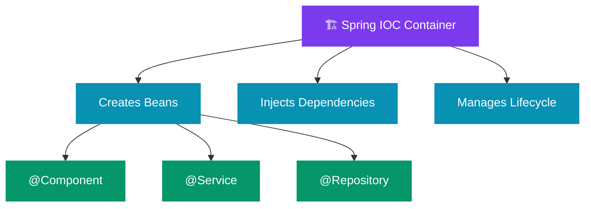

**② The three injection styles the container can use:**

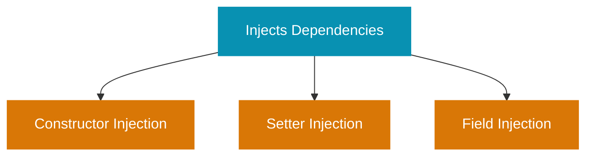

> `Injects Dependencies` (cyan) is the same node in both diagrams. Name constructor injection first in an interview. It is the only style that lets you declare the field `final` and construct the bean in a fully valid state.

🧠 **In Simple Words:**
IOC in Spring gives loose coupling, separation of concerns, and easier unit testing. This makes the application easier to split into modules, to maintain, and to extend.

---

</details>

---

2. **💉 Different ways to achieve dependency injection? 🔥🔥**

<!-- -->
<details>
<summary>Answer</summary>

**Answer:**

You can do Dependency Injection (DI) in several ways. Here are the most common methods:

1. **Constructor Injection:** The class gets its dependencies through its constructor. This is the simplest and most widely used method for DI.

```java
public class MyClass {
    private final Dependency dependency;

    public MyClass(Dependency dependency) {
        this.dependency = dependency;
    }
}
```

> 💡 **In Spring:** `@Autowired` is **not required** on the constructor if the class has only one constructor (Spring 4.3+). Spring uses it for injection automatically. If the class has multiple constructors, put `@Autowired` on the one you want, so Spring knows which to use. This is one more reason to prefer constructor injection. It needs fewer annotations. Also, Spring + Lombok (`@RequiredArgsConstructor`) can wire it with no boilerplate code.

2. **Setter Injection:** The class gets its dependencies through setter methods. This gives more flexibility. You can change dependencies after the object is constructed.

```java
public class MyClass {
    private Dependency dependency;

    public void setDependency(Dependency dependency) {
        this.dependency = dependency;
    }
}
```

> ⚠️ **In Spring:** The above shows the plain Java pattern. You never call `setDependency()` manually — Spring calls it automatically. But this works only if you annotate the setter with `@Autowired`. Without it, Spring does not inject anything.
>
> ```java  
> @Component  
> public class MyClass {  
>     private Dependency dependency;
>
>     @Autowired  
>     public void setDependency(Dependency dependency) {  
>         this.dependency = dependency;  
>     }  
> }  
> ```

3. **Field Injection:** Spring injects dependencies directly into fields, using annotations (like `@Autowired` in Spring). The code is simpler. But the dependencies are hidden, so they are harder to track.

```java
public class Service {
    @Autowired
    private Repository repository;
}
```

💡 **Pro Tip:** Use constructor injection for mandatory dependencies. Setter injection suits optional dependencies better, or a class with many dependencies.

| Type | `@Autowired` required? |
|---|---|
| Constructor injection (single constructor) | ❌️ Not needed (Spring 4.3+) |
| Constructor injection (multiple constructors) | ✅ On the chosen one |
| Setter injection | ✅ Always needed |
| Field injection | ✅ Always needed |

---

</details>

---

3. **🔧 Difference between setter injection and constructor injection? 🔥🔥**

<!-- -->
<details>
<summary>Answer</summary>

**Answer:**

| Feature | Constructor Injection 🅰️ | Setter Injection 🅱️ |
|---------|--------------------------|---------------------|
| **When injected** | At bean creation time | After bean creation |
| **Immutability** | ✅ Supports immutable fields (`final`) | ❌️ Cannot use `final` fields |
| **Mandatory dependencies** | ✅ Guarantees all required deps | ⚠️ No guarantee, may be null |
| **Flexibility** | ❌️ Cannot change after construction | ✅ Can change post-instantiation |
| **Recommended for** | Required, unchangeable dependencies | Optional dependencies |

🧠 **In Simple Words:**
- **Constructor Injection** 🔒 is like giving all ingredients before cooking. Nothing can be missing.
- **Setter Injection** 🔓 is like adding toppings after cooking. It is flexible but optional.

Then you can name these real costs:

- You cannot make the fields `final`.
- A missing dependency shows up as an NPE at call time, not as a startup failure.
- You cannot instantiate the class in a plain JUnit test without reflection.
- The bean hides how many things it actually depends on. So nobody notices it has grown to 15.

---

</details>

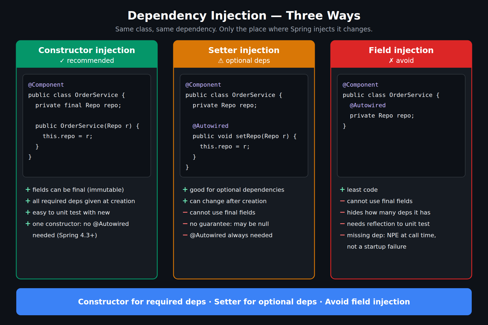

---

4. **🎯 @Autowired vs @Qualifier? 🔥**

<!-- -->
<details>
<summary>Answer</summary>

**Answer:**

**@Autowired**

- 🎯 **Purpose:** Automatically injects dependencies by type.
- 📋 **Usage:** You declare dependencies in your class. Spring resolves and injects them based on type.

```java
@Autowired
private MyService myService;
```

Where `MyService` is given as:

```java
@Configuration
public class AppConfig {

    @Bean
    @Primary
    public MyService primaryService() {
        return new PrimaryService();
    }

    @Bean
    public MyService secondaryService() {
        return new SecondaryService();
    }
}
```

**@Qualifier**

- 🔍 **Purpose:** It names exactly which bean to inject when multiple candidates are available.
- 📋 **Usage:** You use it together with `@Autowired`. It removes the ambiguity by giving the exact bean name.

```java
@Autowired
@Qualifier("secondaryService")
private MyService myService;
```

⚠️ **What happens if you do not say which bean:** say there are two candidates and a plain `@Autowired`. Spring does **not** fail immediately. It goes through a fixed resolution order. It only throws when every step has failed:

| # | Step | Who decides |
|---|---|---|
| 1 | Match candidates **by type** | — |
| 2 | `@Qualifier` at the injection point narrows the candidate set | 👤 consumer |
| 3 | A single `@Primary` bean wins | 🏭 producer |
| 4 | Highest `@Priority` wins (**lowest** numeric value = highest priority) | 🏭 producer |
| 5 | **Fallback: the injection point's *name* is matched against the bean name / alias** | 🎲 accidental |
| 6 | Still ambiguous → `NoUniqueBeanDefinitionException` | 💥 |

> Since Spring 6.2 (Boot 3.4+), a name match (step 5) wins over `@Priority` (step 4). `@Primary` still wins over both.

```
NoUniqueBeanDefinitionException: No qualifying bean of type 'MyService'
available: expected single matching bean but found 2: primaryService, secondaryService
```

`NoUniqueBeanDefinitionException` is a subtype of `NoSuchBeanDefinitionException`. Resolve it on purpose with one of these:

- `@Qualifier` — the consumer decides at the injection point
- `@Primary` — the bean definition sets a default

🐛 **Step 5 causes the bug — injection can succeed by accident.** Say the field or constructor-parameter name is the same as a bean name. Then Spring picks that bean without any warning, and startup shows no error. Take the `AppConfig` above **without** `@Primary`. (With `@Primary`, step 3 picks `primaryService` for both fields, and step 5 never runs.)

```java
@Autowired
private MyService myService;        // ❌️ NoUniqueBeanDefinitionException — no name match

@Autowired
private MyService secondaryService; // ✅ injects secondaryService — matched BY FIELD NAME ONLY
```

The second line does not show which bean you meant. It has no `@Qualifier` and no `@Primary`. It works only because the identifier happens to match a bean name. Name these results in an interview:

- **A rename breaks production wiring.** Every IDE treats `secondaryService` → `service` as a safe rename that changes nothing. But it turns a working app into a startup failure. Or worse, step 3 picks a *different* `@Primary` bean. Then the app starts fine, but with the wrong implementation.
- **It explains "but it works on my machine."** Two developers name their fields differently. They get different beans from the same configuration.
- **Constructor parameters need `-parameters`** to match this way. Without it, the compiler does not keep parameter names.
  - Boot turns on that flag by default: in Maven through `spring-boot-starter-parent`, in Gradle through the Spring Boot Gradle plugin.
  - So the fallback works in a normal Boot app and is *absent* in a plain build.
  - Same code, different wiring — a compiler flag decides it.
  - Field names always stay in the class file. So field injection always has the fallback.

💡 **Two ways to avoid the ambiguity fully** — inject *all* the candidates instead of choosing one:

```java
@Autowired private List<MyService> allServices;        // every candidate, @Order-sortable
@Autowired private Map<String, MyService> byBeanName;  // bean name -> bean
```

This is the standard strategy/plugin pattern. When you add a new implementation, it joins the collection. The injection point does not change.

🧠 **In Simple Words:**
`@Autowired` injects by type. `@Qualifier` names the exact bean to inject when there is more than one candidate.

---

</details>

---

5. **🥇 What is the purpose of @Primary? ⚡**

<!-- -->
<details>
<summary>Answer</summary>

**Answer:**

`@Primary` marks one bean as the primary bean among multiple candidates of the same type. When multiple beans can be autowired, Spring prefers the bean with `@Primary`.

```java
@Configuration
public class AppConfig {

    @Bean
    @Primary
    public MyService primaryService() {
        return new PrimaryService();
    }

    @Bean
    public MyService secondaryService() {
        return new SecondaryService();
    }
}
```

In this example, `primaryService` is the primary bean. So Spring prefers it for autowiring when `MyService` is required.

🎯 **Interview Tip:** `@Primary` is the default choice. `@Qualifier` is the specific override. When both are present, `@Qualifier` wins.

---

</details>

---

<a id="bean-scopes-and-annotations"></a>

## 3. Bean Scopes and Annotations

1. **🏷️ What does the @SpringBootApplication annotation do internally? 🔥🔥**

<!-- -->
<details>
<summary>Answer</summary>

**Answer:**

`@SpringBootApplication` is a shortcut annotation. It adds all of the following:

- ⚙️ **@Configuration:** Marks the class as a source of bean definitions for the application context.
- 🔧 **@EnableAutoConfiguration:** Tells Spring Boot to start adding beans. It decides based on classpath settings, other beans, and various property settings. For example, if `spring-webmvc` is on the classpath, this annotation marks the application as a web application. It then turns on key behaviors, such as setting up a `DispatcherServlet`.
- 🔍 **@ComponentScan:** Tells Spring to look for other components, configurations, and services in the base package. This is how it finds the controllers.

But people often get @EnableAutoConfiguration wrong. It does not "search classes annotated with @Configuration." That is @ComponentScan's job.

- Auto-config checks the classpath (the JAR dependencies).
- It wires beans only when a condition is true, based on what is present.
- Example: if `spring-webmvc` is on the classpath, Boot marks the application as a web application and sets up a `DispatcherServlet`.

So: jar present on classpath → @Conditional check passes → bean configured. The classpath controls it, not your @Configuration classes. Remember this — it is the core of how Boot works.

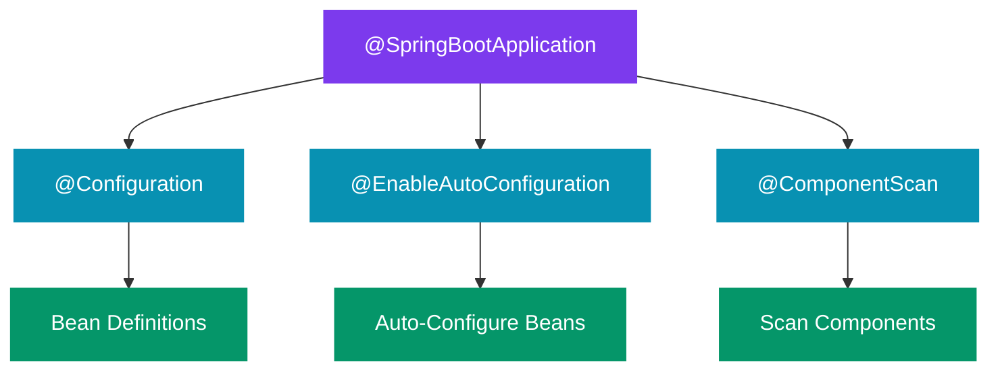

<details>
<summary><strong>🤔 Doubt: Can you show concrete examples of auto-configuration — what happens if Spring Data JPA is present, or if Actuator is present?</strong></summary>

The pattern is always the same: **a JAR appears on the classpath → an auto-configuration class guarded by `@Conditional` checks runs → it wires the beans for you.** Here is that one pattern in three starters:

**1. `spring-boot-starter-web` (spring-webmvc on classpath)**
- **Trigger:** `DispatcherServlet` class is present on the classpath.
- **Boot auto-wires:** an embedded **Tomcat**, a `DispatcherServlet`, a Jackson `ObjectMapper` for JSON, default `HttpMessageConverter`s, and error handling (`/error`).
- **Result:** you write a `@RestController` and it serves JSON. You configured none of that.

**2. `spring-boot-starter-data-jpa` (Spring Data JPA present)**
- **Trigger:** Hibernate / `EntityManager` classes are on the classpath **and** Spring can build a `DataSource` (a JDBC driver + `spring.datasource.*` props, or an embedded H2 jar).
- **Boot auto-wires:** a **HikariCP `DataSource`**, an `EntityManagerFactory` (Hibernate as the JPA provider), and a `JpaTransactionManager`. It also enables your `@Repository` interfaces.
- **Conditional detail — and the trap:** a JPA app with no DB config fails at startup with *"Failed to configure a DataSource: 'url' attribute is not specified and no embedded datasource could be configured."*
  - You may want to say the auto-config "backed off" (skipped itself). But a configuration that backs off produces **no error at all**.
  - What really happens is the opposite. `DataSourceAutoConfiguration`'s class-level conditions are `@ConditionalOnClass({DataSource.class, EmbeddedDatabaseType.class})` and "no R2DBC `ConnectionFactory` bean".
  - These are satisfied, because the starter put HikariCP and the JDBC API on the classpath.
  - So the condition **passes**, and Spring **attempts** bean creation.
  - Then `DataSourceProperties` fails, because it has no URL and no driver to infer.
  - `DataSourceBeanCreationFailureAnalyzer` turns that raw exception into the friendly message you see.
  - **"Backs off" ≠ "fails" — they are opposite outcomes.** If you mix them up in an auto-configuration follow-up, the interviewer will notice.

**3. `spring-boot-starter-actuator` (Actuator present)**
- **Trigger:** Actuator classes on the classpath.
- **Boot auto-wires:** the setup for the `/actuator` endpoints — `/health`, `/info`, `/metrics`, a Micrometer `MeterRegistry`, etc.
- **You then opt in** via properties (`management.endpoints.web.exposure.include=*`). This picks *which* endpoints are exposed. But auto-config created the **beans** as soon as the jar was on the classpath.

**The common mechanism** — each starter includes an auto-config class, protected by `@Conditional` annotations:

| Condition | Meaning | Example |
|---|---|---|
| `@ConditionalOnClass` | "this class is on the classpath" | `DispatcherServlet.class` present → configure web |
| `@ConditionalOnMissingBean` | "user hasn't defined their own" | only create a `DataSource` if you didn't |
| `@ConditionalOnProperty` | "this property is set" | enable a feature flag |

So the chain is exactly:

> **jar on classpath → `@ConditionalOnClass` passes → `@ConditionalOnMissingBean` confirms you didn't override → bean wired.**

The `@ConditionalOnMissingBean` part is what lets you always override Boot. The moment *you* declare your own `@Bean DataSource`, Boot's auto-config sees that one already exists. So it **backs off**. That is why Boot is "opinionated but not restrictive". It only configures what you did not configure yourself.

---

</details>
<br/>

---

</details>

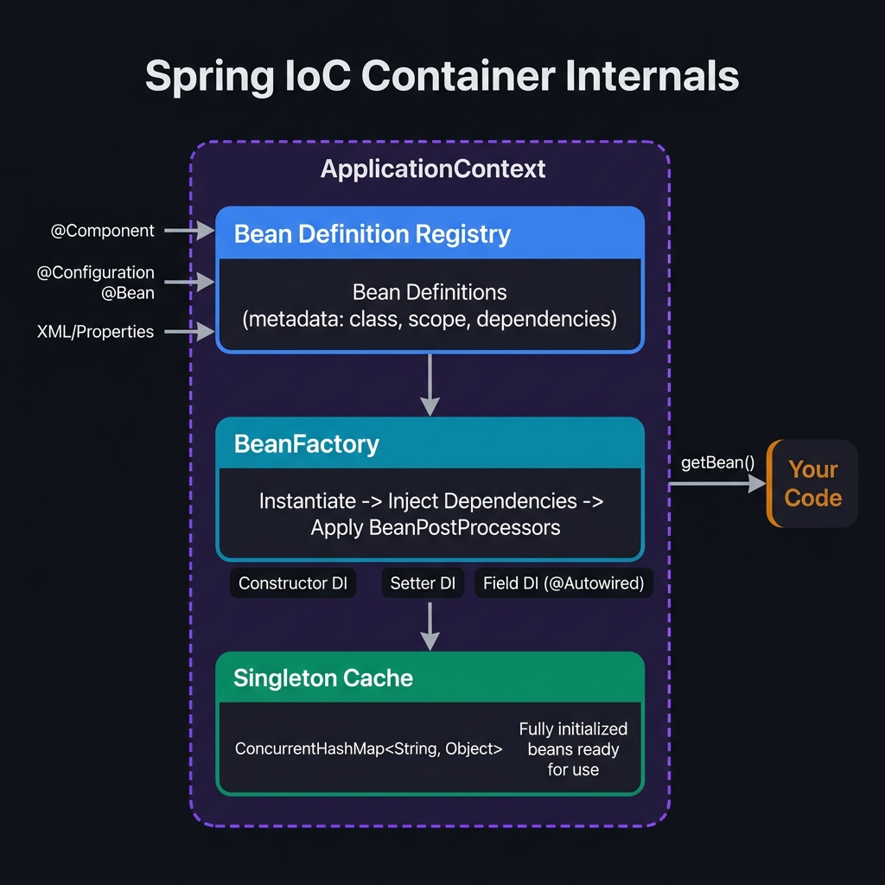

---

2. **🏗️ Explain layers in your application. ⚡**

<!-- -->
<details>
<summary>Answer</summary>

**Answer:**

In a client-server architecture, we can split an application into these layers:

- 🖥️ **Presentation Logic** — The UI layer that interacts with the user.
- ⚙️ **Business Logic** — Core application logic and rules.
- 🗄️ **Data Source** — Database and persistence layer.

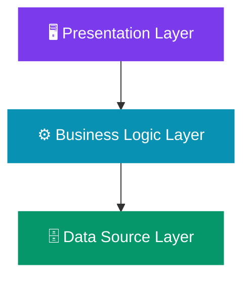

---

</details>

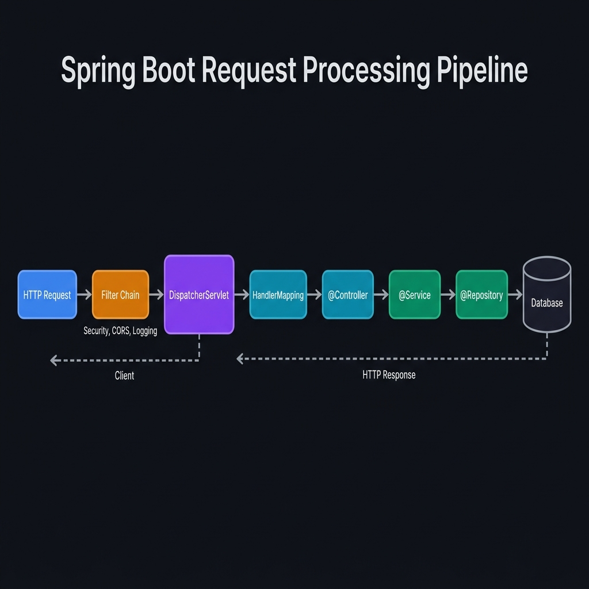

---

3. **🧩 Why do we need controller, service, and DAO separated? 🔥**

<!-- -->
<details>
<summary>Answer</summary>

**Answer:**

We use programming languages like Java to write business logic on the server. We split this code further into:

- 🎮 **Controller Layer** — Handles HTTP requests and responses.
- 🧠 **Business/Service Layer** — Contains business logic and validation.
- 🗄️ **DAO Layer** — Handles database operations and persistence.

🧠 **In Simple Words:**
Separation of concerns makes the code easier to maintain and test. It also keeps the layers loosely coupled. Each layer has a single responsibility.

---

</details>

---

4. **🫘 What are the different bean scopes? 🔥🔥**

<!-- -->
<details>
<summary>Answer</summary>

**Answer:**

In Spring Framework, bean scope defines the lifecycle and visibility of a bean instance. Here are the most commonly used bean scopes:

| Scope | Description | When to Use |
|-------|-------------|-------------|
| **Singleton** | ✅ One instance per Spring container (default) | Stateless beans |
| **Prototype** | 🔄 New instance every time it is requested | Stateful beans |
| **Request** | 🌐 New instance per HTTP request | Web-aware context only |
| **Session** | 🔗 New instance per HTTP session | Web-aware context only |
| **Application** | 📦 One instance per `ServletContext` | Shared across entire app |
| **WebSocket** | 🔌 New instance per WebSocket session | WebSocket-based apps |

1. 🥇 **Singleton:** The Spring container creates only one instance of the bean per container. It is the default scope. All clients that request the bean share this single instance.
2. 🔄 **Prototype:** The container creates a new instance of the bean every time someone requests it. Each client gets its own instance.
3. 🌐 **Request:** The container creates a new instance for each HTTP request. Only available in web-aware `ApplicationContext`.
4. 🔗 **Session:** The container creates a new instance for each HTTP session. Only available in web-aware `ApplicationContext`.
5. 📦 **Application:** The container creates a single instance for each `ServletContext`. The whole application shares it.
6. 🔌 **WebSocket:** The container creates a new instance for each WebSocket session. Used only in WebSocket-based applications.

🎯 **Interview Tip:** The right scope depends on a few things: whether the bean holds state, what the application needs, and how long the bean instance should live.

**⚠️ The classic trap — injecting a prototype bean into a singleton:**

A very common follow-up: *"If I inject a prototype-scoped bean as a field into a singleton `@Service`, how many prototype instances get used at runtime?"*

```java
@Component
@Scope("prototype")
public class Task {
    // expected: a brand-new Task every time we use it
}

@Service // singleton
public class TaskRunner {

    @Autowired
    private Task task; // injected ONCE — at TaskRunner creation time

    public void run() {
        task.execute(); // always the SAME Task instance ❌️
    }
}
```

**Answer: only ONE.**

- Spring resolves the prototype exactly **once — when the singleton is created**.
- The singleton keeps that single reference for its entire life.
- So prototype scope **stops working, with no error or warning**.

This surprises people. They assume "prototype" means "new instance on every access". But Spring applies scope only at **injection/lookup time**, and a singleton is injected just once.

**How to really get a fresh prototype on every use** (any of these works):

| Technique | How it works |
|-----------|-------------|
| `@Lookup` method injection | Spring overrides a method to return a fresh bean from the container on each call |
| `ObjectProvider<Task>` / `ObjectFactory<Task>` | Inject the provider; call `.getObject()` each time you need a new instance |
| `ApplicationContext.getBean(Task.class)` | Explicit lookup per use (ties your code to the container) |
| Scoped proxy on the prototype | `@Scope(value = "prototype", proxyMode = ScopedProxyMode.TARGET_CLASS)` — Spring injects a proxy that fetches a new target per method call |

```java
// Cleanest: @Lookup
@Service
public class TaskRunner {

    public void run() {
        Task task = getTask(); // fresh instance each call ✅
        task.execute();
    }

    @Lookup
    protected Task getTask() {
        return null; // Spring overrides this method at runtime
    }
}
```

```java
// Or ObjectProvider
@Service
public class TaskRunner {

    private final ObjectProvider<Task> taskProvider;

    public TaskRunner(ObjectProvider<Task> taskProvider) {
        this.taskProvider = taskProvider;
    }

    public void run() {
        Task task = taskProvider.getObject(); // fresh instance each call ✅
        task.execute();
    }
}
```

🔑 **Key Point:** Spring applies scope at the moment you **get a bean from the container**, not on every field access. A singleton gets its dependencies once. So any prototype injected as a plain field behaves like a singleton. To fix this, use `@Lookup`, `ObjectProvider`, or a scoped proxy.

---

</details>

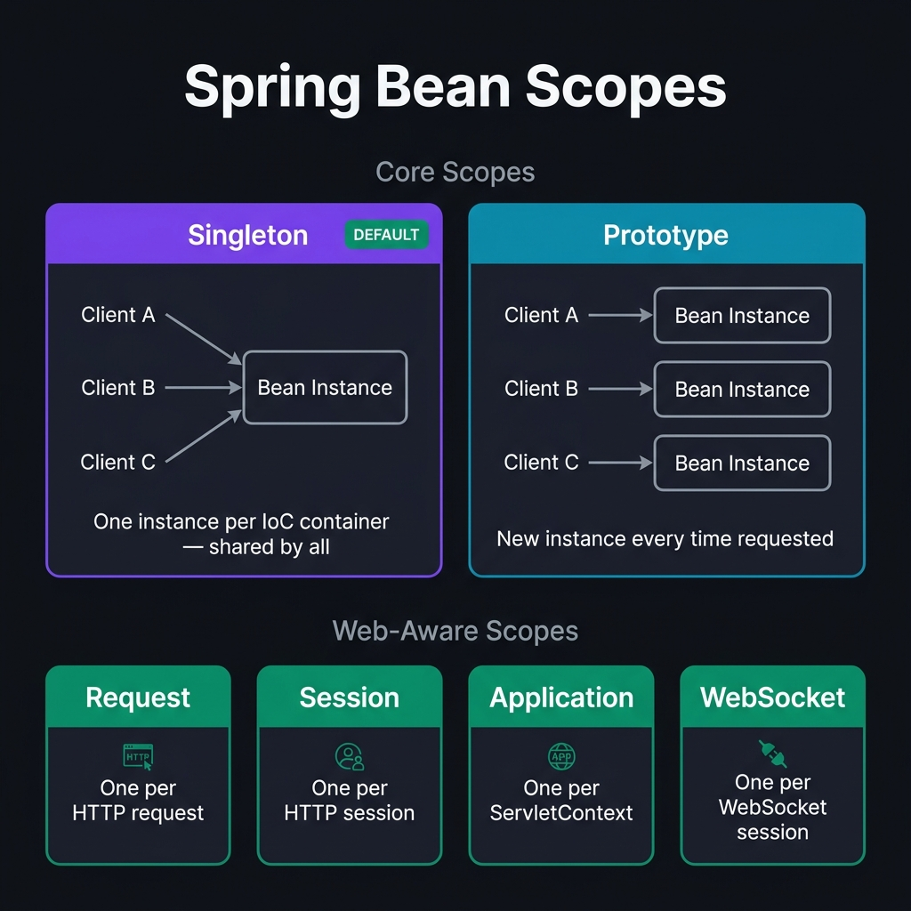

---

5. **🔍 If you want to exclude some packages from scanning, then how will you do that? 🔥🔥**

<!-- -->
<details>
<summary>Answer</summary>

**Answer:**

To exclude packages or classes from component scanning, use the **`excludeFilters`** attribute of `@ComponentScan`. There is **no plain `exclude` attribute** on `@ComponentScan` that takes package-name strings. That is a common mistake.

**Option 1 — `excludeFilters` with a REGEX filter (exclude by package):**

```java
import org.springframework.boot.SpringApplication;
import org.springframework.boot.autoconfigure.SpringBootApplication;
import org.springframework.context.annotation.ComponentScan;
import org.springframework.context.annotation.ComponentScan.Filter;
import org.springframework.context.annotation.FilterType;

@SpringBootApplication
@ComponentScan(excludeFilters = {
    @Filter(type = FilterType.REGEX, pattern = "com\\.example\\.package1\\..*"),
    @Filter(type = FilterType.REGEX, pattern = "com\\.example\\.package2\\..*")
})
public class MyApplication {
    public static void main(String[] args) {
        SpringApplication.run(MyApplication.class, args);
    }
}
```

**Option 2 — `excludeFilters` with `ASSIGNABLE_TYPE` (exclude specific classes):**

```java
@ComponentScan(excludeFilters =
    @Filter(type = FilterType.ASSIGNABLE_TYPE, classes = {LegacyService.class}))
```

**Option 3 — narrow `basePackages` so the unwanted package is never scanned in the first place:**

```java
@ComponentScan(basePackages = "com.example.wanted")
```

⚠️ **A trap in Option 1:** a `@ComponentScan` placed directly on the `@SpringBootApplication` class replaces Boot's own scan settings (Spring Framework 6.0, and 6.1.2+). You lose Boot's default filters, `TypeExcludeFilter` and `AutoConfigurationExcludeFilter`. So add those two filters to your own `excludeFilters` list as well.

⚠️ **Don't confuse this with `@SpringBootApplication(exclude = ...)`.** That `exclude` attribute *does* exist. But it disables **auto-configuration classes** (e.g. `DataSourceAutoConfiguration.class`). It has nothing to do with component-scan packages.

---

</details>

---

6. **🔖 Can we use @Component in place of @Service? 🔥**

<!-- -->
<details>
<summary>Answer</summary>

**Answer:**

Yes, you can use `@Component` instead of `@Service` in Spring Framework.

`@Component`, `@Service`, `@Repository`, `@Controller`, and `@RestController` are all stereotype annotations in Spring. They have a similar purpose: they mark a class as a Spring-managed component. But each one also carries a meaning about the class's role:

- 🧩 **@Component:** A generic stereotype annotation for any Spring-managed component. Use it when the class doesn't fit a more specific annotation.
- 🧠 **@Service:** Shows that the class is a service component in the business logic layer. Use it for classes that do service tasks.

For `@Service`, the swap only changes the meaning, not the behavior. `@Service` adds **no behavior** over `@Component` today.

⚠️ **The exception is `@Repository` — it is NOT just semantic.** `@Repository` triggers **automatic persistence exception translation**:

- Spring registers a `PersistenceExceptionTranslationPostProcessor` that wraps `@Repository` beans in a proxy.
- The proxy converts low-level, vendor-specific data-access exceptions (JDBC `SQLException`, Hibernate's `HibernateException`, etc.).
- It turns them into Spring's single, unchecked `DataAccessException` hierarchy.

If you replace `@Repository` with plain `@Component` on a DAO, you **lose this translation**. So "nothing changes" is false for the data-access layer.

💡 **Pro Tip:** `@Component` works technically. But specific annotations like `@Service`, `@Repository`, and `@Controller` give clearer meaning. They show the purpose of each class better. They also make the code better organized and easier to read, especially in larger projects.

---

</details>

---

7. **🎭 What are the stereotype annotations? 🔥**

<!-- -->
<details>
<summary>Answer</summary>

**Answer:**

`@Component`, `@Service`, `@Repository`, `@Controller`, and `@RestController` are all stereotype annotations in Spring.

| Annotation | Purpose | Layer |
|-----------|---------|-------|
| **@Component** | 🧩 Generic Spring-managed component | Any |
| **@Service** | 🧠 Business logic layer | Service |
| **@Repository** | 🗄️ Data access layer | DAO |
| **@Controller** | 🎮 Web MVC controller (returns views) | Presentation |
| **@RestController** | 🌐 REST API controller (returns JSON/XML) | Presentation |

🔑 **Key Point:** Only `@Repository` carries extra runtime behavior — **persistence exception translation** into Spring's `DataAccessException` hierarchy (see previous question). `@Service` and `@Controller` are markers that show the class's role. `@Controller`/`@RestController` also tell Spring MVC's handler mapping that the class belongs to the web layer.

---

</details>

---

8. **🧬 Tell annotation which has stereotype annotation inbuilt? ⚡**

<!-- -->
<details>
<summary>Answer</summary>

**Answer:**

- 🌐 `@RestController` — combines `@Controller` + `@ResponseBody`
- 🛡️ `@ControllerAdvice` — builds on `@Component`
- ⚙️ `@Configuration` — builds on `@Component`

---

</details>

---

9. **✋ Tell 5 Spring annotations that you have used excluding the stereotype annotations and excluding annotations that are stereotype embedded. ⚡**

<!-- -->
<details>
<summary>Answer</summary>

**Answer:**

1. 🚫 `@NoRepositoryBean` — Use it when we don't want the container to pick up the class/interface and create an instance of it.
2. 🎮 `@GetMapping` / `@PutMapping`
3. 🧪 `@DataJpaTest`
4. 💰 `@Transactional` — declarative transaction demarcation (marking where a transaction starts and ends; see §7)
5. 📦 `@Bean`
6. 📐 `@Scope`
7. 🔧 `@Value` / `@ConfigurationProperties` — property binding

⚠️ **Watch the rule in the question.** `@SpringBootConfiguration` is a tempting answer, but it is **not allowed**:

- It is meta-annotated with `@Configuration` (the annotation itself carries `@Configuration`).
- `@Configuration` is itself meta-annotated with `@Component`.
- So it *is* stereotype-embedded.

Naming `@RestController` or `@ControllerAdvice` here is the same trap.

🔑 **Key Point:** Additional annotations from other Spring modules:

- **Spring AOP:** `@Aspect`, `@Before`, `@After`, `@AfterReturning`, `@AfterThrowing`, `@Around`, `@Pointcut`, `@DeclareParents`
- **Spring Security:** `@EnableWebSecurity`, `@Secured`, `@RolesAllowed` (a JSR-250 annotation that Spring Security supports), `@PreAuthorize`, `@PostAuthorize`

---

</details>

---

10. **📋 What Spring Boot annotations have you used? ⚡**

<!-- -->
<details>
<summary>Answer</summary>

**Answer:**

- 🚀 **Application level:** `@SpringBootApplication`, `@EnableWebSecurity` (from Spring Security, not Boot)
- 🧩 **Stereotype annotations:** `@Component`, `@Controller`, `@RestController`, `@Service`, `@Repository`
- ⚙️ **Method level:** `@Bean`, `@GetMapping`, `@PostMapping`, `@RequestMapping`, `@RequestBody`, `@Autowired`, `@Primary`, `@Qualifier`

---

</details>

---

<a id="configuration-and-profiles"></a>

## 4. Configuration and Profiles

1. **⛔ How to disable a specific auto-configuration class? 🔥**

<!-- -->
<details>
<summary>Answer</summary>

**Answer:**

If we do not want to use some auto-configuration classes, we exclude them with the `exclude` attribute.

- `@SpringBootApplication` is **already** meta-annotated with `@EnableAutoConfiguration`.
- It also re-declares the same `exclude` / `excludeName` attributes.
- So you put `exclude` directly on `@SpringBootApplication`.
- Putting both annotations on the same class is not needed. It is not the standard form.

**Option 1 — annotation form (most common):**

```java
@SpringBootApplication(exclude = { DataSourceAutoConfiguration.class })
public class DemoApplication {
    public static void main(String[] args) {
        SpringApplication.run(DemoApplication.class, args);
    }
}
```

We can add multiple classes. Separate them with commas:

```java
@SpringBootApplication(exclude = {A.class, B.class, C.class})
```

**Option 2 — property form (no code change needed):**

```properties
spring.autoconfigure.exclude=org.springframework.boot.autoconfigure.jdbc.DataSourceAutoConfiguration
```

**Option 3 — `excludeName` when the class is not on the compile classpath:**

```java
@SpringBootApplication(excludeName = {
    "org.springframework.boot.autoconfigure.jdbc.DataSourceAutoConfiguration"
})
```

🎯 **Interview Tip:** The follow-up is *"what if you can't touch the annotation?"* For example:

- the main class lives in a shared parent module, or
- you want the exclusion in only one environment.

This is exactly what `spring.autoconfigure.exclude` is for. It is an ordinary property. So you can set it per profile, per environment, or via `SPRING_AUTOCONFIGURE_EXCLUDE` at deploy time.

⚠️ You can exclude only auto-configuration classes this way. Say you exclude a class that is *not* registered as an auto-configuration. Then startup fails with "The following classes could not be excluded because they are not auto-configuration classes."

---

</details>

---

2. **📝 How to use a property defined in the application.properties file in your Java class? 🔥**

<!-- -->
<details>
<summary>Answer</summary>

**Answer:**

Use the `@Value` annotation to read the properties defined in the `application.properties` file.

```java
@Value("${custom.value}")
private String customVal;
```

---

</details>

---

3. **🌍 What is the use of profiles in Spring Boot? 🔥**

<!-- -->
<details>
<summary>Answer</summary>

**Answer:**

- 🌍 Enterprise applications usually run in multiple environments, such as Dev, QA, and Prod. Each environment has different configuration properties.
- 🗄️ For example, Dev might use an embedded H2 database. Prod could use a commercial database, such as Oracle or DB2. Even if every environment uses the same DBMS, the URLs are different.
- 📂 Spring gives us profiles to keep this simple. A profile separates the configuration for each environment.
- You do not manage this in code. You keep the properties in separate files, such as `application-dev.properties` and `application-prod.properties`.
- You name the active profile with `spring.profiles.active`. Spring then picks up the correct configuration. You can set it in `application.properties` for local runs. In real deployments, pass it as an environment variable or a command-line argument.

Spring picks the file of the profile that is active in `application.properties`.

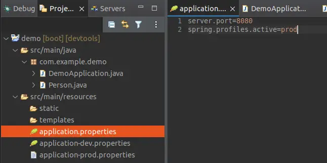

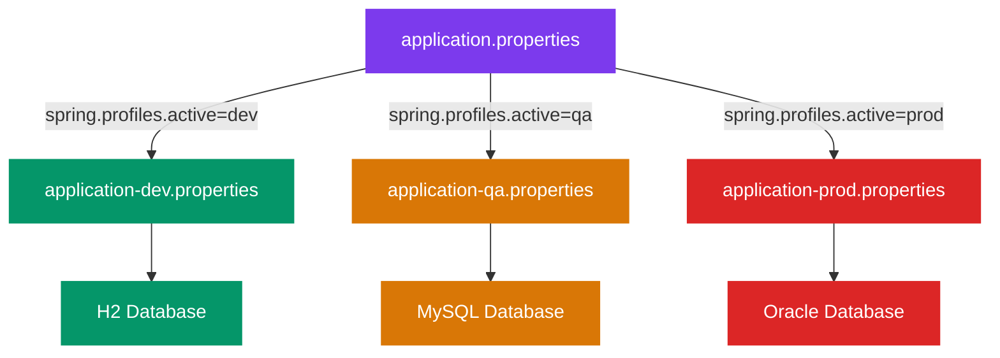

---

</details>

---

4. **📄 What are the advantages of the YAML file over the Properties file? ⚡**

<!-- -->
<details>
<summary>Answer</summary>

**Answer:**

✅ **Advantages:**

1. 📖 More clarity and better readability.
2. 🏗️ Very good for hierarchical configuration data. It shows this data in a better, more readable format.
3. 📋 Support for maps, lists, and scalar types.

We don't need any plugin/configuration or a separate dependency to use YAML files in Spring Boot. In the maven dependencies, we can find `snakeyaml-version.jar`. SnakeYAML parses the YAML. Spring Boot's YAML loader then turns it into flat properties.

Create a new Spring Boot project. Open the `src/main/resources` folder, where the `application.properties` file is. Create another file there: `application.yml`

In `application.yml`:

```yaml
my:
  app:
    id: 10
    name: abc
    cost: 500.0
```

Create a runner class to read the data and test it:

```java
package com.knowprogram.demo;

import org.springframework.beans.factory.annotation.Value;
import org.springframework.boot.CommandLineRunner;
import org.springframework.stereotype.Component;

import lombok.Getter;
import lombok.Setter;
import lombok.ToString;

@Component
@Getter
@Setter
@ToString
public class DataReadRunner implements CommandLineRunner {

    @Value("${my.app.id}")
    private Integer pid;

    @Value("${my.app.name}")
    private String name;

    @Value("${my.app.cost}")
    private Double pcost;

    @Override
    public void run(String... args) throws Exception {
        System.out.println(this);
    }
}
```

📤 **Output:**

```
DataReadRunner(pid=10, name=abc, pcost=500.0)
```

---

</details>

---

5. **⚖️ Which is given preference YAML or property file in Spring Boot? 💤**

<!-- -->
<details>
<summary>Answer</summary>

**Answer:**

`application.properties` is given preference over the `application.yml` file **in the same location** in a Spring Boot application.

🎯 **Interview Tip:** If both `application.properties` and `application.yml` exist in the same location with conflicting values, the value from `application.properties` wins.

---

</details>

---

6. **🏗️ How do you use @ConfigurationProperties with @Validated for type-safe configuration? 🔥**

<!-- -->
<details>
<summary>Answer</summary>

**Answer:**

`@ConfigurationProperties` gives type-safe binding of external configuration to Java objects. The configuration comes from `application.yml` or `application.properties`. Add `@Validated`, and Spring checks the configuration values at startup.

**Step 1: Define the properties class with validation**

```java
@ConfigurationProperties(prefix = "app.payment")
@Validated
public class PaymentProperties {

    @NotBlank(message = "Payment gateway URL is required")
    private String gatewayUrl;

    @Min(value = 1, message = "Timeout must be at least 1 second")
    @Max(value = 30, message = "Timeout must not exceed 30 seconds")
    private int timeoutSeconds = 5;

    @NotBlank
    private String apiKey;

    @Min(1)
    @Max(5)
    private int maxRetries = 3;

    private Retry retry = new Retry();

    // Nested configuration
    public static class Retry {
        private boolean enabled = true;
        private long backoffMs = 1000;

        // getters and setters
        public boolean isEnabled() {
            return enabled;
        }
        public void setEnabled(boolean enabled) {
            this.enabled = enabled;
        }
        public long getBackoffMs() {
            return backoffMs;
        }
        public void setBackoffMs(long backoffMs) {
            this.backoffMs = backoffMs;
        }
    }

    // getters and setters
    public String getGatewayUrl() {
        return gatewayUrl;
    }
    public void setGatewayUrl(String gatewayUrl) {
        this.gatewayUrl = gatewayUrl;
    }
    public int getTimeoutSeconds() {
        return timeoutSeconds;
    }
    public void setTimeoutSeconds(int timeoutSeconds) {
        this.timeoutSeconds = timeoutSeconds;
    }
    public String getApiKey() {
        return apiKey;
    }
    public void setApiKey(String apiKey) {
        this.apiKey = apiKey;
    }
    public int getMaxRetries() {
        return maxRetries;
    }
    public void setMaxRetries(int maxRetries) {
        this.maxRetries = maxRetries;
    }
    public Retry getRetry() {
        return retry;
    }
    public void setRetry(Retry retry) {
        this.retry = retry;
    }
}
```

**Step 2: Configuration in YAML**

```yaml
app:
  payment:
    gateway-url: https://api.razorpay.com/v1
    timeout-seconds: 10
    api-key: rzp_live_xxxxx
    max-retries: 3
    retry:
      enabled: true
      backoff-ms: 2000
```

**Step 3: Enable and use**

```java
@Configuration
@EnableConfigurationProperties(PaymentProperties.class)
public class PaymentConfig {

    @Bean
    public PaymentGateway paymentGateway(PaymentProperties props) {
        return new PaymentGateway(props.getGatewayUrl(), props.getApiKey(),
            props.getTimeoutSeconds());
    }
}
```

**What happens on invalid configuration:**

If `gateway-url` is blank, the application **fails to start** with a clear error:

```
***************************
APPLICATION FAILED TO START
***************************
Description:
Binding to target com.example.PaymentProperties failed:

    Property: app.payment.gatewayUrl
    Value: ""
    Reason: Payment gateway URL is required
```

**@ConfigurationProperties vs @Value:**

| Feature | @ConfigurationProperties | @Value |
|---------|--------------------------|--------|
| Type safety | Strongly typed Java object | String-based, manual casting |
| Validation | `@Validated` with JSR-303 | No built-in validation |
| Nested properties | Natural nesting with inner classes | One key at a time — no binding to an object tree |
| Relaxed binding | `gateway-url` = `gatewayUrl` = `GATEWAY_URL` | Limited — works only if you write the kebab-case name |
| Bulk binding | All properties under a prefix | One property at a time |
| Meta-data | IDE auto-completion support | No auto-completion |

🔑 **Key Point:** For production applications, always prefer `@ConfigurationProperties` over `@Value`. It gives:

- type safety
- validation at startup
- IDE auto-completion, when you add the `spring-boot-configuration-processor` dependency

---

</details>

---

7. **🌍 How do you manage profiles in a microservices environment? ⚡**

<!-- -->
<details>
<summary>Answer</summary>

**Answer:**

In a microservices architecture, managing profiles is harder. You have multiple services, and each has its own configuration per environment. Here are the patterns that teams use in production:

**Pattern 1: Profile-specific YAML files (basic)**

```
src/main/resources/
├── application.yml              # Common/default config
├── application-dev.yml          # Dev environment overrides
├── application-staging.yml      # Staging environment overrides
└── application-prod.yml         # Production environment overrides
```

```yaml
# application.yml (common)
spring:
  application:
    name: order-service

# application-dev.yml
spring:
  datasource:
    url: jdbc:mysql://localhost:3306/orders_dev
logging:
  level:
    root: DEBUG

# application-prod.yml
spring:
  datasource:
    url: jdbc:mysql://prod-rds.amazonaws.com:3306/orders
logging:
  level:
    root: WARN
```

**Activating profiles:**

```properties
# application.properties (local default only — see best practices below)
spring.profiles.active=dev
```

```bash
# Command line
java -jar order-service.jar --spring.profiles.active=prod

# Environment variable
SPRING_PROFILES_ACTIVE=prod java -jar order-service.jar

# Kubernetes deployment
env:
  - name: SPRING_PROFILES_ACTIVE
    value: "prod"
```

**Pattern 2: Spring Cloud Config Server (centralized)**

```yaml
# Config Server stores all configurations centrally
# Git repository structure:
config-repo/
├── order-service/
│   ├── application.yml
│   ├── application-dev.yml
│   └── application-prod.yml
├── payment-service/
│   ├── application.yml
│   ├── application-dev.yml
│   └── application-prod.yml
```

```yaml
# Each microservice's application.yml (Spring Cloud 2020.0+)
# Older setups put the Config Server URI in bootstrap.yml
spring:
  config:
    import: "configserver:http://config-server:8888"
  profiles:
    active: ${SPRING_PROFILES_ACTIVE:dev}
```

**Pattern 3: Profile groups (Spring Boot 2.4+)**

```yaml
# application.yml
spring:
  profiles:
    group:
      prod:
        - prod-db
        - prod-security
        - prod-monitoring
      dev:
        - dev-db
        - dev-security
```

**Best practices for microservices profiles:**

| Practice | Why |
|----------|-----|
| Use environment variables for profile activation | Keeps deployment config outside the code |
| Never hardcode `spring.profiles.active` in committed files | Prevents accidental prod deployments |
| Use Spring Cloud Config for centralized config | Single source of truth for all services |
| Encrypt sensitive values (DB passwords, API keys) | Security requirement for production |
| Use profile groups for complex environments | Cleaner than listing multiple profiles |

🎯 **Interview Tip:** In a Kubernetes-based microservice deployment, environment variables in the deployment YAML usually activate the profiles. Sensitive configuration, like database passwords, should come from Kubernetes Secrets, not profile files.

---

</details>

---

8. **🔀 What is the difference between `CommandLineRunner` and `ApplicationRunner`? When would you use each? ⚡**

<!-- -->
<details>
<summary>Answer</summary>

**Answer:**

Both interfaces run code **after the Spring `ApplicationContext` has been refreshed**. They also run **before `ApplicationReadyEvent` is published**. The key difference is how they receive command-line arguments.

⚠️ **Many people say "before the application serves requests". That is wrong.**

- `SpringApplication.run()` calls `refreshContext()` *first*.
- In a servlet web app, the embedded Tomcat starts **inside** that refresh. The `WebServerStartStopLifecycle` bean starts it, during `finishRefresh()`.
- Spring calls the runners after that, in `callRunners()`.

So the order is:

```
refreshContext()  →  web server started, port is OPEN and accepting traffic
      ↓
ApplicationStartedEvent
      ↓
callRunners()     →  your CommandLineRunner / ApplicationRunner runs HERE
      ↓
ApplicationReadyEvent
```

**Why it matters in production:** think of a slow runner (cache warm-up, reference-data seeding, migration check). While it runs, there is a time window with these problems:

- The pod's port is open.
- A simple liveness probe passes.
- Requests reach an app that is not fully initialised yet.

Fixes:

- Do the seeding in an `ApplicationListener<ApplicationReadyEvent>`. Combine it with a readiness probe on `/actuator/health/readiness`. This probe only changes to `UP` after the runners finish.
- Or move slow work out of startup completely.

**CommandLineRunner — raw `String[]` args:**

```java
@Component
@Order(1)
public class DataLoader implements CommandLineRunner {

    @Override
    public void run(String... args) throws Exception {
        // args = ["--server.port=9090", "--app.mode=debug"]
        for (String arg : args) {
            System.out.println("Raw arg: " + arg);
        }
    }
}
```

**ApplicationRunner — parsed `ApplicationArguments`:**

```java
@Component
@Order(2)
public class ConfigValidator implements ApplicationRunner {

    @Override
    public void run(ApplicationArguments args) throws Exception {
        // Structured access to arguments
        boolean hasDebug = args.containsOption("app.mode");
        List<String> modeValues = args.getOptionValues("app.mode"); // ["debug"]
        List<String> nonOptionArgs = args.getNonOptionArgs();        // positional args

        System.out.println("Debug mode: " + hasDebug);
        System.out.println("Mode values: " + modeValues);
    }
}
```

**Comparison:**

| Feature | `CommandLineRunner` | `ApplicationRunner` |
|---------|-------------------|-------------------|
| Parameter type | `String... args` (raw) | `ApplicationArguments` (parsed) |
| Access `--key=value` | Manual parsing needed | `args.getOptionValues("key")` |
| Access positional args | All mixed together | `args.getNonOptionArgs()` |
| Check option exists | Loop through array | `args.containsOption("key")` |
| `@Order` support | ✅ Yes | ✅ Yes |
| Execution timing | After context loaded | After context loaded |

**When to use which:**

| Use Case | Choose |
|----------|--------|
| Simple startup task (seed DB, log info) | `CommandLineRunner` |
| Need to parse `--option=value` args | `ApplicationRunner` |
| Need to separate positional vs option args | `ApplicationRunner` |
| Don't care about args at all | Either — `CommandLineRunner` is simpler |

**Execution order with both:**

```java
@Component @Order(1) public class First implements CommandLineRunner { ... }
@Component @Order(2) public class Second implements ApplicationRunner { ... }
@Component @Order(3) public class Third implements CommandLineRunner { ... }
// Executes: First → Second → Third (ordered across both types)
```

`@Order` works **across both types**. Spring doesn't split them into two groups.

💡 **Pro Tip:** If your runner throws an exception, Spring Boot **aborts startup**. If the task is not critical, put the risky logic inside a try-catch.

---

</details>

---

9. **🏗️ What is `@ConstructorBinding` in Spring Boot? How do you create immutable configuration classes? 🔥**

<!-- -->
<details>
<summary>Answer</summary>

**Answer:**

`@ConstructorBinding` tells Spring Boot to bind external properties through the **constructor**, not through setter methods. This lets you write **immutable** `@ConfigurationProperties` classes.

**Why immutable config matters:**
- ✅ Thread-safe — no setter means no one can change a value by mistake
- ✅ Fields can be `final` — the compiler makes sure they are initialized
- ✅ Cleaner design — config objects are value objects, not mutable beans

**Spring Boot 2.x approach (explicit annotation required):**

⚠️ This snippet is correct **for 2.x only. It will not compile on 3.x.**

- In Boot 2.x, the annotation was `org.springframework.boot.context.properties.ConstructorBinding`. It could sit on the **type**.
- Boot 3.x moved it to `org.springframework.boot.context.properties.bind.ConstructorBinding`.
- Boot 3.x also narrowed its `@Target` to `CONSTRUCTOR` (plus `ANNOTATION_TYPE`).
- So a class-level `@ConstructorBinding` is now a compile error.
- You only put it on a **constructor**. And you only need it to pick one constructor when the class has more than one.

```java
@ConfigurationProperties(prefix = "app.payment")
@ConstructorBinding
public class PaymentConfig {

    private final String gateway;
    private final int timeout;
    private final boolean retryEnabled;

    public PaymentConfig(String gateway, int timeout, boolean retryEnabled) {
        this.gateway = gateway;
        this.timeout = timeout;
        this.retryEnabled = retryEnabled;
    }

    // Only getters — no setters
    public String getGateway() {
        return gateway;
    }
    public int getTimeout() {
        return timeout;
    }
    public boolean isRetryEnabled() {
        return retryEnabled;
    }
}
```

**Spring Boot 3.x approach (`@ConstructorBinding` is optional for single-constructor classes):**

```java
@ConfigurationProperties(prefix = "app.payment")
public class PaymentConfig {

    private final String gateway;
    private final int timeout;
    private final boolean retryEnabled;

    // Single constructor — Spring Boot 3.x automatically uses constructor binding
    public PaymentConfig(String gateway, int timeout, boolean retryEnabled) {
        this.gateway = gateway;
        this.timeout = timeout;
        this.retryEnabled = retryEnabled;
    }

    public String getGateway() {
        return gateway;
    }
    public int getTimeout() {
        return timeout;
    }
    public boolean isRetryEnabled() {
        return retryEnabled;
    }
}
```

**With Java `record` (Spring Boot 3.x — cleanest approach):**

```java
@ConfigurationProperties(prefix = "app.payment")
public record PaymentConfig(String gateway, int timeout, boolean retryEnabled) {}
```

Records are immutable by design. You don't need to write getters or constructors by hand.

**Corresponding properties:**

```yaml
app:
  payment:
    gateway: razorpay
    timeout: 5000
    retry-enabled: true
```

**Registration — enable scanning:**

```java
@SpringBootApplication
@EnableConfigurationProperties(PaymentConfig.class)
// or use @ConfigurationPropertiesScan to scan all
public class Application { ... }
```

**Combining with `@Validated`:**

```java
@ConfigurationProperties(prefix = "app.payment")
@Validated
public record PaymentConfig(
    @NotBlank String gateway,
    @Min(100) @Max(30000) int timeout,
    boolean retryEnabled
) {}
```

Validation runs at startup. If `gateway` is blank or `timeout` is out of range, the application **fails to start**. It shows a clear error message.

**Nested immutable config:**

```java
@ConfigurationProperties(prefix = "app")
public record AppConfig(
    PaymentConfig payment,
    NotificationConfig notification
) {
    public record PaymentConfig(String gateway, int timeout) {}
    public record NotificationConfig(String smsProvider, boolean enabled) {}
}
```

**Comparison: Setter binding vs Constructor binding:**

| Feature | Setter Binding (default) | Constructor Binding |
|---------|------------------------|-------------------|
| Mutability | Mutable (setters exist) | Immutable (final fields) |
| Thread safety | ⚠️ Not guaranteed | ✅ Safe |
| `@DefaultValue` support | N/A | ✅ Yes |
| Java record support | ❌️ No | ✅ Yes |
| Spring Boot 2.x | Default | Needs `@ConstructorBinding` |
| Spring Boot 3.x | Default for multi-constructor | Default for single/record |

**`@DefaultValue` for optional properties:**

```java
public PaymentConfig(
    String gateway,
    @DefaultValue("3000") int timeout,
    @DefaultValue("false") boolean retryEnabled
) { ... }
```

🎯 **Interview Tip:** If the interviewer asks about `@ConfigurationProperties`, mention constructor binding and records. They are the modern best practice. This shows you write production-grade, thread-safe configuration.

---

</details>

---

<a id="bean-lifecycle-and-post-processors"></a>

## 5. Bean Lifecycle and Post-Processors

1. **🔬 Explain the complete Spring Bean Lifecycle from creation to destruction. 🔥🔥**

<!-- -->
<details>
<summary>Answer</summary>

**Answer:**

The Spring Bean Lifecycle is a fixed list of steps, from instantiation (creation) to destruction. Every bean follows this order. Some steps run only if the bean uses them. For example, an Aware step runs only if the bean implements that interface. You need to know it to:

- write initialization logic
- clean up resources
- debug startup issues

**Complete lifecycle stages:**

| Stage | Mechanism | Description |
|-------|-----------|-------------|
| 1. Instantiation | Constructor | Spring creates the bean instance through the constructor |
| 2. Populate Properties | @Autowired / Setter | Dependencies are injected |
| 3. BeanNameAware | `setBeanName()` | Bean becomes aware of its name in the container |
| 4. BeanFactoryAware | `setBeanFactory()` | Bean gets reference to the BeanFactory |
| 5. ApplicationContextAware | `setApplicationContext()` | Bean gets reference to the ApplicationContext |
| 6. BeanPostProcessor (before) | `postProcessBeforeInitialization()` | Pre-initialization processing |
| 7. @PostConstruct | JSR-250 annotation | Initialization callback |
| 8. InitializingBean | `afterPropertiesSet()` | Spring's InitializingBean interface |
| 9. Custom init-method | `@Bean(initMethod="init")` | Custom init method specified in config |
| 10. BeanPostProcessor (after) | `postProcessAfterInitialization()` | Post-initialization processing (proxies created here) |
| 11. Bean Ready | — | Bean is fully initialized and ready for use |
| 12. @PreDestroy | JSR-250 annotation | Pre-destruction callback |
| 13. DisposableBean | `destroy()` | Spring's DisposableBean interface |
| 14. Custom destroy-method | `@Bean(destroyMethod="cleanup")` | Custom destroy method specified in config |

**① Steps 1–5 — construction, injection, then the `*Aware` callbacks:**

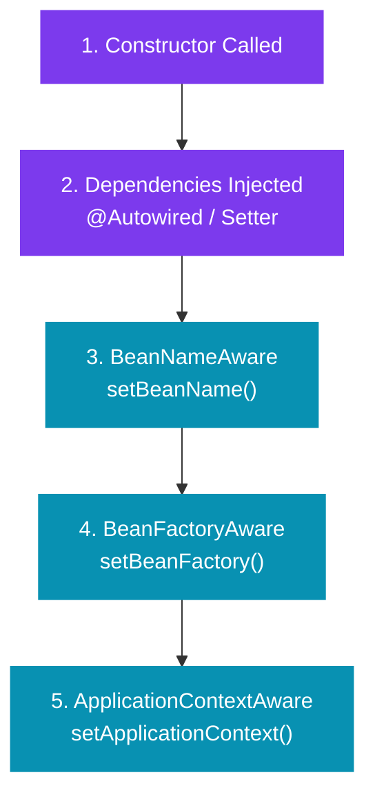

**② Steps 6–11 — initialization, wrapped on both sides by `BeanPostProcessor`:**

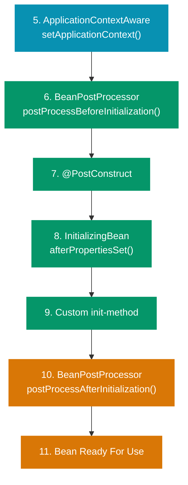

**③ Steps 12–14 — destruction, on context shutdown:**

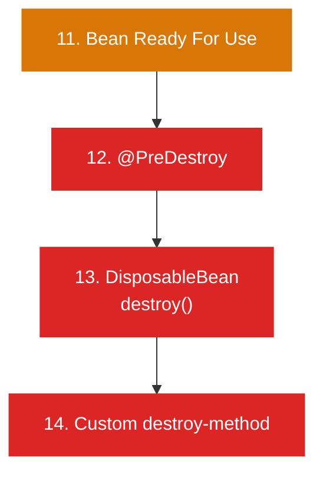

> This is one continuous chain, split into three parts. `E` (step 5) ends ① and starts ②. `K` (step 11) ends ② and starts ③. The step you must know from memory is **10**. In `postProcessAfterInitialization`, Spring replaces your bean with a proxy. That is why `@Transactional` and `@Async` work at all.

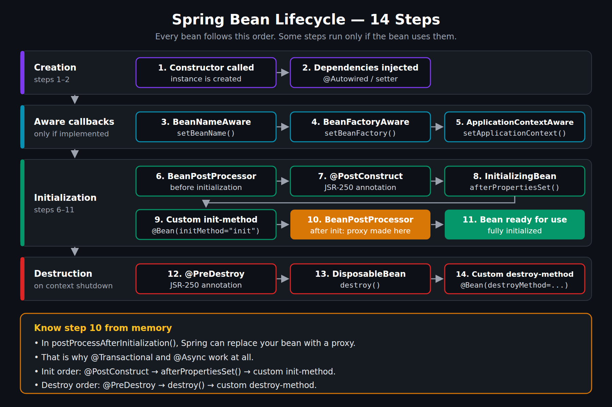

**Code example that shows the lifecycle:**

```java
@Component
public class LifecycleDemoBean implements BeanNameAware, InitializingBean, DisposableBean {

    private String beanName;

    public LifecycleDemoBean() {
        System.out.println("1. Constructor called");
    }

    @Autowired
    public void setDependency(SomeDependency dep) {
        System.out.println("2. Dependencies injected");
    }

    @Override
    public void setBeanName(String name) {
        this.beanName = name;
        System.out.println("3. BeanNameAware - setBeanName: " + name);
    }

    @PostConstruct
    public void postConstruct() {
        System.out.println("7. @PostConstruct called");
    }

    @Override
    public void afterPropertiesSet() {
        System.out.println("8. InitializingBean - afterPropertiesSet called");
    }

    @PreDestroy
    public void preDestroy() {
        System.out.println("12. @PreDestroy called");
    }

    @Override
    public void destroy() {
        System.out.println("13. DisposableBean - destroy called");
    }
}
```

🎯 **Interview Tip:** The most common follow-up is the **order** of initialization callbacks:

- Init: `@PostConstruct` → `afterPropertiesSet()` → custom `init-method`.
- Destruction works the same way: `@PreDestroy` → `destroy()` → custom `destroy-method`.

---

</details>

---

2. **🔩 What is a BeanPostProcessor? When does it run and what are its use cases? 🔥🔥**

<!-- -->
<details>
<summary>Answer</summary>

**Answer:**

A `BeanPostProcessor` is a special Spring interface. It lets you **intercept and modify bean instances** before and after their initialization. It is one of the most powerful extension points (places where you plug in your own code) in the Spring framework.

**Key characteristics:**

- It has two callback methods: `postProcessBeforeInitialization()` and `postProcessAfterInitialization()`
- It is called for **every bean** in the application context
- Its two methods run **after** dependency injection, **before and after** the initialization callbacks (`@PostConstruct`, `afterPropertiesSet()`, custom init)
- Some sub-interfaces run earlier. `AutowiredAnnotationBeanPostProcessor` is an `InstantiationAwareBeanPostProcessor`. It does the injection itself, in `postProcessProperties()`
- Spring uses `BeanPostProcessor` to build its own features, for example `@Autowired`, `@Value`, AOP proxying, and `@Scheduled`

```java
@Component
public class CustomBeanPostProcessor implements BeanPostProcessor {

    @Override
    public Object postProcessBeforeInitialization(Object bean, String beanName)
            throws BeansException {
        if (bean instanceof MyService) {
            System.out.println("Before init: " + beanName);
            // Can modify the bean or return a wrapper
        }
        return bean; // Must return the bean (or a replacement)
    }

    @Override
    public Object postProcessAfterInitialization(Object bean, String beanName)
            throws BeansException {
        if (bean instanceof MyService) {
            System.out.println("After init: " + beanName);
            // AOP proxies are typically created here
        }
        return bean;
    }
}
```

**Built-in BeanPostProcessors in Spring:**

| BeanPostProcessor | Purpose |
|---|---|
| `AutowiredAnnotationBeanPostProcessor` | Handles `@Autowired` and `@Value` injection |
| `CommonAnnotationBeanPostProcessor` | Handles `@PostConstruct`, `@PreDestroy`, `@Resource` |
| `AnnotationAwareAspectJAutoProxyCreator` | Creates AOP proxies for beans that `@Aspect` advice (or another advisor) applies to |
| `ScheduledAnnotationBeanPostProcessor` | Handles `@Scheduled` methods |
| `AsyncAnnotationBeanPostProcessor` | Handles `@Async` methods |

**Common use cases:**

1. **Custom validation** — Validate beans after creation
2. **Logging** — Log bean creation for debugging
3. **Wrapping** — Wrap beans with proxies (AOP, caching, metrics)
4. **Modification** — Set default values or change bean properties

💡 **Pro Tip:** Spring creates AOP proxies in `postProcessAfterInitialization()`. This method returns the proxy objects. That is why `@Transactional`, `@Cacheable`, and `@Async` work through proxies.

---

</details>

---

3. **⚖️ What is the difference between BeanFactoryPostProcessor and BeanPostProcessor? 🔥**

<!-- -->
<details>
<summary>Answer</summary>

**Answer:**

These are two very different extension points in Spring. Mixing them up is a common interview mistake.

| Feature | BeanFactoryPostProcessor | BeanPostProcessor |
|---------|--------------------------|-------------------|
| **When it runs** | Before any bean is instantiated | After each bean is instantiated |
| **What it operates on** | Bean **definitions** (metadata) | Bean **instances** (objects) |
| **Purpose** | Modify bean configuration metadata | Modify or wrap bean instances |
| **Input** | `ConfigurableListableBeanFactory` | Individual bean + bean name |
| **Can change bean class?** | Yes (modifies definition) | No (bean already created) |
| **Can create proxies?** | No | Yes |
| **Number of invocations** | Once (on the entire factory) | Once per bean (for each bean) |

**BeanFactoryPostProcessor example:**

```java
@Component
public class CustomBeanFactoryPostProcessor implements BeanFactoryPostProcessor {

    @Override
    public void postProcessBeanFactory(ConfigurableListableBeanFactory beanFactory)
            throws BeansException {
        // Runs BEFORE any bean is created
        // Can modify bean definitions
        BeanDefinition beanDef = beanFactory.getBeanDefinition("myDataSource");
        beanDef.getPropertyValues().add("url", "jdbc:mysql://new-host:3306/db");
        System.out.println("Modified myDataSource bean definition");
    }
}
```

**Built-in BeanFactoryPostProcessors:**

| BeanFactoryPostProcessor | Purpose |
|---|---|
| `PropertySourcesPlaceholderConfigurer` | Resolves `${...}` placeholders in bean definitions |
| `ConfigurationClassPostProcessor` | Processes `@Configuration`, `@Bean`, `@ComponentScan` |
| `MapperScannerConfigurer` (MyBatis) | Scans for MyBatis mapper interfaces |

**Execution order:**

```
BeanFactoryPostProcessor runs (modifies definitions)
    ↓
Beans are instantiated (constructors called)
    ↓
Dependencies are injected
    ↓
BeanPostProcessor.postProcessBeforeInitialization()
    ↓
@PostConstruct / afterPropertiesSet() / init-method
    ↓
BeanPostProcessor.postProcessAfterInitialization()
```

🔑 **Key Point:**

- `BeanFactoryPostProcessor` modifies the **blueprint** (bean definitions).
- `BeanPostProcessor` modifies the **built objects** (bean instances).

A simple way to remember: BFPP (`BeanFactoryPostProcessor`) changes the recipe. BPP (`BeanPostProcessor`) changes the cooked dish.

---

</details>

---

4. **🔄 What is a circular dependency in Spring? How do you detect and resolve it? 🔥**

<!-- -->
<details>
<summary>Answer</summary>

**Answer:**

A **circular dependency** happens when two or more beans depend on each other. They form a cycle. The cycle stops Spring from finishing bean creation.

```
BeanA → depends on → BeanB → depends on → BeanA  (💥 cycle!)
```

**Example that causes circular dependency:**

```java
@Service
public class OrderService {
    private final PaymentService paymentService;

    @Autowired
    public OrderService(PaymentService paymentService) {
        this.paymentService = paymentService;
    }
}

@Service
public class PaymentService {
    private final OrderService orderService;

    @Autowired
    public PaymentService(OrderService orderService) {
        this.orderService = orderService;
    }
}
```

❌️ **Result:** `BeanCurrentlyInCreationException` at startup.

**How Spring detects it:**

Spring keeps a set of beans that are being created right now. If code asks for a bean that is already in this set, Spring throws `BeanCurrentlyInCreationException`.

Since Spring Boot 2.6+, circular dependencies are **not allowed by default**. Earlier versions allowed them for setter/field injection. They used early proxy references (a reference to a bean that is not fully built yet).

**4 ways to resolve circular dependencies:**

**1. `@Lazy` on one dependency (quickest fix):**

```java
@Service
public class OrderService {
    private final PaymentService paymentService;

    @Autowired
    public OrderService(@Lazy PaymentService paymentService) {
        this.paymentService = paymentService; // proxy injected, resolved on first use
    }
}
```

`@Lazy` injects a proxy instead of the actual bean. Spring resolves the real bean only when a method is called on it. This breaks the cycle.

**2. Setter injection instead of constructor injection:**

```java
@Service
public class OrderService {
    private PaymentService paymentService;

    @Autowired
    public void setPaymentService(PaymentService paymentService) {
        this.paymentService = paymentService;
    }
}
```

With setter injection, Spring can create the bean first, without the dependency. Then it injects the dependency after creation. So the bean no longer needs the dependency before it can be created.

**3. `ObjectProvider` / `ObjectFactory` (deferred lookup):**

```java
@Service
public class OrderService {
    private final ObjectProvider<PaymentService> paymentServiceProvider;

    @Autowired
    public OrderService(ObjectProvider<PaymentService> paymentServiceProvider) {
        this.paymentServiceProvider = paymentServiceProvider;
    }

    public void process() {
        PaymentService paymentService = paymentServiceProvider.getObject(); // resolved here
    }
}
```

**4. Redesign (Best approach):**

Extract the shared logic into a third service to break the cycle:

```
OrderService → PaymentService       (no cycle)
OrderService → OrderPaymentMediator
PaymentService → OrderPaymentMediator
```

**Comparison table:**

| Approach | Pros | Cons |
|----------|------|------|
| `@Lazy` | Minimal code change | Proxy overhead, masks design issue |
| Setter injection | Simple | Mutable dependencies, Spring Boot 2.6+ still blocks by default |
| `ObjectProvider` | Explicit deferred resolution | Verbose, dependency not available at construction |
| Redesign | Clean architecture | Requires refactoring effort |

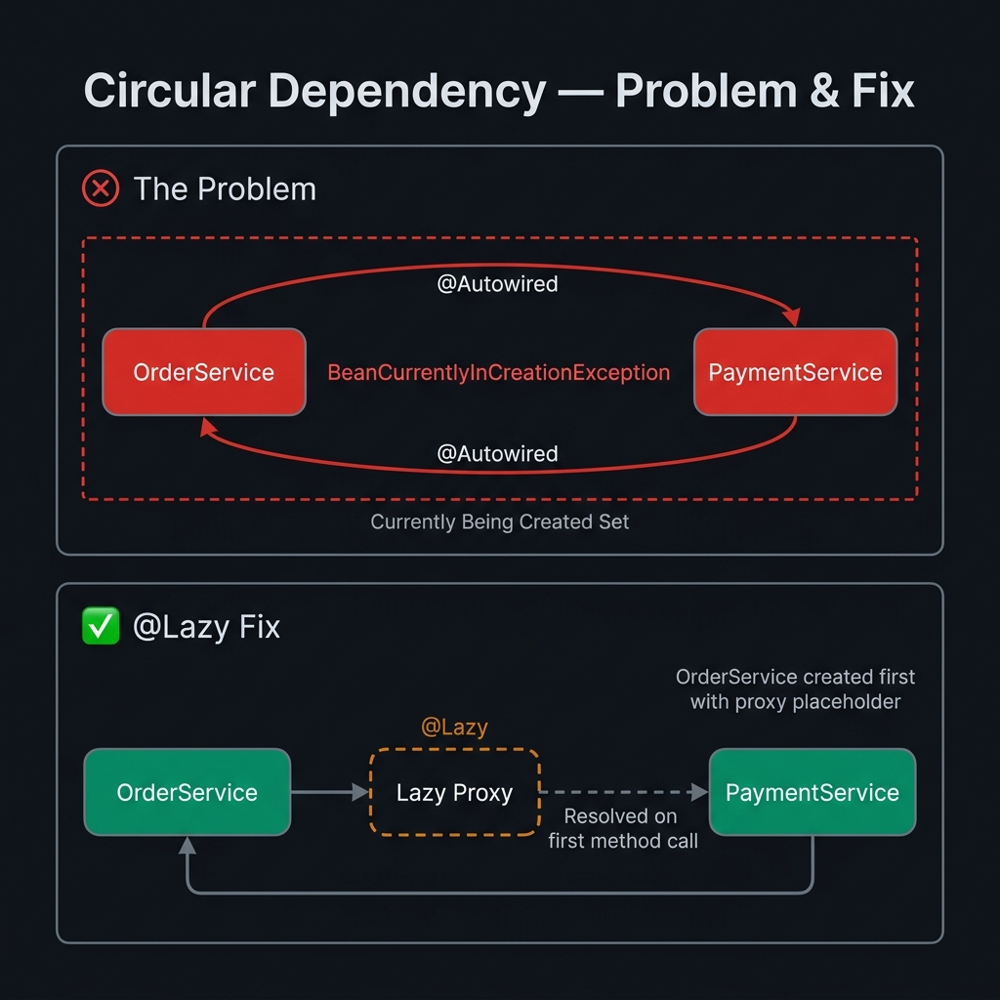

⚠️ **Spring Boot 2.6+ behavior:** Circular dependencies are banned by default. You can turn them back on with `spring.main.allow-circular-references=true`. But this is not recommended. Fix the design instead.

🎯 **Interview Tip:** Always say that a circular dependency is a **design smell** (a sign of a design problem). The best fix is to redesign the dependency graph. `@Lazy` is the quickest short-term fix. But a mediator or event-driven approach is the right fix for production.

---

</details>

---

<a id="auto-configuration-and-starters"></a>

## 6. Auto-configuration and Starters

1. **🏷️ Explain @ConditionalOnProperty, @ConditionalOnClass, @ConditionalOnBean, and @ConditionalOnMissingBean. 🔥🔥**

<!-- -->
<details>
<summary>Answer</summary>

**Answer:**

These are **conditional annotations** from Spring Boot. They decide whether Spring activates a `@Configuration` class or a `@Bean` method. Spring Boot's auto-configuration system is built on them.

**@ConditionalOnProperty** — Activates based on the value of an application property:

```java
@Configuration
@ConditionalOnProperty(name = "feature.notifications.enabled", havingValue = "true")
public class NotificationConfig {

    @Bean
    public NotificationService notificationService() {
        return new EmailNotificationService();
    }
}
```

```properties
# application.properties
feature.notifications.enabled=true
```

**@ConditionalOnClass** — Activates only if a specific class is on the classpath:

```java
@Configuration
@ConditionalOnClass(name = "io.lettuce.core.RedisClient")
public class RedisCacheConfig {

    @Bean
    public CacheManager cacheManager(RedisConnectionFactory factory) {
        return RedisCacheManager.builder(factory).build();
    }
}
// This config only loads if Lettuce Redis client JAR is present
```

**@ConditionalOnBean** — Activates only if a specific bean already exists in the context:

```java
@Configuration
public class SecurityAuditConfig {

    @Bean
    @ConditionalOnBean(SecurityConfig.class)
    public AuditService auditService() {
        return new SecurityAuditService();
        // Only created if SecurityConfig bean exists
    }
}
```

**@ConditionalOnMissingBean** — Activates only if a specific bean does NOT exist (so users can replace it with their own):

```java
@Configuration
public class DefaultServiceConfig {

    @Bean
    @ConditionalOnMissingBean(CacheService.class)
    public CacheService cacheService() {
        return new InMemoryCacheService();
        // Only created if user hasn't defined their own CacheService
    }
}
```

**Summary table:**

| Annotation | Condition | Common Use Case |
|------------|-----------|-----------------|
| `@ConditionalOnProperty` | Property has specific value | Feature flags, environment toggles |
| `@ConditionalOnClass` | Class exists on classpath | Auto-configure based on available libraries |
| `@ConditionalOnBean` | Bean exists in context | Dependent configuration |
| `@ConditionalOnMissingBean` | Bean does NOT exist | Default config that users can override |
| `@ConditionalOnMissingClass` | Class NOT on classpath | Fallback configuration |
| `@ConditionalOnExpression` | SpEL expression is true | Complex conditional logic |

💡 **Pro Tip:** `@ConditionalOnMissingBean` is what makes Spring Boot's auto-configuration so powerful. Most auto-configuration classes use it on their beans. So if you define your own bean, Spring Boot does not create its default bean and uses yours instead.

---

</details>

---

2. **⚙️ How does Spring Boot auto-configuration work internally? Explain spring.factories and AutoConfiguration.imports. 🔥🔥**

<!-- -->
<details>
<summary>Answer</summary>

**Answer:**

Spring Boot auto-configuration configures your application automatically. It decides what to configure from the JAR dependencies on the classpath. It is the core mechanism that makes Spring Boot "opinionated" (it picks sensible defaults for you). It removes most boilerplate configuration (the repeated setup code you would otherwise write).

**How it works step-by-step:**

1. `@SpringBootApplication` includes `@EnableAutoConfiguration`
2. `@EnableAutoConfiguration` imports `AutoConfigurationImportSelector`
3. The import selector reads configuration files to discover all auto-configuration classes
4. Each auto-configuration class uses `@Conditional*` annotations to decide if it should activate
5. Only relevant configurations are applied based on classpath and existing beans

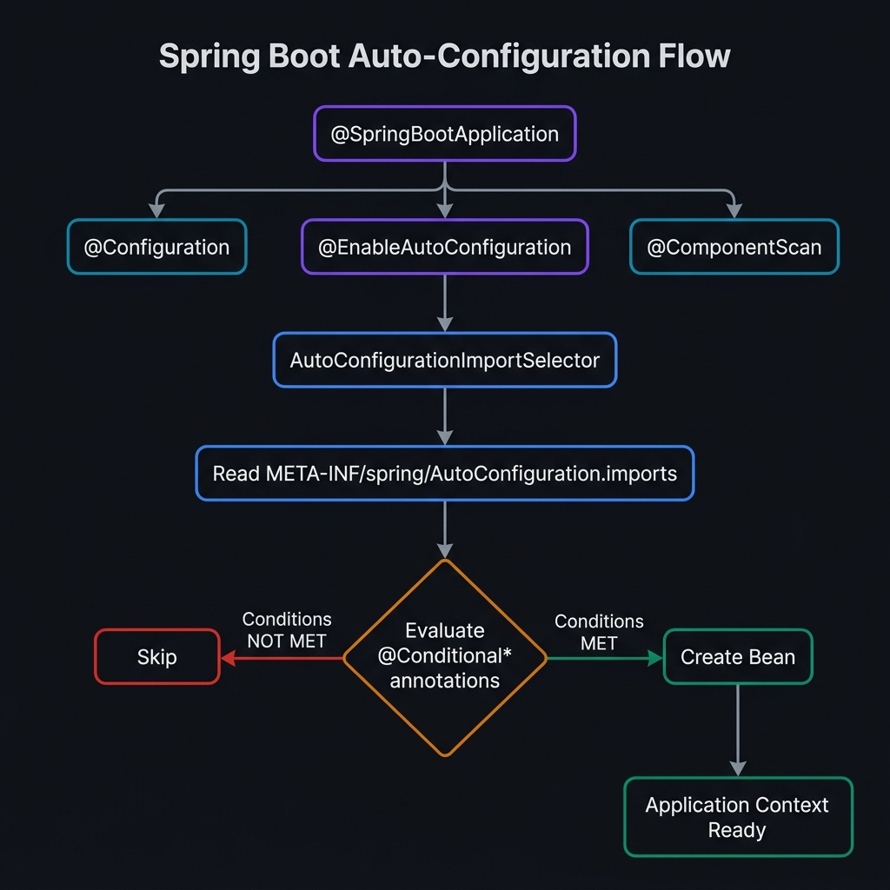

**Discovery mechanism (Spring Boot 2.x vs 3.x):**

| Version | Discovery File | Location |
|---------|---------------|----------|
| Spring Boot 2.x | `META-INF/spring.factories` | Inside each starter JAR |
| Spring Boot 2.7+ (the only option in 3.x) | `META-INF/spring/org.springframework.boot.autoconfigure.AutoConfiguration.imports` | Inside each starter JAR |

**Spring Boot 2.x — `spring.factories`:**

```properties
# META-INF/spring.factories
org.springframework.boot.autoconfigure.EnableAutoConfiguration=\
  org.springframework.boot.autoconfigure.jdbc.DataSourceAutoConfiguration,\
  org.springframework.boot.autoconfigure.orm.jpa.HibernateJpaAutoConfiguration,\
  org.springframework.boot.autoconfigure.web.servlet.WebMvcAutoConfiguration
```

**Spring Boot 3.x — `AutoConfiguration.imports`:**

```
# META-INF/spring/org.springframework.boot.autoconfigure.AutoConfiguration.imports
org.springframework.boot.autoconfigure.jdbc.DataSourceAutoConfiguration
org.springframework.boot.autoconfigure.orm.jpa.HibernateJpaAutoConfiguration
org.springframework.boot.autoconfigure.web.servlet.WebMvcAutoConfiguration
```

**Structure of an auto-configuration class** (an example only). It is named `My…` on purpose, so you do not confuse it with Boot's own class:

```java
@AutoConfiguration
@ConditionalOnClass(DataSource.class)
@ConditionalOnProperty(name = "myapp.datasource.url")
@EnableConfigurationProperties(MyDataSourceProperties.class)
public class MyDataSourceAutoConfiguration {

    @Bean
    @ConditionalOnMissingBean
    public DataSource dataSource(MyDataSourceProperties properties) {
        return DataSourceBuilder.create()
            .url(properties.getUrl())
            .username(properties.getUsername())
            .password(properties.getPassword())
            .build();
    }
}
```

⚠️ **Don't present that as Boot's real `DataSourceAutoConfiguration`** — it is not. The real class has **no `@ConditionalOnProperty`** at all. That is exactly why a missing URL causes a *failure*. The configuration does not silently skip itself (see §3 Q1). Its actual class-level annotations are:

```java
@AutoConfiguration(before = SqlInitializationAutoConfiguration.class)
@ConditionalOnClass({ DataSource.class, EmbeddedDatabaseType.class })
@ConditionalOnMissingBean(type = "io.r2dbc.spi.ConnectionFactory")
@EnableConfigurationProperties(DataSourceProperties.class)
@Import({ DataSourcePoolMetadataProvidersConfiguration.class,
          DataSourceCheckpointRestoreConfiguration.class })
public class DataSourceAutoConfiguration { ... }
```

Spring picks the actual pool in a nested class, `PooledDataSourceConfiguration`. Two conditions guard it:
- `@Conditional(PooledDataSourceCondition.class)` — is Hikari / Tomcat JDBC / DBCP2 on the classpath, or was `spring.datasource.type` set explicitly?
- `@ConditionalOnMissingBean({ DataSource.class, XADataSource.class })` — because of this one, you can always define your own bean instead.

**How to debug auto-configuration:**

```properties
# See which auto-configurations were applied and which were skipped
debug=true
```

This prints a **CONDITIONS EVALUATION REPORT** at startup. It shows:
- **Positive matches** — Conditions met, configuration applied
- **Negative matches** — Conditions not met, configuration skipped

🔑 **Key Point:** Auto-configuration is **not magic**. It is just `@Configuration` classes that Spring loads from a known file. `@Conditional*` annotations guard each one. Once you understand this, Spring Boot is easy to follow.

---

</details>

---

3. **🧪 How do you create a custom auto-configuration in Spring Boot? ⚡**

<!-- -->
<details>
<summary>Answer</summary>

**Answer:**

A custom auto-configuration is useful when you build reusable libraries or shared starters in your organization. Here is a complete step-by-step example.

**Step 1: Create the properties class**

```java
@ConfigurationProperties(prefix = "mycompany.notification")
public class NotificationProperties {

    private boolean enabled = true;
    private String defaultChannel = "email";
    private int retryAttempts = 3;

    // getters and setters
    public boolean isEnabled() {
        return enabled;
    }
    public void setEnabled(boolean enabled) {
        this.enabled = enabled;
    }
    public String getDefaultChannel() {
        return defaultChannel;
    }
    public void setDefaultChannel(String defaultChannel) {
        this.defaultChannel = defaultChannel;
    }
    public int getRetryAttempts() {
        return retryAttempts;
    }
    public void setRetryAttempts(int retryAttempts) {
        this.retryAttempts = retryAttempts;
    }
}
```

**Step 2: Create the service**

```java
public class NotificationService {

    private final NotificationProperties properties;

    public NotificationService(NotificationProperties properties) {
        this.properties = properties;
    }

    public void send(String to, String message) {
        System.out.println("Sending via " + properties.getDefaultChannel()
            + " to " + to + ": " + message);
    }
}
```

**Step 3: Create the auto-configuration class**

```java
@AutoConfiguration
@ConditionalOnClass(NotificationService.class)
@ConditionalOnProperty(name = "mycompany.notification.enabled", havingValue = "true",
        matchIfMissing = true)
@EnableConfigurationProperties(NotificationProperties.class)
public class NotificationAutoConfiguration {

    @Bean
    @ConditionalOnMissingBean
    public NotificationService notificationService(NotificationProperties properties) {
        return new NotificationService(properties);
    }
}
```

**Step 4: Register the auto-configuration**

For Spring Boot 3.x, create:

```
# src/main/resources/META-INF/spring/
# org.springframework.boot.autoconfigure.AutoConfiguration.imports
com.mycompany.autoconfigure.NotificationAutoConfiguration
```

For Spring Boot 2.x, create:

```properties
# src/main/resources/META-INF/spring.factories
org.springframework.boot.autoconfigure.EnableAutoConfiguration=\
  com.mycompany.autoconfigure.NotificationAutoConfiguration
```

**Step 5: Users of your library simply add properties**

```yaml
# application.yml
mycompany:
  notification:
    enabled: true
    default-channel: sms
    retry-attempts: 5
```

**Step 6: The bean is auto-configured and ready to inject**

```java
@RestController
public class OrderController {

    @Autowired
    private NotificationService notificationService; // Auto-configured!

    @PostMapping("/orders")
    public ResponseEntity<String> placeOrder(@RequestBody Order order) {
        notificationService.send(order.getCustomerEmail(), "Order placed!");
        return ResponseEntity.ok("Order created");
    }
}
```

🎯 **Interview Tip:** The key principle is `@ConditionalOnMissingBean`. If the user defines their own `NotificationService` bean, your auto-configuration does not create its own. This is the idea behind Spring Boot: it picks defaults for you ("opinionated"), but you can replace them ("flexible").

---

</details>

---

4. **🏷️ What are Spring Boot Starters? How do they simplify dependency management? ⚡**

<!-- -->
<details>
<summary>Answer</summary>

**Answer:**

Spring Boot Starters are **curated dependency descriptors** (ready-made, tested lists of dependencies). A starter is a single dependency that pulls in all the libraries you need for a specific feature. Starters follow the naming convention `spring-boot-starter-*`.

**The problem starters solve:**

Without starters, building a REST API requires manually adding:
- `spring-web`
- `spring-webmvc`
- `jackson-databind`
- `spring-boot-autoconfigure`
- `tomcat-embed-core`
- `hibernate-validator`
- ... and making sure all their versions work together

With starters, one dependency does it all:

```xml
<dependency>
    <groupId>org.springframework.boot</groupId>
    <artifactId>spring-boot-starter-web</artifactId>
</dependency>
```

**How starters work internally:**

```
spring-boot-starter-web (POM)
├── spring-boot-starter (base)
│   ├── spring-boot
│   ├── spring-boot-autoconfigure
│   └── spring-boot-starter-logging
├── spring-web
├── spring-webmvc
├── spring-boot-starter-json
│   └── jackson-databind
└── spring-boot-starter-tomcat
    └── tomcat-embed-core
```

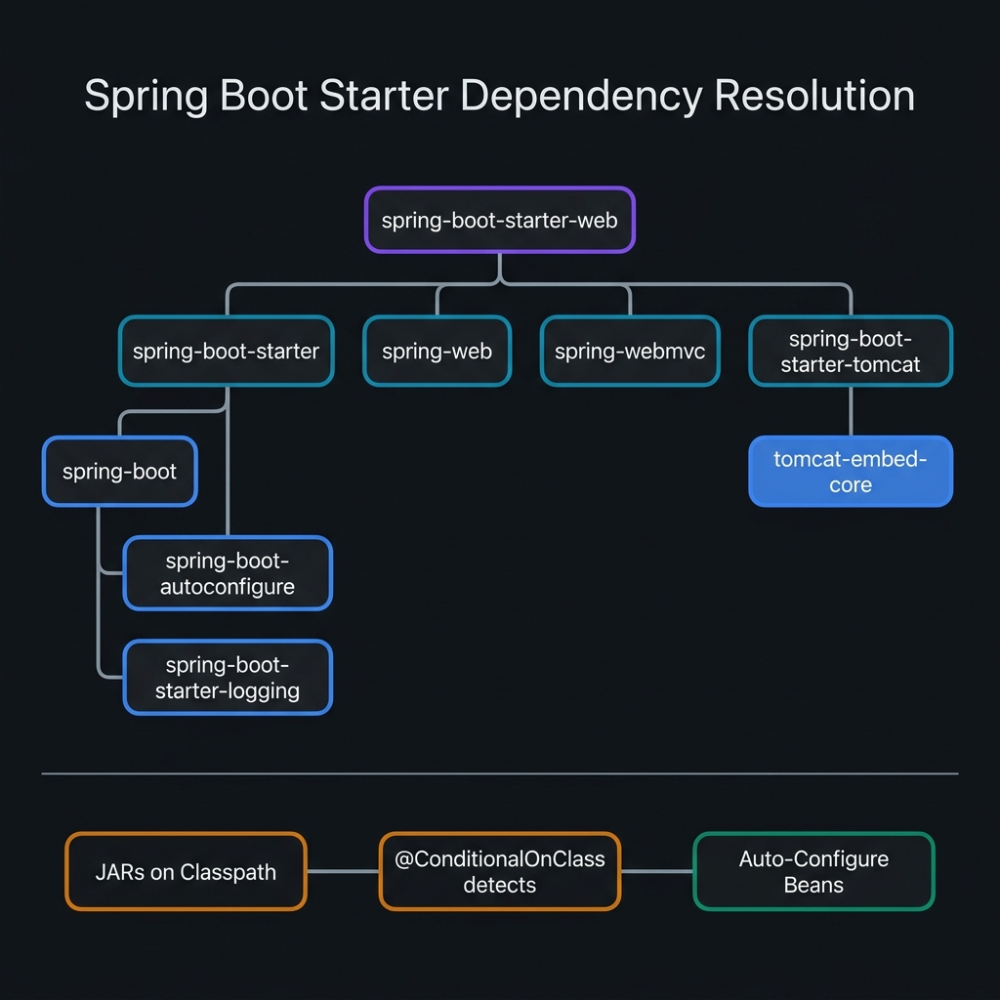

Starters are **just POM files** with no code. They group transitive dependencies (the dependencies of your dependencies) together. The `spring-boot-starter-parent` POM manages all version numbers in one place, through `<dependencyManagement>`. So you never specify versions for Spring-managed libraries.

**Most commonly used starters:**

| Starter | What it brings |
|---------|---------------|
| `spring-boot-starter-web` | Spring MVC + Embedded Tomcat + Jackson |
| `spring-boot-starter-data-jpa` | Spring Data JPA + Hibernate + HikariCP |
| `spring-boot-starter-security` | Spring Security + auth filters |
| `spring-boot-starter-test` | JUnit 5 + Mockito + AssertJ + Spring Test |
| `spring-boot-starter-actuator` | Health checks + Metrics + Monitoring |
| `spring-boot-starter-validation` | Hibernate Validator + Jakarta Validation |
| `spring-boot-starter-data-redis` | Spring Data Redis + Lettuce client |
| `spring-boot-starter-amqp` | Spring AMQP + RabbitMQ client |
| `spring-boot-starter-mail` | Jakarta Mail (formerly JavaMail) + Spring mail abstractions |

**Role of `spring-boot-starter-parent`:**

```xml
<parent>
    <groupId>org.springframework.boot</groupId>
    <artifactId>spring-boot-starter-parent</artifactId>
    <version>3.2.4</version>
</parent>
```

It provides:
- ✅ **Version management** — all starter versions are pre-aligned
- ✅ **Plugin configuration** — Maven compiler, surefire, Spring Boot plugin
- ✅ **Resource filtering** — `application.properties` / `application.yml` support
- ✅ **Sensible defaults** — Java version, encoding, etc.

**Starters vs auto-configuration (important distinction):**

| Concept | What it does |
|---------|-------------|
| **Starter** | Brings the JARs onto the classpath (dependency management) |
| **Auto-configuration** | Detects those JARs and creates beans automatically |

They work together: the starter adds the library → auto-configuration detects it → beans are created.

```
spring-boot-starter-data-jpa (adds Hibernate + HikariCP JARs)
        ↓
DataSourceAutoConfiguration (detects HikariCP on classpath → creates DataSource bean)
HibernateJpaAutoConfiguration (detects Hibernate → creates EntityManagerFactory bean)
```

🎯 **Interview Tip:** You may be asked "How does Spring Boot auto-configure things?" Then connect starters to auto-configuration: "Starters bring the right libraries, and auto-configuration classes detect those libraries using `@ConditionalOnClass` to create beans." This shows you understand the full chain.

---

</details>

---

<a id="transactions-and-aop"></a>

## 7. Transactions and AOP

1. **🛡️ How does @Transactional work internally in Spring? Explain the proxy-based AOP mechanism. 🔥🔥**

<!-- -->
<details>
<summary>Answer</summary>

**Answer:**

`@Transactional` in Spring works through **proxy-based AOP** (Aspect-Oriented Programming). Spring does not modify your class bytecode. Instead, it creates a **proxy wrapper** around your bean. The proxy intercepts method calls and adds transaction management logic.

**How it works step-by-step:**

1. During application startup, an auto-proxy `BeanPostProcessor` detects beans with `@Transactional` methods. In plain Spring this is `InfrastructureAdvisorAutoProxyCreator`. In Boot, when `aspectjweaver` is on the classpath (for example through `spring-boot-starter-aop` or `spring-boot-starter-data-jpa`), it is `AnnotationAwareAspectJAutoProxyCreator`
2. Spring creates a **proxy** (JDK dynamic proxy or CGLIB proxy) that wraps the original bean
3. When a client calls a `@Transactional` method, the call hits the **proxy first**
4. The proxy starts a transaction via `PlatformTransactionManager`
5. The proxy passes the call to the **actual method** on the target bean
6. If the method completes normally, the proxy **commits** the transaction
7. If a `RuntimeException` or an `Error` is thrown, the proxy **rolls back** the transaction

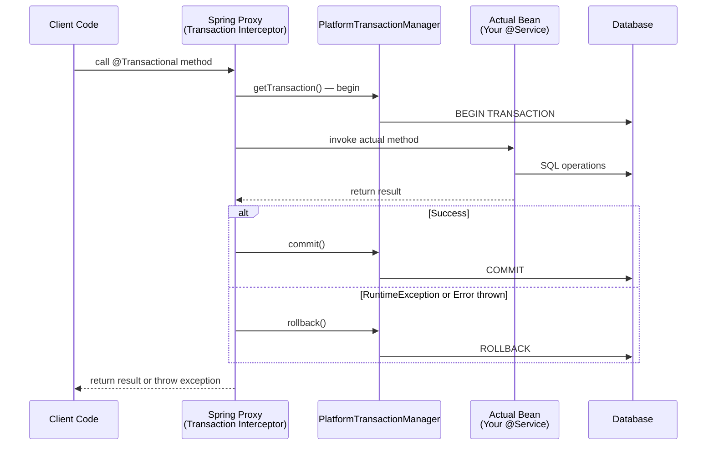

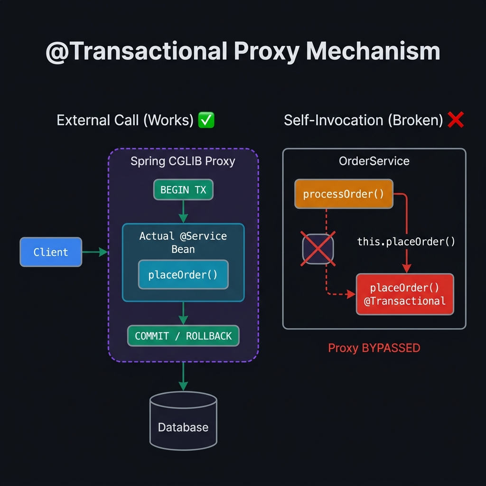

**Two types of proxies:**

| Proxy Type | When Used | How |
|------------|-----------|-----|
| **JDK Dynamic Proxy** | Plain Spring Framework, when the bean implements an interface | Creates a proxy implementing the same interface |
| **CGLIB Proxy** | **Spring Boot default — always, even when the bean implements interfaces** | Creates a runtime subclass of the target class |

⚠️ **The interface rule is the *plain Spring* rule, not the Boot rule.** Spring Boot's `AopAutoConfiguration` and `TransactionAutoConfiguration` both declare `proxyTargetClass = true`. They do it under `@ConditionalOnBooleanProperty(name = "spring.aop.proxy-target-class", matchIfMissing = true)`. (That annotation is Boot 3.5+. Older versions make the same check with `@ConditionalOnProperty`.) So **Boot uses CGLIB by default**. You only get JDK proxies if you explicitly set `spring.aop.proxy-target-class=false`. What this means in practice:

- ❌️ A `final` class **cannot be proxied**. CGLIB cannot subclass it, so the app fails at startup.
- ❌️ A `final` method cannot be overridden. Spring silently skips the advice on it (no error).
- ❌️ Spring never applies advice to `private` and `static` methods either.
- ✅ You do not need a no-arg constructor. Spring creates the CGLIB proxy through **Objenesis** (a library that creates objects without calling a constructor), so it does not call the target's constructor a second time.
- ✅ Injecting by concrete class (`@Autowired OrderService`) works. With a JDK proxy, this would fail unless you injected the interface.

```java
// Spring Boot default: CGLIB proxy (subclass-based)
@Service
public class OrderService {

    @Transactional
    public void placeOrder(Order order) {
        // This method is intercepted by the proxy
        orderRepository.save(order);
        paymentService.processPayment(order);
        inventoryService.reduceStock(order);
    }
}
```

You can verify proxy creation:

```java
@Autowired
private OrderService orderService;

@PostConstruct
public void checkProxy() {
    System.out.println(orderService.getClass().getName());
    // Spring Framework 6.x (every Boot 3.x app):
    //   com.example.OrderService$$SpringCGLIB$$0
    // Spring Framework 5.x and earlier:
    //   com.example.OrderService$$EnhancerBySpringCGLIB$$abc123
}
```

📝 Framework 6.0 repackaged CGLIB. It also changed the generated class-name format to `$$SpringCGLIB$$` (the suffix is a counter, not a hash). Do not quote the old `EnhancerBySpringCGLIB` form for a Boot 3.x app. It shows you are repeating something you read, not something you actually printed.

🔑 **Key Point:** The `@Transactional` annotation itself does nothing. The **proxy** that Spring AOP creates adds the transaction behavior. Without the proxy interception, there is no transaction management.

---

</details>

---

2. **🚨 Why does calling a @Transactional method from the same class not work? How do you fix it? 🔥🔥**

<!-- -->
<details>
<summary>Answer</summary>

**Answer:**

This is the **self-invocation pitfall**. It is one of the most commonly asked Spring interview questions. It also causes many production bugs.

**The Problem:**

When you call a `@Transactional` method from inside the same class, the call does not go through the Spring proxy. `@Transactional` works through proxy interception. So the transaction is **never started**.

```java
@Service
public class OrderService {

    // This method is NOT transactional
    public void processOrder(Order order) {
        // PROBLEM: Direct internal call — bypasses the proxy!
        this.placeOrder(order);
        // "this" refers to the actual object, NOT the proxy
    }

    @Transactional
    public void placeOrder(Order order) {
        orderRepository.save(order);
        paymentService.processPayment(order);
        // If this throws, NO ROLLBACK happens because
        // the transaction was never started!
    }
}
```

**Why it happens:**

```
External call path (WORKS):
  Client → Proxy → placeOrder()  ✅ Transaction started by proxy

Self-invocation path (BROKEN):
  processOrder() → this.placeOrder()  ❌️ Proxy is bypassed
```

When `processOrder()` calls `this.placeOrder()`, `this` is the raw target object, not the proxy wrapper. The proxy only sees the call when it comes from **outside** the bean.

**Solutions:**

**Solution 1: Inject self — works, but needs `@Lazy`**

```java
@Service
public class OrderService {

    @Lazy
    @Autowired
    private OrderService self; // Spring injects the PROXY, not the raw object

    public void processOrder(Order order) {
        self.placeOrder(order); // Goes through proxy ✅
    }

    @Transactional
    public void placeOrder(Order order) {
        orderRepository.save(order);
        paymentService.processPayment(order);
    }
}
```

⚠️ **A self-reference is a circular reference.** Since 2.6, Spring Boot uses `spring.main.allow-circular-references=false` as the default (see §5 Q4). So a plain `@Autowired` field that points to the same bean can make the context fail at startup with `BeanCurrentlyInCreationException`. `@Lazy` breaks the cycle. It injects a proxy that finds the real bean later. So Spring does not need the bean while it is still creating that bean. So if you give this solution, give it *with* `@Lazy` and say the reason. Even better, use Solution 2.

**Solution 2: Extract to a separate service — preferred**

```java
@Service
public class OrderService {

    @Autowired
    private OrderTransactionService txService;

    public void processOrder(Order order) {
        txService.placeOrder(order); // External call goes through proxy ✅
    }
}

@Service
public class OrderTransactionService {

    @Transactional
    public void placeOrder(Order order) {
        orderRepository.save(order);
        paymentService.processPayment(order);
    }
}
```

**Solution 3: Use `ObjectFactory` or `ApplicationContext`**

```java
@Service
public class OrderService {

    @Autowired
    private ObjectFactory<OrderService> selfFactory;

    public void processOrder(Order order) {
        selfFactory.getObject().placeOrder(order); // Gets proxy ✅
    }

    @Transactional
    public void placeOrder(Order order) {
        orderRepository.save(order);
    }
}
```

**Solution 4: `TransactionTemplate` — no proxy involved at all**

```java
@Service
@RequiredArgsConstructor
public class OrderService {

    private final TransactionTemplate txTemplate;
    private final OrderRepository orderRepository;

    public void processOrder(Order order) {
        txTemplate.executeWithoutResult(status -> {
            orderRepository.save(order);
            paymentService.processPayment(order);
        });
    }
}
```

Programmatic transaction management avoids the whole problem. There is no proxy, so there is nothing to bypass. It is also the only option that shows the transaction boundary in the code. With the other options, an annotation only implies it. Spring Boot auto-configures a `TransactionTemplate` bean for you.

**Solution 5: `AopContext.currentProxy()` — last resort**

```java
((OrderService) AopContext.currentProxy()).placeOrder(order);
```

It requires `@EnableAspectJAutoProxy(exposeProxy = true)`. It ties the code to Spring's AOP internals. It throws if the proxy is not exposed. Know that it exists, but do not start your answer with it.

| Fix | Verdict |
|---|---|
| Extract to a separate bean | ✅ Preferred — fixes the design, not just the symptom |
| `TransactionTemplate` | ✅ Cleanest when you only need a small transactional block |
| Self-injection with `@Lazy` | ⚠️ Works, but you are declaring a cycle on purpose |
| `ObjectFactory` / `ApplicationContext` lookup | ⚠️ Same as above, with more boilerplate code |
| `AopContext.currentProxy()` | ⚠️ Last resort — needs `exposeProxy = true` |

🎯 **Interview Tip:** This question tests whether you really understand proxy-based AOP. Always explain that `this` refers to the target object, not the proxy. The strongest answer is to extract the logic into a separate bean (Solution 2). Also note that the *same* limitation applies to `@Async`, `@Cacheable`, `@PreAuthorize` and every other proxy-driven annotation. The reason: they all use the same proxy mechanism.

---

</details>

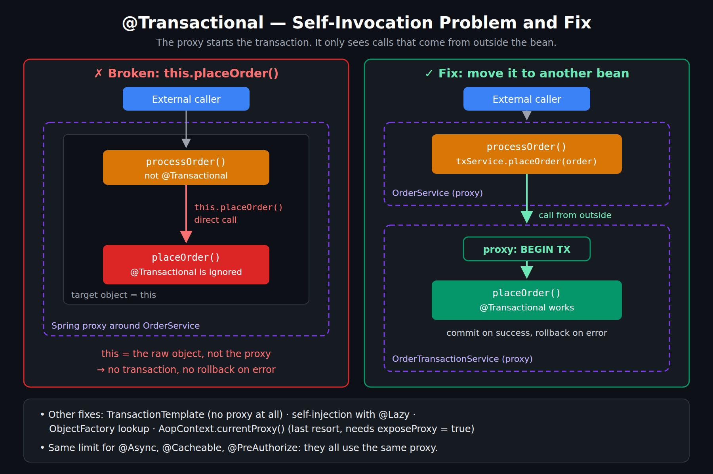

---

3. **📖 What does `readOnly = true` do in @Transactional? How do Spring and Hibernate optimize it? 🔥**

<!-- -->
<details>
<summary>Answer</summary>

**Answer:**

`@Transactional(readOnly = true)` is a hint to the lower layers. It says the transaction will only read data. Both Spring and Hibernate use this hint to apply optimizations.

```java
@Service
public class ProductService {

    @Transactional(readOnly = true)
    public List<Product> getAllProducts() {
        return productRepository.findAll();
    }
}
```

**What happens at each layer:**

| Layer | Optimization | Applies when |
|-------|-------------|---------|
| **Hibernate (flush mode)** | `HibernateJpaDialect.beginTransaction` sets flush mode to `MANUAL` | **Always** — this is the one guaranteed effect |
| **Hibernate (snapshots)** | Also calls `Session.setDefaultReadOnly(true)`, so entities load read-only and no dirty-check snapshot is allocated | **Only when the `EntityManager` is transaction-local** — see the conditional below |
| **Spring / JDBC** | `Connection.setReadOnly(true)` via `DataSourceUtils.prepareConnectionForTransaction` | Only when the dialect prepares the connection; drivers and pools may then route to a read replica |
| **Database** | May pick a read-optimized plan, or hard-reject writes | Driver- and engine-dependent |

**Detailed breakdown:**

1. **No flush at transaction end:** Hibernate does not flush the persistence context, even if you modify an entity by mistake. Hibernate silently drops the changes. This part always happens.

2. **Snapshot skipping happens only under a condition. This follow-up question shows who is a strong candidate.** Spring only calls `session.setDefaultReadOnly(true)` in one case. The transaction definition must be a `ResourceTransactionDefinition` reporting `isLocalResource() == true`. That means `JpaTransactionManager` created the `EntityManager` *for this transaction*. Sometimes an `EntityManager` is **already bound to the thread**. Then it is not transaction-local, and Spring skips that call. You get flush-mode `MANUAL` only. Hibernate still creates the dirty-check snapshot (a copy of the entity, used to find changes at flush) for every loaded entity.

   The most common way an `EntityManager` is already bound is Spring Boot's **open-session-in-view, which is enabled by default** (`spring.jpa.open-in-view`, `matchIfMissing = true`) in a servlet web app. `OpenEntityManagerInViewInterceptor` binds an `EntityManagerHolder` for the whole request. It does this before your `@Transactional` method is ever entered. Take a default Boot MVC app and a service method called from a controller. There, `readOnly = true` gives you the flush-mode benefit but **not** the memory benefit. In batch jobs, `@Async` work and `spring.jpa.open-in-view=false` apps, you get both.

3. **Connection-level hint:** where Spring applies it, `Connection.setReadOnly(true)` marks the JDBC connection as read-only. Some drivers (for example MySQL Connector/J's replication driver) use this flag to send queries to a read replica. HikariCP itself does not route. In Spring, the common setup is an `AbstractRoutingDataSource`, like the one below. ⚠️ Wrap it in `LazyConnectionDataSourceProxy`. Without it, `JpaTransactionManager` takes the connection before Spring sets the read-only flag, so every call goes to the primary.

```java
// Example: Read replica routing with @Transactional(readOnly = true)
public class ReadWriteRoutingDataSource extends AbstractRoutingDataSource {

    @Override
    protected Object determineCurrentLookupKey() {
        return TransactionSynchronizationManager
            .isCurrentTransactionReadOnly() ? "replica" : "primary";
    }
}
```

**Common misconception — but state it carefully:** `readOnly = true` is a **JPA-level hint, not a JPA-level constraint**.

- Hibernate will not stop you from calling `repository.save()`. It simply never flushes. So with a `SEQUENCE`/`TABLE` id generator, the change is often silently discarded and no exception is raised. On PostgreSQL, even the sequence call fails: `cannot execute nextval() in a read-only transaction`.
- ⚠️ That is *not* the same as "the save will succeed". Spring sets the JDBC `readOnly` flag on the connection, and several drivers pass it on to the server. So on **PostgreSQL**, an actual INSERT fails with `ERROR: cannot execute INSERT in a read-only transaction`.
- With `IDENTITY` id generation, Hibernate must execute the INSERT immediately to get the key. Flush mode `MANUAL` cannot delay it. So the statement *does* reach the database.
- In short: it is a hint at the JPA layer, and the driver can turn it into a hard database error.

📝 **Note:** See [Hibernate Interview Questions](13_Hibernate_Interview_Questions.md) for the JPA/Hibernate side of transactions. See [Exception Handling in Java & Spring](12_Exception_Handling_Interview_Questions_in_Java_&_Spring.md) for the full rollback / exception-translation topic.

💡 **Pro Tip:** Use `@Transactional(readOnly = true)` on read-only service methods as a default. The flush-mode and replica-routing benefits are real and free. But do not claim more memory saving than you really get. Maybe you want the snapshot skipped **whether or not** open-session-in-view is on. Then ask for it explicitly at the query level with `@QueryHints(@QueryHint(name = org.hibernate.jpa.HibernateHints.HINT_READ_ONLY, value = "true"))`, or call `session.setDefaultReadOnly(true)` yourself. An interviewer cannot find a weak point in this version of the answer.

---

</details>

---

4. **🔀 Explain `@Transactional` propagation. What is the difference between `REQUIRED`, `REQUIRES_NEW`, `NESTED` and `MANDATORY`? 🔥🔥**

<!-- -->
<details>
<summary>Answer</summary>

**Answer:**

**Propagation answers one question. A `@Transactional` method is entered, and a transaction is *already* running on this thread. What should happen?** That is the whole concept. The rest is the table below.

| Propagation | Existing transaction | No transaction | Mental model |
|---|---|---|---|
| **`REQUIRED`** (default) | **Join it** | Start a new one | "Whatever is going on, I want to be inside a transaction" |
| **`REQUIRES_NEW`** | **Suspend** it, start an independent one, resume the outer on exit | Start a new one | "My work commits or fails on its own" |
| **`NESTED`** | Create a **savepoint** inside the same physical transaction | Start a new one (behaves like `REQUIRED`) | "Let me roll back just my part" |
| **`MANDATORY`** | Join it | ❌️ `IllegalTransactionStateException` | "I will not run without a transaction. The caller must start it" |
| **`SUPPORTS`** | Join it | Run with no transaction | "Transaction optional" |
| **`NOT_SUPPORTED`** | **Suspend** it, run untransacted | Run with no transaction | "Keep this long/read-only work out of the transaction" |
| **`NEVER`** | ❌️ `IllegalTransactionStateException` | Run with no transaction | "Assert that no transaction exists" |

**`REQUIRED` vs `REQUIRES_NEW` — the difference interviewers really test:**

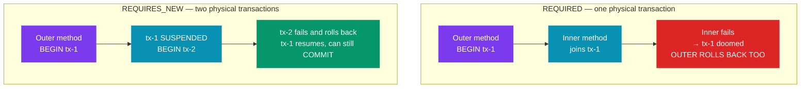

The single most useful sentence: **`REQUIRED` gives you one transaction with two methods in it; `REQUIRES_NEW` gives you two transactions.** With `REQUIRED`, a failure anywhere rolls back everything. With `REQUIRES_NEW`, the inner unit is really independent. That is exactly why it is the standard tool for **audit trails, status logging and failure records**. These records must survive the rollback of the business operation that produced them.

```java
@Service
public class LoanApplicationService {

    @Autowired private AuditService auditService;

    @Transactional                                   // tx-1
    public void submit(Application app) {
        applicationRepository.save(app);
        auditService.record(app.getId(), "SUBMITTED"); // tx-2, commits independently
        riskEngine.evaluate(app);                      // if this throws, tx-1 rolls back
    }                                                  // ...but the audit row survives
}

@Service
public class AuditService {

    @Transactional(propagation = Propagation.REQUIRES_NEW)  // tx-2
    public void record(Long id, String status) {
        auditRepository.save(new AuditEntry(id, status));
    }
}
```

⚠️ **Three traps to know before you recommend `REQUIRES_NEW`:**

1. **It uses a second connection.** The outer transaction is suspended, but it still *holds* its JDBC connection. The inner one borrows another. If you put `REQUIRES_NEW` in many places along a deep call chain, the pool can deadlock against itself. Every thread holds one connection and waits for a second one that will never be free. When you size the pool, you must allow for the maximum nesting depth.
2. **Self-invocation breaks it silently.** `REQUIRES_NEW` works through the same proxy as everything else. So `this.record(...)` from inside the same bean gives you *no* new transaction and *no* error (see Q2).
3. **It cannot see the outer transaction's uncommitted rows.** Under `READ_COMMITTED`, say the inner transaction queries a row that the outer one just inserted. It finds nothing. This bug is really confusing the first time you see it.

**Isolation — the second attribute on the same annotation:**

| Isolation | Prevents | Cost |
|---|---|---|
| `READ_UNCOMMITTED` | nothing (dirty reads possible) | cheapest, almost never used |
| `READ_COMMITTED` | dirty reads | PostgreSQL / Oracle / SQL Server default |
| `REPEATABLE_READ` | dirty + non-repeatable reads | MySQL InnoDB default |
| `SERIALIZABLE` | dirty + non-repeatable + phantom reads | full serialization, highest contention |
| `DEFAULT` | — | delegates to the database's own default |

`Isolation.DEFAULT` is the `@Transactional` default. Spring does **not** set a level. It uses whatever level the database is configured with. That is why "what is Spring's default isolation?" is a trick question. The honest answer is *"the database's"*. Then you name your engine's default. ⚠️ Raising isolation is almost never the right fix for a lost-update problem. Optimistic locking with `@Version` is the right fix, because it fails fast instead of holding locks.

🎯 **Interview Tip:** Do not list all seven. Say *"`REQUIRED` is the default and covers ~95% of cases; the two I actually reach for are `REQUIRES_NEW` for audit/log writes that must survive a rollback, and `MANDATORY` on repository-layer helpers to assert the caller opened a transaction."* Then let them pick which one to go deeper on.

---

</details>

---

5. **↩️ Which exceptions cause a `@Transactional` rollback? What is `rollbackFor` and what is `UnexpectedRollbackException`? 🔥🔥**

<!-- -->
<details>
<summary>Answer</summary>

**Answer:**

**The default rule, exactly:** Spring's `DefaultTransactionAttribute.rollbackOn(Throwable)` returns `true` only for `RuntimeException` and `Error`. Spring treats everything else as a normal result, and the transaction **commits**. That includes **every checked exception**.

| Thrown | Default behaviour |
|---|---|
| `RuntimeException` and subclasses | ⏪ **Rollback** |
| `Error` (`OutOfMemoryError`, …) | ⏪ **Rollback** |
| Checked `Exception` (`IOException`, `SQLException`, your own `BusinessException extends Exception`) | ✅ **Commit** — the surprise |
| Nothing thrown (you caught it) | ✅ Commit |

⚠️ **This is the classic silent data bug.** A service declares `throws PaymentDeclinedException` (checked). It writes three rows, and then throws the exception. Spring follows the rule and commits all three rows. Nothing in the logs shows that anything went wrong.

**Overriding it:**

```java
// Roll back on everything, checked included
@Transactional(rollbackFor = Exception.class)
public void submit(Application app) throws ValidationException {
    applicationRepository.save(app);
    validator.check(app);   // checked — now DOES roll back
}

// Or invert it: roll back on unchecked, EXCEPT one you treat as a normal outcome
@Transactional(noRollbackFor = InsufficientBalanceException.class)
public void debit(Long accountId, BigDecimal amount) {
    ledgerRepository.recordAttempt(accountId, amount);  // survives the exception
    account.debit(amount);
}
```

`rollbackForClassName` / `noRollbackForClassName` take strings. Use them for exception types you cannot reference at compile time.

**The rollback-only trap (`UnexpectedRollbackException`):**

Almost nobody has an answer ready for this follow-up. The setup: an outer `@Transactional` method calls an inner `@Transactional` method with the **default `REQUIRED`**. So they share one physical transaction. The inner method throws. The outer method *catches it and continues*.

```java
@Transactional                        // outer
public void process(Order order) {
    orderRepository.save(order);
    try {
        notificationService.notify(order);   // @Transactional (REQUIRED), throws
    } catch (Exception e) {
        log.warn("notification failed, continuing", e);   // looks harmless
    }
}   // ← throws UnexpectedRollbackException here, and NOTHING is saved
```

What happened: the inner interceptor could not roll back a transaction it did not start. So it did the only thing it could: it **marked the shared transaction rollback-only**. Your `catch` block hid the exception, but it did not remove the mark. At commit time, `AbstractPlatformTransactionManager` sees the flag. It logs *"Global transaction is marked as rollback-only but transactional code requested commit"* at DEBUG level. Then it rolls everything back and throws `UnexpectedRollbackException`. With `JpaTransactionManager` or `DataSourceTransactionManager`, the message is *"Transaction rolled back because it has been marked as rollback-only"*.

**Fixes, in order of preference:**

| Fix | When |
|---|---|
| Make the inner call `Propagation.REQUIRES_NEW` | The inner work is really independent (notifications, audit) |
| Don't annotate the inner method at all | It should not own a transaction boundary |
| Mark it `noRollbackFor` the exception you intend to swallow | The failure really is a normal outcome |
| Never swallow an exception thrown from inside a shared transaction | The general rule |

**Two more things the proxy cannot do for you:**

- 🚨 **Self-invocation.** `this.someTransactionalMethod()` does not go through the proxy at all, so the annotation never takes effect. There is no transaction, so there is no rollback either. Full details are in Q2 of this section.
- 🚨 **The exception must leave the proxied method.** Say a `try/catch` inside a `@Transactional` method catches the exception and does not rethrow it. Then the interceptor never sees it, and it commits. If you want a rollback from inside your own catch block, call `TransactionAspectSupport.currentTransactionStatus().setRollbackOnly()` explicitly.

📝 **Cross-reference:** the broader checked-vs-unchecked design discussion and Spring's `DataAccessException` translation are in [Exception Handling in Java & Spring](12_Exception_Handling_Interview_Questions_in_Java_&_Spring.md). This answer covers only the transaction-boundary part.

🎯 **Interview Tip:** The short answer is three sentences: *"Unchecked and `Error` roll back, checked exceptions commit by default, and you change that with `rollbackFor`. The one that surprises people is `UnexpectedRollbackException` — catching an exception from an inner `REQUIRED` method leaves the shared transaction marked rollback-only, so the outer commit fails and everything is lost."*

---

</details>

---

<a id="async-and-events"></a>

## 8. Async and Events

1. **⚡ How do you use @Async in Spring Boot? Explain @EnableAsync and custom executor configuration. 🔥**

<!-- -->
<details>
<summary>Answer</summary>

**Answer:**

`@Async` runs a method asynchronously, in a separate thread. When a caller calls an `@Async` method, Spring returns to the caller at once. It runs the method in a background thread.

**Step 1: Enable async processing**

```java
@Configuration
@EnableAsync
public class AsyncConfig {
    // Enables detection of @Async annotation
}
```

**Step 2: Use @Async on methods**

```java
@Service
public class NotificationService {

    @Async
    public void sendEmailNotification(String email, String message) {
        // Runs in a separate thread
        emailClient.send(email, message);
        System.out.println("Email sent by: " + Thread.currentThread().getName());
    }

    @Async
    public CompletableFuture<String> sendSmsNotification(String phone, String message) {
        // Async with return value
        String result = smsClient.send(phone, message);
        return CompletableFuture.completedFuture(result);
    }
}
```

**Step 3: Configure a custom TaskExecutor**

**Which executor actually runs the task? (the question behind the question)**

| Runtime | Executor `@Async` resolves to | Behaviour |
|---|---|---|
| **Plain Spring Framework**, no `TaskExecutor`/`Executor` bean | `SimpleAsyncTaskExecutor` (the fallback in `AsyncExecutionInterceptor.getDefaultExecutor`) | **New thread per task, no reuse** — never acceptable in production |
| **Spring Boot** (auto-configured) | `applicationTaskExecutor` — a `ThreadPoolTaskExecutor` from `TaskExecutionAutoConfiguration`, wired to `@Async` by its second bean name `taskExecutor` (Boot 3.0–3.4) or by an auto-configured `AsyncConfigurer` (Boot 3.5+) | Pooled — but see the queue trap below |
| **Spring Boot with `spring.threads.virtual.enabled=true`** | a virtual-thread `SimpleAsyncTaskExecutor` | One virtual thread per task; unbounded by design |

⚠️ **"Spring Boot defaults `@Async` to `SimpleAsyncTaskExecutor`" is a myth.** The YAML block below in this file is the proof. `spring.task.execution.pool.*` configures exactly that auto-configured `applicationTaskExecutor`. If the default really were `SimpleAsyncTaskExecutor`, those properties would do nothing (a no-op).

🪤 **The real Boot trap is the queue, not the executor.** The auto-configured defaults are `core-size = 8`, `queue-capacity = Integer.MAX_VALUE`, `max-size = Integer.MAX_VALUE`.

- A `ThreadPoolExecutor` only grows past core size **once the queue is full**.
- So with an unbounded queue, `max-size` is *never* reached.
- Once 8 tasks are running, every new task waits in the queue without any warning.
- Latency goes up and heap grows. There is no rejection and no signal.

That is why you set `spring.task.execution.pool.queue-capacity` to a real number, or define your own executor:

```java
@Configuration
@EnableAsync
public class AsyncConfig {

    @Bean(name = "taskExecutor")
    public Executor taskExecutor() {
        ThreadPoolTaskExecutor executor = new ThreadPoolTaskExecutor();
        executor.setCorePoolSize(5);
        executor.setMaxPoolSize(10);
        executor.setQueueCapacity(25);
        executor.setThreadNamePrefix("Async-");
        executor.setRejectedExecutionHandler(new ThreadPoolExecutor.CallerRunsPolicy());
        executor.initialize();
        return executor;
    }

    @Bean(name = "emailExecutor")
    public Executor emailExecutor() {
        ThreadPoolTaskExecutor executor = new ThreadPoolTaskExecutor();
        executor.setCorePoolSize(2);
        executor.setMaxPoolSize(5);
        executor.setQueueCapacity(50);
        executor.setThreadNamePrefix("Email-");
        executor.initialize();
        return executor;
    }
}
```

**Use a specific executor:**

```java
@Async("emailExecutor")
public void sendEmailNotification(String email, String message) {
    // Runs in the "Email-" thread pool
    emailClient.send(email, message);
}
```

**Thread pool configuration in `application.yml`:**

```yaml
spring:
  task:
    execution:
      pool:
        core-size: 5
        max-size: 10
        queue-capacity: 25
      thread-name-prefix: "Async-"
```

**Important rules for @Async:**

| Rule | Why |
|------|-----|
| Method should be `public` | Always safe. With a CGLIB proxy, `protected` and package-private methods also work. `private` methods never do |
| Must not be called from the same class | Same self-invocation problem as `@Transactional` |
| Return type must be `void` or `Future`/`CompletableFuture` | Otherwise the async result is lost |
| Class must be a Spring-managed bean | `@Async` works via proxying |

🔑 **Key Point:** `@Async` has the same self-invocation limit as `@Transactional`. The reason: it also works through Spring AOP proxies. If you call an `@Async` method from inside the same class, it runs synchronously.

---

</details>

---

2. **🔮 How do you use CompletableFuture as a return type with @Async? How do you handle exceptions? 🔥**

<!-- -->
<details>
<summary>Answer</summary>

**Answer:**

`CompletableFuture` is the recommended return type for `@Async` methods when you need the result. It is also the one to use when you need to handle errors from the async operation.

**Basic usage:**

```java
@Service
public class PriceService {

    @Async
    public CompletableFuture<Double> fetchPriceFromVendorA(String productId) {
        Double price = vendorAClient.getPrice(productId);
        return CompletableFuture.completedFuture(price);
    }

    @Async
    public CompletableFuture<Double> fetchPriceFromVendorB(String productId) {
        Double price = vendorBClient.getPrice(productId);
        return CompletableFuture.completedFuture(price);
    }
}
```

**Calling and combining results:**

```java
@RestController
public class PriceController {

    @Autowired
    private PriceService priceService;

    @GetMapping("/best-price/{productId}")
    public ResponseEntity<Double> getBestPrice(@PathVariable String productId)
            throws Exception {
        // Both calls execute in parallel
        CompletableFuture<Double> priceA = priceService.fetchPriceFromVendorA(productId);
        CompletableFuture<Double> priceB = priceService.fetchPriceFromVendorB(productId);

        // Wait for both to complete
        CompletableFuture.allOf(priceA, priceB).join();

        Double bestPrice = Math.min(priceA.get(), priceB.get());
        return ResponseEntity.ok(bestPrice);
    }
}
```

**Exception handling with AsyncUncaughtExceptionHandler:**

An `@Async` method with a `void` return type has no `Future` to carry the exception back to the caller. So, by default, the framework catches it and does not pass it back. But it is not fully *lost*:

- Spring's `SimpleAsyncUncaughtExceptionHandler` logs it at **ERROR** with the message *"Unexpected exception occurred invoking async method"*.
- But it never reaches your caller.
- It never triggers a rollback there.
- It never shows up in your own alerting.

To handle it yourself, register an `AsyncUncaughtExceptionHandler`:

```java
@Configuration
@EnableAsync
public class AsyncConfig implements AsyncConfigurer {

    @Override
    public Executor getAsyncExecutor() {
        ThreadPoolTaskExecutor executor = new ThreadPoolTaskExecutor();
        executor.setCorePoolSize(5);
        executor.setMaxPoolSize(10);
        executor.setQueueCapacity(25);
        executor.setThreadNamePrefix("Async-");
        executor.initialize();
        return executor;
    }

    @Override
    public AsyncUncaughtExceptionHandler getAsyncUncaughtExceptionHandler() {
        return new CustomAsyncExceptionHandler();
    }
}

public class CustomAsyncExceptionHandler implements AsyncUncaughtExceptionHandler {

    private static final Logger log = LoggerFactory.getLogger(CustomAsyncExceptionHandler.class);

    @Override
    public void handleUncaughtException(Throwable ex, Method method, Object... params) {
        log.error("Async method '{}' threw exception: {}", method.getName(), ex.getMessage());
        // Send alert, log to monitoring system, etc.
    }
}
```

**Exception handling with CompletableFuture return type:**

```java
@Async
public CompletableFuture<String> riskyOperation() {
    try {
        String result = externalService.call();
        return CompletableFuture.completedFuture(result);
    } catch (Exception e) {
        CompletableFuture<String> future = new CompletableFuture<>();
        future.completeExceptionally(e);
        return future;
    }
}

// Caller handles the exception
riskyOperation()
    .thenAccept(result -> log.info("Success: {}", result))
    .exceptionally(ex -> {
        log.error("Failed: {}", ex.getMessage());
        return null;
    });
```

🎯 **Interview Tip:** Mention that `AsyncUncaughtExceptionHandler` only works for `void` return types. For a `CompletableFuture` return type, the future holds the exception. The caller can handle it with `.exceptionally()` or `.handle()`.

---

</details>

---

3. **📢 How does the ApplicationEventPublisher pattern work in Spring Boot? ⚡**

<!-- -->
<details>
<summary>Answer</summary>

**Answer:**

Spring's event system gives **loose coupling** between components. It uses the publish-subscribe pattern.

- Components can publish events without knowing who listens.
- Listeners can react without knowing who published.

**Step 1: Define a custom event**

```java
public class OrderPlacedEvent extends ApplicationEvent {

    private final String orderId;
    private final String customerEmail;
    private final BigDecimal amount;

    public OrderPlacedEvent(Object source, String orderId, String customerEmail,
                            BigDecimal amount) {
        super(source);
        this.orderId = orderId;
        this.customerEmail = customerEmail;
        this.amount = amount;
    }

    // getters
    public String getOrderId() {
        return orderId;
    }
    public String getCustomerEmail() {
        return customerEmail;
    }
    public BigDecimal getAmount() {
        return amount;
    }
}
```

**Step 2: Publish the event**

```java
@Service
@RequiredArgsConstructor
public class OrderService {

    private final OrderRepository orderRepository;
    private final ApplicationEventPublisher eventPublisher;

    @Transactional
    public Order placeOrder(OrderRequest request) {
        Order order = orderRepository.save(new Order(request));

        // Publish event — OrderService doesn't know or care who listens
        eventPublisher.publishEvent(
            new OrderPlacedEvent(this, order.getId(),
                request.getCustomerEmail(), order.getAmount())
        );

        return order;
    }
}
```

**Step 3: Listen to the event**

```java
@Component
@Slf4j
public class OrderEventListeners {

    @EventListener
    public void handleOrderPlaced(OrderPlacedEvent event) {
        log.info("Sending confirmation email for order: {}", event.getOrderId());
        // Send email notification
    }

    @Async
    @EventListener
    public void handleInventoryUpdate(OrderPlacedEvent event) {
        log.info("Updating inventory for order: {}", event.getOrderId());
        // Update inventory asynchronously
    }

    @TransactionalEventListener(phase = TransactionPhase.AFTER_COMMIT)
    public void handleAfterCommit(OrderPlacedEvent event) {
        log.info("Order committed, sending to analytics: {}", event.getOrderId());
        // Only runs after the transaction is committed successfully
    }
}
```

**@TransactionalEventListener phases:**

| Phase | When it Runs |
|-------|-------------|
| `AFTER_COMMIT` (default) | After transaction commits successfully |
| `AFTER_ROLLBACK` | After transaction rolls back |
| `AFTER_COMPLETION` | After transaction completes (commit or rollback) |
| `BEFORE_COMMIT` | Before the transaction commits |

**Advantages over direct method calls:**

- Loose coupling between publisher and listeners
- Easy to add new listeners without modifying the publisher
- Support for async execution with `@Async`
- Transaction-aware with `@TransactionalEventListener`
- Built-in — no external messaging system needed for in-process events

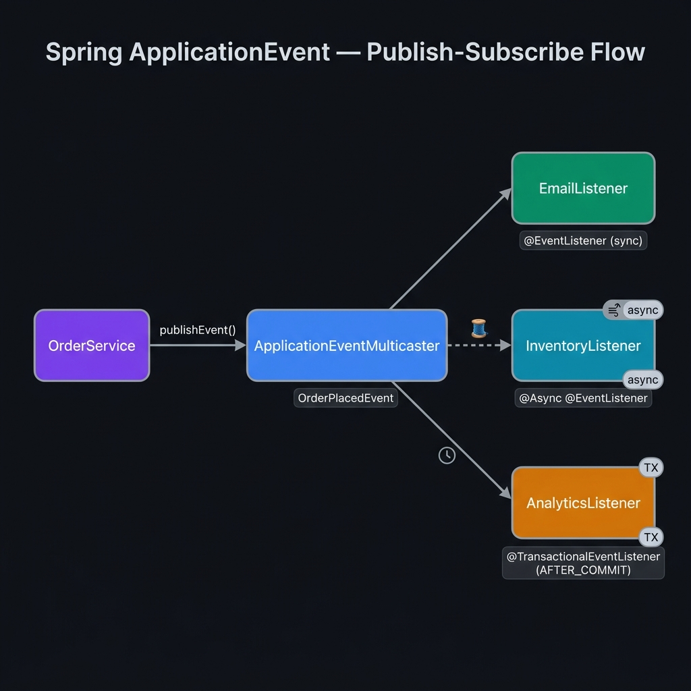

💡 **Pro Tip:** Use `@TransactionalEventListener(phase = TransactionPhase.AFTER_COMMIT)` for side effects like sending emails or notifications. Then the event handler only runs if the transaction actually commits. So you never send a notification for a rolled-back order.

---

</details>

---
