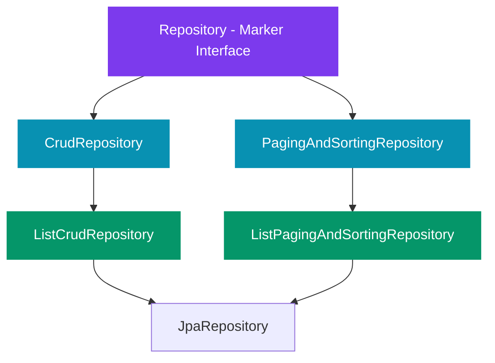
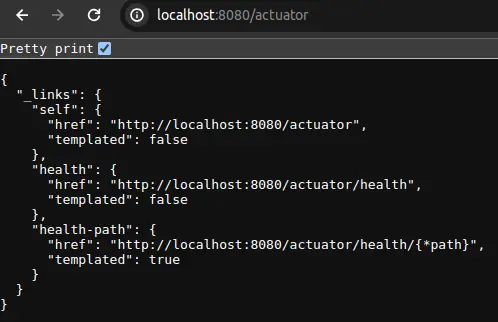
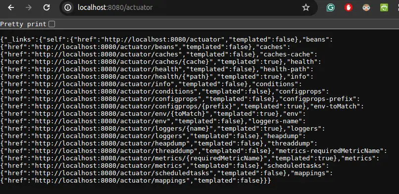
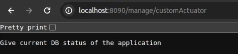
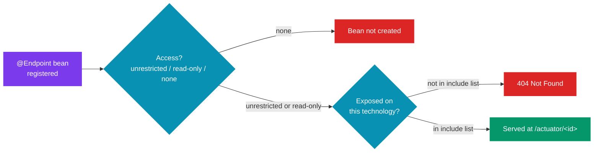
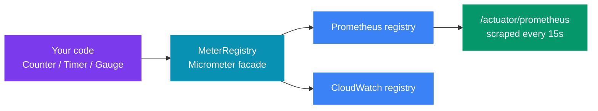

# Spring Data JPA, REST & Actuator Interview Questions

**Spring Data JPA, REST & Actuator Interview Questions** | Covers Spring Data JPA repositories, Spring REST controllers, and Spring Boot Actuator. Also see: [Spring Core](09_Spring_Core_Interview_Questions.md) | [Hibernate & JPA](13_Hibernate_Interview_Questions.md) | [REST API Design](https://github.com/vikas9dev/system-design/blob/main/iq/05_REST_API_Design_Interview_Questions.md)

> 🔗 **Planned scope split — say this if an interviewer asks about these topics.** N+1, fetch strategies and `@EntityGraph` are in [Hibernate & JPA](13_Hibernate_Interview_Questions.md). `ResponseEntity`, `@PathVariable`, `@RequestBody`, `@Valid`, versioning and error contracts are in [REST API Design](https://github.com/vikas9dev/system-design/blob/main/iq/05_REST_API_Design_Interview_Questions.md). This file covers the **repository abstraction**, the **controller/serialization layer**, and **Actuator**.

📊 **Question Count by Section**

| # | Section | Questions |
|---|---|---|
| 1 | [Spring Data JPA](#spring-data-jpa) | 8 |
| 2 | [Spring REST](#spring-rest) | 4 |
| 3 | [Spring Actuator](#spring-actuator) | 8 |
| | **Total** | **20** |

> 🔥🔥 Very High — asked in almost every Tier-1 loop &nbsp;·&nbsp; 🔥 High — very frequent in Tier-1 interviews &nbsp;·&nbsp; ⚡ Medium — commonly asked &nbsp;·&nbsp; 💤 Low — good to know, rarely asked

---

<a id="spring-data-jpa"></a>

## 1. Spring Data JPA

1. **🗄️ Do we need to write @Repository annotation when using Spring Data JPA? 🔥**

<!-- -->
<details>
<summary>Answer</summary>

**Answer:**

```java
@Repository
// Is using the above annotation required?
public interface SongRepository extends JpaRepository<Song, Integer> { }
```

No, it is not required. Spring Boot automatically detects the Spring Data JPA-related classes/interfaces. Our interface already extends `JpaRepository`. So we do not need to write `@Repository` on top of our interface.

💡 **Pro Tip:** Even without `@Repository` on our interface, Spring Data creates the implementation at runtime (a proxy backed by `SimpleJpaRepository`) with all CRUD features.

---

</details>

---

2. **📊 Difference between JpaRepository, CrudRepository, PagingAndSortingRepository. Tell the hierarchy. 🔥**

<!-- -->
<details>
<summary>Answer</summary>

**Answer:**

The base is the `Repository` interface which is a marker interface:

```java
@Indexed
public interface Repository<T, ID> {
}
```

The next layer is `CrudRepository` and `PagingAndSortingRepository`. Both extend the `Repository` marker interface. `CrudRepository` has all the CRUD-related methods like `findAll`, `findAllById`, `findById`, `save`, `delete`, etc.

```java
@NoRepositoryBean
public interface CrudRepository<T, ID> extends Repository<T, ID> {
}
```

`PagingAndSortingRepository` contains methods related to sorting and pagination:

```java
@NoRepositoryBean
public interface PagingAndSortingRepository<T, ID> extends Repository<T, ID> {
}
```

The next layer is `JpaRepository` which contains methods like `flush()`, `saveAndFlush()`, `deleteAllInBatch()`, `deleteAllByIdInBatch()`:

```java
@NoRepositoryBean
public interface JpaRepository<T, ID> extends ListCrudRepository<T, ID>,
        ListPagingAndSortingRepository<T, ID>, QueryByExampleExecutor<T> {
}
```



⚠️ **The follow-up that most candidates get wrong — this hierarchy changed in Spring Data 3.0.**
- Before 3.0, `PagingAndSortingRepository extends CrudRepository`. So if you wanted paging, you also got all of CRUD with it.
- Since **3.0** the two are **siblings**. Both extend `Repository` directly.
- So you can now declare a read-only paging repository with no `save`/`delete` on it at all.
- Most published material (and most blog posts) still shows the old chain.

🔑 **Why the `List*` variants exist:**
- `CrudRepository.findAll()` returns `Iterable<T>`. `PagingAndSortingRepository.findAll(Sort)` also returns `Iterable<T>`.
- `Iterable<T>` is hard to use: no `.size()`, no indexing, no `stream()` without a helper.
- `ListCrudRepository.findAll()` / `ListPagingAndSortingRepository.findAll(Sort)` **covariantly override** those methods to return `List<T>` (covariant override = same method, narrower return type).
- `JpaRepository` extends the `List*` pair. This is why JPA repositories have always been easier to use than the base ones.

<details>
<summary><strong>🤔 Doubt: If PagingAndSortingRepository no longer extends CrudRepository, how does findAll(Pageable) still work?</strong></summary>

It never needed CRUD. `PagingAndSortingRepository` declares exactly two methods and nothing else:

```java
Iterable<T> findAll(Sort sort);
Page<T>     findAll(Pageable pageable);
```

Spring Data builds the proxy from the **declared methods of the interface you extend**. It does not use a fixed CRUD contract. `SimpleJpaRepository` implements all the methods anyway, so it can serve as the implementation for either combination.

The practical gain: take an interface like `interface AuditLogRepo extends ListPagingAndSortingRepository<AuditLog, Long> {}`. It gives you paging and sorting, and callers see **no** `save`, `delete` or `deleteAll`. This makes the public API smaller. You could not get it before 3.0.

---

</details>
<br/>

---

</details>

---

3. **🐻 What is the default JPA provider for Spring Data JPA? ⚡**

<!-- -->
<details>
<summary>Answer</summary>

**Answer:**

Hibernate is the default JPA provider for Spring Data JPA.

---

</details>

---

4. **🚷 Why do CrudRepository, PagingAndSortingRepository, JpaRepository have @NoRepositoryBean? Can we use it in our interfaces extending from these classes? ⚡**

<!-- -->
<details>
<summary>Answer</summary>

**Answer:**

- Spring Data's repository scanner picks up **every interface that extends `Repository`**. It tries to build a proxy for each one.
- To build that proxy, it must resolve a **concrete domain type** from the generics.
- `JpaRepository<T, ID>` has none (`T` is still a type variable). So there is no real entity type to build a proxy for.
- `@NoRepositoryBean` is the marker that says *"skip me, I am an intermediate type, not a repository for a real entity."*

That is why the framework's own interfaces have this annotation. `CrudRepository`, `ListCrudRepository`, `PagingAndSortingRepository`, `JpaRepository` are all `@NoRepositoryBean`. (The root `Repository` marker is not; it carries only `@Indexed`. Spring Data skips it anyway, because it is the base marker type.) Without it, startup would fail when Spring tries to proxy `JpaRepository` itself.

✅ **Yes — and this is the one real use case: your own shared base repository.**

```java
@NoRepositoryBean
public interface BaseRepository<T extends BaseEntity, ID> extends JpaRepository<T, ID> {

    // shared behaviour every entity repository should get for free
    Optional<T> findByIdAndDeletedFalse(ID id);

    List<T> findAllByDeletedFalse();
}

// concrete — scanned, proxied, injectable
public interface LoanApplicationRepository extends BaseRepository<LoanApplication, Long> {
}
```

`BaseRepository` is generic, so it gets `@NoRepositoryBean`. `LoanApplicationRepository` binds `T = LoanApplication`. So Spring Data creates a proxy for it and builds the `findByIdAndDeletedFalse` query for the real entity.

⚠️ **The difference to say clearly:** `@NoRepositoryBean` is **not** "disable this repository". It means *"this interface is a fragment/template in the hierarchy, not a repository definition."* Its method declarations are still inherited. Spring Data still derives queries for them, but on the **concrete** child.

<details>
<summary><strong>🤔 Doubt: What actually happens at startup if I forget @NoRepositoryBean on my generic base interface?</strong></summary>

The scanner treats `BaseRepository` as a repository definition. It tries to resolve its domain type. `T` is unresolved, so you get a startup failure similar to:

```
Could not resolve domain type of interface com.example.BaseRepository
```

Spring throws it while it creates the `RepositoryFactoryBean`. So the context never starts. It is a **fail-fast** error (the app stops at once), not a silent wrong behaviour. That is why it rarely reaches production.

The opposite mistake is putting `@NoRepositoryBean` on a **concrete** repository (`LoanApplicationRepository`). That one fails *later* and is more confusing:
- No bean is created.
- Injection fails with `NoSuchBeanDefinitionException`, for a type you can clearly see in the source tree.

---

</details>
<br/>

---

</details>

---

5. **💾 Tell me a little about the Spring Data JPA project. 🔥**

<!-- -->
<details>
<summary>Answer</summary>

**Answer:**

Normally, a project that talks to a database needs three steps. We create the interface, write the implementation class, and then connect to the database. For example, in raw JDBC or Spring JDBC we:
- write queries
- open the data source
- create a connection
- fetch or save data
- close the connection for safe transactions

But Spring Data JPA is a layer **on top of** the JPA provider (Hibernate). The provider then talks to the database. You write only the interface.


- ⚙️ Spring Data JPA gives data initialization and utility methods for our entities.
- 🔧 It executes the query with the help of the JPA provider.
- 📦 With auto-configuration, it builds the **`EntityManagerFactory`** (via `LocalContainerEntityManagerFactoryBean`). It uses the `DataSource` and the JPA properties in your configuration. The **`EntityManager`** is *not* a singleton bean. One is created **per transaction**. Spring injects a shared, thread-bound proxy (`SharedEntityManagerCreator`). That proxy passes each call to the `EntityManager` bound to the current transaction.
- 🔄 It registers a `JpaTransactionManager`, so `@Transactional` works with no extra setup.

📝 **Note:** If you use Spring Data JPA, the repository methods are implemented by Spring Data's `SimpleJpaRepository`. It calls the JPA `EntityManager`, and Hibernate implements that.

The specific repository depends on which Spring Data module you use:

- 🗄️ `spring-data-jpa` provides `JpaRepository`
- 🍃 `spring-data-mongodb` provides `MongoRepository`
- 🔴 `spring-data-redis` — ⚠️ **no `RedisRepository` interface exists.** Redis's repository support comes from `spring-data-keyvalue`. You extend `CrudRepository` (or `KeyValueRepository`) over an `@RedisHash`-annotated entity. `@EnableRedisRepositories` turns it on. `RedisTemplate` is the **template** API (the `JdbcTemplate` equivalent). It sits next to the repository abstraction. It is not part of it.

🧠 **The pattern to state:** every Spring Data module ships **two** APIs:
- a low-level *template* (`JdbcTemplate`, `MongoTemplate`, `RedisTemplate`, `ElasticsearchTemplate`)
- a high-level *repository* abstraction on top of it

If you name a template when the question asks for a repository, it shows you have mixed up the two layers.

---

</details>

---

6. **📝 Explain @Query — JPQL vs native SQL, and what @Modifying actually does. 🔥🔥**

<!-- -->
<details>
<summary>Answer</summary>

**Answer:**

`@Query` lets you write the query yourself, so Spring does not build it from the method name (the derived-method parser). It has two modes:

```java
public interface LoanApplicationRepository extends JpaRepository<LoanApplication, Long> {

    // 1) JPQL — entity/field names, provider translates to SQL, portable
    @Query("select l from LoanApplication l where l.status = :status and l.amount > :min")
    List<LoanApplication> findApproved(@Param("status") Status status,
                                       @Param("min") BigDecimal min);

    // 2) Native — real table/column names, no translation, not portable
    @Query(value = "SELECT * FROM loan_application WHERE status = :status",
           nativeQuery = true)
    List<LoanApplication> findApprovedNative(@Param("status") String status);
}
```

| | JPQL (default) | Native (`nativeQuery = true`) |
|---|---|---|
| **Operates on** | Entity + field names | Table + column names |
| **Portable across DBs** | ✅ Provider emits dialect SQL | ❌️ Locked to one dialect |
| **Vendor features** (window fns, hints, CTEs) | ⚠️ Standard JPQL has none. Hibernate 6.2+ HQL adds window functions and CTEs; most other vendor SQL is still unavailable | ✅ Full SQL surface |
| **Compile/startup validation** | ✅ Parsed and validated at bootstrap | ❌️ Only fails when executed |
| **Returns managed entities** | ✅ When you select the entity (`select l`); scalar or `new` DTO selects are unmanaged | ✅ *only* if the projection covers the entity; otherwise `Object[]`/DTO and **unmanaged** |
| **Pagination** | `Pageable` works directly | `Pageable` works, but a **`countQuery` is usually required** |

⚠️ **The native + `Pageable` trap.** For a JPQL query, Spring derives the `COUNT(*)` automatically. For a **native** query, it cannot always rewrite your SQL correctly. So you must supply the count query:

```java
@Query(value      = "SELECT * FROM loan_application WHERE branch_id = :branch",
       countQuery = "SELECT count(*) FROM loan_application WHERE branch_id = :branch",
       nativeQuery = true)
Page<LoanApplication> findByBranch(@Param("branch") Long branchId, Pageable pageable);
```

**`@Modifying` — for `UPDATE` / `DELETE` / DDL:**

```java
@Modifying
@Transactional
@Query("update LoanApplication l set l.status = :status where l.id = :id")
int updateStatus(@Param("id") Long id, @Param("status") Status status);
```

Three things it does, and the one thing it does **not**:

1. It tells Spring Data to call `Query.executeUpdate()` instead of `getResultList()`. Without it, you get an `InvalidDataAccessApiUsageException` at runtime.
2. It requires an **enclosing transaction** (`executeUpdate` is a write). Your own declared query methods get **no** transaction by default (only the inherited CRUD methods do). So you must supply `@Transactional` on the method or on the calling service.
3. Return type must be `void` or `int`/`Integer` (rows affected). `long`/`Long` is accepted only from Spring Data JPA 4.x.
4. ❌️ It does **not** update the persistence context. The statement goes **straight to the database, bypassing Hibernate's first-level cache**. So any entity already loaded in the current session still holds the old value.

🔥 **That fourth point is the main point of the question.** The fix is the two `@Modifying` attributes. **Both default to `false`** (verified against `spring-data-jpa`'s `Modifying` annotation defaults):

```java
@Modifying(clearAutomatically = true,   // EntityManager.clear() AFTER  — drops stale entities
           flushAutomatically = true)   // EntityManager.flush() BEFORE — pending changes hit the DB first
```

- `flushAutomatically` stops the bulk statement from running before unflushed changes reach the DB.
- `clearAutomatically` stops a later `findById` from returning a stale cached entity.

Two honest answers come from this:

<details>
<summary><strong>🤔 Doubt: If @Modifying bypasses the persistence context, does it also bypass @Version optimistic locking and JPA lifecycle callbacks?</strong></summary>

**Yes — both.** This is the deeper cost of bulk statements. This follow-up shows who has used them and who has only read about them.

| Bypassed | Why |
|---|---|
| `@Version` optimistic locking | The version column is not incremented and not checked. A concurrent `save()` in another transaction still sees the old version number. So it succeeds and silently overwrites the bulk change (a lost update). |
| `@PreUpdate` / `@PostUpdate` callbacks | These fire from the provider's flush of *managed* entities. A bulk `UPDATE` never loads an entity, so nothing fires. |
| Auditing (`@LastModifiedDate`, `@LastModifiedBy`) | Implemented on top of those same callbacks — so audit columns go stale. |
| Cascades | `cascade = REMOVE` on a bulk `DELETE` does nothing; you get an FK violation instead. |
| Second-level cache | Not updated row by row. Hibernate evicts the whole cache region of the affected entity (for a native query with no declared query spaces, every region). |

---

</details>
<br/>

---

</details>

---

7. **📄 How does pagination work in Spring Data JPA? Page vs Slice. 🔥🔥**

<!-- -->
<details>
<summary>Answer</summary>

**Answer:**

You add a `Pageable` parameter to any repository method. Spring Data then appends `LIMIT`/`OFFSET` (in the right form for the dialect) and `ORDER BY`.

```java
Page<LoanApplication>  findByStatus(Status status, Pageable pageable);
Slice<LoanApplication> findByBranchId(Long branchId, Pageable pageable);
List<LoanApplication>  findByBranchId(Long branchId, Sort sort);

// caller
Pageable page = PageRequest.of(0, 20, Sort.by("createdAt").descending());
Page<LoanApplication> result = repo.findByStatus(Status.APPROVED, page);
```

**The question that separates candidates — `Page` vs `Slice`:**

| | `Slice<T>` | `Page<T>` |
|---|---|---|
| **Extra `COUNT(*)` query** | ❌️ Never | ✅ Always — a second query |
| **`getTotalElements()` / `getTotalPages()`** | ❌️ Not available | ✅ Available |
| **How it knows there is a next page** | Fetches **`size + 1`** rows, returns `size`, and sets `hasNext()` from the extra row | From the total count |
| **Cost on a large table** | One query | Two queries; the `COUNT(*)` can dominate |
| **Fits** | Infinite scroll / "Load more" | Numbered pagination ("Page 3 of 47") |

`Page<T> extends Slice<T>` — verified against `spring-data-commons`. So `Page` is exactly `Slice` **plus** the totals. The second query exists to compute the totals.

🔑 **Interview one-liner:** "If the UI never shows a total, return `Slice` — you save a `COUNT(*)` on every request. `Slice` gets `hasNext()` for free by fetching one extra row."

⚠️ **Two traps to mention before you are asked:**

1. **Unstable sort ⇒ duplicated/missing rows across pages.** Suppose you use `OFFSET` pagination with a non-unique sort key. The database can return rows in a different order between requests. Always add a tiebreaker (a unique column as the last sort key): `Sort.by("createdAt").descending().and(Sort.by("id"))`.
2. **Deep `OFFSET` gets slower linearly.** `OFFSET 100000` makes the DB scan and throw away 100,000 rows. For deep paging, use **keyset (seek) pagination** — `where (created_at, id) < (:lastCreatedAt, :lastId) order by created_at desc, id desc limit 20`. Its cost stays flat because it can use the index directly. `Slice` is the natural return type for it.

<details>
<summary><strong>🤔 Doubt: Why does pagination combined with a JOIN FETCH produce "firstResult/maxResults specified with collection fetch; applying in memory"?</strong></summary>

Because a `JOIN FETCH` over a **to-many** association multiplies rows. One parent with 5 children becomes 5 SQL rows. Suppose Hibernate applied `LIMIT 20` to that result set. It would return an unpredictable, possibly partial set of parents. The page boundary could cut a parent's collection in half.

To stay correct, Hibernate **drops the `LIMIT` from the SQL, loads the entire result set, and paginates in memory**. It logs that warning when it does this. On a large table, this can easily cause an OOM (`OutOfMemoryError`). (In Hibernate 5 it was `HHH000104` as a warning; Hibernate 6 kept the in-memory behaviour.)

Fixes, in order of preference:

1. **Two queries** — page the IDs first (no fetch join). Then load the entities with `where id in (:ids)` plus the fetch join. Spring Data does not do this for you with a to-many `@EntityGraph`, so you write it by hand. (For a to-one graph, no trick is needed: one join query with `LIMIT` works.)
2. **`@BatchSize`** on the collection — page the parents normally. Hibernate then batch-loads the children in a few `IN` queries.
3. **`Set` instead of `List`** does *not* fix pagination. It only removes duplicates. That is a different problem.

Note this is a **to-many** problem only. A `JOIN FETCH` on a to-one association does not multiply rows. So pagination stays in SQL. See [Hibernate & JPA](13_Hibernate_Interview_Questions.md) for the N+1 side of this.

---

</details>
<br/>

---

</details>

---

8. **🔐 Are Spring Data repository methods transactional by default? 🔥**

<!-- -->
<details>
<summary>Answer</summary>

**Answer:**

**Yes — and the important detail is *how*.** `SimpleJpaRepository` is the class behind every repository proxy. It is annotated at the **class level**:

```java
@Repository
@Transactional(readOnly = true)
public class SimpleJpaRepository<T, ID> implements JpaRepositoryImplementation<T, ID> {

    @Transactional                       // overrides the class-level readOnly
    public <S extends T> S save(S entity) { ... }

    @Transactional
    public void deleteById(ID id) { ... }

    // findById, findAll, count, existsById … inherit readOnly = true
}
```

*(Verified against `spring-data-jpa` — the class carries `@Repository` + `@Transactional(readOnly = true)`, and the write methods re-annotate with plain `@Transactional`.)*

So:

| Method kind | Effective transaction |
|---|---|
| `findById`, `findAll`, `count`, `existsById` | `REQUIRED`, **`readOnly = true`** |
| `save`, `saveAll`, `delete`, `deleteById` | `REQUIRED`, read-write |
| Your `@Modifying @Query` method | ❌️ **Nothing inherited** — you must supply `@Transactional` yourself, or call it from a transactional service |

🔑 **What `readOnly = true` actually gives you:**
- Hibernate sets the flush mode to `MANUAL`. So it **skips dirty-checking** at flush time. This saves real CPU and memory on large read result sets.
- It sets the JDBC connection read-only. Some drivers/routers use this to send the query to a **read replica**.
- ❌️ It does **not** make the database reject writes. It is a hint, not a guarantee.

⚠️ **The trap — "why does my derived delete fail outside a transaction?"**
- Derived deletes (`deleteByStatus(...)`) and `@Modifying` queries are **not** covered by `SimpleJpaRepository`'s annotations.
- The reason: they are generated from *your* interface. They are not inherited from that class.
- If you call them with no surrounding transaction, they throw one of these (Spring wraps both in `InvalidDataAccessApiUsageException`):

```
TransactionRequiredException: Executing an update/delete query      // @Modifying query
TransactionRequiredException: No EntityManager with actual transaction available for current thread - cannot reliably process 'remove' call   // derived delete
```

💡 **The rule to state:**
- Repository-level transactions exist so that a single CRUD call is safe on its own.
- They are **not** where your transaction boundary belongs. Put it on the **service** method. Then several repository calls commit or roll back together.
- Each repository call joins the service's transaction via `REQUIRED`. It does not start its own.

<details>
<summary><strong>🤔 Doubt: If the service is @Transactional(readOnly = true) but calls repo.save(), which one wins?</strong></summary>

**The outer one — the service.** This surprises people.

- With the default `REQUIRED` propagation, `save()` **joins the existing transaction**. It does not start a new one.
- `readOnly` is a property of the *transaction*. It is fixed when the transaction is created. A method that joins it cannot upgrade it.
- Spring does not throw either. The inner `@Transactional` just uses the transaction that is already running.

What you actually see depends on which layer enforces it:

- Hibernate's flush mode is `MANUAL`, so the dirty-checking flush never runs → **the update is silently skipped**. This is the classic "my save() did nothing and no exception was thrown" bug.
- Say the JDBC connection was set read-only and the database enforces it (e.g. PostgreSQL, or a replica endpoint). Then you get an error at execution time instead.

Neither failure shows the real cause: a `readOnly = true` two frames higher in the call stack. Simple rules:
- Put `readOnly = true` only on service methods that are really read-only.
- If you need a truly independent write, use `@Transactional(propagation = REQUIRES_NEW)`. That creates a **new** transaction, so it gets its own `readOnly` setting.

---

</details>
<br/>

---

</details>

---

<a id="spring-rest"></a>

## 2. Spring REST

1. **🌐 Explain @RestController annotation in Spring Boot. 🔥**

<!-- -->
<details>
<summary>Answer</summary>

**Answer:**

- 🧩 `@RestController` is a shortcut annotation for creating RESTful controllers.
- It is meta-annotated with `@Controller`, which is itself a `@Component`. So classpath scanning detects it automatically.
- 🔗 It adds the `@Controller` and `@ResponseBody` annotations.
- So you do not need to put `@ResponseBody` on every request-handling method. The actual JSON/XML conversion is done by an `HttpMessageConverter` (for example Jackson), not by the annotation.
- 📤 It tells Spring to write the data returned by each method straight into the response body. Spring does not render a template.
- You usually use it together with handler methods annotated with `@RequestMapping`.

---

</details>

---

2. **⚔️ Difference between @RestController and @Controller in Spring Boot? 🔥**

<!-- -->
<details>
<summary>Answer</summary>

**Answer:**

First, let us see the difference between a web application and a REST API:

| Feature | @Controller 🅰️ | @RestController 🅱️ |
|---------|----------------|---------------------|
| **Response type** | View (HTML + CSS + JS) | Data (JSON/XML) |
| **Intended for** | 🖥️ Human viewers | 🤖 REST clients / programs |
| **@ResponseBody** | ❌️ Must add manually per method | ✅ Automatically applied |
| **Template rendering** | ✅ Maps model to view/template | ❌️ Writes directly to HTTP response |

🧠 **In Simple Words:**
- **@Controller** = Returns views (HTML pages) for browsers.
- **@RestController** = Returns data (JSON/XML) for API consumers.

---

</details>

---

3. **🗺️ What are the major differences between @RequestMapping and @GetMapping? 🔥**

<!-- -->
<details>
<summary>Answer</summary>

**Answer:**

`@RequestMapping` works with GET, POST, PUT, and other request methods. You choose the method with the `method` attribute on the annotation.

`@GetMapping` is only an extension of `@RequestMapping`. It makes the request type clearer.

| Feature | @RequestMapping 🅰️ | @GetMapping 🅱️ |
|---------|---------------------|-----------------|
| **HTTP methods** | ✅ Supports all (GET, POST, PUT, DELETE) | ❌️ Only GET |
| **Clarity** | ⚠️ Requires `method` attribute | ✅ More readable and explicit |
| **Shortcut for** | General purpose | `@RequestMapping(method = RequestMethod.GET)` |

⚠️ **The actual trap — `@RequestMapping` with no `method` attribute maps *every* HTTP method.**

```java
@RequestMapping("/loans")            // ← GET, POST, PUT, DELETE, PATCH, HEAD, OPTIONS … all of them
public List<Loan> list() { ... }
```

A `POST /loans` reaches this handler. You get no 405, because for Spring MVC the mapping matched. This is a real security/correctness warning sign. It is the follow-up question an interviewer wants you to raise.

🔑 **The other half:** `@GetMapping` (and `@PostMapping`, etc.) are **method-level only**. They are `@Target(METHOD)`. So a class-level base path still needs `@RequestMapping`:

```java
@RestController
@RequestMapping("/api/v1/loans")     // ← class level: must be @RequestMapping
public class LoanController {

    @GetMapping("/{id}")             // ← method level: composed annotation
    public Loan get(@PathVariable Long id) { ... }
}
```

So the correct summary is not "`@GetMapping` replaces `@RequestMapping`". It is this: "`@GetMapping` is a `@RequestMapping` meta-annotated with `method = GET`, usable only on methods."

See [REST API Design](https://github.com/vikas9dev/system-design/blob/main/iq/05_REST_API_Design_Interview_Questions.md) for more depth on `@PathVariable` / `@RequestBody` / `@Valid`.

---

</details>

---

4. **🗂️ What is ObjectMapper in Spring Boot? How does Jackson work? 🔥🔥**

<!-- -->
<details>
<summary>Answer</summary>

**Answer:**

`ObjectMapper` is the main class in the **Jackson** library. Jackson is Spring Boot's default JSON serializer/deserializer. `ObjectMapper` converts Java objects ↔ JSON.

**Core operations:**

```java
// NOTE: every call below throws a checked JsonProcessingException,
// so this body must be inside a try/catch or the method must declare `throws`.
ObjectMapper mapper = new ObjectMapper();

// Java object → JSON string (serialization)
String json = mapper.writeValueAsString(employee);
// → {"name":"Alice","salary":120000}

// JSON string → Java object (deserialization)
Employee emp = mapper.readValue(json, Employee.class);

// JSON → JsonNode (tree model, when class is unknown)
JsonNode node = mapper.readTree(json);
String name = node.get("name").asText();
```

**Key annotations:**

| Annotation | Purpose |
|---|---|
| `@JsonProperty("emp_name")` | Map JSON field name to a different Java field name |
| `@JsonIgnore` | Exclude a field from serialization/deserialization |
| `@JsonAlias({"empName", "employee_name"})` | Accept multiple JSON key names during deserialization |
| `@JsonInclude(Include.NON_NULL)` | Skip null fields in serialized output |
| `@JsonFormat(pattern = "yyyy-MM-dd")` | Format dates in JSON output |

**Spring Boot auto-configuration:**

Spring Boot auto-configures a shared `ObjectMapper` bean through `JacksonAutoConfiguration`. You can customize it:

```java
@Bean
public Jackson2ObjectMapperBuilderCustomizer customizer() {
    return builder -> builder
        .featuresToDisable(SerializationFeature.WRITE_DATES_AS_TIMESTAMPS)
        .featuresToDisable(DeserializationFeature.FAIL_ON_UNKNOWN_PROPERTIES);
}
```

Or in `application.properties`:
```properties
spring.jackson.serialization.write-dates-as-timestamps=false
spring.jackson.deserialization.fail-on-unknown-properties=false
```

**Common production trap:** `FAIL_ON_UNKNOWN_PROPERTIES` defaults to `true` in raw Jackson. In Spring Boot auto-config it defaults to `false`. If you create `ObjectMapper` yourself (not through Spring), unknown JSON fields will throw `UnrecognizedPropertyException`.

🔑 **Interview one-liner:** "ObjectMapper is Jackson's workhorse — `writeValueAsString()` serializes, `readValue()` deserializes. Spring auto-configures one, so inject it rather than creating your own to stay consistent with the app's Jackson configuration."

---

</details>

---

<a id="spring-actuator"></a>

## 3. Spring Actuator

1. **📡 What is the Spring Actuator? What are its advantages? 🔥**

<!-- -->
<details>
<summary>Answer</summary>

**Answer:**

- 📖 "Actuator" is a manufacturing term. It means a mechanical device that moves or controls something. An actuator can create a large amount of motion from a small change.
- 📊 In Spring Boot, Actuator is an extra feature. It helps us monitor and manage the application when we push it to production.
- These features include auditing, health, metrics gathering, and many more. Spring Boot can apply them to the application automatically.
- 📦 You can enable this feature by adding the dependency `spring-boot-starter-actuator` in `pom.xml`.
- ⚡ With Spring Actuator, you can see many details. Examples: which beans were created, CPU usage, and the HTTP hits your server has handled.

```xml
<dependency>
    <groupId>org.springframework.boot</groupId>
    <artifactId>spring-boot-starter-actuator</artifactId>
</dependency>
```



---

</details>

---

2. **🔗 What are different Actuator Endpoints? 🔥**

<!-- -->
<details>
<summary>Answer</summary>

**Answer:**

The discovery page is at the base path: `http://localhost:8080/actuator`

🔥 **Start with what is exposed by default. This is the most-asked Actuator follow-up.**

On a default Spring Boot 3.x app, **only `health` is exposed over HTTP.** This is verified against the configuration metadata in `spring-boot-actuator-autoconfigure` 3.5.4:

| Property | Verified default |
|---|---|
| `management.endpoints.web.exposure.include` | `health` |
| `management.endpoints.jmx.exposure.include` | `health` |
| `management.endpoints.web.base-path` | `/actuator` |
| `management.endpoint.health.show-details` | `never` |

So `/actuator/env`, `/actuator/beans`, `/actuator/metrics` all return **404 until you opt in**. And `/actuator/health` returns just `{"status":"UP"}`, with no component breakdown. Saying "you get all the endpoints once you add the starter" is the wrong answer.

⚠️ **JMX is a separate axis, and it is fully off by default.** `spring.jmx.enabled` defaults to **`false`** (verified in `spring-boot-autoconfigure` 3.5.4). So the JMX properties do nothing unless you turn JMX on.

A common mistake is to set `management.endpoints.jmx.exposure.include` when you meant HTTP. This mistake gives no error at all.

To expose everything over **HTTP** (fine for local, never for production):

```properties
management.endpoints.web.exposure.include=*
```

To expose only selected endpoints over **HTTP** (note: `web`, not `jmx`):

```properties
management.endpoints.web.exposure.include=health,info,env,beans
management.endpoints.web.exposure.exclude=env
```

`exclude` wins over `include`. This is the usual way to run `include=*` and still hide the sensitive endpoints.

Once you include them, these URLs work:

- 🌍 Environment and property sources: `http://localhost:8080/actuator/env`
- 📦 All Spring beans in the context: `http://localhost:8080/actuator/beans`
- 📊 Metric names, then a single metric: `/actuator/metrics` → `/actuator/metrics/jvm.memory.used`
- 🗺️ All request mappings: `/actuator/mappings`
- ⚙️ Auto-configuration report: `/actuator/conditions`



---

</details>

---

3. **🛤️ How to modify the actuator endpoint path? ⚡**

<!-- -->
<details>
<summary>Answer</summary>

**Answer:**

By default, all endpoints sit under the application's default context path, with the suffix `/actuator`. The application may already have endpoints that start with `/actuator`. If so, we can change the base path to something else.

```properties
management.endpoints.web.base-path=/manage
```

Now we can access all actuator endpoints under a new URL, e.g.: `/manage/health`

---

</details>

---

4. **⚙️ How to customize the management server port? 💤**

<!-- -->
<details>
<summary>Answer</summary>

**Answer:**

We can change the port of the actuator. The application runs on one port, and the actuator runs on another.

```properties
management.server.port=8090
```

---

</details>

---

5. **🛠️ How to create custom Endpoints for the Actuator? ⚡**

<!-- -->
<details>
<summary>Answer</summary>

**Answer:**

You can do this by adding the following annotations:

- 📦 Add `@Endpoint` and `@Component` to the class.
- ⚙️ Add `@ReadOperation`, `@WriteOperation`, or `@DeleteOperation` at the method level:
  - `@ReadOperation` maps to HTTP GET
  - `@WriteOperation` maps to HTTP POST
  - `@DeleteOperation` maps to HTTP DELETE

⚠️ **Registered ≠ exposed. Get this right.** A `@Endpoint` bean is automatically **registered** and **enabled**, but it is **not exposed**.

- The verified default is `management.endpoints.web.exposure.include=health`.
- So your custom endpoint returns **404** until you add it to the include list.
- JMX is also fully off (`spring.jmx.enabled=false`).
- So on a default app, "it's automatically available over JMX or HTTP" is simply not true.

```java
package com.example.demo;

import org.springframework.boot.actuate.endpoint.annotation.Endpoint;
import org.springframework.boot.actuate.endpoint.annotation.ReadOperation;
import org.springframework.stereotype.Component;

@Component
@Endpoint(id = "dbstatus")
public class DbStatusEndpoint {

    @ReadOperation
    public String currentDbDetails() {
        return "Give current DB status of the application";
    }
}
```

```properties
# REQUIRED — without this the endpoint is registered but returns 404
management.endpoints.web.exposure.include=health,info,dbstatus
```

The endpoint is then served at `GET /actuator/dbstatus`.

🪤 **A naming trap, worth one line.** A camelCase id like `@Endpoint(id = "customActuator")` is **legal**. `EndpointId` only rejects these: an empty value, characters outside `[a-zA-Z0-9.-]`, a leading digit, and a leading uppercase letter. But **property binding uses the lower-cased id**. So you would configure it as `management.endpoint.customactuator.access`, not `.customActuator.`. Use an all-lowercase id to avoid the problem.



---

</details>

---

6. **💊 How do you create custom health indicators for Spring Boot Actuator? 🔥**

<!-- -->
<details>
<summary>Answer</summary>

**Answer:**

Custom health indicators let you add health checks specific to your application to the `/actuator/health` endpoint. They are essential for monitoring dependencies like databases, message queues, external APIs, and caches.

**Basic custom health indicator:**

```java
@Component
public class PaymentGatewayHealthIndicator implements HealthIndicator {

    private final PaymentGatewayClient paymentClient;

    public PaymentGatewayHealthIndicator(PaymentGatewayClient paymentClient) {
        this.paymentClient = paymentClient;
    }

    @Override
    public Health health() {
        try {
            boolean isReachable = paymentClient.ping();
            if (isReachable) {
                return Health.up()
                    .withDetail("gateway", "Razorpay")
                    .withDetail("status", "reachable")
                    .withDetail("responseTime", "45ms")
                    .build();
            } else {
                return Health.down()
                    .withDetail("gateway", "Razorpay")
                    .withDetail("error", "Gateway not responding")
                    .build();
            }
        } catch (Exception e) {
            return Health.down()
                .withDetail("gateway", "Razorpay")
                .withException(e)
                .build();
        }
    }
}
```

**Health indicator for Kafka connectivity — read-only, no side effects:**

❌️ **Do not do this.** It is a surprisingly common snippet, and an interviewer will point it out at once:

```java
// ANTI-PATTERN — writes a real message to a real topic on EVERY health check
kafkaTemplate.send("health-check-topic", "ping").get(5, TimeUnit.SECONDS);
```

A Kubernetes readiness probe runs about every 10s **per pod**. With 10 pods, that is ~86,000 junk messages a day into a production cluster. It also adds a 5-second blocking wait that can hold the Actuator thread. A health check must be **read-only and fast**.

✅ **The usual form: a metadata call to the broker:**

```java
import java.util.concurrent.TimeUnit;
import java.util.concurrent.TimeoutException;
import org.apache.kafka.clients.admin.AdminClient;
import org.apache.kafka.clients.admin.DescribeClusterResult;
import org.springframework.boot.actuate.health.Health;
import org.springframework.boot.actuate.health.HealthIndicator;
import org.springframework.stereotype.Component;

@Component
public class KafkaHealthIndicator implements HealthIndicator {

    private static final int TIMEOUT_MS = 1_000;

    private final AdminClient adminClient;

    public KafkaHealthIndicator(AdminClient adminClient) {
        this.adminClient = adminClient;
    }

    @Override
    public Health health() {
        try {
            DescribeClusterResult cluster = adminClient.describeCluster();
            String clusterId = cluster.clusterId().get(TIMEOUT_MS, TimeUnit.MILLISECONDS);
            int nodeCount = cluster.nodes().get(TIMEOUT_MS, TimeUnit.MILLISECONDS).size();

            return Health.up()
                .withDetail("clusterId", clusterId)
                .withDetail("brokers", nodeCount)
                .build();
        } catch (InterruptedException e) {
            // ALWAYS restore the flag — never swallow an interrupt
            Thread.currentThread().interrupt();
            return Health.down().withDetail("kafka", "interrupted").build();
        } catch (TimeoutException e) {
            return Health.down().withDetail("kafka", "timeout after " + TIMEOUT_MS + "ms").build();
        } catch (Exception e) {
            return Health.down()
                .withDetail("kafka", "unreachable")
                .withDetail("error", e.getMessage())
                .build();
        }
    }
}
```

🔒 **Two details an interviewer looks for here:**
1. **`InterruptedException` is caught separately and the interrupt flag restored.** `Future.get(timeout, unit)` throws it. A general `catch (Exception e)` swallows (hides) the interrupt. Then the thread cannot respond to shutdown. Interviewers often test this, and a health indicator is exactly where it shows up.
2. **A short timeout, well under the probe period.** Suppose a health check can block for 5s inside a 10s probe interval. Then it turns a slow dependency into a cascading restart loop.

**Configuration to show full details:**

```properties
# application.properties
management.endpoint.health.show-details=always
management.endpoints.web.exposure.include=health,info,metrics
```

**Sample response at `/actuator/health`:**

```json
{
  "status": "UP",
  "components": {
    "db": {
      "status": "UP",
      "details": {
        "database": "MySQL",
        "validationQuery": "isValid()"
      }
    },
    "paymentGateway": {
      "status": "UP",
      "details": {
        "gateway": "Razorpay",
        "status": "reachable",
        "responseTime": "45ms"
      }
    },
    "kafka": {
      "status": "UP",
      "details": {
        "clusterId": "lkc-7x2q9",
        "brokers": 3
      }
    },
    "diskSpace": {
      "status": "UP",
      "details": {
        "total": 107374182400,
        "free": 53687091200,
        "threshold": 10485760,
        "path": "/app/.",
        "exists": true
      }
    },
    "ping": {
      "status": "UP"
    }
  }
}
```

**Health status aggregation is a *precedence order*, not a set of rules:**

`SimpleStatusAggregator` holds a fixed order. The aggregate status is the **first status in that order that is present** among the components. (Decompiled from `spring-boot-actuator` 3.5.4: `DEFAULT_ORDER = [DOWN, OUT_OF_SERVICE, UP, UNKNOWN]`, resolved with `min()` over that ordering.)

| Precedence | Status | Wins when | HTTP status |
|:---:|---|---|:---:|
| 1 | `DOWN` | **Any** component is DOWN | **503** |
| 2 | `OUT_OF_SERVICE` | Any component is OUT_OF_SERVICE and none are DOWN | **503** |
| 3 | `UP` | At least one component is UP, and none are DOWN or OUT_OF_SERVICE | 200 |
| 4 | `UNKNOWN` | Nothing above is present — no DOWN, no OUT_OF_SERVICE, **no UP** | 200 |

⚠️ **`UNKNOWN` ranks *below* `UP`, not above it.** A mix of UP + UNKNOWN components aggregates to **UP**. A frequent mistake is this wrong reading: "any UNKNOWN makes the whole thing UNKNOWN". `UNKNOWN` is also the fallback when there are no components.

🌐 **HTTP mapping:** `DOWN` and `OUT_OF_SERVICE` map to **503 Service Unavailable**. Everything else maps to **200** (`SimpleHttpCodeStatusMapper.DEFAULT_MAPPINGS`). A load balancer or probe reacts to this HTTP status. The JSON body is for humans.

**Using health groups:**

Health **groups** (`management.endpoint.health.group.*`) came in **Spring Boot 2.2**. What came in **2.3** was different: the Kubernetes-oriented `livenessState` / `readinessState` indicators and the auto-configured `liveness` / `readiness` probe groups. These are two different features, and people often mix them up.

```properties
# Custom groups — available since 2.2
management.endpoint.health.group.readiness.include=db,kafka
management.endpoint.health.group.liveness.include=ping
management.endpoint.health.group.readiness.show-details=always

# Built-in Kubernetes probe groups — since 2.3, but OFF unless enabled or on K8s
management.endpoint.health.probes.enabled=true
```

This exposes:
- `/actuator/health/readiness` — for the Kubernetes readiness probe
- `/actuator/health/liveness` — for the Kubernetes liveness probe

⚠️ **`management.endpoint.health.probes.enabled` defaults to `false`** (verified in the 3.5.4 configuration metadata). The built-in probe groups turn on by themselves only when Spring **detects a Kubernetes environment**. If you run the same image locally or on ECS, `/actuator/health/liveness` is a 404 until you set that flag explicitly. This confuses people who test probes outside the cluster.

💡 **Pro Tip:** In Kubernetes, put the database and message-queue checks in the **readiness** group.

- If the DB is down, the pod should stop taking traffic.
- But restarting the pod will not fix the DB.
- Keep the **liveness** group to just `ping`. Then a failing dependency never triggers a restart loop across every pod at once.
- If you do the opposite (dependency checks in liveness), one slow database can take down an entire deployment.

---

</details>

---

7. **🔓 An endpoint can be enabled but still return 404 — explain. And how do you secure the management surface? 🔥**

<!-- -->
<details>
<summary>Answer</summary>

**Answer:**

**Two independent axes** (two separate controls) decide whether an Actuator endpoint is available. Mixing them up is the classic cause of Actuator debugging problems.



| Axis | Controls | Property |
|---|---|---|
| **Access** (was *enabled*) | Whether the endpoint bean exists at all | `management.endpoint.<id>.access` |
| **Exposure** | Whether an existing endpoint is reachable over a given technology (web / JMX) | `management.endpoints.web.exposure.include` / `.exclude` |

So an endpoint that is enabled but not in the include list is **created, functional, and returns 404 over HTTP**. Spring Boot does this on purpose. Exposure is the security boundary. Access is the on/off switch.

📅 **Version note: `.enabled` is out of date as of Spring Boot 3.4.** The metadata in 3.5.4 marks `management.endpoint.<id>.enabled` as deprecated, with `replacement: management.endpoint.<id>.access` and `since: 3.4.0`. The same goes for `management.endpoints.enabled-by-default` → `management.endpoints.access.default`. The new properties take three values:

```properties
management.endpoints.access.default=read-only    # unrestricted | read-only | none
management.endpoint.shutdown.access=none
management.endpoint.loggers.access=read-only     # GET allowed, POST (level change) blocked
```

`read-only` is the truly new option. It allows `@ReadOperation` but blocks `@WriteOperation` / `@DeleteOperation`. The old boolean `enabled` could not express this. If you answer only in terms of `.enabled`, you look one version behind.

🔒 **`/actuator/shutdown` is the one endpoint disabled by default.** It is declared `@Endpoint(id = "shutdown", defaultAccess = Access.NONE)` (verified in `spring-boot-actuator` 3.5.4). Everything else is enabled but not exposed. `shutdown` is off at the access axis too, because a `POST /actuator/shutdown` stops the JVM.

**Securing the management endpoints: the answer in layers:**

```properties
# 1) Move management to a separate port, not routed by the public ingress
management.server.port=8090
# Bind to loopback only if nothing outside the host calls it.
# K8s probes and Prometheus reach the pod IP, so they would fail.
management.server.address=127.0.0.1

# 2) Expose the minimum
management.endpoints.web.exposure.include=health,info,prometheus
management.endpoints.web.exposure.exclude=env,beans,configprops,heapdump,threaddump

# 3) Do not leak details to anonymous callers
management.endpoint.health.show-details=when-authorized
management.endpoint.health.show-components=when-authorized
```

```java
// 4) Spring Security on the management port only
@Bean
SecurityFilterChain actuatorChain(HttpSecurity http) throws Exception {
    http.securityMatcher(EndpointRequest.toAnyEndpoint())
        .authorizeHttpRequests(auth -> auth
            .requestMatchers(EndpointRequest.to(HealthEndpoint.class, InfoEndpoint.class)).permitAll()
            .anyRequest().hasRole("ACTUATOR"))
        .httpBasic(Customizer.withDefaults());
    return http.build();
}
```

⚠️ **"How do you stop `/actuator/env` leaking secrets?"** Three answers, in order:
1. **Do not expose it**: `exposure.exclude=env,configprops`. Excluding it is better than sanitising it (masking its values).
2. If you must expose it, keep the Spring Boot 3 default: `management.endpoint.env.show-values=never`. Then **every** value is masked as `******`. Do not switch it to `always`. (The old Boot 2.x sanitiser masked only keys matching `password`, `secret`, `key`, `token`, `credentials`, `vcap_services`, plus the password inside URI values. It worked on key names, so a secret under `myCustomThing` leaked in clear text.)
3. Put it behind authentication and a private port. `/actuator/env` and `/actuator/heapdump` are the two endpoints that have caused real breaches when they were reachable from the internet.

<details>
<summary><strong>🤔 Doubt: I set management.endpoints.web.exposure.include=* and /actuator/shutdown is still 404. Why?</strong></summary>

Because `*` only changes the **exposure** axis. `shutdown` is off on the **access** axis (`@Endpoint(id = "shutdown", defaultAccess = Access.NONE)`). So the bean is never created, and there is nothing to expose. You need both:

```properties
management.endpoints.web.exposure.include=*
management.endpoint.shutdown.access=unrestricted   # Boot 3.4+ (was: .enabled=true)
```

This is the clearest example of why the two axes are separate. It is good to have the answer ready. The interviewer usually asks it as "why doesn't `*` work for shutdown?"

So `include=*` is **not** the security hole people think it is for `shutdown`. But it really is a hole for `env`, `heapdump`, `threaddump` and `configprops`. These are all enabled by default and are just not exposed.

---

</details>
<br/>

---

</details>

---

8. **📈 How do you get application metrics out of Actuator? Explain Micrometer. ⚡**

<!-- -->
<details>
<summary>Answer</summary>

**Answer:**

`/actuator/metrics` is backed by **Micrometer**. Micrometer is a vendor-neutral metrics facade (one API in front of many backends): "SLF4J for metrics". You write your instrumentation once against Micrometer's API. Then you choose the backend (Prometheus, CloudWatch, Datadog, New Relic, Graphite) with a dependency plus configuration, not a code change.



**By default** (once exposed), you get JVM memory and GC, thread counts, class loading, `http.server.requests` timings per URI and status, HikariCP pool stats, and Logback event counts:

```properties
management.endpoints.web.exposure.include=health,info,metrics,prometheus
```

```
GET /actuator/metrics                          → list of meter names
GET /actuator/metrics/http.server.requests     → count, total time, max
GET /actuator/metrics/http.server.requests?tag=status:500&tag=uri:/api/v1/loans
```

**The four meter types:**

| Meter | Use for | Example |
|---|---|---|
| `Counter` | Monotonically increasing count | Loans disbursed, retries triggered |
| `Timer` | Latency + count together | External gateway call duration |
| `Gauge` | A value sampled at scrape time | Queue depth, cache size |
| `DistributionSummary` | Distribution of a non-time value | Loan amount, payload size |

**Custom metrics:**

```java
@Service
public class DisbursementService {

    private final Counter disbursed;
    private final Timer gatewayLatency;

    public DisbursementService(MeterRegistry registry) {
        this.disbursed = Counter.builder("loans.disbursed")
            .description("Loans successfully disbursed")
            .tag("channel", "web")
            .register(registry);

        this.gatewayLatency = Timer.builder("gateway.call")
            .publishPercentiles(0.5, 0.95, 0.99)
            .register(registry);
    }

    public void disburse(Loan loan) {
        gatewayLatency.record(() -> gateway.send(loan));
        disbursed.increment();
    }
}
```

`@Timed` on a method does the same thing with an annotation. In Spring Boot 3.x it needs a `TimedAspect` bean for every method, controllers included. (Boot 2.x read `@Timed` on controllers without the aspect. Boot 3.0 removed that support.) Since Spring Boot 3.2, Boot creates this bean for you when AOP is on the classpath. From 3.2.3 on, you must also set `management.observations.annotations.enabled=true`. On older versions, you declare it yourself.

⚠️ **Cardinality is the trap, and it is the follow-up question.** Every distinct tag-value combination is a separate time series.

- Tagging with `loanId` or `userId` produces millions of series. This will crash a Prometheus instance. It is called a cardinality explosion.
- Tag with **bounded** dimensions only (a small, fixed set of values): status, channel, region, error type.
- For exactly this reason, Micrometer's `http.server.requests` uses the *URI template* (`/loans/{id}`), not the resolved path.

**Prometheus:** add `micrometer-registry-prometheus` and expose `prometheus`. Then `/actuator/prometheus` serves the text exposition format for scraping. It is a pull model, so the app holds no scraper credentials.

---

</details>

---
