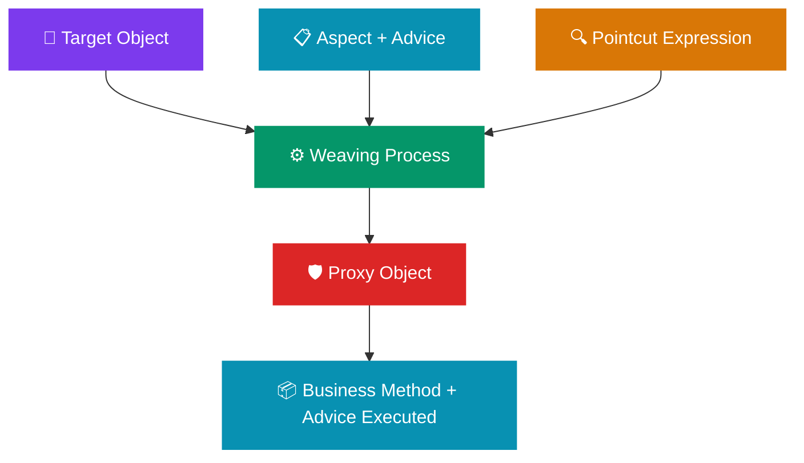
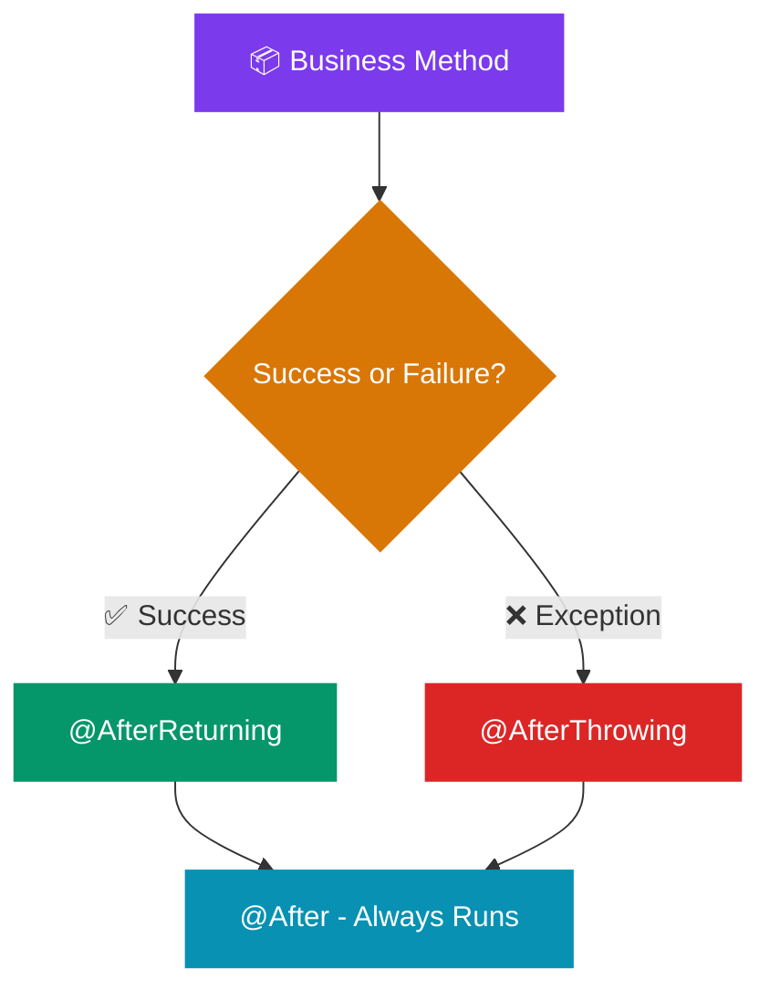
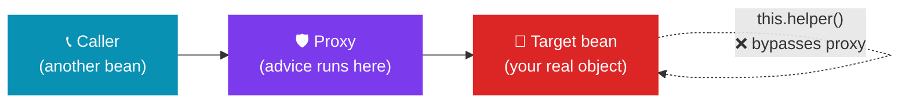
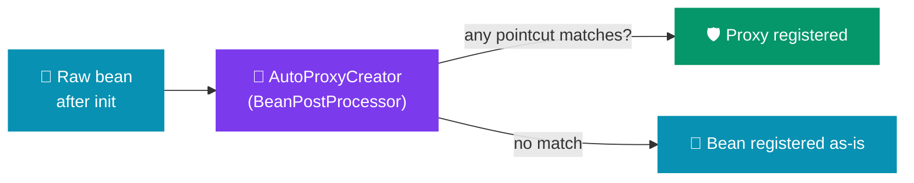
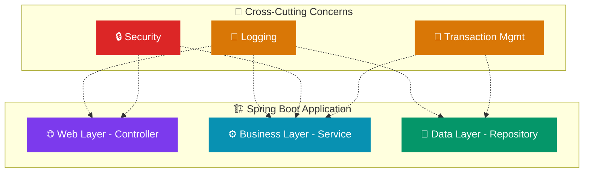
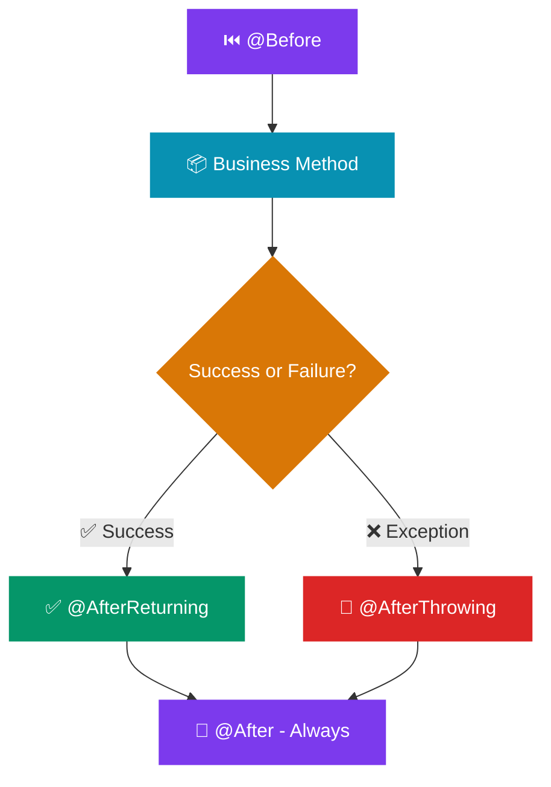

# Spring AOP using AspectJ

**Spring AOP using AspectJ** | AOP stands for Aspect Oriented Programming. Why do we use Spring AOP? We use it for cross-cutting concerns (extra tasks, like logging, that many classes need). Let us see it in detail.

📊 **Question Count by Section**

| # | Section | Questions |
|---|---|---|
| 1 | [AOP Terminologies](#1-aop-terminologies) | 2 |
| 2 | [Pointcut](#2-pointcut) | 2 |
| 3 | [Spring AOP Example](#3-spring-aop-example) | 0 |
| 4 | [More Examples of Spring AOP](#4-more-examples-of-spring-aop) | 0 |
| 5 | [Spring Boot AOP – Around Advice Example](#5-spring-boot-aop--around-advice-example) | 1 |
| 6 | [Conditional Execution of Advice](#6-conditional-execution-of-advice) | 1 |
| 7 | [Proxy Mechanics — Why Your Advice Sometimes Does Not Fire](#7-proxy-mechanics--why-your-advice-sometimes-does-not-fire) | 4 |
| 8 | [Spring AOP vs AspectJ — the Weaving Models](#8-spring-aop-vs-aspectj--the-weaving-models) | 2 |
| 9 | [Advice Ordering & the JoinPoint API](#9-advice-ordering--the-joinpoint-api) | 2 |
| 10 | [Spring Boot AOP Interview Questions](#10-spring-boot-aop-interview-questions) | 4 |
| | **Total** | **18** |

> 🔥🔥 Very High — asked in almost every Tier-1 loop &nbsp;·&nbsp; 🔥 High — very frequent in Tier-1 interviews &nbsp;·&nbsp; ⚡ Medium — commonly asked &nbsp;·&nbsp; 💤 Low — good to know, rarely asked

> 📌 **Read §7 before §1–§6 if you are short on time.** Sections 1–6 teach the *syntax* of aspects. **§7 (proxy mechanics) is what interviews really test.** Interviewers ask it right after a `@Transactional` question. Every question in §7–§9 applies without change to `@Transactional`, `@Async`, `@Cacheable`, `@Retryable` and `@PreAuthorize`. All of these are proxy-based advice, not magic annotations.

🔗 **Related files:** [`09_Spring_Core_Interview_Questions.md`](09_Spring_Core_Interview_Questions.md) (`@Transactional`, bean lifecycle, `BeanPostProcessor` — *how* the auto-proxy creator wraps beans) &nbsp;·&nbsp; `12_Exception_Handling_Interview_Questions_in_Java_&_Spring.md` (where `@ControllerAdvice` actually belongs) &nbsp;·&nbsp; [`../2_design_patterns/13_Proxy_Design_Pattern_in_Java.md`](../2_design_patterns/13_Proxy_Design_Pattern_in_Java.md) (the GoF pattern that this whole file applies).

**Cross-cutting concern** : Move the extra services of a project into other classes (service classes/Aspect classes). Then connect them where and when they are needed.

## 1. AOP Terminologies

1. **Aspect** (`@Aspect`): An Aspect is a class that gives extra services to a project. Examples: transaction management, logging, security, encoding, decoding, etc.
2. **Advice** : It is a method inside the Aspect class. It holds the real code of the Aspect. There are 5 Types of Advice:
   1. Before Advice (`@Before`): The advice runs before the business method is called.
   2. After Advice (`@After`): The advice runs after the business method is finished.
   3. Around Advice (`@Around`): The advice code has 2 sections/parts. The 1st part runs first. Then the business method runs. At last, the 2nd part of the advice runs.
   4. After Returning Advice (`@AfterReturning`): The advice runs after the business method, only if it succeeds.
   5. After Throwing Advice (`@AfterThrowing`): The advice runs after the business method, only if the business method throws an exception.
3. **Pointcut** (`@Pointcut`): It is an expression. It selects the business method that needs advice. It can never say which advice. It looks like a method header.
4. **JoinPoint** : A **point in program execution** where advice can be added. In **Spring AOP a join point is always a method execution** — nothing else. Full AspectJ also offers field get/set, constructor call, static initializer and exception-handler join points.
   - ⚠️ **Common mix-up:** a join point is *not* "advice + pointcut combined". That is an **Advisor**.
     - `org.springframework.aop.PointcutAdvisor` holds exactly one `Pointcut` + one `Advice`.
     - It is the internal unit that Spring's auto-proxy creator really works with.
     - Pointcut = **where**, Advice = **what**, JoinPoint = the concrete **execution** that matched.
5. **Target** : The real business object that the advice is applied to. It is the bean instance without the proxy. Inside advice, you get it with `jp.getTarget()`. Compare `jp.getThis()`, which returns the proxy.
6. **Weaving** : The process of linking aspects into target code. It has **four kinds**, and only the last one is Spring AOP:
   - 🏗️ **Compile-time weaving** — the AspectJ compiler (`ajc`) weaves advice into the `.class` bytecode at build time.
   - 📦 **Post-compile (binary) weaving** — weaves into classes or JARs that are already compiled.
   - 🚚 **Load-time weaving (LTW)** — a JVM agent (`-javaagent:aspectjweaver.jar` + `META-INF/aop.xml`) weaves classes as the classloader loads them.
   - 🔄 **Runtime proxy weaving** — **what Spring AOP does**. Spring does not change the bytecode of your class. Instead, it creates a *wrapper object* around the bean at startup.
7. **Proxy** : The object Spring gives out in place of the target. It does **not** contain a copy of your business logic:
   - A **CGLIB** proxy **subclasses** the target and overrides its methods. The advice runs, then the call is **delegated** to the separate target instance. It does not call `super.method()` on the proxy itself. **This is the Spring Boot default.**
   - A **JDK dynamic proxy** implements the target's **interfaces**. It **delegates** to a separate target instance through an `InvocationHandler`.

> 📌 **Naming warning about this file's title.** "Spring AOP *using AspectJ*" means you use the **AspectJ annotation syntax** (`@Aspect`, `@Pointcut`, `@Before`, …). **Spring's runtime proxies** do the work. It does **not** mean the AspectJ weaver is used. See [§8 — Spring AOP vs AspectJ](#8-spring-aop-vs-aspectj--the-weaving-models) for the real difference.



🛠️ **Example:**

```java
@Aspect
@Component                        // ⚠️ without @Component the aspect is never registered
public class TxnService {

    // ".." = zero-or-more args.  "..." (three dots) is NOT an AspectJ token.
    // Before Spring 6.1.8 startup fails. Since 6.1.8 it is only a DEBUG log: the advice never runs.
    @Pointcut("execution(public * com.app.ProductDao.*(..))")
    public void p1() {}

    @Before("p1()")               // advice declaration bound to pointcut p1()
    public void beginTx() {
        // the join point is the runtime execution of each matched ProductDao method
    }
}
```

1. **🔀 What is the difference between @After, @AfterReturning, @AfterThrowing advice? 🔥**

<!-- -->
<details>
<summary>Answer</summary>

**Answer:**

| Feature | `@After` 🔄 | `@AfterReturning` ✅ | `@AfterThrowing` 🚨 |
|---------|-------------|---------------------|---------------------|
| **When Executed** | Always — after business method | Only on successful execution | Only on exception/failure |
| **Cares about result?** | ❌️ No | ✅ Yes (success only) | ✅ Yes (failure only) |
| **Analogy** | `finally` block | `try` success path | `catch` block |

- 🔄 **After advice** (`@After`) runs after the business method. It does not care if the method succeeded or failed.
- ✅ **After returning advice** (`@AfterReturning`) runs only when the business method succeeds.
- 🚨 **After throwing advice** (`@AfterThrowing`) runs only when the business method fails (Exception).



🎯 **Interview Tip:** Compare `@After` to a `finally` block. It always runs, on success or failure.

---

</details>

---

2. **🛠️ How to implement the AOP concept? 💤**

<!-- -->
<details>
<summary>Answer</summary>

**Answer:**

It can be configured in 2 ways:

- 📜 **XML-based configuration** (`<aop:config>`, `<aop:aspect>`) — legacy, almost never used in 2026.
- ⚡ **AspectJ annotation syntax** (`@Aspect` + `@Pointcut` + `@Before`/`@Around`/…) — the modern approach, and the one Spring Boot expects.

💡 **What really turns AOP on in Spring Boot?** Not `@EnableAspectJAutoProxy`.

- **`AopAutoConfiguration`** does it for you as soon as `spring-boot-starter-aop` is on the classpath.
- That starter pulls in `aspectjweaver` for the *annotation types and pointcut parser*, not for the weaver.
- It is controlled by `spring.aop.auto` with `matchIfMissing = true`.
- Internally, the auto-config registers an `AnnotationAwareAspectJAutoProxyCreator`. This is a **`BeanPostProcessor`**. It checks every bean at creation time. If any aspect's pointcut matches the bean, it returns a proxy in its place.

🎯 **The only reason to write `@EnableAspectJAutoProxy` by hand** is to change its attributes:

- `proxyTargetClass = true/false` (force CGLIB or JDK proxy)
- `exposeProxy = true` (enable `AopContext.currentProxy()` — see [§7](#7-proxy-mechanics--why-your-advice-sometimes-does-not-fire))

---

</details>

---

## 2. Pointcut

- 🔍 A pointcut is an expression. It selects the business class method that needs advice.
- ⚠️ A pointcut can never say which advice will be connected.

⚠️ **A pointcut expression is always a *designator* around a pattern** — never a bare pattern. The most common designator is `execution(...)`:

```
execution( Specifier ReturnType Package.ClassName.MethodName(ParameterTypes) )
```

Everything inside the parentheses below is the **body** of `execution(...)`. Say you copy a bare `public * com.kp.dao.*.*(..)` into `@Pointcut(...)`. You get a **parse failure**, not a pointcut. Before Spring 6.1.8 this stops startup. Since 6.1.8, Spring only logs it at DEBUG, and the advice silently never runs.

📝 **Symbols used in pointcut expressions** (there are more than two):

| Symbol | Meaning |
|---|---|
| `*` | Wildcard for one whole element — a return type, a package segment, a class name, a method name, or one parameter type |
| `.` | Package / class separator |
| `..` | In params: **zero or more args of any type**. In a package path: **that package and all sub-packages** (`com.kp..*`) |
| `+` | **Subtype pattern** — `execution(* com.kp.dao.BaseDao+.*(..))` matches `BaseDao` and every subclass/implementor |
| `&&` `\|\|` `!` | Combine pointcuts with boolean logic — `@Pointcut("serviceLayer() && @annotation(Audited)")` |

**Examples**

1) `execution(public int com.kp.dao.EmployeeDao.saveEmployee(Employee))`
This selects the `saveEmployee()` method to connect with advice. The method is public, returns `int`, and takes one `Employee` parameter. It is defined in class `EmployeeDao` in the `com.kp.dao` package.

2) `execution(public * com.kp.dao.EmployeeDao.*())`
Zero parameters only (no parameter). Any method name inside the `EmployeeDao` class. Any return type.

3) `execution(public * com.kp.dao.EmployeeDao.*(..))`
Two dots mean zero or more params (of any type). So any parameter list is fine.

4) `execution(public * com.kp.dao.*.*(..))`
All classes inside the `com.kp.dao` package, and their methods. Note: `com.kp.dao.*` is **that package only**. Use `com.kp.dao..*` to include sub-packages.

5) `execution(* com.kp.dao.*.*(..))`
Any return type and any access modifier. But see the ⚠️ below: what the proxy can reach still limits it.

> ⚠️ **The specifier can only narrow the match. It cannot widen it past the proxy.** Proxy-based AOP can only intercept what the proxy can override or implement. A JDK proxy reaches only `public` interface methods. A CGLIB proxy also reaches `protected` and package-private methods. `private`, `static` and `final` methods are never advised. See [§7](#7-proxy-mechanics--why-your-advice-sometimes-does-not-fire).

Let us understand it in detail through an example.

**Business Methods:**

- M#1 `public int saveEmployee(Employee e) { ... }`
- M#2 `public void deleteEmployee(Integer id) { ... }`
- M#3 `public void updateEmployee(Employee e) { ... }`
- M#4 `public Employee getEmployee(Integer id) { ... }`

**Pointcut Expressions Examples**

| Expression | Pattern | Matching Methods |
|------------|---------|-----------------|
| **a)** | `execution(public * *())` — Zero params, any method name, any return type | ❌️ None (0 methods) |
| **b)** | `execution(public void *(..))` — Any params, void return type | ✅ M#2 & M#3 (2 methods) |
| **c)** | `execution(public * saveEmployee(..))` — Any params, any return type, specific name | ✅ M#1 (1 method) |
| **d)** | `execution(public * *(Integer))` — Single Integer param, any return type | ✅ M#2 & M#4 (2 methods) |

🔑 **Read the return type first.** The most common bug you create yourself is a return-type mismatch.

- Say the pointcut is `execution(public String …saveEmployee())`, but the method is `void saveEmployee()`.
- It matches **nothing**. The advice never runs, and nothing tells you.
- There is no warning. A pointcut that matches zero join points is fully legal.

1. **🎯 Why did my `@Before` advice silently not run? 🔥**

<!-- -->
<details>
<summary>Answer</summary>

**Answer:**

A pointcut that matches **zero** join points is legal AspectJ. Spring logs nothing. Go through the checklist in this order:

| # | Check | Symptom if wrong |
|---|---|---|
| 1 | Is the aspect class annotated with **both** `@Aspect` **and** `@Component` (or declared as a `@Bean`)? | `@Aspect` alone is only metadata. The class is never a bean, so nothing is registered |
| 2 | Is the aspect class inside a **component-scanned** package? | Same as above |
| 3 | Does the **return type** in the pattern match? (`void` vs `String` vs `*`) | Silent zero matches |
| 4 | Does the **arg pattern** match? `*()` = zero args; `*(..)` = any args | Silent zero matches |
| 5 | Is the target method **`public`** and on a **Spring-managed bean**? | `private`/`static`/`final` are never advised; a `new`-ed object has no proxy at all |
| 6 | Is the call **self-invocation** (`this.method()` from inside the same bean)? | The call skips the proxy completely — see [§7](#7-proxy-mechanics--why-your-advice-sometimes-does-not-fire) |
| 7 | Correct **package/class** in the pattern? Typos here are silent too | Silent zero matches |

💡 **Fastest debug:** for a short time, widen the pointcut to `execution(* com.example..*(..))` and log `jp.getSignature()`.

- If the advice runs now, it is a pattern problem (3/4/7).
- If it still does not run, it is a wiring or proxy problem (1/2/5/6).

---

</details>

---

2. **🔍 What is the difference between `execution`, `within`, `@annotation` and `bean()`? ⚡**

<!-- -->
<details>
<summary>Answer</summary>

**Answer:**

`execution` is one **pointcut designator** (PCD) among several. Spring AOP supports these:

| Designator | Matches on | Example |
|---|---|---|
| `execution(...)` | Method **signature** — the one used most | `execution(* com.app.service.*.*(..))` |
| `within(...)` | Any join point **inside a type or package** — less exact and cheaper than `execution` | `within(com.app.service..*)` |
| `@annotation(...)` | The **method** carries the annotation | `@annotation(com.app.MyTx)` |
| `@within(...)` | The **declaring class** carries the annotation | `@within(org.springframework.stereotype.Service)` |
| `@target(...)` | The **runtime class** of the target carries the annotation | `@target(com.app.Audited)` |
| `args(...)` | Runtime **argument types** | `args(java.io.Serializable)` |
| `@args(...)` | Runtime argument types carry the annotation | `@args(com.app.Validated)` |
| `this(...)` | The **proxy** is `instanceof` the given type | `this(com.app.LoanService)` |
| `target(...)` | The **target object** is `instanceof` the given type | `target(com.app.LoanServiceImpl)` |
| `bean(...)` | **Spring-only** PCD — matches by **bean name** | `bean(*Service)` |

🔗 **Composition** (combining pointcuts) is the standard practice. Write one named `@Pointcut` per condition. Then combine them with `&&`, `||` and `!`:

```java
@Pointcut("within(com.app.service..*)")
public void serviceLayer() {}

@Pointcut("@annotation(com.app.anno.Audited)")
public void audited() {}

@Around("serviceLayer() && audited() && !execution(* *.get*(..))")
public Object audit(ProceedingJoinPoint jp) throws Throwable {
    return jp.proceed();
}
```

⚠️ **`this()` vs `target()` is a common follow-up.**

- With a **JDK dynamic proxy**, the proxy implements only the *interfaces*. So `this(LoanServiceImpl)` does **not** match, but `target(LoanServiceImpl)` does.
- With a **CGLIB** proxy (the Boot default), the proxy *is* a subclass of the target class. So both match.

📌 **Performance note:**

- Spring evaluates `execution` statically where possible.
- `args`, `@args`, `this`, `target` and `@target` need **runtime** type checks on every call.
- Always add a cheap scoping designator such as `within(...)`, e.g. `within(com.app..*) && @annotation(...)`. The order you write them in does not matter: AspectJ rewrites the pointcut and checks the cheapest parts first.

---

</details>

---

## 3. Spring AOP Example

Create a spring starter project "SpringBootAOPEx". Add the following dependency:

```xml
<dependency>
    <groupId>org.springframework.boot</groupId>
    <artifactId>spring-boot-starter-aop</artifactId>
</dependency>
```

Let us see a very basic example.

```java
package com.example.demo;

import org.springframework.stereotype.Component;

// business class
@Component
public class EmployeeDao {
    public void saveEmployee() {
        System.out.println("EmployeeDao.saveEmployee()");
    }
}
```

```java
package com.example.demo;

import org.springframework.beans.factory.annotation.Autowired;
import org.springframework.boot.CommandLineRunner;
import org.springframework.stereotype.Component;

@Component
public class TestRunner implements CommandLineRunner {

    @Autowired
    EmployeeDao dao;

    @Override
    public void run(String... args) throws Exception {
        dao.saveEmployee();
    }
}
```

📤 **Output** (when we run the application):

```
EmployeeDao.saveEmployee()
```

Now we want to run some tasks before the `saveEmployee()` method call. We want to do this without changing the `EmployeeDao` and `TestRunner` classes. To do that:

Create an Aspect as follows. Do not forget `@Component` on the class, or it is never registered:

> 📌 **You do *not* need `@EnableAspectJAutoProxy` in Spring Boot.** With `spring-boot-starter-aop` on the classpath, `AopAutoConfiguration` already turns on AspectJ auto-proxying. It is controlled by `spring.aop.auto`, `matchIfMissing = true`. Adding the annotation does no harm, but it is not needed. Write it by hand only when you need `proxyTargetClass` or `exposeProxy`. In a **plain Spring Framework** (non-Boot) app, it *is* required.

```java
package com.example.demo;

import org.aspectj.lang.annotation.Aspect;
import org.aspectj.lang.annotation.Before;
import org.aspectj.lang.annotation.Pointcut;
import org.springframework.stereotype.Component;

@Aspect
@Component
public class TxnService {

    @Pointcut("execution(public void com.example.demo.EmployeeDao.saveEmployee())")
    public void p1() {
    }

    @Before("p1()")   // advice bound to pointcut p1()
    public void beginTxn() {
        System.out.println("Txn Begin");
    }
}
```

📤 **Output** (when we run the application):

```
Txn Begin
EmployeeDao.saveEmployee()
```

The same can be done inline, without a named `@Pointcut`:

```java
@Aspect
@Component
public class TxnService {

    // ⚠️ Return type must be `void` (or `*`) — saveEmployee() returns void.
    // Writing `public String ...` here would match NOTHING and the advice
    // would silently never run.
    @Before("execution(public void com.example.demo.EmployeeDao.*())")
    public void beforeTxn() {
        System.out.println("Txn Begin");
    }
}
```

💡 **Named `@Pointcut` vs inline expression:**

- A named pointcut can be reused by several advice methods. You can combine it with `&&`/`||`.
- An inline string is fine for a single use.
- Note: the named-pointcut method returns `void` and has an empty body. Make it `public` if other aspects refer to it. Inside the same aspect, `private` also works. It is a *marker*. It is never called.

## 4. More Examples of Spring AOP

```java
package com.example.demo;

import java.util.Random;

import org.springframework.stereotype.Component;

// business class
@Component
public class EmployeeDao {
    public void saveEmployee() {
        System.out.println("EmployeeDao.saveEmployee()");

        if (new Random().nextInt(15) <= 5) {
            throw new RuntimeException("Dummy Exception");
        }
    }
}
```

```java
package com.example.demo;

import org.aspectj.lang.annotation.After;
import org.aspectj.lang.annotation.AfterReturning;
import org.aspectj.lang.annotation.AfterThrowing;
import org.aspectj.lang.annotation.Aspect;
import org.aspectj.lang.annotation.Before;
import org.aspectj.lang.annotation.Pointcut;
import org.springframework.stereotype.Component;

@Aspect
@Component
public class TxnService {

    @Pointcut("execution(public void com.example.demo.EmployeeDao.saveEmployee())")
    public void p1() {
    }

    @Before("p1()")
    public void beginTxn() {
        System.out.println("Txn Begin");
    }

    @AfterReturning("p1()")
    public void commitTxn() {
        System.out.println("Txn is committed");
    }

    @AfterThrowing("p1()")
    public void rollbackTxn() {
        System.out.println("Txn is rollback");
    }

    @After("p1()")
    public void sendReport() {
        System.out.println("Report sent");
    }
}
```

📤 **Output** (in case of failure):

```
Txn Begin
EmployeeDao.saveEmployee()
Txn is rollback
Report sent
```

📤 **Output** (in case of success):

```
Txn Begin
EmployeeDao.saveEmployee()
Txn is committed
Report sent
```

🔑 **Key Point:** The `@After` advice always runs. It runs when the business method succeeds and also when it fails.

🧭 **Why does `Report sent` (`@After`) print *after* `Txn is committed` (`@AfterReturning`)?** This is a **planned rule, not an accident**.

- Since **Spring Framework 5.2.7**, Spring orders advice methods in the **same `@Aspect` class** by advice type.
- The order, from highest to lowest precedence, is: `@Around` → `@Before` → `@After` → `@AfterReturning` → `@AfterThrowing`.
- On the way out, "after" advice with higher precedence runs **last**.
- So `@After` works like AspectJ's *after-finally*. It runs after `@AfterReturning`/`@AfterThrowing`.
- Before 5.2.7, the order inside one aspect was **undefined**. A doc or blog may say `@After` runs first on the way out. That text is older than this change.
- Across **different** aspects, the rule is different. Use `@Order`/`Ordered` — see [§9](#9-advice-ordering--the-joinpoint-api).

⚠️ **`@AfterThrowing` does not swallow the exception.** It is only a *notification*. After the advice runs, the original exception still propagates to the caller. Only `@Around` can really stop an exception. Usually it should not do that — see [§5](#5-spring-boot-aop--around-advice-example).

We can also show the exception details in the advice:

```java
@AfterThrowing(value = "p1()", throwing = "th")
public void rollbackTxn(Throwable th) {
    System.out.println("Txn is rollback: " + th.getMessage());
}
```

In the same way, if the business method returns a value, the advice can get it:

```java
@Component
public class EmployeeDao {
    public String saveEmployee() {
        // existing code
        return "Hello";
    }
}
```

The `saveEmployee()` method now returns a string. So the pointcut `execution` expression should also use the `String` return type:

```java
@Aspect
@Component
public class TxnService {

    @Pointcut("execution(public String com.example.demo.EmployeeDao.saveEmployee())")
    public void p1() {
    }

    @AfterReturning(value = "p1()", returning = "ob")
    public void commitTxn(Object ob) {
        System.out.println("Txn is committed: " + ob);
    }
}
```

📤 **Output:**

```
EmployeeDao.saveEmployee()
Txn is committed: Hello
```

## 5. Spring Boot AOP – Around Advice Example

```java
@Component
public class EmployeeDao {
    public String saveEmployee() {
        System.out.println("EmployeeDao.saveEmployee()");
        return "Hello";
    }
}
```

```java
package com.example.demo;

import org.aspectj.lang.ProceedingJoinPoint;
import org.aspectj.lang.annotation.Around;
import org.aspectj.lang.annotation.Aspect;
import org.aspectj.lang.annotation.Pointcut;
import org.springframework.stereotype.Component;

@Aspect
@Component
public class TxnService {

    @Pointcut("execution(* com.example.demo.EmployeeDao.*())")
    public void p1() {
    }

    // ✅ The canonical shape: return Object, declare `throws Throwable`,
    //    use try/finally so the "after" side runs on BOTH paths.
    @Around("p1()")
    public Object aroundTest(ProceedingJoinPoint jp) throws Throwable {
        System.out.println("Before business method");
        try {
            Object obj = jp.proceed();                    // call business method
            System.out.println("Return data: " + obj);
            return obj;                                   // caller sees the real value
        } finally {
            System.out.println("After business method");  // success AND exception
        }
    }
}
```

📤 **Output:**

```
Before business method
EmployeeDao.saveEmployee()
Return data: Hello
After business method
```

🧠 **In Simple Words:**

- The advice calls the business method through the join point, that is, `ProceedingJoinPoint`.
- Its `proceed()` method invokes the business method. It returns whatever the business method returned.
- **The caller sees whatever the `@Around` advice returns.**
- So if you forget to return the result of `jp.proceed()`, the caller gets `null`, with no error.

<details>
<summary><strong>🤔 Doubt: Why not just use `catch (Throwable e) { e.printStackTrace(); }` inside `@Around`?</strong></summary>

This is the most common `@Around` bug. Learn to spot it, because it *looks* safe:

```java
// ❌️ ANTI-PATTERN — do not ship this
@Around("p1()")
public Object bad(ProceedingJoinPoint jp) {
    try {
        return jp.proceed();
    } catch (Throwable e) {
        e.printStackTrace();
    }
    return null;              // the exception has been erased
}
```

If the aspect swallows the `Throwable` and returns `null`, it **gives its caller a false result**. An interviewer will expect these four results:

| # | Consequence |
|---|---|
| 1 | 💰 **The transaction commits.** Say a `@Transactional` proxy sits *outside* this aspect. It never sees the exception. So the rollback rule never fires, and a half-finished unit of work is committed. |
| 2 | 💥 **`AopInvocationException`** — `"Null return value from advice does not match primitive return type for: ..."`. You get this as soon as the target method returns `int`/`boolean`/`long`. |
| 3 | 🚫 **`@AfterThrowing` never fires** on any inner aspect. Error metrics and alerts stop seeing the failure. |
| 4 | 🧨 **The caller branches on `null`** and fails later, far from the real cause. This is the well-known "NPE three layers away from the bug". |

✅ **Two correct forms:**

```java
// (a) instrument only — let everything through
try { return jp.proceed(); } finally { /* timing, MDC cleanup */ }

// (b) observe the failure, then RETHROW
try {
    return jp.proceed();
} catch (Throwable t) {
    log.error("failed {}", jp.getSignature().toShortString(), t);
    throw t;                  // ← non-negotiable
}
```

📌 The advice method must declare `throws Throwable`. That is what makes (a) and (b) compile. It costs nothing. The caller gets the same exception object, unchanged, if it is a `RuntimeException`, an `Error`, or a checked exception the method declares. An **undeclared** checked exception reaches the caller wrapped in `UndeclaredThrowableException`.

---

</details>
<br/>

The return value passes through `@Around`. So the advice can **modify** it:

```java
@Around("p1()")
public Object modifyResult(ProceedingJoinPoint jp) throws Throwable {
    String obj = (String) jp.proceed();
    return obj + " - Modified data";
}
```

We can also **replace the arguments** passed to the business method.

- `proceed(Object[])` takes the new argument array.
- Its length and types must match the target's signature.

```java
@Around("execution(* com.example.demo.EmployeeDao.save(..))")
public Object replaceArgs(ProceedingJoinPoint jp) throws Throwable {
    Object[] args = jp.getArgs();          // the original arguments
    Employee sanitized = ((Employee) args[0]).withTrimmedName();
    return jp.proceed(new Object[] { sanitized });
}
```

Also, the advice may call `proceed()` **once, many times, or not at all**. This is how you build a caching or retry aspect:

```java
// not at all → serve from cache (the same idea as @Cacheable's CacheInterceptor)
Object hit = cache.get(key);
if (hit != null) {
    return hit;
}

// many times → retry with backoff (the same idea as @Retryable's retry interceptor)
for (int attempt = 1; attempt <= 3; attempt++) {
    try {
        return jp.proceed();
    } catch (TransientException e) {
        if (attempt == 3) {
            throw e;
        }
        Thread.sleep(200L * attempt);
    }
}
```

1. **⚡ When would you use `@Around` instead of `@Before` + `@After`? 🔥**

<!-- -->
<details>
<summary>Answer</summary>

**Answer:**

Use `@Around` **only** when you need one of the four things that the other advice types cannot do:

| Capability | `@Around` | `@Before`/`@After`/`@AfterReturning`/`@AfterThrowing` |
|---|:---:|:---:|
| Skip the target method entirely (caching, feature flag, short-circuit) | ✅ | ❌️ |
| Call the target **more than once** (retry) | ✅ | ❌️ |
| **Modify** arguments (`proceed(Object[])`) or the return value | ✅ | ❌️ |
| Wrap the call in a resource that spans both sides (timer, `try`-with-resources, MDC, `SecurityContext`) | ✅ | ⚠️ possible but split across two methods and a `ThreadLocal` |
| Convert or suppress an exception | ✅ | ❌️ (`@AfterThrowing` only observes) |

❌️ **Do not** use `@Around` for plain "log entry / log exit". `@Before` + `@After` show the intent more clearly. They also cannot forget to call `proceed()`.

🎯 **The best example of when you need `@Around`:** a **latency timer**.

- `@Before` + `@After` would need a `ThreadLocal<Long>` to carry the start time across two methods.
- The `@After` must also call `remove()`. If you forget, the old value stays on the pooled thread.
- `@Around` keeps it in a local variable:

```java
@Around("@annotation(com.app.anno.Timed)")
public Object time(ProceedingJoinPoint jp) throws Throwable {
    long start = System.nanoTime();
    try {
        return jp.proceed();
    } finally {
        long ms = (System.nanoTime() - start) / 1_000_000;
        log.info("{} took {} ms", jp.getSignature().toShortString(), ms);
    }
}
```

⚠️ **The downside:** `@Around` is the only advice that can *break* the application. It can forget to `proceed()`, or it can swallow an exception. Use the least powerful advice type that does the job.

---

</details>

---

## 6. Conditional Execution of Advice

⚡ **Requirement:** Call the advice only if the business method has the `@MyTx` annotation. **This is the most often used concept.**

First, create an annotation:

```java
package com.example.demo.anno;

import java.lang.annotation.ElementType;
import java.lang.annotation.Retention;
import java.lang.annotation.RetentionPolicy;
import java.lang.annotation.Target;

@Retention(RetentionPolicy.RUNTIME)
@Target(ElementType.METHOD)
public @interface MyTx {
}
```

**Business Class:**

```java
package com.example.demo;

import org.springframework.stereotype.Component;

import com.example.demo.anno.MyTx;

// business class
@Component
public class EmployeeDao {

    @MyTx
    public String saveEmployee() {
        System.out.println("EmployeeDao.saveEmployee()");
        return "Hello";
    }
}
```

In the advice, use `@annotation` when you declare the pointcut:

```java
package com.example.demo;

import org.aspectj.lang.annotation.Aspect;
import org.aspectj.lang.annotation.Before;
import org.aspectj.lang.annotation.Pointcut;
import org.springframework.stereotype.Component;

@Aspect
@Component
public class TxnService {

    @Pointcut("@annotation(com.example.demo.anno.MyTx)")
    public void p1() {
    }

    @Before("p1()")
    public void beforeTxn() {
        System.out.println("Before Txn");
    }
}
```

📤 **Output:**

```
Before Txn
EmployeeDao.saveEmployee()
```

### 6.1 Reading the annotation's attributes inside the advice

The version above only asks *"is the annotation present?"*. Real annotation-driven aspects carry **attributes** and read them. That is the part that matters. Give `@MyTx` some attributes:

```java
@Retention(RetentionPolicy.RUNTIME)
@Target(ElementType.METHOD)
public @interface MyTx {
    int timeoutSeconds() default 30;
    boolean readOnly() default false;
}
```

Then **bind the annotation instance as an advice parameter**. The parameter *name* must match the name used inside `@annotation(...)`:

```java
@Around("@annotation(myTx)")                       // ← "myTx" = the parameter name
public Object advise(ProceedingJoinPoint jp, MyTx myTx) throws Throwable {
    if (myTx.readOnly()) {
        log.debug("read-only path, timeout={}s", myTx.timeoutSeconds());
    }
    return jp.proceed();
}
```

🔑 **Three things to note:**

- ✅ The retention policy **must** be `RUNTIME`. The default is `CLASS` retention. AspectJ cannot bind a `CLASS` annotation, because it does not exist at runtime. Before Spring 6.1.8 this stops startup. Since 6.1.8, Spring only logs it at DEBUG, and the advice never runs, with no warning.
- ✅ When you bind by parameter name, the advice body needs **no reflection code**. You never need `method.getAnnotation(MyTx.class)`.
- ✅ You can bind the *target*'s arguments in the same way. `@Around("@annotation(myTx) && args(loanId,..)")` gives you `(ProceedingJoinPoint jp, MyTx myTx, Long loanId)`.

📌 **This is exactly how Spring's own annotations work.** Take `@Transactional(timeout = 5, readOnly = true)`, `@Cacheable(value = "rates", key = "#id")` and `@Retryable(maxAttempts = 3)`. An interceptor reads each of them from the method at call time. Write this pattern once, and all of them become clear.

<details>
<summary><strong>🤔 Doubt: Why does binding break with a `NullPointerException` or "inconsistent binding" error?</strong></summary>

There are two causes. Both are easy to run into:

1. **Name mismatch.** `@Around("@annotation(myTx)")` binds to the parameter with the *exact name* `myTx`. Say you rename the parameter to `tx` but do not update the string. Then AspectJ reads `myTx` as a type name, not a parameter. It throws `IllegalArgumentException: error Type referred to is not an annotation type: myTx`. Before Spring 6.1.8 this stops startup. Since 6.1.8, Spring only logs it at DEBUG, and the advice silently never runs.
2. **Parameter names stripped at compile time.** Binding depends on reading parameter names from the bytecode.
   - Spring Boot turns on `-parameters` by default: `spring-boot-starter-parent` does it for Maven, and the Boot Gradle plugin does it for Gradle. So this normally works.
   - But a hand-made build without `-parameters` cannot always resolve the formal parameter. Since Spring 6.1, debug info no longer helps: Spring removed the `LocalVariableTable` fallback. Then Spring tries to guess the names from the pointcut. For one bound annotation, like `@annotation(myTx)`, the guess works. For two arguments of the same type, like `args(a,b)` on two `Long` parameters, it cannot guess. Startup then fails with `AmbiguousBindingException`, on every Spring 6 version.
   - Fix the compiler flag. Do **not** work around it by falling back to reflection.

⚠️ The annotation instance can be `null` **only** in one case: when the pointcut also matches methods that do not have it (e.g. `@annotation(myTx) || execution(...)`). With a plain `@annotation(myTx)` pointcut, it is never null.

---

</details>
<br/>

1. **🏷️ How would you build an `@Auditable` annotation that logs who changed what? 🔥**

<!-- -->
<details>
<summary>Answer</summary>

**Answer:**

There are four pieces: the annotation, the pointcut, the binding, and the join-point reflection.

```java
@Retention(RetentionPolicy.RUNTIME)
@Target(ElementType.METHOD)
public @interface Auditable {
    String action();
    boolean captureArgs() default false;
}
```

```java
@Aspect
@Component
@RequiredArgsConstructor
public class AuditAspect {

    private final AuditRepository auditRepository;

    @Around("@annotation(auditable)")
    public Object audit(ProceedingJoinPoint jp, Auditable auditable) throws Throwable {
        MethodSignature sig = (MethodSignature) jp.getSignature();
        String actor = SecurityContextHolder.getContext().getAuthentication().getName();
        long start = System.nanoTime();
        try {
            Object result = jp.proceed();
            record(auditable, sig, jp, actor, "SUCCESS", null, start);
            return result;
        } catch (Throwable t) {
            record(auditable, sig, jp, actor, "FAILED", t.getMessage(), start);
            throw t;                                  // ← never swallow
        }
    }

    private void record(Auditable a, MethodSignature sig, ProceedingJoinPoint jp,
                        String actor, String outcome, String error, long start) {
        AuditEvent e = new AuditEvent();
        e.setAction(a.action());
        e.setMethod(sig.getDeclaringType().getSimpleName() + "." + sig.getName());
        e.setActor(actor);
        e.setOutcome(outcome);
        e.setError(error);
        e.setDurationMs((System.nanoTime() - start) / 1_000_000);
        if (a.captureArgs()) {
            e.setPayload(Arrays.toString(jp.getArgs()));   // ⚠️ mask PII first
        }
        auditRepository.save(e);
    }
}
```

Usage:

```java
@Auditable(action = "LOAN_APPROVED", captureArgs = true)
public Loan approve(Long loanId, String remarks) { ... }
```

⚠️ **Four production concerns the interviewer wants to hear:**

1. 🔐 **PII in `getArgs()`** — never dump raw arguments. Mask or allow-list the fields, or capture only IDs. This is why `captureArgs` defaults to `false`.
2. 🔄 **Transaction boundary** — say `audit()` writes in the *same* transaction, and the business method rolls back. Then **the audit row rolls back too**. Usually you want `@Transactional(propagation = REQUIRES_NEW)` on the audit write, or an async/outbox write. Put that `REQUIRES_NEW` method on a **separate bean** (e.g. an `AuditWriter`). A call to a method in the aspect itself is self-invocation and skips the proxy. Then the failure record survives.
3. 🐌 **A synchronous DB insert per call** makes every request wait for the audit write. If the call is hot (called very often), publish an `ApplicationEvent` (or Kafka message). Then save it on another thread.
4. 🚪 **Self-invocation** — say you annotate a method, and another method in the same bean calls it. Then nothing is audited. See [§7](#7-proxy-mechanics--why-your-advice-sometimes-does-not-fire).

---

</details>

---

## 7. Proxy Mechanics — Why Your Advice Sometimes Does Not Fire

Interviewers really ask about this section. It is the standard follow-up question after `@Transactional`.

Everything below applies **identically** to `@Transactional`, `@Async`, `@Cacheable`, `@Retryable` and `@PreAuthorize`. They are all proxy-based advice.



1. **🚪 What is the self-invocation problem in Spring AOP? 🔥🔥**

<!-- -->
<details>
<summary>Answer</summary>

**Answer:**

**A method called via `this.` from inside the same bean never goes through the proxy. So no advice runs at all.**

- Spring does not change your class.
- It creates a **separate wrapper object** — the proxy.
- It injects *that* proxy into every bean that autowires your bean.
- The advice lives on the proxy.
- Inside your own method, `this` is the **raw target**, not the proxy.
- So an internal call is a plain Java virtual call. It goes straight to the method body.

```java
@Service
public class LoanService {

    public void processBatch(List<Long> ids) {
        for (Long id : ids) {
            processOne(id);       // ❌️ this.processOne(...) — NO transaction, NO advice
        }
    }

    @Transactional
    public void processOne(Long id) { ... }
}
```

Say a controller calls `loanService.processBatch(...)`. The steps are:

1. The call reaches the proxy.
2. The proxy has no advice for `processBatch`, so it delegates to the target.
3. The target calls `this.processOne(...)`.
4. **The proxy is not involved in this call.**

Every row is written without a transaction. There is **no error and no log line** to tell you.

🎯 **The three fixes, ranked:**

| # | Fix | Verdict |
|---|---|---|
| 1 | **Move the method to a different bean** and autowire it in | ✅ **Best.** No Spring tricks, easy to test. It usually shows that the two methods had different responsibilities anyway |
| 2 | **Self-injection** — `@Autowired @Lazy private LoanService self;` then `self.processOne(id)` | ⚠️ Works. `@Lazy` breaks the circular reference. Without it, you may also need `spring.main.allow-circular-references=true` on Boot 2.6+. Ugly and confusing to readers |
| 3 | **`AopContext.currentProxy()`** — needs `@EnableAspectJAutoProxy(exposeProxy = true)` | ⚠️ **Last resort.** It ties business code to Spring AOP. If anyone forgets the flag, it fails with `IllegalStateException: Cannot find current proxy` |

```java
// Fix 3 — the escape hatch
@SpringBootApplication
@EnableAspectJAutoProxy(exposeProxy = true)     // ← required, or currentProxy() throws
public class App { }

// inside LoanService
((LoanService) AopContext.currentProxy()).processOne(id);
```

⚠️ **Related trap:** advice applies **only to Spring-managed beans**. A `new LoanService()` has no proxy at all. So `@Transactional` on it does nothing. This is also why a unit test that creates the class with `new` never runs the advice.

🔍 **How to detect it in a running app:**

- Set `logging.level.org.springframework.transaction.interceptor=TRACE`.
- You will see a `Getting transaction for [...]` line for every call that *did* go through the proxy.
- If a method you expected prints no such line, the call did not go through the proxy. Self-invocation is the usual cause. Others: a `private` or `final` method, or an object created with `new`.

---

</details>

---

2. **🔀 JDK dynamic proxy vs CGLIB — which does Spring use, and when does it matter? 🔥🔥**

<!-- -->
<details>
<summary>Answer</summary>

**Answer:**

| | **JDK dynamic proxy** | **CGLIB** |
|---|---|---|
| **Mechanism** | `java.lang.reflect.Proxy` implements the target's **interfaces** and delegates via an `InvocationHandler` | Generates a **subclass** of the target class and overrides its methods |
| **Requires an interface?** | ✅ Yes — mandatory | ❌️ No |
| **Proxy type is** | Only the interfaces (`LoanService`) | The class **and** its interfaces (`LoanServiceImpl$$SpringCGLIB$$0`) |
| **Cannot proxy** | A class with no interface | A `final` class; `final`/`private`/`static` methods are not overridden |

🎯 **Which one does Spring pick?**

| Setup | Result |
|---|---|
| **Spring Boot** — `AopAutoConfiguration` applies `proxyTargetClass = true` (`spring.aop.proxy-target-class`, `matchIfMissing = true`) | **CGLIB for everything**, interface or not |
| **Plain Spring Framework** — `proxyTargetClass = false`, the framework default | **JDK proxy** if the bean implements ≥ 1 interface, **CGLIB** if it implements none |

People often say *"Spring uses JDK proxies by default"*. This is **wrong for Spring Boot**, and you are almost certainly running Spring Boot.

⚠️ **Where the choice causes a bug:** set `spring.aop.proxy-target-class=false` in a Boot app, and this code breaks —

```java
@Autowired
private LoanServiceImpl loanService;   // 💥 BeanNotOfRequiredTypeException
```

— because the JDK proxy is a `LoanService`, not a `LoanServiceImpl`. **Autowire the interface, not the implementation.** (Under CGLIB this code happens to work. That is why the bug only appears when someone changes the setting.)

🚫 **The hard limits of proxy-based AOP** — no configuration can remove these:

| Cannot be advised | Why |
|---|---|
| **`private`** methods | Not visible to a subclass, not on any interface |
| **`static`** methods | Not dispatched virtually — there is nothing to override |
| **`final`** methods | Cannot be overridden by the CGLIB subclass |
| A **`final` class** | Cannot be subclassed at all — CGLIB fails outright |
| Methods on a **`new`-ed** object | No container, therefore no proxy |
| **Constructors** and **field access** | Not method-execution join points |
| **Self-invocation** (`this.m()`) | Never crosses the proxy — see Q1 |

📌 **The safe rule to state in an interview: only `public` methods on Spring-managed beans, called from outside the bean.**

(Spring's docs say a CGLIB proxy also intercepts `protected` and package-private methods. A JDK proxy reaches only `public` interface methods. So the `public`-only rule is the one that is safe for both proxy types. Do not rely on the rest.)

🔍 **How to check at runtime:**

- `AopUtils.isAopProxy(bean)`, `AopUtils.isJdkDynamicProxy(bean)`, `AopUtils.isCglibProxy(bean)`.
- `AopProxyUtils.ultimateTargetClass(bean)` — gets the real class behind the proxy.

---

</details>

---

3. **⚙️ How does Spring actually create the proxy? 🔥**

<!-- -->
<details>
<summary>Answer</summary>

**Answer:**

Through a **`BeanPostProcessor`**. This explains two things:

- AOP is invisible from your code.
- AOP can only apply to container-managed beans.

1. `AopAutoConfiguration` (or `@EnableAspectJAutoProxy`) registers an **`AnnotationAwareAspectJAutoProxyCreator`**. This is a `BeanPostProcessor` — to be exact, a `SmartInstantiationAwareBeanPostProcessor`.
2. At startup, it scans all beans for `@Aspect` classes. It turns each advice method into an **`Advisor`** (one `Pointcut` + one `Advice`).
3. For **every** bean, in `postProcessAfterInitialization`, it asks each `Advisor`'s pointcut: *"does this bean have any matching method?"*
4. If any matches, it returns a **proxy** in place of the bean. Otherwise it returns the bean unchanged. The container stores whatever came back. So other beans get the proxy without knowing it.
5. At call time, the proxy runs the matching advisors as an **interceptor chain** (`ReflectiveMethodInvocation`). Calling `proceed()` moves to the next interceptor. The last one invokes the target method.



🔑 **Three results to mention in the interview:**

- 🕐 **Proxying happens at bean creation**, not at call time. So a bean injected *before* proxying can be the raw target. This is rare. It can happen with some `BeanPostProcessor` ordering, or with circular references that have no `@Lazy`.
- 🧩 **Extra advice joins the same chain**. Spring does not wrap the proxy in a second proxy. `@Transactional` + a custom `@Around` on the same method run inside **one** proxy. Advisor precedence sets their order.
- 🔗 It is the same `BeanPostProcessor` extension point covered in [`09_Spring_Core_Interview_Questions.md`](09_Spring_Core_Interview_Questions.md). If you say "AOP is just a `BeanPostProcessor`", you connect two topics in one sentence.

---

</details>

---

4. **🧱 When would you use a Servlet filter or an interceptor instead of an aspect? ⚡**

<!-- -->
<details>
<summary>Answer</summary>

**Answer:**

Pick the layer that has the information your logic needs.

| | **Servlet `Filter`** | **`HandlerInterceptor`** | **AOP `@Aspect`** |
|---|---|---|---|
| **Layer** | Servlet container, before Spring MVC | Spring MVC, around the handler | Any Spring bean method |
| **Keys on** | Raw HTTP request/response, URL patterns | The resolved handler + `ModelAndView` | Method signature / annotation |
| **Sees** | Everything, including requests that never reach a controller (404s, CORS pre-flight, security rejections) | Only requests that matched a handler | Only bean method calls |
| **Can it wrap the body?** | ✅ Yes (`ContentCachingRequestWrapper`) | ❌️ No | ❌️ N/A |
| **Works for non-web calls?** | ❌️ No | ❌️ No | ✅ Yes — schedulers, Kafka consumers, batch jobs |
| **Typical use** | Request/response logging, correlation IDs, auth token extraction, gzip | Locale/theme, per-handler auth checks, timing per handler | Transactions, caching, retry, audit, method timing |

🎯 **The decision rule:**

- If the concern is defined by the **HTTP request**, use a filter.
- If it is defined by a **method signature or annotation**, use an aspect.

Examples:

- Correlation-ID injection is a filter. It must exist before any controller runs, and it must cover error paths.
- `@Auditable` on a service method is an aspect. There is no HTTP request in a Kafka consumer.

⚠️ **The order of the two is a common trap:**

- Filters run fully **outside** the Spring AOP proxy.
- So a filter always sees the request before any aspect. On the way out, it sees it after any aspect.
- An `@Around` aspect can never see a request that the security filter chain rejected.

---

</details>

---

## 8. Spring AOP vs AspectJ — the Weaving Models

1. **⚖️ What is the difference between Spring AOP and AspectJ? 🔥🔥**

<!-- -->
<details>
<summary>Answer</summary>

**Answer:**

They are two different technologies. They happen to share an **annotation syntax**.

This file's title says AspectJ. But the whole file uses AspectJ *annotations* with **Spring AOP proxies**. The AspectJ weaver (the tool that changes bytecode) is never involved.

| | **Spring AOP** | **AspectJ** |
|---|---|---|
| **Weaving** | **Runtime** — a proxy object wraps the bean | **Compile-time** (`ajc`), **post-compile** (binary), or **load-time** (`-javaagent:aspectjweaver.jar` + `META-INF/aop.xml`) |
| **Join points** | **Method execution only** | Method execution **and** call, constructor call/execution, field get/set, static initializer, exception handler, advice execution |
| **Applies to** | **Spring beans only** | **Any object**, including `new`-ed objects, calls into JDK classes and third-party JARs |
| **Self-invocation** | ❌️ Bypassed — the classic trap | ✅ Works — the bytecode itself is woven |
| **`private`/`static`/`final`** | ❌️ Never advised | ✅ Can be advised |
| **Build/runtime setup** | None — `spring-boot-starter-aop` and you are done | AspectJ compiler or a JVM agent |
| **Overhead** | Per-call proxy dispatch; nothing at build time | Lower call overhead (advice is woven into the bytecode, no proxy hop); slower build / class-loading |
| **Type safety of pointcuts** | Before Spring 6.1.8, a syntax error or an unknown type name fails startup. Since 6.1.8, both only give a DEBUG log. A wrong method name or return type always matches nothing, silently | Checked at build time — a syntax error fails the build; a pointcut that matches nothing gives an `adviceDidNotMatch` warning |

🎯 **How to answer briefly:** *"Spring AOP is proxy-based. So it only intercepts method executions on Spring beans that go through the proxy — to be safe, `public` ones — and self-invocation gets past it. AspectJ weaves the bytecode — at compile time or load time. So it can advise anything, including private methods and objects Spring doesn't manage. In practice I use Spring AOP for 99% of cases. I would only use AspectJ's load-time weaving if I really had to intercept something the proxy can't reach."*

📌 **`spring-boot-starter-aop` pulls in `aspectjweaver` — does that mean I'm using AspectJ?** No. Spring uses that jar for two things:

- the **annotation types** (`@Aspect`, `@Pointcut`, …)
- the **pointcut expression parser**

The weaver itself does nothing unless you attach the java agent.

---

</details>

---

2. **🚚 How would you enable AspectJ load-time weaving in a Spring Boot app? ⚡**

<!-- -->
<details>
<summary>Answer</summary>

**Answer:**

It needs two parts, plus an optional third. But to be honest, you rarely need this.

**1.** Attach the weaver as a JVM agent:

```
java -javaagent:/path/aspectjweaver.jar -jar app.jar
```

**2.** Tell the weaver which packages and aspects to weave, in `META-INF/aop.xml`:

```xml
<aspectj>
    <weaver options="-Xset:weaveJavaxPackages=false">
        <include within="com.example.demo..*"/>
    </weaver>
    <aspects>
        <aspect name="com.example.demo.AuditAspect"/>
    </aspects>
</aspectj>
```

**3.** Optional: turn on Spring's LTW (load-time weaving) support. Then Spring gives its own `LoadTimeWeaver` to the context. In a plain `java -jar` app, this needs the `spring-instrument.jar` agent, not only the AspectJ agent:

```java
@Configuration
@EnableLoadTimeWeaving
public class WeavingConfig { }
```

(Spring also ships two more things:

- `spring-instrument.jar` — another agent. Step 3 needs it in a plain `java -jar` app.
- `@EnableSpringConfigured` — injects dependencies into non-Spring objects woven by AspectJ.)

⚠️ **Why this is rare in practice:**

- 🐢 Class loading becomes slower, by an amount you can measure. Every loaded class passes through the weaver.
- 🧩 The `-javaagent` flag must be present in **every** environment: local, CI, Docker `ENTRYPOINT`, Kubernetes. If you forget it in one place, the aspects disappear with no error.
- 🐞 Debugging is harder. The woven bytecode no longer matches your source line by line.
- 🎯 **Almost every real need is better solved by restructuring the code.** For example, to fix self-invocation, move the method to another bean instead of weaving.

✅ **The real cases for it:**

- advising **domain objects Spring does not manage** (JPA entities, `new`-ed value objects)
- intercepting **field access**
- instrumenting **third-party library classes** you cannot annotate

---

</details>

---

## 9. Advice Ordering & the JoinPoint API

1. **🔢 Two aspects match the same method — which one runs first? 🔥**

<!-- -->
<details>
<summary>Answer</summary>

**Answer:**

There are **two independent rules**. People often mix them up.

**Rule A — across different aspects: `@Order` / `Ordered`.**

```java
@Aspect
@Component
@Order(1)                      // lower value = higher precedence = OUTERMOST
public class LoggingAspect { }

@Aspect
@Component
@Order(2)
public class AuditAspect { }
```

- **Lower value = higher precedence = runs first on the way in, last on the way out.** It wraps the other aspects from the outside.
- ⚠️ **`@Order` on a single advice *method* does nothing.** It must be on the aspect **class** (or the class implements `Ordered`).
- Without an explicit order, the precedence between two aspects is **undefined**. Never rely on class name or declaration order.

**Rule B — within one aspect: fixed by advice type (Spring 5.2.7+).**

- The order, highest to lowest precedence: `@Around` → `@Before` → `@After` → `@AfterReturning` → `@AfterThrowing`.
- Higher-precedence "after" advice finishes last on the way out.
- So `@After` behaves as **after-finally**. It runs *after* `@AfterReturning`/`@AfterThrowing`.
- Before 5.2.7, this order was undefined.

📌 **Where Spring's own advice sits:** by default, `@Transactional` has the order `Ordered.LOWEST_PRECEDENCE`. So a custom aspect with any `@Order` value **lower** than that wraps **outside** the transaction. An aspect with no `@Order` also has `LOWEST_PRECEDENCE`, so the order between it and the transaction is undefined. That matters:

| Your aspect is… | Consequence |
|---|---|
| **Outside** the transaction (`@Order(1)`) | Your advice runs *before* the transaction opens and *after* it commits. Correct for logging "the transaction succeeded". **Wrong** for anything that must join the transaction |
| **Inside** the transaction (give the transaction a higher precedence, e.g. `@EnableTransactionManagement(order = 0)`, and your aspect `@Order(1)`) | Your DB writes join the same transaction and roll back with it. Correct for a transactional audit trail. **Wrong** for a failure log that must survive the rollback |

🎯 This question usually leads to a follow-up about this choice: "does my audit row survive the rollback?"

---

</details>

---

2. **🔬 What can you read off a `JoinPoint` inside advice? ⚡**

<!-- -->
<details>
<summary>Answer</summary>

**Answer:**

`JoinPoint` lets you read the details of the intercepted call through reflection. Its subtype `ProceedingJoinPoint` is for `@Around` only.

| Call | Returns |
|---|---|
| `jp.getSignature()` | A `Signature` — cast to **`MethodSignature`** for the real detail |
| `((MethodSignature) jp.getSignature()).getMethod()` | The `java.lang.reflect.Method` — read *any* annotation off it |
| `sig.getName()` / `sig.getDeclaringType()` / `sig.getReturnType()` / `sig.getParameterNames()` | Method name, declaring class, return type, parameter names |
| `jp.getArgs()` | `Object[]` of the actual arguments |
| `jp.getTarget()` | The **real** object (unproxied) |
| `jp.getThis()` | The **proxy** object |
| `jp.toShortString()` | A compact `execution(LoanService.approve(..))` label — ideal for logs. `jp.getSignature().toShortString()` gives just `LoanService.approve(..)` |
| `jp.proceed()` / `jp.proceed(Object[])` | **`ProceedingJoinPoint` only** — invoke the target, optionally with replaced args |

```java
@Around("@annotation(com.app.anno.Timed)")
public Object time(ProceedingJoinPoint jp) throws Throwable {
    MethodSignature sig = (MethodSignature) jp.getSignature();
    Method method = sig.getMethod();
    log.debug("→ {}.{}({})",
            sig.getDeclaringType().getSimpleName(),
            sig.getName(),
            Arrays.toString(jp.getArgs()));
    return jp.proceed();
}
```

⚠️ **`getTarget()` vs `getThis()`** is what interviewers ask about here:

- `getThis()` returns the **proxy**. Calling a method on it *enters the advice again*. This easily causes an infinite loop.
- `getTarget()` returns the raw bean. So it **skips all advice**. This is exactly why it is not a workaround for self-invocation.

⚠️ **`getMethod()` on a JDK proxy** returns the **interface** method. So annotations declared only on the implementation class are not visible. When you need the implementation's annotations, use `AopUtils.getMostSpecificMethod(sig.getMethod(), jp.getTarget().getClass())`.

⚠️ **Never log `getArgs()` raw** in a regulated domain. Arguments often carry PII (personal data such as PAN, Aadhaar, account numbers). Mask them, or log only an allow-list of fields.

---

</details>

---

## 10. Spring Boot AOP Interview Questions

1. **🎯 What is AOP? 🔥🔥**

<!-- -->
<details>
<summary>Answer</summary>

**Answer:**

Aspect Oriented Programming (AOP) is a style of programming. Its goal is to separate cross-cutting functions, such as logging/caching, from the business logic of an application.

- 🏗️ A Spring Boot application is mainly divided into three layers:
  - 🌐 **Web Layer** — exposes the services as RESTful web services (Controller).
  - ⚙️ **Business Layer** — handles business logic.
  - 💾 **Data Layer** — handles data persistence logic.
- 🔀 Each layer has a different responsibility. Some common aspects apply to all layers, e.g. Logging, Security, Validation, etc. These common aspects are also called **cross-cutting concerns**.
- 🛡️ Spring AOP uses proxies with interceptors. They intercept method calls on Spring beans.



🧠 **In Simple Words:** AOP lets you separate support tasks (logging, security, transactions) from your actual business code. You write them once and apply them everywhere.

---

</details>

---

2. **📖 What are AOP Terminologies? 🔥🔥**

<!-- -->
<details>
<summary>Answer</summary>

**Answer:**

- 📋 **Aspect** : Aspect is a class in which we define Pointcuts and Advices.
- ⚙️ **Advice** : It's the behavior that handles system-wide concerns (logging, security checks, etc.). A method holds this behavior, and it runs at a JoinPoint. Based on the Advice type, it runs Before, After, or Around the JoinPoint.
- 🔍 **Pointcut** : A Pointcut is an expression. It defines at which JoinPoints a given Advice should be applied.
- 🔗 **JoinPoint** : A JoinPoint is a point in program execution where an Aspect (new behavior) can be added. In Spring AOP it is always a method execution.

🎯 **Interview Tip:** Remember the analogy — Pointcut is the "where", Advice is the "what", and JoinPoint is the concrete method execution that matched.

---

</details>

---

3. **📋 What are the Types of advice in AspectJ AOP? 🔥🔥**

<!-- -->
<details>
<summary>Answer</summary>

**Answer:**

| Advice Type | Annotation | When It Executes |
|-------------|------------|-----------------|
| **Before** | `@Before` | ⏮️ Before the join point |
| **After Returning** | `@AfterReturning` | ✅ After successful completion |
| **After Throwing** | `@AfterThrowing` | 🚨 After method throws exception |
| **After (Finally)** | `@After` | 🔄 Always — regardless of outcome |
| **Around** | `@Around` | ⚡ Surrounds the entire join point |

- ⏮️ **`@Before`** : Advice that runs before a join point. It cannot stop the flow from reaching the join point (unless it throws an exception).
- ✅ **`@AfterReturning`** : Advice that runs after a join point completes normally.
- 🚨 **`@AfterThrowing`** : Advice that runs if a method exits by throwing an exception.
- 🔄 **`@After`** : Advice that runs no matter how a join point exits (normal or exceptional return).
- ⚡ **`@Around`** :
  - Advice that surrounds a join point, such as a method invocation.
  - The first parameter of the advice method must be of type `ProceedingJoinPoint`.
  - Inside the advice body, calling `proceed()` on the `ProceedingJoinPoint` makes the underlying method run.
  - You can also call `proceed` with an `Object[]`. The values in the array become the arguments of the method execution.
  - **The value returned by the around advice will be the return value seen by the caller of the method.**
  - For example, a simple caching aspect could return a value from a cache if it has one. If it does not, it invokes `proceed()`.
  - Note that **`proceed` may be invoked once, many times, or not at all** inside the around advice. All of these are allowed.



💡 **Pro Tip:** `@Around` is the most powerful advice. It can:

- control whether the target method runs at all
- modify arguments
- modify the return value
- even swallow exceptions (catch them and not rethrow)

---

</details>

---

4. **💼 Provide an example of when you have used Spring AOP in your project. 🔥**

<!-- -->
<details>
<summary>Answer</summary>

**Answer:**

> ⚠️ **First, the trap in most people's answer to this question:** `@ControllerAdvice` is **not** Spring AOP. It has no aspect, no pointcut, no advice and no proxy. It is a **Spring MVC** mechanism. `DispatcherServlet` calls `ExceptionHandlerExceptionResolver` *after* the handler runs. That resolver scans `@ControllerAdvice` beans for a matching `@ExceptionHandler`. It is "cross-cutting" only as an idea. If you give it as your AOP example, the interviewer may ask *"so which advice type is `@ExceptionHandler`?"* — a question with no good answer. `@ControllerAdvice` belongs in `12_Exception_Handling_Interview_Questions_in_Java_&_Spring.md`, not here.

🎤 **How to say it:**

> "I haven't written custom aspects. The cross-cutting logging we needed was based on the **HTTP request**. So it went into Servlet filters in the API gateway, not aspects. That keeps it fully out of the service layer. It also covers requests that never reach a controller. What I *have* worked with a lot is Spring's own AOP: `@Transactional` in more than a hundred classes across the services, `@Cacheable` on master-data lookups backed by Redis, `@Retryable` on repository calls that hit row-lock contention, `@Async` for batch event handlers. And I've hit the proxy trap in production. A `@Transactional` method was called from another method in the same bean. It ran without a transaction, with no error, because self-invocation never crosses the proxy. We fixed it by moving the method into a separate bean."

✅ **Why this is better than inventing an aspect:**

- It is **true**. So it stays correct in every follow-up question. An invented aspect would fail on the first one.
- It shows you know the *mechanism*, not just the syntax. (`@Transactional` **is** an aspect — a proxy running `TransactionInterceptor`.)
- It leads the interviewer, on purpose, to the two best follow-ups: **self-invocation** ([§7 Q1](#7-proxy-mechanics--why-your-advice-sometimes-does-not-fire)) and **filter vs aspect** ([§7 Q4](#7-proxy-mechanics--why-your-advice-sometimes-does-not-fire)).

🎯 **The clear decision rule to end with:**

- *Filters for anything based on the HTTP request or response.*
- *Aspects for anything based on a method signature or annotation — including code paths with no HTTP request at all, like a Kafka consumer or a scheduled job.*

💡 **If you are asked to design one on the spot**, use the `@Auditable` aspect in [§6 Q1](#6-conditional-execution-of-advice). It is annotation-driven, uses `@Around`, rethrows, and has the `REQUIRES_NEW` detail: the audit row survives a rollback.

---

</details>

---
