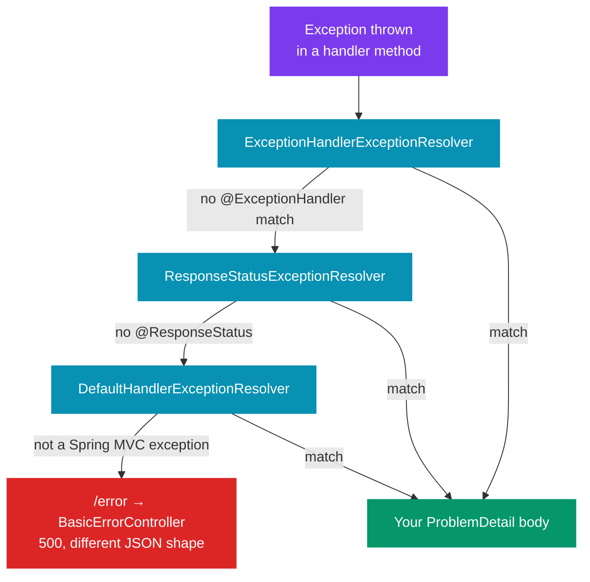
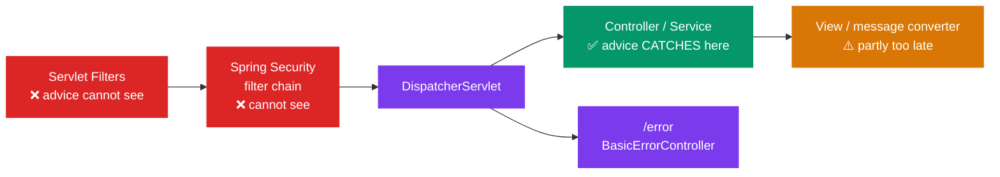
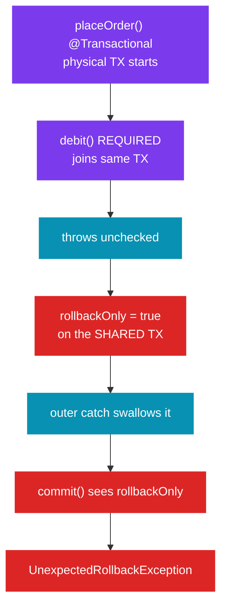

# Exception Handling in Spring Boot — Interview Questions

**Exception Handling in Spring Boot** | This file covers `@ControllerAdvice` / `@RestControllerAdvice`, `@ExceptionHandler`, RFC 9457 `ProblemDetail`, bean-validation errors, handler resolution order, `@Transactional` rollback rules, and common Spring exceptions.

- For core Java exception basics (hierarchy, checked vs unchecked, `throw`/`throws`), see [06_Exception_Handling_Interview_Questions_in_Java.md](./06_Exception_Handling_Interview_Questions_in_Java.md).
- For the HTTP-level view (RFC 9457 field table, correct use of status codes, validation-error body formats), see [05_REST_API_Design_Interview_Questions.md](https://github.com/vikas9dev/system-design/blob/main/iq/05_REST_API_Design_Interview_Questions.md).

> ⚠️ **Version note:** every Spring snippet in this file targets **Spring Framework 6.x / Spring Boot 3.x**. It was compiled against Spring 6.2. Two things break on Boot 2.x:  
> - `ResponseEntityExceptionHandler` overrides take `HttpStatus`, not `HttpStatusCode`.  
> - `ProblemDetail` does not exist at all (it came in Spring 6).

📊 **Question Count by Section**

| # | Section | Questions |
|---|---|---|
| 1 | [Global Exception Handling Fundamentals](#global-exception-handling-fundamentals) | 5 |
| 2 | [The Global Handler in Practice](#the-global-handler-in-practice) | 3 |
| 3 | [Handler Resolution, Blind Spots and the `/error` Fallback](#handler-resolution-blind-spots-and-the-error-fallback) | 4 |
| 4 | [Exceptions and Transactions](#exceptions-and-transactions) | 3 |
| 5 | [Mapping Infrastructure Exceptions to HTTP](#mapping-infrastructure-exceptions-to-http) | 2 |
| | **Total** | **17** |

> 🔥🔥 Very High — asked in almost every Tier-1 loop &nbsp;·&nbsp; 🔥 High — very frequent in Tier-1 interviews &nbsp;·&nbsp; ⚡ Medium — commonly asked &nbsp;·&nbsp; 💤 Low — good to know, rarely asked

<a id="global-exception-handling-fundamentals"></a>

## 1. Global Exception Handling Fundamentals

1. **🌍 What is the need for Global Exception Handling in Spring Boot? ⚡**

<!-- -->
<details>
<summary>Answer</summary>

**Answer:**

In real projects, it is not enough to *not crash*. When the API fails, it must return an error in a fixed format that the client can write code against.

⚠️ **The honest limit that interviewers check for:** a global handler only gives consistency for exceptions it actually knows about.

- An exception with no matching `@ExceptionHandler` goes on to Spring Boot's `BasicErrorController` (`/error`).
- That controller returns a *completely different* format — `{timestamp, status, error, path}`.
- So a real handler always ends with an `@ExceptionHandler(Exception.class)` fallback.
- Without it, the "consistency" claim is false for exactly the cases you did not expect.

<details>
<summary><strong>🤔 Doubt: If Spring Boot already returns a JSON error from `/error`, why write anything at all?</strong></summary>

`BasicErrorController` can only tell you *that* something failed. It cannot tell you *which business rule* failed.

- It does not know that `LoanAlreadyDisbursedException` means 409 — it reports 500.
- Its `message` field is **hidden by default** since Boot 2.3 (`server.error.include-message=never`), so the client gets `""`.
- It has no place to put a machine-readable error code, a field-level validation map, or a `traceId`.

`BasicErrorController` is the safety net, not the contract. You write the advice to define the contract. You keep the safety net for any exception that gets past the advice. This includes exceptions thrown *before* `DispatcherServlet` — see §3 Q2.

---

</details>
<br/>

---

</details>

---

2. **💬 What makes an error response "clear"? What fields belong in it? 🔥**

<!-- -->
<details>
<summary>Answer</summary>

**Answer:**

A clear error response is one that a client can make decisions on **without parsing English**. So it needs two separate parts: a stable machine-readable part and a human-readable part.

**The smallest useful error DTO:**

| Field | Purpose | Who reads it |
|---|---|---|
| `status` | HTTP status code, repeated in the body | Clients behind proxies that rewrite status |
| `title` / `error` | Short, **stable** category — never reworded | Machines (switch on it) |
| `code` | Your own error code, e.g. `EMP_LIMIT` | Machines — the real branch key |
| `detail` / `message` | Human sentence, safe to show a user | Humans |
| `timestamp` | When it happened, ISO-8601 UTC | Support triage |
| `traceId` | Correlation id linking to your logs | Support triage — the highest-value field |
| `fieldErrors` | Per-field map, validation only | Form UIs |

**The three rules that interviewers actually test:**

1. ❌️ **Never return `ex.getMessage()` from an infrastructure exception.** A `DataIntegrityViolationException` message contains the constraint name, the table, and often the bad value. Map it to a generic sentence, and log the real one.
2. ✅ **The status code and the body's status field must match.** If they differ, every client that trusts the body gets the wrong answer. This bug is *extremely* common in real code (see the production example in §2 Q1).
3. 🔑 **`traceId` turns a support ticket into a log query.** Put the MDC trace id on every error body. With Micrometer Tracing / Sleuth, it is already in the MDC (Mapped Diagnostic Context — a per-thread map of values that the log pattern can print on each line).

💡 **Pro Tip:** Do not invent your own error format. Spring 6 ships `ProblemDetail`. It already standardises `type`, `title`, `status`, `detail`, `instance`, and it lets you add extra fields with `setProperty(...)`.

⚠️ **Say "RFC 9457", not "RFC 7807".**

- RFC 9457 (July 2023) **obsoleted** RFC 7807 (replaced it officially).
- The field set and the `application/problem+json` media type did not change. So everything written about 7807 is still true.
- But Spring 6.2's own `ProblemDetail` and `ResponseEntityExceptionHandler` javadoc now cite **9457**.
- When you name the current number, it shows you read the spec, not a 2016 blog post.

Saying *"I'd use `ProblemDetail` rather than a hand-rolled `ErrorType` DTO"* is the 2026 answer to this question. The field-by-field breakdown is in [05_REST_API_Design_Interview_Questions.md](https://github.com/vikas9dev/system-design/blob/main/iq/05_REST_API_Design_Interview_Questions.md) §4.

<details>
<summary><strong>🤔 Doubt: Should a validation failure be 400 or 422?</strong></summary>

You can defend both. Be ready to explain whichever one you pick.

- **400 Bad Request** — the request itself is broken *as a request*: JSON that cannot be parsed, a wrong type, a missing required field. Spring's own `ResponseEntityExceptionHandler` maps `MethodArgumentNotValidException` to **400**. So 400 is the choice that needs no extra work.
- **422 Unprocessable Entity** — the syntax is fine, but the *meaning* fails. For example, a well-formed loan application that breaks a business rule (`amount > sanctionedLimit`).

A clear split: **400 for "I couldn't read your request", 422 for "I read it and refuse it"**. The answer that loses points is using 200 with an error body. It breaks every retry policy, circuit breaker, and dashboard that depends on the status code.

---

</details>
<br/>

---

</details>

---

3. **🏷️ Which annotations drive Spring Boot error handling? 🔥🔥**

<!-- -->
<details>
<summary>Answer</summary>

**Answer:**

Four annotations plus one base class:

- 🌐 **`@ControllerAdvice`** — makes a class a global interceptor for exceptions thrown out of `@RequestMapping` handler methods. One place defines how an exception type is rendered, for many controllers. It is itself meta-annotated `@Component`, so component scanning picks it up.
- 🔁 **`@RestControllerAdvice`** — `@ControllerAdvice` + `@ResponseBody`. This is the one you almost always want for a JSON API (see Q4).
- 🎯 **`@ExceptionHandler`** — marks the method that handles a given exception type. On a **controller**, it handles that controller only. On an **advice**, it handles globally (or the configured subset).
- 📊 **`@ResponseStatus`** — put it on the **exception class** to declare its HTTP status without writing a handler at all.
- 🧱 **`ResponseEntityExceptionHandler`** — the base class to extend when you want to change how Spring's *own* MVC exceptions (405, 415, 400-validation, …) are rendered.

✅ **The correction most candidates need:** it is **not** true that Spring returns 500 for everything until you add `@ResponseStatus`. Spring Boot auto-registers three resolvers, in this order:

| Order | Resolver | What it handles |
|:---:|---|---|
| 1 | `ExceptionHandlerExceptionResolver` | Your `@ExceptionHandler` methods (controller-local, then advices) |
| 2 | `ResponseStatusExceptionResolver` | Exceptions annotated `@ResponseStatus`, plus `ResponseStatusException` |
| 3 | `DefaultHandlerExceptionResolver` | Spring MVC's own exceptions — `HttpRequestMethodNotSupportedException` → **405**, `HttpMediaTypeNotSupportedException` → **415**, `HttpMediaTypeNotAcceptableException` → **406**, `MethodArgumentNotValidException` → **400**, `NoResourceFoundException` → **404** |

So the standard framework exceptions already get correct statuses by default. What defaults to **500** is an **unmapped custom exception**. `@ResponseStatus` (or an `@ExceptionHandler`) fills that gap.



🔑 **Key Point:** the everyday form is `@ExceptionHandler` methods on a `@RestControllerAdvice` class. This way, handling applies globally (or to a declared subset of controllers).

<details>
<summary><strong>🤔 Doubt: If `@ResponseStatus` on the exception class is enough, why write a handler?</strong></summary>

`@ResponseStatus` gives you the **status code** and nothing else.

```java
@ResponseStatus(HttpStatus.NOT_FOUND)
public class EmployeeNotFoundException extends RuntimeException {

    public EmployeeNotFoundException(Long id) {
        super("Employee not found: " + id);
    }
}
```

That gives a 404, but the body comes from `BasicErrorController`. It has no error code, no `traceId`, and `message` is blank by default.

It also ties your **domain** exception to an **HTTP** concept. That is wrong as soon as the same exception is thrown from a Kafka consumer or a batch job, which has no HTTP response to set.

- Use `@ResponseStatus` for short-lived internal APIs.
- Use an `@ExceptionHandler` when you need a real body, logging, or a domain layer that does not know about HTTP.
- A middle option is `throw new ResponseStatusException(HttpStatus.NOT_FOUND, "...")`. It needs no new class, but it has the same HTTP coupling.

---

</details>
<br/>

<details>
<summary><strong>🤔 Doubt: What does a bare `@ResponseStatus` on the advice *class* do?</strong></summary>

Nothing useful. People often copy this line without understanding it. You should spot it in a code review:

```java
@ControllerAdvice
@ResponseStatus            // ❌️ delete this
public class MyControllerAdvice { … }
```

Two problems:

1. `@ResponseStatus`'s `value()`/`code()` **default to `HttpStatus.INTERNAL_SERVER_ERROR`**. So, as written, it declares "everything is a 500".
2. It has no visible effect anyway:
   - `HandlerMethod.evaluateResponseStatus()` falls back to the class-level annotation.
   - `ServletInvocableHandlerMethod.invokeAndHandle()` applies it.
   - Then the return-value handler for `ResponseEntity` / `ProblemDetail` **overwrites** the status from the returned object.
   - So each handler's own status wins.

Dead code that looks like it does something is worse than no code. Delete it.

---

</details>
<br/>

---

</details>

---

4. **🆚 `@ControllerAdvice` vs `@RestControllerAdvice` — and how do you scope an advice to a subset of controllers? 🔥**

<!-- -->
<details>
<summary>Answer</summary>

**Answer:**

**The difference is one annotation:**

```java
@ControllerAdvice
@ResponseBody
public class A { }          // ≡

@RestControllerAdvice
public class B { }          // @ControllerAdvice + @ResponseBody
```

`@RestControllerAdvice` is meta-annotated with `@ResponseBody`. So a handler can return the **body object directly** (`ProblemDetail`, a DTO, a `Map`), and the message converters serialise it.

With a plain `@ControllerAdvice`, a bare returned object (a DTO, a `Map`) is treated as a **view name**. Spring looks for a view with that name and fails.

⚠️ **The less obvious part that interviewers like:** a plain `@ControllerAdvice` *does* work if every handler returns `ResponseEntity<T>`, **`ProblemDetail`, or `ErrorResponse`**. `HttpEntityMethodProcessor.supportsReturnType` accepts all three, with or without `@ResponseBody`:

```java
return ((HttpEntity.class.isAssignableFrom(type) && !RequestEntity.class.isAssignableFrom(type)) ||
        ErrorResponse.class.isAssignableFrom(type) || ProblemDetail.class.isAssignableFrom(type));
```

- The return type itself tells Spring that this is a body, not a view.
- That is why a lot of legacy code with plain `@ControllerAdvice` + `ResponseEntity` works fine. Nobody notices that the annotation is incomplete.
- **So prefer `@RestControllerAdvice` for clarity, not because `ProblemDetail` would otherwise fail.** The difference only matters for handlers that return a plain DTO or `Map`.

**Scoping an advice** — `@ControllerAdvice` with no attributes applies to *all* controllers. There are three ways to narrow it:

```java
// 1. by package
@RestControllerAdvice(basePackages = "com.example.api.pub")
public class PublicApiAdvice { }

// 2. by controller type (or a marker interface / base class)
@RestControllerAdvice(assignableTypes = { EmployeeController.class, PayrollController.class })
public class PayrollAdvice { }

// 3. by an annotation present on the controller
@RestControllerAdvice(annotations = InternalApi.class)
public class InternalApiAdvice { }
```

Typical use: a **v1** advice returns the legacy error format, and a **v2** advice returns `ProblemDetail`. You scope them by package. Then you can move one API version at a time without breaking existing clients.

📝 **Note:** when several advices can handle the same exception, their order matters — see §3 Q1.

<details>
<summary><strong>🤔 Doubt: Can `@ControllerAdvice` do anything besides `@ExceptionHandler`?</strong></summary>

Yes. Three method-level annotations can live on advices, and only one of them is about exceptions:

| Annotation | Runs when | Typical use |
|---|---|---|
| `@ExceptionHandler` | A handler method threw | Error rendering |
| `@InitBinder` | Before argument binding | Register a custom `PropertyEditor`, trim strings, block fields from binding |
| `@ModelAttribute` | Before the handler runs | Push a common attribute (tenant, locale) into the model for every controller |

`@InitBinder` on an advice is also the standard defence against mass assignment (a client setting fields it should not, like `id` or `role`): `binder.setDisallowedFields("id", "role")`.

---

</details>
<br/>

---

</details>

---

5. **🎚️ Spring 6 gives you four ways to attach an HTTP status and body to an exception — `@ResponseStatus`, `ResponseStatusException`, an `@ExceptionHandler`, and implementing `ErrorResponse` / extending `ErrorResponseException`. Which do you pick, and why? 🔥**

<!-- -->
<details>
<summary>Answer</summary>

**Answer:**

They are not four versions of the same thing. They sit at different points on one scale: **how much does your domain layer have to know about HTTP?**

**The comparison table**

| | `@ResponseStatus` on the exception | `ResponseStatusException` | `@ExceptionHandler` on an advice | Implement `ErrorResponse` / extend `ErrorResponseException` |
|---|---|---|---|---|
| **Body control** | ❌️ none — `BasicErrorController` shape, `message` blank by default | ⚠️ status + `detail` only | ✅ total | ✅ total — you own the whole `ProblemDetail` |
| **Logging hook** | ❌️ none | ❌️ none | ✅ the method *is* the hook | ⚠️ only via the advice that renders it |
| **Domain ↔ HTTP coupling** | ❌️ `HttpStatus` compiled into the domain class | ❌️ `HttpStatus` at the throw site | ✅ **none** — status lives in the web layer | ❌️ status compiled into the exception |
| **i18n via message codes** | ⚠️ `reason` is resolved through `MessageSource` when one is configured, but only as a flat string | ✅ inherits `ErrorResponse`'s codes | ⚠️ manual — you call `MessageSource` yourself | ✅ built in: `getDetailMessageCode()` + `updateAndGetBody(MessageSource, Locale)` |
| **Code cost** | 1 line | 1 line, no new class | 1 advice method **per exception type** | 1 class; **0** advice methods once the framework renders it |
| **Where it is resolved** | `ResponseStatusExceptionResolver` (resolver #2, §1 Q3) | `ResponseStatusExceptionResolver`, *or* `ResponseEntityExceptionHandler` | `ExceptionHandlerExceptionResolver` (resolver #1) | `ResponseEntityExceptionHandler` — see the ⚠️ below |

**🧩 `ErrorResponse` is the contract the other three lack**

The Spring reference calls it *"a contract to expose HTTP error response details including HTTP status, response headers, and a body in the format of RFC 9457"*. **RFC 9457** is *Problem Details for HTTP APIs*, and it **obsoleted RFC 7807**. The reference then adds: *"**All Spring MVC exceptions implement this.**"*

That sentence explains two snippets elsewhere in this file: `ProblemDetail body = ex.getBody();` in §2 Q1's override, and again in §2 Q2.

- `getBody()` is not an extra method that someone added to `MethodArgumentNotValidException`.
- It is **one of `ErrorResponse`'s two abstract methods**.
- So *every* Spring MVC exception already carries a fully-built `ProblemDetail` that the framework filled in.
- That is why the usual override **decorates** `ex.getBody()` (adds to it) instead of building a new body.
- If you build a new one, you throw away the status, the title, and the localized detail that Spring already resolved.

The interface, in full:

| Kind | Members |
|---|---|
| **Abstract** | `HttpStatusCode getStatusCode()` · `ProblemDetail getBody()` |
| **Default** | `getHeaders()` · `getTypeMessageCode()` · `getTitleMessageCode()` · `getDetailMessageCode()` · `getDetailMessageArguments()` · `getDetailMessageArguments(MessageSource, Locale)` · `updateAndGetBody(MessageSource, Locale)` |
| **Static** | `create(Throwable, HttpStatusCode, String)` · `builder(Throwable, HttpStatusCode, String)` · `builder(Throwable, ProblemDetail)` · `getDefaultTypeMessageCode(Class<?>)` · `getDefaultTitleMessageCode(Class<?>)` · `getDefaultDetailMessageCode(Class<?>, String)` |

⚠️ **An exact detail worth knowing, because people often claim more than is true here.**

- *"All Spring MVC exceptions implement `ErrorResponse`"* is the reference doc's own wording, and it is the right thing to say.
- But the javadoc's implementing-classes list does **not** include a few types that `ResponseEntityExceptionHandler` still handles. For example: `TypeMismatchException`, `HttpMessageNotReadableException`, `ConversionNotSupportedException`.
- Those are `org.springframework.beans` / `http.converter` exceptions, not `web.servlet` ones. For them, the handler builds the `ProblemDetail` itself.
- So `ex.getBody()` is available on the *MVC* exceptions. Do not assume it on every exception the base class catches.

**🏗️ The "no advice method at all" recipe — and the trap in it**

Throw it, and it is rendered as a 409 `application/problem+json` with **no handler method written for it**. This needs either a `@RestControllerAdvice extends ResponseEntityExceptionHandler`, or `spring.mvc.problemdetails.enabled=true`. When you add the 40th exception, you write no advice code.

⚠️ **The trap: implementing `ErrorResponse` alone is not enough in Spring MVC.** This was checked against `ResponseEntityExceptionHandler` in the 6.2 source:

- Its `@ExceptionHandler` list names `ErrorResponseException.class`.
- The dispatch branch reads `else if (ex instanceof ErrorResponseException subEx)`.
- There is **no** branch for a bare `ErrorResponse`. And there could not be a generic one: `@ExceptionHandler` matches `Throwable` types, and `ErrorResponse` is a plain interface that a non-throwable could implement.
- So an exception that implements `ErrorResponse` but extends `RuntimeException` directly is **not** auto-rendered. It falls through to your catch-all and becomes a 500.

Two correct ways to use a bare `ErrorResponse`:

```java
// ✅ 1 — return it from a handler. ErrorResponse and ProblemDetail are both supported
//        @ExceptionHandler return values: "To render an RFC 9457 error response
//        with details in the body".
@ExceptionHandler(BusinessRuleException.class)
public ErrorResponse handleBusinessRule(BusinessRuleException ex) {
    log.warn("Business rule [{}] violated", ex.getCode(), ex);
    return ErrorResponse.builder(ex, HttpStatus.UNPROCESSABLE_ENTITY, ex.getMessage())
            .title("Business Rule Violation")
            .property("code", ex.getCode())
            .build();
}
```

```java
// ✅ 2 — one advice method for a whole family, by giving the family a base class.
public abstract class DomainException extends ErrorResponseException {

    protected DomainException(HttpStatusCode status) {
        super(status);
    }
}

@ExceptionHandler(DomainException.class)
public ProblemDetail handleDomain(DomainException ex) {
    log.warn("Domain failure: {}", ex.getClass().getSimpleName(), ex);   // the logging hook
    return ex.getBody();                                                 // already built
}
```

Option 2 is usually the one to describe in the interview. It brings back the **logging hook** that the zero-method version loses. And it is still one method for N exceptions.

**🪜 `ErrorResponseException` is the middle step, and `ResponseStatusException` sits under it**

`ErrorResponseException` is *"a `RuntimeException` that implements `ErrorResponse` to expose an HTTP status, response headers, and a body formatted as an RFC 9457 `ProblemDetail`… can be used as is, or … extended as a more specific exception"*. It extends `NestedRuntimeException` and exposes `setType` / `setTitle` / `setDetail` / `setInstance`. Use it when you want a real body but not a new class hierarchy.

🔑 **`ResponseStatusException extends ErrorResponseException`** — the javadoc lists it as its only direct known subclass. Two things follow from this, and interviewers like them:

📝 **Note:** that depth rule works per advice class. The reference says clearly: *"a cause match on a higher-priority `@ControllerAdvice` bean is preferred to any match (for example, root) on a lower-priority `@ControllerAdvice` bean"*. So across classes, advice order still beats depth (§3 Q1).

**🌍 i18n — the reason `ErrorResponse` beats a hand-built `ProblemDetail`**

If you build the body by hand, the `detail` string is hard-coded English. `ErrorResponse` exposes message **codes** instead, with this default strategy:

| Field | Message code |
|---|---|
| `type` | `problemDetail.type.[fully qualified exception class name]` |
| `title` | `problemDetail.title.[fully qualified exception class name]` |
| `detail` | `problemDetail.[fully qualified exception class name][suffix]` |

`updateAndGetBody(MessageSource, Locale)` resolves these codes and returns the updated `ProblemDetail`. `getDetailMessageArguments()` supplies the placeholder values.

- Put the strings in `messages.properties` / `messages_hi.properties`.
- Wire a `MessageSource`.
- Now the same exception renders in the user's language — **no branching in the handler**.

This is the strongest single argument for the `ErrorResponse` route on a public or multi-locale API. And because Spring's own exceptions implement the contract, it also localizes a validation 400 without you rewriting it.

**🎯 The rule this gives — the one §1 Q3 leaves open**

That question ends on a real objection: `@ResponseStatus` *"couples your **domain** exception to an **HTTP** concept, which is wrong the moment the same exception is thrown from a Kafka consumer or a batch job that has no HTTP response to set."*

The objection is correct. It applies **equally** to extending `ErrorResponseException`. An `InsufficientBalanceException` that carries `HttpStatus.CONFLICT` is just as wrong inside a nightly settlement job.

So the rule splits by **where the exception can be thrown from**, not by personal taste:

- 🌐 **Exception thrown only from the web layer** (a controller, a web-facing service) → extend `ErrorResponseException`. Here the HTTP status is not leaking into the domain; it *is* the domain. Zero advice code, i18n included.
- 🧱 **Exception that a consumer, a scheduler, or a batch job can reach** → keep it a plain `RuntimeException` with a **business** code (`INSUFFICIENT_BALANCE`). Map it to a status in the advice. Use one `@ExceptionHandler` per family. Then the Kafka consumer gets an exception that means something to *it*.
- ⚡ **Prototype or an internal tool** → `ResponseStatusException` at the throw site. It is simple and fast. Say clearly that you would not ship it on a public API.
- ❌️ **`@ResponseStatus` on the exception class** → the weakest of the four in 2026. It gives up the body, the logging hook, and the `traceId`, *and* it still has the coupling cost. Recognise it in legacy code, but do not choose it.

💡 **Pro Tip:** the one-line version to say in an interview — *"status codes live in the web layer unless the exception can only ever be thrown from the web layer. `ErrorResponseException` for the second case, an `@ExceptionHandler` for the first, and `ErrorResponse` is the contract that makes both render the same RFC 9457 body."*

<details>
<summary><strong>🤔 Doubt: If `spring.mvc.problemdetails.enabled=true` already does this, why would I extend `ResponseEntityExceptionHandler`?</strong></summary>

They solve problems that overlap but are different. And they conflict if you use both.

- The **property** gives you RFC 9457 bodies for Spring's built-in exceptions with zero code. It gives consistency, not customisation.
- The **base class** is what you extend when you need to change one built-in handler. For example: add a `traceId`, change a `title`, or keep the `Allow` header on a 405 (§2 Q1's doubt block).

⚠️ Pick one. The reference is clear about how they interact: *"In Spring Boot, the `spring.mvc.problemdetails.enabled` property autoconfigures a `ResponseEntityExceptionHandler` that handles built-in exceptions with problem details. In that case, you may prefer to create another `@ControllerAdvice` instead of extending `ResponseEntityExceptionHandler` if you want to take over the handling of a specific built-in exception. You'll need to ensure your handler is ordered ahead of the one configured by Spring Boot **whose order is 0**."*

So choose one of these:

- the property + a separate advice at `@Order(-1)`, **or**
- your own advice that extends the base class, and leave the property alone.

If two `ResponseEntityExceptionHandler`s both claim the built-ins, you get the classic "my override never runs" problem.

---

</details>
<br/>

<details>
<summary><strong>🤔 Doubt: Does `@ResponseStatus`'s `reason` really go through `MessageSource`?</strong></summary>

Yes, but it is a much weaker hook than `ErrorResponse`'s message codes.

The javadoc for `reason()` says only: *"Set the reason to a non-empty value to have it used to send a Servlet container error page. In this case, the return value of the handler method will be ignored."* It does not mention i18n.

But `ResponseStatusExceptionResolver.applyStatusAndReason` resolves it when a `MessageSource` is present. In the 6.2 source, it calls `this.messageSource.getMessage(reason, null, reason, LocaleContextHolder.getLocale())`. Otherwise, it falls back to the literal string.

Two reasons it is still the worst option:

1. ⚠️ **`reason` triggers `sendError`.** The javadoc: *"The default implementation sends a response error using `HttpServletResponse.sendError(int)` or `HttpServletResponse.sendError(int, String)` if there is a reason."* `sendError` passes the request to the Servlet error page — that is, back to `BasicErrorController`. So you are localizing a string inside the *default* error format, not inside your contract.
2. ❌️ **No arguments.** `getMessage(reason, null, …)` passes a `null` argument array, so `{0}` placeholders cannot be filled. `ErrorResponse.getDetailMessageArguments()` exists exactly to supply them.

If you want the error both localized *and* structured, use `ErrorResponse` + `updateAndGetBody`, not `@ResponseStatus(reason = "…")`.

---

</details>
<br/>

---

</details>

---

<a id="the-global-handler-in-practice"></a>

## 2. The Global Handler in Practice

1. **🛠️ Write a production-grade global exception handler for a Spring Boot 3 REST API. 🔥🔥**

<!-- -->
<details>
<summary>Answer</summary>

**Answer:**

The 2026 answer is **`@RestControllerAdvice` extending `ResponseEntityExceptionHandler`, returning RFC 9457 `ProblemDetail`**. All code below compiles against Spring Framework 6.2 / Spring Boot 3.5.

**① Domain exceptions — unchecked, immutable, and they always call `super(message)`:**

```java
public class ResourceNotFoundException extends RuntimeException {

    private final String resource;
    private final Object resourceId;

    public ResourceNotFoundException(String resource, Object resourceId) {
        super(resource + " not found: " + resourceId);
        this.resource = resource;
        this.resourceId = resourceId;
    }

    public String getResource() {
        return resource;
    }

    public Object getResourceId() {
        return resourceId;
    }
}

public class BusinessRuleException extends RuntimeException {

    private final String code;

    public BusinessRuleException(String code, String message) {
        super(message);
        this.code = code;
    }

    public String getCode() {
        return code;
    }
}
```

⚠️ Note what is **not** here:

- No Lombok `@Setter`/`@NoArgsConstructor` on an exception. Exceptions should be immutable.
- No duplicate `private String message` field that shadows the one in `Throwable`.
- `super(message)` is always called. If you skip it, `Throwable.getMessage()` returns `null`. This is exactly how the "my error body has a null message" bug happens.

**② The advice:**

```java
@RestControllerAdvice
public class GlobalExceptionHandler extends ResponseEntityExceptionHandler {

    private static final Logger log = LoggerFactory.getLogger(GlobalExceptionHandler.class);
    private static final URI NOT_FOUND = URI.create("https://api.example.com/errors/not-found");
    private static final URI RULE_VIOLATION = URI.create("https://api.example.com/errors/business-rule");

    // ONE builder, so every error really does carry the same envelope.
    private ProblemDetail problem(HttpStatus status, String detail, String title, URI type) {
        ProblemDetail body = ProblemDetail.forStatusAndDetail(status, detail);
        body.setTitle(title);
        if (type != null) {
            body.setType(type);
        }
        body.setProperty("timestamp", Instant.now());
        String traceId = MDC.get("traceId");
        if (traceId != null) {
            body.setProperty("traceId", traceId);
        }
        return body;
    }

    @ExceptionHandler(ResourceNotFoundException.class)
    public ProblemDetail handleNotFound(ResourceNotFoundException ex) {
        log.warn("Not found: {} id={}", ex.getResource(), ex.getResourceId());   // 4xx: no stack trace
        ProblemDetail body = problem(HttpStatus.NOT_FOUND, ex.getMessage(), "Resource Not Found", NOT_FOUND);
        body.setProperty("resource", ex.getResource());
        return body;
    }

    @ExceptionHandler(BusinessRuleException.class)
    public ProblemDetail handleBusinessRule(BusinessRuleException ex) {
        log.warn("Business rule [{}] violated: {}", ex.getCode(), ex.getMessage());   // 4xx: no stack trace
        ProblemDetail body = problem(HttpStatus.UNPROCESSABLE_ENTITY, ex.getMessage(),
                "Business Rule Violation", RULE_VIOLATION);
        body.setProperty("code", ex.getCode());
        return body;
    }

    // ⚠️ REQUIRED if you use Spring Security method security. AccessDeniedException is NOT
    // one of the 20 types ResponseEntityExceptionHandler claims, so without this handler the
    // catch-all below turns every @PreAuthorize denial into a 500 instead of a 403.
    @ExceptionHandler(AccessDeniedException.class)
    public ProblemDetail handleAccessDenied(AccessDeniedException ex) {
        log.warn("Access denied: {}", ex.getMessage());
        return problem(HttpStatus.FORBIDDEN,
                "You do not have permission to perform this action.", "Forbidden", null);
    }

    // Last-resort fallback — without this, anything unmapped falls through
    // to BasicErrorController and returns a DIFFERENT JSON shape.
    @ExceptionHandler(Exception.class)
    public ProblemDetail handleUnexpected(Exception ex) {
        log.error("Unhandled exception", ex);                                   // 5xx: WITH the throwable
        return problem(HttpStatus.INTERNAL_SERVER_ERROR,
                "Something went wrong. Quote the traceId when contacting support.",
                "Internal Server Error", null);
    }
}
```

⚠️ **This version fixes two things that the obvious first draft gets wrong.**

1. **`AccessDeniedException` must be handled explicitly.**
   - It is not in `ResponseEntityExceptionHandler`'s list. So `@ExceptionHandler(Exception.class)` catches it at depth 2 (depth 3 for Security 6.3's `AuthorizationDeniedException`) and returns **500 instead of 403**.
   - This is a real bug, and it matters for security. It also contradicts the note in §3 Q2 that method-security denials *do* reach the advice.
   - `ResponseStatusException` is safe, by contrast. It extends `ErrorResponseException`, which **is** in the list. So it matches at depth 1.
2. **The envelope is built in one place.**
   - If you build each `ProblemDetail` by hand, you end up with `timestamp` on one handler, `traceId` on another, and neither on a third.
   - Then the one field the support team needs is missing from the exact 404s and 422s that create tickets.

Returning `ProblemDetail` directly is enough. Two classes share the work:

- **`RequestResponseBodyMethodProcessor`** (and `HttpEntityMethodProcessor` for a bare `ProblemDetail`) sets the response status from `getStatus()`. It also fills `instance` from the request URI when it is null.
- Their shared superclass **`AbstractMessageConverterMethodProcessor`** does the `application/problem+json` content negotiation.

You do not need a `ResponseEntity` wrapper.

**③ Response — same envelope for every error:**

```json
{
  "type": "https://api.example.com/errors/not-found",
  "title": "Resource Not Found",
  "status": 404,
  "detail": "Employee not found: 99",
  "instance": "/api/employees/99",
  "resource": "Employee",
  "timestamp": "2026-07-30T09:14:22.417Z"
}
```

**④ Service and controller — the status codes that go with it:**

```java
@Service
public class EmployeeService {

    private final EmployeeRepository repository;

    public EmployeeService(EmployeeRepository repository) {
        this.repository = repository;
    }

    @Transactional
    public Employee create(EmployeeRequest request) {
        if (repository.count() >= 500) {
            throw new BusinessRuleException("EMP_LIMIT", "Headcount limit reached");
        }
        return repository.save(new Employee(request.name()));
    }

    @Transactional(readOnly = true)
    public List<Employee> findAll() {
        return repository.findAll();          // an empty list is a SUCCESS, not an error
    }

    @Transactional(readOnly = true)
    public Employee findById(Long id) {
        return repository.findById(id)
                .orElseThrow(() -> new ResourceNotFoundException("Employee", id));
    }

    @Transactional
    public Employee update(Long id, EmployeeRequest request) {
        Employee existing = findById(id);
        existing.setName(request.name());
        return repository.save(existing);
    }

    @Transactional
    public void deleteById(Long id) {
        if (!repository.existsById(id)) {
            throw new ResourceNotFoundException("Employee", id);
        }
        repository.deleteById(id);
    }
}
```

```java
@RestController
@RequestMapping("/api/employees")
public class EmployeeController {

    private final EmployeeService service;

    public EmployeeController(EmployeeService service) {
        this.service = service;
    }

    @PostMapping
    public ResponseEntity<Employee> create(@Valid @RequestBody EmployeeRequest request) {
        Employee saved = service.create(request);
        return ResponseEntity.created(URI.create("/api/employees/" + saved.getId())).body(saved);
    }

    @GetMapping
    public ResponseEntity<List<Employee>> findAll() {
        return ResponseEntity.ok(service.findAll());   // empty → 200 with []
    }

    @GetMapping("/{id}")
    public ResponseEntity<Employee> findById(@PathVariable Long id) {
        return ResponseEntity.ok(service.findById(id));
    }

    @PutMapping("/{id}")
    public ResponseEntity<Employee> update(@PathVariable Long id,
                                           @Valid @RequestBody EmployeeRequest request) {
        return ResponseEntity.ok(service.update(id, request));   // update → 200, NOT 201
    }

    @DeleteMapping("/{id}")
    public ResponseEntity<Void> delete(@PathVariable Long id) {
        service.deleteById(id);
        return ResponseEntity.noContent().build();               // sync delete → 204, NOT 202
    }
}
```

🐞 **Interviewers hide four bugs in exactly this example.** Be able to name all four:

| Bug | Why it breaks | Fix |
|---|---|---|
| Error DTO with `@AllArgsConstructor` but **no getters** | Jackson's `SerializationFeature.FAIL_ON_EMPTY_BEANS` is **on by default** and Boot's `Jackson2ObjectMapperBuilder` does not disable it (it only disables `DEFAULT_VIEW_INCLUSION` and `FAIL_ON_UNKNOWN_PROPERTIES`). A bean with no discoverable properties throws `InvalidDefinitionException: No serializer found for class …` — so the handler's carefully chosen 400 never reaches the client | Add `@Getter`, or use `ProblemDetail` / a `record` |
| `throw new BusinessException("List is empty", HttpStatus.NO_CONTENT)` | **204 must not have a body** (RFC 9110 §15.3.5). Tomcat enforces it — the response body is discarded, so the message silently never arrives. And the design is wrong anyway: an empty result set is a successful query | Return **200 with `[]`** |
| Advice references `service.getEmployeeById(id)` while the service declares `getEmpById(id)` | Does not compile. Reference code that does not build is the fastest way to lose credibility in a code-reading round | Rename one side |
| `@ResponseStatus(BAD_REQUEST)` on the method while the body object carries `NOT_FOUND` | Status line and body disagree; clients that read the body branch wrongly | Build the body from one source of truth |

<details>
<summary><strong>🤔 Doubt: What breaks if I override a `ResponseEntityExceptionHandler` method and return a raw `Map`?</strong></summary>

Two things, both silent.

```java
@Override
protected ResponseEntity<Object> handleHttpRequestMethodNotSupported(
        HttpRequestMethodNotSupportedException ex, HttpHeaders headers,
        HttpStatusCode status, WebRequest request) {

    Map<String, Object> body = new HashMap<>();
    body.put("message", "Change HTTP method type");
    return new ResponseEntity<>(body, HttpStatus.METHOD_NOT_ALLOWED);   // ❌️
}
```

1. **The `Allow` header is gone.** Before it delegates, the superclass passes `ex.getHeaders()` as the `headers` argument. `ex.getHeaders()` builds `Allow` from `getSupportedMethods()`. RFC 9110 §15.5.6 **requires** `Allow` on a 405. If you skip `super`/`handleExceptionInternal`, the header is dropped.
2. **You silently take this one exception out of `ProblemDetail`.** In Spring 6, `ResponseEntityExceptionHandler` returns an RFC 9457 body by default. So now the 405 has a different format from every other error. The advice exists to prevent exactly this inconsistency.

The standard override changes the `ProblemDetail` that the framework already built, and then delegates up:

```java
@Override
protected ResponseEntity<Object> handleHttpRequestMethodNotSupported(
        HttpRequestMethodNotSupportedException ex, HttpHeaders headers,
        HttpStatusCode status, WebRequest request) {

    ProblemDetail body = ex.getBody();          // MethodNotSupported implements ErrorResponse
    body.setTitle("Method Not Allowed");
    body.setProperty("supported", ex.getSupportedMethods());
    return handleExceptionInternal(ex, body, headers, status, request);
}
```

⚠️ The `HttpStatusCode status` parameter is **Spring 6 only**. On Boot 2.x the signature takes `HttpStatus` and this override will not compile.

---

</details>
<br/>

<details>
<summary><strong>🤔 Doubt: How do I get `ProblemDetail` for the *built-in* exceptions too, without extending anything?</strong></summary>

Set one property:

```properties
spring.mvc.problemdetails.enabled=true
```

That registers `ProblemDetailsExceptionHandler`. It is an internal `@ControllerAdvice`. It turns Spring MVC's own exceptions (405, 415, 400-validation, …) into RFC 9457 bodies across the whole application.

⚠️ In practice, you cannot use it **together** with extending `ResponseEntityExceptionHandler`. When you define your own `ResponseEntityExceptionHandler` bean, Boot turns off the auto-configured advice. Pick one:

- the property, for "I just want the standard format";
- the base class, for "I need to customise individual handlers".

---

</details>
<br/>

---

</details>

---

2. **✅ How do you turn bean-validation failures into a clean 400? 🔥🔥**

<!-- -->
<details>
<summary>Answer</summary>

**Answer:**

Never write `if (name == null || name.isBlank()) throw …` by hand. Declare the constraints, and let the framework throw the exception.

**① Constrain the request DTO (a `record` works and is immutable):**

```java
public record EmployeeRequest(
        @NotBlank(message = "name must not be blank")
        @Size(max = 100, message = "name must be at most 100 characters")
        String name) {
}
```

**② Trigger validation with `@Valid` on the parameter:**

```java
@PostMapping
public ResponseEntity<Employee> create(@Valid @RequestBody EmployeeRequest request) {
    return ResponseEntity.status(HttpStatus.CREATED).body(service.create(request));
}
```

A violation now throws **`MethodArgumentNotValidException`**, which `ResponseEntityExceptionHandler` already maps to **400**.

**③ Add a field-level map to it:**

```java
@Override
protected ResponseEntity<Object> handleMethodArgumentNotValid(
        MethodArgumentNotValidException ex, HttpHeaders headers,
        HttpStatusCode status, WebRequest request) {

    // A field can fail MORE THAN ONE constraint, so the value is a List — a plain
    // put() silently discards all but the last. EmployeeRequest above carries both
    // @NotBlank and @Size on `name`, so this is reachable with the very next request.
    Map<String, List<String>> fieldErrors = new LinkedHashMap<>();
    for (FieldError fe : ex.getBindingResult().getFieldErrors()) {
        fieldErrors.computeIfAbsent(fe.getField(), k -> new ArrayList<>())
                   .add(Objects.requireNonNullElse(fe.getDefaultMessage(), "invalid"));
    }

    // Class-level / cross-field constraints produce ObjectError, NOT FieldError.
    // Without this, a @ValidDateRange failure yields "fieldErrors": {} — zero information.
    List<String> globalErrors = ex.getBindingResult().getGlobalErrors().stream()
            .map(oe -> Objects.requireNonNullElse(oe.getDefaultMessage(), "invalid"))
            .toList();

    ProblemDetail body = ex.getBody();      // Spring already built a 400 ProblemDetail
    body.setTitle("Validation Failed");
    body.setDetail("One or more fields are invalid");
    body.setProperty("fieldErrors", fieldErrors);
    if (!globalErrors.isEmpty()) {
        body.setProperty("errors", globalErrors);
    }
    return handleExceptionInternal(ex, body, headers, status, request);
}
```

`MethodArgumentNotValidException implements ErrorResponse`. So `ex.getBody()` gives you the `ProblemDetail` that the framework prepared. Add to it, instead of building a new one from scratch. (**Every** Spring MVC exception implements `ErrorResponse`. That is why this trick works everywhere — see §1 Q5.)

⚠️ **An interviewer asks about three edge cases on exactly this loop:**

- A field fails two constraints. A plain `put` drops one.
- A class-level/cross-field constraint. It is an `ObjectError`, so `getFieldErrors()` does not see it.
- `getDefaultMessage()` is `@Nullable`. `Collectors.toMap` would throw an NPE. `LinkedHashMap` silently stores `null`.

The code above handles all three.

**④ Response:**

```json
{
  "type": "about:blank",
  "title": "Validation Failed",
  "status": 400,
  "detail": "One or more fields are invalid",
  "instance": "/api/employees",
  "fieldErrors": { "name": ["name must not be blank"] }
}
```

⚠️ **The trap: `@Valid` on a `@RequestBody` and `@Validated` on the class raise *different* exceptions.**

| Where the constraint lives | Trigger | Exception | Handled by `ResponseEntityExceptionHandler`? |
|---|---|---|---|
| Fields of a `@RequestBody` DTO | `@Valid` on the parameter | `MethodArgumentNotValidException` | ✅ yes → 400 |
| Directly on `@RequestParam` / `@PathVariable` | Constraint on the parameter, **and no class-level `@Validated`** (Spring 6.1+ built-in method validation) | `HandlerMethodValidationException` | ✅ yes → 400 |
| Directly on `@RequestParam` / `@PathVariable` | Constraint on the parameter, **with `@Validated` on the class** (AOP-proxy validation) | `ConstraintViolationException` | ❌️ **no** — defaults to **500** |

⚠️ **Rows 2 and 3 are two states of the same controller. Only one can be true at a time. They are not two independent facts.**

- Spring's reference doc says it clearly: *"In order to take advantage of the Spring MVC built-in support for method validation added in Spring Framework 6.1, you need to **remove** the class level `@Validated` annotation from the controller."*
- Class-level `@Validated` **takes you out** of the built-in path and puts you back on the AOP one.
- That is why the annotation that looks like it *enables* validation is the one that turns your 400 into a 500.

💡 Also note: `@Valid` is not itself a constraint annotation. That is why row 1 stays on the `MethodArgumentNotValidException` path in both cases.

So, on a controller that **keeps** class-level `@Validated`, you must add the `ConstraintViolationException` handler yourself:

```java
@ExceptionHandler(ConstraintViolationException.class)
public ProblemDetail handleConstraintViolation(ConstraintViolationException ex) {
    Map<String, String> violations = new LinkedHashMap<>();
    for (ConstraintViolation<?> cv : ex.getConstraintViolations()) {
        violations.put(cv.getPropertyPath().toString(), cv.getMessage());
    }
    ProblemDetail body = ProblemDetail.forStatusAndDetail(
            HttpStatus.BAD_REQUEST, "One or more parameters are invalid");
    body.setTitle("Validation Failed");
    body.setProperty("violations", violations);
    return body;
}
```

📝 **Note:** `ConstraintViolationException` is `jakarta.validation.ConstraintViolationException`. Do not confuse it with Hibernate's `org.hibernate.exception.ConstraintViolationException`.

- The Hibernate one means a **database** constraint was violated.
- Spring passes it up as `DataIntegrityViolationException`.
- You should **map** that **to** 409, not 400.

⚠️ Note the words *map to*. `DataIntegrityViolationException` is not in `ResponseEntityExceptionHandler`'s handled list. It is not in `DefaultHandlerExceptionResolver` either. So by default it is a **500** until you write that handler (§5 Q1).

<details>
<summary><strong>🤔 Doubt: `@Valid` vs `@Validated` — when do I need which?</strong></summary>

| | `@Valid` (`jakarta.validation`) | `@Validated` (Spring) |
|---|---|---|
| Origin | Bean Validation spec | Spring Framework |
| Validation **groups** | ❌️ not supported | ✅ `@Validated(OnCreate.class)` |
| Where it goes | On the parameter/field to cascade into | On the **class** to enable method-level validation via an AOP proxy |
| Cascades into nested objects | ✅ (on the field) | ❌️ not by itself |

Practical rule:

- **`@Valid` on the `@RequestBody` parameter and on nested fields.**
- **`@Validated` on the class**, when you need groups, or when you want `@NotBlank` on a `@RequestParam` to actually be enforced.

`@Validated` works through an AOP proxy, so it has the usual proxy limit. If you call a method from *inside* the same bean, its constraints are not checked. The call never leaves the object, so it does not go through the proxy. This is the same self-invocation trap as `@Transactional` (§4 Q1).

---

</details>
<br/>

---

</details>

---

3. **🪵 Your `@ExceptionHandler` catches the exception — do you log it there, at what level, and with or without the stack trace? 🔥**

<!-- -->
<details>
<summary>Answer</summary>

**Answer:**

The advice **is** the boundary.

- Everything below it either handled the failure or let it propagate.
- Nothing above it will ever see the exception object again.
- So it is the one place that logs — and *exactly* one place.

The rule is **log once, at the boundary, then translate**.

The general anti-patterns behind that rule are listed in [06_Exception_Handling_Interview_Questions_in_Java.md](./06_Exception_Handling_Interview_Questions_in_Java.md) Q50. They are: log-and-rethrow, swallowing, and `log.error(ex.getMessage())` instead of passing the `Throwable`. This question is the Spring half: **what the advice itself should do.**

**① The policy — level is set by who is at fault, not by how alarming the exception looks**

| Class | Level | Stack trace? | Reasoning |
|---|---|---|---|
| **4xx** — validation, not-found, business-rule violation | **`WARN`**, or `INFO` for high-volume expected ones | ❌️ **no** | The client sent something wrong. That is the API working correctly. Nothing is broken and nobody is paged |
| **5xx** — unmapped exception, downstream failure, bug | **`ERROR`** | ✅ **always** | Something on your side failed. The trace *is* the diagnostic value |
| **502/503/504 from a downstream** | `ERROR`, or `WARN` if a retry / circuit breaker absorbed it | ✅ yes | Judgement call — but if the retry succeeded, one `ERROR` per attempt is pure noise |

In SLF4J the difference is one argument. People often get this argument wrong:

```java
@RestControllerAdvice
public class GlobalExceptionHandler extends ResponseEntityExceptionHandler {

    private static final Logger log = LoggerFactory.getLogger(GlobalExceptionHandler.class);

    // 4xx — last argument is a format VALUE, so NO stack trace is printed
    @ExceptionHandler(BusinessRuleException.class)
    public ProblemDetail handleBusinessRule(BusinessRuleException ex) {
        log.warn("Business rule violated: code={}", ex.getCode());
        ProblemDetail body = ProblemDetail.forStatusAndDetail(
                HttpStatus.UNPROCESSABLE_ENTITY, ex.getMessage());
        body.setTitle("Business Rule Violation");
        body.setProperty("code", ex.getCode());
        return withTrace(body);
    }

    // 5xx — last argument is a THROWABLE, so SLF4J prints the full stack trace
    @ExceptionHandler(Exception.class)
    public ProblemDetail handleUnexpected(Exception ex) {
        log.error("Unhandled exception", ex);
        ProblemDetail body = ProblemDetail.forStatusAndDetail(
                HttpStatus.INTERNAL_SERVER_ERROR,
                "Something went wrong. Quote the traceId when contacting support.");
        body.setTitle("Internal Server Error");
        return withTrace(body);
    }
}
```

🔑 **How this works:** SLF4J prints a stack trace when the **last** argument is a `Throwable`. This is true even if a `{}` is still unfilled — that `{}` is then printed as plain text.

- `log.warn("Rule {} failed", ex.getCode())` prints one line.
- `log.error("Failed path={}", path, ex)` prints the line **and** the trace.

⚠️ **The handler in §1 Q5 (option ✅ 1) logs `log.warn("Business rule [{}] violated", ex.getCode(), ex)` — with the throwable.** That is this exact mistake, in this same file. A 422 is a client-fault outcome, so it should not carry a trace. Drop the trailing `ex` when you copy that snippet.

**② Why this is an alerting question, not a logging question**

- 📟 Alerts are based on `ERROR`. If every rejected form field logs `ERROR`, most of your error rate comes from **users typing badly**. That number grows with traffic, and it tells you nothing about failures.
- 📉 Once that happens, someone raises the threshold to stop the pager alerts. Then a real burst of 500s stays **below** the new threshold. The 4xx noise did not only add clutter. It **raised the level a real incident has to reach.**
- 💾 A stack trace is 20–50× the bytes of a single log line. Some log platforms bill by ingest volume. There, stack-traced 400s become a big line on the bill. The fix someone finally tries is sampling — and sampling drops the real errors too.

🎯 **What to say in the interview:** *"4xx at WARN with no trace, 5xx at ERROR with the throwable. The test is 'would I want to be woken up for this' — a client sending a malformed request is not an incident, so it must not produce an ERROR. The moment 4xx logs at ERROR my alert threshold stops meaning anything and real 500s get lost in the noise."*

**③ `traceId` — the same value in the log line and in the body**

```java
private ProblemDetail withTrace(ProblemDetail body) {
    String traceId = MDC.get("traceId");
    if (traceId != null) {                 // null in async threads, tests, and pre-filter paths
        body.setProperty("traceId", traceId);
    }
    body.setProperty("timestamp", Instant.now());
    return body;
}
```

- 🔗 The whole point: **the error a user screenshots becomes a log query.** With `traceId` in the body and `traceId` in the log line, you need one search. You do not guess timestamps or replay the request.
- ⚠️ **`MDC.get` can return `null`.** Then `setProperty("traceId", null)` writes `"traceId": null`. That is worse than a missing field, because clients write code against a field that is only sometimes filled. Guard it, as above.
- 💡 **Pro Tip:** with Micrometer Tracing, the ids are already in the MDC under `traceId` / `spanId`. You only read them; you never generate them. If you find yourself creating a UUID here, the tracing filter is not wired. Fix that instead. A locally-created id does not correlate across services, and that is the only reason the field exists.

**④ PII — if you miss this part, it costs you the offer**

❌️ **Never log the request body, and never log the *values* from a validation failure.** A `MethodArgumentNotValidException` on a loan application carries exactly the data that must not reach a log platform: email, phone, PAN, account number, address, date of birth.

```java
// ❌️ leaks user data into a store with different retention and access rules
log.warn("Validation failed: {}", ex.getBindingResult().getFieldErrors());

// ✅ field NAMES only — enough to debug the contract, carries no user data
List<String> invalidFields = ex.getBindingResult().getFieldErrors().stream()
        .map(FieldError::getField)
        .sorted()
        .toList();
log.warn("Validation failed: fields={}", invalidFields);
```

- 🔑 The debugging value is in **which field** failed, not **what the user typed**. So the safe version loses nothing you would have used.
- ⚠️ Keep `FieldError::getRejectedValue` out of every log statement. It is the literal user input. Also note that `toString()` on a `FieldError` includes it. That is why the ❌️ line above leaks, without ever naming the method.
- 🧾 The same care applies to the **response** body. `fieldErrors` may name the field and state the rule. But it should not send the rejected value back. The response travels through proxies, browser consoles, and screenshots.
- 🧯 This is also why `server.error.include-binding-errors` defaults to `never` (see §3 Q3). The framework made the same decision.

**⑤ Centralising it — `handleExceptionInternal` is the one shared point**

Take the exceptions that Spring itself throws (405, 415, 400-validation, `NoResourceFoundException`, …). For these, `ResponseEntityExceptionHandler` sends **every** one of its `handle*` methods through a single method. So that is the method you override:

```java
@Override
protected ResponseEntity<Object> handleExceptionInternal(
        Exception ex, @Nullable Object body, HttpHeaders headers,
        HttpStatusCode statusCode, WebRequest request) {

    if (statusCode.is5xxServerError()) {
        log.error("Framework exception status={}", statusCode.value(), ex);
    }
    else {
        log.warn("Framework exception status={} type={}", statusCode.value(),
                 ex.getClass().getSimpleName());
    }
    return super.handleExceptionInternal(ex, body, headers, statusCode, request);
}
```

⚠️ **A correction to a claim that many people repeat:** `ResponseEntityExceptionHandler` in Spring Framework 6.2 has **no `logServerError` / `logClientError` hooks**. Those method names do not exist on the class. Its members are:

- `handleException` (the `@ExceptionHandler` dispatcher)
- the per-exception `handle*` methods
- `createProblemDetail`, `createResponseEntity`, `handleExceptionInternal`
- `setMessageSource` / `getMessageSource`
- a `logger` field, and a static `pageNotFoundLogger` (used only to warn on method-not-supported)

**`handleExceptionInternal` is the real single shared point.** It is the only method that every built-in path passes through.

Two behaviours to know before you override it:

1. It returns **`null`** when the response is already committed. It logs `"Response already committed. Ignoring: "` at WARN. Your override must handle a `null` from `super`.
2. When the status is 500 **and** the body is `null`, it sets the `WebUtils.ERROR_EXCEPTION_ATTRIBUTE` (`jakarta.servlet.error.exception`) request attribute. This lets the ERROR dispatch to `/error` still see the original exception. This is the link to §3 Q3.

⚠️ It is **not** a shared point for your *own* `@ExceptionHandler` methods. Those return their body directly. They never touch it unless you route them through it. For one truly global rule, extract a `private void logByStatus(HttpStatusCode status, Exception ex)` and call it from each handler. This is explicit, and it still works when someone adds a handler later.

**⑥ Where the triple-logged stack trace comes from**

…The exception is rethrown into an advice that logs it again (#2). This runs inside a framework that may log the unhandled exception a third time on the way out (#3).

- That is three copies for one incident.
- Every dashboard that counts errors now counts 3× the real number.
- So your error-rate SLO is measuring your logging style.

- ✅ **The fix is not "log more carefully". The fix is to move the decision.**
  - A layer that *cannot* handle a failure wraps it and throws **without logging**. The boundary logs.
  - A layer that *can* handle it (fallback, retries exhausted, degraded response) logs it and does **not** rethrow.
- 🔑 One sentence: **you either log it or you throw it, never both.**
- 📎 Handle-vs-propagate placement across layers is [06_Exception_Handling_Interview_Questions_in_Java.md](./06_Exception_Handling_Interview_Questions_in_Java.md) Q49; the anti-pattern catalogue is Q50 there.

<details>
<summary><strong>🤔 Doubt: Is `INFO` ever right for a 4xx, or is `WARN` always the answer?</strong></summary>

`INFO` is right when the 4xx is **expected traffic** rather than a signal.

- ✅ `INFO`:
  - a 404 on a polling `GET /jobs/{id}` for a job that does not exist yet, which is a normal, expected case;
  - a 409 on an idempotency-key replay, which means the protection *worked*;
  - a 401 on an expired token that the client will refresh and retry.
- ✅ `WARN` — anything where you would want to notice a spike:
  - a 400 that suggests a client is sending a broken payload format;
  - a 403 pattern that looks like probing (someone testing what they can access).
- ❌️ `ERROR` — never for a 4xx. The exception is when *you* caused the client's 4xx (you shipped a contract change with no version bump). That is really a 5xx-level incident with a 4xx status.

A clear test: **would a sustained 10× spike in this line mean something is broken on my side?** Yes → `WARN`. No → `INFO`. Would it wake somebody up → `ERROR`. By definition, no 4xx does.

---

</details>
<br/>

<details>
<summary><strong>🤔 Doubt: If I suppress the trace on 4xx, how do I still find *where* it was thrown?</strong></summary>

You do not need a trace for a 4xx. A 4xx is a decision your code made **on purpose**. So the decision should carry its own identifier. Put that on the exception, not in a trace:

```java
public class BusinessRuleException extends RuntimeException {

    private final String code;

    public BusinessRuleException(String code, String message) {
        super(message);
        this.code = code;
    }

    public String getCode() {
        return code;
    }
}
```

💡 This is the real reason for a `code` field on every domain exception:

- It makes the stack trace unnecessary for the entire 4xx class.
- That lets you turn traces off there, and you still lose no ability to diagnose.
- It is also the same field the client branches on (§1 Q2). One value does two jobs.

---

</details>
<br/>

---

</details>

---

<a id="handler-resolution-blind-spots-and-the-error-fallback"></a>

## 3. Handler Resolution, Blind Spots and the `/error` Fallback

1. **🎯 Two `@ExceptionHandler` methods could handle the same exception — which one wins? 🔥**

<!-- -->
<details>
<summary>Answer</summary>

**Answer:**

Resolution happens on **four** levels, in this order:

**① Controller-local beats advice.** `ExceptionHandlerExceptionResolver` first looks for an `@ExceptionHandler` on the controller that threw. It checks the advices only if none matches there. So a controller-local handler is a targeted override for one endpoint group.

**② Between advices — `@Order` / `Ordered` / `@Priority`.** `ControllerAdviceBean` sorts advices by their order value, lowest first. Advices with no annotation get `Ordered.LOWEST_PRECEDENCE`. The **first** advice with a matching handler wins. So the advice that holds your `@ExceptionHandler(Exception.class)` catch-all should have the **highest** order value (lowest precedence). If it does not, it hides the more specific advices.

**③ Within one class — closest match in the type hierarchy, not declaration order.** `ExceptionHandlerMethodResolver` sorts candidates with **`ExceptionDepthComparator`**. This comparator counts how many superclass steps lie between the thrown type and the declared type.

```java
// thrown: BusinessRuleException extends RuntimeException extends Exception

@ExceptionHandler(Exception.class)              // depth 2
public ProblemDetail generic(Exception ex) { … }

@ExceptionHandler(RuntimeException.class)       // depth 1
public ProblemDetail runtime(RuntimeException ex) { … }

@ExceptionHandler(BusinessRuleException.class)  // depth 0  ← WINS
public ProblemDetail business(BusinessRuleException ex) { … }
```

Throwing `BusinessRuleException` picks `business(...)`. The order of the methods in the file does not matter. This also explains a second point. Adding `@ExceptionHandler(Exception.class)` to a class extending `ResponseEntityExceptionHandler` does **not** take over the framework's 405/415/400 handling. The superclass declares those handlers at depth 0.

**④ Cause unwrapping.** Sometimes nothing matches the thrown exception directly. Then Spring tries the lookup again against `ex.getCause()`. It does this **recursively, down the entire cause chain to the root**, not just one step. So an `IllegalStateException` wrapped in a `CompletionException` can still reach your `IllegalStateException` handler.

⚠️ **Scope matters. People often state this half too broadly.** A direct match beats a cause match **only within one resolver** (one controller, or one advice). The cause search lives inside `ExceptionHandlerMethodResolver`. Spring checks it **once per advice**, in advice order:

```
controller(direct → cause) → advice#1(direct → cause) → advice#2(direct → cause) → …
```

So **an earlier advice's cause-match beats a later advice's direct match**. This is the same cross-advice order trap as level ②. It is also why the doubt block below matters.

**⑤ Media type — new in Spring 6.2.** `@ExceptionHandler` got a **`produces`** attribute. So Spring keys the mappings on `(exceptionType, mediaType)`. Two handlers for the *same* exception type with different `produces` are **no longer ambiguous**. The resolver picks one by content negotiation.

⚠️ **Ambiguity throws `IllegalStateException: Ambiguous @ExceptionHandler method mapped for …`.** This happens when two methods in the **same class** map the same `(exception type, media type)` pair. Two methods in *different* advices are fine — order decides.

🕒 **But *when* it throws is different, and the worse case is the common one.**

- Spring builds advice resolvers eagerly in `ExceptionHandlerExceptionResolver.afterPropertiesSet()`. So an ambiguous advice fails at **startup**. The failure is loud and safe.
- Spring builds controller-local resolvers **lazily** (`exceptionHandlerCache.computeIfAbsent(...)`), on the first exception from that controller. So an ambiguous pair on a `@RestController` fails **the first time that endpoint errors in production**, not at startup.

<details>
<summary><strong>🤔 Doubt: I have a `@ExceptionHandler(Exception.class)` and my 404s started coming back as 500 — why?</strong></summary>

Almost always, the cause is advice ordering. This is the usual setup that breaks:

```java
@Order(Ordered.HIGHEST_PRECEDENCE)          // ❌️ runs first
@RestControllerAdvice
public class CatchAllAdvice {
    @ExceptionHandler(Exception.class)
    public ProblemDetail any(Exception ex) { … }
}

@RestControllerAdvice                        // unordered → LOWEST_PRECEDENCE
public class DomainAdvice {
    @ExceptionHandler(ResourceNotFoundException.class)
    public ProblemDetail notFound(ResourceNotFoundException ex) { … }
}
```

`ExceptionDepthComparator` only ranks candidates **within one advice**. Across advices, the *first advice that has any match at all* wins. So `CatchAllAdvice` takes every exception, and Spring never checks `DomainAdvice`.

Fix — pick one:

- Give the catch-all `@Order(Ordered.LOWEST_PRECEDENCE)`.
- Or put the catch-all in the *same* class as the specific handlers, so depth comparison applies.

---

</details>
<br/>

---

</details>

---

2. **🚫 What can `@ControllerAdvice` NOT catch? 🔥**

<!-- -->
<details>
<summary>Answer</summary>

**Answer:**

`@ControllerAdvice` is part of `DispatcherServlet`'s exception-resolver chain. It cannot see anything that fails **outside** that chain.



| Blind spot | Why | What to use instead |
|---|---|---|
| **Servlet `Filter`s** | They run before `DispatcherServlet` is even entered | Handle inside the filter and write the response yourself, or forward to `/error` |
| **Spring Security auth/authz failures** | `AuthenticationException` / `AccessDeniedException` are raised in the security **filter chain** | `AuthenticationEntryPoint` (401) and `AccessDeniedHandler` (403) — note `@ExceptionHandler(AccessDeniedException.class)` *does* work for a method-security `@PreAuthorize` failure inside the controller, because that one is thrown after dispatch |
| **Async / `@Async` methods** | The exception surfaces on a different thread with no request bound | The **return type** decides this, not you. A `void` `@Async` method's exception cannot be caught by the caller → register an `AsyncUncaughtExceptionHandler`. With a `Future`/`CompletableFuture` return, the exception shows up at `get()`/`join()` instead |
| **`@Scheduled` jobs** | No request, no `DispatcherServlet`, different thread | The `TaskScheduler`'s `ErrorHandler` — logged by default, so failures are silent to your advice *and* to your alerting (§3 Q4) |
| ✅ **`HandlerInterceptor.preHandle` — the blind spot that isn't one** | `applyPreHandle`, `getHandler` and `getHandlerAdapter` all run **inside** `doDispatch`'s try block, so the throw feeds `processHandlerException` | `@ControllerAdvice` **does** catch it. Candidates get this wrong in both directions, so say it clearly |
| **Exceptions during response writing** | Depends on *whose* body fails | A serialisation failure on a **controller's** return value is still inside `doDispatch`'s try. So the advice **can** handle it (→ `HttpMessageNotWritableException`, 500), if the response buffer has not flushed yet. A failure while serialising **the advice's own** return value cannot be recovered. It happens after `processHandlerException` already chose the handler. That is exactly the Jackson `FAIL_ON_EMPTY_BEANS` bug in §2 Q1. View rendering is also too late — `render()` runs after exception resolution |
| **Startup / bean-creation failures** | The context never comes up; there is no request | `FailureAnalyzer`, or just read the startup log |
| **404 for a missing handler** | Historically not dispatched to a handler at all | Two *different* exceptions: `NoHandlerFoundException` (no mapping at all; thrown by default since Spring 6.1, before that it needed `spring.mvc.throw-exception-if-no-handler-found=true`) and `NoResourceFoundException` (a static-resource miss from `ResourceHttpRequestHandler`, **`@since` Spring 6.1 → Boot 3.2**, not Boot 3.0/3.1). Both are mapped by `ResponseEntityExceptionHandler` in 6.2 |

⚠️ **The Boot 3.2 upgrade trap. It breaks the exact handler this file recommends.**

- `NoResourceFoundException` exists from Spring 6.1 / Boot 3.2. It **reaches your advice** instead of being handled inside the framework.
- So after the upgrade, an existing `@ExceptionHandler(Exception.class)` catch-all starts turning every **404 into a 500**.
- If you prepare one "tell me about an upgrade that bit you" story from this file, prepare this one.
- The fix: add an explicit `@ExceptionHandler(NoResourceFoundException.class)`. Or extend `ResponseEntityExceptionHandler`, so the depth-0 mapping wins.

🎯 **Interview framing:** the interviewer may ask *"you added the advice and 401s still return the default Spring Security JSON — why?"*. The answer is **"because the exception never reached `DispatcherServlet`; it was thrown in the filter chain, so I need an `AuthenticationEntryPoint`, not an `@ExceptionHandler`."** This one sentence shows you have shipped a secured API, not just read a blog post about it.

---

</details>

---

3. **🕳️ An exception is thrown in a servlet `Filter`, before `DispatcherServlet`. How do you still return your standard `ProblemDetail` body — and what does `/error` do if you don't? 🔥**

<!-- -->
<details>
<summary>Answer</summary>

**Answer:**

§3 Q2 explained *why* the advice cannot see this case. `@ControllerAdvice` is part of `DispatcherServlet`'s exception-resolver chain. A `Filter` runs before that chain even starts. This question is the follow-up: **what happens instead, and what your three options are.**

**① What actually happens if you do nothing: an ERROR dispatch**

The exception propagates out of the filter chain into the servlet container. The container does not return your body. Instead, it does a fresh **ERROR dispatch** to the error page registered for the application. In Spring Boot, that page is `/error`:

```
Filter throws
   └─► container unwinds the filter chain
        └─► ERROR dispatch  →  /error
             └─► BasicErrorController
                  ├─ Accept: text/html  → the Whitelabel Error Page (HTML)
                  └─ anything else      → JSON from DefaultErrorAttributes
```

> From the Spring Boot 3.5 reference: *"Spring Boot provides an `/error` mapping that handles all errors in a sensible way, and it is registered as a 'global' error page in the servlet container. For machine clients, it produces a JSON response with details of the error, the HTTP status, and the exception message. For browser clients, there is a 'whitelabel' error view that renders the same data in HTML format."*

- 🧩 `BasicErrorController` (`org.springframework.boot.autoconfigure.web.servlet.error.BasicErrorController`) has two mappings:
  - one with `produces = text/html`, which returns a `ModelAndView` for the whitelabel page
  - a fallback, which returns a `ResponseEntity<Map<String, Object>>`

  **Content negotiation decides which one a caller gets.** So the same failure is an HTML page in a browser and JSON from `curl`.
- 📦 `DefaultErrorAttributes` (`org.springframework.boot.web.servlet.error.DefaultErrorAttributes`) builds the map. Its documented keys are **`timestamp`, `status`, `error`, `exception`, `message`, `errors`, `trace`, `path`**. Several of them appear only "if configured". The property table below explains this.

⚠️ **This is a different contract, not a weaker version of yours.**

- Your advice sends `application/problem+json` with `type` / `title` / `status` / `detail` / `instance`.
- `/error` sends plain `application/json` with `timestamp` / `status` / `error` / `path`.
- A client that branches on your `code` or reads your `traceId` gets neither.

| | Your advice | The `/error` fallback |
|---|---|---|
| Media type | `application/problem+json` | `application/json` — or `text/html` for a browser |
| Shape | RFC 9457 `ProblemDetail` (RFC 9457 obsoleted RFC 7807) | `{timestamp, status, error, path}` |
| `message` | your `detail` sentence | **`""` by default** — see ② |
| Machine-readable `code` | yes, via `setProperty` | none |
| `traceId` | yes | none, unless you add it |
| Status chosen by | your `@ExceptionHandler` mapping | whatever the container recorded — usually **500** |

**② Why `message` is blank — and the property defaults**

Since **Boot 2.3**, Spring hides the exception message by default. The reason: returning `ex.getMessage()` from any infrastructure exception leaks constraint names, SQL, and file paths. Checked against `ErrorProperties` in the Spring Boot 3.5 source:

| Property | Default | Accepted values |
|---|---|---|
| `server.error.include-message` | **`never`** | `never` · `always` · `on-param` |
| `server.error.include-stacktrace` | **`never`** | `never` · `always` · `on-param` |
| `server.error.include-binding-errors` | **`never`** | `never` · `always` · `on-param` |
| `server.error.include-exception` | **`false`** | `true` · `false` |
| `server.error.include-path` | `always` | `never` · `always` · `on-param` |

- `on-param` means *"include it when the matching request parameter is present and not `false`"* — for example `?trace=true`, `?message=true`. This is useful in a local profile. In production, it lets anyone ask your server for its internal details (a free tool for attackers).

🚨 **`server.error.include-stacktrace=always` in a prod profile is a real information leak, not a small style issue.** A stack trace names your packages, your ORM, your driver version. It often shows the SQL and the bad value too.

- Keep it `never` in production. Set `always` only in a local profile.
- Set it **explicitly** in `application-prod.yml`. Do not rely on the default. Defaults can change between major versions; an explicit line does not.

**③ Making the fallback match your contract — override `ErrorAttributes`**

Do this even if you also fix the filter. `/error` is still the last safety net, and something will reach it one day. `ErrorMvcAutoConfiguration` adds `DefaultErrorAttributes` under `@ConditionalOnMissingBean(value = ErrorAttributes.class, ...)`. So when you declare your own subclass, it replaces the default:

```java
@Component
public class TracingErrorAttributes extends DefaultErrorAttributes {

    @Override
    public Map<String, Object> getErrorAttributes(WebRequest request, ErrorAttributeOptions options) {
        Map<String, Object> attributes = super.getErrorAttributes(request, options);
        String traceId = MDC.get("traceId");
        if (traceId != null) {
            attributes.put("traceId", traceId);
        }
        attributes.put("code", "UNHANDLED");
        attributes.remove("exception");        // never name internal classes to a client
        return attributes;
    }
}
```

- ✅ The signature is exactly `Map<String, Object> getErrorAttributes(WebRequest, ErrorAttributeOptions)`. **`ErrorAttributeOptions` is the Boot 2.3+ form.** The old `getErrorAttributes(WebRequest, boolean includeStackTrace)` no longer exists in Boot 3. A Boot 2.x-era override of it fails to compile if it has `@Override`. Without `@Override`, it compiles but is silently never called.
- 🔑 `ErrorAttributeOptions` carries the `Include` set — **`EXCEPTION`, `STACK_TRACE`, `MESSAGE`, `BINDING_ERRORS`, `STATUS`, `ERROR`, `PATH`**. Spring fills it from the `server.error.*` properties above. Branch with `options.isIncluded(Include.MESSAGE)`. Do not read the properties again yourself.
- 💡 **Pro Tip:** `DefaultErrorAttributes` is annotated `@Order(Ordered.HIGHEST_PRECEDENCE)`. It implements **`HandlerExceptionResolver`** as well as `ErrorAttributes`.
  - That second role is how it saves the original exception. The exception is then still available after the dispatch to `/error`.
  - **Subclass it; never implement `ErrorAttributes` from scratch.** If you do, you lose that role, and your `/error` body loses the exception entirely.

**④ The three ways to handle a filter-thrown exception**

| | Approach | Reuses your advice? | Trade-off |
|---|---|---|---|
| **(a)** | `try/catch` in the filter; serialise a `ProblemDetail` onto the response yourself | ❌️ no | Full control, no framework involved. But it is a **second copy of your error contract**, and it will drift away from the advice. Fine for one filter, a problem at five |
| **(b)** ⭐ | Inject the `handlerExceptionResolver` bean into the filter and delegate to it | ✅ **yes** | **Best default.** One contract, defined once. Costs a qualified injection and the null-handler caveat below |
| **(c)** | Let it propagate; customise `ErrorAttributes` so `/error` matches | ❌️ no — a similar-looking body, not the same one | Zero filter code. It catches *everything*, including failures no filter could catch. But the body stays `{timestamp,status,error,path}` + extras, never a true `ProblemDetail`. And you cannot map exception type → status |

**(a) — write the body yourself:**

```java
public class TenantFilter extends OncePerRequestFilter {

    private final ObjectMapper objectMapper;

    public TenantFilter(ObjectMapper objectMapper) {
        this.objectMapper = objectMapper;
    }

    @Override
    protected void doFilterInternal(HttpServletRequest request, HttpServletResponse response,
                                    FilterChain chain) throws ServletException, IOException {
        try {
            chain.doFilter(request, response);
        }
        catch (MissingTenantException ex) {
            ProblemDetail body = ProblemDetail.forStatusAndDetail(
                    HttpStatus.BAD_REQUEST, "X-Tenant-Id header is required");
            body.setTitle("Missing Tenant");
            body.setInstance(URI.create(request.getRequestURI()));

            response.setStatus(HttpStatus.BAD_REQUEST.value());
            response.setContentType(MediaType.APPLICATION_PROBLEM_JSON_VALUE);
            objectMapper.writeValue(response.getWriter(), body);
        }
    }
}
```

⚠️ Two traps:

- Set the status **before** you write the body. Once the response commits, the status line is fixed.
- Set `application/problem+json` by hand. Outside `DispatcherServlet`, nothing negotiates the media type for you.

**(b) — delegate to the resolver, so your existing advice runs** ⭐

```java
public class TenantFilter extends OncePerRequestFilter {

    private final HandlerExceptionResolver resolver;

    public TenantFilter(@Qualifier("handlerExceptionResolver") HandlerExceptionResolver resolver) {
        this.resolver = resolver;
    }

    @Override
    protected void doFilterInternal(HttpServletRequest request, HttpServletResponse response,
                                    FilterChain chain) throws ServletException, IOException {
        try {
            chain.doFilter(request, response);
        }
        catch (MissingTenantException ex) {
            // handler == null: we never reached a HandlerMethod
            resolver.resolveException(request, response, null, ex);
        }
    }
}
```

- 🔑 **The qualifier is mandatory.**
  - `handlerExceptionResolver` is the bean name of `WebMvcConfigurationSupport`'s `@Bean public HandlerExceptionResolver handlerExceptionResolver(@Qualifier("mvcContentNegotiationManager") ContentNegotiationManager)`.
  - It returns the `HandlerExceptionResolverComposite`. This is the same composite `DispatcherServlet` uses. It holds `ExceptionHandlerExceptionResolver` (your advice), `ResponseStatusExceptionResolver` and `DefaultHandlerExceptionResolver`.
  - Without the qualifier you get a `NoUniqueBeanDefinitionException`, because several beans implement that interface (see §5 Q2).
- 🧠 The signature is `ModelAndView resolveException(HttpServletRequest, HttpServletResponse, @Nullable Object handler, Exception ex)`. `handler` is explicitly `@Nullable`. That is exactly your situation.
- ⚠️ **The null-handler warning. It is a real one.**
  - `ExceptionHandlerExceptionResolver.getExceptionHandlerMethod` takes a `@Nullable HandlerMethod`.
  - With `null`, it skips the controller-local search. It goes straight to the `@ControllerAdvice` cache and tests each entry with `advice.isApplicableToBeanType(handlerType)`.
  - `HandlerTypePredicate.test` returns `true` at once when the advice declares **no selectors**. But a `null` type falls past every selector loop to `return false`.
  - **So an unrestricted `@RestControllerAdvice` runs. One narrowed with `basePackages` / `assignableTypes` / `annotations` silently does not.** If your advice is scoped, widen it or add an unscoped fallback advice.
- ⚠️ `resolveException` returns `null` when no resolver in the composite handled the exception. The response then stays untouched, and the exception in effect disappears. If you want a guarantee, check the return value. If it is `null`, write a 500 yourself.

**(c) — see ③ above.** (b) and (c) work together; you do not choose one. (b) covers the filters you own. (c) covers everything else that reaches the container.

🎯 **Interview framing:** *"Filters are outside the advice's window, so I have three options and I'd pick on how many filters there are. For one or two I inject the `handlerExceptionResolver` composite and delegate — the exception then flows through the exact same `@ExceptionHandler` a controller exception would, so the contract is defined once. Independently of that I subclass `DefaultErrorAttributes`, because `/error` is still the net for anything no filter catches, and by default its `message` is empty and it carries no `traceId`."*

🔐 **A Spring Security filter is a special case. Do not answer it with this mechanism.** `AuthenticationException` and `AccessDeniedException` are raised inside the security filter chain. `ExceptionTranslationFilter` catches them. It sends them to an `AuthenticationEntryPoint` (401) or an `AccessDeniedHandler` (403). Those are the extension points, not `HandlerExceptionResolver`. Full details in [18_Spring_Security_JWT_Interview_Questions.md](18_Spring_Security_JWT_Interview_Questions.md).

<details>
<summary><strong>🤔 Doubt: Why is my filter exception a 500 when the exception is annotated `@ResponseStatus(BAD_REQUEST)`?</strong></summary>

Because **`ResponseStatusExceptionResolver`** reads `@ResponseStatus`. And resolvers only run inside `DispatcherServlet`. In a filter, nothing reads the annotation. The container sees an unhandled exception and dispatches to the error page with 500.

The same reason explains a second surprise. **`ResponseStatusException` also has no effect when thrown from a filter.** People choose it exactly because it "usually just works". That makes the failure very confusing.

Option (b) fixes both at once. `resolveException` runs the whole composite, and `ResponseStatusExceptionResolver` is in it.

---

</details>
<br/>

<details>
<summary><strong>🤔 Doubt: If the ERROR dispatch re-enters the servlet, do my filters run again on it?</strong></summary>

By default, **no**. This is the most common reason a custom `ErrorAttributes` writes `traceId: null`.

A filter mapped without an explicit set of dispatcher types applies to `REQUEST` only. So the `ERROR` dispatch skips it. Usually you want this. You do not want the filter that just threw to run again on the way to `/error`.

- ❌️ **Take an MDC filter that fills `traceId` in `doFilterInternal` and clears it in a `finally`. By the time `/error` renders, it has already cleared it.** Two fixes:
  - Read the id from a request attribute you set early, not from the MDC.
  - Or register the MDC filter for `REQUEST, ERROR, ASYNC`, so it sets up the context again on the error dispatch.
- ✅ `OncePerRequestFilter` treats error dispatches in a special way through `shouldNotFilterErrorDispatch()`. This method returns `true` by default. Override it to `false` if you really want a filter on the error path.

📝 **How Boot registers it (checked in `AbstractFilterRegistrationBean`, Boot 3.5):** a plain `Filter` bean gets `REQUEST` only. A `OncePerRequestFilter` bean gets **all** dispatcher types. But `shouldNotFilterErrorDispatch()` still skips the `ERROR` dispatch. So for both kinds, the filter does not run on the way to `/error` by default.

---

</details>
<br/>

---

</details>

---

4. **⏰ A `@Scheduled` job throws an exception. Does the job stop running forever — and can `@ControllerAdvice` see it? ⚡**

<!-- -->
<details>
<summary>Answer</summary>

**Answer:**

These are two questions. The second one is the interesting one. Start with the easy half.

**No, `@ControllerAdvice` cannot see it.** The reason is the same as for every row in §3 Q2's blind-spot table:

- There is **no HTTP request**, so nothing ever entered `DispatcherServlet`.
- So Spring never checks the exception-resolver chain.
- The scheduler thread has no request bound to it.
- `@ControllerAdvice` is a `DispatcherServlet` mechanism — no dispatch, no advice.

**And no, the job does not stop — *under Spring*.** This part is surprising, because on the raw JDK API it does stop.

| | Raw `ScheduledExecutorService` | Spring `@Scheduled` |
|---|---|---|
| Uncaught exception from the task | **All future executions are suppressed**, permanently and silently | Caught by an `ErrorHandler`, **logged**, and the schedule **continues** |
| How you find out | You do not — `Future.isDone()` flips to `true` and nothing else changes | One `ERROR` line in the log |

The JDK contract for `scheduleAtFixedRate` / `scheduleWithFixedDelay` is explicit. After one throw, the periodic task is dead:

> "An execution of the task throws an exception. In this case calling `get` on the returned future will throw `ExecutionException`, holding the exception as its cause. **Subsequent executions are suppressed.** Subsequent calls to `isDone()` on the returned future will return `true`."

**Why Spring behaves differently — the decoration chain.** `ThreadPoolTaskScheduler` never gives your `Runnable` to the executor as it is. It wraps it first:

```java
// ThreadPoolTaskScheduler (Spring 6.2) — the decorator applied by every schedule* method
private Runnable errorHandlingTask(Runnable task, boolean isRepeatingTask) {
    return TaskUtils.decorateTaskWithErrorHandler(task, this.errorHandler, isRepeatingTask);
}
```

The wrapper is `DelegatingErrorHandlingRunnable` — *"Runnable wrapper that catches any exception or error thrown from its delegate Runnable and allows an `ErrorHandler` to handle it"*:

```java
// DelegatingErrorHandlingRunnable.run() (Spring 6.2)
@Override
public void run() {
    try {
        this.delegate.run();
    }
    catch (UndeclaredThrowableException ex) {
        this.errorHandler.handleError(ex.getUndeclaredThrowable());
    }
    catch (Throwable ex) {
        this.errorHandler.handleError(ex);
    }
}
```

Nothing escapes to the executor. So the executor never sees a failed run, so it never suppresses the schedule.

🔑 **The default `ErrorHandler` depends on whether the task repeats.** `TaskUtils.getDefaultErrorHandler(boolean isRepeatingTask)` decides — *"For repeating tasks it will suppress errors, but for one-time tasks it will propagate. In both cases, the errors will be logged."*

| Task | `isRepeatingTask` | Default handler | Effect |
|---|---|---|---|
| `@Scheduled(fixedDelay = …)` / `fixedRate` | `true` | **`TaskUtils.LOG_AND_SUPPRESS_ERROR_HANDLER`** — *"log the Exception but perform no further handling"* | Logged, suppressed, **schedule continues** |
| `@Scheduled(cron = …)` (trigger-based) | `true` — `schedule(Runnable, Trigger)` explicitly calls `TaskUtils.getDefaultErrorHandler(true)` and hands it to `ReschedulingRunnable` | Same suppressing handler | Logged, suppressed, **reschedules normally** |
| One-shot `TaskScheduler.schedule(task, Instant)` | `false` | **`TaskUtils.LOG_AND_PROPAGATE_ERROR_HANDLER`** — *"log at error level and then re-throw the Exception"* | Logged, then rethrown into the executor, so it surfaces via the `Future` |

⚠️ **What "logged" really costs you.** The default handler is `TaskUtils.LoggingErrorHandler`. All it does is write one line — `"Unexpected error occurred in scheduled task"` at `ERROR` level. That means:

- ❌️ **No alert.** Nobody is paged, unless your log pipeline alerts on `ERROR`.
- ❌️ **No metric.** Nothing increments. Dashboards show the job as healthy, because it is still *running*.
- ❌️ **No advice, no `ProblemDetail`, no HTTP status.** There is no response to put one in.
- ❌️ **No rollback beyond the method's own `@Transactional` boundary.** Say a job processes 100 chunks and dies on chunk 37. It leaves 36 chunks committed and 63 never attempted.
- 😐 **And the job keeps running.** It fails the same way every minute. It produces a huge number of identical stack traces, and everyone learns to scroll past them.

This is the *"our nightly reconciliation job silently failed for three weeks and nobody noticed"* story. Note it is the **exact opposite** of the raw-JDK failure:

- With `ScheduledExecutorService`, the job dies quietly.
- With `@Scheduled`, the job stays alive and *fails* quietly.
- Both are silent. Only one of them still uses CPU.

✅ **Fix it by replacing the default `ErrorHandler`.** The handler is a property of the **`TaskScheduler`**, not of `ScheduledTaskRegistrar`. The registrar has no `setErrorHandler`. So you build the scheduler and register it:

```java
@Configuration
@EnableScheduling
public class SchedulingConfig implements SchedulingConfigurer {

    private static final Logger log = LoggerFactory.getLogger(SchedulingConfig.class);

    private final MeterRegistry meterRegistry;

    public SchedulingConfig(MeterRegistry meterRegistry) {
        this.meterRegistry = meterRegistry;
    }

    @Override
    public void configureTasks(ScheduledTaskRegistrar registrar) {
        registrar.setTaskScheduler(taskScheduler());
    }

    @Bean(destroyMethod = "shutdown")
    public ThreadPoolTaskScheduler taskScheduler() {
        ThreadPoolTaskScheduler scheduler = new ThreadPoolTaskScheduler();
        scheduler.setPoolSize(5);                       // ⬅️ see the single-thread trap below
        scheduler.setThreadNamePrefix("sched-");
        scheduler.setErrorHandler(alertingErrorHandler());
        return scheduler;
    }

    private ErrorHandler alertingErrorHandler() {
        return throwable -> {
            log.error("Scheduled task failed", throwable);
            meterRegistry.counter("scheduled.task.failures",
                    "exception", throwable.getClass().getSimpleName()).increment();
            // deliberately NOT rethrown — rethrowing here would kill the schedule
        };
    }
}
```

⚠️ **Do not rethrow from a custom `ErrorHandler` on a repeating task.** That is exactly what `LOG_AND_PROPAGATE_ERROR_HANDLER` does. It gives the exception back to the executor. This brings back the JDK's "subsequent executions are suppressed" behaviour. Count the failure and alert on it; never rethrow it.

<details>
<summary><strong>🤔 Doubt: My job runs every minute and takes 90 seconds. What actually happens — and why did my *other* jobs stop too?</strong></summary>

There are two separate mechanisms. The second one causes the outage.

**① `fixedDelay` vs `fixedRate` decide when the *next* run of that job starts:**

| | Measured from | 90 s job on a 60 s schedule | After a failure |
|---|---|---|---|
| `fixedDelay = 60000` | the **completion** of the previous invocation | Next run starts 60 s after the previous one *ends* — no overlap, the job simply drifts | Next run is still 60 s after the failed run returned |
| `fixedRate = 60000` | the **start** of the previous invocation | The tick is already late every time; runs queue up back-to-back | Same — the schedule itself is unaffected by the failure |

By default, neither one runs the *same* `@Scheduled` method concurrently. The scheduler will not start invocation *n+1* of a task while *n* is still running. `fixedRate` does not give you parallelism. It gives you a **backlog**.

**② And that backlog blocks everything else, because there is one thread.** Spring Boot's auto-configured `ThreadPoolTaskScheduler` has a **pool size of 1**. Every `@Scheduled` method in the application shares that single thread.

- Say one job hangs on a socket read with no timeout. It does not only stall itself.
- It also stalls your cache refresh, your outbox poller and your token rotation, with no end.
- There is no error anywhere, because nothing has *failed*. The job is only waiting.

```properties
spring.task.scheduling.pool.size=5
```

🔑 A hung job is strictly worse than a failing one. A failure at least produces a log line. Give every scheduled method its own timeout. Size the pool for the number of jobs you actually run.

---

</details>
<br/>

**How this differs from the `@Async` row already in §3 Q2's table.** Both are "no request, different thread, advice is blind". But the fallback mechanism is not the same. The **return type** decides the difference:

```java
// AsyncExecutionAspectSupport.handleError (Spring 6.2)
protected void handleError(Throwable ex, Method method, Object... params) throws Exception {
    if (Future.class.isAssignableFrom(method.getReturnType())) {
        ReflectionUtils.rethrowException(ex);
    }
    else {
        this.exceptionHandler.obtain().handleUncaughtException(ex, method, params);
    }
}
```

| Mechanism | Where an uncaught exception goes |
|---|---|
| `@Async` returning **`void`** | `AsyncUncaughtExceptionHandler` — the default `SimpleAsyncUncaughtExceptionHandler` only logs. Override it via `AsyncConfigurer#getAsyncUncaughtExceptionHandler` |
| `@Async` returning **`Future` / `CompletableFuture`** | ❗ The handler is **never called**. The future stores the exception. It shows up at `get()` / `join()`, wrapped in `ExecutionException` / `CompletionException`. If the controller returns that future, `@ControllerAdvice` **can** see it — through the cause-unwrapping step in §3 Q1 |
| `@Scheduled` | `ErrorHandler` on the `TaskScheduler` — `LOG_AND_SUPPRESS_ERROR_HANDLER` for repeating tasks |

🎯 **Interview framing:** *"Advice never sees either one, because neither is a dispatch. `@Async` gives you an `AsyncUncaughtExceptionHandler` only for `void` methods — return a `CompletableFuture` and the exception goes back to the caller instead. `@Scheduled` gives you an `ErrorHandler` on the `TaskScheduler`, and its default for a repeating task logs and suppresses, so the job keeps running and the failure is invisible. That is the opposite of the raw `ScheduledExecutorService`, where one throw kills the schedule forever. So I wire a custom `ErrorHandler` that increments a failure counter — the job's health becomes a metric, not a log line."*

---

</details>

---

<a id="exceptions-and-transactions"></a>

## 4. Exceptions and Transactions

1. **🔄 Which exceptions roll back a `@Transactional` method, and which silently commit? 🔥🔥**

<!-- -->
<details>
<summary>Answer</summary>

**Answer:**

Here the Java side of exception handling (checked vs unchecked) meets the Spring side. The default rule surprises many people.

**The default rule:** Spring rolls back on **`RuntimeException` and `Error`**. It **commits** on checked exceptions.

| Thrown from a `@Transactional` method | Default behaviour |
|---|---|
| `RuntimeException` (and subclasses) | 🔴 **Rollback** |
| `Error` (e.g. `OutOfMemoryError`) | 🔴 **Rollback** |
| Checked `Exception` | 🟢 **Commit** — the write is kept |
| Any exception you **caught** inside the method | 🟢 **Commit** — Spring never saw it |

```java
class InsufficientFundsException extends RuntimeException { … }   // unchecked
class LedgerPostingException extends Exception { … }              // CHECKED

@Service
class LedgerService {

    // 1. Unchecked → rolls back automatically
    @Transactional
    public void debit(String account, long amount) {
        throw new InsufficientFundsException("balance too low");   // ROLLS BACK
    }

    // 2. Checked → COMMITS unless you say otherwise ⚠️
    @Transactional
    public void postSilentlyCommits() throws LedgerPostingException {
        repository.save(entry);
        throw new LedgerPostingException("downstream rejected");    // COMMITS the save!
    }

    // 3. Checked + rollbackFor → rolls back
    @Transactional(rollbackFor = LedgerPostingException.class)
    public void postRollsBack() throws LedgerPostingException {
        repository.save(entry);
        throw new LedgerPostingException("downstream rejected");    // ROLLS BACK
    }

    // 4. Unchecked + noRollbackFor → commits on purpose
    @Transactional(noRollbackFor = OptionalEnrichmentException.class)
    public void enrich() {
        repository.save(entry);
        throw new OptionalEnrichmentException("enrichment skipped"); // COMMITS
    }
}
```

**The settings:**

| Attribute | Meaning |
|---|---|
| `rollbackFor` / `rollbackForClassName` | Add exception types that **should** roll back (use this for checked business exceptions) |
| `noRollbackFor` / `noRollbackForClassName` | List types that should **not** roll back, even though they are unchecked |
| `jakarta.transaction.Transactional` | The **JTA** annotation. Its default rule is the **same** as Spring's (roll back on unchecked, commit on checked). The difference is the **attribute names**: `rollbackOn` / `dontRollbackOn`. This causes the classic "why didn't it roll back" bug. You import the JTA annotation and keep writing `rollbackFor`, but that attribute does not exist. Two more differences. First, JTA says `dontRollbackOn` wins when both match. Spring instead picks the **closest match in the exception hierarchy**. Second, JTA has no `readOnly`, and its `value()` is a `TxType` enum, not `Propagation` |

⚠️ **This is exactly why "checked or unchecked?" matters for a Spring service.**

- At the Java level, a checked business exception looks careful and correct.
- At the Spring level, it silently commits your partial write.
- Unless you have a reason, make service-layer business exceptions **unchecked**.

<details>
<summary><strong>🤔 Doubt: I put try/catch around the failing call inside the transactional method, and it committed a half-finished write. Why?</strong></summary>

Spring's transaction interceptor sits **outside** your method. It only sees exceptions that *propagate out of* the proxied call.

```java
@Transactional
public void importRow(String row) {
    repository.save(partialEntity);
    try {
        parse(row);
    } catch (IOException ex) {
        log.warn("bad row, skipping", ex);   // ❌️ interceptor sees nothing
    }
    // commit — with the partial write kept
}
```

Three valid fixes:

1. **Rethrow** as an unchecked exception if the write should not stand.
2. **Mark the transaction manually** when you must keep handling locally:
   ```java
   TransactionAspectSupport.currentTransactionStatus().setRollbackOnly();
   // ⚠️ throws NoTransactionException if no transaction is bound to the thread —
   //    so this is only safe inside an actually-transactional call path.
   ```
3. **Move the optional work out** of the transaction completely. Do it after commit, with `@TransactionalEventListener`. (`TransactionPhase.AFTER_COMMIT` is already the **default**, so you usually do not need to set the attribute.) ⚠️ Know how this fails before you suggest it. The transaction is already committed and closed. So a listener that writes needs its own `REQUIRES_NEW`. Also, anything it throws is swallowed, not propagated. See **§4 Q3**.

This belongs with the other two `@Transactional` proxy traps:

- **Self-invocation**: calling `this.transactionalMethod()` skips the proxy, so there is no transaction at all.
- **Private methods**: the proxy cannot intercept them. (Since Spring 6.0, `protected` and package-private methods work with class-based proxies. Interface-based proxies still need `public`.)

---

</details>
<br/>

---

</details>

---

2. **💥 Why does the outer method throw `UnexpectedRollbackException` even though it caught everything? 🔥**

<!-- -->
<details>
<summary>Answer</summary>

**Answer:**

With the default propagation, **the inner call is not a separate transaction. It is the same one.** And once that transaction is marked rollback-only, you cannot undo that.

```java
@Service
class OrderService {

    private final LedgerService ledger;

    @Transactional                          // outer, PROPAGATION_REQUIRED
    public void placeOrder() {
        try {
            ledger.debit("ACC-1", 5000);    // inner @Transactional → JOINS this transaction
        } catch (InsufficientFundsException ex) {
            log.warn("debit failed, continuing", ex);   // swallowed…
        }
        orderRepository.save(order);
        // …but at commit time:
        // org.springframework.transaction.UnexpectedRollbackException:
        //   Transaction rolled back because it has been marked as rollback-only
    }
}
```

**What actually happened:**

1. `placeOrder()` starts the physical transaction.
2. `debit()` is `PROPAGATION_REQUIRED` (the default) → it **joins**. It does not start a new one. Spring creates only a *logical* inner scope.
3. `debit()` throws unchecked → the interceptor sets **`rollbackOnly = true`** on the shared transaction.
4. Your `catch` swallows the exception. But the flag lives on the transaction, not on the call stack. Catching an exception cannot un-mark it.
5. The outer commit sees `rollbackOnly` and refuses. A rollback happens. Spring throws `UnexpectedRollbackException`, so you cannot *believe* you committed.



**How to actually make the inner call optional — `REQUIRES_NEW`:**

```java
@Transactional(propagation = Propagation.REQUIRES_NEW)
public void audit(String message) {
    auditRepository.save(new AuditEntry(message));
}
```

`REQUIRES_NEW` **suspends** the outer transaction. It runs on its own connection, with its own commit/rollback. A failure there marks only the inner transaction. So the outer `catch` really works, and the outer transaction can still commit.

⚠️ **Three warnings to give right after this:**

- `REQUIRES_NEW` holds **two connections** at once while it runs. A pool sized for one connection per request will deadlock under load.
- The call must go through the proxy. So `this.audit(...)` from inside the same bean silently gets no new transaction. Inject the bean (or self-inject) so the call goes through the proxy.
- The inner transaction **cannot see** the uncommitted changes of the suspended outer one. It reads from a different connection, so it sees the state from before the outer transaction.

📝 **Note:** use `REQUIRES_NEW` for **audit trails and failure logs**. These records must survive the rollback of the business transaction that created them.

---

</details>

---

3. **📮 You moved the audit write into `@TransactionalEventListener(phase = AFTER_COMMIT)` as suggested. It throws. What happens to the business transaction, and to the audit row? ⚡**

<!-- -->
<details>
<summary>Answer</summary>

**Answer:**

This follows up on the third fix in §4 Q1: *"move the optional work out of the transaction entirely"*. That advice is correct. But it replaces one failure mode with another. The interviewer wants to know if you know which new failure mode you took on.

**The three-line answer:**

- 💾 **The business transaction is not affected.** It was **already committed** before the listener ran. An exception here rolls back **nothing**. There is no transaction left to roll back.
- 🔇 **The exception never reaches your caller.** Spring's transaction-synchronisation code catches and logs it. The controller returns `200`, and the client sees success.
- 🕳️ **The audit row is silently lost.** No advice runs. No `@ExceptionHandler` sees it. No `ProblemDetail` is sent. You get one `ERROR` line in the log and nothing else.

**Why the exception disappears: follow the two callbacks.**

Many people think `TransactionSynchronization.afterCommit()` handles `AFTER_COMMIT`. That method *does* propagate exceptions. But it is not the method that handles `AFTER_COMMIT`. Spring puts the AFTER_COMMIT branch in **`afterCompletion(int status)`**:

```java
// TransactionalApplicationListenerSynchronization.PlatformSynchronization (Spring 6.2)
@Override
public void afterCompletion(int status) {
    TransactionPhase phase = getTransactionPhase();
    if (phase == TransactionPhase.AFTER_COMMIT && status == STATUS_COMMITTED) {
        processEventWithCallbacks();
    }
    else if (phase == TransactionPhase.AFTER_ROLLBACK && status == STATUS_ROLLED_BACK) {
        processEventWithCallbacks();
    }
    else if (phase == TransactionPhase.AFTER_COMPLETION) {
        processEventWithCallbacks();
    }
}
```

`processEventWithCallbacks()` **does** rethrow your `RuntimeException`. But the exception has nowhere to go, because the caller catches everything:

```java
// TransactionSynchronizationUtils.invokeAfterCompletion (Spring 6.2)
for (TransactionSynchronization synchronization : synchronizations) {
    try {
        synchronization.afterCompletion(completionStatus);
    }
    catch (Throwable ex) {
        logger.error("TransactionSynchronization.afterCompletion threw exception", ex);
    }
}
```

🔑 **Key Point:** the `beforeCommit` / `afterCommit` triggers are **not** wrapped in try/catch. The `beforeCompletion` / `afterCompletion` triggers **are**. So every "after" phase of `@TransactionalEventListener` ends up in the branch that swallows exceptions. This one difference is the whole answer.

⚠️ **The second trap is worse: the listener can lose the row even when it does not throw.** From the `@TransactionalEventListener` javadoc (Spring 6.2, word for word):

> **WARNING:** if the `TransactionPhase` is set to `AFTER_COMMIT` (the default), `AFTER_ROLLBACK`, or `AFTER_COMPLETION`, the transaction will have been committed or rolled back already, **but the transactional resources might still be active and accessible. As a consequence, any data access code triggered at this point will still "participate" in the original transaction, but changes will not be committed to the transactional resource.**

So a plain `auditRepository.save(...)` inside an `AFTER_COMMIT` listener:

- ❌️ does **not** throw `TransactionRequiredException`,
- ❌️ does **not** quietly open a transaction of its own,
- ❌️ **joins the already-committed transaction**, whose resources are still bound. It flushes into a connection that will never commit again. The write is lost with **no exception at all**.

✅ **The fix is to force a truly new transaction:**

```java
@Component
class AuditListener {

    private final AuditRepository auditRepository;

    AuditListener(AuditRepository auditRepository) {
        this.auditRepository = auditRepository;
    }

    @TransactionalEventListener                                  // AFTER_COMMIT is the default
    @Transactional(propagation = Propagation.REQUIRES_NEW)       // ⬅️ without this the row is lost
    public void onLoanDisbursed(LoanDisbursedEvent event) {
        auditRepository.save(new AuditEntry(event.loanId(), "DISBURSED"));
    }
}
```

`REQUIRES_NEW` suspends the old bound resources. It takes a fresh connection with its own commit. It is the only propagation that actually persists data from an "after" phase.

**Choose the phase on purpose. The phases are not interchangeable:**

| Phase | Runs | Exception thrown there | Reach for it when |
|---|---|---|---|
| `BEFORE_COMMIT` | Inside the transaction, just before commit | ✅ **Propagates** — the commit never happens, Spring rolls back, the caller sees the exception | The side effect must be atomic with the business write |
| **`AFTER_COMMIT`** (**the default**) | After a successful commit, resources still bound | ❌️ Logged and swallowed | Notifications, cache eviction, fire-and-forget work |
| `AFTER_ROLLBACK` | After a rollback | ❌️ Logged and swallowed | Compensations, failure audit |
| `AFTER_COMPLETION` | After commit **or** rollback | ❌️ Logged and swallowed | Cleanup that must run either way |

> 📎 One more default to know: if the event is published with **no transaction running**, the listener is **not invoked at all**. Set `fallbackExecution = true` to turn this off.

💡 **Pro Tip — `phase = AFTER_COMMIT` is redundant.** `AFTER_COMMIT` is already the annotation's default. So a bare `@TransactionalEventListener` means exactly the same thing. Writing it out also adds the `org.springframework.transaction.event.TransactionPhase` import, with zero change in behaviour.

- Write it only when you want the phase visible at the call site, as documentation.
- Always write `BEFORE_COMMIT` / `AFTER_ROLLBACK` explicitly, because those *do* change behaviour.

<details>
<summary><strong>🤔 Doubt: So how do I make sure the side effect really happens?</strong></summary>

You cannot do it with events.

- `AFTER_COMMIT` gives you **at-most-once**.
- `BEFORE_COMMIT` gives you atomicity, but it puts a remote call inside your transaction.
- Neither is exactly-once across two systems (your DB and the broker / audit store).

The real answer is the **transactional outbox**:

1. Inside the **same** transaction as the business write, `INSERT` a row into an `outbox` table. It is one transaction and one atomic unit. It commits or it does not.
2. A **separate poller** (or CDC/Debezium reading the WAL) reads that table and performs the side effect. It retries until it succeeds.

The event listener never has to be reliable. The durable record of "this must happen" is already committed together with the business row.

📎 The full details (table schema, the poller, CDC vs polling, and the multi-replica trap) are in [17_Spring_Microservices_Interview_Questions.md](17_Spring_Microservices_Interview_Questions.md) (Outbox pattern / dual-write problem) and [04_Kafka_Interview_Questions.md](https://github.com/vikas9dev/system-design/blob/main/iq/04_Kafka_Interview_Questions.md) (outbox + Debezium). Do not explain it again here. Name it and point to it.

---

</details>
<br/>

🎯 **Interview framing — this question *adds a condition to* §4 Q2. It does not replace it.** §4 Q2 ends by recommending `REQUIRES_NEW` for audit trails. This one ends at `AFTER_COMMIT`. Both are right, for different requirements. Saying so is the answer:

| | `REQUIRES_NEW` **inside** the transaction (§4 Q2) | `@TransactionalEventListener(AFTER_COMMIT)` (this Q) |
|---|---|---|
| Runs when the business transaction **rolls back** | ✅ Yes — the audit row **survives** the rollback | ❌️ No — the listener never fires |
| Runs when the business transaction **commits** | ✅ Yes | ✅ Yes |
| Failure of the side effect | Visible. You can catch it, and it can mark the outer transaction rollback-only | Invisible. Swallowed and logged |
| Cost | Holds a **second connection** for the duration (pool pressure) | No extra connection held during the business transaction |
| Right for | *"Record that we **tried** and failed"* — failure audit, compliance trail | *"Tell the world it **succeeded**"* — notifications, cache eviction, downstream events |

One sentence to finish the answer: **"`REQUIRES_NEW` is for side effects that must outlive a rollback; `AFTER_COMMIT` is for side effects that must only happen on success — and if the side effect must be *guaranteed* on success, neither is enough and you need an outbox row written inside the transaction."**

---

</details>

---

<a id="mapping-infrastructure-exceptions-to-http"></a>

## 5. Mapping Infrastructure Exceptions to HTTP

1. **🗄️ A user POSTs a value that violates a unique constraint. Trace what Spring throws, where, and what your API should return. 🔥🔥**

<!-- -->
<details>
<summary>Answer</summary>

**Answer:**

> 📎 This is the **infrastructure** side of Spring exceptions: what the persistence layer throws, and how it reaches HTTP. Two topics live in [09_Spring_Core_Interview_Questions.md](./09_Spring_Core_Interview_Questions.md), and this answer does not repeat them:  
> - the DI/bean-wiring side (`NoSuchBeanDefinitionException`, `@Primary` vs `@Qualifier`, circular references)  
> - the reason for the `DataAccessException` hierarchy

**① Translation — the vendor exception becomes a Spring unchecked exception**

- 🏷️ **`@Repository` turns it on.** `PersistenceExceptionTranslationPostProcessor` is a bean post-processor. It *"automatically applies persistence exception translation to any bean marked with Spring's `@Repository` annotation, adding a corresponding `PersistenceExceptionTranslationAdvisor` to the exposed proxy"*. You almost never declare it yourself. Spring Boot's `PersistenceExceptionTranslationAutoConfiguration` registers it under `@ConditionalOnProperty(prefix = "spring.dao.exceptiontranslation", name = "enabled", matchIfMissing = true)`. So it is on unless you turn it off.
- 🔁 **What comes out of the repository.** Three kinds of error go in:  
  - a vendor `SQLException` (MySQL error **1062**, PostgreSQL SQLSTATE **23505**, Oracle **ORA-00001**)  
  - a JPA `PersistenceException`  
  - Hibernate's `org.hibernate.exception.ConstraintViolationException`  

  All of them come out as one Spring type: **`DataIntegrityViolationException`**.
- 🧨 **The whole tree is unchecked.** `DataIntegrityViolationException` → `NonTransientDataAccessException` → `DataAccessException` → `NestedRuntimeException` → `RuntimeException`. This has two direct results. Nothing forces you to `catch` it. And it rolls a `@Transactional` method back by default (§4 Q1).
- 🎯 **Interview framing:** *"the value of the `DataAccessException` tree is that my service layer names one exception instead of three vendor error codes. It is a portability boundary, not decoration."*

**② The timing trap — this is what the question really tests**

With JPA, `repository.save()` on a **new** entity calls `EntityManager.persist()`. Persist makes the instance managed. It does **not** promise that the `INSERT` has already run. The Jakarta Persistence javadoc for `persist` says it clearly: the failure *"may be thrown when the persist operation is invoked, or … at flush or commit time"*.

So this code is a very common bug, and it looks very correct:

```java
@Transactional
public User register(RegisterRequest request) {
    User user = new User(request.email(), request.name());
    try {
        return repository.save(user);                       // ❌️ catches nothing
    } catch (DataIntegrityViolationException ex) {
        throw new EmailAlreadyRegisteredException(request.email());
    }
}
```

The `INSERT` has not run yet. Hibernate flushes at commit. That is **after** `register(...)` returns and the transaction interceptor commits. So the violation is thrown *outside* the `try` and out of the proxy. It reaches the global advice as a raw `DataIntegrityViolationException`.

✅ **Force the flush inside the method** if you want to catch it there:

```java
@Transactional
public User register(RegisterRequest request) {
    User user = new User(request.email(), request.name());
    try {
        // JpaRepository: "Saves an entity and flushes changes instantly"
        return repository.saveAndFlush(user);
    } catch (DataIntegrityViolationException ex) {
        throw new EmailAlreadyRegisteredException(request.email());   // 409, your own type
    }
}
```

⚠️ **Caution — catching it does not repair the transaction.** When the flush throws, the transaction can no longer commit. Jakarta Persistence states it as a rule: *"All instances of `PersistenceException` except for instances of `NoResultException`, `NonUniqueResultException`, `LockTimeoutException`, and `QueryTimeoutException` will cause the current transaction, if one is active and the persistence context has been joined to it, to be marked for rollback."* So the `catch` may **translate** the failure and rethrow it. It may not hide the failure and keep writing. If you do that, the commit fails with `UnexpectedRollbackException` (§4 Q2). You have turned a clean 409 into a 500.

🔑 **Key Point:** the honest one-sentence answer is *"with JPA the constraint violation surfaces at flush, not at `save()`; `saveAndFlush()` is how you pull it forward far enough to catch — and even then the transaction is rollback-only, so the only legal move is to translate and rethrow."*

💡 **Pro Tip:** there is one important exception to "save does not insert":  
- With **`GenerationType.IDENTITY`**, the row must really exist before the generated key is known.  
- This is why Hibernate cannot use JDBC batching for inserts of IDENTITY-generated entities. The `INSERT` goes out at `persist()` time.  
- So on an IDENTITY-keyed entity, the `try/catch` around `save()` **does** fire.  
- On a `SEQUENCE`-keyed entity, the same code does not fire, and nothing warns you.  

This difference is the reason you write `saveAndFlush()` explicitly. Do not depend on where your id generator happens to put the statement.

**③ The mapping table — infrastructure exception → HTTP status**

| Spring exception | What really happened | Status | Retry? |
|---|---|:---:|---|
| `DataIntegrityViolationException` | Any integrity constraint — unique, FK, NOT NULL, check | **409 Conflict** | ❌️ no — the same request fails the same way |
| `DuplicateKeyException` (**subclass** of the above) | Specifically a PK / unique violation | **409 Conflict** | ❌️ no |
| `EmptyResultDataAccessException` | A query expected ≥ 1 row and got 0 | **404 Not Found** | ❌️ no |
| `CannotAcquireLockException` | Lock not obtained — includes the deadlock loser | **409 Conflict** | ✅ **yes**, with backoff |
| `OptimisticLockingFailureException` / `ObjectOptimisticLockingFailureException` | `@Version` mismatch — someone else won | **409 Conflict** | ✅ yes, re-read then retry |
| `QueryTimeoutException` | Statement timeout | **503** or **504** | ✅ yes, bounded |
| `DataAccessResourceFailureException` | Cannot reach the DB at all | **503 Service Unavailable** | ✅ yes |

⚠️ **Two corrections to the common (but wrong) version of this table:**

1. **`DeadlockLoserDataAccessException` is deprecated** — *"as of 6.0.3, in favor of `PessimisticLockingFailureException`/`CannotAcquireLockException`"*. It is still a subclass of `PessimisticLockingFailureException`, so old `catch` blocks compile. But new code should catch **`CannotAcquireLockException`**. You can also catch the broader `PessimisticLockingFailureException`. The javadoc recommends it because it *"semantically includ\[es] a wider range of locking-related failures"*. Naming the deprecation is an easy, very specific way to show real experience.
2. **`EmptyResultDataAccessException` no longer comes from `deleteById`.** The `CrudRepository.deleteById` contract now reads *"If the entity is not found in the persistence store it is silently ignored."* Today you see this exception mainly when `JdbcTemplate.queryForObject(...)` returns zero rows. `findById` returns `Optional`, so it never throws. You throw your own 404 from `orElseThrow`.

**④ The correctness point almost everyone gets wrong: none of this is mapped by default**

⚠️ **`DataIntegrityViolationException` produces a `500`, not a `409`, until *you* write the handler.** Nothing in the framework maps it:

- ❌️ It has **no `@ResponseStatus`**. The class javadoc and annotation list do not show one.
- ❌️ It does **not** implement `ErrorResponse`, so `ResponseEntityExceptionHandler` ignores it. That base class handles Spring **MVC** exceptions, and this is a **DAO** exception.
- ❌️ `DefaultHandlerExceptionResolver` handles only Spring MVC's own exceptions (§1 Q3's resolver table). A DAO exception is not on that list.

So it falls through to your `@ExceptionHandler(Exception.class)` fallback, or to `BasicErrorController`. The client sees **500 Internal Server Error**. But this is clearly a conflict that the client caused. 409 is a *design decision you implement*, never a default.

> 📌 **Same point as §2 Q2:** its note says you should *map* `DataIntegrityViolationException` to 409. That is the **status you choose**. It is not a status Spring assigns.

**⑤ The handler — 409, and it must not echo the exception message**

```java
@ExceptionHandler(DataIntegrityViolationException.class)
public ProblemDetail handleIntegrityViolation(DataIntegrityViolationException ex) {
    // The REAL message goes to the log, where only you can read it.
    log.warn("Integrity constraint violated", ex);

    ProblemDetail body = ProblemDetail.forStatusAndDetail(
            HttpStatus.CONFLICT,
            "The request conflicts with existing data. Check unique fields and try again.");
    body.setTitle("Conflict");
    body.setType(URI.create("https://api.example.com/errors/conflict"));
    body.setProperty("traceId", MDC.get("traceId"));
    return body;
}
```

❌️ **What is left out on purpose: `ex.getMessage()`.**  
- A translated integrity violation carries the vendor text inside it.  
- That text usually names the **constraint, the table, the column, and the bad value**. For example: `Duplicate entry 'user@example.com' for key 'users.uk_users_email'`.  
- If you return it, an anonymous caller learns your schema. The caller *also* learns that a given email is registered.  
- On a signup endpoint, that is a user-enumeration oracle (a way for an attacker to test which emails have accounts).  

Log the real message with a `traceId`. Return a plain sentence.

💡 **Pro Tip:** the client may really need to know *which* field clashed. Then map the constraint **name** to a stable code you own, like `body.setProperty("code", "EMAIL_TAKEN")`. Use a small `Map<String, String>` from constraint name to code. The UI can then choose what to do based on the code. No DB identifiers ever go over the network. This is a much better answer than "I parse the message with a regex".

**⑥ Why the unique constraint is the design, and the `findByEmail` pre-check is not**

The version people are tempted to write:

```java
// ❌️ TOCTOU: correct-looking, and wrong under any concurrency at all
if (repository.findByEmail(request.email()).isPresent()) {
    throw new EmailAlreadyRegisteredException(request.email());
}
return repository.save(new User(request.email(), request.name()));
```

- ⏱️ **Time-of-check to time-of-use.** Two requests for the same email can both run `findByEmail` before either one inserts. Both see "free", and both insert. At READ COMMITTED nothing stops them. You get two rows, or one 500. Which one depends on whether a constraint exists.
- 🔒 **Extra effort cannot make a pre-check safe.** `SELECT … FOR UPDATE` locks rows that *exist*. The row you worry about does not exist yet, so there is nothing to lock. To close the gap properly you need `SERIALIZABLE` (or predicate/gap locks). You will not run that on a signup path.
- ✅ **The unique index is the only real guarantee.** The reason: the one component that sees both transactions enforces it: `ALTER TABLE users ADD CONSTRAINT uk_users_email UNIQUE (email);`

🔑 **The correct design is both, with different jobs:**  
- Keep the pre-check as a *UX helper*. It gives a fast, friendly 409 in the normal case, and it keeps the log clean.  
- Treat the constraint as the *correctness boundary*. You translate its violation.  

Never keep only the pre-check.

📎 The optimistic-locking version of this question — `@Version`, `ObjectOptimisticLockingFailureException`, and the "`@ExceptionHandler(OptimisticLockException.class)` compiles and never fires" trap — is covered in [13_Hibernate_Interview_Questions.md](./13_Hibernate_Interview_Questions.md) Q25. It is not repeated here. The status is the same 409, but the cause is different. This question is *two writers, one identity*. That one is *two writers, one row*.

<details>
<summary><strong>🤔 Doubt: Should the 409 handler live in the advice, or should the service translate to a domain exception?</strong></summary>

Translate in the service, and keep the advice's `DataIntegrityViolationException` handler as the safety net.

| | Advice handles the raw DAO exception | Service translates to a domain exception |
|---|---|---|
| Knows *which* constraint failed | ❌️ only by parsing the message | ✅ it knows what it was inserting |
| Error `code` for the client | ❌️ generic | ✅ `EMAIL_TAKEN`, `GSTIN_TAKEN`, … |
| Works off the HTTP path (Kafka consumer, batch) | ❌️ no advice there | ✅ the exception is meaningful anywhere |
| Coupling | Domain stays clean | Domain stays clean — it names a *business* conflict, not a status |

So you need three parts:  
- In the service: `saveAndFlush` + catch + `throw new EmailAlreadyRegisteredException(...)`.  
- An `@ExceptionHandler(EmailAlreadyRegisteredException.class)` → 409 with a code.  
- **And** a broad `@ExceptionHandler(DataIntegrityViolationException.class)` → generic 409 for every constraint you did not expect.  

Without the second handler, an unexpected FK violation becomes a 500.

---

</details>
<br/>

<details>
<summary><strong>🤔 Doubt: Is a duplicate really 409 — why not 400, or 422?</strong></summary>

People argue for all three. 409 is the one that matches the RFC meaning.

- **400 Bad Request** — means the request is malformed. It is not: the JSON parsed, and the email is a valid email. ❌️
- **422 Unprocessable Content** — means well-formed, but wrong in meaning *on its own terms*. Closer. You can defend it for a business-rule failure (§1 Q2's 400-vs-422 split).
- ✅ **409 Conflict** — RFC 9110 §15.5.10: the request could not be completed due to a **conflict with the current state of the target resource**. That is exactly a duplicate. The same payload was fine a second ago. It will be fine again if the other row is deleted. The failure is about **state**, not about the payload.

The test to say in the interview: *"if the same bytes could succeed later without editing them, it is 409."*

---

</details>
<br/>

---

</details>

---

2. **🔢 Give 5 Spring exceptions you have come across (the DI/bean-wiring family). ⚡**

<!-- -->
<details>
<summary>Answer</summary>

**Answer:**

> 📎 This is the DI/bean-wiring end of Spring exceptions. The deeper coverage of `@Primary`, `@Qualifier`, bean lifecycle, and circular references lives in [09_Spring_Core_Interview_Questions.md](./09_Spring_Core_Interview_Questions.md) — this section looks at the same material from the exceptions side.

1. `NoSuchBeanDefinitionException`
2. `NoUniqueBeanDefinitionException`
3. `BeanCurrentlyInCreationException`
4. `BeanInstantiationException`
5. `ApplicationContextException`

### 1. NoSuchBeanDefinitionException

Raised when a dependency is requested but no bean of that type exists in the container.

🛠️ **Example:**

```java
//@Component
// With @Component commented out, Student is no longer a bean
public class Student {
}

@Component
public class University {
    @Autowired
    Student student;
}
```

⚠️ **What the stack trace really says.** This matters. Interviewers use it to tell "I have seen this" apart from "I have read about this". The top-level exception is **`UnsatisfiedDependencyException`**, *caused by* `NoSuchBeanDefinitionException`:

```
org.springframework.beans.factory.UnsatisfiedDependencyException:
  Error creating bean with name 'university': Unsatisfied dependency expressed through field 'student'
Caused by: org.springframework.beans.factory.NoSuchBeanDefinitionException:
  No qualifying bean of type 'com.example.Student' available
```

`NoSuchBeanDefinitionException` is what `getBean(...)` throws directly; during autowiring it is always wrapped.

📝 **Note:** `NoUniqueBeanDefinitionException` is a **subclass** of `NoSuchBeanDefinitionException` — "no *qualifying* bean" covers both "none" and "too many".

### 2. NoUniqueBeanDefinitionException

Two implementations of the same interface are both beans. So Spring cannot decide which one to inject.

🛠️ **Example:**

```java
public interface MyInterface {
}

@Component
public class MyInterfaceImpl1 implements MyInterface {
}

@Component
public class MyInterfaceImpl2 implements MyInterface {
}

@Component
public class Test {
    @Autowired
    MyInterface myInterface;
}
```

✅ **Resolution — `@Primary`** (a default for everyone):

```java
@Component
@Primary
public class MyInterfaceImpl1 implements MyInterface {
}
```

✅ **Resolution — `@Qualifier`** (an explicit choice at one injection point):

```java
@Component
public class Test {
    @Autowired
    @Qualifier("myInterfaceImpl1")
    MyInterface myInterface;
}
```

⚖️ **Precedence:** if `MyInterfaceImpl2` is `@Primary` and the injection point says `@Qualifier("myInterfaceImpl1")`, **`@Qualifier` wins**. `@Primary` is the fallback default; `@Qualifier` is a direct instruction.

📝 **Note:** the default bean name is the class name with the first letter lowercased — `MyInterfaceImpl1` (class) → `myInterfaceImpl1` (bean name).

### 3. BeanCurrentlyInCreationException

A circular dependency: `Student` needs `Teacher` and `Teacher` needs `Student`.

🛠️ **Example:**

```java
@Component
public class Student {
    Teacher teacher;

    @Autowired // constructor injection
    public Student(Teacher teacher) {
        this.teacher = teacher;
    }
}

@Component
public class Teacher {
    Student student;

    @Autowired // constructor injection
    public Teacher(Student student) {
        this.student = student;
    }
}
```

⚠️ **Do not say "only constructor injection breaks; field injection is fine."** That was true up to Spring Boot 2.5. **Since Boot 2.6, `spring.main.allow-circular-references` defaults to `false`**. So *any* circular reference fails at startup, including field and setter injection, unless you explicitly turn it back on. On Boot 3.x that is still the default.

| Injection style | Boot ≤ 2.5 | Boot ≥ 2.6 (incl. 3.x) |
|---|---|---|
| Constructor ↔ constructor | ❌️ fails | ❌️ fails |
| Field / setter | ✅ resolved via the early-reference cache | ❌️ **fails** unless `spring.main.allow-circular-references=true` |

✅ **Resolutions, best first:**

1. **Refactor.** A cycle is a design smell (a sign of a design problem). Move the shared behaviour into a third bean. Interviewers want to hear this answer first.
2. **`@Lazy`** on one side. Spring injects a proxy, and resolves the real bean on first use:
   ```java
   @Component
   public class Teacher {
       Student student;

       @Lazy
       @Autowired
       public Teacher(Student student) {
           this.student = student;
       }
   }
   ```
3. **`spring.main.allow-circular-references=true`** — the last-resort option. It works, but it hides the design problem. Spring logs no warning when it is on. The only hint is the startup failure report, which calls this option "a last resort".

### 4. BeanInstantiationException

The bean's constructor itself throws during instantiation.

🛠️ **Example:**

```java
@Component
public class Sample {
    // Spring uses this constructor to create the bean
    public Sample() {
        throw new RuntimeException(":)");
    }
}
```

### 5. ApplicationContextException

⚠️ **Not a Spring Boot class.** It is `org.springframework.context.ApplicationContextException`, from core Spring Framework. It existed long before Boot. What *is* Boot-specific is the most common way you see it:  
- `ServletWebServerApplicationContext.createWebServer()` throws it with *"Unable to start ServletWebServerApplicationContext due to missing ServletWebServerFactory bean"*.  
- This happens when web auto-configuration never ran.  
- The usual cause: `@SpringBootApplication` is missing from the starter class, or the class is outside the scanned package tree.

🎯 **Interview Tip:** name the five. For each one, give the one-line *cause*, not just the name. You get extra credit for three details:  
- the `UnsatisfiedDependencyException` wrapping detail  
- the `@Qualifier` > `@Primary` precedence  
- the Boot 2.6 circular-reference default  

These three show real experience, not just a memorised list.

---

</details>

---
