# Hibernate Interview Questions

**Hibernate Interview Questions** | Also see:- [Java 8 Interview Questions](08_Java_8_Interview_Questions.md), [Most Commonly Asked Java Interview Questions](01_Most_Commonly_Asked_Java_Interview_Questions.md), Spring Boot Interview Questions

📊 **Question Count by Section**

| # | Section | Questions |
|---|---|---|
| 1 | [Hibernate Basics](#hibernate-basics) | 6 |
| 2 | [Hibernate Configuration and Mapping](#hibernate-configuration-and-mapping) | 2 |
| 3 | [Hibernate Sessions and Transactions](#hibernate-sessions-and-transactions) | 2 |
| 4 | [Hibernate Performance and Caching](#hibernate-performance-and-caching) | 6 |
| 5 | [Advanced Hibernate and JPA Patterns](#advanced-hibernate-and-jpa-patterns) | 25 |
| | **Total** | **41** |

> 🔥🔥 Very High — asked in almost every Tier-1 loop &nbsp;·&nbsp; 🔥 High — very frequent in Tier-1 interviews &nbsp;·&nbsp; ⚡ Medium — commonly asked &nbsp;·&nbsp; 💤 Low — good to know, rarely asked

<a id="hibernate-basics"></a>

## 1. Hibernate Basics

1. **🐻 What is Hibernate? 💤**

<!-- -->
<details>
<summary>Answer</summary>

**Answer:**

Hibernate is an object-relational mapping (ORM) tool. It maps Java objects to database tables.

🧠 **In Simple Words:**
Hibernate connects your Java objects to database tables. So you can work with objects instead of writing raw SQL.

---

</details>

---

2. **🗺️ How is the mapping done in Hibernate? ⚡**

<!-- -->
<details>
<summary>Answer</summary>

**Answer:**

Hibernate is a JPA implementation. So we can use JPA annotations or XML configuration to do this mapping.

- 📑 **JPA Annotations** — Use annotations like `@Entity`, `@Table`, `@Column` directly on Java classes.
- 📄 **XML Configuration** — Define mappings in `.hbm.xml` files for each entity.

---

</details>

---

3. **⚖️ Why use Hibernate instead of simple JDBC? 🔥**

<!-- -->
<details>
<summary>Answer</summary>

**Answer:**

- 🧹 Hibernate removes all the boilerplate code (repeated setup code) that comes with JDBC.
- 🗄️ It supports HQL (Hibernate Query Language). HQL is more object-oriented.
- 🔄 It has a simple `Transaction` API, and it works with Spring's `@Transactional`. You still mark where a transaction starts and ends.
- 🚨 Hibernate throws `JDBCException` or `HibernateException`. These are unchecked exceptions. So the compiler does not force a try/catch. You still catch them where you can recover.
- ⚡ Hibernate supports caching for better performance.

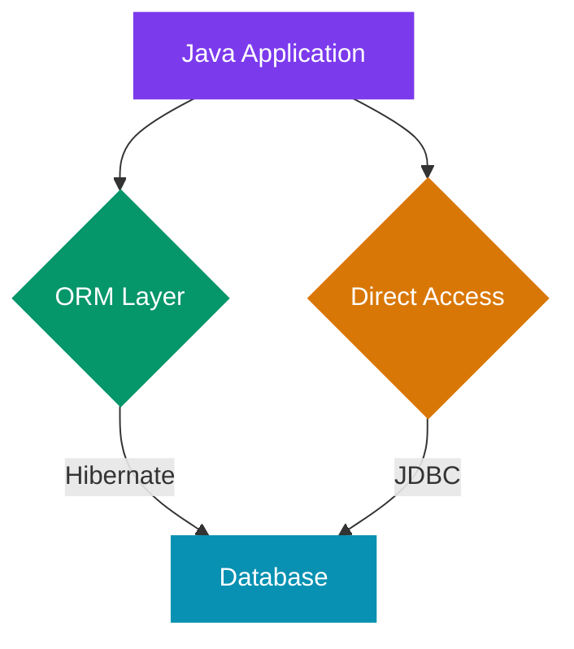

🎯 **Interview Tip:** Focus on 3 points: Hibernate gives database portability, caching, and removes boilerplate. These are the top 3 reasons interviewers expect.

---

</details>

---

4. **🔌 What are the important interfaces used in Hibernate? 🔥**

<!-- -->
<details>
<summary>Answer</summary>

**Answer:**

- 🏭 **SessionFactory (`org.hibernate.SessionFactory`)** — You use an instance of this to get `Session` objects for database operations.
  - It is expensive to build and thread-safe.
  - You create it **once per database / datasource / persistence unit** (e.g., 1 for MySQL, 1 for Oracle). It is *not* one per connection.
  - A `SessionFactory` **owns** a connection pool. It hands out many short-lived `Session`s. Each `Session` borrows a connection when it needs one.
  - In Spring Boot this is the `EntityManagerFactory`. You never build it by hand.
- 🔗 **Session (`org.hibernate.Session`)** — It's a factory for transactions.
  - It connects the application to the database.
  - You use it to get a physical connection to the database.
  - It also gives methods for CRUD operations.
  - It gives a `Transaction` object.
- 🔒 **Transaction (`org.hibernate.Transaction`)** — This defines single/atomic units of work.

```java
SessionFactory factory = metadata.getSessionFactoryBuilder().build();
Session session = factory.openSession();
Transaction t = session.beginTransaction();

session.persist(persistentObj); // JPA-standard; replaces the removed save()

t.commit();
session.close(); // Close session first
factory.close(); // Then close factory
```

⚠️ **Version note:**
- The old `Session` methods `save()`, `update()`, `saveOrUpdate()` and `delete()` were **deprecated in Hibernate 6**.
- They were **removed in Hibernate 7**.
- In any new code, use the JPA methods instead: `persist()`, `merge()`, `remove()`.
- Spring Boot 3.x ships Hibernate 6.x. So these old methods still compile there. But they will fail to compile on Hibernate 7.

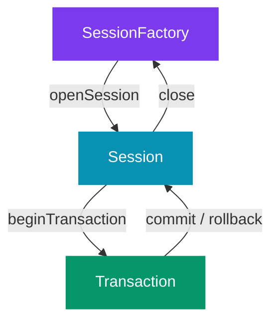

---

</details>

---

5. **🏷️ What are the important annotations used in Hibernate? ⚡**

<!-- -->
<details>
<summary>Answer</summary>

**Answer:**

- 📦 `@Entity` — Put it on model classes to mark them as entity beans.
- 🗄️ `@Table` — Put it on entity beans to set the matching table name in the database.
- 🔑 `@Access` — Sets the access type: field or property. By default, the place of `@Id` decides it: `@Id` on a field gives field access, `@Id` on a getter gives property access. If you want Hibernate to use getter/setter methods, set it to property. Example: `@Access(value = AccessType.PROPERTY)`
- 🆔 `@Id` — Marks the primary key in the entity bean.
- 🔗 `@EmbeddedId` — Marks a composite primary key in the entity bean.
- 📋 `@Column` — Sets the column name in a database table.
- ⚙️ `@GeneratedValue` — Sets the strategy for generating the primary key. You use it with the `GenerationType` enum, e.g., `GenerationType.IDENTITY`.
- 🔀 `@OneToOne` — Defines the one-to-one mapping between two entity beans. Similar annotations are `@OneToMany`, `@ManyToOne`, and `@ManyToMany`.
- 🔄 `org.hibernate.annotations.Cascade` — Defines the cascading between two entity beans. You use it with mappings. It works together with `org.hibernate.annotations.CascadeType`.
- 🗝️ `jakarta.persistence.PrimaryKeyJoinColumn` — Defines the property for the foreign key. You usually use it on a shared-primary-key `@OneToOne`.

📦 **Namespace note:** since **Hibernate 6 / Spring Boot 3**, all JPA annotations are in `jakarta.persistence.*`, not `javax.persistence.*`. If a code sample has `javax.persistence` imports, it is from before Boot 3.

---

</details>

---

6. **🔗 What are the mappings in Hibernate? 🔥**

<!-- -->
<details>
<summary>Answer</summary>

**Answer:**

There are 4 types of Association mappings in Hibernate:

- 🔗 One-To-One
- 🔀 Many-To-One
- 📂 One-To-Many
- 🔄 Many-To-Many

```java
// One-to-One
@OneToOne(targetEntity = Employee.class)
private Employee employee;

// Many-to-One
class Student {
    @ManyToOne(cascade = CascadeType.ALL)
    private Address address;
}

// Many-to-Many
class Student {
    @ManyToMany(targetEntity = Degree.class, cascade = {CascadeType.ALL})
    @JoinTable(name = "DegreeStudentThirdTable",
        joinColumns = {@JoinColumn(name = "StudentId")},
        inverseJoinColumns = {@JoinColumn(name = "CertificateId")}
    )
    private List<Degree> degrees;
}

// One-to-Many
class Department {
    @OneToMany(mappedBy = "department", cascade = CascadeType.ALL)
    private List<Employee> employees;

    // Getters and Setters
}

class Employee {
    @ManyToOne
    @JoinColumn(name = "department_id")
    private Department department;

    // Getters and Setters
}
```

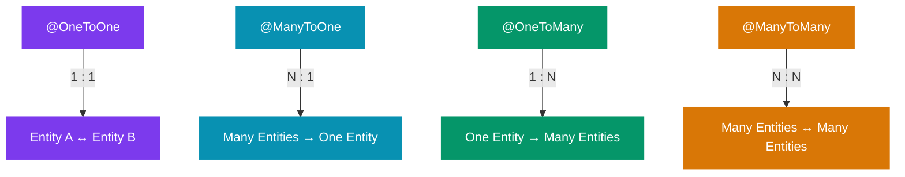

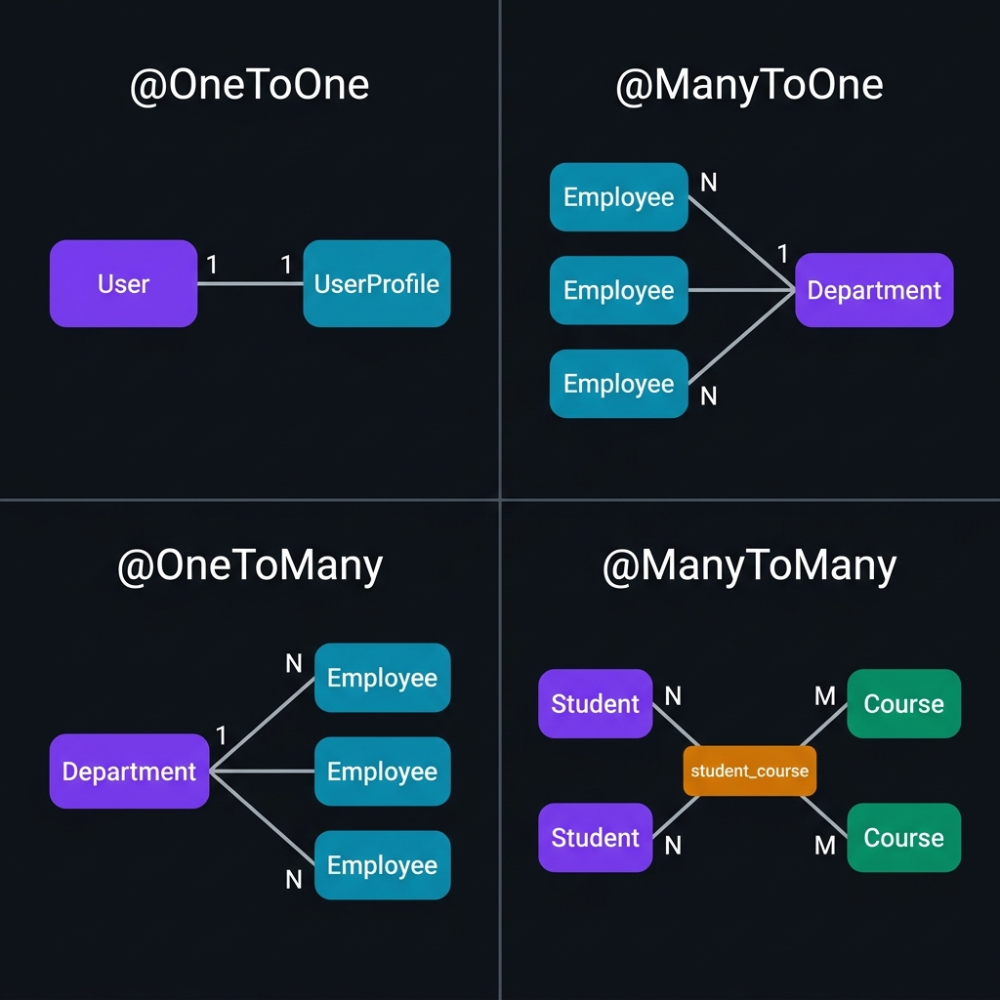

---

</details>

---

<a id="hibernate-configuration-and-mapping"></a>

## 2. Hibernate Configuration and Mapping

1. **📝 What are the Hibernate configuration files? 💤**

<!-- -->
<details>
<summary>Answer</summary>

**Answer:**

⚠️ **Legacy topic.** This is how standalone Hibernate starts up (bootstrapping).
- In a Spring Boot application there is **no `hibernate.cfg.xml`**.
- The datasource, dialect and Hibernate properties all come from `application.yml`/`application.properties`.
- Spring Boot builds the `EntityManagerFactory` for you.

Know it well enough to say this. Don't start your answer with it.

- 📄 It holds database-specific configuration. Hibernate uses it to initialize `SessionFactory`.
- 📝 By convention, its name is `hibernate.cfg.xml`.
- 🗄️ To connect to Oracle/SQL Server as well, create another configuration file.

🛠️ **Example:**

```xml
<?xml version="1.0" encoding="UTF-8"?>
<!DOCTYPE hibernate-configuration PUBLIC "-//Hibernate/Hibernate Configuration DTD 3.0//EN" "https://hibernate.org/dtd/hibernate-configuration-3.0.dtd">
<hibernate-configuration>
    <session-factory>
        <!-- JDBC Database connection settings -->
        <property name="hibernate.connection.driver_class">com.mysql.cj.jdbc.Driver</property>
        <property name="hibernate.connection.url">jdbc:mysql://localhost:3306/your_database</property>
        <property name="hibernate.connection.username">your_username</property>
        <property name="hibernate.connection.password">your_password</property>

        <!-- JDBC connection pool settings -->
        <property name="hibernate.c3p0.min_size">5</property>
        <property name="hibernate.c3p0.max_size">20</property>
        <property name="hibernate.c3p0.timeout">300</property>
        <property name="hibernate.c3p0.max_statements">50</property>
        <property name="hibernate.c3p0.idle_test_period">3000</property>

        <!-- SQL dialect — see the version note below; usually omit this entirely -->
        <property name="hibernate.dialect">org.hibernate.dialect.MySQLDialect</property>

        <!-- Standalone-only: bind the Session to the current thread -->
        <property name="hibernate.current_session_context_class">thread</property>

        <!-- Echo all executed SQL to stdout -->
        <property name="hibernate.show_sql">true</property>
        <property name="hibernate.format_sql">true</property>

        <!-- Apply additive schema changes on startup — dev only, never production -->
        <property name="hibernate.hbm2ddl.auto">update</property>

        <!-- Names the annotated entity class -->
        <mapping class="com.example.YourEntityClass"/>
    </session-factory>
</hibernate-configuration>
```

⚠️ **Three things in that file that make you look out of date in an interview:**

| Property | Problem | What to say instead |
|---|---|---|
| `hibernate.dialect` (older configs use `MySQL8Dialect`) | **Version-specific dialect classes are deprecated in Hibernate 6.** Now there is one dialect class per product (`MySQLDialect`, `PostgreSQLDialect`). Hibernate detects the server version from the JDBC connection. | Leave out `hibernate.dialect` fully and let Hibernate find it. Set it only when you connect through a proxy that hides the real server version. |
| `hibernate.current_session_context_class=thread` | The old **standalone** value. With Spring's native `LocalSessionFactoryBean`, Spring sets `SpringSessionContext` for you. With JPA (Spring Boot), you use the injected `EntityManager` instead. | "In Spring I never set this — the session is bound to the transaction, not to the raw thread." |
| `hibernate.hbm2ddl.auto=update` | Applies **additive-only** changes (it never drops or renames). So the schema slowly stops matching your entities, with no warning. | `validate` or `none` + Flyway/Liquibase. See §5 Q15 for the full breakdown. |

---

</details>

---

2. **📄 What are the Hibernate mapping files? 💤**

<!-- -->
<details>
<summary>Answer</summary>

**Answer:**

⚠️ **Legacy — trivia only.**
- `.hbm.xml` mapping is **deprecated in Hibernate 6**.
- Hibernate 7 still reads it, but it stays deprecated. An opt-in setting, `hibernate.transform_hbm_xml.enabled`, converts it to the JPA `mapping.xml` format.
- The supported way to map entities is annotations (or the `orm.xml` JPA descriptor).

Recognise the format. Never suggest it.

By convention, the mapping file name is `class_name.hbm.xml`.

- 📦 `hibernate-mapping` — Root element.
- 🏷️ `class` — Names the Persistent class.
- 🆔 `id` — Names the primary key attribute in the class.
- ⚙️ `generator` — Generates the primary key.
- 📋 `property` — Names a property of the Persistent class.

---

</details>

---

<a id="hibernate-sessions-and-transactions"></a>

## 3. Hibernate Sessions and Transactions

1. **🔀 What is the difference between openSession() and getCurrentSession()? 🔥**

<!-- -->
<details>
<summary>Answer</summary>

**Answer:**

| Feature | `getCurrentSession()` 🅰️ | `openSession()` 🅱️ |
|---------|--------------------------|---------------------|
| **Binding** | ✅ Bound to the current context (the thread, or in Spring the current transaction) | ❌️ Not bound to any context. You get a new `Session` on every call |
| **Closing** | ✅ Hibernate flushes it and **closes it automatically when the transaction commits or rolls back** | ⚠️ The developer must close it |
| **Thread Safety** | ✅ **This is the safe option under concurrency.** One session per thread/transaction, never shared | ⚠️ You manage the lifecycle. Sharing one instance across threads corrupts the persistence context |
| **Use Case** | The normal choice: any code running inside a managed transaction | The manual option for special cases: batch jobs, tooling, a second session inside one thread |

⚠️ **Correction to a common wrong answer:** a context-bound session is **not** tied to the `SessionFactory`'s lifetime.
- If it were, one `Session` would live for the entire application.
- Its persistence context would grow without limit.
- Every entity ever loaded would stay cached.

Its scope is the **transaction**.

🌱 **In Spring:** you rarely call either. You inject `@PersistenceContext EntityManager`. It is a proxy. On each call, it finds the `EntityManager` bound to the current transaction. The idea is the same as `getCurrentSession()`. But Spring does the binding itself (through `TransactionSynchronizationManager`), not through `SpringSessionContext`.

🧠 **In Simple Words:**
- `getCurrentSession()` is a shared resource that Hibernate manages. The transaction opens and closes it for you.
- `openSession()` is like borrowing a resource. You must return (close) it.

---

</details>

---

2. **✅ What are the advantages of Hibernate? ⚡**

<!-- -->
<details>
<summary>Answer</summary>

**Answer:**

Hibernate is a widely used ORM framework in Java. It has several advantages:

- 🧹 **Simplified Database Operations** — Hibernate hides the low-level JDBC code. Developers work with objects and entities directly, not with SQL queries.
- 🔄 **Database Portability** — Hibernate adds a layer over the database. So developers can write database-independent code. Applications can switch database vendors without big changes.
- ⚙️ **Automatic Table Generation** — Hibernate can create database tables from entity classes. So developers do not need to write DDL scripts by hand.
- ⚡ **Caching Mechanisms** — Hibernate has built-in caching (first-level and second-level cache). Caching helps performance because it reduces the number of database queries.
- 💤 **Lazy Loading** — Hibernate supports lazy loading. It loads associated objects only when you first access them. This avoids fetching data you don't need at the start.
- 🔗 **Transparent Persistence** — Hibernate writes changes on managed entities to the database automatically. You don't call save or update.
- 📦 **Object-Oriented Approach** — Developers work with domain model objects directly. This fits object-oriented programming principles well.
- 📑 **Integration with JPA** — Hibernate implements the Java Persistence API (JPA) specification. So developers can use standard JPA annotations and also get Hibernate's extra features.

💡 **Pro Tip:** In interviews, name caching, lazy loading, and database portability as the top advantages. These are the most frequently asked follow-up topics.

---

</details>

---

<a id="hibernate-performance-and-caching"></a>

## 4. Hibernate Performance and Caching

1. **🔍 What is the difference between get()/find() and load()/getReference() in Hibernate? ⚡**

<!-- -->
<details>
<summary>Answer</summary>

**Answer:**

Both get a persistent object by its ID. They differ in two things: **when** the database is hit, and **what happens when the row does not exist**.

⚠️ **Version note first — this shows if your answer is out of date.** `Session.load()` is **deprecated in Hibernate 6** and **removed in Hibernate 7**. Its replacement is `Session.getReference()` / `EntityManager.getReference()`. It has identical semantics (the same behaviour). Also, `Session.get()` is the Hibernate-native version of the JPA-standard `EntityManager.find()`. Answer in terms of **`find()` vs `getReference()`**. Mention `get()`/`load()` as the legacy names.

| Feature | `get()` / `find()` 🅰️ | `load()` / `getReference()` 🅱️ |
|---------|------------|-------------|
| **Database Hit** | ✅ Immediately hits the database (unless already in the persistence context) | ❌️ Returns an **uninitialised proxy** — no SQL at all yet |
| **Return on Not Found** | Returns `null` | Returns a proxy **successfully**; the exception comes later |
| **Return Type** | Fully initialized object or `null` | Proxy object (initialized on first property access) |
| **Performance** | ⚠️ Always queries DB | ⚡ Defers DB access; free if you only need the FK |
| **Use Case** | When you need the entity's data, or must know whether it exists | Setting a foreign key without loading the parent row |

🛠️ **Example:**

```java
// find() / get() — immediately hits the database
Employee emp = entityManager.find(Employee.class, 1L);   // null if not found
Employee emp2 = session.get(Employee.class, 1L);          // Hibernate-native twin

// getReference() / load() — returns a proxy, DB hit deferred
Employee ref = entityManager.getReference(Employee.class, 1L);
// NO SQL yet. The row may not even exist.
ref.getName();  // <-- SQL fires HERE; EntityNotFoundException thrown HERE if missing
```

⚠️ **The trap:** `getReference()` does **not** throw when the ID is missing. It throws `EntityNotFoundException` (JPA) / `ObjectNotFoundException` (Hibernate) **later**, when the proxy is first initialised. That may happen in a completely different method. Or it may happen after the session has closed. In that case you get `LazyInitializationException` instead. Never use `getReference()` as an existence check.

💡 **The one case where `getReference()` is the best choice** — setting an association without loading it:

```java
// No SELECT on department at all — Hibernate only needs the FK value
Employee emp = new Employee("Alice");
emp.setDepartment(entityManager.getReference(Department.class, deptId));
entityManager.persist(emp);
```

🧠 **In Simple Words:**
- `find()` is going to the library and checking whether the book is on the shelf right now.
- `getReference()` is writing down the shelf number. You only find out the book is missing when you walk over to get it.

🎯 **Interview Tip:** The key point is *when* the exception appears, not *whether* one is thrown. Say: "`find()` returns `null` immediately. `getReference()` returns a proxy and fails on first access — so the failure can escape the transaction entirely."

---

</details>

---

2. **💤 What is Lazy loading and Eager loading in Hibernate? Which one is the default? 🔥🔥**

<!-- -->
<details>
<summary>Answer</summary>

**Answer:**

Lazy loading and eager loading are two strategies in Hibernate. They control how associated objects or collections are fetched from the database.

| Feature | Lazy Loading 🅰️ | Eager Loading 🅱️ |
|---------|-----------------|------------------|
| **When Data is Loaded** | On first access (deferred) | Immediately with parent entity |
| **Database Queries** | ⚠️ Multiple queries (on demand) | ⚠️ Single JOIN **only on `em.find()`** — on a JPQL query (`findAll()`) Hibernate issues **N secondary selects** |
| **Memory Usage** | ✅ Lower — loads only what's needed | ❌️ Higher — loads everything upfront |
| **Performance** | ⚡ Better for large object graphs | 🐢 Can be slow with many associations |
| **Risk** | `LazyInitializationException` if session closed | ❌️ The **most common source of N+1** — every EAGER association fires its own select per row |
| **Default?** | ✅ Default for **ToMany** (`@OneToMany`, `@ManyToMany`) | ✅ Default for **ToOne** (`@ManyToOne`, `@OneToOne`) and `@Basic` |

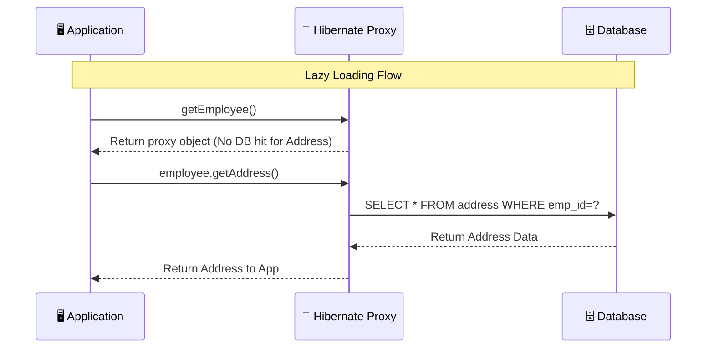

**Default loading behavior (JPA spec — Hibernate implements it as written):**

⚠️ There is **no single default**. It depends on the *cardinality* of the association:

- 🔗 **Single-Valued Associations** (`@ManyToOne`, `@OneToOne`) — **EAGER** by default. Hibernate fetches the associated object together with the parent, whether you need it or not.
- 📂 **Collection-Valued Associations** (`@OneToMany`, `@ManyToMany`, `@ElementCollection`) — **LAZY** by default. Hibernate fetches the elements when the collection is first accessed.
- 📋 **`@Basic` fields** — **EAGER** by default.

🧠 **Mnemonic:** *ToOne = EAGER, ToMany = LAZY.* The spec assumed that one extra row is cheap. A whole collection is not.

⚠️ A common wrong belief is "Hibernate is lazy by default". That is only half true. The wrong half is the one that causes N+1 in production. See **§5 Q19 — "What are the default FetchTypes for different JPA mappings?"** for the full table. It also explains why you should override every ToOne to `FetchType.LAZY`.

💡 **Pro Tip:** In interviews, mention the N+1 problem. Also say how `JOIN FETCH` in HQL or `@EntityGraph` can solve it.

---

</details>

---

3. **🗄️ What are the different types of Hibernate Caching? 🔥🔥**

<!-- -->
<details>
<summary>Answer</summary>

**Answer:**

Hibernate provides three levels of caching:

- 🥇 **First Level Cache (Session Cache)**
- 🥈 **Second Level Cache (SessionFactory Cache)**
- 🥉 **Query Cache**

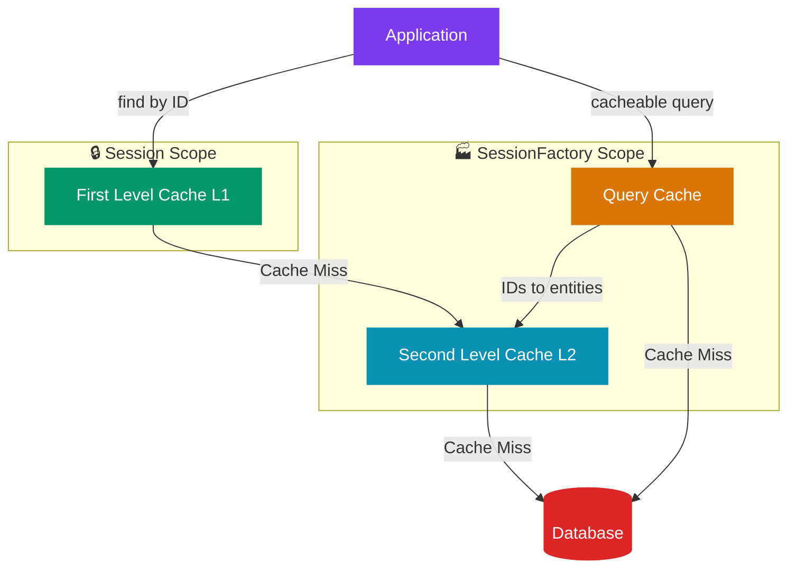

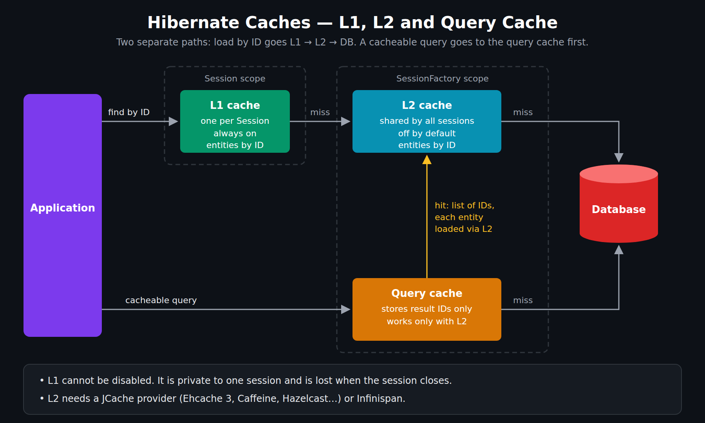

**First Level Cache:**

- ⚡ Hibernate caches the entities loaded in a session, keyed by ID. It does not cache query results here.
- 💡 The idea of a cache is to reduce the number of database queries.
- 🔗 The Hibernate first-level cache is linked to the `Session` object.
- ✅ The first-level cache is enabled by default. There is no way to disable it.
- 🧹 Hibernate gives methods to delete selected objects from the cache, or to clear the cache completely.
- 🔒 An object cached in one session is not visible to other sessions. When the session is closed, all its cached objects are lost.

**Second Level Cache:**

- ⚠️ The second-level cache is disabled by default. You can enable it through configuration.
- 🏗️ Hibernate 6 talks to the cache through **JSR-107 (JCache)**, the standard Java caching API. So *any* JCache provider works — **Ehcache 3**, **Caffeine**, **Hazelcast**, **Redisson**.
- 🏗️ **Infinispan** works too. It also ships its own native region factory.

**Query Cache:**

- 🔗 The query-level cache only works with the second-level cache. It never works with the first-level cache alone.

| Feature | First-Level Cache (L1) 🥇 | Second-Level Cache (L2) 🥈 |
|---------|---------------------------|----------------------------|
| **Default Status** | ✅ Enabled by default (cannot be disabled) | ⚠️ Disabled by default (must be configured) |
| **Association** | Tied to the `Session` object | Tied to the `SessionFactory` object |
| **Scope** | Private to the current session | Shared across the entire application |
| **Lifespan** | Destroyed when the session is closed | Lives as long as the application runs (or until evicted) |
| **Provider** | Built into Hibernate | Requires a JCache provider (Ehcache 3, Caffeine, Hazelcast…) or Infinispan |

**Configure the Second Level Cache with Ehcache 3 (Hibernate 6 / Spring Boot 3):**

1️⃣ Add the **JCache bridge** plus a provider:

```xml
<!-- Hibernate's JSR-107 bridge -->
<dependency>
    <groupId>org.hibernate.orm</groupId>
    <artifactId>hibernate-jcache</artifactId>
</dependency>

<!-- Any JCache provider — Ehcache 3 here (jakarta classifier for Boot 3) -->
<dependency>
    <groupId>org.ehcache</groupId>
    <artifactId>ehcache</artifactId>
    <classifier>jakarta</classifier>
</dependency>
```

2️⃣ Point Hibernate at the JCache region factory:

```properties
spring.jpa.properties.hibernate.cache.use_second_level_cache=true
spring.jpa.properties.hibernate.cache.use_query_cache=true
spring.jpa.properties.hibernate.cache.region.factory_class=jcache
spring.jpa.properties.hibernate.javax.cache.provider=org.ehcache.jsr107.EhcacheCachingProvider
spring.jpa.properties.hibernate.javax.cache.uri=classpath:ehcache.xml
```

3️⃣ Create an **Ehcache 3** configuration file (`ehcache.xml`). Use the Ehcache 3 XML schema, not the 2.x one.

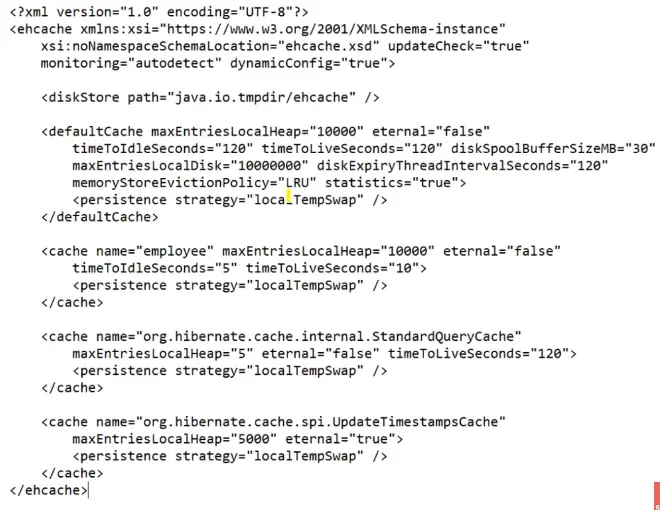

4️⃣ Annotate entity beans with `@Cache` and the concurrency strategy to use:

```java
import org.hibernate.annotations.Cache;
import org.hibernate.annotations.CacheConcurrencyStrategy;

@Entity
@Table(name = "ADDRESS")
@Cache(usage = CacheConcurrencyStrategy.READ_WRITE, region = "address")
public class Address {
}
```

📝 **Note:** The `region` value must match a cache/region name declared in `ehcache.xml`. If you leave out `region`, Hibernate uses the **fully-qualified entity class name** as the default. That is usually what you want.

⚠️ **Version trap — the config most tutorials still show no longer works.** The old `hibernate-ehcache` artifact, `org.hibernate.cache.ehcache.EhCacheRegionFactory`, and the `net.sf.ehcache.configurationResourceName` property are the **Ehcache 2.x proprietary integration**. It was deprecated in Hibernate 5.3 and **removed in Hibernate 6**. On Spring Boot 3, that configuration fails at startup with `StrategySelectionException` ("Unable to resolve name [...] as strategy [...RegionFactory]"). An interviewer may show you that snippet. If you see the problem, it counts for more than if you list the replacement.

📝 The `hibernate.javax.cache.*` property names look old, but they are correct. Hibernate kept the `javax` spelling for the **JCache (JSR-107)** settings even in 6.x. The reason: JSR-107 itself never moved to the `jakarta` namespace. Only the *JPA* annotations moved.

---

</details>

---

4. **⚙️ How will you achieve second-level caching in Hibernate? 🔥**

<!-- -->
<details>
<summary>Answer</summary>

**Answer:**

Second-level caching lets Hibernate cache data at the `SessionFactory` level. This means multiple sessions can share the cached data. It can greatly improve performance, because it reduces the number of database queries.

1️⃣ **Configure Cache Provider** — On Hibernate 6, you select the **JCache** region factory. Then you choose any JSR-107 provider (Ehcache 3, Caffeine, Hazelcast, Redisson). Infinispan is the one provider with its own native factory.

```properties
spring.jpa.properties.hibernate.cache.use_second_level_cache=true
spring.jpa.properties.hibernate.cache.use_query_cache=true
spring.jpa.properties.hibernate.cache.region.factory_class=jcache
spring.jpa.properties.hibernate.javax.cache.provider=org.ehcache.jsr107.EhcacheCachingProvider
```

2️⃣ **Entity Configuration** — Annotate each entity you want to cache with `@Cache`:

```java
@Entity
@Cache(usage = CacheConcurrencyStrategy.READ_WRITE)
public class YourEntity {
    // Entity mapping
}
```

3️⃣ **Enable in XML Mapping** (alternative to annotations):

```xml
<class name="com.example.YourEntity" table="your_entity">
    <cache usage="read-write"/>
    <!-- Other mappings -->
</class>
```

4️⃣ **Query Caching** — Enable query caching and cache queries explicitly:

```java
Query query = session.createQuery("from YourEntity where condition = :condition");
query.setParameter("condition", value);
query.setCacheable(true); // Enable query caching
List<YourEntity> entities = query.list();
```

5️⃣ **Manage Cache** — `SessionFactory.getCache()` already returns the public `org.hibernate.Cache` interface. No casting to internal types is needed (or possible):

```java
SessionFactory sessionFactory = entityManagerFactory.unwrap(SessionFactory.class);
org.hibernate.Cache cache = sessionFactory.getCache();

cache.evictEntityData(YourEntity.class);       // all cached rows of one entity type
cache.evictEntityData(YourEntity.class, 42L);  // one specific row
cache.evictQueryRegion("queryName");           // one query-cache region
cache.evictAllRegions();                        // nuke everything
```

⚠️ **Version trap:** the old names — `evictEntityRegion(...)`, `evictCollectionRegion(...)`, `evictEntity(...)` — were renamed to `evict*Data(...)` in **Hibernate 5.3** and **removed in Hibernate 6**. Some code casts `getCache()` to `SessionFactoryImpl.CacheImpl` (a Hibernate-internal type). That code does not compile on any recent version, and it never needed the cast.

⚠️ **Caution:** Use caching with care. If you do not manage it properly, it can lead to stale data. **Bulk and native updates that run through Hibernate** (`@Modifying` queries) do not update cached rows. Hibernate evicts instead: the affected entity regions for JPQL, and *all* regions for native SQL with unknown tables. **Writes that skip Hibernate** (`JdbcTemplate`, other apps, DB scripts) leave the cache stale until someone evicts it manually. Always think about cache invalidation strategies.

---

</details>

---

5. **⚡ What is the advantage of Query Cache? 🔥**

<!-- -->
<details>
<summary>Answer</summary>

**Answer:**

The Query Cache works together with the Second-Level Cache. It caches the result set of queries. Its advantage: it greatly improves performance by reducing database hits.

- ⚡ **Speed** — Frequently run queries get results from the cache instead of the database. This makes response times faster.
- 🔧 **Efficiency** — It reduces repeated database operations. This frees up resources and reduces server load.
- 📈 **Scalability** — It uses the database more efficiently. So the application stays more responsive under heavy load.
- 💰 **Cost** — It reduces database usage. This can lower operational costs in cloud-hosted setups where you pay for database queries.

🎯 **Interview Tip:** In Hibernate 5, the Query Cache stored only entity IDs. Hibernate then loaded the entities from the Second-Level Cache. Hibernate 6.0–6.4 stored the full entity state instead. Since 6.5, `hibernate.cache.query_cache_layout` controls this. The default `AUTO` stores only IDs for entities that are in the L2 cache, and the full state for other entities. Either way, the Query Cache needs the second-level cache turned on.

---

</details>

---

6. **📊 What is the summary of Hibernate Cache? ⚡**

<!-- -->
<details>
<summary>Answer</summary>

**Answer:**

**First-Level Cache (Session Cache):**

- 🔒 It is the default cache, linked to the Hibernate session.
- 📦 It caches objects within the scope of one session. It is not shared across sessions.

**Second-Level Cache (SessionFactory Cache):**

- 🏭 It is an optional cache shared by all sessions.
- 📂 It can cache entities, collections, and query results.
- ⚙️ It needs explicit configuration. It also needs a third-party cache provider like Ehcache, Infinispan, etc.

**Query Cache:**

- 🔗 The Query Cache works together with the Second-Level Cache.
- 🗂️ It caches the result set of queries. For entities that are in the L2 cache, it stores only their IDs.

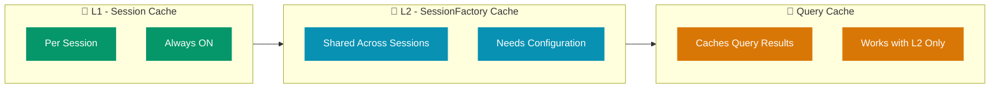

🧠 **In Simple Words:**
- **L1 Cache** — Your private notepad for a single session.
- **L2 Cache** — A shared notice board for the whole application.
- **Query Cache** — A saved page of search results. It avoids querying the database again.

---

</details>

---

> 🎯 **Why this section matters:** Tier-1 companies test Hibernate/JPA depth beyond basic CRUD. The N+1 problem, @Transactional propagation, and locking strategies are among the most frequently asked questions at Razorpay, PhonePe, and Walmart. If you know the entity lifecycle and performance tuning, you stand out from junior candidates as an SDE II.

<a id="advanced-hibernate-and-jpa-patterns"></a>

## 5. Advanced Hibernate and JPA Patterns

1. **🔎 What is the N+1 problem in Hibernate and why is it dangerous? 🔥🔥**

<!-- -->
<details>
<summary>Answer</summary>

**Answer:**

The N+1 problem happens in two steps:

- Hibernate runs **1 query** to fetch a list of parent entities.
- Then it runs **N additional queries**, one for each parent, to fetch its child entities.

This makes performance much worse, especially with large datasets.

**Example that triggers N+1:**

```java
@Entity
public class Department {
    @Id
    @GeneratedValue(strategy = GenerationType.IDENTITY)
    private Long id;
    private String name;

    @OneToMany(mappedBy = "department", fetch = FetchType.LAZY)
    private List<Employee> employees;
}

@Entity
public class Employee {
    @Id
    @GeneratedValue(strategy = GenerationType.IDENTITY)
    private Long id;
    private String name;

    @ManyToOne
    @JoinColumn(name = "department_id")
    private Department department;
}
```

```java
// This triggers N+1!
List<Department> departments = entityManager
    .createQuery("SELECT d FROM Department d", Department.class)
    .getResultList();

// 1 query: SELECT * FROM department
// Then for EACH department when you access employees:
for (Department dept : departments) {
    System.out.println(dept.getName() + ": " + dept.getEmployees().size());
    // N queries: SELECT * FROM employee WHERE department_id = ?
}
```

If there are 100 departments, Hibernate fires **101 queries** (1 + 100) instead of a single JOIN query.

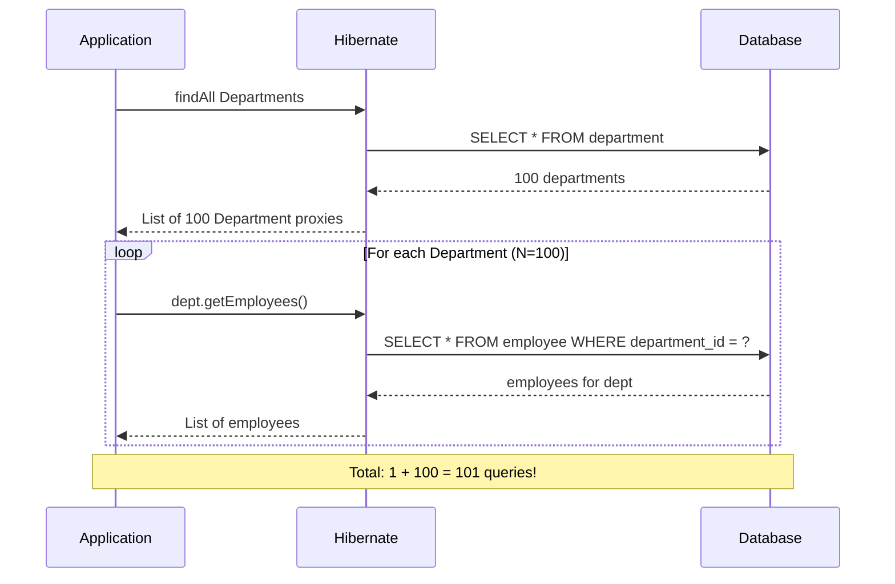

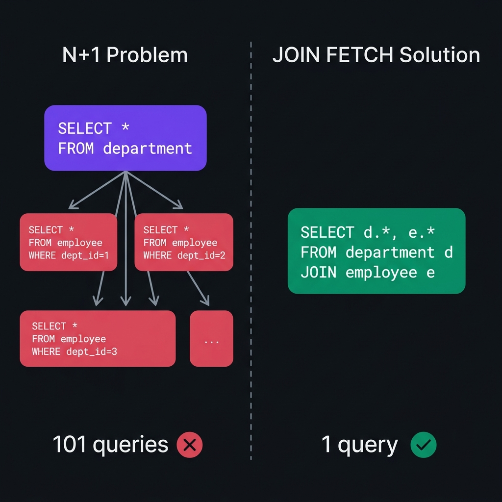

**Why it is dangerous:**

| Impact | Description |
|--------|-------------|
| **Performance** | Latency grows linearly with data size |
| **Database Load** | Hundreds/thousands of round trips to DB |
| **Connection Pool** | The request keeps one connection for all N+1 round trips, so it returns to the pool late. Under load, the pool can run out |
| **Scalability** | Works in dev with 10 records, breaks in prod with 10,000 |

🎯 **Interview Tip:** Always mention that N+1 is a **runtime** problem, not a compile-time error. It only shows up when you actually access the lazy collection. So it is easy to miss during development.

---

</details>

---

2. **🛠️ How do you detect N+1 problems in a Hibernate application? 🔥**

<!-- -->
<details>
<summary>Answer</summary>

**Answer:**

You can detect N+1 problems in Hibernate in several ways:

**1. Enable Hibernate SQL Logging:**

```properties
# application.properties
spring.jpa.show-sql=true
spring.jpa.properties.hibernate.format_sql=true

# For detailed parameter logging
logging.level.org.hibernate.SQL=DEBUG
# Hibernate 6+ logger below; Hibernate 5 used org.hibernate.type.descriptor.sql.BasicBinder
logging.level.org.hibernate.orm.jdbc.bind=TRACE
```

**2. Enable Hibernate Statistics:**

```properties
# application.properties
spring.jpa.properties.hibernate.generate_statistics=true
```

```java
@Autowired
private EntityManagerFactory emf;

public void checkStats() {
    SessionFactory sf = emf.unwrap(SessionFactory.class);
    Statistics stats = sf.getStatistics();
    stats.setStatisticsEnabled(true);

    // After executing your code
    long statementCount = stats.getPrepareStatementCount();   // all SQL statements sent
    long queryCount = stats.getQueryExecutionCount();         // HQL/JPQL queries you ran
    long collectionFetchCount = stats.getCollectionFetchCount(); // lazy collections loaded one by one

    System.out.println("SQL statements: " + statementCount);
    System.out.println("Query count: " + queryCount);
    System.out.println("Collection fetch count: " + collectionFetchCount);

    // If statementCount >> queryCount, or collectionFetchCount grows with the row count, you likely have N+1
    stats.clear();
}
```

**3. Use a Query Counter in Tests (datasource-proxy):**

```xml
<dependency>
    <groupId>net.ttddyy</groupId>
    <artifactId>datasource-proxy</artifactId>
    <scope>test</scope>
</dependency>
```

⚠️ **The step everyone forgets:** `QueryCountHolder` records something only if the proxy **wraps** the real `DataSource`, with query counting switched on. Without this, the counter always stays at zero. Then the assertion below passes, no matter how bad the N+1 is. You get a green test that proves nothing.

```java
@TestConfiguration
class ProxyDataSourceConfig {

    @Bean
    static BeanPostProcessor countingDataSource() {
        return new BeanPostProcessor() {
            @Override
            public Object postProcessAfterInitialization(Object bean, String name) {
                if (bean instanceof DataSource ds) {
                    return ProxyDataSourceBuilder.create(ds)
                        .name("test-ds")
                        .countQuery()   // <-- without this, QueryCountHolder stays empty
                        .build();
                }
                return bean;
            }
        };
    }
}
```

```java
@Test
void shouldNotHaveNPlusOne() {
    // Reset query count
    QueryCountHolder.clear();

    // Execute service method
    List<Department> departments = departmentService.getAllWithEmployees();
    departments.forEach(d -> d.getEmployees().size()); // trigger lazy load

    // Assert query count
    QueryCount queryCount = QueryCountHolder.getGrandTotal();
    assertThat(queryCount.getSelect()).isLessThanOrEqualTo(2); // Fails if N+1
}
```

**4. Use Hypersistence Optimizer (commercial tool by Vlad Mihalcea):**

This tool automatically finds N+1, unnecessary eager fetching, and other Hibernate performance issues at development time.

📝 **Get the licensing right if you name it.**

- Hypersistence Optimizer is a **paid, per-developer commercial product** (free trial available). It is not open source.
- Vlad's *open-source* library is `hypersistence-utils` (formerly `hibernate-types`). It is a different artifact. It adds JSON/array/interval column types. It is not a performance analyser.
- If you mix up the two, the interviewer will trust you less. And this mistake is easy to avoid.

**Detection Strategy Summary:**

| Method | When to Use | Effort |
|--------|-------------|--------|
| SQL Logging | Quick debugging during development | Low |
| Hibernate Statistics | Monitoring query counts in staging | Low |
| datasource-proxy | Automated N+1 detection in tests | Medium |
| Hypersistence Optimizer | Comprehensive Hibernate audit | Low (commercial library) |

💡 **Pro Tip:** The most reliable approach is to write integration tests with query count assertions. They stop future code changes from bringing N+1 back.

---

</details>

---

3. **🧩 What are the different solutions to fix the N+1 problem? 🔥🔥**

<!-- -->
<details>
<summary>Answer</summary>

**Answer:**

There are four main solutions to fix the N+1 problem in Hibernate:

**Solution 1: JOIN FETCH (JPQL)**

This is the most common and recommended approach. It forces Hibernate to load parent and child entities in a single SQL JOIN query.

```java
// BAD: triggers N+1
@Query("SELECT d FROM Department d")
List<Department> findAll();

// GOOD: single JOIN query
@Query("SELECT d FROM Department d JOIN FETCH d.employees")
List<Department> findAllWithEmployees();
```

Generated SQL:
```sql
SELECT d.*, e.* FROM department d
INNER JOIN employee e ON d.id = e.department_id
```

Two things to know about this query:

- `JOIN FETCH` is an inner join. A department with no employees is dropped from the result. Use `LEFT JOIN FETCH` to keep it.
- Before Hibernate 6, the list has one copy of a department per employee row. Hibernate 6 removes these duplicates for you.

**Solution 2: @EntityGraph (JPA 2.1+)**

This is a declarative way to say which associations to fetch eagerly for one specific query. You do not change the entity's default fetch type.

```java
public interface DepartmentRepository extends JpaRepository<Department, Long> {

    // Using @EntityGraph with attributePaths
    @EntityGraph(attributePaths = {"employees"})
    @Query("SELECT d FROM Department d")
    List<Department> findAllWithEmployeesGraph();

    // Or define a named entity graph on the entity
    @EntityGraph(value = "Department.withEmployees")
    List<Department> findAll();
}

// Named EntityGraph on the entity
@Entity
@NamedEntityGraph(
    name = "Department.withEmployees",
    attributeNodes = @NamedAttributeNode("employees")
)
public class Department {
    // ...
}
```

**Solution 3: @BatchSize (Hibernate-specific)**

Hibernate does not run N separate queries. Instead, it groups the child fetches into batches. This reduces N+1 to N/batchSize + 1 queries.

```java
@Entity
public class Department {
    @OneToMany(mappedBy = "department")
    @BatchSize(size = 25) // fetch 25 department's employees at a time
    private List<Employee> employees;
}
```

Generated SQL (for 100 departments, batch=25):
```sql
-- Query 1: fetch departments
SELECT * FROM department;

-- Query 2-5: fetch employees in batches of 25
SELECT * FROM employee WHERE department_id IN (?, ?, ?, ..., ?); -- 25 IDs
SELECT * FROM employee WHERE department_id IN (?, ?, ?, ..., ?); -- 25 IDs
SELECT * FROM employee WHERE department_id IN (?, ?, ?, ..., ?); -- 25 IDs
SELECT * FROM employee WHERE department_id IN (?, ?, ?, ..., ?); -- 25 IDs
-- Total: 5 queries instead of 101
```

You can also set it globally:

```properties
spring.jpa.properties.hibernate.default_batch_fetch_size=25
```

**Solution 4: DTO Projection**

If you only need specific fields (not full entities), project directly into DTOs. This avoids entity hydration (building entity objects from rows) and lazy loading completely.

```java
public record DepartmentSummary(String departmentName, long employeeCount) {}

@Query("""
    SELECT new com.example.DepartmentSummary(d.name, COUNT(e))
    FROM Department d LEFT JOIN d.employees e
    GROUP BY d.name
    """)
List<DepartmentSummary> findDepartmentSummaries();
```

**Comparison of Solutions:**

| Solution | Queries | Pros | Cons |
|----------|---------|------|------|
| JOIN FETCH | 1 | Fewest queries, most efficient | Can cause Cartesian product with multiple collections |
| @EntityGraph | 1 | Declarative, reusable, standard JPA | Same Cartesian product risk |
| @BatchSize | N/batch + 1 | Simple to add, no query changes | Still multiple queries, Hibernate-specific |
| DTO Projection | 1 | Most performant, no entity overhead | Loses entity features (dirty checking, lazy loading) |

🎯 **Interview Tip:** When asked "How do you solve N+1?", answer in this order:

1. Start with JOIN FETCH (the most common answer).
2. Then mention @EntityGraph as the JPA-standard alternative.
3. Then mention @BatchSize for cases where JOIN FETCH causes Cartesian product issues (e.g., multiple `@OneToMany` collections).

💬 **Explain the trade-off in the interview. That is the more interesting part:**

- **Gain:** hand-written SQL makes the query plan explicit and predictable. That is why it is the better choice for latency-sensitive lending flows.
- **Cost:** you lose everything the persistence context gives you — dirty checking, the L1 cache, cascade semantics, portability.
- **Risk:** correctness now depends on careful code review.

This leads to a good follow-up question, *"when is dropping to JDBC the right call?"* Answer:

- **Yes** for read-heavy reporting and bulk paths, where you want control of the plan.
- **Not** for write paths, where entity-lifecycle behaviour (versioning, cascades, auditing) is doing real work for you.

---

</details>

---

4. **🌐 How does the N+1 problem manifest in REST APIs and how do you handle it? 🔥**

<!-- -->
<details>
<summary>Answer</summary>

**Answer:**

In REST APIs, the N+1 problem is especially dangerous because:
- The JSON serializer (e.g., Jackson) accesses the lazy collections during serialization
- The Hibernate session may already be closed, which causes `LazyInitializationException`
- Or, if `spring.jpa.open-in-view=true` (default in Spring Boot), the session stays open, and N+1 runs silently during serialization

**Typical problematic flow:**

```java
@RestController
public class DepartmentController {

    @GetMapping("/departments")
    public List<Department> getAll() {
        // Returns entities directly — Jackson serializes employees lazily
        return departmentRepository.findAll(); // N+1 during serialization!
    }
}
```

**Solution: Use DTOs and fetch eagerly in the service layer:**

```java
// DTO
public record DepartmentResponse(
    Long id,
    String name,
    List<EmployeeResponse> employees
) {}

public record EmployeeResponse(Long id, String name) {}

// Service
@Service
@Transactional(readOnly = true)
public class DepartmentService {

    @Autowired
    private DepartmentRepository repo;

    public List<DepartmentResponse> getAllDepartments() {
        // Fetch with JOIN FETCH — single query
        List<Department> departments = repo.findAllWithEmployees();

        // Map to DTOs inside the transaction
        return departments.stream()
            .map(d -> new DepartmentResponse(
                d.getId(),
                d.getName(),
                d.getEmployees().stream()
                    .map(e -> new EmployeeResponse(e.getId(), e.getName()))
                    .toList()
            ))
            .toList();
    }
}

// Controller — returns DTOs, not entities
@RestController
public class DepartmentController {

    @GetMapping("/departments")
    public List<DepartmentResponse> getAll() {
        return departmentService.getAllDepartments();
    }
}
```

**Best practices for REST APIs:**

| Practice | Why |
|----------|-----|
| Always return DTOs, never entities | Prevents lazy loading in serialization layer |
| Set `spring.jpa.open-in-view=false` | Forces you to handle fetching properly in service layer |
| Use `@Transactional(readOnly = true)` for reads | Optimizes Hibernate (no dirty checking) |
| Profile endpoints with SQL logging in dev | Catches N+1 before it reaches production |

⚠️ **Warning about `open-in-view`:** Spring Boot enables `spring.jpa.open-in-view=true` by default. It keeps the Hibernate session open until the HTTP response is sent. This allows lazy loading in the view layer, so it silently hides N+1 problems. Always disable it in production applications.

---

</details>

---

5. **🔄 What are the different propagation types in @Transactional and when do you use each? 🔥🔥**

<!-- -->
<details>
<summary>Answer</summary>

**Answer:**

Spring's `@Transactional` annotation supports 7 propagation types. They control how transactions relate to each other when a method calls another transactional method.

```java
import org.springframework.transaction.annotation.Propagation;
import org.springframework.transaction.annotation.Transactional;
```

**1. REQUIRED (default):**
- Joins the existing transaction if one exists, otherwise creates a new one.
- Most commonly used propagation type.

```java
@Transactional(propagation = Propagation.REQUIRED) // default, can omit
public void placeOrder(Order order) {
    orderRepository.save(order);
    inventoryService.updateStock(order); // joins same transaction
}
```

**2. REQUIRES_NEW:**
- Always creates a new transaction. Suspends the existing transaction if one exists.
- Use it when the inner operation must commit, whatever the result of the outer transaction.

```java
@Transactional(propagation = Propagation.REQUIRES_NEW)
public void logAuditEvent(AuditEvent event) {
    // This commits even if the calling transaction rolls back
    auditRepository.save(event);
}
```

⚠️ **Two things that always follow REQUIRES_NEW in an interview:**

1. **Self-invocation breaks it.** Suppose you call `logAuditEvent(...)` from another method *of the same bean*. The call skips the Spring proxy completely. So Spring ignores the annotation, and the call simply joins the outer transaction. You must call it through an injected reference to another bean (or `AopContext.currentProxy()`).
2. **It uses a second pooled connection.** The outer transaction is suspended, but it still holds its connection. The inner one borrows another. Take a 10-connection pool and 10 concurrent requests, each doing REQUIRES_NEW. Every thread holds one connection and waits for a second. This is a deadlock you cause yourself, and it looks exactly like connection-pool exhaustion (see §5 Q20).

**3. NESTED:**
- Creates a savepoint within the existing transaction. If the nested transaction fails, it rolls back to the savepoint. The outer transaction can still commit.
- Requires JDBC savepoint support.

```java
@Transactional(propagation = Propagation.NESTED)
public void processPayment(Payment payment) {
    // If this fails, rolls back to savepoint
    // Outer transaction decides whether to commit or rollback
    paymentRepository.save(payment);
}
```

⚠️ **NESTED does not work with JPA + Hibernate.** A NESTED call inside an existing transaction throws one of two errors. Which one depends on the Spring version:

```
// Spring 7: nestedTransactionAllowed is false by default
org.springframework.transaction.NestedTransactionNotSupportedException:
    Transaction manager does not allow nested transactions by default -
    specify 'nestedTransactionAllowed' property with value 'true'

// Spring 6 (flag already true), or Spring 7 after setNestedTransactionAllowed(true)
org.springframework.transaction.NestedTransactionNotSupportedException:
    JpaDialect does not support savepoints - check your JPA provider's capabilities
```

Turning the flag on does not fix it. `HibernateJpaDialect` does not give Spring a savepoint manager. Spring's own Javadoc also warns: JPA does not support nested transactions. A savepoint rolls back only the JDBC rows, not the `EntityManager` and its cached entities.

`DataSourceTransactionManager` (plain JDBC) supports NESTED. With JPA, use `REQUIRES_NEW` instead. Note that it is not the same thing: the inner transaction commits on its own, even if the outer one later rolls back.

```java
@Transactional(propagation = Propagation.REQUIRES_NEW) // works with JPA, unlike NESTED
public void processPayment(Payment payment) {
    paymentRepository.save(payment);
}
```

Interviewers like this trap. Candidates explain savepoint semantics perfectly. Then the interviewer asks "so what happens if you just add `@Transactional(propagation = NESTED)` to a Spring Data JPA service?" The answer is: *it throws at runtime*.

**4. SUPPORTS:**
- Executes within an existing transaction if one exists, otherwise executes non-transactionally.
- Use for methods that can work either way.

```java
@Transactional(propagation = Propagation.SUPPORTS)
public List<Product> searchProducts(String keyword) {
    // Reads work fine with or without a transaction
    return productRepository.findByNameContaining(keyword);
}
```

**5. NOT_SUPPORTED:**
- Always executes non-transactionally. Suspends any existing transaction.
- Use it for operations that should not take part in any transaction (e.g., heavy read operations).

```java
@Transactional(propagation = Propagation.NOT_SUPPORTED)
public void generateHeavyReport() {
    // Long-running read — don't hold a transaction open
    reportService.generatePdf();
}
```

**6. MANDATORY:**
- Must execute within an existing transaction. Throws `IllegalTransactionStateException` if no transaction exists.
- Use it to make sure a method is never called without a transaction.

```java
@Transactional(propagation = Propagation.MANDATORY)
public void deductBalance(Long accountId, BigDecimal amount) {
    // Must always run inside a transaction — safety net
    accountRepository.deduct(accountId, amount);
}
```

**7. NEVER:**
- Must execute without any transaction. Throws `IllegalTransactionStateException` if a transaction exists.
- Use for operations that must not be transactional.

```java
@Transactional(propagation = Propagation.NEVER)
public void sendNotification(String message) {
    // External HTTP call — must not be inside a DB transaction
    notificationClient.send(message);
}
```

**① The only question that matters first — is a transaction already running?**

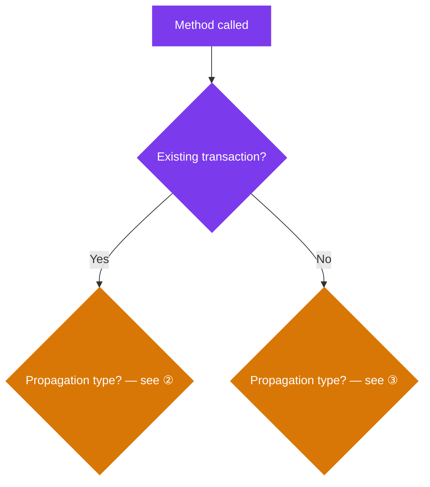

**② A transaction IS already running — what each propagation does:**

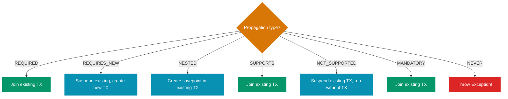

**③ NO transaction running — what each propagation does:**

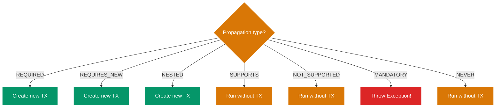

> Diagrams ② and ③ expand the two outgoing edges of `B` in ①. Read them side by side. The two exception cases are exact opposites: `NEVER` throws only when a transaction *exists* (②), `MANDATORY` throws only when one *doesn't* (③).

**Summary Table:**

| Propagation | Existing TX | No Existing TX | Use Case |
|-------------|-------------|----------------|----------|
| REQUIRED | Join | Create new | Default — most service methods |
| REQUIRES_NEW | Suspend, create new (⚠️ **second connection**) | Create new | Audit logs, notifications |
| NESTED | Create savepoint (⚠️ **throws on JPA + Hibernate**) | Create new | Partial rollback scenarios |
| SUPPORTS | Join | Non-transactional | Read-only operations |
| NOT_SUPPORTED | Suspend | Non-transactional | Heavy reports, external calls |
| MANDATORY | Join | Throw exception | Critical financial operations |
| NEVER | Throw exception | Non-transactional | External HTTP calls |

📝 **Note:** See [Spring Core Interview Questions](09_Spring_Core_Interview_Questions.md) for @Transactional proxy mechanism in Spring context.

---

</details>

---

6. **🔒 What are the isolation levels in @Transactional and what problems does each solve? 🔥🔥**

<!-- -->
<details>
<summary>Answer</summary>

**Answer:**

An isolation level controls how much one transaction can see of the changes made by other transactions. Here, "other" means concurrent transactions (they run at the same time). Spring's `@Transactional` supports 5 isolation levels.

```java
@Transactional(isolation = Isolation.READ_COMMITTED)
public void transferFunds(Long from, Long to, BigDecimal amount) {
    // ...
}
```

**Concurrency Problems:**

| Problem | Description | Example |
|---------|-------------|---------|
| **Dirty Read** | Reading uncommitted data from another transaction | TX-A updates salary to 50k (not committed), TX-B reads 50k, TX-A rolls back. TX-B has stale data. |
| **Non-Repeatable Read** | Same query returns different data within a transaction | TX-A reads salary=40k, TX-B commits salary=50k, TX-A reads salary=50k. Different result in same TX. |
| **Phantom Read** | New rows appear/disappear between queries in a transaction | TX-A counts 10 employees, TX-B inserts 1, TX-A counts 11. Row "appeared" during TX. |

**Isolation Levels:**

| Isolation Level | Dirty Read | Non-Repeatable Read | Phantom Read | Performance |
|-----------------|-----------|---------------------|--------------|-------------|
| **DEFAULT** | Depends on DB | Depends on DB | Depends on DB | Depends on DB |
| **READ_UNCOMMITTED** | Possible | Possible | Possible | Fastest |
| **READ_COMMITTED** | Prevented | Possible | Possible | Fast |
| **REPEATABLE_READ** | Prevented | Prevented | Possible (SQL standard); mostly prevented in MySQL InnoDB and PostgreSQL | Moderate |
| **SERIALIZABLE** | Prevented | Prevented | Prevented | Slowest |

```java
// READ_UNCOMMITTED — rarely used, only for non-critical reads
@Transactional(isolation = Isolation.READ_UNCOMMITTED)
public long getApproximateCount() {
    return productRepository.count(); // OK if slightly inaccurate
}

// READ_COMMITTED — most common, default for PostgreSQL and Oracle
@Transactional(isolation = Isolation.READ_COMMITTED)
public Product getProduct(Long id) {
    return productRepository.findById(id).orElseThrow();
}

// REPEATABLE_READ — default for MySQL/InnoDB
@Transactional(isolation = Isolation.REPEATABLE_READ)
public void calculateMonthlyReport() {
    // All reads within this TX see the same snapshot
    BigDecimal total = orderRepository.sumForMonth(currentMonth);
    reportRepository.save(new Report(currentMonth, total));
}

// SERIALIZABLE — use sparingly, for critical financial operations
@Transactional(isolation = Isolation.SERIALIZABLE)
public void transferFunds(Long from, Long to, BigDecimal amount) {
    Account sender = accountRepository.findById(from).orElseThrow();
    Account receiver = accountRepository.findById(to).orElseThrow();
    sender.debit(amount);
    receiver.credit(amount);
}
```

**Database Defaults:**

| Database | Default Isolation Level |
|----------|------------------------|
| MySQL (InnoDB) | REPEATABLE_READ |
| PostgreSQL | READ_COMMITTED |
| Oracle | READ_COMMITTED |
| SQL Server | READ_COMMITTED |

🎯 **Interview Tip:** Most interviewers expect you to know two things:

- `READ_COMMITTED` is the most commonly used level.
- `SERIALIZABLE` has the highest consistency but the worst performance.

Always mention that more consistency costs throughput, and less consistency gives more throughput.

---

</details>

---

7. **🛡️ How do rollbackFor and noRollbackFor work in @Transactional? 🔥**

<!-- -->
<details>
<summary>Answer</summary>

**Answer:**

By default, Spring's `@Transactional` rolls back only on **unchecked exceptions** (subclasses of `RuntimeException`) and **Errors**. Checked exceptions do **not** trigger a rollback by default.

**Default Behavior:**

```java
@Transactional
public void processOrder(Order order) throws MessagingException {
    orderRepository.save(order);

    // RuntimeException → ROLLBACK (default)
    if (order.getAmount() <= 0) {
        throw new IllegalArgumentException("Invalid amount"); // rolls back
    }

    // Checked Exception → NO ROLLBACK (default!)
    try {
        emailService.sendConfirmation(order);
    } catch (MessagingException e) {
        throw e; // checked exception — transaction COMMITS despite error!
    }
}
```

**Using rollbackFor:**

```java
// Roll back for specific checked exceptions
@Transactional(rollbackFor = {MessagingException.class, PaymentException.class})
public void processOrder(Order order) throws MessagingException {
    orderRepository.save(order);
    paymentService.charge(order);       // PaymentException → rollback
    emailService.sendConfirmation(order); // MessagingException → rollback
}

// Roll back for ALL exceptions (common best practice)
@Transactional(rollbackFor = Exception.class)
public void criticalOperation() {
    // Both checked and unchecked exceptions cause rollback
}
```

**Using noRollbackFor:**

`noRollbackFor` only matters when the exception **propagates out of** the `@Transactional` method. If you catch it inside, the proxy never sees it. So there is no rollback to prevent.

```java
// A runtime exception that must NOT undo the DB write
public class NotificationFailedException extends RuntimeException {
    public NotificationFailedException(String msg, Throwable cause) {
        super(msg, cause);
    }
}

@Service
public class OrderService {

    // The order MUST be saved even if we fail to notify the customer.
    // Without noRollbackFor, this RuntimeException would roll the INSERT back.
    @Transactional(noRollbackFor = NotificationFailedException.class)
    public void placeOrder(Order order) {
        orderRepository.save(order);          // committed

        try {
            notificationClient.send(order);
        } catch (IOException e) {
            // Rethrown so the caller learns about it — and it escapes the proxy,
            // which is exactly why noRollbackFor is needed here.
            throw new NotificationFailedException("Notification failed", e);
        }
    }
}
```

Flow, step by step:

1. `save()` is queued.
2. `NotificationFailedException` propagates.
3. Spring's proxy checks the rollback rules.
4. The exception is on the `noRollbackFor` list.
5. The transaction **commits**.
6. The exception continues to the caller.

⚠️ **Two anti-patterns in this area:**

```java
// ANTI-PATTERN 1: catching inside makes noRollbackFor pointless
@Transactional(noRollbackFor = SomeException.class)
public void x() {
    try { risky(); } catch (SomeException e) { log.warn("..."); }
    // Proxy never sees the exception — it would have committed anyway
}

// ANTI-PATTERN 2: Optional.orElseThrow() with no argument throws
// NoSuchElementException, NOT EntityNotFoundException
Product p = productRepository.findById(id).orElseThrow();
// catch (EntityNotFoundException e) would never fire.
// Be explicit:
Product p2 = productRepository.findById(id)
    .orElseThrow(() -> new EntityNotFoundException("Product " + id));
```

**Summary Table:**

| Exception Type | Default Behavior | rollbackFor | noRollbackFor |
|----------------|-----------------|-------------|---------------|
| RuntimeException | Rollback | N/A (already rolls back) | Can prevent rollback |
| Checked Exception | No rollback | Can force rollback | N/A (already no rollback) |
| Error | Rollback | N/A (already rolls back) | Can prevent rollback |

**Best Practice:**

```java
// Recommended: always use rollbackFor = Exception.class for critical methods
@Transactional(rollbackFor = Exception.class)
public void transferMoney(TransferRequest request) throws InsufficientFundsException {
    // Now ALL exceptions (checked + unchecked) trigger rollback
}
```

💡 **Pro Tip:** A common interview follow-up is "What happens if you catch the exception inside the method?" Answer: suppose you catch and handle the exception, and you do not re-throw it. Then the transaction will commit normally. The reason: Spring's proxy never sees the exception.

---

</details>

---

8. **📖 What does readOnly=true do in @Transactional and when should you use it? 🔥🔥**

<!-- -->
<details>
<summary>Answer</summary>

**Answer:**

`@Transactional(readOnly = true)` is an optimization hint. It tells the persistence provider that this transaction will only read data, not change it.

```java
@Service
public class ProductService {

    @Transactional(readOnly = true)
    public List<Product> getAllProducts() {
        return productRepository.findAll();
    }

    @Transactional(readOnly = true)
    public ProductStats getStatistics() {
        long count = productRepository.count();
        BigDecimal avgPrice = productRepository.averagePrice();
        return new ProductStats(count, avgPrice);
    }
}
```

**What readOnly=true actually does:**

| Layer | Effect |
|-------|--------|
| **Hibernate/JPA** | Turns off dirty checking. Hibernate does not take entity snapshots, so it saves memory and CPU |
| **Hibernate FlushMode** | Sets it to `MANUAL`. No automatic flush to the DB at the end of the transaction |
| **Spring JDBC** | Sets `Connection.setReadOnly(true)` on the JDBC connection |
| **JDBC driver** | Depends on the driver, and the effect is small. MySQL Connector/J may send `SET SESSION TRANSACTION READ ONLY`. The PostgreSQL driver's behaviour depends on its `readOnlyMode` setting. Neither changes *which server* you talk to. |

⚠️ **Do not claim `readOnly=true` routes traffic to a read replica.** It does not. An interviewer will question this point first. `readOnly` is a flag on the *current* connection. It never selects a different connection. HikariCP is a **single-datasource pool with no replica-routing feature at all**. Real read/write splitting needs one of:

- `AbstractRoutingDataSource` — you write the routing key yourself (it is commonly based on `TransactionSynchronizationManager.isCurrentTransactionReadOnly()`)
- an external proxy — **ProxySQL**, **PgBouncer + a router**, **Vitess**
- a driver-level feature such as MySQL Connector/J's replication URL (`jdbc:mysql:replication://`). With it, a read-only connection goes to a replica. (The old `ReplicationDriver` class was removed in Connector/J 8.0.)

The most important part of this answer is the **first two rows**: no dirty-check snapshots, and `FlushMode.MANUAL`. Start your answer with those.

**Performance impact:**

```java
// WITHOUT readOnly — Hibernate takes snapshots for dirty checking
@Transactional
public List<Product> getAllProducts() {
    List<Product> products = productRepository.findAll();
    // Hibernate stores snapshot of every product entity
    // At flush time, compares current state vs snapshot
    // Wastes memory and CPU for read-only operations
    return products;
}

// WITH readOnly — no snapshots, no dirty checking
@Transactional(readOnly = true)
public List<Product> getAllProducts() {
    List<Product> products = productRepository.findAll();
    // No snapshots stored — significant memory savings for large result sets
    // No flush — no comparison overhead
    return products;
}
```

**When NOT to use readOnly=true:**

```java
@Transactional(readOnly = true)
public void updateProduct(Long id, String name) {
    Product p = productRepository.findById(id).orElseThrow();
    p.setName(name);
    // THIS CHANGE WILL NOT BE SAVED!
    // Dirty checking is disabled, flush mode is MANUAL
    // The update is silently lost — no error thrown
}
```

**Best practices:**

- Set `readOnly = true` at the class level for service classes that are mostly read-heavy
- Override with `readOnly = false` (or just `@Transactional`) for write methods

```java
@Service
@Transactional(readOnly = true) // default for all methods
public class ProductService {

    public List<Product> getAll() { ... }      // inherits readOnly=true
    public Product getById(Long id) { ... }    // inherits readOnly=true

    @Transactional // overrides to readOnly=false for writes
    public Product create(ProductRequest req) { ... }

    @Transactional
    public void delete(Long id) { ... }
}
```

🎯 **Interview Tip:** Interviewers look for one key point: `readOnly=true` is not just a "hint". It has real effects on dirty checking and flush mode. Mention the memory you save by skipping entity snapshots. Also say clearly that it does **not** route you to a replica by itself.

---

</details>

---

9. **🔐 How does optimistic locking work in Hibernate with @Version? 🔥**

<!-- -->
<details>
<summary>Answer</summary>

**Answer:**

Optimistic locking assumes that, most of the time, multiple transactions can complete without conflict. It uses a **version column** to detect concurrent changes at commit time. It does this instead of taking locks at the start.

**Implementation with @Version:**

```java
@Entity
public class Product {
    @Id
    @GeneratedValue(strategy = GenerationType.IDENTITY)
    private Long id;

    private String name;
    private BigDecimal price;

    @Version
    private Integer version; // Hibernate manages this automatically
}
```

**How it works:**

1. When an entity is loaded, Hibernate reads the current version number.
2. When the entity is updated, Hibernate adds a `WHERE version = ?` clause to the UPDATE.
3. If another transaction changed the entity (so the version changed), the UPDATE affects 0 rows.
4. Hibernate raises `StaleObjectStateException`. The JPA layer reports it as `jakarta.persistence.OptimisticLockException`. **Inside Spring, the exception translator converts it to `org.springframework.orm.ObjectOptimisticLockingFailureException`** before it reaches your code.

**Generated SQL:**

```sql
-- Load
SELECT id, name, price, version FROM product WHERE id = 1;
-- version = 0

-- Update (includes version check)
UPDATE product
SET name = 'New Name', price = 29.99, version = 1
WHERE id = 1 AND version = 0;
-- If 0 rows updated → OptimisticLockException
```

**Handling OptimisticLockException:**

```java
@Service
public class ProductService {

    @Transactional
    public Product updatePrice(Long id, BigDecimal newPrice) {
        Product product = productRepository.findById(id).orElseThrow();
        product.setPrice(newPrice);
        return productRepository.save(product);
    }
}

// Controller-level exception handling
@RestControllerAdvice
public class GlobalExceptionHandler {

    // Catch the SPRING type — this is what actually reaches the handler
    @ExceptionHandler(ObjectOptimisticLockingFailureException.class)
    public ResponseEntity<ErrorResponse> handleOptimisticLock(
            ObjectOptimisticLockingFailureException ex) {
        return ResponseEntity
            .status(HttpStatus.CONFLICT)
            .body(new ErrorResponse("Resource was modified by another user. Please retry."));
    }
}
```

⚠️ **The "looks right, does nothing" bug.** Writing `@ExceptionHandler(OptimisticLockException.class)` (the raw `jakarta.persistence` type) compiles fine but never fires. Here is why:

- `JpaTransactionManager` / the repository exception translator converts Hibernate's `StaleObjectStateException` and JPA's `OptimisticLockException` into Spring's `DataAccessException` hierarchy.
- This happens at **commit** time.
- So what escapes your service is `ObjectOptimisticLockingFailureException`.

Catch the Spring type. Or catch both, if the code path can also run outside a Spring-managed transaction.

**Retry pattern for optimistic locking:**

```java
@Service
public class ProductService {

    @Retryable(
        retryFor = ObjectOptimisticLockingFailureException.class, // Spring Retry 2.x name
        maxAttempts = 3,
        backoff = @Backoff(delay = 100)
    )
    @Transactional
    public Product updatePrice(Long id, BigDecimal newPrice) {
        Product product = productRepository.findById(id).orElseThrow();
        product.setPrice(newPrice);
        return productRepository.save(product);
    }
}
```

📝 **Spring Retry 2.x renamed the attributes:** `value` / `include` / `exclude` are deprecated. Use **`retryFor`** / **`noRetryFor`** instead. The old names still work on 2.x, but they will be removed in the next major version.

<details>
<summary><strong>🤔 Doubt: Why must the retry advice sit OUTSIDE the transaction advice?</strong></summary>

Because Hibernate does not detect the version conflict when you call `setPrice()`. It detects it when it **flushes the UPDATE at commit**. That flush happens *inside* `@Transactional`'s interceptor, as the interceptor returns.

Suppose the retry advice ran **inside** the transaction (that is, closer to the method than `@Transactional`). Then the steps would be:

1. retry interceptor calls the method → method body succeeds, no exception
2. transaction interceptor commits → conflict detected → exception thrown **after** the retry interceptor already returned
3. no retry happens; the exception escapes

It must be the other way round: retry **outside**, transaction **inside**. Then each attempt gets a *fresh* transaction and a *fresh* read of the version column. A retry inside the same transaction would not help anyway. The persistence context still holds the stale entity with the stale version.

```
[ @Retryable advice ]        ← outermost: each attempt = a new attempt
    [ @Transactional advice ]   ← begins/commits; conflict surfaces HERE
        [ your method body ]
```

Spring Retry's default `@Retryable` order is `Ordered.LOWEST_PRECEDENCE - 1`. This places it outside `@Transactional` (default `LOWEST_PRECEDENCE`). So the default is correct. But still say this in the interview, because "does the retry actually fire?" is the obvious follow-up. If you ever set explicit orders, the lower `order` value must be on `@Retryable`.

⚠️ Same trap as REQUIRES_NEW: if the retried method is called from **within the same bean**, no proxy is involved. So neither annotation applies.

---

</details>
<br/>

**Supported @Version types:**

| Type | Behavior |
|------|----------|
| `int` / `Integer` | Incremented by 1 on each update |
| `long` / `Long` | Incremented by 1 on each update |
| `short` / `Short` | Incremented by 1 on each update |
| `java.sql.Timestamp` / `java.util.Date` | Set to current timestamp on update |
| `Instant`, `LocalDateTime`, `OffsetDateTime`, `ZonedDateTime` | Timestamp versioning. `Instant` and `LocalDateTime` are standard since JPA 3.2. `OffsetDateTime` and `ZonedDateTime` are a **Hibernate extension** |

⚠️ **Prefer numeric versions.** Timestamp versioning is limited by clock resolution (the smallest time step the clock can record). Two updates can happen inside the same clock tick and get the same timestamp. Then the `WHERE version = ?` check still matches, and Hibernate **silently misses** the conflict. This is a lost update. Clock skew across app nodes (their clocks show different times) makes it worse. A numeric counter has neither problem. Use a timestamp only when the column must also serve as a human-readable "last modified".

🎯 **Interview Tip:** Say clearly that optimistic locking holds no database lock between the read and the write. It finds conflicts by comparing versions. (The final UPDATE still takes a short row lock, like any UPDATE.) So it is ideal for cases with high concurrency and few conflicts, like e-commerce product updates.

---

</details>

---

10. **🗝️ What is pessimistic locking in Hibernate and how does PESSIMISTIC_WRITE differ from PESSIMISTIC_READ? 🔥**

<!-- -->
<details>
<summary>Answer</summary>

**Answer:**

Pessimistic locking acquires database-level locks when an entity is read. Until the transaction completes, other transactions cannot modify the locked rows. Depending on the lock type, they may also be unable to take a locking read on them.

**PESSIMISTIC_READ (Shared Lock):**

- Acquires a shared lock (`SELECT ... FOR SHARE`).
- Other transactions **can read** but **cannot modify** the locked rows.
- Use it when you need consistent data for reads, but you don't plan to update.

```java
@Query("SELECT a FROM Account a WHERE a.id = :id")
@Lock(LockModeType.PESSIMISTIC_READ)
Optional<Account> findByIdWithSharedLock(@Param("id") Long id);
```

**PESSIMISTIC_WRITE (Exclusive Lock):**

- Acquires an exclusive lock (`SELECT ... FOR UPDATE`).
- Other transactions **cannot lock-read or modify** the locked rows. On MVCC databases (MySQL InnoDB, PostgreSQL), plain `SELECT`s still read the row.
- Use it when you need to read and then update the entity.

```java
@Query("SELECT a FROM Account a WHERE a.id = :id")
@Lock(LockModeType.PESSIMISTIC_WRITE)
Optional<Account> findByIdWithExclusiveLock(@Param("id") Long id);
```

**Real-world example — Bank transfer:**

```java
@Service
public class TransferService {

    @Transactional
    public void transfer(Long fromId, Long toId, BigDecimal amount) {
        // Lock both accounts to prevent concurrent modifications
        // Always lock in consistent order (lower ID first) to avoid deadlocks
        Long firstId = Math.min(fromId, toId);
        Long secondId = Math.max(fromId, toId);

        Account first = accountRepository.findByIdWithExclusiveLock(firstId)
            .orElseThrow();
        Account second = accountRepository.findByIdWithExclusiveLock(secondId)
            .orElseThrow();

        Account sender = fromId.equals(firstId) ? first : second;
        Account receiver = fromId.equals(firstId) ? second : first;

        if (sender.getBalance().compareTo(amount) < 0) {
            throw new InsufficientFundsException("Not enough balance");
        }

        sender.debit(amount);
        receiver.credit(amount);
    }
}
```

**Lock timeout:**

```java
@QueryHints({
    // Jakarta namespace — the javax.* spelling is the deprecated legacy alias
    @QueryHint(name = "jakarta.persistence.lock.timeout", value = "3000") // 3 seconds
})
@Lock(LockModeType.PESSIMISTIC_WRITE)
@Query("SELECT a FROM Account a WHERE a.id = :id")
Optional<Account> findByIdForUpdate(@Param("id") Long id);
```

📝 On Hibernate 6 / Spring Boot 3 the hint name is **`jakarta.persistence.lock.timeout`**. Write it that way.

⚠️ Also note that the timeout is **not portable** (it does not work the same on every database):

- PostgreSQL has no `SELECT … FOR UPDATE WAIT n`. So Hibernate 6 cannot translate any millisecond value you choose there.
- Only two values map cleanly: `0` → `NOWAIT` and `-2` → `SKIP LOCKED`.
- On Postgres with Hibernate 6 you normally set `lock_timeout` at the session/DB level instead. Newer Hibernate 7 versions (for example 7.2) do this for you. They run `set local lock_timeout` before the query and reset it after.
- Oracle supports a real wait value (`FOR UPDATE WAIT n`, in seconds). MySQL 8 does not: its SQL has only `NOWAIT` and `SKIP LOCKED`. The wait there comes from `innodb_lock_wait_timeout` (seconds, default 50).

**Comparison:**

| Feature | PESSIMISTIC_READ | PESSIMISTIC_WRITE |
|---------|-----------------|-------------------|
| SQL Generated | `SELECT ... FOR SHARE` | `SELECT ... FOR UPDATE` |
| Plain (non-locking) `SELECT` by another TX | ✅ Not blocked | ✅ **Not blocked** — served from the MVCC snapshot |
| Locking read (`FOR SHARE`) by another TX | ✅ Allowed (shared locks are compatible) | ❌️ Blocked |
| Locking read (`FOR UPDATE`) / write by another TX | ❌️ Blocked | ❌️ Blocked |
| Use Case | Read consistency without update intent | Read-then-update operations |
| Deadlock Risk | Higher if you write later: two TXs holding shared locks both wait to upgrade | Possible if TXs lock rows in a different order |

⚠️ **Correction to a very common wrong answer:** "`FOR UPDATE` stops other transactions from reading the row" is **false on both MySQL/InnoDB and PostgreSQL**. This file uses these two engines everywhere.

- Both are MVCC (they keep old row versions, so readers see a snapshot).
- A plain `SELECT * FROM account WHERE id = 1` reads the last committed version from the snapshot. It **never waits**, no matter what locks are held.
- Only *locking* reads and writes wait in a queue.
- The claim is true on lock-based engines, such as SQL Server under its default `READ_COMMITTED` without RCSI (Read Committed Snapshot Isolation).

⚠️ **Deadlock Prevention:** Always take locks in the same order every time (for example, by ascending ID). Suppose TX-A locks Account 1 then Account 2, and TX-B locks Account 2 then Account 1. Then a deadlock occurs.

<details>
<summary><strong>🤔 Doubt: Does @Lock work on a native query?</strong></summary>

**No — and on Hibernate 6/7 it throws.** Spring Data's `@Lock` sets a `LockModeType`. The JPA provider applies it when it **generates** the SQL. If you write the SQL yourself with `@Query(nativeQuery = true)`, Hibernate has nothing to add the lock to. Spring Data still calls `setLockMode()` on the query. Hibernate then throws `IllegalStateException: Illegal attempt to set lock mode for a native query` each time the method is called.

When the native statement is a **modifying** one, it is worse than doing nothing:

```java
// Nothing here does what it looks like it does
@Lock(LockModeType.PESSIMISTIC_READ)
@Query(nativeQuery = true, value = "UPDATE role_hierarchy SET is_deleted = true WHERE role_id = ?1")
void logicalDeleteByRoleId(Long roleId);
```

Three things are wrong at once:
1. `@Lock` cannot work on a native query. Hibernate throws `IllegalStateException` before the SQL runs.
2. A lock mode on a plain `UPDATE` has no meaning anyway. The UPDATE takes its own exclusive row locks by definition.
3. `PESSIMISTIC_READ` (a *shared* lock) is the wrong mode to choose before a write, even when it does apply. It can lead to lock upgrades and deadlocks.

This kind of careful reading is a good habit to show. Some annotations *look* like they protect the code, but because of how they are used, they can never work. These bugs are some of the easiest production bugs to miss in a code review.

**If you need a pessimistic lock, take it on a derived or JPQL query. Then change the managed entity:**

```java
@Lock(LockModeType.PESSIMISTIC_WRITE)
@Query("SELECT r FROM RoleHierarchyEntity r WHERE r.roleId = :roleId")
List<RoleHierarchyEntity> findForUpdate(@Param("roleId") Long roleId);
// then set the flag on each entity and let dirty checking write it
```

---

</details>
<br/>

---

</details>

---

11. **⚖️ When should you use optimistic locking vs pessimistic locking? 🔥**

<!-- -->
<details>
<summary>Answer</summary>

**Answer:**

| Criteria | Optimistic Locking | Pessimistic Locking |
|----------|-------------------|---------------------|
| **Mechanism** | Version check at commit time | Database lock at read time |
| **Lock Type** | No physical lock | `FOR UPDATE` / `FOR SHARE` |
| **Concurrency** | High — no locks held | Low — blocks other transactions |
| **Conflict Detection** | At commit time (late) | At read time (early) |
| **Conflict Handling** | `ObjectOptimisticLockingFailureException` (Spring) + retry | Other TX waits (blocked) |
| **Best For** | Low-conflict, high-read scenarios | High-conflict, critical-write scenarios |
| **Performance** | Better under low contention | Better under high contention (avoids retries) |
| **Deadlock Risk** | No lock waits from the version check (the UPDATE itself still takes row locks) | Possible |
| **Implementation** | `@Version` annotation | `@Lock` annotation / `LockModeType` |
| **DB Support Needed** | Any (application-level) | Requires DB lock support |

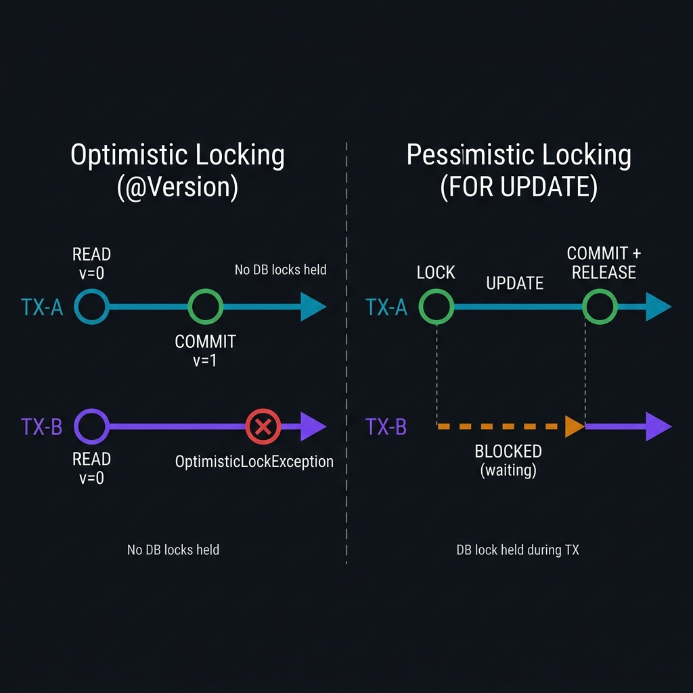

**When to use Optimistic Locking:**

- E-commerce product catalog updates (rare concurrent edits)
- User profile updates (users rarely update simultaneously)
- Content management systems (low write contention)
- REST APIs where retries are cheap

```java
// Good for optimistic: product catalog update
@Entity
public class Product {
    @Version
    private Integer version;
}
```

**When to use Pessimistic Locking:**

- Bank account balance updates (high conflict, zero tolerance for lost updates)
- Inventory stock deduction (multiple users buying same item)
- Seat booking systems (exactly one person should get the seat)
- Any operation where retries are expensive or unacceptable

```java
// Good for pessimistic: inventory deduction
@Lock(LockModeType.PESSIMISTIC_WRITE)
@Query("SELECT i FROM Inventory i WHERE i.productId = :productId")
Optional<Inventory> findByProductIdForUpdate(@Param("productId") Long productId);
```

**Hybrid approach (common in real-world systems):**

```java
@Service
public class OrderService {

    // Optimistic for order creation (low conflict)
    @Transactional
    public Order createOrder(OrderRequest request) {
        Order order = new Order(); // has @Version
        order.setStatus(OrderStatus.PENDING);
        return orderRepository.save(order);
    }

    // Pessimistic for payment processing (high conflict on balance)
    @Transactional
    public void processPayment(Long orderId) {
        Order order = orderRepository.findById(orderId).orElseThrow();
        Account account = accountRepository.findByIdForUpdate(order.getAccountId())
            .orElseThrow(); // PESSIMISTIC_WRITE
        account.debit(order.getAmount());
        order.setStatus(OrderStatus.PAID);
    }
}
```

🎯 **Interview Tip:** The best answer is "it depends on the use case."

- Start with optimistic locking as the default. It is simpler, adds no lock waits, and gives higher throughput.
- Switch to pessimistic only when conflict rates are high or data consistency is critical (financial transactions).

---

</details>

---

12. **💾 What is the difference between save, persist, merge, and saveAndFlush in JPA/Hibernate? 🔥🔥**

<!-- -->
<details>
<summary>Answer</summary>

**Answer:**

| Method | Source | Return Type | Transient Entity | Detached Entity | ID Generation |
|--------|--------|-------------|------------------|-----------------|---------------|
| `persist()` | JPA | `void` | Makes persistent | Throws `EntityExistsException` | ID set at `persist()`. IDENTITY runs the INSERT at once; with SEQUENCE the INSERT may wait until flush |
| `save()` | Spring Data | Entity (with ID) | Makes persistent | Merges (calls `merge` internally) | Same as `persist()` / `merge()` |
| `merge()` | JPA | New managed copy | Creates new persistent entity | Reattaches as new managed copy | Same as `persist()`, but on the managed copy |
| `saveAndFlush()` | Spring Data | Entity (with ID) | Makes persistent + immediate flush | Merges + immediate flush | Immediate (SQL executed) |

**Detailed behavior:**

```java
@Service
public class EmployeeService {

    @PersistenceContext
    private EntityManager em;

    @Autowired
    private EmployeeRepository repo;

    // persist() — JPA standard
    @Transactional
    public void persistExample() {
        Employee emp = new Employee("John"); // Transient

        em.persist(emp);
        // emp is now Managed (persistence context tracks it)
        // emp.getId() is populated immediately with BOTH strategies — but for
        // opposite reasons:
        //   SEQUENCE  -> the ID comes from the sequence / pre-allocated block,
        //                so the INSERT can be deferred and BATCHED at flush.
        //   IDENTITY  -> Hibernate is FORCED to run the INSERT right now to read
        //                the generated key back, which DISABLES JDBC batching.

        emp.setName("John Updated");
        // Hibernate detects this change via dirty checking — no explicit save needed
    }

    // save() — Spring Data JPA
    @Transactional
    public Employee saveExample() {
        Employee emp = new Employee("Jane"); // Transient
        Employee saved = repo.save(emp);
        // Returns managed entity with generated ID
        // Internally calls persist() for new entities, merge() for detached
        return saved;
    }

    // merge() — JPA standard
    @Transactional
    public void mergeExample() {
        Employee detached = new Employee(1L, "Updated Name"); // Detached (has ID)

        Employee managed = em.merge(detached);
        // 'managed' is the persistent copy — tracked by persistence context
        // 'detached' is still detached — changes to it are NOT tracked

        managed.setSalary(50000); // This change IS tracked
        detached.setSalary(60000); // This change is NOT tracked
    }

    // saveAndFlush() — Spring Data JPA
    @Transactional
    public Employee saveAndFlushExample() {
        Employee emp = new Employee("Bob");
        Employee saved = repo.saveAndFlush(emp);
        // INSERT is executed IMMEDIATELY (not deferred)
        // Useful when you need the generated ID right away
        // or when another query in the same TX needs to see this data
        return saved;
    }
}
```

**Spring Data `save()` internal logic:**

```java
// SimpleJpaRepository.save() implementation
@Transactional
public <S extends T> S save(S entity) {
    if (entityInformation.isNew(entity)) {
        em.persist(entity);    // New entity → persist
        return entity;
    } else {
        return em.merge(entity); // Existing entity → merge
    }
}
```

**When to use each:**

| Scenario | Recommended Method |
|----------|-------------------|
| Creating a new entity (Spring Data) | `save()` |
| Creating a new entity (plain JPA) | `persist()` |
| Updating a detached entity | `merge()` or `save()` |
| Need generated ID immediately | `saveAndFlush()` |
| Batch inserts (performance) | `persist()` + `flush()`/`clear()` every N rows — **and see the caveat below** |

⚠️ **`persist()` alone does not give you batching.** JDBC batching needs three things. If the third one is missing, it silently cancels the first two:

```properties
spring.jpa.properties.hibernate.jdbc.batch_size=50
spring.jpa.properties.hibernate.order_inserts=true
spring.jpa.properties.hibernate.order_updates=true
```

…**plus an ID strategy that is not `IDENTITY`.**

- With `GenerationType.IDENTITY`, Hibernate must execute each INSERT immediately to read back the generated key.
- So it cannot collect a batch. Hibernate turns batching off with no warning and no error.
- On PostgreSQL/Oracle, use `GenerationType.SEQUENCE` with a pooled `allocationSize`.
- **On MySQL there are no sequences.** So use a `TABLE` generator with a large `allocationSize`, or assign ids in the application instead.

See **§5 Q22** for the full breakdown.

💡 **Pro Tip:** A common mistake is calling `save()` on a managed entity inside a `@Transactional` method. It is not needed. Hibernate's dirty checking will automatically persist changes at flush time.

---

</details>

---

13. **🔬 How does Hibernate's dirty checking mechanism work? 🔥🔥**

<!-- -->
<details>
<summary>Answer</summary>

**Answer:**

Dirty checking is how Hibernate automatically finds changes to managed entities. At flush time, it writes those changes to the database. You do not need explicit save/update calls.

**How it works internally:**

1. When an entity is loaded into the persistence context, Hibernate takes a **snapshot** (deep copy) of all property values.
2. At flush time (before commit or before a query), Hibernate compares each managed entity's current state with its snapshot.
3. If any property has changed (the entity is "dirty"), Hibernate generates and executes an UPDATE statement.

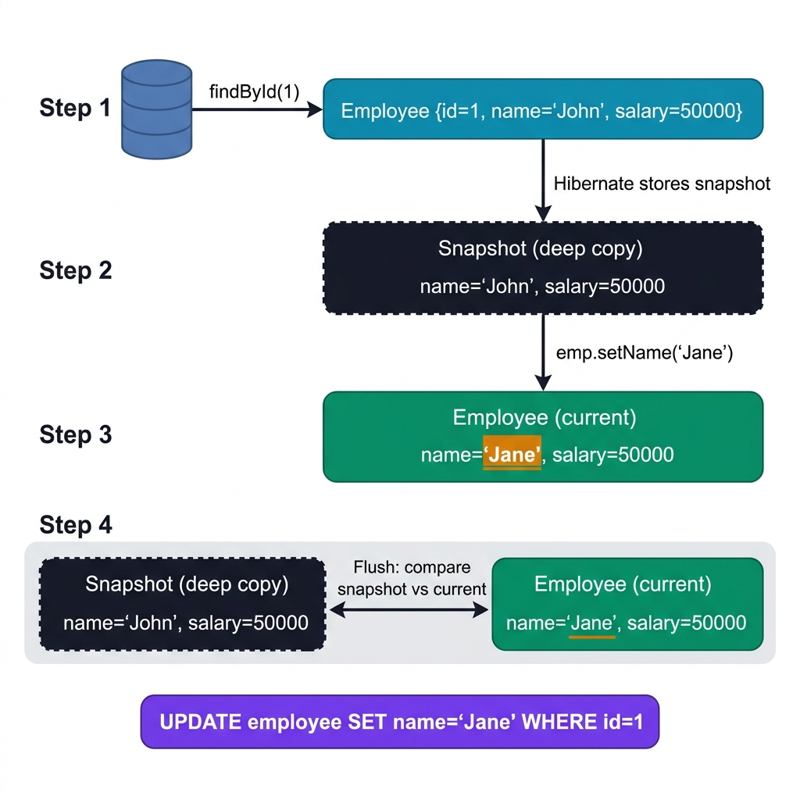

```java
@Transactional
public void updateEmployeeName(Long id, String newName) {
    Employee emp = employeeRepository.findById(id).orElseThrow();
    // Hibernate takes snapshot: {id=1, name="John", salary=50000}

    emp.setName(newName);
    // Current state: {id=1, name="Jane", salary=50000}

    // NO explicit save() call needed!
    // At flush time, Hibernate compares:
    //   snapshot.name ("John") != current.name ("Jane") → DIRTY
    //   snapshot.salary (50000) == current.salary (50000) → CLEAN
    // Generates: UPDATE employee SET name='Jane', salary=50000 WHERE id=1
}
```

**Flush triggers:**

| Trigger | When |
|---------|------|
| Transaction commit | Automatic flush before commit |
| JPQL/HQL query execution | Flush before query to ensure consistency |
| `EntityManager.flush()` | Manual flush |
| Native SQL query | Flush before native query |

**Default UPDATE behavior:**

By default, Hibernate updates **all columns** even if only one changed:

```sql
-- Only name changed, but ALL columns are in the UPDATE
UPDATE employee SET name='Jane', salary=50000, department_id=1 WHERE id=1
```

**Optimizing with @DynamicUpdate:**

```java
@Entity
@DynamicUpdate // Only include changed columns in UPDATE
public class Employee {
    // ...
}
```

```sql
-- With @DynamicUpdate, only changed columns are updated
UPDATE employee SET name='Jane' WHERE id=1
```

**When dirty checking is skipped:**

| Scenario | Dirty Checking? |
|----------|----------------|
| `@Transactional(readOnly = true)` | Skipped (no snapshots taken) |
| Detached entity (outside persistence context) | Not applicable |
| DTO projections | Not applicable |
| Native / bulk `@Modifying` queries | Bypasses dirty checking **and leaves the persistence context stale** — see below |

<details>
<summary><strong>🤔 Doubt: What breaks when a @Modifying query updates a row that is already in the persistence context?</strong></summary>

The persistence context keeps returning the **old** object. A bulk update goes straight to the database. It does not touch the L1 cache, so Hibernate does not know the row changed.

```java
@Modifying
@Query("UPDATE Loan l SET l.status = 'APPROVED' WHERE l.id = :id")
void approve(@Param("id") Long id);

@Transactional
public void approveAndNotify(Long id) {
    Loan loan = loanRepository.findById(id).orElseThrow(); // status = PENDING, now managed
    loanRepository.approve(id);                            // DB row -> APPROVED

    loan.getStatus();      // still PENDING! read from the L1 cache, not the DB
    notifier.send(loan);   // notifies with the wrong status

    // Worse: at flush, dirty checking compares `loan` against its snapshot.
    // If anything else on `loan` changed, the generated UPDATE writes the WHOLE
    // entity back — silently reverting status to PENDING.
}
```

**The fix is two attributes:**

```java
@Modifying(clearAutomatically = true, flushAutomatically = true)
@Query("UPDATE Loan l SET l.status = 'APPROVED' WHERE l.id = :id")
void approve(@Param("id") Long id);
```

- `flushAutomatically = true` — flush pending changes **before** the bulk statement. Then the bulk statement does not overwrite your unsaved edits.
- `clearAutomatically = true` — clear the persistence context **after** it. Then the next read fetches again from the database.

⚠️ `clearAutomatically` detaches *everything*, not just the affected rows. Any entity you loaded before that call is detached after it. So either re-read it, or put the bulk update in its own small transactional method.

---

</details>
<br/>

**Performance implications:**

- The default (reflection-based) dirty check costs **O(entities × fields)** at every flush.
  - It visits *every* managed entity. It compares *every* mapped property against its snapshot, whether anything changed or not.
  - It is not O(n) in entities alone. A 40-column entity is 40× the work of a 1-column one.
- Each snapshot is a second copy of an entity's loaded state. So snapshots add a large amount to the memory use of the persistence context.
- For large result sets (thousands of entities), consider:
  - Using `readOnly = true` for read queries — no snapshots taken at all
  - Clearing the persistence context periodically: `em.clear()`
  - Using DTO projections instead of entities
  - **Bytecode enhancement** — see below

**Bytecode enhancement — turning O(entities × fields) into O(dirty):**

Hibernate can add tracking code to entity classes at build time (this is called instrumenting them). Then every setter records that its field changed. Flush then only visits entities that actually reported a change, and only their changed fields. There is no snapshot comparison at all.

```groovy
// Gradle — org.hibernate.orm plugin
hibernate {
    enhancement {
        enableDirtyTracking = true      // self-dirty-tracking setters
        enableLazyInitialization = true // enables lazy @Basic / lazy ToOne without a proxy
    }
}
```

📝 This is a **build-time** transformation, not a runtime property.

- The enhancement runs as part of compilation, through the Hibernate Gradle/Maven plugin.
- It also enables `@Basic(fetch = LAZY)` on large columns (BLOB/CLOB) and true lazy `@ManyToOne` without proxies.
- It is worth mentioning in an interview. Most candidates only know `@DynamicUpdate`. That changes the *generated SQL*, not the *cost of detecting the change*.

🎯 **Interview Tip:** Mention that dirty checking is the reason you don't need to call `save()` on managed entities inside a `@Transactional` method. This key idea shows the difference between experienced developers and beginners.

---

</details>

---

14. **👻 What is a Hibernate Proxy and how do you solve LazyInitializationException? 🔥🔥**

<!-- -->
<details>
<summary>Answer</summary>

**Answer:**

A Hibernate Proxy is a subclass of your entity that Hibernate generates at runtime. It acts as a placeholder.

- You load an entity with a lazy association.
- Hibernate returns a proxy object instead of the real entity.
- The proxy intercepts method calls.
- It runs a database query only when you access the lazy data.

**How LazyInitializationException occurs:**

```java
@Service
public class DepartmentService {

    @Transactional
    public Department getDepartment(Long id) {
        return departmentRepository.findById(id).orElseThrow();
        // Transaction ends here → session closes
    }
}

@RestController
public class DepartmentController {

    @GetMapping("/departments/{id}")
    public DepartmentResponse getDepartment(@PathVariable Long id) {
        Department dept = departmentService.getDepartment(id);
        // Session is CLOSED here only if spring.jpa.open-in-view=false.
        // Spring Boot's default (true) keeps it open, so no exception.
        dept.getEmployees().size(); // LazyInitializationException!
        // The proxy tries to load employees but has no session
        return null; // mapping to DepartmentResponse left out
    }
}
```

**4 Solutions:**

**Solution 1: Fetch eagerly in the query (recommended)**

```java
@Query("SELECT d FROM Department d JOIN FETCH d.employees WHERE d.id = :id")
Optional<Department> findByIdWithEmployees(@Param("id") Long id);
```

**Solution 2: @EntityGraph**

```java
@EntityGraph(attributePaths = {"employees"})
Optional<Department> findById(Long id);
```

**Solution 3: Initialize within the transaction**

```java
@Transactional
public Department getDepartmentWithEmployees(Long id) {
    Department dept = departmentRepository.findById(id).orElseThrow();
    Hibernate.initialize(dept.getEmployees()); // Forces loading
    // Or: dept.getEmployees().size(); // Also forces loading
    return dept;
}
```

**Solution 4: Use DTOs (best for REST APIs)**

```java
@Transactional(readOnly = true)
public DepartmentResponse getDepartmentResponse(Long id) {
    Department dept = departmentRepository.findByIdWithEmployees(id)
        .orElseThrow();
    return new DepartmentResponse(
        dept.getId(),
        dept.getName(),
        dept.getEmployees().stream()
            .map(e -> new EmployeeResponse(e.getId(), e.getName()))
            .toList()
    );
}
```

**What about `spring.jpa.open-in-view=true`?**

This keeps the Hibernate session open until the HTTP response is fully rendered. It prevents `LazyInitializationException`. But it is considered an anti-pattern because:
- It can cause N+1 problems in the view/serialization layer
- It holds database connections longer than needed
- It hides design problems (lazy loading outside the service layer)

**Summary:**

| Solution | Pros | Cons |
|----------|------|------|
| JOIN FETCH | Single query, explicit | Query-specific, Cartesian product risk |
| @EntityGraph | Declarative, reusable | Limited to attribute paths |
| `Hibernate.initialize()` | Quick fix | Still requires open session, may cause N+1 |
| DTO projection | Best performance, clean API | Loses entity features |
| open-in-view=true | Zero code change | Anti-pattern, hides N+1 issues |

💡 **Pro Tip:** In interviews, always recommend JOIN FETCH or DTOs as the solution. If you mention `open-in-view=true` as a "solution", the interviewer may see it as a warning sign. It shows you are hiding the problem, not solving it.

---

</details>

---

15. **🗄️ What are the different values of hbm2ddl.auto and when should you use each? 🔥**

<!-- -->
<details>
<summary>Answer</summary>

**Answer:**

The `hbm2ddl.auto` property controls how Hibernate manages the database schema when the application starts. In Spring Boot, the property is `spring.jpa.hibernate.ddl-auto`.

| Value | Behavior | Existing Data | Use Case |
|-------|----------|---------------|----------|
| **create** | Drops the tables mapped by your entities and recreates them on startup (other tables are not touched) | Lost on every restart | Unit tests, proof of concept |
| **create-drop** | Same as `create`, but also drops tables on `SessionFactory` close | Lost on every restart + shutdown | Automated tests (clean state per test suite) |
| **update** | Compares entity model with DB schema and applies additive changes (add columns/tables) | Preserved | Development, early prototyping |
| **validate** | Validates that entity model matches DB schema. Does NOT modify schema. Throws exception on mismatch. | Preserved | Staging, production |
| **none** | Does nothing. Hibernate does not touch the schema. | Preserved | Production (with Flyway/Liquibase) |

**Spring Boot configuration:**

```properties
# application.properties
spring.jpa.hibernate.ddl-auto=validate

# Hibernate native config
hibernate.hbm2ddl.auto=validate
```

**Dangers of `update` in production:**

```java
// Entity before
@Entity
public class User {
    @Column(name = "email", length = 255)
    private String email;
}

// Entity after — column renamed
@Entity
public class User {
    @Column(name = "email_address", length = 255)
    private String emailAddress;
}
// hbm2ddl.auto=update will:
// - ADD a new column 'email_address'
// - NOT remove the old column 'email'
// - NOT migrate data from 'email' to 'email_address'
// Result: the old data stays in 'email', which the app no longer reads.
// The new column starts empty, so the app "loses" the data. The old column is left orphaned.
```

**Production best practice:**

```properties
# Production — always use 'validate' or 'none'
spring.jpa.hibernate.ddl-auto=validate

# Use Flyway or Liquibase for schema migrations
spring.flyway.enabled=true
spring.flyway.locations=classpath:db/migration
```

**Recommended per environment:**

| Environment | ddl-auto | Schema Management |
|-------------|----------|-------------------|
| Local development | `update` | Hibernate manages schema |
| Unit tests | `create-drop` | Fresh schema per test run |
| Integration tests | `create` or Flyway | Reproducible schema |
| Staging | `validate` | Flyway/Liquibase |
| Production | `validate` or `none` | Flyway/Liquibase |

⚠️ **Warning:** Never use `create`, `create-drop`, or `update` in production. These can cause data loss or schema corruption. Always use a migration tool like Flyway or Liquibase for production schema changes.

💬 **The expected follow-up is "so how do you catch drift between your entities and the schema?"** Interviewers ask it because `none` gives you no safety check at all. Honest answer:
- `validate` would fail fast at startup on a mismatch.
- It is the clearly better default for any service where the entities are the source of truth for reads.
- `none` is the right choice only when the schema really contains objects Hibernate does not model (views, other services' tables in a shared schema).
- Otherwise, `none` is a missed safety check.

---

</details>

---

16. **🔄 What are the different entity states in Hibernate and how do they transition? 🔥🔥**

<!-- -->
<details>
<summary>Answer</summary>

**Answer:**

Hibernate entities exist in one of four states throughout their lifecycle:

| State | In Persistence Context? | Has DB Row? | Description |
|-------|------------------------|-------------|-------------|
| **Transient** | No | No | Newly created object, not associated with any session |
| **Persistent (Managed)** | Yes | Yes (or pending) | Attached to an active session, changes are tracked |
| **Detached** | No | Yes | Was persistent, but session was closed or entity was evicted |
| **Removed** | Yes (marked for deletion) | Yes (pending delete) | Scheduled for deletion from database |

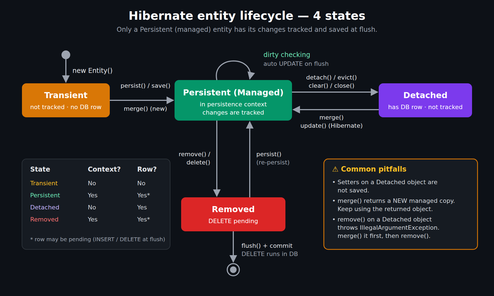

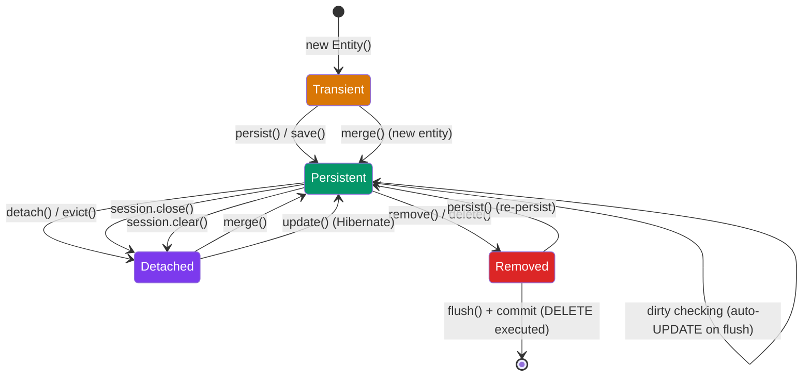

**Code example showing all transitions:**

```java
@Transactional
public void entityLifecycleDemo() {
    // 1. TRANSIENT — just created, not managed
    Employee emp = new Employee("John", 50000);
    // emp is Transient: no ID, not in persistence context

    // 2. TRANSIENT → PERSISTENT (persist/save)
    entityManager.persist(emp);
    // emp is now Persistent: tracked by persistence context
    // INSERT will be queued (not necessarily executed yet)

    // 3. PERSISTENT — dirty checking in action
    emp.setSalary(60000);
    // No explicit save needed — Hibernate detects the change
    // UPDATE will be generated at flush time

    // 4. PERSISTENT → DETACHED (detach/evict)
    entityManager.detach(emp);
    // emp is now Detached: changes are no longer tracked
    emp.setSalary(70000); // This change is NOT tracked!

    // 5. DETACHED → PERSISTENT (merge)
    Employee managedEmp = entityManager.merge(emp);
    // managedEmp is Persistent (new managed copy)
    // emp is still Detached!
    // managedEmp.getSalary() == 70000 (merged from detached state)

    // 6. PERSISTENT → REMOVED (remove/delete)
    entityManager.remove(managedEmp);
    // managedEmp is Removed: DELETE will be executed at flush/commit
}
```

**Common pitfalls:**

```java
// Pitfall 1: Modifying a detached entity
@Transactional
public void pitfall1() {
    Employee emp = repo.findById(1L).orElseThrow(); // Persistent
    entityManager.detach(emp);
    emp.setName("New Name"); // NOT saved — entity is detached!
}

// Pitfall 2: Using the wrong reference after merge
@Transactional
public void pitfall2() {
    Employee detached = getDetachedEmployee();
    Employee managed = entityManager.merge(detached);

    detached.setName("Changed"); // NOT tracked (detached instance)
    managed.setName("Changed");  // Tracked (managed instance)
}

// Pitfall 3: Removing a detached entity
@Transactional
public void pitfall3() {
    Employee detached = getDetachedEmployee();
    entityManager.remove(detached); // IllegalArgumentException!
    // Must merge first, then remove:
    Employee managed = entityManager.merge(detached);
    entityManager.remove(managed); // Works
}
```

🎯 **Interview Tip:** Draw the state diagram on the whiteboard during the interview. Interviewers like it when you clearly explain the 4 states and the transitions between them. Focus on the Persistent state. That is where all the automatic Hibernate features (dirty checking, lazy loading) happen.

---

</details>

---

17. **🔗 What are the different CascadeTypes in JPA and when should you use each? 🔥**

<!-- -->
<details>
<summary>Answer</summary>

**Answer:**

Cascade types decide which operations on a parent entity Hibernate should also apply to its child entities automatically.

| CascadeType | Operation Propagated | Use Case |
|-------------|---------------------|----------|
| **PERSIST** | `persist()` / Spring Data `save()` on a new entity | When creating a parent should also create children (e.g., Order + OrderItems) |
| **MERGE** | `merge()` | When updating a parent should also update children (e.g., updating User + Address) |
| **REMOVE** | `remove()` / `delete()` | When deleting a parent should also delete children (e.g., deleting a Post + Comments) |
| **REFRESH** | `refresh()` | When refreshing parent from DB should also refresh children |
| **DETACH** | `detach()` / `evict()` | When detaching parent should also detach children |
| **ALL** | All of the above | When parent fully owns the child lifecycle |

**Code examples:**

```java
// CASCADE PERSIST — creating Order also creates OrderItems
@Entity
public class Order {
    @OneToMany(mappedBy = "order", cascade = CascadeType.PERSIST)
    private List<OrderItem> items = new ArrayList<>();

    public void addItem(OrderItem item) {
        items.add(item);
        item.setOrder(this);
    }
}

// Usage:
Order order = new Order();
order.addItem(new OrderItem("Product A", 2));
order.addItem(new OrderItem("Product B", 1));
entityManager.persist(order); // Also persists both OrderItems
```

```java
// CASCADE ALL — parent fully owns children
@Entity
public class Post {
    @OneToMany(mappedBy = "post", cascade = CascadeType.ALL)
    private List<Comment> comments = new ArrayList<>();
}

// Persist, merge, remove — all cascade to comments
```

```java
// MULTIPLE CASCADE TYPES — selective cascading
@Entity
public class Department {
    @OneToMany(mappedBy = "department",
        cascade = {CascadeType.PERSIST, CascadeType.MERGE})
    // Delete department does NOT delete employees
    // But creating/updating department cascades to employees
    private List<Employee> employees;
}
```

**When NOT to cascade:**

```java
// DON'T cascade REMOVE on @ManyToOne or shared references
@Entity
public class Employee {
    @ManyToOne
    // NO cascade here! Deleting an employee should NOT delete the department
    private Department department;
}

// DON'T use CascadeType.ALL on @ManyToMany (dangerous!)
@Entity
public class Student {
    @ManyToMany(cascade = CascadeType.ALL) // DANGEROUS
    private List<Course> courses;
    // Deleting a student would delete courses, affecting other students!
}

// SAFE @ManyToMany cascade
@Entity
public class Student {
    @ManyToMany(cascade = {CascadeType.PERSIST, CascadeType.MERGE})
    private List<Course> courses;
}
```

**Cascade Type Decision Guide:**

| Relationship | Recommended Cascade |
|-------------|-------------------|
| `@OneToOne` (parent owns child) | `CascadeType.ALL` |
| `@OneToMany` (parent owns children) | `CascadeType.ALL` or `PERSIST + MERGE` |
| `@ManyToOne` (child references parent) | None or `PERSIST + MERGE` |
| `@ManyToMany` (shared reference) | `PERSIST + MERGE` only (never REMOVE) |

💡 **Pro Tip:** The main rule: only cascade from the **parent** (owning) side to the **child** side. Never cascade REMOVE on shared/referenced entities.

---

</details>

---

18. **🧹 What is the difference between orphanRemoval=true and CascadeType.REMOVE? 🔥**

<!-- -->
<details>
<summary>Answer</summary>

**Answer:**

Both `orphanRemoval=true` and `CascadeType.REMOVE` delete child entities, but they are triggered by different actions.

**CascadeType.REMOVE:**
- Deletes children **only when the parent entity is deleted**.
- Removing a child from the parent's collection does NOT delete it from the database.

**orphanRemoval=true:**
- Deletes children when the parent is deleted (same as `CascadeType.REMOVE`).
- **Also** deletes children when they are **removed from the parent's collection**.

```java
// With CascadeType.REMOVE only
@Entity
public class Post {
    @OneToMany(mappedBy = "post", cascade = CascadeType.REMOVE)
    private List<Comment> comments;
}

@Transactional
public void cascadeRemoveExample() {
    Post post = postRepository.findById(1L).orElseThrow();

    // Removing from collection → comment stays in DB!
    post.getComments().remove(0);
    // No DELETE executed — comment is orphaned in DB

    // Deleting parent → the comments still in the list are deleted
    postRepository.delete(post);
    // DELETE FROM comment WHERE id = ?  (once per comment still in the list)
    // ⚠️ The comment removed above still has post_id = 1, so the post
    //    DELETE fails with a foreign-key error unless you delete it too
    // DELETE FROM post WHERE id = 1
}
```

```java
// With orphanRemoval=true
@Entity
public class Post {
    @OneToMany(mappedBy = "post", orphanRemoval = true)
    private List<Comment> comments;
}

@Transactional
public void orphanRemovalExample() {
    Post post = postRepository.findById(1L).orElseThrow();

    // Removing from collection → comment is DELETED from DB!
    post.getComments().remove(0);
    // DELETE FROM comment WHERE id = ?
    // The "orphaned" comment is automatically deleted

    // Clearing the collection also deletes the old children
    post.getComments().clear();
    // All previous comments are deleted from DB
    // ⚠️ Do not call post.setComments(new ArrayList<>()): Hibernate throws
    // "A collection with cascade=all-delete-orphan was no longer referenced"
}
```

**Comparison:**

| Scenario | CascadeType.REMOVE | orphanRemoval=true |
|----------|-------------------|-------------------|
| Parent deleted | Children deleted | Children deleted |
| Child removed from parent's collection | Child NOT deleted (orphaned) | Child deleted |
| Collection cleared with `clear()` | Old children NOT deleted | Old children deleted |
| Only `comment.setPost(null)`, child left in the collection | Child stays in DB | Child stays in DB — the trigger is removal from the collection, not the FK change |

**When to use each:**

| Use Case | Recommendation |
|----------|---------------|
| Parent fully owns children (Post/Comments) | `orphanRemoval = true` |
| Parent-child with independent lifecycle | `CascadeType.REMOVE` or no cascade |
| Children should never exist without parent | `orphanRemoval = true` |
| Children may be reassigned to another parent | Neither — manage manually |

```java
// Best practice: combine orphanRemoval with CascadeType.ALL for full ownership
@Entity
public class ShoppingCart {
    @OneToMany(mappedBy = "cart",
        cascade = CascadeType.ALL,
        orphanRemoval = true)
    private List<CartItem> items;

    public void removeItem(CartItem item) {
        items.remove(item);  // Triggers DB delete via orphanRemoval
        item.setCart(null);
    }

    public void clearItems() {
        items.clear();  // Deletes all items from DB
    }
}
```

🎯 **Interview Tip:** The key difference: `CascadeType.REMOVE` only acts when the parent is deleted. `orphanRemoval=true` also acts when a child is separated from the parent. Think of `orphanRemoval` as "if a child has no parent, delete it."

---

</details>

---

19. **📊 What are the default FetchTypes for different JPA mappings? 🔥**

<!-- -->
<details>
<summary>Answer</summary>

**Answer:**

JPA sets a different default fetch strategy for each type of association:

| Mapping | Default FetchType | Reason |
|---------|------------------|--------|
| `@OneToOne` | **EAGER** | Single entity, low cost to fetch |
| `@ManyToOne` | **EAGER** | Single entity, low cost to fetch |
| `@OneToMany` | **LAZY** | Collection, can be large — costly to load |
| `@ManyToMany` | **LAZY** | Collection, can be very large — costly to load |
| `@Basic` (fields) | **EAGER** | Simple column values |
| `@ElementCollection` | **LAZY** | Collection of basic types |

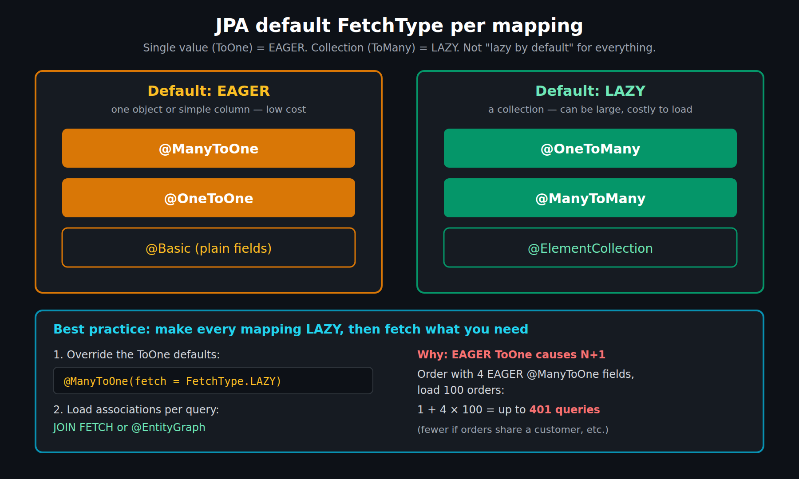

**The simple rule:** Single-valued associations (ToOne) default to EAGER. Collection-valued associations (ToMany) default to LAZY.

⚠️ **Do not say "Hibernate is lazy by default."** That is the most common wrong answer to this question. Lazy-by-default applies to *collections only*. `@ManyToOne` and `@OneToOne` are EAGER unless you say otherwise.

**Best practice — override ToOne defaults to LAZY:**

```java
@Entity
public class Employee {

    // BAD: default EAGER — always fetches Department even when not needed
    @ManyToOne
    private Department department;

    // GOOD: explicitly set LAZY
    @ManyToOne(fetch = FetchType.LAZY)
    private Department department;
}

@Entity
public class UserProfile {

    // BAD: default EAGER — always fetches User with profile
    @OneToOne
    private User user;

    // GOOD: explicitly set LAZY
    @OneToOne(fetch = FetchType.LAZY)
    private User user;
}
```

**Why override @ManyToOne and @OneToOne to LAZY?**

Look at an entity with several `@ManyToOne` associations:

```java
@Entity
public class Order {
    @ManyToOne // EAGER by default
    private Customer customer;

    @ManyToOne // EAGER by default
    private Product product;

    @ManyToOne // EAGER by default
    private ShippingAddress address;

    @ManyToOne // EAGER by default
    private PaymentMethod payment;
}

// Loading 100 orders with default EAGER:
// 1 query for orders
// + 100 queries for customers (if not cached)
// + 100 queries for products
// + 100 queries for addresses
// + 100 queries for payment methods
// = up to 401 queries! (N+1 on EACH association; fewer if orders share a customer etc.)
```

```java
// Fix: set all to LAZY, fetch explicitly when needed
@Entity
public class Order {
    @ManyToOne(fetch = FetchType.LAZY)
    private Customer customer;

    @ManyToOne(fetch = FetchType.LAZY)
    private Product product;

    @ManyToOne(fetch = FetchType.LAZY)
    private ShippingAddress address;

    @ManyToOne(fetch = FetchType.LAZY)
    private PaymentMethod payment;
}

// Then fetch what you need:
@Query("SELECT o FROM Order o JOIN FETCH o.customer JOIN FETCH o.product WHERE o.id = :id")
Optional<Order> findByIdWithDetails(@Param("id") Long id);
```

**Recommended configuration:**

| Association | Recommended FetchType | Reason |
|-------------|----------------------|--------|
| `@ManyToOne` | `LAZY` | Avoid N+1 on multiple ToOne associations |
| `@OneToOne` | `LAZY` | Same reason; use JOIN FETCH when needed |
| `@OneToMany` | `LAZY` (default) | Already LAZY; keep it |
| `@ManyToMany` | `LAZY` (default) | Already LAZY; keep it |

🎯 **Interview Tip:** Always say that you prefer LAZY for all mappings. Then say that you use JOIN FETCH or @EntityGraph to load associations when needed. This shows you understand the performance effects and follow best practices.

---

</details>

---

20. **🔥 What causes connection pool exhaustion in Hibernate and how do you debug it? 🔥**

<!-- -->
<details>
<summary>Answer</summary>

**Answer:**

Connection pool exhaustion happens when all database connections in the pool are in use. New requests cannot get a connection. The application then hangs or times out.

**Common causes:**

**1. Long-running transactions holding connections:**

```java
// BAD: holding connection for entire duration including external API call
@Transactional
public void processOrder(Order order) {
    orderRepository.save(order);
    externalPaymentService.charge(order); // HTTP call — 5 seconds
    inventoryService.reserve(order);
    emailService.sendConfirmation(order); // SMTP call — 3 seconds
    // Connection held for 8+ seconds!
}

// GOOD: separate transaction boundaries
public void processOrder(Order order) {
    orderService.saveOrder(order);            // @Transactional — quick DB op
    externalPaymentService.charge(order);     // No transaction needed
    inventoryService.reserve(order);          // @Transactional — quick DB op
    emailService.sendConfirmation(order);     // No transaction needed
}
```

**2. N+1 queries exhausting connections:**

```java
// Each lazy load may hold the connection longer
@Transactional
public void exportAll() {
    List<Department> depts = deptRepo.findAll(); // 1 query
    for (Department d : depts) {
        for (Employee e : d.getEmployees()) {   // N queries
            generateReport(e);                   // Slow processing
        }
    }
    // Connection held for entire loop duration
}
```

**3. Missing @Transactional or connection leak:**

```java
// BAD: no transaction management — connection may leak
public void riskyMethod() {
    EntityManager em = emf.createEntityManager();
    em.getTransaction().begin();
    em.persist(entity);
    // If exception occurs here, connection is never returned to pool!
    em.getTransaction().commit();
    em.close();
}
```

**4. open-in-view=true holding connections:**

```properties
# Connection held from request start to response end
spring.jpa.open-in-view=true  # default in Spring Boot — dangerous
```

**Debugging connection pool issues:**

**Step 1: Configure HikariCP logging:**

```properties
# application.properties
spring.datasource.hikari.maximum-pool-size=10
spring.datasource.hikari.connection-timeout=30000
spring.datasource.hikari.leak-detection-threshold=2000

# Enable HikariCP debug logging
logging.level.com.zaxxer.hikari=DEBUG
logging.level.com.zaxxer.hikari.HikariConfig=DEBUG
```

**Step 2: Monitor with JMX / Actuator:**

```properties
# Enable HikariCP metrics
spring.datasource.hikari.register-mbeans=true
management.endpoints.web.exposure.include=health,metrics
```

```java
// Programmatic monitoring
@Autowired
private DataSource dataSource;

public void checkPool() {
    HikariDataSource ds = (HikariDataSource) dataSource;
    HikariPoolMXBean poolBean = ds.getHikariPoolMXBean();

    log.info("Active: {}", poolBean.getActiveConnections());
    log.info("Idle: {}", poolBean.getIdleConnections());
    log.info("Waiting: {}", poolBean.getThreadsAwaitingConnection());
    log.info("Total: {}", poolBean.getTotalConnections());
}
```

**Step 3: Find the leak using leak detection:**

When you set `leak-detection-threshold`, HikariCP logs a stack trace. It shows where the code took the connection but did not return it:

```
[WARN] HikariPool-1 - Connection leak detection triggered for connection com.mysql.cj.jdbc.ConnectionImpl@abcdef,
on thread http-nio-8080-exec-5, stack trace follows:
java.lang.Exception: Apparent connection leak detected
    at com.example.service.OrderService.processOrder(OrderService.java:45)
```

**Recommended HikariCP settings for production:**

```properties
spring.datasource.hikari.maximum-pool-size=20
spring.datasource.hikari.minimum-idle=5
spring.datasource.hikari.idle-timeout=300000
spring.datasource.hikari.max-lifetime=1800000
spring.datasource.hikari.connection-timeout=30000
spring.datasource.hikari.leak-detection-threshold=60000
spring.jpa.open-in-view=false
```

**Prevention checklist:**

| Practice | Why |
|----------|-----|
| Set `open-in-view=false` | Prevents connections from being held during view rendering |
| Keep transactions short | Return connections quickly to the pool |
| Move external calls outside `@Transactional` | Don't hold connections during HTTP/SMTP calls |
| Fix N+1 problems | Fewer queries = shorter connection hold time |
| Set `leak-detection-threshold` | Catches connection leaks in development |
| Monitor pool metrics | Alert before exhaustion happens |

💡 **Pro Tip:** The `leak-detection-threshold` is the most useful setting for debugging connection pool issues. Set it to a low value (2-5 seconds) in development. Set a higher value (30-60 seconds) in production.

---

</details>

---

21. **🪪 How do you implement equals() and hashCode() on a JPA entity? 🔥🔥**

<!-- -->
<details>
<summary>Answer</summary>

**Answer:**

This is the most common follow-up after "what are the entity states?". Interviewers ask it as a scenario: *"You put three new entities into a `HashSet`, then flush. What breaks?"*

**The failure:**

```java
@Entity
public class Loan {
    @Id
    @GeneratedValue(strategy = GenerationType.IDENTITY)
    private Long id;

    @Override
    public boolean equals(Object o) {
        return o instanceof Loan l && Objects.equals(id, l.id);
    }

    @Override
    public int hashCode() {
        return Objects.hash(id); // 💣 id is null right now
    }
}
```

```java
Set<Loan> batch = new HashSet<>();
Loan loan = new Loan();      // TRANSIENT — id == null, hashCode() == 31
batch.add(loan);             // bucketed under hash(null)

entityManager.persist(loan); // id := 4712  → hashCode() is now hash(4712)

batch.contains(loan);        // false! looks in the WRONG bucket
batch.remove(loan);          // no-op — the entity is unreachable, and leaks
```

The object's hash changed **while it was inside the hash-based collection**. `HashSet` never rehashes on its own. So the element stays in a bucket that the set will never search again. The same bug happens in `@OneToMany Set<Child>` collections that Hibernate maps.

**Three correct approaches:**

| Approach | `equals()` | `hashCode()` | When |
|---|---|---|---|
| **Business / natural key** ✅ | compare the immutable natural key (loan application number, ISBN, email) | hash the same key | Best — works in every state, no DB round trip |
| **Constant hash + ID-aware equals** ✅ | equal only when **both** IDs are non-null and equal; otherwise reference equality | `return getClass().hashCode();` — a **class-level constant** | When there is no natural key. Makes a `HashSet` slow, like a list scan, but is always *correct* |
| **`@NaturalId`** ✅ | Hibernate's way to declare a business key. It also enables `session.byNaturalId(...)` lookups with its own cache | — | When the natural key exists and you also want to query by it |

```java
@Entity
public class Loan {
    @Id
    @GeneratedValue
    private Long id;

    @NaturalId
    @Column(nullable = false, updatable = false, unique = true)
    private String applicationNumber; // immutable business key

    @Override
    public boolean equals(Object o) {
        if (this == o) {
            return true;
        }
        if (!(o instanceof Loan other)) {
            return false;
        }
        return applicationNumber.equals(other.getApplicationNumber()); // getter, not field: works on a proxy
    }

    @Override
    public int hashCode() {
        return applicationNumber.hashCode(); // stable across all 4 entity states
    }

    public String getApplicationNumber() {
        return applicationNumber;
    }
}
```

**Why `instanceof` and not `getClass() ==`:**

Hibernate gives you a **proxy subclass**. So `loan.getClass()` may be `Loan$HibernateProxy$xY7`, not `Loan`. A `getClass() == o.getClass()` check then returns false when it compares a proxy with a real instance. Use `instanceof` (or `Hibernate.getClass(o)`). Read fields through **getters**, never directly. Direct field access on an uninitialised proxy returns `null`, because only the getter triggers initialisation.

⚠️ **Never put Lombok `@Data` or `@EqualsAndHashCode` on an `@Entity`.** `@Data` generates `equals`/`hashCode`/`toString` over **all** fields. This means:
- it loads every lazy association into memory as soon as you compare or log an entity. You get instant N+1, or `LazyInitializationException` outside a session;
- it includes the generated `id`, so you get the mutable-hash bug above again;
- `@Data` also generates setters on fields that should be immutable.

If you use Lombok on entities, limit it to `@Getter`/`@Setter` and write `equals`/`hashCode` by hand.

🎯 **Interview Tip:** The sentence that earns points is *"`hashCode()` must be stable across all four entity states — transient, managed, detached, removed."* Everything else follows from it. If you have no natural key, say so. Then use the constant-hash variant. Do not pretend that an `@Id` hash is fine.

---

</details>

---

22. **🔢 What are the JPA ID generation strategies, and how does the choice affect batch inserts? 🔥🔥**

<!-- -->
<details>
<summary>Answer</summary>

**Answer:**

| Strategy | How the ID is produced | Extra round trip | JDBC batch inserts | Engine support |
|---|---|---|---|---|
| **IDENTITY** | DB auto-increment column; the value only exists **after** the INSERT | No, but the INSERT cannot be delayed | ❌️ **Disabled** | Everywhere |
| **SEQUENCE** | A database sequence, read before the INSERT | One call per block (amortised by `allocationSize`) | ✅ Works | 🐘 PG / Oracle / SQL Server. ⚠️ **Not MySQL** |
| **TABLE** | A row in a dedicated key table, updated under a lock | Yes, and it serialises writers | ✅ Works, but the table is a contention point | Everywhere |
| **AUTO** | Provider's choice. Hibernate 6 picks **SEQUENCE** on databases that support it. It falls back to **TABLE** on MySQL | — | ✅ Usually | Everywhere |
| **UUID** (`@GeneratedValue` + `UUID` field) | Generated in the JVM | None | ✅ Works. But random UUIDs fragment B-tree indexes. Prefer a time-ordered UUIDv7 | Everywhere |

**The point interviewers really look for — `IDENTITY` silently disables batching:**

To return a generated key, `IDENTITY` needs the row to be actually inserted. So Hibernate must run the INSERT **the moment you call `persist()`**. It can never hold statements back to build up a batch. Hibernate simply ignores `hibernate.jdbc.batch_size` on those entities. There is no warning and no exception, just one round trip per row.

```java
// batch_size=50 configured, but this entity uses IDENTITY:
@Id
@GeneratedValue(strategy = GenerationType.IDENTITY)
private Long id;

repository.saveAll(tenThousandRows);
// → 10,000 separate INSERT round trips. Batching never engages.
```

**With SEQUENCE, the INSERT can be deferred and batched:**

```java
@Id
@GeneratedValue(strategy = GenerationType.SEQUENCE, generator = "loan_seq")
@SequenceGenerator(name = "loan_seq", sequenceName = "loan_seq", allocationSize = 50)
private Long id;
```

```properties
spring.jpa.properties.hibernate.jdbc.batch_size=50
spring.jpa.properties.hibernate.order_inserts=true
spring.jpa.properties.hibernate.order_updates=true
```

- `allocationSize = 50` — Hibernate calls the sequence once and gives out 50 IDs in memory (the **pooled** optimiser). This means one sequence round trip per 50 rows, not one per row.
- `order_inserts` / `order_updates` — reorders pending statements so that rows for the same table are grouped together. Without it, an insert into a different table in the middle ends the current batch early.

⚠️ **This whole fix is PostgreSQL / Oracle / SQL Server advice — MySQL has no sequences.** There is no `CREATE SEQUENCE` in MySQL (MariaDB added them; MySQL has not). Suppose you ask Hibernate 6 for `GenerationType.SEQUENCE` against `MySQLDialect`. It does **not** fail. It silently falls back to a **table-backed generator**. That is row 3 of the table above: the one that makes every writer wait its turn on a single locked row. You get batching, but you pay for it with write contention.

**So on MySQL, "just switch to SEQUENCE" is not an available answer.** The four that are:

| Option | How | Cost |
|---|---|---|
| **Keep `IDENTITY`, drop batching** | Accept one round trip per row | Fine below a few thousand rows/txn |
| **`TABLE` generator, wide `allocationSize`** | `@TableGenerator(… allocationSize = 500)` — Hibernate claims the block once per 500 rows, so it touches the locked row rarely | Contention becomes very small at a high `allocationSize`. Ids get gaps |
| **Assign ids in the application** | UUIDv7 / Snowflake / a Redis counter, no `@GeneratedValue` at all | Full batching, no DB round trip. You are responsible for uniqueness |
| **Bypass the ORM** | `JdbcTemplate.batchUpdate()` for the bulk path | Best throughput. You lose the persistence context |

💡 **The line that scores:** *"`IDENTITY` disables batching. On PostgreSQL I'd move to a pooled `SEQUENCE`; on MySQL there are no sequences, so I'd either widen a `TABLE` generator's `allocationSize` or assign ids in the application — the ORM answer differs by engine here."* The key point is to name the engine limit before anyone asks.

⚠️ **`allocationSize` must match the sequence's `INCREMENT BY`.** Hibernate's pooled optimiser reserves the block `[currval - allocationSize + 1, currval]`. If the DDL says `INCREMENT BY 1` but the entity says `allocationSize = 50`, the blocks overlap. Since Hibernate 5.4 this fails at startup by default with a `MappingException` (`hibernate.id.sequence.increment_size_mismatch_strategy=EXCEPTION`). If that check is turned off, Hibernate gives out IDs that another writer will also generate, and you get duplicate-key violations. Declare both values together in the migration.

**Batch write loop — flush and clear, or you rebuild the N+1 in memory:**

```java
@Transactional
public void importAll(List<LoanRow> rows) {
    for (int i = 0; i < rows.size(); i++) {
        entityManager.persist(toEntity(rows.get(i)));
        if ((i + 1) % 50 == 0) {    // every 50 rows == hibernate.jdbc.batch_size
            entityManager.flush();  // send the batch
            entityManager.clear();  // release the managed entities
        }
    }
}
```

Without `clear()`, all 10,000 entities stay managed. The persistence context grows without limit. Every flush runs dirty checking again over the whole set. Sometimes you only insert and do not need the entity lifecycle at all. For that case, `StatelessSession` skips the persistence context, the L1 cache and dirty checking entirely.

🎯 **Interview Tip:** "IDENTITY is convenient and it costs you batching" is the sentence to say. Then give the reason: the generated key is only known after the INSERT. This shows you understand the mechanism, and did not just memorise a rule.

---

</details>

---

23. **📄 What goes wrong when you combine JOIN FETCH with pagination? 🔥**

<!-- -->
<details>
<summary>Answer</summary>

**Answer:**

There are two separate failures. Both appear only when the data grows.

**Problem 1 — `HHH000104` (`HHH90003004` on Hibernate 6): pagination silently moves into memory**

```java
@Query("SELECT d FROM Department d JOIN FETCH d.employees")
Page<Department> findAllWithEmployees(Pageable pageable);
```

```
WARN HHH90003004: firstResult/maxResults specified with collection fetch;
                applying in memory
```

The JOIN returns one SQL row **per employee**, not per department. So `LIMIT 20` would cut a department in the middle. You would get an entity with only half of its employees loaded.

Hibernate refuses to break your object graph. So it does this:

- It drops the `LIMIT` from the SQL.
- It loads **the entire result set** into the JVM.
- It paginates the list there, in memory.

The results are correct, but memory use and latency are very bad. A "page 1 of 20" endpoint ends up reading a million rows.

It is a **warning**, not an error. So it passes code review and CI, and then shows up as an OOM (out of memory error) in production. Turn it into an error:

```properties
spring.jpa.properties.hibernate.query.fail_on_pagination_over_collection_fetch=true
```

This property defaults to `false`, so you must set it yourself.

**The fix — the two-query pattern:**

```java
// Query 1: page the IDs only. No join, so LIMIT works in SQL.
@Query("SELECT d.id FROM Department d ORDER BY d.name")
Page<Long> findDepartmentIds(Pageable pageable);

// Query 2: fetch the full graph for exactly those IDs. No pagination needed.
@Query("SELECT d FROM Department d JOIN FETCH d.employees WHERE d.id IN :ids") // Hibernate 6: no DISTINCT needed
List<Department> findWithEmployees(@Param("ids") List<Long> ids);
```

This makes two round trips. Both are correct, and both have a size limit.

Other options:

- Use **`@BatchSize`** / `default_batch_fetch_size` instead of a fetch join. Pagination then works normally, because the main query has no join.
- Fetch only **ToOne** associations in the join. The warning is only for *collection* fetches, because ToOne joins do not multiply rows.

**Problem 2 — `MultipleBagFetchException`**

```java
@Query("SELECT o FROM Order o JOIN FETCH o.items JOIN FETCH o.payments")
List<Order> findAllWithEverything();
```

```
org.hibernate.loader.MultipleBagFetchException:
    cannot simultaneously fetch multiple bags
```

A **bag** is a `List` with no `@OrderColumn`. It is an unordered collection that allows duplicates.

- Fetching two bags at once produces a Cartesian product (every row of one joined with every row of the other): 10 items × 3 payments = 30 rows.
- Hibernate cannot tell which duplicates are real, so it refuses completely.
- This one is a hard failure at startup or query time, not a warning.

| Fix | How | Trade-off |
|---|---|---|
| Change the collections to `Set<T>` ✅ | `private Set<OrderItem> items;` | A set has no duplicates, so Hibernate can de-duplicate the Cartesian rows. Still fetches N×M rows over the wire. Loses list ordering. |
| Add `@OrderColumn` | makes the `List` an indexed collection, not a bag | Requires an extra persisted index column |
| Fetch one collection, `@BatchSize` the other ✅ | `JOIN FETCH o.items` + `@BatchSize(25)` on `payments` | Best default — avoids the Cartesian product entirely |
| Two separate queries into the same persistence context | fetch items, then fetch payments; Hibernate merges into the same entities | Explicit, always correct |

⚠️ **Even one bag fetch has a cost.**

- `JOIN FETCH` on a single `List` collection repeats the parent's columns once per child row.
- With 100 departments × 500 employees, the parent row's data crosses the network 50,000 times.
- On Hibernate 5, JPQL `DISTINCT` removed duplicate parents from the result list. It was also sent to the SQL, unless you set the `hibernate.query.passDistinctThrough=false` hint.
- On Hibernate 6, Hibernate removes these duplicates automatically for entity queries. `DISTINCT` is then only sent to SQL, where it makes the database sort for no reason.

🎯 **Interview Tip:** Because of these two problems, "just use JOIN FETCH" is an incomplete answer to the N+1 question. The strongest version is: *"JOIN FETCH for a single collection and only when I'm not paginating; `@EntityGraph` or `@BatchSize` otherwise; and the two-query ID pattern whenever pagination and a collection have to coexist."*

---

</details>

---

24. **🧬 What are the JPA inheritance mapping strategies and when do you use each? 🔥**

<!-- -->
<details>
<summary>Answer</summary>

**Answer:**

JPA offers three strategies through `@Inheritance(strategy = …)`. There is also `@MappedSuperclass`. It is not inheritance mapping at all, and it is very often the right answer.

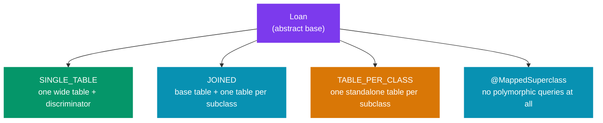

**1. SINGLE_TABLE (the default)**

```java
@Entity
@Inheritance(strategy = InheritanceType.SINGLE_TABLE)
@DiscriminatorColumn(name = "loan_type", discriminatorType = DiscriminatorType.STRING)
public abstract class Loan {
    @Id
    @GeneratedValue
    private Long id;
    private BigDecimal amount;
}

@Entity
@DiscriminatorValue("HOME")
public class HomeLoan extends Loan {
    private String propertyAddress;
}

@Entity
@DiscriminatorValue("VEHICLE")
public class VehicleLoan extends Loan {
    private String registrationNumber;
}
```

One table holds every column of every subclass, plus a `loan_type` discriminator.

- ✅ **Fastest.** Polymorphic queries and subclass queries are single-table reads — no joins ever.
- ❌️ **Subclass columns must be nullable.** `property_address` has to be NULL for every vehicle loan. So you **cannot put a `NOT NULL` constraint on any subclass field**. Data integrity moves out of the database and into application code. Interviewers expect you to raise this problem.
- ❌️ The table gets a column for every field of every subclass. It becomes wide and mostly empty.

**2. JOINED**

```java
@Entity
@Inheritance(strategy = InheritanceType.JOINED)
public abstract class Loan { /* base columns */ }

@Entity
@PrimaryKeyJoinColumn(name = "loan_id")
public class HomeLoan extends Loan { /* subclass columns */ }
```

There is a base table plus one table per subclass. They share the primary key.

- ✅ **Fully normalised.** Every column can be `NOT NULL`, no space is wasted, and FKs work properly.
- ❌️ **A join per inheritance level** on every read. A polymorphic `SELECT l FROM Loan l` becomes a LEFT JOIN across all subclass tables.
- Use it when subclasses have a lot of their own state and integrity constraints matter. This is the usual choice in a lending domain.

**3. TABLE_PER_CLASS**

```java
@Entity
@Inheritance(strategy = InheritanceType.TABLE_PER_CLASS)
public abstract class Loan { /* columns are repeated into each subclass table */ }
```

Each concrete subclass gets a standalone table containing base **and** subclass columns.

- ✅ No joins when you query a concrete subclass directly.
- ❌️ **Polymorphic queries become `UNION ALL`** across every subclass table. This is expensive, and it gets much slower as you add subclasses.
- ❌️ **You cannot use `GenerationType.IDENTITY`.** IDs must be unique across sibling tables, and these tables share no sequence. You need a shared SEQUENCE or TABLE generator.
- It is rarely the right answer. Use it only when you query subclasses on their own and almost never polymorphically.

**4. `@MappedSuperclass` — usually what you actually wanted**

```java
@MappedSuperclass
public abstract class Auditable {
    @CreatedDate
    private Instant createdAt;
    @LastModifiedDate
    private Instant updatedAt;
    private String createdBy;
}

@Entity
public class Loan extends Auditable { }

@Entity
public class Customer extends Auditable { }
```

The superclass is **not an entity**. Its fields are copied into each subclass's table. But there is no shared table and no discriminator. Also, `SELECT a FROM Auditable a` is not a legal JPQL query. (Hibernate HQL does accept it with the fully qualified class name. It then runs one query per entity subclass.)

**Comparison:**

| | SINGLE_TABLE | JOINED | TABLE_PER_CLASS | @MappedSuperclass |
|---|---|---|---|---|
| Tables | 1 | 1 + n | n | n (no base table) |
| Read performance | Best | Join per level | Best for concrete, worst polymorphic | n/a |
| `NOT NULL` on subclass fields | ❌️ Impossible | ✅ Yes | ✅ Yes | ✅ Yes |
| Polymorphic query | Trivial | LEFT JOINs | `UNION ALL` | ❌️ Not possible |
| `IDENTITY` IDs | ✅ | ✅ | ❌️ | ✅ |
| Schema evolution | Adding a subclass adds columns | Adding a subclass adds a table | Adding a subclass adds a table | Independent |

🏭 **Where this shows up in a lending domain:** take a product hierarchy (home / vehicle / personal loan).

- All products share principal, tenure, interest rate and status.
- They differ only in a few product-specific fields.
- `JOINED` keeps each product's mandatory fields truly mandatory.
- `SINGLE_TABLE` would make every one of them nullable across the whole loan book.

🎯 **Interview Tip:** Do not just list the three. Start with the main trade-off: *"SINGLE_TABLE trades data integrity for speed; JOINED trades a join for integrity"*. Then ask whether the subclasses are queried polymorphically. If they are not, propose `@MappedSuperclass`. Explain why the schema never needed the inheritance.

---

</details>

---

25. **🔐 What are the second-level cache concurrency strategies and how do you choose one? 🔥**

<!-- -->
<details>
<summary>Answer</summary>

**Answer:**

`@Cache(usage = …)` picks the consistency guarantee that the L2 cache gives you. If you choose wrongly, the cache starts serving wrong data.

| Strategy | Guarantee | Cost | Use for |
|---|---|---|---|
| **READ_ONLY** | Strongest and cheapest. Entries are never updated. | None — no locking at all | Immutable reference data: currency codes, product master, branch list. **An update throws `UnsupportedOperationException`.** |
| **NONSTRICT_READ_WRITE** | Weak. The entry is **evicted after** the transaction commits, so there is a window where readers see the old value. | Very low | Data that is read constantly, written rarely, and tolerates seconds of staleness |
| **READ_WRITE** | Strong enough for most things. Uses **soft locks**: the entry is locked before the DB write and released after commit; concurrent readers miss the cache and go to the DB rather than reading stale. | Moderate | ✅ **The default choice for mutable entities** |
| **TRANSACTIONAL** | Full transactional consistency — cache and DB commit together. | Highest; needs a **JTA/XA-capable provider** (for example Infinispan, plus a JTA transaction manager) | Rare. Not usable with a plain `JpaTransactionManager` on a single datasource |

```java
@Entity
@Cache(usage = CacheConcurrencyStrategy.READ_ONLY)   // never changes after seeding
public class Currency { }

@Entity
@Cache(usage = CacheConcurrencyStrategy.READ_WRITE)  // safe default when it can change
public class Product { }
```

**Two related traps in the same area:**

**1. Caching an entity does not cache its collections.**

- Each collection needs its own `@Cache`.
- The collection cache stores only the **IDs** of the children.
- Hibernate then loads the children themselves from the entity cache.
- So both must be cached. If not, you have just added a round trip per element:

```java
@Entity
@Cache(usage = CacheConcurrencyStrategy.READ_WRITE)
public class Department {

    @OneToMany(mappedBy = "department")
    @Cache(usage = CacheConcurrencyStrategy.READ_WRITE) // ← required, and easy to forget
    private Set<Employee> employees;
}
```

**2. *Any* write to *any* queried table invalidates the query cache.**

- It stores query-string + parameters → a list of entity IDs (for L2-cacheable entities), along with a per-table timestamp.
- One INSERT into `employee` invalidates **every** cached query that touched `employee`. It does this even if the new row could not have matched.
- On a write-heavy table, writes clear the cache faster than reads fill it.
- You pay for the lookups, the memory and the invalidation tracking, but get a ~0% hit rate. That is measurably **slower** than no cache.

Enable it only for queries over tables that almost never change. Measure the hit rate before and after.

⚠️ **Bulk and native SQL do not update the L2 cache row by row.**

🎯 **Interview Tip:** The question usually comes as *"which strategy for a frequently-updated entity?"*. The answer is `READ_WRITE`. The reason is soft locks: Hibernate sends a concurrent reader to the database instead of giving it a stale value.

Then add the honest warning without being asked:

- The L2 cache is only worth it for read-mostly reference data.
- A distributed cache (Redis) in front of the *service* layer is often a better tool than an L2 cache behind the ORM.

---

</details>

---
