# Most Asked SQL Interview Questions

**Most Asked SQL Interview Questions** | This file lists the SQL interview questions that are asked most often. First, we create a schema and some sample data. Most of the questions below use them. The schema has tables for employees, departments, leaves, products, sales, orders, and payments.

📊 **Question Count by Section**

| # | Section | Questions |
|---|---|---|
| 1 | [SQL Fundamentals](#sql-fundamentals) | 7 |
| 2 | [SQL Constraints and Data Types](#sql-constraints-and-data-types) | 7 |
| 3 | [SQL Joins and Relationships](#sql-joins-and-relationships) | 6 |
| 4 | [Query](#query) | 14 |
| 5 | [Advanced SQL Concepts](#advanced-sql-concepts) | 11 |
| 6 | [Dialect Divergences — MySQL ↔ PostgreSQL](#6-dialect-divergences--mysql--postgresql) | 3 |
| | **Total** | **48** |

> 🔥🔥 Very High — asked in almost every Tier-1 loop &nbsp;·&nbsp; 🔥 High — very frequent in Tier-1 interviews &nbsp;·&nbsp; ⚡ Medium — commonly asked &nbsp;·&nbsp; 💤 Low — good to know, rarely asked

> 🔗 **See also:** [`02_Database_Design_and_Internals_Interview_Questions.md`](https://github.com/vikas9dev/system-design/blob/main/iq/02_Database_Design_and_Internals_Interview_Questions.md) — ACID, isolation levels, dirty/phantom reads, `SELECT … FOR UPDATE`, optimistic vs pessimistic locking, B-tree internals and `EXPLAIN` output. This file does **not repeat those on purpose**. This file covers how to write the queries. · [`13_Hibernate_Interview_Questions.md`](13_Hibernate_Interview_Questions.md) — when JPA/HQL writes the SQL for you, and when you switch to `nativeQuery = true`.

```sql
-- Creating Employee Table
CREATE TABLE employees (
    employee_id INT PRIMARY KEY,
    first_name VARCHAR(50),
    last_name VARCHAR(50),
    department_id INT,
    salary DECIMAL(10, 2),
    joining_date DATE,
    manager_id INT
);

-- Creating Department Table
CREATE TABLE departments (
    department_id INT PRIMARY KEY,
    department_name VARCHAR(50)
);

CREATE TABLE leaves (
    leave_id INT PRIMARY KEY,
    employee_id INT,
    leave_date DATE,
    FOREIGN KEY (employee_id) REFERENCES employees(employee_id)
);

-- Inserting Data into employees Table
INSERT INTO employees VALUES (1, 'John', 'Doe', 1, 60000, '2018-01-10', NULL);
INSERT INTO employees VALUES (2, 'Jane', 'Smith', 2, 75000, '2017-03-15', 1);
INSERT INTO employees VALUES (3, 'Sam', 'Brown', 1, 55000, '2020-06-20', 1);
INSERT INTO employees VALUES (4, 'Lisa', 'White', 3, 90000, '2016-09-05', NULL);
INSERT INTO employees VALUES (5, 'Mark', 'Green', 2, 80000, '2019-11-12', 2);
INSERT INTO employees VALUES (6, 'Emily', 'Clark', 1, 67000, '2019-01-05', 1);
INSERT INTO employees VALUES (7, 'Daniel', 'Lewis', 3, 72000, '2021-05-10', 4);
INSERT INTO employees VALUES (8, 'Sophia', 'Wilson', 4, 98000, '2015-12-15', 6);
INSERT INTO employees VALUES (9, 'James', 'Johnson', NULL, 65000, '2020-10-10', 7);
INSERT INTO employees VALUES (10, 'Olivia', 'Jones', 2, 82000, '2018-03-23', 2);
INSERT INTO employees VALUES (11, 'Zara', 'Ali', 5, 45000, '2021-07-11', 8);
INSERT INTO employees VALUES (12, 'Amit', 'Sharma', 6, 50000, '2022-05-22', 3);

-- Inserting Data into departments Table
INSERT INTO departments VALUES (1, 'HR');
INSERT INTO departments VALUES (2, 'Finance');
INSERT INTO departments VALUES (3, 'Engineering');
INSERT INTO departments VALUES (4, 'Marketing');
INSERT INTO departments VALUES (5, 'Sales');
INSERT INTO departments VALUES (6, 'Operations');
INSERT INTO departments VALUES (7, 'Logistics');

INSERT INTO leaves VALUES (1, 1, '2024-05-20');
INSERT INTO leaves VALUES (2, 2, '2024-03-15');
INSERT INTO leaves VALUES (3, 3, '2024-02-20');
INSERT INTO leaves VALUES (4, 4, '2024-07-10');
INSERT INTO leaves VALUES (5, 5, '2024-04-25');
INSERT INTO leaves VALUES (6, 6, '2024-06-05');
INSERT INTO leaves VALUES (7, 7, '2024-08-12');
INSERT INTO leaves VALUES (8, 8, '2024-01-10');
INSERT INTO leaves VALUES (9, 9, '2024-09-15');
INSERT INTO leaves VALUES (10, 10, '2024-11-05');
INSERT INTO leaves VALUES (11, 11, '2024-12-01');
INSERT INTO leaves VALUES (12, 12, '2024-10-10');

CREATE TABLE products (
    product_id INT PRIMARY KEY,
    product_name VARCHAR(100),
    price DECIMAL(10, 2)
);

CREATE TABLE sales (
    sale_id INT PRIMARY KEY,
    product_id INT,
    employee_id INT,
    quantity INT,
    sales_amount DECIMAL(10, 2),
    sale_date DATE,
    FOREIGN KEY (product_id) REFERENCES products(product_id),
    FOREIGN KEY (employee_id) REFERENCES employees(employee_id)
);

CREATE TABLE orders (
    order_id INT PRIMARY KEY,
    customer_id INT,
    order_date DATE
);

CREATE TABLE payments (
    payment_id INT PRIMARY KEY,
    order_id INT,
    payment_date DATE,
    FOREIGN KEY (order_id) REFERENCES orders(order_id)
);

INSERT INTO products (product_id, product_name, price) VALUES (1, 'Product A', 10.00);
INSERT INTO products (product_id, product_name, price) VALUES (2, 'Product B', 20.00);
INSERT INTO products (product_id, product_name, price) VALUES (3, 'Product C', 30.00);
INSERT INTO products (product_id, product_name, price) VALUES (4, 'Product D', 40.00);
INSERT INTO products (product_id, product_name, price) VALUES (5, 'Product E', 50.00);

INSERT INTO sales (sale_id, product_id, employee_id, quantity, sales_amount, sale_date) VALUES (1, 1, 2, 100, 1000.00, '2024-03-01');
INSERT INTO sales (sale_id, product_id, employee_id, quantity, sales_amount, sale_date) VALUES (2, 2, 2, 200, 4000.00, '2024-03-02');
INSERT INTO sales (sale_id, product_id, employee_id, quantity, sales_amount, sale_date) VALUES (3, 3, 5, 150, 4500.00, '2024-03-02');
INSERT INTO sales (sale_id, product_id, employee_id, quantity, sales_amount, sale_date) VALUES (4, 4, 5, 80, 3200.00, '2024-03-04');
INSERT INTO sales (sale_id, product_id, employee_id, quantity, sales_amount, sale_date) VALUES (5, 5, 10, 120, 6000.00, '2024-03-05');

INSERT INTO orders (order_id, customer_id, order_date) VALUES (1, 101, '2023-01-01');
INSERT INTO orders (order_id, customer_id, order_date) VALUES (2, 102, '2023-01-02');
INSERT INTO orders (order_id, customer_id, order_date) VALUES (3, 103, '2023-01-03');
INSERT INTO orders (order_id, customer_id, order_date) VALUES (4, 104, '2023-01-04');
INSERT INTO orders (order_id, customer_id, order_date) VALUES (5, 105, '2023-01-05');

INSERT INTO payments (payment_id, order_id, payment_date) VALUES (1, 1, '2023-01-06');
INSERT INTO payments (payment_id, order_id, payment_date) VALUES (2, 2, '2023-01-07');
INSERT INTO payments (payment_id, order_id, payment_date) VALUES (3, 3, '2023-01-08');
INSERT INTO payments (payment_id, order_id, payment_date) VALUES (4, 4, '2023-01-09');
```

<a id="sql-fundamentals"></a>

## 1. SQL Fundamentals

1. **🔄 Explain the order of execution of SQL. 🔥🔥**

<!-- -->
<details>
<summary>Answer</summary>

**Answer:**

The order of execution of SQL statements can be confusing. It does not always match what you expect. If you understand it, you can write much better queries.

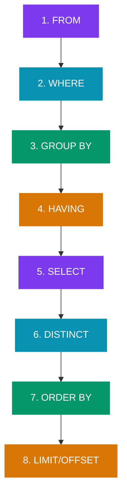

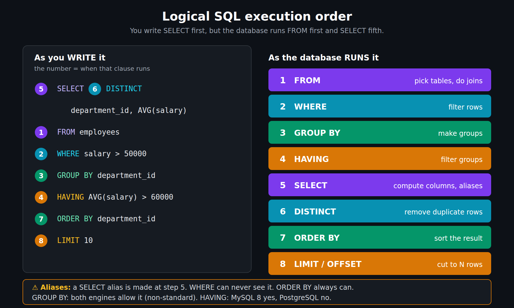

1. **FROM Clause**: The first step is to process the `FROM` clause. It finds the tables involved and does any needed joins.
2. **WHERE Clause**: Next, the `WHERE` clause filters the rows based on the specified conditions.
3. **GROUP BY Clause**: After filtering, the `GROUP BY` clause groups the remaining rows based on the specified columns.
4. **HAVING Clause**: The `HAVING` clause then filters the groups created in the previous step.
5. **SELECT Clause**: The `SELECT` clause works out the columns and expressions to return in the result set.
6. **DISTINCT Clause**: If used, the `DISTINCT` clause removes duplicate rows from the result set.
7. **ORDER BY Clause**: The `ORDER BY` clause sorts the result set based on the specified columns and directions.
8. **LIMIT/OFFSET Clause**: Finally, the `LIMIT` or `OFFSET` clause limits the number of rows returned.

🛠️ **Example:**

```sql
SELECT DISTINCT department_id, AVG(salary)
FROM employees
WHERE salary > 50000
GROUP BY department_id
HAVING AVG(salary) > 60000
ORDER BY department_id
LIMIT 10;
```

- 📋 **FROM employees**: Identify the table to be queried.
- 🔍 **WHERE salary > 50000**: Filter rows where `salary` is greater than 50000.
- 📊 **GROUP BY department_id**: Group the filtered rows by `department_id`.
- ⚙️ **HAVING AVG(salary) > 60000**: Filter groups where the average `salary` is greater than 60000.
- ✅ **SELECT DISTINCT department_id, AVG(salary)**: Select and compute the needed columns, with no duplicate rows.
- 🔢 **ORDER BY department_id**: Sort the result set by `department_id`.
- 📐 **LIMIT 10**: Limit the result set to 10 rows.

⚠️ **This order decides which clauses can see an alias. And the two engines disagree.**
- A `SELECT` alias is created at **step 5**.
- So later steps can see it (`ORDER BY`, `LIMIT`).
- By the SQL standard, earlier steps cannot see it (`WHERE`, `GROUP BY`, `HAVING`).
- Both engines break this rule for `GROUP BY`, as an extension (see the table).
- PostgreSQL follows the rule for `WHERE` and `HAVING`.
- **MySQL 8 is less strict for `HAVING`**, as a documented extension:

```sql
SELECT department_id, AVG(salary) AS avg_sal
FROM employees
GROUP BY department_id
HAVING avg_sal > 60000;      -- 🐬 MySQL 8: runs.  🐘 PostgreSQL: ERROR — column "avg_sal" does not exist
```

| Clause | 🐘 PostgreSQL 16 | 🐬 MySQL 8 |
|---|---|---|
| `WHERE` | ❌️ alias not visible | ❌️ alias not visible |
| `GROUP BY` | ✅ allowed (PostgreSQL extension) | ✅ allowed |
| `HAVING` | ❌️ **repeat the expression** | ✅ alias allowed |
| `ORDER BY` | ✅ allowed | ✅ allowed |

📌 **About the `GROUP BY` row: yes, you can use the alias itself there. But it is non-standard and has two traps.** The SQL standard lets only `ORDER BY` see output column names. Both engines extend that to `GROUP BY`. Neither extends it to `WHERE`.

**1. On PostgreSQL, only the alias name on its own works — never an expression built on it:**

```sql
SELECT department_id AS dept, COUNT(*) FROM employees GROUP BY dept;       -- ✅ both engines
SELECT department_id AS dept, COUNT(*) FROM employees GROUP BY dept + 1;   -- ❌️ PostgreSQL: ERROR: column "dept" does not exist
```

Inside an expression, PostgreSQL looks up the name in the **input columns** (the table), not in the output aliases. The same limit applies in `ORDER BY`. MySQL is looser: it also finds an alias inside an expression, in both `GROUP BY` and `ORDER BY`.

**2. When an alias has the same name as a real column, the real column wins.** PostgreSQL does this with no warning. It documents this rule: an ambiguous `GROUP BY` name is read as an **input-column name**, not as the output alias. So this query groups by the *table's* `department_id`, not by `salary`. Then it fails, because `salary` is not grouped:

```sql
SELECT salary AS department_id, COUNT(*) FROM employees GROUP BY department_id;   -- ⚠️ groups by the real column → ERROR: salary is not grouped
```

MySQL also groups by the real column and raises warning 1052 ("Column … in group statement is ambiguous"). Under the default `ONLY_FULL_GROUP_BY`, it then rejects this query with error 1055, because `salary` is not grouped. In both cases, the rule is the same: never give a column an alias that is another column's name.

✅ **Portable rule (works on every engine):**
- Repeat the expression in `WHERE`/`HAVING` (`HAVING AVG(salary) > 60000`).
- **Group by the expression, not the alias** (`GROUP BY department_id`).
- Use alias references only in `ORDER BY`. It is the one place where every engine *and* the standard agree.

If you answer "just use the alias in `HAVING`", the interviewer sees you know only MySQL. See [§6](#6-dialect-divergences--mysql--postgresql) row 13.

---

</details>

---

2. **⚖️ What is the difference between WHERE and HAVING? 🔥🔥**

<!-- -->
<details>
<summary>Answer</summary>

**Answer:**

The `WHERE` clause filters rows **before** any grouping happens. It works on individual rows in the database table.

```sql
SELECT *
FROM employees
WHERE salary > 50000;
```

The `HAVING` clause filters groups **after** the `GROUP BY` step. It filters the aggregated results. You mostly use `HAVING` with aggregate functions (like `SUM`, `COUNT`, `AVG`, etc.).

```sql
SELECT department_id, AVG(salary)
FROM employees
GROUP BY department_id
HAVING AVG(salary) > 60000;
```

| Feature | WHERE 🅰️ | HAVING 🅱️ |
|---------|----------|-----------|
| **Applies to** | Individual rows | Grouped rows |
| **Execution order** | Before `GROUP BY` | After `GROUP BY` |
| **Aggregate functions** | ❌️ Cannot use | ✅ Can use |
| **Use case** | Filter raw data | Filter aggregated results |

🎯 **Interview Tip:** Remember that `WHERE` filters rows before grouping, while `HAVING` filters groups after aggregation. They are not interchangeable.

<details>
<summary><strong>🤔 Doubt: Is HAVING legal without a GROUP BY? What does it operate on, and what does this query return?</strong></summary>

```sql
SELECT COUNT(*) FROM employees HAVING COUNT(*) > 5;
```

✅ **Yes, it is legal.** With no `GROUP BY`, the **whole table becomes one implicit group**:
- Every aggregate in the query is computed across all rows.
- `HAVING` filters that single group.

The syntax is the same as usual. There is just one group instead of many.

**What it returns, on the 12-row `employees` table:** one row containing `12`, because `12 > 5` is `TRUE`.

⚠️ **The trap is the false case: it returns ZERO ROWS, not `NULL` and not `0`.**

```sql
SELECT COUNT(*) FROM employees;                         -- always 1 row: 12
SELECT COUNT(*) FROM employees HAVING COUNT(*) > 5;     -- 1 row: 12   ✅ group survives
SELECT COUNT(*) FROM employees HAVING COUNT(*) > 500;   -- 0 rows      ⚠️ the group is filtered away
```

An aggregate query with no `GROUP BY` normally returns **exactly one row, always**. This is true even on an empty table, where `COUNT(*)` is `0`. Adding `HAVING` is the one thing that can remove that row completely. The reason: `HAVING` filters *groups*, and it can filter out the single implicit group like any other group.

💡 **Why it matters in application code:** "no rows" and "a row containing 0/NULL" are different results.
- In JDBC, `rs.next()` returns `false`. So code written as `rs.next(); return rs.getLong(1);` throws instead of returning a count.
- In Spring Data, a `Long` return type comes back as `null`, not `0L`. Unboxing it later throws an NPE. An `Optional<Long>` comes back empty. A primitive `long` return type fails at call time, because `null` cannot fit in it.
- If you need exactly one row every time, filter in `WHERE` (or in the application), not in `HAVING`.

📎 A `HAVING` with **no aggregate at all and no `GROUP BY`** is also legal: `SELECT 1 FROM employees HAVING 1 = 1`. It just applies the condition to that one implicit group. It is legal, but there is no reason to write it. That is the job of `WHERE`.

---

</details>
<br/>

---

</details>

---

3. **📊 What is the use of GROUP BY? 🔥**

<!-- -->
<details>
<summary>Answer</summary>

**Answer:**

The `GROUP BY` clause in SQL puts rows with the same values into groups. You often use it together with aggregate functions (such as `COUNT`, `SUM`, `AVG`, `MAX`, `MIN`). They do calculations on each group of data.

✅ **Use Cases:**

- 📊 **Aggregate Data**: Summarize data by certain categories.
- 🔍 **Data Analysis**: Analyze patterns within groups.
- 📋 **Reporting**: Generate reports with grouped data insights.

🛠️ **Example:** This query groups employees by `department_id` and calculates the average salary for each department:

```sql
SELECT department_id, AVG(salary)
FROM employees
GROUP BY department_id;
```

---

</details>

---

4. **🔀 What is the difference between GROUP BY and WHERE Clause? 🔥**

<!-- -->
<details>
<summary>Answer</summary>

**Answer:**

The `GROUP BY` clause groups rows with the same values in specified columns. It is used with aggregate functions.

```sql
SELECT department_id, AVG(salary)
FROM employees
GROUP BY department_id;
```

The `WHERE` clause filters rows before grouping. It specifies conditions for individual rows.

```sql
SELECT *
FROM employees
WHERE salary > 50000;
```

| Feature | GROUP BY 🅰️ | WHERE 🅱️ |
|---------|------------|----------|
| **Purpose** | Groups rows for aggregation | Filters individual rows |
| **Works with** | ✅ Aggregate functions | ❌️ No aggregate functions |
| **Execution order** | After `WHERE` | Before `GROUP BY` |

🧠 **In Simple Words:**
- **WHERE** acts like a guard at the entrance. It decides which rows get in.
- **GROUP BY** puts the rows that got through into groups.

---

</details>

---

5. **🗂️ What is the difference between DML, DDL, and DCL? 🔥🔥**

<!-- -->
<details>
<summary>Answer</summary>

**Answer:**

**1. Data Manipulation Language (DML):**

- 🎯 **Purpose**: Used for managing data within schema objects.
- ⚙️ **Common Commands**: `SELECT`, `INSERT`, `UPDATE`, `DELETE`.

```sql
INSERT INTO employees (employee_id, first_name, last_name) VALUES (1, 'John', 'Doe');
```

**2. Data Definition Language (DDL):**

- 🏗️ **Purpose**: Used for defining and modifying database structures or schema.
- ⚙️ **Common Commands**: `CREATE`, `ALTER`, `DROP`, `TRUNCATE`.

```sql
CREATE TABLE employees (
    employee_id INT PRIMARY KEY,
    first_name VARCHAR(50),
    last_name VARCHAR(50)
);
```

**3. Data Control Language (DCL):**

- 🔒 **Purpose**: Used for controlling access to data in the database.
- ⚙️ **Common Commands**: `GRANT`, `REVOKE`.

```sql
GRANT SELECT ON employees TO user_name;
```

| Feature | DML 🅰️ | DDL 🅱️ | DCL 🅾️ |
|---------|--------|--------|--------|
| **Purpose** | Manipulates data | Defines structure | Controls access |
| **Rollback (MySQL / Oracle)** | ✅ Can be rolled back | ❌️ Auto-committed | ❌️ Auto-committed |
| **Rollback (PostgreSQL / SQL Server)** | ✅ Can be rolled back | ✅ **Transactional DDL** | ✅ Transactional |
| **Examples** | `SELECT`, `INSERT` | `CREATE`, `DROP` | `GRANT`, `REVOKE` |

⚠️ **"DDL can't be rolled back" is true for MySQL/Oracle, not for SQL in general.**
- MySQL and Oracle issue an **implicit commit** before and after every DDL statement.
- So a `CREATE`/`ALTER`/`DROP` inside a transaction commits everything around it, with no warning.
- **PostgreSQL and SQL Server have fully transactional DDL.** `BEGIN; DROP TABLE t; ROLLBACK;` leaves the table as it was.

This matters in real work. It is exactly why you can recover from a failed Flyway migration on PostgreSQL. On MySQL, the same failure leaves a half-applied schema.

🛠️ **What that means for Flyway, in practice.**
- When a migration fails **on MySQL**, the `flyway_schema_history` row is marked failed.
- `flyway repair` cleans up *that row*. It **cannot undo the DDL that already committed**.
- You undo the partial schema by hand (or restore from backup) and then re-run.
- So the practical rule on MySQL is: **one DDL statement per migration script**. Then a half-applied migration does the least possible damage.
- **On PostgreSQL**, the whole script rolls back atomically. The exception is a statement that cannot run in a transaction, like `CREATE INDEX CONCURRENTLY`. You fix the script and re-run. You rarely need `repair`.

📌 **`TRUNCATE` is DDL, but it does *not* change the table structure.** The definition, columns, indexes and constraints stay the same. It counts as DDL for two reasons:
- It **frees all data pages at once**, instead of logging row-by-row deletes.
- It **resets the `AUTO_INCREMENT` / identity counter** (`DELETE` never does this). But this second point differs by engine; see the table.

Three results that interviewers ask about:

| | `DELETE FROM t` | `TRUNCATE TABLE t` |
|---|---|---|
| **Category** | DML | DDL |
| **Rollback** | ✅ Transactional on every engine | ❌️ Auto-commits on **MySQL**/Oracle · ✅ **rolls back on PostgreSQL** |
| **Row triggers** | ✅ Fires `BEFORE`/`AFTER DELETE` per row | ❌️ Never fires row-level triggers |
| **`WHERE` clause** | ✅ Supported | ❌️ All rows, always |
| **Identity counter** | Preserved | ⚠️ **Engine-split** — 🐬 MySQL / SQL Server: ✅ reset to the seed automatically. 🐘 PostgreSQL: ❌️ **not** reset — the default is `CONTINUE IDENTITY`; you must write `TRUNCATE … RESTART IDENTITY` |

---

</details>

---

6. **🪟 Differences between `GROUP BY` and `PARTITION BY`? 🔥**

<!-- -->
<details>
<summary>Answer</summary>

**Answer:**

**GROUP BY**

- 🎯 **Purpose**: Aggregates data across multiple rows by one or more columns.
- ⚙️ **Functionality**: Combines rows that have the same values into summary rows, using functions like `SUM`, `AVG`, `COUNT`, etc.
- 📊 **Usage**: Commonly used with aggregate functions to generate summary data.

```sql
SELECT department_id, SUM(salary)
FROM employees
GROUP BY department_id;
```

This query groups the employees by their `department_id` and calculates the total salary for each department.

**PARTITION BY**

- 🎯 **Purpose**: Used with window functions. They do calculations across a set of table rows that are related to the current row.
- ⚙️ **Functionality**: Does not reduce the number of rows returned. Instead, it adds a column with aggregate values calculated over a partition.
- 📊 **Usage**: Commonly used with functions like `ROW_NUMBER()`, `RANK()`, `DENSE_RANK()`, `NTILE()`, `LAG()`, `LEAD()`, etc. 📎 **Each one has a worked example in [§5 Q1 — Explain all types of window functions](#advanced-sql-concepts)**. This question is only about the difference between `GROUP BY` and `PARTITION BY`.

```sql
SELECT employee_id, department_id, salary,
       SUM(salary) OVER (PARTITION BY department_id) AS total_department_salary
FROM employees;
```

This query calculates the total salary for each department, but it does not group the rows. It adds a new column, `total_department_salary`. For each employee, it holds the total salary of that employee's department.

| Feature | GROUP BY 🅰️ | PARTITION BY 🅱️ |
|---------|------------|----------------|
| **Row reduction** | ✅ Reduces rows | ❌️ Keeps all rows |
| **Result** | Summary rows only | All rows + aggregate column |
| **Usage context** | General aggregation | Analytical/window functions |
| **Functions** | `SUM`, `AVG`, `COUNT` | `ROW_NUMBER`, `RANK`, `LAG`, `LEAD` |

🧠 **In Simple Words:**
- **GROUP BY** collapses rows into groups and gives one result per group.
- **PARTITION BY** keeps every row but adds computed values based on the group each row belongs to.

<details>
<summary><strong>🤔 Doubt: I need each employee's salary AND their department average in the same row. Why can't GROUP BY do it?</strong></summary>

Because `GROUP BY` **removes the individual rows**. After grouping, "John's salary" no longer exists in the intermediate result. There are only *departments*. A query cannot return one row per employee and one row per department at the same time.

```sql
-- ❌️ Fails on both engines
SELECT first_name, salary, AVG(salary) AS dept_avg
FROM employees
GROUP BY department_id;
```

There are two separate errors here:
1. **`first_name` and `salary` are neither grouped nor aggregated.** PostgreSQL always rejects this. MySQL 8 also rejects it under the default `ONLY_FULL_GROUP_BY`. With that flag switched off, MySQL returns the value from **any one row it picks**. That is wrong data, with no error.
2. **The row count is wrong by design.** `GROUP BY department_id` can only produce one row per department, never one per employee.

✅ **`PARTITION BY` is the fix, because it does not reduce rows.** It computes the aggregate over a window and attaches it to every row in that window:

```sql
SELECT first_name,
       salary,
       AVG(salary) OVER (PARTITION BY department_id)          AS dept_avg_sal,
       salary - AVG(salary) OVER (PARTITION BY department_id) AS diff_from_avg
FROM employees;
```

12 employees in → 12 rows out. Each row carries its own department's average. Repeating the `OVER` clause is fine. To avoid the repeat, name it once in a `WINDOW` clause (`… OVER w … WINDOW w AS (PARTITION BY department_id)`). Both engines support this.

---

</details>
<br/>

<details>
<summary><strong>🤔 Doubt: "Return the highest-paid employee in each department" — why is GROUP BY + MAX(salary) wrong?</strong></summary>

Because `MAX(salary)` gives you the **number**, not the **person**. The name is not groupable, so:

```sql
-- ❌️ The classic wrong answer
SELECT department_id, first_name, MAX(salary)
FROM employees
GROUP BY department_id;
```

PostgreSQL (and MySQL with `ONLY_FULL_GROUP_BY` on) rejects it. With the flag **off**, MySQL returns the max salary next to **the name of any one employee it picks from that department**. The two columns come from different rows. That is the worst result: no error, and a wrong answer.

✅ **1. Window function + filter in an outer query.** This is the portable default:

```sql
SELECT * FROM (
    SELECT e.*,
           ROW_NUMBER() OVER (PARTITION BY department_id ORDER BY salary DESC) AS rn
    FROM employees e
) t
WHERE t.rn = 1;
```

The filter **must** be in an outer query or CTE. The engine evaluates a window function after `HAVING`. So neither `WHERE rn = 1` nor `HAVING rn = 1` can see it. Use `RANK()` instead of `ROW_NUMBER()` when you want all tied rows. `ROW_NUMBER()` picks exactly one of them, and which one it picks is not defined.

✅ **2. Join back to the aggregate.** It needs no window functions, and it returns all tied rows without extra work:

```sql
SELECT e.*
FROM employees e
JOIN (
    SELECT department_id, MAX(salary) AS mx
    FROM employees
    GROUP BY department_id
) m ON m.department_id = e.department_id
   AND m.mx = e.salary;
```

> 🐘 **PostgreSQL shortcut:** `SELECT DISTINCT ON (department_id) * FROM employees ORDER BY department_id, salary DESC;` — MySQL has no equivalent; see [§6](#6-dialect-divergences--mysql--postgresql) row 11.

---

</details>
<br/>

---

</details>

---

7. **🔃 Explain the use of CASE statements in SQL. ⚡**

<!-- -->
<details>
<summary>Answer</summary>

**Answer:**

The `CASE` statement in SQL is a very useful tool. It lets you write conditional logic directly inside SQL queries. It works like `if-else` statements in programming languages. You can use the `CASE` statement to:

- create custom output
- perform conditional aggregations
- and more

📖 **Syntax:**

```sql
CASE
    WHEN condition1 THEN result1
    WHEN condition2 THEN result2
    ...
    ELSE result_n
END
```

🛠️ **Example 1 - Categorizing Employees Based on Salary:**

```sql
SELECT
    employee_id,
    first_name,
    last_name,
    salary,
    CASE
        WHEN salary < 50000 THEN 'Low Salary'
        WHEN salary >= 50000 AND salary <= 80000 THEN 'Medium Salary'
        ELSE 'High Salary'
    END AS salary_category
FROM
    employees;
```

🛠️ **Example 2 - Handling Null Values:**

```sql
SELECT
    employee_id,
    first_name,
    last_name,
    manager_id,
    CASE
        WHEN manager_id IS NULL THEN 'No Manager'
        ELSE CAST(manager_id AS CHAR)      -- MySQL: cast target is CHAR, not VARCHAR
    END AS manager_status
FROM
    employees;
```

⚠️ **Dialect trap:** MySQL's `CAST()` has **no `VARCHAR` target type**. So `CAST(x AS VARCHAR)` is a syntax error. Use `CAST(x AS CHAR)`. PostgreSQL and SQL Server *do* accept `CAST(x AS VARCHAR)`. PostgreSQL also allows the shorthand `x::text`.

⚠️ **Every branch of a `CASE` must return the same type.** Say you mix `'No Manager'` (string) with a bare `manager_id` (int). MySQL then converts both branches to a string anyway. If you write the cast yourself, you choose the type. The engine does not choose it silently for you.

🛠️ **Example 3 - Conditional Aggregations:**

```sql
SELECT
    department_id,
    SUM(CASE WHEN salary > 60000 THEN salary ELSE 0 END) AS total_high_salaries,
    SUM(CASE WHEN salary <= 60000 THEN salary ELSE 0 END) AS total_low_salaries
FROM
    employees
GROUP BY
    department_id;
```

🎯 **Interview Tip:** `CASE` statements have many uses. In interviews, mention use cases like data transformation, conditional aggregation, and pivoting data (turning rows into columns).

<details>
<summary><strong>🤔 Doubt: Why does COUNT(CASE WHEN … THEN 1 ELSE 0 END) count every row?</strong></summary>

Because **`COUNT(expr)` counts non-NULL values**, and `0` is a valid non-NULL value. So the `ELSE 0` branch gives `COUNT` a value on *every* row. The result is just `COUNT(*)`.

```sql
-- ❌️ Returns 12 (every employee), not the 2 employees with no manager
COUNT(CASE WHEN manager_id IS NULL THEN 1 ELSE 0 END)

-- ✅ Omit ELSE — an unmatched CASE yields NULL, which COUNT skips
COUNT(CASE WHEN manager_id IS NULL THEN 1 END)

-- ✅ Or switch the aggregate: SUM does want the 0
SUM(CASE WHEN manager_id IS NULL THEN 1 ELSE 0 END)
```

📌 **The rule: `SUM` wants `ELSE 0`, `COUNT` wants no `ELSE` at all.** If you mix them up, you get no error. You just get a wrong number.

**The full pattern — "conditional aggregation" (manual pivoting).** You get one row per group, with several conditional measures in that row. The database computes them all in a **single table scan**, instead of one query per measure:

```sql
SELECT department_id,
       SUM(CASE WHEN salary >  60000 THEN salary ELSE 0 END) AS total_high_salaries,
       SUM(CASE WHEN salary <= 60000 THEN salary ELSE 0 END) AS total_low_salaries,
       COUNT(CASE WHEN manager_id IS NULL THEN 1 END)        AS employees_without_manager
FROM employees
GROUP BY department_id;
```

> 🐘 **PostgreSQL has dedicated syntax:** `COUNT(*) FILTER (WHERE manager_id IS NULL)` — the intent is clearer, and the plan is the same. 🐬 **MySQL 8 has no `FILTER`**; use the `CASE` form above, or the shorthand `SUM(manager_id IS NULL)` (booleans are `1`/`0`). See [§6](#6-dialect-divergences--mysql--postgresql) row 6.

---

</details>
<br/>

---

</details>

---

<a id="sql-constraints-and-data-types"></a>

## 2. SQL Constraints and Data Types

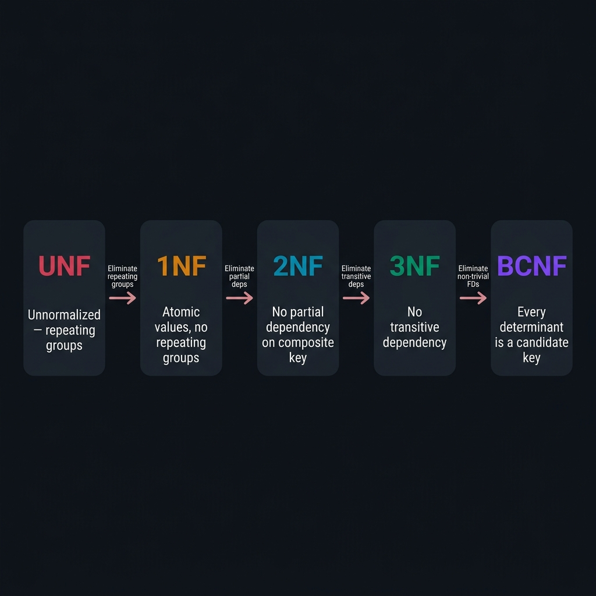

1. **🔒 What are constraints and types of Constraints? 🔥**

<!-- -->
<details>
<summary>Answer</summary>

**Answer:**

In SQL, constraints are rules on table columns. They keep the data in the database correct, accurate, and reliable. You can add constraints when you create the table, or after the table exists.

**Types of Constraints:**

1. **Primary Key Constraint**: Ensures that each row in a table has a unique identifier.

```sql
CREATE TABLE employees (
    employee_id INT PRIMARY KEY,
    first_name VARCHAR(50),
    last_name VARCHAR(50)
);
```

2. **Foreign Key Constraint**: Links two tables. It makes sure the data keeps referential integrity (every reference points to a row that exists).

```sql
CREATE TABLE orders (
    order_id INT PRIMARY KEY,
    employee_id INT,
    CONSTRAINT fk_employee
    FOREIGN KEY (employee_id) REFERENCES employees(employee_id)
);
```

3. **Unique Constraint**: Ensures all values in a column or a set of columns are unique.

```sql
CREATE TABLE products (
    product_id INT PRIMARY KEY,
    product_name VARCHAR(50) UNIQUE
);
```

4. **Not Null Constraint**: Ensures that a column cannot have a NULL value.

```sql
CREATE TABLE customers (
    customer_id INT PRIMARY KEY,
    customer_name VARCHAR(50) NOT NULL
);
```

5. **Check Constraint**: Ensures that all values in a column satisfy a specific condition.

```sql
CREATE TABLE employees (
    employee_id INT PRIMARY KEY,
    age INT CHECK (age >= 18)
);
```

6. **Default Constraint**: Provides a default value for a column when no value is specified.

```sql
-- MySQL 8.0.13+ — a function default must be wrapped in parentheses
CREATE TABLE orders (
    order_id INT PRIMARY KEY,
    order_date DATE DEFAULT (CURRENT_DATE)
);

-- MySQL 5.6.5+ — TIMESTAMP/DATETIME are the one exception, no parentheses needed
CREATE TABLE orders2 (
    order_id   INT PRIMARY KEY,
    created_at DATETIME DEFAULT CURRENT_TIMESTAMP
);
```

⚠️ **`GETDATE()` is T-SQL (SQL Server) and does not exist in MySQL.** The spelling in each engine:

- MySQL/PostgreSQL/standard SQL → `CURRENT_DATE` / `CURRENT_TIMESTAMP`
- SQL Server → `GETDATE()`
- Oracle → `SYSDATE`

Also note the MySQL version limit. **Expression defaults on non-`TIMESTAMP` columns only arrived in 8.0.13.** On 5.7, MySQL rejects a `DATE DEFAULT (CURRENT_DATE)` completely. There you must set the value in the `INSERT` or in a `BEFORE INSERT` trigger.

📝 **Summary:**

- 🔑 **Primary Key**: Unique identifier for each row.
- 🔗 **Foreign Key**: Links two tables.
- 🎯 **Unique**: Ensures unique values in a column.
- 🚫 **Not Null**: Ensures no NULL values.
- ✅ **Check**: Ensures column values meet a condition.
- ⚙️ **Default**: Sets a default value for a column.

---

</details>

---

2. **🔑 What is the difference between "Primary Key" and "Unique Key"? 🔥🔥**

<!-- -->
<details>
<summary>Answer</summary>

**Answer:**

| Feature | Primary Key 🅰️ | Unique Key 🅱️ |
|---------|---------------|--------------|
| **Count per table** | ✅ Only one | ✅ Multiple allowed |
| **NULL values** | ❌️ Cannot be NULL | ✅ **Multiple NULLs allowed** (MySQL, PostgreSQL, Oracle, SQLite) — **exactly one** on SQL Server |
| **Backing index** | InnoDB: **is** the clustered index. PostgreSQL: an ordinary B-tree, nothing is clustered | A separate (secondary) B-tree index — except InnoDB with no PK, which clusters on the first `NOT NULL UNIQUE` key |
| **Auto Increment** | ✅ Supports | ✅ **Also supports** — MySQL only requires the `AUTO_INCREMENT` column to be *a* key, not the *primary* key |

⚠️ **The two rows people get wrong — and interviewers know it:**

**1. A `UNIQUE` column accepts *many* NULLs, not one.** The reason is three-valued logic:

- The engine checks uniqueness with `=`.
- `NULL = NULL` is **UNKNOWN**, never TRUE.
- So two NULLs are never "duplicates".

MySQL/InnoDB, PostgreSQL, Oracle and SQLite all behave this way. **SQL Server is the different one.** It allows only a single NULL. PostgreSQL 15+ can choose the SQL Server behaviour, if you ask for it explicitly:

```sql
-- MySQL / PostgreSQL / Oracle: both rows insert successfully
CREATE TABLE contacts (id INT PRIMARY KEY, email VARCHAR(100) UNIQUE);
INSERT INTO contacts VALUES (1, NULL);
INSERT INTO contacts VALUES (2, NULL);   -- ✅ no violation

-- PostgreSQL 15+ only: opt in to "at most one NULL"
CREATE TABLE contacts2 (id INT PRIMARY KEY, email VARCHAR(100) UNIQUE NULLS NOT DISTINCT);
```

**2. `AUTO_INCREMENT` works on a plain `UNIQUE` key.** MySQL's actual rule is "there can be at most one `AUTO_INCREMENT` column per table and **it must be indexed**". Being the primary key is the common case, not the requirement:

```sql
CREATE TABLE t (
    id INT AUTO_INCREMENT UNIQUE,   -- ✅ valid MySQL: UNIQUE is enough
    x  INT
);
```

SQL Server `IDENTITY` and PostgreSQL `GENERATED … AS IDENTITY` have no key requirement at all. The column does not need an index.

🧠 **In Simple Words:**
- **Primary Key** is the main identity of a row -- like a national ID number (unique, mandatory, one per table).
- **Unique Key** is like an email address -- unique but optional, and you can have multiple unique constraints.

<details>
<summary><strong>🤔 Doubt: If NULLs don't collide, how do I enforce "at most one active row per customer"?</strong></summary>

This is the real-world version of the multiple-NULLs rule. It is very common in soft-delete schemas (rows are marked deleted, not removed). A `UNIQUE (customer_id, deleted_at)` does **not** work:

- Every live row has `deleted_at IS NULL`.
- NULLs don't collide.
- So you can insert unlimited "active" rows.

```sql
-- PostgreSQL
CREATE UNIQUE INDEX uq_active_customer
    ON accounts (customer_id)
    WHERE deleted_at IS NULL;
```

**2. Sentinel value instead of NULL** — works everywhere, including MySQL. The downside: you must store a special "magic" value instead of NULL:

```sql
-- deleted_at defaults to '9999-12-31' rather than NULL
ALTER TABLE accounts ADD CONSTRAINT uq_active UNIQUE (customer_id, deleted_at);
```

**3. Generated column** — MySQL 5.7+ has no partial indexes. So you store the condition as a real column:

```sql
ALTER TABLE accounts
    ADD COLUMN active_customer_id INT
        AS (IF(deleted_at IS NULL, customer_id, NULL)) STORED,
    ADD UNIQUE KEY uq_active (active_customer_id);
```

The generated column is `NULL` for deleted rows. NULLs don't collide, so the constraint skips deleted rows automatically. It is the same NULL behaviour, but this time you use it on purpose.

---

</details>
<br/>

---

</details>

---

3. **➕ Different types of Operators? 💤**

<!-- -->
<details>
<summary>Answer</summary>

**Answer:**

| Type of Operator | Operators | Example | Explanation |
|-----------------|-----------|---------|-------------|
| **Arithmetic** | `+`, `-`, `*`, `/`, `%` | `SELECT 5 + 2;` | Performs basic arithmetic operations. |
| **Comparison** | `=`, `<>`/`!=`, `>`, `<`, `>=`, `<=` | `SELECT * FROM employees WHERE salary > 50000;` | Compares two values. |
| **Logical** | `AND`, `OR`, `NOT` | `SELECT * FROM employees WHERE salary > 50000 AND department_id = 1;` | Combines multiple conditions. |
| **Bitwise** | `&`, `\|`, `^`, `~`, `<<`, `>>` | `SELECT 5 & 3;` | Performs operations on bits of integer values. |
| **Other** | `BETWEEN`, `IN`, `LIKE`, `IS NULL`, `IS NOT NULL` | `SELECT * FROM employees WHERE salary BETWEEN 40000 AND 60000;` | Performs various specialized operations. |

```sql
-- 1. Arithmetic Operators
SELECT 5 + 2;  -- Addition: 7
SELECT 5 - 2;  -- Subtraction: 3
SELECT 5 * 2;  -- Multiplication: 10
SELECT 5 / 2;  -- Division: 2.5000 (MySQL)
SELECT 5 % 2;  -- Modulo: 1

-- 2. Comparison Operators
SELECT * FROM employees WHERE salary = 50000;   -- Equal to
SELECT * FROM employees WHERE salary <> 50000;  -- Not equal to
SELECT * FROM employees WHERE salary > 50000;   -- Greater than
SELECT * FROM employees WHERE salary < 50000;   -- Less than
SELECT * FROM employees WHERE salary >= 50000;  -- Greater than or equal to
SELECT * FROM employees WHERE salary <= 50000;  -- Less than or equal to

-- 3. Logical Operators
SELECT * FROM employees WHERE salary > 50000 AND department_id = 1;  -- AND
SELECT * FROM employees WHERE salary > 50000 OR department_id = 1;   -- OR
SELECT * FROM employees WHERE NOT salary = 50000;                    -- NOT

-- 4. Bitwise Operators
SELECT 5 & 3;   -- Bitwise AND: 1
SELECT 5 | 3;   -- Bitwise OR: 7
SELECT 5 ^ 3;   -- Bitwise XOR (MySQL): 6 — PostgreSQL: ^ is power (125), XOR is #
SELECT ~5;      -- Bitwise NOT (MySQL): 18446744073709551610 — see note below
SELECT 5 << 1;  -- Shift Left: 10
SELECT 5 >> 1;  -- Shift Right: 2

-- 5. Other Operators
SELECT * FROM employees WHERE salary BETWEEN 40000 AND 60000;  -- BETWEEN
SELECT * FROM employees WHERE department_id IN (1, 2, 3);       -- IN
SELECT * FROM employees WHERE first_name LIKE 'J%';             -- LIKE
SELECT * FROM employees WHERE last_name IS NULL;                 -- IS NULL
SELECT * FROM employees WHERE last_name IS NOT NULL;             -- IS NOT NULL
```

⚠️ **`~` is not two's-complement in MySQL.** MySQL runs bitwise operators in **unsigned 64-bit** arithmetic. So `SELECT ~5` returns `18446744073709551610` (= 2⁶⁴ − 6), not `-6`. `-6` is the SQL Server / PostgreSQL answer, where the result stays signed. If you need the signed value in MySQL, cast it: `SELECT CAST(~5 AS SIGNED);` → `-6`.

⚠️ **`%` works in MySQL, SQL Server and PostgreSQL.** Standard SQL spells it `MOD(a, b)`. Oracle has only `MOD`. MySQL and PostgreSQL accept both.

Also note `SELECT 5 / 2`:

- In MySQL it returns `2.5000`, because `/` is always decimal division (4 decimal places by default, set by `div_precision_increment`).
- In PostgreSQL it returns **`2`**, because integer ÷ integer is integer division. Use `5.0 / 2` or `5 / 2.0` there.

---

</details>

---

4. **🔤 Difference between CHAR and VARCHAR? ⚡**

<!-- -->
<details>
<summary>Answer</summary>

**Answer:**

**1. `CHAR`:**

- 📐 **Fixed-Length**: Uses a fixed amount of memory, whatever the actual data length is.
- 💾 **Storage Efficiency**: Less efficient for varying-length data; better for consistent-length data.
- ⚡ **Performance**: Can be slightly faster in some engines because of fixed length. In modern engines the difference is usually too small to matter (PostgreSQL even recommends against `CHAR`).
- 📏 **Padding**: Pads extra spaces to the right of the value to meet the defined length.

```sql
CREATE TABLE employees (
    employee_code CHAR(10)
);
```

If you store "12345" in a `CHAR(10)`, it will be stored as `"12345     "` (with five trailing space characters).

**2. `VARCHAR`:**

- 📐 **Variable-Length**: Uses only the memory the actual data needs, plus a small length header: 1 or 2 bytes in MySQL, 1 or 4 bytes in PostgreSQL.
- 💾 **Storage Efficiency**: More efficient for varying-length data.
- 🐢 **Performance**: In theory a little slower than `CHAR` because of length calculations. In practice the difference is usually too small to matter.
- 📏 **Padding**: Does not pad extra spaces; stores the exact length of the value.

```sql
CREATE TABLE employees (
    employee_name VARCHAR(50)
);
```

If you store "John" in a `VARCHAR(50)`, it will be stored just as "John".

| Feature | CHAR 🅰️ | VARCHAR 🅱️ |
|---------|---------|------------|
| **Length** | Fixed | Variable |
| **Storage** | ⚠️ May waste space | ✅ Efficient |
| **Performance** | ⚡ Faster reads | 🐢 Slightly slower |
| **Padding** | ✅ Pads with spaces | ❌️ No padding |
| **Best for** | Fixed-length data (e.g., country codes) | Variable-length data (e.g., names) |

---

</details>

---

5. **📇 What is an index? Explain its different types. 🔥🔥**

<!-- -->
<details>
<summary>Answer</summary>

**Answer:**

An index in SQL is a database object. It makes reads from a table faster, because it gives quick access to the rows. Think of a book's index. It helps you find what you need fast, without reading every page.

**Types of Indexes:**

1. **Primary Key Index**:
- ⚙️ **Automatically Created**: When a primary key is defined.
- 🎯 **Purpose**: Ensures that the primary key column has unique values and can be used to quickly access rows.

2. **Unique Index**:
- 🎯 **Ensures Uniqueness**: Prevents duplicate values in a column.
- 🔑 **Purpose**: Used to enforce unique constraints on columns other than the primary key.

3. **Clustered Index**:
- 📦 **Physical Order**: The table's rows *are* the index leaves. The engine stores row data in index-key order.
- 1️⃣ **One Per Table**: A table can have only one clustered index (there is only one physical row order).

```sql
-- ⚠️ SQL Server (T-SQL) ONLY — this statement does not exist in MySQL or PostgreSQL
CREATE CLUSTERED INDEX idx_employee_id ON employees(employee_id);
```

⚠️ **Clustering is per-engine, and `CREATE CLUSTERED INDEX` is T-SQL:**

| Engine | How clustering works |
|---|---|
| **MySQL / InnoDB** | Implicit, and you cannot avoid it. The table **is** clustered on the primary key. No PK? InnoDB uses the first `NOT NULL UNIQUE` key, else a hidden 6-byte `DB_ROW_ID`. You never write `CREATE CLUSTERED INDEX`. You choose the PK. |
| **SQL Server** | Explicit. `CREATE CLUSTERED INDEX` exists. Without one, the table is a heap (rows in no fixed order). |
| **PostgreSQL** | ❌️ **No clustered indexes at all.** Every index is secondary and points into the heap. The `CLUSTER` command is a *one-off physical re-sort*. PostgreSQL does not keep that order afterwards. |

💡 **Why it matters in InnoDB:**

- The PK is the clustered index. So every **secondary index leaf stores the primary key**, not a row pointer.
- A secondary-index lookup that needs extra columns costs two B-tree lookups (index → PK → row). This is the "bookmark lookup".
- This is the real reason a large primary key (e.g. a UUID string) makes *every* index on the table bigger.
- It is also the real reason to use covering indexes (an index that holds every column the query needs).

4. **Non-Clustered Index**:
- 📋 **Logical Order**: Keeps a structure separate from the data rows, with pointers to the physical data.
- 🔢 **Multiple Per Table**: A table can have multiple non-clustered indexes.

```sql
CREATE INDEX idx_last_name ON employees(last_name);
```

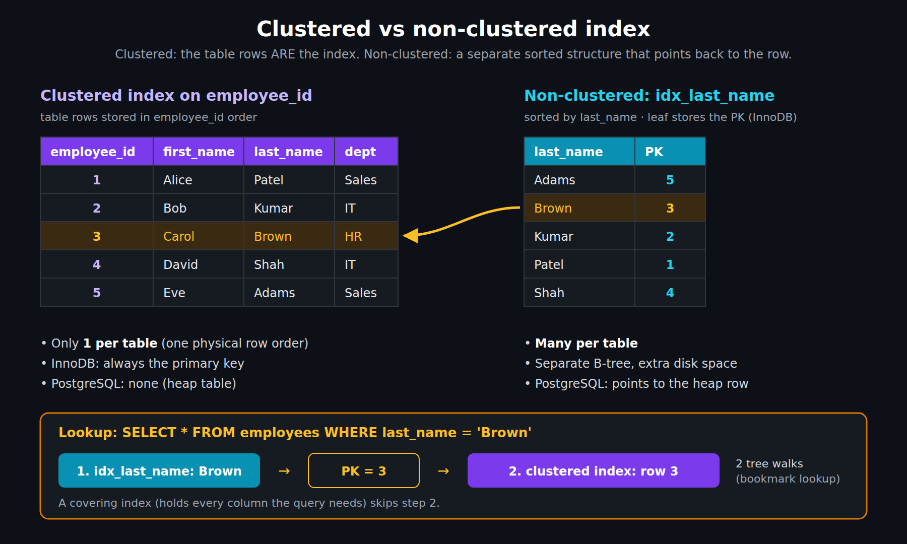

5. **Full-Text and Composite indexes** — 📎 **see [`02_Database_Design_and_Internals_Interview_Questions.md`](https://github.com/vikas9dev/system-design/blob/main/iq/02_Database_Design_and_Internals_Interview_Questions.md) Q2** for the full list (B-tree, hash, composite, covering, partial, full-text/GIN, spatial, expression) and for composite column ordering. Two engine notes to remember here:

- You query MySQL's `FULLTEXT` with `MATCH … AGAINST`. A leading-wildcard `LIKE '%foo%'` cannot use a normal B-tree index. (PostgreSQL can speed it up with a `pg_trgm` GIN index.)
- **PostgreSQL has no `FULLTEXT` type at all.** It uses a GIN index over a `tsvector`, queried with `@@`.

📝 **Summary — the four this file owns:**

- 🔑 **Primary Key Index**: Ensures primary key uniqueness and quick access.
- 🎯 **Unique Index**: Ensures column value uniqueness.
- 📦 **Clustered Index**: The table's rows *are* the index leaves. Mandatory in InnoDB, optional in SQL Server, absent in PostgreSQL.
- 📋 **Non-Clustered Index**: Logical ordering with pointers (in InnoDB, the pointer is the primary key).

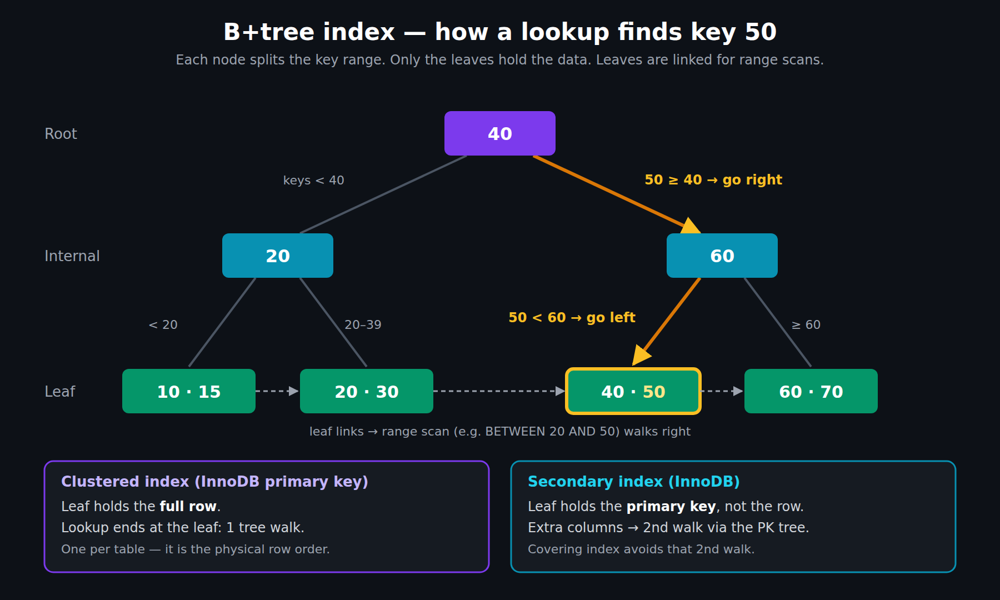

---

</details>

---

6. **❓ Difference between ISNULL() and IFNULL()? 💤**

<!-- -->
<details>
<summary>Answer</summary>

**Answer:**

- 🔍 `ISNULL(expression)`: Checks if an expression is NULL. Returns 1 if true, 0 otherwise.
- 🔄 `IFNULL(expression, replacement)`: Replaces NULL values with a specified replacement value.

```sql
-- ISNULL Example
SELECT
    employee_id,
    first_name,
    ISNULL(manager_id) AS is_manager_id_null
FROM
    employees;

-- IFNULL Example
SELECT
    employee_id,
    first_name,
    IFNULL(manager_id, 'No Manager') AS manager_id
FROM
    employees;
```

| Feature | ISNULL() 🅰️ | IFNULL() 🅱️ |
|---------|------------|------------|
| **Purpose** | Checks for NULL | Replaces NULL |
| **Returns** | `1` (true) or `0` (false) | The replacement value |
| **Parameters** | 1 parameter | 2 parameters |

💡 **Pro Tip:** In SQL Server, `ISNULL()` behaves like MySQL's `IFNULL()`. It takes two parameters and returns a replacement value. So check which database you are working with.

```sql
SELECT COALESCE(manager_id, department_id, -1) AS fallback_id FROM employees;
```

| Engine | Two-arg NULL replacement | ANSI equivalent |
|---|---|---|
| MySQL | `IFNULL(x, y)` | `COALESCE(x, y)` |
| SQL Server | `ISNULL(x, y)` | `COALESCE(x, y)` |
| Oracle | `NVL(x, y)` | `COALESCE(x, y)` |
| PostgreSQL | *(none)* | `COALESCE(x, y)` |

Use `COALESCE` by default. Use the dialect function only when you need its special type-conversion behaviour.

The opposite function is **`NULLIF(a, b)`**. It returns `NULL` when `a = b`, otherwise `a`. The common use is to avoid divide-by-zero: `SELECT total / NULLIF(cnt, 0)` gives `NULL`, not an error, when `cnt` is 0.

---

</details>

---

7. **🕳️ Explain SQL's three-valued logic. Why does `NOT IN` with a NULL return nothing? 🔥🔥**

<!-- -->
<details>
<summary>Answer</summary>

**Answer:**

SQL is **not** two-valued Boolean logic. Every predicate gives one of **three** values: `TRUE`, `FALSE`, or `UNKNOWN`. `NULL` is what produces `UNKNOWN`.

`NULL` does not mean "zero" or "empty string". It means **"the value is not known"**. You cannot answer a question about an unknown value.

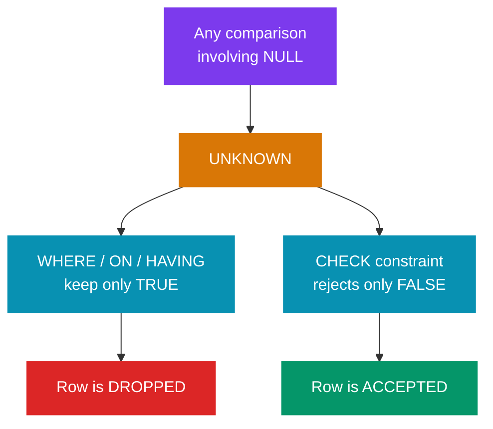

> The single sentence to remember: **`WHERE` keeps only `TRUE`; a `CHECK` constraint rejects only `FALSE`.** So in a query, `UNKNOWN` silently *removes* the row. In a constraint, `UNKNOWN` silently *lets the row in*. Same value, opposite results.

**1️⃣ `NULL` is never equal to anything, including itself**

```sql
SELECT NULL = NULL;      -- NULL (i.e. UNKNOWN), NOT 1
SELECT NULL <> NULL;     -- NULL, NOT 1
SELECT NULL = 5;         -- NULL
SELECT NULL IS NULL;     -- 1  ✅ the only way to test for NULL
SELECT NULL <=> NULL;    -- 1  ✅ MySQL's NULL-safe equality operator
```

`WHERE manager_id = NULL` matches **zero rows**. It does not match "the rows with no manager". You must write `WHERE manager_id IS NULL`. PostgreSQL's equivalent of `<=>` is `IS NOT DISTINCT FROM`.

**2️⃣ 🔥 The main trap: `NOT IN` with a NULL in the subquery returns an empty set**

```sql
-- Intent: departments that have no employees assigned.
-- Employee 9 has department_id = NULL — so this returns ZERO ROWS.
SELECT department_id, department_name
FROM departments
WHERE department_id NOT IN (SELECT department_id FROM employees);   -- ❌️ empty
```

**Why.** `x NOT IN (a, b, NULL)` expands to `x <> a AND x <> b AND x <> NULL`.

- That last term is always `UNKNOWN`.
- `TRUE AND UNKNOWN = UNKNOWN`. So the whole predicate can never be `TRUE`.
- The best case is `UNKNOWN`, and `WHERE` drops it.

**One NULL anywhere in the subquery result empties the entire query result.**

Note the difference: **`IN` is safe, `NOT IN` is not.** `x IN (a, NULL)` still returns `TRUE` when `x = a`, because `TRUE OR UNKNOWN = TRUE`.

✅ **Three fixes, best first:**

```sql
-- ✅ 1. NOT EXISTS — immune to NULLs, and usually the fastest plan (anti-join)
SELECT d.department_id, d.department_name
FROM departments d
WHERE NOT EXISTS (
    SELECT 1 FROM employees e WHERE e.department_id = d.department_id
);

-- ✅ 2. LEFT JOIN … IS NULL — the anti-join written by hand
SELECT d.department_id, d.department_name
FROM departments d
LEFT JOIN employees e ON e.department_id = d.department_id
WHERE e.employee_id IS NULL;

-- ⚠️ 3. Keep NOT IN but exclude NULLs explicitly — works, but fragile:
--        it breaks again the day someone drops the NOT NULL guard.
SELECT department_id, department_name
FROM departments
WHERE department_id NOT IN (
    SELECT department_id FROM employees WHERE department_id IS NOT NULL
);
```

`NOT EXISTS` works because it asks "did the subquery produce **any row**?". That is a question about whether a row exists. It never compares values, so `UNKNOWN` never appears.

**3️⃣ `COUNT(col)` vs `COUNT(*)` — and why `AVG ≠ SUM / COUNT(*)`**

```sql
-- 12 employees; employee 9 has department_id = NULL
SELECT
    COUNT(*)                   AS total_rows,        -- 12  — counts ROWS
    COUNT(department_id)        AS non_null_depts,    -- 11  — skips NULLs
    COUNT(DISTINCT department_id) AS distinct_depts,  --  6  — skips NULLs too
    COUNT(1)                   AS also_rows          -- 12  — identical to COUNT(*)
FROM employees;
```

- `COUNT(*)` counts **rows**. `COUNT(col)` counts **non-NULL values of that column**. `COUNT(1)` / `COUNT('x')` are the same as `COUNT(*)`. Many people believe `COUNT(1)` is faster. That is false in both MySQL and PostgreSQL.
- **The standard aggregates (`SUM`, `AVG`, `MIN`, `MAX`) silently ignore NULLs too.** (A few collectors keep them, for example PostgreSQL's `array_agg` and `json_agg`.) So `AVG(salary)` = `SUM(salary) / COUNT(salary)`, **not** `SUM(salary) / COUNT(*)`. If you want NULLs treated as zero, write it: `AVG(COALESCE(salary, 0))`.
- `SUM()` over zero rows (or all-NULL rows) returns **`NULL`, not 0**. Wrap it: `COALESCE(SUM(x), 0)`. `COUNT()` over zero rows correctly returns `0`.
- `MIN`/`MAX` ignore NULLs entirely.

**4️⃣ `GROUP BY`, `DISTINCT` and `UNION` treat NULLs as equal — `=` does not**

This difference in rules confuses many people. For *grouping and deduplication*, SQL uses "not distinct from" rules. Under these rules, two NULLs **are** the same:

```sql
SELECT department_id, COUNT(*)
FROM employees
GROUP BY department_id;      -- all NULL-department rows collapse into ONE group
```

Same for `SELECT DISTINCT`, `UNION` dedup, and `PARTITION BY`. But `WHERE a = b` on the same two NULLs is `UNKNOWN`.

📌 **The sentence to have ready: SQL runs *two different equality rules*. The interviewer is really testing if you know which rule applies where.**

| | **Comparison equality** (`=`) | **Grouping equality** ("not distinct from") |
|---|---|---|
| **Used by** | `WHERE`, `ON`, `HAVING`, `CHECK`, `IN`/`NOT IN` | `GROUP BY`, `DISTINCT`, `UNION`/`INTERSECT`/`EXCEPT` dedup, `PARTITION BY` |
| **Two NULLs are…** | ❌️ **never** equal — the result is `UNKNOWN` | ✅ **the same** — they collapse into one group/row |
| **Spelled explicitly as** | `a = b` | `a IS NOT DISTINCT FROM b` (PostgreSQL) · `a <=> b` (MySQL) |

In the *same query*, the same NULLs are "all different" to a `WHERE` clause and "all identical" to a `GROUP BY`. That is not a bug. It is two rules, chosen on purpose. `UNIQUE` constraints follow the **comparison** rule. That is exactly why a `UNIQUE` column accepts many NULLs (see §2 Q2).

**5️⃣ NULL sort order is different between engines**

```sql
SELECT first_name, manager_id FROM employees ORDER BY manager_id ASC;
```

| Engine | `ORDER BY col ASC` | `ORDER BY col DESC` | Override |
|---|---|---|---|
| **MySQL**, SQL Server | NULLs **first** (NULL sorts lowest) | NULLs last | `ORDER BY col IS NULL, col` |
| **PostgreSQL**, Oracle | NULLs **last** (NULL sorts highest) | NULLs first | `ORDER BY col NULLS FIRST/LAST` |

MySQL has no `NULLS FIRST`/`NULLS LAST` clause. Use the `ORDER BY col IS NULL, col` trick to force the order. The boolean sorts `0` before `1`.

**6️⃣ NULL in an outer join — and the `ON` vs `WHERE` trap**

An outer join *creates* NULLs for the unmatched side. Say you put a predicate on those created columns in `WHERE` instead of `ON`. Then your `LEFT JOIN` silently becomes an `INNER JOIN`:

```sql
-- ❌️ Not what you asked for: WHERE runs AFTER the join, and NULL >= date is UNKNOWN,
--    so every unmatched employee is discarded → this is now an INNER JOIN.
SELECT e.employee_id
FROM employees e
LEFT JOIN leaves l ON e.employee_id = l.employee_id
WHERE l.leave_date >= CURRENT_DATE - INTERVAL '6 months';

-- ✅ Predicate belongs in ON: it filters what is eligible to match,
--    and unmatched employees survive with NULL columns.
SELECT e.employee_id, l.leave_date
FROM employees e
LEFT JOIN leaves l
       ON e.employee_id = l.employee_id
      AND l.leave_date >= CURRENT_DATE - INTERVAL '6 months';

-- ✅ Anti-join variant — "employees who took NO leave in the last 6 months".
--    Same ON clause, plus an IS NULL filter on the optional side.
SELECT e.employee_id
FROM employees e
LEFT JOIN leaves l
       ON e.employee_id = l.employee_id
      AND l.leave_date >= CURRENT_DATE - INTERVAL '6 months'
WHERE l.leave_id IS NULL;
```

> 🐬 **MySQL 8:** `CURRENT_DATE` is identical, but the interval arithmetic is not. Write `DATE_SUB(CURRENT_DATE, INTERVAL 6 MONTH)` or `CURRENT_DATE - INTERVAL 6 MONTH`. MySQL's `INTERVAL` is an unquoted keyword expression. PostgreSQL's is a quoted literal (`INTERVAL '6 months'`). See [§6](#6-dialect-divergences--mysql--postgresql).

**Rule:** on an outer join:

- A condition on the **inner (optional) side** goes in `ON`.
- A condition on the **preserved side** may go in `WHERE`.

On an `INNER JOIN`, the two positions give the same result.

**7️⃣ Other NULL behaviours worth one line each**

| Behaviour | Result |
|---|---|
| `CHECK (age >= 18)` with `age = NULL` | ✅ **Passes** — a CHECK rejects only `FALSE`, not `UNKNOWN`. Add `NOT NULL` if you mean it. |
| `UNIQUE` column with several NULLs | ✅ Allowed (except SQL Server) — NULLs never collide. See §2 Q2. |
| `CONCAT('a', NULL)` | MySQL: **`NULL`**. PostgreSQL and SQL Server `CONCAT()` skip NULLs and return `'a'`. PostgreSQL's `'a' || NULL` returns `NULL`. Oracle's `||` treats NULL as `''` and returns `'a'`. |
| `NULL + 1`, `NULL * 0` | `NULL` — arithmetic propagates NULL, always. |
| `CASE WHEN x = NULL THEN …` | Never matches. Use `WHEN x IS NULL`. |
| `'' = NULL` | `NULL`. Empty string is a *value*; NULL is the absence of one. (Oracle is the exception — it stores `''` as NULL.) |

🎯 **Interview Tip:** Say this one line to show you understand it: *"`NULL` isn't a value, it's the absence of one — so any comparison with it is `UNKNOWN`, and `WHERE` keeps only `TRUE`. That's why `NOT IN` over a nullable column returns nothing and why I reach for `NOT EXISTS` by default."*

<details>
<summary><strong>🤔 Doubt: Is `NOT EXISTS` always the right choice over `NOT IN`, or is that just NULL-safety?</strong></summary>

It is both. The performance part is worth knowing on its own.

**Correctness:** `NOT EXISTS` is always NULL-safe. `NOT IN` is not. That alone decides the default.

**Performance:**

- The optimizer sees `NOT EXISTS` as an **anti-join** (return rows with no match). It can pick a hash or merge anti-join plan.
- `NOT IN` over a *nullable* column cannot become a clean anti-join. The engine must keep the "one NULL removes everything" behaviour. This usually makes it a slower materialised subquery (its result saved in a temporary table) or a row-by-row check.
- Declare the column `NOT NULL`, and MySQL 8.0.17+ will rewrite `NOT IN` into an anti-join too. The chance of a NULL is what blocks the rewrite. PostgreSQL never rewrites `NOT IN (subquery)` into an anti-join. At best it uses a hashed subplan.

**The one place `NOT IN` is still better:** a small, hardcoded literal list, like `WHERE status NOT IN ('CLOSED', 'REJECTED')`. There is no subquery and no NULL, so nothing can go wrong. It also reads better than the other forms.

**And `LEFT JOIN … IS NULL`?** It means the same as `NOT EXISTS`. Modern optimizers give it the same anti-join plan. Still, prefer `NOT EXISTS` because it shows intent clearly:

- It says "absence" directly.
- It cannot multiply rows if the join key is not unique.

---

</details>
<br/>

---

</details>

---

<a id="sql-joins-and-relationships"></a>

## 3. SQL Joins and Relationships

1. **🔗 Explain all types of joins in SQL. 🔥🔥**

<!-- -->
<details>
<summary>Answer</summary>

**Answer:**

**① The four matching joins. They differ only in which side keeps its unmatched rows:**

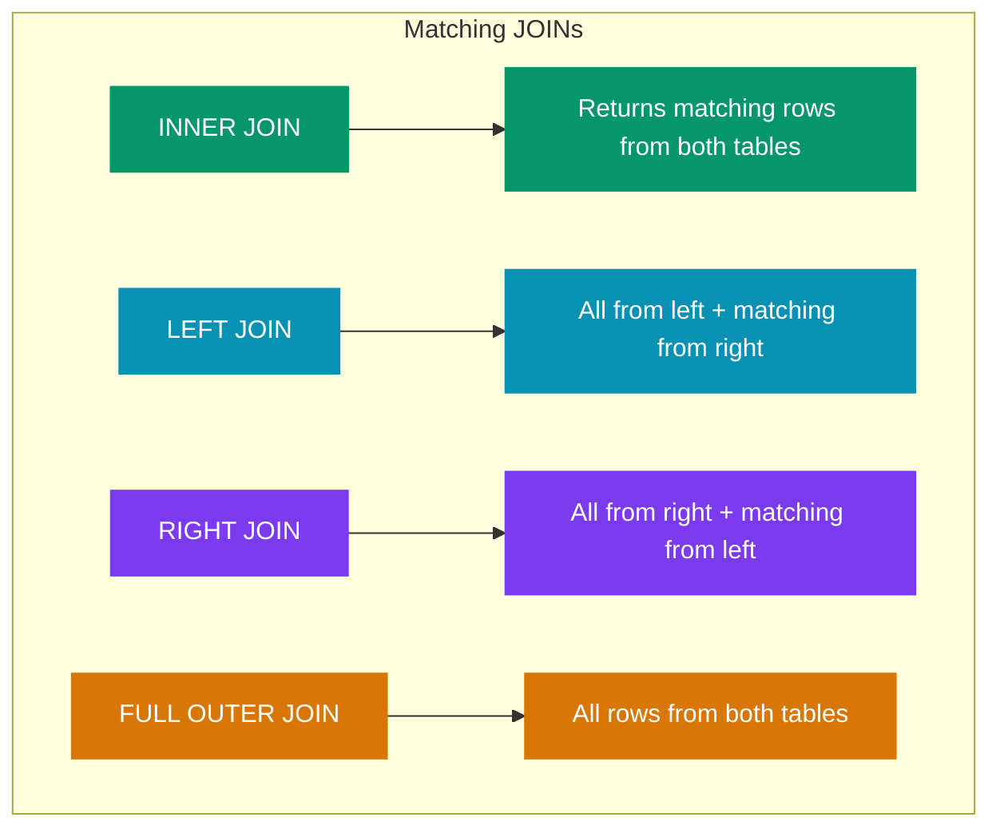

**② The two special joins. One has no ON predicate; the other uses the same table on both sides:**

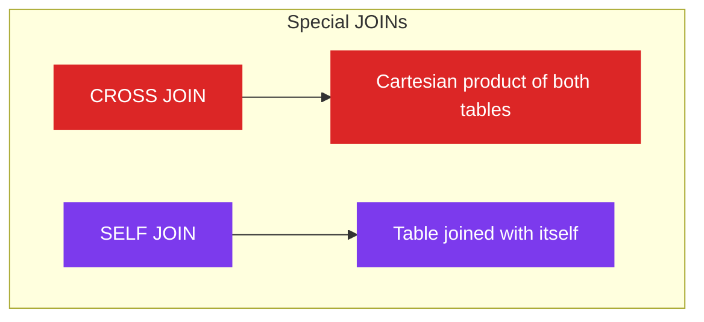

> Diagram ① shows the joins you choose between based on **row retention** (which unmatched rows they keep).  
> Diagram ② shows the two that do not follow the usual pattern:
> - `CROSS` has no join predicate at all.
> - `SELF` uses one table under two aliases.

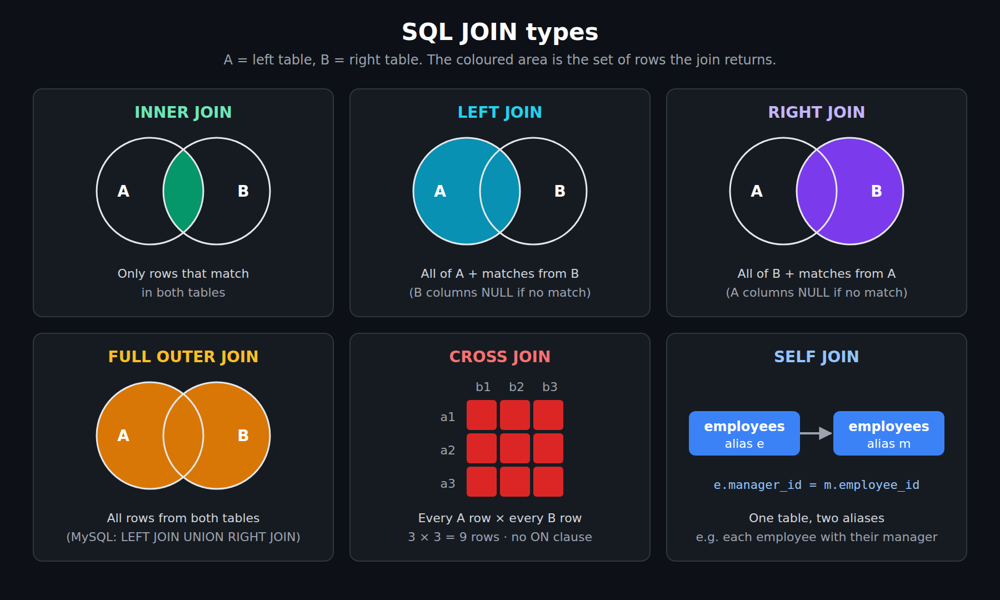

**1. Inner Join:** Returns records that have matching values in both tables.

```sql
-- Syntax
SELECT a.*, b.*
FROM table_a a
INNER JOIN table_b b ON a.common_column = b.common_column;

-- Example
SELECT e.first_name, d.department_name
FROM employees e
INNER JOIN departments d
ON e.department_id = d.department_id;
```

**2. Left (Outer) Join:** Returns all records from the left table and the matched records from the right table. Unmatched records from the left table are also included.

```sql
-- Syntax
SELECT a.*, b.*
FROM table_a a
LEFT JOIN table_b b ON a.common_column = b.common_column;

-- Example
SELECT e.first_name, d.department_name
FROM employees e
LEFT JOIN departments d
ON e.department_id = d.department_id;
```

**3. Right (Outer) Join:** Returns all records from the right table and the matched records from the left table. Unmatched records from the right table are also included.

```sql
-- Syntax
SELECT a.*, b.*
FROM table_a a
RIGHT JOIN table_b b ON a.common_column = b.common_column;

-- Example
SELECT e.first_name, d.department_name
FROM employees e
RIGHT JOIN departments d
ON e.department_id = d.department_id;
```

**4. Full (Outer) Join:** Returns all records when there is a match in either left or right table. Unmatched records from both tables are included.

```sql
-- Syntax
SELECT a.*, b.*
FROM table_a a
FULL OUTER JOIN table_b b ON a.common_column = b.common_column;

-- Example (PostgreSQL / SQL Server / Oracle — MySQL has no FULL OUTER JOIN, see note)
SELECT e.first_name, d.department_name
FROM employees e
FULL OUTER JOIN departments d ON e.department_id = d.department_id;
```

⚠️ **Note:** **MySQL** does not support the `FULL OUTER JOIN` clause. Most modern RDBMS support it (PostgreSQL, SQL Server, Oracle, SQLite). In MySQL, you can get the same result with `LEFT JOIN` `UNION` `RIGHT JOIN`. One trap: `UNION` also removes real duplicate rows. If the data can have them, use `UNION ALL` and keep only the unmatched rows in the second part (`WHERE a.common_column IS NULL`):

```sql
-- Simulating FULL OUTER JOIN in MySQL
SELECT a.column1, b.column2
FROM table1 a
LEFT JOIN table2 b ON a.common_column = b.common_column

UNION

SELECT a.column1, b.column2
FROM table1 a
RIGHT JOIN table2 b ON a.common_column = b.common_column;
```

**5. Cross Join:** Returns the Cartesian product of both tables, meaning it returns all possible combinations of rows.

```sql
-- Syntax
SELECT a.*, b.*
FROM table_a a
CROSS JOIN table_b b;

-- Example
SELECT e.first_name, d.department_name
FROM employees e
CROSS JOIN departments d;
```

**6. Self Join:** A self join is a normal join where the table is joined with itself.

```sql
-- Syntax
SELECT a.*, b.*
FROM table_a a
INNER JOIN table_a b ON a.common_column = b.common_column;

-- Example: Show employees and their managers
SELECT e1.first_name AS employee_name, e2.first_name AS manager_name
FROM employees e1
INNER JOIN employees e2
ON e1.manager_id = e2.employee_id;
```

📝 **Summary:**

- 🔗 **Inner Join**: Matches records in both tables.
- ◀️ **Left Join**: All records from the left table and matched records from the right.
- ▶️ **Right Join**: All records from the right table and matched records from the left.
- ↔️ **Full Join**: All records when there is a match in either left or right table.
- ✖️ **Cross Join**: Cartesian product of both tables.
- 🔄 **Self Join**: Table joined with itself.

---

</details>

---

2. **↔️ Difference between INNER JOIN and OUTER JOIN? 🔥🔥**

<!-- -->
<details>
<summary>Answer</summary>

**Answer:**

`INNER JOIN` returns only the rows that match in both tables. `OUTER JOIN` returns all rows from one or both tables, plus the matched rows. If a row has no match, NULL values fill the columns of the missing side.

| Feature | INNER JOIN 🅰️ | OUTER JOIN 🅱️ |
|---------|-------------|-------------|
| **Matching rows** | ✅ Only matched rows | ✅ Matched + unmatched rows |
| **NULL handling** | ❌️ Excludes non-matching | ✅ Includes with NULLs |
| **Types** | Single type | LEFT, RIGHT, FULL |

- 🔗 **INNER JOIN**: Only returns rows with matching data in both tables.
- ◀️ **LEFT JOIN**: Returns all rows from the left table, with matched rows from the right table (NULL if no match).
- ▶️ **RIGHT JOIN**: Returns all rows from the right table, with matched rows from the left table (NULL if no match).
- ↔️ **FULL JOIN**: Returns all rows from both tables, with matched rows and NULLs where there is no match.

🧠 **In Simple Words:** INNER JOIN is like finding common friends between two people. OUTER JOIN is like listing all friends of one or both people. It marks "unknown" for the friends the other person doesn't know.

---

</details>

---

3. **🔄 Difference between UNION and UNION ALL. 🔥**

<!-- -->
<details>
<summary>Answer</summary>

**Answer:**

**1. UNION:**

- 🎯 **Purpose**: Combines the results of two or more SELECT statements into a single result set, removing duplicates.
- 🚫 **Duplicates**: Removes duplicate rows from the result set.
- 📋 **Use Case**: When you need to combine results and ensure there are no duplicate rows.

```sql
-- Syntax
SELECT column1, column2 FROM table1
UNION
SELECT column1, column2 FROM table2;

-- Example: every distinct department id known to either table
SELECT department_id FROM employees
UNION
SELECT department_id FROM departments;
```

⚠️ **`UNION` removes duplicates using grouping equality, so it merges all NULLs into one row** (employee 9 has a NULL `department_id`). This happens even though `NULL = NULL` is UNKNOWN. `GROUP BY`/`DISTINCT` follow the same rule; see §2 Q7.

**2. UNION ALL:**

- 🎯 **Purpose**: Combines the results of two or more SELECT statements into a single result set, including duplicates.
- ✅ **Duplicates**: Does not remove duplicate rows; all rows from each SELECT statement are included.
- 📋 **Use Case**: When you need to combine results and can accept duplicates, for better performance.

```sql
-- Syntax
SELECT column1, column2 FROM table1
UNION ALL
SELECT column1, column2 FROM table2;

-- Example: every department id from both tables, duplicates retained
SELECT department_id FROM employees
UNION ALL
SELECT department_id FROM departments;
```

| Feature | UNION 🅰️ | UNION ALL 🅱️ |
|---------|---------|-------------|
| **Duplicates** | ❌️ Removed | ✅ Kept |
| **Performance** | 🐢 Slower (sort/hash to dedup) | ⚡ Faster (straight concatenation) |
| **Use case** | Need unique results | Need all results |

💡 **Default to `UNION ALL`.** `UNION` always runs a full sort or hash pass to remove duplicates. It does this even when you can prove the two branches cannot overlap. That is the common case. Use plain `UNION` only when you really need duplicates removed.

📝 **Rules both share:**

- Every branch must have the **same number of columns with compatible types**.
- The result column names come from the **first** `SELECT`.
- A single `ORDER BY` at the very end applies to the whole union (not to individual branches).

🧩 **Siblings:** `INTERSECT` (rows in both) and `EXCEPT` / Oracle's `MINUS` (rows in the first but not the second) complete the group of set operators. PostgreSQL, Oracle and SQL Server have had them for years. **MySQL only added `INTERSECT`/`EXCEPT` in 8.0.31.** Before that, you get the same results with `INNER JOIN` (for `INTERSECT`) and `NOT EXISTS` (for `EXCEPT`).

---

</details>

---

4. **🕸️ What are the various types of relationships in SQL? ⚡**

<!-- -->
<details>
<summary>Answer</summary>

**Answer:**

In SQL, you define relationships between tables to keep data integrity and to make it easier to query related data.

**1. One-to-One (1:1) Relationship:** Each row in Table A is linked to one and only one row in Table B, and vice versa.

```sql
CREATE TABLE employees (
    employee_id INT PRIMARY KEY,
    name VARCHAR(50)
);

CREATE TABLE employee_details (
    detail_id INT PRIMARY KEY,
    employee_id INT UNIQUE,   -- UNIQUE makes it 1:1; without it, this is 1:N
    address VARCHAR(100),
    FOREIGN KEY (employee_id) REFERENCES employees(employee_id)
);
```

**2. One-to-Many (1:N) Relationship:** Each row in Table A can be linked to multiple rows in Table B, but each row in Table B is linked to only one row in Table A.

```sql
CREATE TABLE departments (
    department_id INT PRIMARY KEY,
    department_name VARCHAR(50)
);

CREATE TABLE employees (
    employee_id INT PRIMARY KEY,
    name VARCHAR(50),
    department_id INT,
    FOREIGN KEY (department_id) REFERENCES departments(department_id)
);
```

**3. Many-to-One (N:1) Relationship:** Each row in Table B can be linked to multiple rows in Table A, but each row in Table A is linked to only one row in Table B (this is simply One-to-Many seen from the other side).

**4. Many-to-Many (N:N) Relationship:** Each row in Table A can be linked to multiple rows in Table B, and vice versa. You usually build this relationship with a junction table (a third table that holds pairs of keys).

```sql
CREATE TABLE students (
    student_id INT PRIMARY KEY,
    student_name VARCHAR(50)
);

CREATE TABLE courses (
    course_id INT PRIMARY KEY,
    course_name VARCHAR(50)
);

CREATE TABLE student_courses (
    student_id INT,
    course_id INT,
    PRIMARY KEY (student_id, course_id),
    FOREIGN KEY (student_id) REFERENCES students(student_id),
    FOREIGN KEY (course_id) REFERENCES courses(course_id)
);
```

**5. Self-Referencing Relationship:** A table has a foreign key that references its own primary key. This is useful for hierarchical data.

```sql
CREATE TABLE employees (
    employee_id INT PRIMARY KEY,
    name VARCHAR(50),
    manager_id INT,
    FOREIGN KEY (manager_id) REFERENCES employees(employee_id)
);
```

**① Cardinalities modelled with a plain foreign key (no extra table needed):**

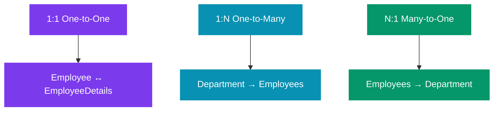

**② Cardinalities that need special modelling — a junction table, or an FK back to the same table:**

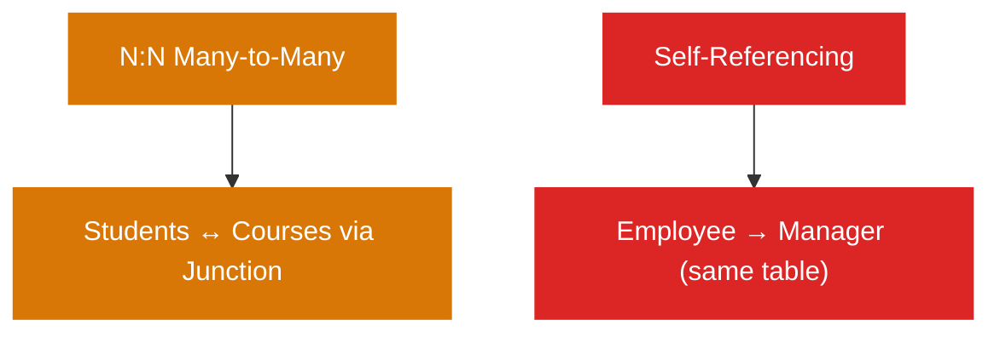

> 1:N and N:1 in ① are the *same* relationship, read from opposite ends.  
> Interviewers ask more questions about the two in ②:
> - N:N needs a third table.
> - Self-referencing needs a nullable FK plus a recursive CTE to walk the tree.

**🌳 Traversing the self-reference — `WITH RECURSIVE`**

The `manager_id → employee_id` self-FK above forms a tree. The follow-up question is always *"now print the whole org chart under employee 1"*. A plain join gives you only one level. For any depth, you need a **recursive CTE** (MySQL 8.0+, PostgreSQL, SQL Server, Oracle 11gR2+). SQL Server and Oracle write plain `WITH`, without the `RECURSIVE` keyword:

```sql
WITH RECURSIVE org_chart AS (
    -- ⚓ Anchor: the root(s) of the tree
    SELECT employee_id, first_name, manager_id, 1 AS depth
    FROM employees
    WHERE manager_id IS NULL

    UNION ALL

    -- 🔁 Recursive step: join the previous level back to the table
    SELECT e.employee_id, e.first_name, e.manager_id, oc.depth + 1
    FROM employees e
    JOIN org_chart oc ON e.manager_id = oc.employee_id
    WHERE oc.depth < 20                     -- 🛡️ cycle guard
)
SELECT depth, employee_id, first_name FROM org_chart ORDER BY depth, employee_id;
```

**Four things interviewers check here:**
- 🔑 The **anchor + `UNION ALL` + self-reference** structure. Use `UNION ALL`, not `UNION`. `UNION` would remove duplicates on every iteration, and it is almost always wrong.
- 🛡️ A **termination guard**. Real hierarchy data has cycles (for example, a manager loop from a bad import). A recursive CTE without a guard keeps looping. It stops only when it hits `cte_max_recursion_depth` (MySQL, default 1000), or it runs forever. A `depth` column with a limit is the cheap fix.
- 🔁 The recursive branch must reference the CTE **exactly once**. It cannot use aggregates. It cannot put the CTE on the right side of a `LEFT JOIN`. MySQL also forbids `GROUP BY` and window functions there. PostgreSQL allows both.
- ⬆️ **Reverse the join to walk upward** (`ON oc.manager_id = e.employee_id`). This gives an employee's full management chain instead of their subtree.

📝 **Summary:**

- 🔗 **One-to-One**: Each row in one table is linked to one row in another table.
- 📊 **One-to-Many**: One row in a table is linked to multiple rows in another table.
- 🔄 **Many-to-One**: Multiple rows in one table are linked to one row in another table.
- 🏗️ **Many-to-Many**: Multiple rows in one table are linked to multiple rows in another table via a junction table.
- 🔁 **Self-Referencing**: A table references itself, useful for hierarchical relationships.

---

</details>

---

5. **🗝️ Explain the key taxonomy: Candidate, Primary, Composite, Surrogate vs Natural, Foreign. ⚡**

<!-- -->
<details>
<summary>Answer</summary>

**Answer:**

> 📌 The textbook term **"secondary key"** appears in DBMS courses, but almost never in an interview.  
> Interviewers ask about the taxonomy below instead.  
> If someone does say "secondary key", they mean one of two things:
> - a *non-primary candidate key*, or
> - in MySQL's own words, simply **a non-clustered (secondary) index**.

**1. Super Key** — any set of columns that uniquely identifies a row, including sets with extra columns that are not needed. `(employee_id)`, `(employee_id, first_name)` and `(employee_id, salary)` are all super keys. It is mostly a step toward the next definition.

**2. Candidate Key** — a **minimal** super key. It is unique and non-nullable, and you cannot remove any column without losing uniqueness. A table can have several. For `employees`, both `employee_id` and (say) a `national_id_number` would qualify.

**3. Primary Key** — the **one candidate key you choose** as the row's identity. All the others become **alternate keys**, enforced with `UNIQUE`.

```sql
CREATE TABLE employees (
    employee_id       INT PRIMARY KEY,            -- chosen candidate key
    national_id_number VARCHAR(20) NOT NULL UNIQUE, -- alternate key
    first_name        VARCHAR(50),
    last_name         VARCHAR(50)
);
```

**4. Composite (Compound) Key** — a primary key spanning **more than one column**. Standard for junction tables:

```sql
CREATE TABLE student_courses (
    student_id INT,
    course_id  INT,
    PRIMARY KEY (student_id, course_id)   -- composite
);
```

⚠️ Column order in a composite PK **matters**. It also defines the clustered index. So the leftmost-prefix rule (see [`02_Database_Design_and_Internals_Interview_Questions.md`](https://github.com/vikas9dev/system-design/blob/main/iq/02_Database_Design_and_Internals_Interview_Questions.md) Q2) decides which queries it can serve.

**5. Surrogate vs Natural Key** — the design decision interviewers really want to hear you discuss.

> 📎 **Full comparison in [`02_Database_Design_and_Internals_Interview_Questions.md`](https://github.com/vikas9dev/system-design/blob/main/iq/02_Database_Design_and_Internals_Interview_Questions.md) — Q21**. It covers auto-increment vs UUID as the surrogate, shard hotspots, and why you must never expose sequential ids in a public API.

✅ **The answer you can defend:** use a **surrogate primary key** for identity and stability. Add a **`UNIQUE` constraint on the natural key**, so the database still enforces the business rule. You get both benefits. You just do not use the natural key as the join target.

⚠️ **The UUID footnote** (a very common follow-up): a random UUIDv4 as an InnoDB primary key destroys insert locality (new rows no longer go to nearby pages). The reason: InnoDB stores the clustered index in PK order, and random keys spread writes across the whole B-tree. Fixes:

- use a time-ordered UUIDv7/ULID, or
- if you use MySQL's own `UUID()` (a time-based UUIDv1), store it as `BINARY(16)` with MySQL 8's `UUID_TO_BIN(uuid, 1)` swap-flag. The flag moves the timestamp bytes to the front so the keys increase (monotonic). It does not help a random UUIDv4, which has no timestamp.

**6. Foreign Key** — a column that references a candidate key in another (or the same) table. It is the *only* key type that is not about uniqueness at all. It is about **referential integrity**.

---

</details>

---

6. **🔍 What is the difference between SUBQUERY and JOIN? 🔥🔥**

<!-- -->
<details>
<summary>Answer</summary>

**Answer:**

**1. SUBQUERY:**

- 📖 **Definition**: A query placed inside another query. It can return data that the main query then uses.
- ⚙️ **Usage**: Commonly used in `SELECT`, `INSERT`, `UPDATE`, and `DELETE` statements. It gives a result set to the outer query.

```sql
-- Syntax
SELECT column1
FROM table1
WHERE column2 = (SELECT column2
                 FROM table2
                 WHERE condition);

-- Example
SELECT first_name
FROM employees
WHERE department_id = ( SELECT department_id
                       FROM departments
                       WHERE department_name = 'HR'
);
```

- 🐢 **Performance**: Can be slower than joins for large datasets. It may run the subquery once for each row of the outer query.

**2. JOIN:**

- 📖 **Definition**: Combines rows from two or more tables based on a related column between them.
- ⚙️ **Usage**: Used to get related data from many tables in a single query.

```sql
-- Syntax
SELECT a.column1, b.column2
FROM table1 a
JOIN table2 b ON a.common_column = b.common_column;

-- Example
SELECT e.first_name, e.last_name, d.department_name
FROM employees e
JOIN departments d ON e.department_id = d.department_id;
```

- ⚡ **Performance**: Generally faster than subqueries for large datasets. The database can combine tables and filter rows in a single pass.

| Feature | Subquery 🅰️ | JOIN 🅱️ |
|---------|------------|--------|
| **Approach** | Nested query | Table combination |
| **Performance** | 🐢 May be slower (large data) | ⚡ Generally faster |
| **Readability** | Can be complex | More straightforward |
| **Use case** | Query on result of another query | Combining related tables |
| **Types** | Correlated, non-correlated | INNER, LEFT, RIGHT, FULL |

🧠 **In Simple Words:**
- Subqueries are useful when you need to run a query on the result of another query.
- Joins are more efficient for combining and getting data from multiple tables.

<details>
<summary><strong>🤔 Doubt: What is a subquery's execution order? Doesn't it just run once, on its own, and give its result to the outer query?</strong></summary>

**That is correct for an *uncorrelated* subquery and wrong for a *correlated* one.** This difference explains the whole performance question. The "🐢 may execute the subquery for each row" note above applies only to the correlated case.

**1️⃣ Uncorrelated (independent) — evaluated once, as you expect:**

```sql
SELECT first_name FROM employees
WHERE department_id = (SELECT department_id FROM departments WHERE department_name = 'HR');
```

The inner query uses nothing from the outer one. So the engine:
- runs it **once**,
- puts the result in its place,
- runs the outer query against that constant.

**2️⃣ Correlated — cannot run first, because it depends on the outer row:**

```sql
SELECT e.first_name FROM employees e
WHERE e.salary > (SELECT AVG(salary) FROM employees WHERE department_id = e.department_id);
--                                                                        ^^^^^^^^^^^^^^^^
--                                                              outer column → correlated
```

`e.department_id` has no value until the engine reads an outer row. So, logically, the subquery is **re-evaluated once per outer row**. This is a nested loop. This is the form that performs badly.

**3️⃣ Position in the execution order depends on the clause.**
- A subquery in `WHERE` belongs to the `WHERE` step.
- A **derived table** (a subquery in `FROM`) belongs to the `FROM` step. So it is evaluated before anything else in the query.

⚠️ **The important warning: the optimizer rarely runs either form exactly as written.** Both engines **decorrelate** (rewrite the subquery so it no longer runs per row):
- `IN`/`EXISTS` become **semi-joins**.
- `NOT EXISTS` becomes an **anti-join**.
- Derived tables are merged into the outer query.

"Once per row" is the *semantics* (what the result means), not usually the *plan*. The main exception is `NOT IN (subquery)`. It must keep the "one NULL removes everything" rule. MySQL rewrites it into an anti-join only when both columns are declared `NOT NULL`. PostgreSQL 16 does not rewrite it at all. See [§2 Q7](#sql-constraints-and-data-types).

🔍 **How to see which one you really got — read the plan:**

| | 🐬 MySQL 8 `select_type` | 🐘 PostgreSQL plan node |
|---|---|---|
| Uncorrelated, evaluated once | `SUBQUERY` | `InitPlan` |
| **Correlated, per outer row** | **`DEPENDENT SUBQUERY`** ⚠️ | `SubPlan` |
| Rewritten into a join | *(no subquery row — a join appears)* | `Semi Join` / `Anti Join` |
| Derived table in `FROM` | `DERIVED` | `Subquery Scan` (or merged away) |

**`DEPENDENT SUBQUERY` in a MySQL plan is the warning sign.** It means the rewrite did not happen, and you pay the cost per outer row. Rewrite it as a `JOIN` or a derived table.

📌 **Two more points to say in an interview:**
- **`EXISTS` short-circuits.** It stops at the first matching row. It does not compute the full subquery result. This is why `EXISTS` is faster than `COUNT(*) > 0` for existence checks.
- **The "subqueries are slow" idea comes partly from history.** MySQL before 5.6 ran even an *uncorrelated* `IN (subquery)` as a dependent subquery. That is where "subqueries are slow" comes from. In 5.6+, semi-join optimization made `IN` subqueries almost as fast as joins.

---

</details>
<br/>

---

</details>

---

<a id="query"></a>

## 4. Query

1. **💰 Write a SQL query to find the second highest salary of an employee. 🔥🔥**

<!-- -->
<details>
<summary>Answer</summary>

**Answer:**

⚠️ **First, agree on what "second highest" means. This is the whole question.** With salaries `90000, 90000, 75000`, there are two meanings:

- **Second-highest distinct *salary* → `75000`.** This is what "2nd highest salary" means. LeetCode 176 and almost every interviewer expect this.
- **Second *row* when sorted by salary → `90000`.** This is a different question. It is almost never the one asked.

Say your assumption to the interviewer. Then write the query for the first meaning.

✅ **The answer to give — `DENSE_RANK()`. It is safe with ties, works across engines (MySQL 8+, not 5.7), and extends to nth:**

```sql
SELECT MAX(salary) AS second_highest_salary
FROM (
    SELECT salary,
           DENSE_RANK() OVER (ORDER BY salary DESC) AS sal_rank
    FROM employees
) ranked
WHERE sal_rank = 2;          -- change 2 → n for the nth highest
```

- `DENSE_RANK()` gives **tied salaries the same rank and leaves no gap**. So `sal_rank = 2` is the second *distinct* salary, no matter how many people share the top one. `RANK()` would be wrong here. With two people at 90000, it skips rank 2 completely and returns nothing.
- The outer `MAX()` does two jobs:
  - It reduces the (possibly many) rows at rank 2 to one value.
  - **It returns `NULL` when the subquery is empty.** This is the required output when the table has fewer than 2 distinct salaries.

❌️ **The version that fails the follow-up question — know why:**

```sql
-- ❌️ WRONG on two counts
SELECT *
FROM employees
ORDER BY salary DESC
LIMIT 1 OFFSET 1;
```

1. **Not safe with ties.** If two employees both earn the top salary, this returns *the second person at the highest salary*. It does not return the second-highest salary. `DISTINCT` cannot fix `SELECT *` either, because the other columns differ. You have to select the salary column alone.
2. **Returns the empty set, not `NULL`,** when the table has fewer than two rows.

✅ **Portable, no window functions** (works on MySQL 5.7 and very old engines, and is easy to explain in words). It means "the largest salary that is strictly smaller than the largest salary":

```sql
SELECT MAX(salary) AS second_highest_salary
FROM employees
WHERE salary < (SELECT MAX(salary) FROM employees);
```

The strict `<` makes it safe with ties. `MAX` over an empty set again gives `NULL`. But this does not extend past n = 2. For that, use `DENSE_RANK()`.

🔑 **Nth highest via `LIMIT`/`OFFSET` — here the two engines differ.**
- MySQL's `LIMIT`/`OFFSET` accept **only integer literals or placeholders, never an expression**. So `LIMIT 1 OFFSET n-1` is a *syntax error* on MySQL.
- PostgreSQL evaluates any integer expression there. So the same line parses fine:

```sql
-- 🐘 PostgreSQL: OFFSET takes an expression — this just works
SELECT DISTINCT salary FROM employees ORDER BY salary DESC
LIMIT 1 OFFSET (3 - 1);          -- 3rd highest

-- 🐬 MySQL 8: ❌️ LIMIT 1 OFFSET n-1 → does not parse.
-- ✅ Portable, and what you'd actually ship: the app computes n-1 and binds it
SELECT DISTINCT salary FROM employees ORDER BY salary DESC LIMIT 1 OFFSET ?;
```

Binding the offset from the application is the answer to give on both engines. It does not depend on the SQL dialect, and it is what you want in production code. (MySQL can also do it with a `PREPARE`/`EXECUTE` prepared statement, but nobody uses that in production code.)

Two details make this form fully correct, not just nearly correct:
- **`DISTINCT`** merges tied top salaries. So the offset skips a *salary*, not a *person*.
- Wrapping the whole query in a **scalar subquery** (`SELECT ( … ) AS second_highest_salary`) turns an empty result into `NULL` instead of zero rows.

These are exactly the two things the simple `LIMIT 1 OFFSET 1` above gets wrong.

🛠️ **If they ask for the *employees* earning the second-highest salary** (plural — everyone tied at that salary):

```sql
WITH ranked_salaries AS (
    SELECT employee_id, first_name, last_name, salary,
           DENSE_RANK() OVER (ORDER BY salary DESC) AS sal_rank
    FROM employees
)
SELECT employee_id, first_name, last_name, salary
FROM ranked_salaries
WHERE sal_rank = 2;
```

💡 **Pro Tip:** `DENSE_RANK()` is the safe default *because* it handles duplicate salaries correctly. This is exactly why the `LIMIT 1 OFFSET 1` one-liner is not the answer to give.

---

</details>

---

2. **🏢 Write a SQL query to find the top 3 departments with the highest average salary. 🔥🔥**

<!-- -->
<details>
<summary>Answer</summary>

**Answer:**

```sql
SELECT department_id, AVG(salary) AS avg_sal
FROM employees
GROUP BY department_id
ORDER BY avg_sal DESC
LIMIT 3;
```

⚠️ **This returns exactly 3 rows, and on a tie the row it picks is not defined.** If the 3rd and 4th departments have the same average salary, the one you get is undefined. It can change between runs. There are two fixes. **The correct one depends on what "top 3" means**:

✅ **1. Need exactly 3 rows → keep `LIMIT`, add a fixed tie-breaker:**

```sql
SELECT department_id, AVG(salary) AS avg_sal
FROM employees
GROUP BY department_id
ORDER BY avg_sal DESC, department_id ASC     -- ← reproducible, no longer arbitrary
LIMIT 3;
```

✅ **2. Must not silently drop a tied department → rank instead:**

```sql
WITH ranked_dept_sal AS (
    SELECT department_id,
           AVG(salary) AS avg_sal,
           DENSE_RANK() OVER (ORDER BY AVG(salary) DESC) AS sal_rank
    FROM employees
    GROUP BY department_id
)
SELECT department_id, avg_sal
FROM ranked_dept_sal
WHERE sal_rank <= 3;
```

📌 **This query shows two things that are worth knowing on their own:**
- **A window function may take an aggregate as its argument.** `OVER (ORDER BY AVG(salary) DESC)` is legal together with `GROUP BY`. This works because the database runs window functions **after** `GROUP BY`/`HAVING`. You do not need a nested subquery just to rank groups.
- **You must repeat `AVG(salary)`. `ORDER BY avg_sal` inside `OVER` does not work.** A window function cannot see the `SELECT` alias. The database computes the window function at the same step as the alias, not after it. See [§1 Q1](#sql-fundamentals).

| | `ORDER BY … LIMIT 3` | `DENSE_RANK() … WHERE sal_rank <= 3` |
|---|---|---|
| **Rows returned** | **Exactly 3**, always | **3 or more** — every department tied at rank 3 is returned |
| **On a tie** | ⚠️ Undefined winner (unless a tie-breaker is added) | ✅ Keeps all tied departments |
| **Cost** | Bounded top-N sort, can stop early | Must rank **every** group, then filter |
| **Answers** | "Give me three rows" | "Give me the top three salary *levels*" |

⚙️ **`DENSE_RANK` vs `RANK` is a real choice here.**
- `DENSE_RANK <= 3` returns the top 3 **distinct average values**.
- `RANK <= 3` returns the top 3 **positions**. So two departments tied at rank 1 use up ranks 1 and 2. You then see fewer distinct levels.

Use `ROW_NUMBER()` if you want exactly 3 rows *and* the window-function form.

🎯 **What to say in the interview:** say which meaning you picked. Do not just write a query. *"I'll return all departments in the top 3 salary levels so ties aren't dropped; if you need exactly three rows I'd use `LIMIT` with a tie-breaker."* Do not say "`LIMIT` is bad". It is the right tool when the requirement is a fixed row count.

---

</details>

---

3. **🏆 Find the highest-earning employee in each department. Show their id, name, and department. 🔥🔥**

<!-- -->
<details>
<summary>Answer</summary>

**Answer:** This is the **top-N-per-group** pattern (here N = 1). It is the most-asked SQL query pattern. The clean solution is a **window function**. It ranks rows *within each department*, then filters to the top.

```sql
WITH ranked AS (
    SELECT
        e.employee_id,
        e.first_name,
        d.department_name,
        RANK() OVER (PARTITION BY e.department_id ORDER BY e.salary DESC) AS rnk
    FROM employees e
    JOIN departments d ON e.department_id = d.department_id
)
SELECT employee_id, first_name, department_name
FROM ranked
WHERE rnk = 1;
```

🔑 **`PARTITION BY` is the key idea.** It restarts the ranking for each department. So `rnk = 1` gives the top earner *per department* (not one global top earner).

⚠️ **`RANK()` vs `ROW_NUMBER()` on ties:**

- **`RANK()`** → if two employees tie for the highest salary in a department, **both** are returned (both get `rnk = 1`). Use it when "highest earner(s)" should include ties.
- **`ROW_NUMBER()`** → returns **exactly one** row per rank position. On a tie, the order it picks is not defined. When you must return exactly N, add a fixed tie-breaker in `ORDER BY` (e.g. `ORDER BY salary DESC, employee_id ASC`).

**Extend to top-N per group:** just change the filter to `WHERE rnk <= N`. For example, *top 2 products per category* or *top 2 accounts per month*. (This is an example schema, not the seed tables above.)

```sql
WITH ranked AS (
    SELECT
        MONTHNAME(admission_date)                AS month,
        account_id,
        COUNT(DISTINCT patient_id)               AS unique_patients,
        ROW_NUMBER() OVER (
            PARTITION BY MONTH(admission_date)
            ORDER BY COUNT(DISTINCT patient_id) DESC, account_id ASC
        ) AS rn
    FROM patient_logs
    GROUP BY MONTH(admission_date), MONTHNAME(admission_date), account_id
)
SELECT month, account_id, unique_patients
FROM ranked
WHERE rn <= 2;
```

💡 **Two traps that make people fail these questions:**
1. The word **"unique"** means `COUNT(DISTINCT col)`, not `COUNT(*)`.
2. The database runs window functions **after** `GROUP BY`. So you can rank by an aggregate like `COUNT(DISTINCT …)` directly inside the `OVER (... ORDER BY ...)`.

> 🚫 **Avoid the `GROUP BY … HAVING MAX(salary)` shortcut.** Say you select a non-aggregated `employee_id` together with `GROUP BY department_id`. It returns an *arbitrary* (undefined) employee per group (and it is invalid under `ONLY_FULL_GROUP_BY`). Always use the window-function approach for top-N-per-group.

```sql
ROW_NUMBER() OVER (PARTITION BY borrower_id, document_name ORDER BY updated_on DESC) AS rn
```

---

</details>

---

4. **🏚️ Write a SQL query to find the departments with no employees. 🔥**

<!-- -->
<details>
<summary>Answer</summary>

**Answer:**

```sql
SELECT
    d.*
FROM
    departments d
LEFT JOIN
    employees e ON d.department_id = e.department_id
WHERE
    e.employee_id IS NULL;
```

💡 **Test `IS NULL` on the right side's primary key** (`e.employee_id`), not on the join column.
- Testing `e.department_id` also works here. On a match, the join guarantees it is non-NULL.
- But this habit fails when you anti-join on a *nullable* non-key column. There, `IS NULL` no longer means "no match". It can also mean "matched a row whose value is NULL".

🔁 **The same anti-join can be written in three ways. Know all three and why you would pick each:**

```sql
-- ✅ NOT EXISTS — the default. Correct by construction, no NULL rule to remember.
SELECT * FROM departments d
WHERE NOT EXISTS (SELECT 1 FROM employees e WHERE e.department_id = d.department_id);
```

```sql
-- ⚠️ NOT IN — correct ONLY with the IS NOT NULL guard. Drop the guard and this returns zero rows.
SELECT * FROM departments d
WHERE d.department_id NOT IN (
    SELECT department_id FROM employees WHERE department_id IS NOT NULL
);
```

📌 **`DISTINCT` inside a `NOT IN` subquery is useless.** `IN`/`NOT IN` is a set-membership test. Duplicates in the subquery cannot change the result. `DISTINCT` gives no benefit. It adds an extra pass to remove duplicates on any plan that materializes (stores) the subquery result.

⚠️ **The query planner is what makes the three forms different.**
- On PostgreSQL, `NOT IN (subquery)` over a **nullable** column cannot be turned into a real anti-join. Three-valued logic makes that rewrite incorrect.
- The planner falls back to a hashed `SubPlan`. If the subquery result is larger than `work_mem`, it gets worse. It scans the whole subquery result again **for each outer row**.
- Your `IS NOT NULL` filter does not fix this. Even a column declared `NOT NULL` does not help: PostgreSQL never rewrites `NOT IN (subquery)` into an anti-join.

| Form | NULL-safe? | 🐘 PostgreSQL plan |
|---|---|---|
| `LEFT JOIN … WHERE pk IS NULL` | ✅ structurally | `Anti Join` |
| `NOT EXISTS` | ✅ structurally | `Anti Join` |
| `NOT IN` + `IS NOT NULL` guard | ⚠️ only if you remember the guard | hashed `SubPlan` |

🎯 **The interview line:** *"I'd write `NOT EXISTS`. `NOT IN` is correct here only because I added a NULL guard, and even guarded, PostgreSQL still can't plan it as an anti-join."* The full NULL mechanism is in [§2 Q7](#sql-constraints-and-data-types). Decorrelation details are in [§3 Q6](#sql-joins-and-relationships).

---

</details>

---

5. **💳 Write a SQL query to find the customers who have placed an order but have not made a payment. 🔥**

<!-- -->
<details>
<summary>Answer</summary>

**Answer:**

```sql
SELECT DISTINCT o.customer_id
FROM orders o
LEFT JOIN payments p ON o.order_id = p.order_id
WHERE p.payment_id IS NULL;
```

📝 **Note:**
- The `LEFT JOIN` makes sure all orders are included.
- The `WHERE p.payment_id IS NULL` condition removes orders that have matching payments.

This is an **anti-join** written by hand.

✅ **`NOT EXISTS` is the version to use by default.** It gives the same anti-join plan. But it says "no matching row" clearly. It also cannot multiply rows if the join key is not unique:

```sql
SELECT DISTINCT o.customer_id
FROM orders o
WHERE NOT EXISTS (SELECT 1 FROM payments p WHERE p.order_id = o.order_id);
```

⚠️ **You must not write `NOT IN` here.** `payments.order_id` is nullable. A single NULL in that subquery makes the whole query return **zero rows**. The full mechanism is in [§2 Q7](#sql-constraints-and-data-types).

---

</details>

---

6. **🧑‍💼 Write a SQL query to find the employee name, department name, and manager name. 🔥**

<!-- -->
<details>
<summary>Answer</summary>

**Answer:**

```sql
SELECT
    e1.first_name,
    d.department_name,
    e2.first_name AS manager_name
FROM
    employees e1
LEFT JOIN
    employees e2 ON e1.manager_id = e2.employee_id
LEFT JOIN
    departments d ON e1.department_id = d.department_id;
```

⚠️ **`LEFT JOIN` is the answer. `INNER JOIN` is the trap.** Both joins here are on **nullable** columns:

- `manager_id IS NULL` for the top of the org chart (John, Lisa in the sample data). An `INNER JOIN` on `e1.manager_id = e2.employee_id` **silently removes the CEOs from the report**. This is the worst kind of bug. The query runs fine and just returns fewer rows.
- `department_id IS NULL` for employee 9 (James). So an inner join to `departments` drops him too.

With `LEFT JOIN`, those rows stay, with `NULL` in the manager/department column. That is the true value. If users see the output, give it a label:

```sql
SELECT
    e1.first_name,
    COALESCE(d.department_name, 'Unassigned')   AS department_name,
    COALESCE(e2.first_name, 'No Manager (top level)') AS manager_name
FROM employees e1
LEFT JOIN employees   e2 ON e1.manager_id    = e2.employee_id
LEFT JOIN departments d  ON e1.department_id = d.department_id;
```

🎯 **Interview Tip:** any time you self-join a hierarchy, say *"`manager_id` is nullable at the root, so this has to be a `LEFT JOIN`"* before they ask. It takes one second. It shows you have written this query in real work before.

---

</details>

---

7. **👥 Write a SQL query to find the employees who work in the same department as their manager. 🔥**

<!-- -->
<details>
<summary>Answer</summary>

**Answer:**

```sql
SELECT
    e.employee_id,
    e.first_name,
    e.department_id
FROM
    employees e
JOIN
    employees e1 ON e.department_id = e1.department_id
               AND e.manager_id = e1.employee_id;
```

---

</details>

---

8. **🧹 How to delete DUPLICATE records from a table using a SQL Query? 🔥**

<!-- -->
<details>
<summary>Answer</summary>

**Answer:**

There are several ways to delete duplicate records from a table. Below is a common approach: a `DELETE` statement with a self-join. In this example:
- Duplicate rows are defined by the `first_name` and `last_name` columns.
- We keep the row with the lowest `employee_id`.

1️⃣ **Step 1: Identify Duplicates**

```sql
SELECT
    first_name,
    last_name,
    COUNT(*)            AS copies,
    MIN(employee_id)     AS keep_id,        -- the row we will keep
    GROUP_CONCAT(employee_id) AS all_ids    -- MySQL; PostgreSQL: STRING_AGG(employee_id::text, ',')
FROM
    employees
GROUP BY
    first_name,
    last_name
HAVING
    COUNT(*) > 1;
```

⚠️ **The version you will see everywhere is invalid SQL. Don't write it:**

```sql
-- ❌️ ERROR 1055: 'employee_id' is not in GROUP BY and is not an aggregate
SELECT employee_id, first_name, last_name, COUNT(*)
FROM employees
GROUP BY first_name, last_name
HAVING COUNT(*) > 1;
```

`employee_id` is neither grouped nor aggregated.
- **`ONLY_FULL_GROUP_BY` has been in MySQL's default `sql_mode` since 5.7.5.** So this fails with an error on every modern MySQL.
- It is always invalid in PostgreSQL and standard SQL. There is no mode to disable the check.
- Pre-5.7 MySQL accepted it and returned an *arbitrary* (undefined) `employee_id` from the group. This is the real reason it is wrong: the question "which id?" has no answer.

The fix is either to **drop the column** or to **aggregate it**. `MIN(employee_id)`, as above, also tells you which row survives.

2️⃣ **Step 2: Delete Duplicates**

```sql
-- MySQL multi-table DELETE syntax
DELETE e1
FROM employees e1
INNER JOIN employees e2
    ON e1.first_name = e2.first_name
    AND e1.last_name = e2.last_name
    AND e1.employee_id > e2.employee_id;
```

📖 **Explanation:**

- 🔗 **INNER JOIN on first_name and last_name**: Joins the table to itself based on the columns that define duplicates.
- ⚖️ **e1.employee_id > e2.employee_id**: Compares each pair of duplicates. This makes sure we keep the row with the smallest `employee_id`.
- 🗑️ **DELETE e1**: Deletes the duplicate rows.

✅ **The window-function version. Its purpose is clearer. It also changes easily to "keep the newest" instead of "keep the lowest id":**

```sql
DELETE FROM employees
WHERE employee_id IN (
    SELECT employee_id FROM (
        SELECT employee_id,
               ROW_NUMBER() OVER (
                   PARTITION BY first_name, last_name
                   ORDER BY employee_id
               ) AS rn
        FROM employees
    ) ranked                      -- ⚠️ this extra wrapper is mandatory in MySQL, see below
    WHERE rn > 1
);
```

⚠️ **MySQL error 1093 — "You can't specify target table 'employees' for update in FROM clause."**
- MySQL does not allow a `DELETE`/`UPDATE` on a table while you select from it directly.
- Wrapping the subquery in an extra derived table (`ranked`) forces materialisation (the result is stored first). This avoids the error.
- **PostgreSQL has no such restriction.** You can write the inner query without the wrapper.

⚠️ **The self-join `DELETE` above is a single statement, so it is atomic. But on a large table it locks a lot of rows (on InnoDB at `REPEATABLE READ`, it also takes gap locks across the range).** In production, delete in batches in a loop. MySQL does not allow `LIMIT` on a multi-table `DELETE` like the self-join above. So batch the single-table window-function form instead: add `LIMIT 1000` after its `WHERE … IN (…)`. Do not run one statement over millions of rows.

---

</details>

---

9. **🛒 Write a SQL query to find the top 2 products with the highest sales. 🔥**

<!-- -->
<details>
<summary>Answer</summary>

**Answer:**

```sql
SELECT p.product_id, p.product_name, SUM(s.quantity) AS total_sales
FROM products p
JOIN sales s ON p.product_id = s.product_id
GROUP BY p.product_id, p.product_name
ORDER BY total_sales DESC
LIMIT 2;
```

---

</details>

---

10. **🏖️ Write a SQL query to find the employees who have not taken any leave in the last 6 months. ⚡**

<!-- -->
<details>
<summary>Answer</summary>

**Answer:**

```sql
SELECT
    e.*
FROM
    employees e
LEFT JOIN
    leaves l ON e.employee_id = l.employee_id
           AND l.leave_date >= DATE_SUB(CURDATE(),
                     INTERVAL 6 MONTH)
WHERE
    l.leave_id IS NULL;
```

- 🔗 **LEFT JOIN employees and leaves**: Links the `employees` table with the `leaves` table on `employee_id`. It also keeps only leave dates within the last 6 months.
- 🔍 **WHERE l.leave_id IS NULL**: Keeps only the employees who have not taken any leave in the last 6 months.

🔑 **The key detail: the date filter is in `ON`, not `WHERE`.** This is the `LEFT JOIN … IS NULL` **anti-join** (it keeps the rows that have no match). If you move `l.leave_date >= …` down into `WHERE`, it silently turns into an `INNER JOIN`. Combined with `l.leave_id IS NULL`, it then returns **zero rows**: an unmatched row has a NULL `leave_date`, so it fails the date filter. See §2 Q7 §6 for why. Here is the same query in another form. Many people find it clearer:

```sql
SELECT e.*
FROM employees e
WHERE NOT EXISTS (
    SELECT 1
    FROM leaves l
    WHERE l.employee_id = e.employee_id
      AND l.leave_date >= DATE_SUB(CURDATE(), INTERVAL 6 MONTH)
);
```

---

</details>

---

11. **📅 Write a SQL query to find the employees who have worked for more than 5 years. ⚡**

<!-- -->
<details>
<summary>Answer</summary>

**Answer:**

⚠️ **Date arithmetic is one of the least portable things in SQL. This query is not the same on both engines.** Write the PostgreSQL form by default. Switch to the MySQL form when asked:

```sql
-- 🐘 PostgreSQL 16 — INTERVAL is a quoted literal, subtracted with plain `-`
SELECT employee_id, joining_date
FROM employees
WHERE joining_date <= CURRENT_DATE - INTERVAL '5 years';

-- 🐬 MySQL 8 — INTERVAL takes an unquoted unit keyword; DATE_SUB() or plain - both work
SELECT employee_id, joining_date
FROM employees
WHERE joining_date <= DATE_SUB(CURDATE(), INTERVAL 5 YEAR);
```

- **`CURRENT_DATE` works on both.** `CURDATE()` is MySQL-only. So prefer `CURRENT_DATE` even when you write MySQL. (`GETDATE()` is SQL Server, `SYSDATE` is Oracle.)
- **`DATE_SUB()` does not exist in PostgreSQL**, and `INTERVAL '5 years'` is a syntax error in MySQL. The usual spellings differ, so memorise them as a pair. (One form runs on both: `CURRENT_DATE - INTERVAL '5' YEAR`.) See [§6](#6-dialect-divergences--mysql--postgresql) row 9.
- ✅ **Keep the arithmetic on the constant, never on the column.** `WHERE joining_date <= CURRENT_DATE - INTERVAL '5 years'` is **sargable** (the database can use an index to answer it). It uses an index on `joining_date`. Now look at two rewrites: `WHERE AGE(joining_date) >= INTERVAL '5 years'` or `WHERE YEAR(CURDATE()) - YEAR(joining_date) >= 5`. Both wrap the column in a function, and that forces a full scan.

---

</details>

---

12. **🔝 How to read the TOP 5 records from a table — and how does row limiting differ across engines? ⚡**

<!-- -->
<details>
<summary>Answer</summary>

**Answer:**

The word "TOP" in the question is **SQL Server vocabulary**. Row limiting is one of the least portable parts of SQL. Saying this is most of the answer.

```sql
-- ✅ MySQL / PostgreSQL / SQLite / MariaDB
SELECT * FROM employees ORDER BY salary DESC LIMIT 5;

-- ✅ MySQL / PostgreSQL — skip then take
SELECT * FROM employees ORDER BY salary DESC LIMIT 5 OFFSET 10;
```

| Engine | Row-limiting syntax |
|---|---|
| **MySQL / MariaDB / PostgreSQL / SQLite** | `LIMIT n [OFFSET m]` |
| **ANSI SQL:2008** — PostgreSQL, Oracle 12c+, DB2, SQL Server 2012+ | `OFFSET m ROWS FETCH FIRST n ROWS ONLY` |
| **SQL Server** (all versions) | `SELECT TOP 5 * FROM …` (`TOP` has no offset; for an offset, use `OFFSET … FETCH`, which needs `ORDER BY`) |
| **Oracle 11g and earlier** | `WHERE ROWNUM <= 5` — applied **before** `ORDER BY`, so it must wrap a sorted subquery |

```sql
-- ✅ The ANSI form — the most portable thing you can write
SELECT * FROM employees
ORDER BY salary DESC
OFFSET 0 ROWS FETCH FIRST 5 ROWS ONLY;

-- ✅ SQL Server
SELECT TOP 5 * FROM employees ORDER BY salary DESC;

-- ⚠️ Oracle 11g — ROWNUM is assigned before ORDER BY, so this is WRONG:
SELECT * FROM employees WHERE ROWNUM <= 5 ORDER BY salary DESC;   -- ❌️ 5 arbitrary rows, then sorted
-- ✅ sort first in an inline view, then limit:
SELECT * FROM (SELECT * FROM employees ORDER BY salary DESC) WHERE ROWNUM <= 5;
```

⚠️ **`FETCH FIRST n ROWS WITH TIES`** (PostgreSQL 13+, Oracle 12c+; SQL Server spells it `TOP (n) WITH TIES`) returns *more* than n rows when the nth and (n+1)th rows are tied on the `ORDER BY` key. It is the correct answer to "top 5" when ties matter. MySQL has no equivalent; use `RANK() … WHERE rnk <= 5`. (`DENSE_RANK()` would return the top 5 distinct values, which can be many more rows.)

⚠️ **Deep `OFFSET` is a performance trap.** `LIMIT 10 OFFSET 1000000` still reads and throws away a million rows. For pagination over large tables, use **keyset ("seek") pagination** instead. Pass the last row's sort key into the next query:

```sql
SELECT * FROM employees
WHERE (salary, employee_id) < (:last_salary, :last_id)   -- row-value comparison
ORDER BY salary DESC, employee_id DESC
LIMIT 10;
```

---

</details>

---

13. **🏷️ Write a SQL query to find the employees who have the same name and work in the same department. ⚡**

<!-- -->
<details>
<summary>Answer</summary>

**Answer:**

```sql
SELECT DISTINCT
    e.employee_id,
    e.first_name,
    e.last_name,
    e.department_id
FROM
    employees e
JOIN
    employees e1 ON e.department_id = e1.department_id
               AND e.first_name    = e1.first_name
               AND e.last_name     = e1.last_name      -- "same name" = both parts
               AND e.employee_id  <> e1.employee_id;
```

⚠️ **Two bugs in the naive version:**

1. **`DISTINCT` is not optional.** The self-join returns one row per *matching partner*. Three employees with the same name+department produce **two rows each**. That is six rows for three people. `DISTINCT` removes the duplicate rows.
2. **"Same name" means first *and* last.** Matching on `first_name` alone reports Jane Smith and Jane Doe as the same person.

Also note: `e.department_id = e1.department_id` **excludes the NULL-department employees**. `NULL = NULL` is UNKNOWN. So two employees who both have no department never match. Here, that is usually what you want. If it is not, use MySQL's NULL-safe `e.department_id <=> e1.department_id`.

✅ **The version that scales better** uses `GROUP BY`. It avoids the self-join's extra rows completely. It directly answers "which name+department pairs are duplicated":

```sql
SELECT first_name, last_name, department_id, COUNT(*) AS headcount
FROM employees
GROUP BY first_name, last_name, department_id
HAVING COUNT(*) > 1;
```

---

</details>

---

14. **💲 Write a SQL query to find the 3 most expensive products. ⚡**

<!-- -->
<details>
<summary>Answer</summary>

**Answer:**

```sql
SELECT product_id, product_name, price
FROM products
ORDER BY price DESC
LIMIT 3;
```

⚠️ **Watch for the trick version of this question: "top 3 products by *average* price".** `products` has **one row per `product_id`**. So `AVG(price) GROUP BY product_id` just gives back `price`, with extra work. The aggregation adds nothing:

```sql
-- ❌️ Aggregating at the same grain as the primary key. AVG of one value = that value.
SELECT product_id, product_name, AVG(price) AS avg_price
FROM products
GROUP BY product_id, product_name
ORDER BY avg_price DESC
LIMIT 3;
```

🔑 **The rule:** an aggregate only means something when you **group at a coarser grain than the table's key** (so each group can hold many rows). `AVG(price)` makes sense per *category*, per *supplier*, or per *month*. It never makes sense per product id in a table keyed by product id. Saying this to the interviewer is the point of the question:

```sql
-- ✅ Meaningful aggregation — assumes a category column on products
SELECT category, AVG(price) AS avg_price, COUNT(*) AS product_count
FROM products
GROUP BY category
ORDER BY avg_price DESC
LIMIT 3;
```

⚠️ **Ties again:** when the 3rd and 4th products share a price, `ORDER BY price DESC LIMIT 3` picks any one of them, with no fixed rule. If you must return all tied rows, use `RANK() … WHERE rnk <= 3` (`DENSE_RANK()` gives the top 3 distinct prices instead). If you must return exactly 3, add a deterministic tie-breaker (a second sort column that gives a fixed order): `ORDER BY price DESC, product_id ASC`.

---

</details>

---

<a id="advanced-sql-concepts"></a>

## 5. Advanced SQL Concepts

1. **🏅 Explain all types of window functions. (mainly rank, row_num, dense_rank, lead & lag) 🔥🔥**

<!-- -->
<details>
<summary>Answer</summary>

**Answer:**

Window functions in SQL let you run calculations across a set of table rows. These rows are related to the current row.

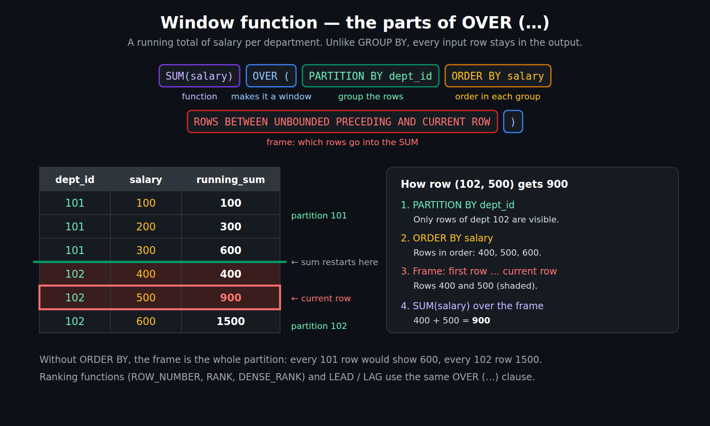

**1. Aggregate Functions:** These functions do a calculation on a set of values and return a single value. As window functions, they can give cumulative or moving calculations.

- ➕ **SUM()**: Calculates the total sum of a numeric column.

```sql
-- As GROUP BY
SELECT department_id, SUM(salary) AS dept_total
FROM employees
GROUP BY department_id;

-- As Window Function
SELECT first_name, department_id,
SUM(salary) OVER (PARTITION BY department_id) AS dept_total
FROM employees;
```

- 📊 **AVG()**: Calculates the average value of a numeric column.

```sql
SELECT first_name, department_id,
AVG(salary) OVER (PARTITION BY department_id) AS dept_avg
FROM employees;
```

- ⬇️ **MIN()**: Finds the minimum value in a set.

```sql
SELECT first_name, department_id,
MIN(salary) OVER (PARTITION BY department_id) AS dept_min
FROM employees;
```

- ⬆️ **MAX()**: Finds the maximum value in a set.

```sql
SELECT first_name, department_id,
MAX(salary) OVER (PARTITION BY department_id) AS dept_max
FROM employees;
```

- 🔢 **COUNT()**: Counts the number of rows.

```sql
SELECT first_name, department_id,
COUNT(*) OVER (PARTITION BY department_id) AS dept_count
FROM employees;
```

**2. Ranking Functions:** These functions assign a ranking value to each row within a partition.

- 🔢 **ROW_NUMBER()**: Assigns a unique sequential integer to rows within a partition.

```sql
SELECT first_name, department_id, salary,
ROW_NUMBER() OVER (PARTITION BY department_id ORDER BY salary DESC) AS row_num
FROM employees;
```

- 🏅 **RANK()**: Assigns a rank to each row within a partition, with gaps for ties.

```sql
SELECT first_name, department_id, salary,
RANK() OVER (PARTITION BY department_id ORDER BY salary DESC) AS sal_rank
FROM employees;
```

- 🥇 **DENSE_RANK()**: Assigns a rank to each row within a partition, without gaps for ties.

```sql
SELECT first_name, department_id, salary,
DENSE_RANK() OVER (PARTITION BY department_id ORDER BY salary DESC) AS dense_sal_rank
FROM employees;
```

- 📐 **NTILE()**: Divides rows into a given number of groups of about equal size.

```sql
SELECT first_name, department_id, salary,
NTILE(4) OVER (PARTITION BY department_id ORDER BY salary DESC) AS ntile_group
FROM employees;
```

**3. Value Functions:** These functions let you read data from other rows in the same result set.

- ◀️ **LAG()**: Gives access to a value from a previous row in the result set.

```sql
SELECT first_name, salary,
LAG(salary, 1) OVER (ORDER BY salary) AS prev_salary
FROM employees;
```

- ▶️ **LEAD()**: Gives access to a value from a later row in the result set.

```sql
SELECT first_name, salary,
LEAD(salary, 1) OVER (ORDER BY salary) AS next_salary
FROM employees;
```

- ⏮️ **FIRST_VALUE()**: Returns the first value in the window frame.

```sql
SELECT first_name, salary,
FIRST_VALUE(salary) OVER (ORDER BY salary) AS first_salary
FROM employees;
```

- ⏭️ **LAST_VALUE()**: Returns the last value in the window frame. **But it needs an explicit frame. Without one, it does not do what its name says.**

```sql
-- ❌️ WRONG: returns the CURRENT row's salary, not the last one
SELECT first_name, salary,
LAST_VALUE(salary) OVER (ORDER BY salary) AS last_salary
FROM employees;

-- ✅ CORRECT: frame extended to the end of the partition
SELECT first_name, salary,
LAST_VALUE(salary) OVER (
    ORDER BY salary
    ROWS BETWEEN UNBOUNDED PRECEDING AND UNBOUNDED FOLLOWING
) AS last_salary
FROM employees;
```

🔥 **Why — this is the most-asked window-function trap.** When an `OVER` clause has `ORDER BY` and **no explicit frame**, SQL uses the default frame:

```
RANGE BETWEEN UNBOUNDED PRECEDING AND CURRENT ROW
```

So the frame *ends at the current row*.

- `LAST_VALUE` does return the last row **of that frame**.
- That row is the current row (to be exact: its last peer under `RANGE`, meaning the last row with the same `ORDER BY` value).
- `FIRST_VALUE` looks correct only by luck. The frame always *starts* at the partition start. So "first of frame" happens to be the same as "first of partition".

✅ **Simple rule:** `FIRST_VALUE` is safe with the default frame. **`LAST_VALUE` and `NTH_VALUE` are not.** For them, always write `ROWS BETWEEN UNBOUNDED PRECEDING AND UNBOUNDED FOLLOWING`. Or avoid the problem fully by reversing the sort: `FIRST_VALUE(salary) OVER (ORDER BY salary DESC)`.

**4. Cumulative Distribution Functions:** These functions calculate how values are distributed in a result set.

- 📈 **CUME_DIST()**: Calculates the cumulative distribution of a value within a set of values.

```sql
SELECT first_name, salary,
CUME_DIST() OVER (ORDER BY salary) AS cume_dist_pct
FROM employees;
```

- 📊 **PERCENT_RANK()**: Calculates the relative rank of a row within a partition.

```sql
SELECT first_name, salary,
PERCENT_RANK() OVER (ORDER BY salary) AS pct_rank
FROM employees;
```

📝 **Summary:**

- ⚙️ **Aggregate Functions**: `SUM()`, `AVG()`, `MIN()`, `MAX()`, `COUNT()`
- 🏅 **Ranking Functions**: `ROW_NUMBER()`, `RANK()`, `DENSE_RANK()`, `NTILE()`
- 🔄 **Value Functions**: `LAG()`, `LEAD()`, `FIRST_VALUE()`, `LAST_VALUE()`
- 📈 **Cumulative Distribution Functions**: `CUME_DIST()`, `PERCENT_RANK()`

---

</details>

---

2. **🥇 RANK() vs DENSE_RANK()? 🔥🔥**

<!-- -->
<details>
<summary>Answer</summary>

**Answer:**

Both functions give ranks to rows in a result set, based on the values of a given column. But they handle ties differently.

📋 **Example Table: `scores`**

| student | score |
|---------|-------|
| A | 90 |
| B | 90 |
| C | 85 |
| D | 80 |
| E | 80 |
| F | 75 |

The `RANK()` function assigns a rank to each row. Tied rows get the same rank. The rank after the tied rows then jumps by the number of tied rows.

```sql
-- ⚠️ `AS Rank` is a syntax error on MySQL 8.0 — RANK is a reserved word there.
-- Use a different alias, or backtick it: AS `Rank`
SELECT student, score, RANK() OVER (ORDER BY score DESC) AS score_rank
FROM scores;
```

| student | score | score_rank |
|---------|-------|-----------|
| A | 90 | 1 |
| B | 90 | 1 |
| C | 85 | 3 |
| D | 80 | 4 |
| E | 80 | 4 |
| F | 75 | 6 |

The `DENSE_RANK()` function is similar to `RANK()`, but it does not leave gaps between the ranks when there are ties.

```sql
SELECT student, score, DENSE_RANK() OVER (ORDER BY score DESC) AS score_dense_rank
FROM scores;
```

| student | score | score_dense_rank |
|---------|-------|-----------|
| A | 90 | 1 |
| B | 90 | 1 |
| C | 85 | 2 |
| D | 80 | 3 |
| E | 80 | 3 |
| F | 75 | 4 |

| Feature | RANK() 🅰️ | DENSE_RANK() 🅱️ |
|---------|----------|----------------|
| **Gaps in ranking** | ✅ Yes, gaps after ties | ❌️ No gaps |
| **Example** | 1, 1, **3**, 4, 4, **6** | 1, 1, **2**, 3, 3, **4** |

🧠 **In Simple Words:**
- **RANK()** skips numbers after a tie (like a race where two people tie for 1st, the next is 3rd).
- **DENSE_RANK()** doesn't skip numbers (the next person after a tie is 2nd).

⚠️ **MySQL 8.0 reserved words.** When MySQL added window functions, it also made `RANK`, `DENSE_RANK`, `ROW_NUMBER`, `LEAD`, `LAG`, `FIRST_VALUE`, `LAST_VALUE`, `NTILE`, `CUME_DIST`, `PERCENT_RANK`, `OVER`, `WINDOW` and `GROUPS` **reserved**. Code that used `rank` as a column or alias on 5.7 breaks after the upgrade. The error is a plain syntax error that does not say why. Backtick it (`` `rank` ``) or rename it.

🎯 **Which one to pick:**

- "the nth highest *value*" → **`DENSE_RANK`** (no gaps, so `= n` is always the nth distinct value).
- "the nth *row*, exactly one" → **`ROW_NUMBER`** with a deterministic tie-breaker.
- "the top scorer(s), ties included" → **`RANK`**.

Picking `RANK` for an nth-highest question is the classic wrong answer. With a tie at the top, `WHERE rnk = 2` returns nothing at all.


---

</details>

---

3. **🧩 How do you use window functions to solve complex queries? 🔥**

<!-- -->
<details>
<summary>Answer</summary>

**Answer:**

Window functions help you solve complex queries in SQL. Examples are running totals, moving averages, cumulative sums, rankings, and more. You do not need subqueries or self-joins for these.

**1. Running Total:** Calculate a running total of sales for each employee.

```sql
SELECT employee_id, sale_date, sales_amount,
       SUM(sales_amount) OVER (PARTITION BY employee_id ORDER BY sale_date) AS running_total
FROM sales;
```

⚠️ **This query has a hidden frame. It changes the answer when dates repeat.**

- With `ORDER BY` and no explicit frame, the default is `RANGE BETWEEN UNBOUNDED PRECEDING AND CURRENT ROW`.
- Under `RANGE`, all rows with the same `sale_date` are **peers**.
- Every one of them gets the *same* total: the total that includes all its peers.
- In the sample data, employee 2 has only one sale per date, so the bug does not show there. If employee 2 had two sales on `2024-03-02`, both rows would show the combined figure, not a growing one.

Switch to `ROWS` for a strictly row-by-row running total:

```sql
SELECT employee_id, sale_date, sales_amount,
       SUM(sales_amount) OVER (
           PARTITION BY employee_id ORDER BY sale_date, sale_id
           ROWS BETWEEN UNBOUNDED PRECEDING AND CURRENT ROW
       ) AS running_total
FROM sales;
```

**2. Moving Average:** A **3-row** moving average and a true **3-day** moving average are different queries. That difference is the point of the question:

```sql
-- 3-ROW moving average: current row + the 2 physical rows before it.
-- If a product has no sale on some days, the window silently spans a longer period.
SELECT product_id, sale_date, sales_amount,
       AVG(sales_amount) OVER (
           PARTITION BY product_id ORDER BY sale_date
           ROWS BETWEEN 2 PRECEDING AND CURRENT ROW
       ) AS moving_avg_3rows
FROM sales;

-- 3-DAY moving average: a value-based window. Gaps in the calendar are handled correctly,
-- and multiple sales on the same day all fall inside one window.
SELECT product_id, sale_date, sales_amount,
       AVG(sales_amount) OVER (
           PARTITION BY product_id ORDER BY sale_date
           RANGE BETWEEN INTERVAL 2 DAY PRECEDING AND CURRENT ROW
       ) AS moving_avg_3days
FROM sales;
```

**3. Ranking:** Rank employees by their total sales within their department.

```sql
SELECT e.employee_id, e.department_id, SUM(s.sales_amount) AS total_sales,
       RANK() OVER (PARTITION BY e.department_id ORDER BY SUM(s.sales_amount) DESC) AS sales_rank
FROM employees e
JOIN sales s ON s.employee_id = e.employee_id
GROUP BY e.employee_id, e.department_id;
```

**4. First and Last Values:** Get the first and last sales dates for each employee.

```sql
SELECT employee_id, sale_date, sales_amount,
       FIRST_VALUE(sale_date) OVER (PARTITION BY employee_id ORDER BY sale_date) AS first_sale_date,
       LAST_VALUE(sale_date) OVER (PARTITION BY employee_id ORDER BY sale_date
                                  ROWS BETWEEN UNBOUNDED PRECEDING AND UNBOUNDED FOLLOWING) AS last_sale_date
FROM sales;
```

**5. Cumulative Distribution:** Calculate the cumulative distribution of salaries within a department.

```sql
SELECT employee_id, department_id, salary,
       CUME_DIST() OVER (PARTITION BY department_id ORDER BY salary) AS cumulative_distribution
FROM employees;
```

**6. Percent Rank:** Find the percentile rank of employees' salaries within their department.

```sql
SELECT employee_id, department_id, salary,
       PERCENT_RANK() OVER (PARTITION BY department_id ORDER BY salary) AS pct_rank
FROM employees;
```

**🪟 The window frame — `ROWS` vs `RANGE`, and the default nobody writes down**

Every `OVER` clause has three parts:

- `PARTITION BY` — which rows.
- `ORDER BY` — in what order.
- The **frame** — which slice of the partition this row's calculation sees.

People often leave out the frame. Leaving it out does **not** mean "the whole partition":

| `OVER` clause | Effective frame |
|---|---|
| `OVER (PARTITION BY x)` — **no `ORDER BY`** | The **entire partition**. This is why `SUM(salary) OVER (PARTITION BY department_id)` correctly gives a department total. |
| `OVER (PARTITION BY x ORDER BY y)` — **`ORDER BY`, no frame** | `RANGE BETWEEN UNBOUNDED PRECEDING AND CURRENT ROW` — start of partition **up to the current row and its peers**. |
| Explicit `ROWS BETWEEN …` | Exactly what you wrote, counted in **physical rows**. |

| | `ROWS` | `RANGE` |
|---|---|---|
| **Counts** | Physical rows | Values of the `ORDER BY` key |
| **Tied rows** | Treated separately — each gets its own frame | Treated as **peers** — all tied rows share one frame and get identical results |
| **Offsets allowed** | `n PRECEDING` / `n FOLLOWING` (row counts) | A value offset — `INTERVAL 2 DAY PRECEDING`, `100 PRECEDING` (MySQL 8.0, PostgreSQL 11+ and Oracle; not SQL Server) |
| **Use for** | Running totals, N-row moving averages | Calendar/value windows where ties must agree |

🔑 **Simple rules:**

- If the `ORDER BY` key can contain duplicates and you want a *strictly incremental* result, write `ROWS` explicitly.
- `RANK`/`DENSE_RANK`/`ROW_NUMBER`/`NTILE`/`LAG`/`LEAD`/`CUME_DIST`/`PERCENT_RANK` ignore the frame fully.
- So the frame only matters for aggregates and `FIRST_VALUE`/`LAST_VALUE`/`NTH_VALUE`.

⚠️ **Where window functions are *not* allowed — `WHERE`, `HAVING`, `GROUP BY`, and `ON`.** The database evaluates them **after** those clauses. The logical order is: `FROM` → `WHERE` → `GROUP BY` → `HAVING` → **window functions** → `SELECT` → `DISTINCT` → `ORDER BY` → `LIMIT`. So a `WHERE` cannot filter on a window function: its value does not exist yet at that step. **You must wrap it in a subquery or CTE and filter on the outside.** This is why every top-N-per-group answer in this file has two levels:

```sql
-- ❌️ ERROR 3593: You cannot use the window function 'rank' in this context
SELECT employee_id FROM employees
WHERE RANK() OVER (ORDER BY salary DESC) = 1;

-- ✅ Compute in an inner scope, filter in an outer one
SELECT employee_id FROM (
    SELECT employee_id, RANK() OVER (ORDER BY salary DESC) AS rnk FROM employees
) t WHERE rnk = 1;
```

(`ORDER BY` and `LIMIT` *are* fine. They run after window functions. Some warehouses (Snowflake, BigQuery, Teradata, DuckDB) offer a `QUALIFY` clause as a shortcut. MySQL, PostgreSQL and SQL Server do not, so there you must use the subquery.)

📝 **Summary:**

- ➕ **Running Total**: `SUM()` — add an explicit `ROWS` frame if the sort key has duplicates.
- 📊 **Moving Average**: `AVG()` with a **`ROWS`** frame for an N-row window, or a **`RANGE … INTERVAL`** frame for a true N-day window. They are not the same query.
- 🏅 **Ranking**: Use `RANK()`, `ROW_NUMBER()`, or `DENSE_RANK()` — frame-independent.
- ⏮️ **First and Last Values**: `FIRST_VALUE()` is safe with the default frame; **`LAST_VALUE()` needs `ROWS BETWEEN UNBOUNDED PRECEDING AND UNBOUNDED FOLLOWING`**.
- 📈 **Cumulative Distribution**: Use `CUME_DIST()`.
- 📊 **Percent Rank**: Use `PERCENT_RANK()`.
- 🚫 **Never in `WHERE`/`HAVING`/`GROUP BY`** — wrap in a subquery or CTE.

---

</details>

---

4. **🏎️ Which is faster between CTE and Subquery? 🔥**

<!-- -->
<details>
<summary>Answer</summary>

**Answer:**

The speed difference between Common Table Expressions (CTEs) and subqueries depends on the context and the database engine.

**Common Table Expressions (CTEs):**

- 📖 **Readability**: CTEs often make complex queries easier to read and maintain.
- ⚡ **Performance**: Usually the same as a subquery. PostgreSQL 12+ inlines a simple CTE used once, and MySQL 8 can merge or materialize it. A CTE cannot have its own index, so for a large result used many times, an indexed temporary table can be faster.
- 🔄 **Reusability**: You can define a CTE once and reference it many times in the same query.
- ⚙️ **Execution**: Some database engines optimize CTEs by materializing them (storing the result for a short time). Others treat them like inline views.

**Subqueries:**

- 🐢 **Performance**: Subqueries can sometimes be slower than joins or CTEs, especially correlated subqueries. The reason: they may run many times.
- 📋 **Readability**: Inline subqueries can make queries harder to read and maintain than CTEs.
- ⚙️ **Execution**: The database engine may optimize subqueries differently. In some simple, non-correlated cases, they might be faster than CTEs.

🛠️ **Using a CTE:**

```sql
WITH sales_cte AS (
    SELECT employee_id, SUM(sales_amount) AS total_sales
    FROM sales
    GROUP BY employee_id
)
SELECT e.first_name, e.last_name, c.total_sales
FROM employees e
JOIN sales_cte c ON e.employee_id = c.employee_id;
```

🛠️ **Using a Subquery:**

```sql
SELECT e.first_name, e.last_name, (
    SELECT SUM(s.sales_amount)
    FROM sales s
    WHERE s.employee_id = e.employee_id
) AS total_sales
FROM employees e;
```

| Feature | CTE 🅰️ | Subquery 🅱️ |
|---------|--------|------------|
| **Readability** | ✅ Cleaner, more readable | ⚠️ Can get complex |
| **Reusability** | ✅ Can reference multiple times | ❌️ Must repeat |
| **Performance** | ⚡ Varies by engine | ⚡ Varies by engine |
| **Best for** | Complex, multi-step queries | Simple, one-time lookups |

✅ **The honest answer: on a modern optimizer, neither is faster. A non-recursive CTE and an inline subquery usually compile to the same plan.** The real difference is this: can the engine *merge* the CTE into the outer query, or must it *materialise* it first?

| Engine | Non-recursive CTE behaviour |
|---|---|
| **MySQL 8.0** | **Merged** into the outer query where possible, exactly like a derived table, even when it is referenced more than once. Materialised only when it contains something unmergeable (aggregate, `DISTINCT`, `LIMIT`, `UNION`). Then it is built once and shared by all references. |
| **PostgreSQL ≤ 11** | Always **materialised** — a hard *optimisation fence*. Predicates from the outer query could not be pushed down. This is where the common belief "CTEs are slower in Postgres" comes from. |
| **PostgreSQL 12+** | Merged by default when the CTE is used only once (fence removed). A CTE used twice or more is still materialised. You can force the old behaviour with `WITH x AS MATERIALIZED (…)`, or forbid it with `AS NOT MATERIALIZED`. |
| **SQL Server / Oracle** | SQL Server always inlines. Oracle inlines or materialises by cost. It often materialises a CTE used more than once. The `/*+ MATERIALIZE */` hint forces it. |

🔑 **So the real choice is about readability and reuse, not speed.**

- Pick a CTE when the query has multiple logical steps, or when you reference the same intermediate result twice.
- Pick a correlated subquery for a single scalar lookup.
- **The exception where CTEs really win: recursion.** `WITH RECURSIVE` has no subquery equivalent (see §3 Q4).

⚠️ **The correlated-subquery trap in the second example:**

- The database evaluates `(SELECT SUM(…) WHERE s.employee_id = e.employee_id)` **per outer row**.
- On 12 employees you will not notice it. On 12 million it is an N+1 problem that you created yourself.
- The CTE/`JOIN` form aggregates once.
- The two forms also return different results. The correlated subquery returns **`NULL`** for an employee with no sales. The `JOIN` **drops the row entirely** (use `LEFT JOIN` + `COALESCE(total_sales, 0)` to match).

💡 **Pro Tip:** It is often good practice to test both approaches. Check the execution plans with `EXPLAIN` to see which one is faster for your use case.

---

</details>

---

5. **🚀 How do you use stored procedures to improve SQL query performance? ⚡**

<!-- -->
<details>
<summary>Answer</summary>

**Answer:**

> 🚨 **Read this before the list below. Every example in this answer follows the `p_` / `v_` naming convention. This is not a style choice.**
>
> **Inside a MySQL routine body, a parameter or local variable *wins* over a column with the same name.** So the form below is a bug that destroys data. Most tutorials print it this way:
>
> ```sql
> CREATE PROCEDURE update_employee_salary(IN employee_id INT, IN new_salary DECIMAL(10,2))
> BEGIN
>     UPDATE employees SET salary = new_salary
>     WHERE employee_id = employee_id;   -- ❌️ parameter compared to ITSELF → always TRUE
> END //
> ```
>
> `WHERE employee_id = employee_id` compares the **parameter to the parameter**, never to the column. It is `TRUE` for every row. So the procedure **rewrites the salary of the entire table**. The same shadowing (the name hides the column) also breaks other statements, with no error:
>
> - `SELECT`s: `WHERE department_id = department_id` returns all rows.
> - `SELECT … INTO`: `DECLARE salary …; SELECT salary INTO salary …` reads the new `NULL` local, not the column.
>
> ✅ **Fix: prefix every parameter `p_` and every local `v_`.** MySQL's own manual warns that a local variable should not have the same name as a table column. It costs two characters and removes a whole type of bug.

Stored procedures can improve SQL query performance in several main ways:

**1. Parse caching (not "precompilation"):** MySQL parses a routine once per *connection* and caches the parsed form. Repeated calls in the same session skip the parse. The optimizer still plans each statement on every call.

```sql
DELIMITER //

CREATE PROCEDURE get_employee_details()
BEGIN
    SELECT * FROM employees;
END //

DELIMITER ;
```

⚠️ **Interviewers argue against this claim: "Stored procedures are precompiled and therefore faster".** MySQL does **not** precompile routines and keep the result. Here is what it does:

- It parses the routine on the first call *within a session*.
- It caches the parsed form in that session's memory. It does not cache an execution plan.
- It **discards it when the connection closes**.

A connection pool recycles connections. So you pay for the "saved" compile again and again.

- SQL Server does cache plans in a shared, server-wide cache. This has its own risk: *parameter sniffing* (a plan built for the first parameter values is reused for very different values).
- PostgreSQL keeps prepared statements per session. For the first five executions it plans each call with the real values. After that it may switch to one cached generic plan, if that plan is not much more expensive.

Either way, the real gain is fewer **network round trips**, not compilation. Say that instead.

**2. Reduced Network Traffic:** You make a single call to a stored procedure. You do not send multiple SQL statements across the network.

```sql
CALL get_employee_details();
```

**3. Code Reusability and Maintenance:** Stored procedures let you reuse code. They keep the logic in one place, in the database. This makes queries easier to maintain and update.

```sql
DELIMITER //

CREATE PROCEDURE update_employee_salary(IN p_employee_id INT, IN p_new_salary DECIMAL(10,2))
BEGIN
    UPDATE employees
    SET salary = p_new_salary
    WHERE employee_id = p_employee_id;    -- ✅ prefixed: no shadowing
END //

DELIMITER ;
```

**4. Enhanced Security:** Stored procedures can add an extra layer of security. They control access to data.

```sql
GRANT EXECUTE ON PROCEDURE update_employee_salary TO user_name;
```

**5. Improved Performance through Execution Plans:** Stored procedures reuse a session-cached execution plan across calls.

```sql
DELIMITER //

CREATE PROCEDURE get_employee_by_department(IN p_department_id INT)
BEGIN
    SELECT * FROM employees
    WHERE department_id = p_department_id;   -- ✅ un-prefixed, this returned the WHOLE table
END //

DELIMITER ;
```

**6. Better Error Handling:** Stored procedures can include full error handling.

```sql
DELIMITER //

CREATE PROCEDURE safe_update_employee_salary(IN p_employee_id INT, IN p_new_salary DECIMAL(10,2))
BEGIN
    DECLARE EXIT HANDLER FOR SQLEXCEPTION
    BEGIN
        -- Error handling code
        ROLLBACK;
        RESIGNAL;                        -- re-raise so the caller learns it failed
    END;

    START TRANSACTION;
    UPDATE employees
    SET salary = p_new_salary
    WHERE employee_id = p_employee_id;
    COMMIT;
END //

DELIMITER ;
```

**7. Modular Programming:** Stored procedures support modular programming. You can break complex operations into smaller, reusable procedures.

```sql
DELIMITER //

CREATE PROCEDURE calculate_bonus(IN p_employee_id INT, OUT p_bonus DECIMAL(10,2))
BEGIN
    DECLARE v_salary DECIMAL(10,2);
    -- ❌️ was: DECLARE salary …; SELECT salary INTO salary … → read the NULL local, not the column
    SELECT salary INTO v_salary FROM employees WHERE employee_id = p_employee_id;
    SET p_bonus = v_salary * 0.10;
END //

DELIMITER ;
```

📝 **Summary:**

- ⚡ **Parse reuse**: Parse once per session — *not* persistent precompilation in MySQL.
- 🌐 **Reduced Network Traffic**: Less network overhead. This is the real gain you can defend.
- 🔄 **Code Reusability**: Centralized and reusable logic.
- 🔒 **Enhanced Security**: Controlled data access. Callers need `EXECUTE`, not table grants.
- 🚨 **Error Handling**: Strong error management.
- 🏗️ **Modular Programming**: Improved code organization.
- ⚠️ **Naming**: `p_` for parameters, `v_` for locals. This is required in MySQL.

🎯 **Expect this follow-up at SDE II level: "would you put this logic in a stored procedure in a Spring Boot service?"** The expected answer is usually **no**. If you can argue why, that is worth more than the list above:

| Against | Why it matters |
|---|---|
| **Invisible to version control and code review** | Procedures live in the database. Without strict migrations they drift out of sync. Nobody reviews the diff. |
| **Untestable in CI** | No JUnit, no mocks. You need a live database to test a branch of business logic. |
| **Splits the domain model** | Half the rules in Java, half in SQL. New joiners cannot find where a calculation lives. |
| **Blocks horizontal scaling** | Application servers scale out cheaply. The database is the one thing you cannot easily add more of. If you push CPU work into it, you move load to the least scalable tier. |
| **Vendor lock-in** | Routine bodies are the least portable SQL there is. |

✅ **Where they are still useful:**

- Bulk set-based work, where sending rows to the app tier is the real cost (nightly ETL, reporting rollups, mass reconciliation).
- Operations that must be atomic and close to the data.

---

</details>

---

6. **👁️ Explain View concepts. ⚡**

<!-- -->
<details>
<summary>Answer</summary>

**Answer:**

A view in SQL is a virtual table. It is based on the result set of a SQL query. It does not store data physically. It helps you:

- simplify complex queries.
- improve security by limiting access to specific data.

📖 **Characteristics:**

- 🖥️ **Virtual Table**: Acts like a table but does not store data itself.
- ⚙️ **Derived from Query**: Created using a SELECT statement.
- 📝 **Read-Only or Updatable**: Views can be read-only or allow updates. This depends on the SQL database and the view's definition.

🛠️ **Creating a View:**

```sql
CREATE VIEW view_name AS
SELECT column1, column2, ...
FROM table
WHERE condition;
```

🛠️ **Example:**

```sql
CREATE VIEW employee_view AS
SELECT e.employee_id, e.first_name, e.last_name, d.department_name
FROM employees e
JOIN departments d ON e.department_id = d.department_id;
```

🔍 **Using a View:** You can query a view just like a regular table.

```sql
SELECT * FROM employee_view;
```

✅ **Benefits:**

- 📋 **Simplifies Complex Queries**: Hides complex joins and filters behind a single view.
- 🔒 **Enhances Security**: Limits access to specific columns or rows.
- 🎯 **Data Consistency**: Gives consistent query results without copying data.
- 🔧 **Eases Maintenance**: Keeps query logic in one place, so it is easier to update.

**Updating Data through a View:** Some views are updatable. You can use them to change data in the underlying tables.

❌️ **This example looks right, but it is wrong:**

```sql
-- ❌️ Do NOT write this against the join-view above.
UPDATE employee_view SET department_name = 'Marketing' WHERE employee_id = 1;
```

1. **It does the opposite of what you meant.** `department_name` belongs to `departments`. So this **renames the department itself**. That moves *every* employee in HR to "Marketing". It does not move only employee 1.
2. **MySQL runs it without any error.** That is what makes it dangerous. MySQL updates a multi-table view when both are true:
   - the statement changes columns of a **single** base table, and
   - the view is otherwise "mergeable".

   Here both are true (only `departments` changes). So nothing warns you.

✅ **Correct: update the column that belongs to the row you are changing.** That is the foreign key on `employees`:

```sql
-- Reassign employee 1 to Marketing (department_id 4)
UPDATE employee_view e
SET e.department_id = 4          -- only if the view selects e.department_id (employee_view above does not)
WHERE e.employee_id = 1;

-- ✅ Or, most honestly, skip the view and update the base table:
UPDATE employees SET department_id = 4 WHERE employee_id = 1;
```

⚠️ **Restrictions:**

- Not all views are updatable. The limits depend on the SQL database and how complex the view is.
- In MySQL, a view is **not updatable** if it uses any of these: aggregate functions, `DISTINCT`, `GROUP BY`, `HAVING`, `UNION`, a subquery in the select list, or a non-updatable view.
- Multi-table (join) views are updatable **only** for statements that touch a single base table.
- 🛡️ **`WITH CHECK OPTION`** stops you from using a view to write rows that the view could not then read back. For example, inserting an HR employee through a "Finance only" view:

```sql
CREATE VIEW finance_employees AS
SELECT * FROM employees WHERE department_id = 2
WITH CHECK OPTION;   -- an INSERT/UPDATE with department_id <> 2 is now rejected
```

- 💡 **PostgreSQL's way around this:** you can make any view writable, however complex it is. You define an `INSTEAD OF` trigger (or a `RULE`) for it. Simple single-table views are auto-updatable there, as in MySQL.
- 📦 **Views do not store data. Materialized views do.** PostgreSQL and Oracle have `CREATE MATERIALIZED VIEW` (a real table refreshed on demand). **MySQL has none.** In MySQL, the equivalent is a summary table that a scheduled job or triggers keep up to date.

🗑️ **Dropping a View:**

```sql
DROP VIEW view_name;
```

📝 **Summary:**

- 🖥️ **Views**: Virtual tables created from SQL queries.
- 🏗️ **Creation**: Defined using `CREATE VIEW`.
- 🔍 **Usage**: Queried like regular tables, for simpler access and security.
- ✅ **Benefits**: Simplifies complex queries, improves security, and gives data consistency.
- 📝 **Updating**: Some views are updatable; others are read-only.
- 🔧 **Maintenance**: Centralized query logic eases updates and management.

---

</details>

---

7. **🎯 What are triggers in SQL? ⚡**

<!-- -->
<details>
<summary>Answer</summary>

**Answer:**

A trigger in SQL is a set of instructions that run automatically (or "fire"). They run in response to specific events on a particular table or view. You can use triggers to:

- enforce business rules.
- maintain data integrity.
- audit changes.

**Types of Triggers:**

**1. Before Triggers:**
- ⏮️ **Fires before** an insert, update, or delete operation on a table.
- 🔍 **Usage**: Often used to check or change data before the database writes it to the table.

```sql
DELIMITER //

CREATE TRIGGER before_insert_employee
BEFORE INSERT ON employees
FOR EACH ROW
BEGIN
    IF NEW.salary < 0 THEN
        SET NEW.salary = 0;
    END IF;
END //

DELIMITER ;
```

**2. After Triggers:**
- ⏭️ **Fires after** an insert, update, or delete operation on a table.
- 📋 **Usage**: Often used to update related tables or log changes. Use a foreign key, not a trigger, for referential integrity.

```sql
DELIMITER //

CREATE TRIGGER after_insert_employee
AFTER INSERT ON employees
FOR EACH ROW
BEGIN
    INSERT INTO employee_log(employee_id, action)
    VALUES (NEW.employee_id, 'INSERT');
END //

DELIMITER ;
```

**Trigger Timing:**

- ⏮️ **BEFORE**: Executes before the triggering event.
- ⏭️ **AFTER**: Executes after the triggering event.

**Trigger Events:**

- ➕ **INSERT**: Fires when a new row is inserted.
- 🔄 **UPDATE**: Fires when a row is updated.
- 🗑️ **DELETE**: Fires when a row is deleted.

**Trigger Levels:**

- 🔢 **Row-Level Triggers**: Execute once for each row affected by the triggering event.
- 📄 **Statement-Level Triggers**: Execute once for the entire statement, no matter how many rows it affects.

⚠️ **MySQL supports row-level triggers only.**

- `FOR EACH ROW` is mandatory in MySQL's `CREATE TRIGGER` grammar.
- **There are no statement-level triggers.** `FOR EACH STATEMENT` is a syntax error.
- PostgreSQL, Oracle and SQL Server all have them. SQL Server's DML triggers are *always* statement-level. It has no `FOR EACH ROW` option. They give you `inserted`/`deleted` pseudo-tables, not `NEW`/`OLD`.

If you claim statement-level triggers in a MySQL team, someone will correct you.

⚠️ **Two more MySQL-specific trigger facts worth knowing:**
- `TRUNCATE TABLE` **does not fire triggers**. It is DDL, not row-wise DML. Foreign-key `ON DELETE CASCADE` actions that InnoDB performs do not fire them either.
- Since MySQL 5.7 you *can* have multiple triggers for the same event on the same table. You order them with `FOLLOWS` / `PRECEDES`. Before 5.7 you could have only one.

🛠️ **Creating a Trigger:**

```sql
CREATE TRIGGER trigger_name
BEFORE|AFTER INSERT|UPDATE|DELETE
ON table_name
FOR EACH ROW
BEGIN
    -- Trigger logic here
END;
```

🛠️ **Example Triggers:**

**1. Before Insert Trigger:**

```sql
DELIMITER //

CREATE TRIGGER before_insert_employee
BEFORE INSERT ON employees
FOR EACH ROW
BEGIN
    IF NEW.salary < 0 THEN
        SET NEW.salary = 0;
    END IF;
END //

DELIMITER ;
```

**2. After Insert Trigger:**

```sql
DELIMITER //

CREATE TRIGGER after_insert_employee
AFTER INSERT ON employees
FOR EACH ROW
BEGIN
    INSERT INTO employee_log(employee_id, action)
    VALUES (NEW.employee_id, 'INSERT');
END //

DELIMITER ;
```

✅ **Advantages of Triggers:**

- ⚙️ **Automation**: Automatically enforce business rules and data integrity.
- 🎯 **Consistency**: Handle related changes in the same way every time.
- 📋 **Auditing**: Track changes and maintain historical records.

⚠️ **Disadvantages of Triggers:**

- 🔧 **Complexity**: Can make the system harder to debug and maintain.
- 🐢 **Performance Overhead**: Can slow the system down if you do not use them carefully.

📝 **Summary:**

- ⚡ **Triggers**: Automated actions that fire in response to specific table events.
- 📖 **Types**: Before and after triggers, each can fire on insert, update, or delete events.
- 🔢 **Levels**: Row-level (per row) and statement-level (per statement) — **MySQL has row-level only**.
- ✅ **Advantages**: Enforce rules, maintain consistency, and track changes.
- ⚠️ **Disadvantages**: Can increase complexity and impact performance.

---

</details>

---

8. **📦 What is the stored procedure in SQL? 💤**

<!-- -->
<details>
<summary>Answer</summary>

**Answer:**

> 📌 This is the definition only. The *trade-off* discussion is in §5 Q5. §5 Q5 also has the `p_`/`v_` naming rule that stops these procedures from corrupting data. Interviews really test the trade-off part.

A stored procedure in SQL is a **named, stored set of one or more SQL statements**. The database processes them as a unit. You call it with `CALL`. Stored procedures let you run SQL logic inside the database in a reusable way, with access control.

**Key Features of Stored Procedures:**

- ⚡ **Parse reuse**: MySQL parses the routine on first execution *in a session*. It caches the parsed form there. ⚠️ Note this is **not** persistent precompilation in MySQL. The cache is lost when the connection closes. See §5 Q5.
- 🔄 **Reusability**: Multiple programs and applications can reuse the same stored procedure. This means more code reuse and less duplicate code.
- 🔒 **Security**: They can hide complex logic. They can block direct access to the underlying tables.
- 🔧 **Maintainability**: Changes to business logic happen in one place, the stored procedure. This makes it easier to update and maintain.
- 🌐 **Network Traffic Reduction**: Reduces network traffic by executing multiple SQL statements in a single call.

🛠️ **Creating a Stored Procedure:**

```sql
DELIMITER //

CREATE PROCEDURE get_employee_details()
BEGIN
    SELECT * FROM employees;
END //

DELIMITER ;
```

🛠️ **Executing a Stored Procedure:**

```sql
CALL get_employee_details();
```

🛠️ **Parameters in Stored Procedures:**

```sql
DELIMITER //

CREATE PROCEDURE get_employee_by_id(IN p_employee_id INT)
BEGIN
    SELECT * FROM employees
    WHERE employee_id = p_employee_id;
END //

DELIMITER ;
```

⚠️ **The `p_` prefix is mandatory, not just for looks.** Suppose you name the parameter `employee_id`. Then `WHERE employee_id = employee_id` compares the parameter to itself. That is always true. So this "get by id" procedure would return **the entire table**. Full explanation in §5 Q5.

✅ **Advantages of Stored Procedures:**

- 🌐 **Fewer round trips**: one `CALL` replaces a long sequence of separate statements. This is the performance claim you can defend best.
- 🏗️ **Modularity**: Break down complex operations into simpler, reusable procedures.
- 🔒 **Security**: Callers can be granted `EXECUTE` on the procedure without any grant on the underlying tables.
- 🎯 **Consistency**: Business logic is implemented the same way everywhere.

---

</details>

---

9. **⚙️ Difference between the Function and Store procedure? ⚡**

<!-- -->
<details>
<summary>Answer</summary>

**Answer:**

**Function:** Does a calculation and returns a single value or a table. You can use it in `SELECT`, `WHERE`, and other clauses.

```sql
DELIMITER //

CREATE FUNCTION function_name(param datatype)
RETURNS datatype
DETERMINISTIC
BEGIN
    -- Function logic
    RETURN value;
END //

DELIMITER ;
```

🛠️ **Example:**

```sql
DELIMITER //
CREATE FUNCTION calculate_square (number INT)
RETURNS INT
DETERMINISTIC
BEGIN
    RETURN number * number;
END //
DELIMITER ;

-- Calling the function
SELECT calculate_square(5) AS square_result;
```

**Stored Procedure:** Runs a series of operations, like insert, update, delete, and more complex logic. You run it with `EXEC` in SQL Server/Oracle, and with `CALL` in MySQL.

```sql
DELIMITER //

CREATE PROCEDURE procedure_name()
BEGIN
    -- Procedure logic
END //

DELIMITER ;
```

🛠️ **Example:**

```sql
DELIMITER //

CREATE PROCEDURE update_employee_salary(IN p_employee_id INT, IN p_new_salary DECIMAL(10, 2))
BEGIN
    UPDATE employees
    SET salary = p_new_salary
    WHERE employee_id = p_employee_id;
END //

DELIMITER ;

-- Executing the stored procedure
CALL update_employee_salary(1, 70000.00);
```

| Feature | Function 🅰️ | Stored Procedure 🅱️ |
|---------|-----------|-------------------|
| **Return value** | ✅ Must return a value | ⚠️ Optional (via OUT params) |
| **Usage in SQL** | ✅ Can use in SELECT/WHERE | ❌️ Cannot use in SELECT |
| **Transaction** | ❌️ No transaction control | ✅ Full transaction control |
| **Invocation** | `SELECT function()` | `CALL procedure()` |
| **DML operations** | ⚠️ Limited | ✅ Full support |

---

</details>

---

10. **🖱️ What is a Cursor? 💤**

<!-- -->
<details>
<summary>Answer</summary>

**Answer:**

**Key Concepts:**

1. 📖 **Declare a Cursor**: Define the cursor and the SQL query it will run.
2. 🔓 **Open the Cursor**: Run the query and fill the cursor with the result set.
3. 📥 **Fetch Rows**: Read single rows from the cursor.
4. 🔒 **Close the Cursor**: Release the cursor and its resources.

⚠️ **There is no fifth "deallocate" step in MySQL.** `DEALLOCATE` is **T-SQL**.

- SQL Server keeps two things apart: the cursor's *result set* (freed by `CLOSE`) and its *definition* (freed by `DEALLOCATE`).
- MySQL, PostgreSQL and Oracle have four steps: `DECLARE` → `OPEN` → `FETCH` → `CLOSE`.
- MySQL closes any cursor that is still open by itself when the enclosing block ends.

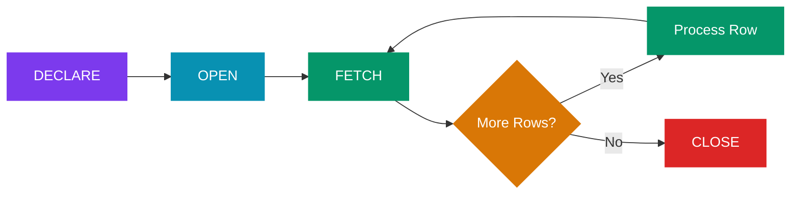

🛠️ **MySQL Example:**

⚠️ **`DECLARE` is allowed only inside a stored-program block** (`BEGIN … END` of a procedure, function or trigger).

- If you paste the body below straight into a MySQL client, you get a syntax error.
- So the `CREATE PROCEDURE` wrapper is part of the answer. It is not extra code you can drop.

**And the declaration order is fixed and enforced:** variables → cursors → handlers. If you declare the `NOT FOUND` handler before the cursor, it fails to compile.

```sql
DELIMITER //

CREATE PROCEDURE raise_all_salaries()
BEGIN
    -- 1️⃣ Variables first
    DECLARE done INT DEFAULT 0;
    DECLARE emp_id INT;
    DECLARE emp_salary DECIMAL(10, 2);

    -- 2️⃣ Then cursors
    DECLARE emp_cursor CURSOR FOR
        SELECT employee_id, salary FROM employees;

    -- 3️⃣ Then handlers — this order is mandatory
    DECLARE CONTINUE HANDLER FOR NOT FOUND SET done = 1;

    OPEN emp_cursor;

    read_loop: LOOP
        FETCH emp_cursor INTO emp_id, emp_salary;
        IF done = 1 THEN
            LEAVE read_loop;
        END IF;

        UPDATE employees SET salary = emp_salary * 1.10 WHERE employee_id = emp_id;
    END LOOP;

    CLOSE emp_cursor;
END //

DELIMITER ;
```

⚠️ **The `FETCH`-then-check pattern matters.** A common buggy version puts the `FETCH` at the top of a `WHILE done = 0` loop body, with no check after it. That version processes the **last row twice**:

- The final `FETCH` sets `done = 1`, but the variables still hold the previous row's values.
- The loop condition is only tested at the top of the *next* iteration.

The fix: check `done` right after every `FETCH`. The `LOOP` above does this. A `FETCH` before the `WHILE`, plus a second `FETCH` as the last line of the body, is also correct.

✅ **And the real answer to this question:** the whole procedure above is a **set-based one-liner**: `UPDATE employees SET salary = salary * 1.10;`.

- It is a single statement.
- It runs orders of magnitude faster.
- It cannot apply the raise twice.

Use a cursor only when a row really depends on the result of processing a previous row. Tell the interviewer this before you finish writing the cursor.

📖 **Explanation:**

- 📝 **Declare Variables**: Store the current row's data.
- 🔍 **Declare Cursor**: Define the cursor with a SELECT query.
- 🚨 **Declare Handler**: Handle the condition when the cursor reaches the end.
- 🔓 **Open Cursor**: Run the query and get ready to fetch rows.
- 📥 **Fetch Rows**: Read rows one by one inside a loop.
- ⚙️ **Perform Operations**: Do any row-by-row operations.
- 🔒 **Close Cursor**: Release the cursor's resources.

✅ **Use Cases:**

- 🔄 **Iterating Over Rows**: When you need to process each row individually.
- 🏗️ **Complex Logic**: Complex business logic that a single SQL statement can't do.
- 📊 **Row-by-Row Operations**: Operations that depend on previous rows' data.

⚠️ **Caution:** Cursors are powerful, but they can be slower than set-based operations. The usual advice: use them rarely, and choose set-based SQL operations when you can.

---

</details>

---

11. **🚨 How exceptions can be handled in MySQL? 💤**

<!-- -->
<details>
<summary>Answer</summary>

**Answer:**

In MySQL, you handle exceptions with `DECLARE ... HANDLER` statements inside stored procedures or functions. A handler says what to do when a specific condition or error occurs.

🛠️ **Example: Stored Procedure with Exception Handling**

```sql
DELIMITER $$

CREATE PROCEDURE update_salary(
    IN emp_id INT,
    IN new_salary DECIMAL(10, 2)
)
BEGIN
    -- Declare a handler for any SQL error
    DECLARE EXIT HANDLER FOR SQLEXCEPTION
    BEGIN
        -- Handle the exception
        ROLLBACK;
        SELECT 'An error occurred while updating the salary';
    END;

    -- Start transaction
    START TRANSACTION;

    -- Update the employee's salary
    UPDATE employees
    SET salary = new_salary
    WHERE employee_id = emp_id;

    -- Commit the transaction
    COMMIT;

    -- Success message
    SELECT 'Salary updated successfully';
END $$

DELIMITER ;
```

📖 **Explanation:**

- ⚙️ **DELIMITER $$**: Changes the statement delimiter to `$$`. This lets you write procedures with many statements.
- 🚨 **DECLARE EXIT HANDLER FOR SQLEXCEPTION**: Declares a handler for SQL exceptions. If an error occurs, MySQL runs the given block of code.
- 🔄 **BEGIN ... END**: Defines the block of code to execute when an error occurs. Here, it performs a `ROLLBACK` and returns an error message.
- ▶️ **START TRANSACTION**: Begins a new transaction.
- 📝 **UPDATE**: The operation that may cause an error.
- ✅ **COMMIT**: Commits the transaction if no errors occur.

**Types of Handlers:**

- 🔄 **CONTINUE HANDLER**: Continues execution after handling the exception.
- 🛑 **EXIT HANDLER**: Exits the procedure after handling the exception.

🛠️ **Example of CONTINUE HANDLER:**

```sql
DELIMITER $$

CREATE PROCEDURE test_handler()
BEGIN
    DECLARE CONTINUE HANDLER FOR SQLEXCEPTION
    BEGIN
        SELECT 'Handled an exception';
    END;

    -- Intentionally cause an error
    DROP TABLE non_existent_table;

    -- Execution continues here after handling the error
    SELECT 'This will still run';
END $$

DELIMITER ;
```

📝 **Note:** In this example, the `DROP` of a non-existent table causes an error. Even so, the procedure continues and returns the second message.

✅ **Use Cases:**

- 🔄 **Transaction Management**: Make sure transactions are handled correctly: rolled back or committed.
- 💬 **Custom Error Messages**: Give clear, user-friendly error messages.
- 🔍 **Debugging**: Capture and log errors for debugging.

---

</details>

---

<a id="6-dialect-divergences--mysql--postgresql"></a>

## 6. Dialect Divergences — MySQL ↔ PostgreSQL

1. **🔀 You answered in one dialect and the interviewer says "we're on the other one." What actually changes? 🔥🔥**

<!-- -->
<details>
<summary>Answer</summary>

**Answer:**

**The honest opening line:** "Almost nothing in the query I just wrote — joins, `GROUP BY`, CTEs and window functions are the same on both. What changes is writes, DDL, and the concurrency model." Then give specific details.

**A. Syntax — the 13 that cause errors while writing queries**

| # | Thing | 🐘 PostgreSQL 16 | 🐬 MySQL 8 |
|---|---|---|---|
| 1 | Identifier quoting | `"employees"` — and **unquoted names fold to lowercase** | `` `employees` `` — unquoted names keep their case |
| 2 | String concat | `a \|\| b` (also `CONCAT`) | `CONCAT(a, b)` — `\|\|` means **OR** unless `PIPES_AS_CONCAT` is set |
| 3 | String comparison | **Case-sensitive** by default; `ILIKE` or `citext` for insensitive | **Case-insensitive** by default (`utf8mb4_0900_ai_ci` ignores case *and* accents) |
| 4 | NULL replacement | `COALESCE(x, y)` | `IFNULL(x, y)` or `COALESCE(x, y)` |
| 5 | Aggregate string concat | `STRING_AGG(name, ', ' ORDER BY name)` | `GROUP_CONCAT(name ORDER BY name SEPARATOR ', ')` |
| 6 | Conditional aggregate | `COUNT(*) FILTER (WHERE status = 'APPROVED')` | No `FILTER` — `SUM(status = 'APPROVED')` or `COUNT(CASE WHEN … END)` |
| 7 | Auto-generated id | `GENERATED BY DEFAULT AS IDENTITY` (ANSI) or `SERIAL` (legacy) | `AUTO_INCREMENT` — no ANSI identity syntax |
| 8 | Boolean | A **real** `BOOLEAN` type | Alias for `TINYINT(1)`; `TRUE` is literally `1` |
| 9 | Date arithmetic | `CURRENT_DATE - INTERVAL '6 months'` | `DATE_SUB(CURRENT_DATE, INTERVAL 6 MONTH)` or `CURRENT_DATE - INTERVAL 6 MONTH` — unquoted keyword form |
| 10 | `LIMIT`/`OFFSET` | Any integer **expression**; `FETCH FIRST n ROWS ONLY` also works | Integer **literals or placeholders only** — `OFFSET n-1` will not parse |
| 11 | Top-1 per group | `SELECT DISTINCT ON (department_id) * … ORDER BY department_id, salary DESC` | No `DISTINCT ON` — use `ROW_NUMBER() OVER (PARTITION BY …) = 1` |
| 12 | `GROUP BY` strictness | Always rejects a non-aggregated, non-grouped column (unless it depends on a grouped primary key) | `ONLY_FULL_GROUP_BY` is on by default but is **routinely switched off**, so legacy queries return an arbitrary row's value |
| 13 | `SELECT` alias in `HAVING` | ❌️ **Rejected** — repeat the expression (`HAVING AVG(salary) > 60000`). Aliases are visible in `GROUP BY`/`ORDER BY` only | ✅ Allowed — `HAVING avg_sal > 60000` runs. Neither engine allows an alias in `WHERE`. See [§1 Q1](#sql-fundamentals) |

**B. Semantics — the 6 that decide architecture, not syntax**

| # | Thing | 🐘 PostgreSQL 16 | 🐬 MySQL 8 (InnoDB) |
|---|---|---|---|
| 14 | Upsert | `INSERT … ON CONFLICT (col) DO UPDATE SET x = EXCLUDED.x` — you name the conflicting constraint | `INSERT … ON DUPLICATE KEY UPDATE x = VALUES(x)` — fires on **any** unique key, which is a real trap on tables with more than one unique key |
| 15 | Returning the written row | `RETURNING *` on `INSERT`/`UPDATE`/`DELETE` — one round trip | Not supported — you run another `SELECT` (and risk a race unless you're in a transaction) |
| 16 | Transactional DDL | `CREATE`/`ALTER`/`DROP` participate in the transaction — **a failed migration rolls back cleanly** | Every DDL statement causes an **implicit commit**; a half-applied migration stays half-applied |
| 17 | Default isolation | `READ COMMITTED` | `REPEATABLE READ` |
| 18 | Phantom prevention | RR = snapshot isolation, **no gap locks**; true serializability via SSI at `SERIALIZABLE`, which aborts with a serialization error you **must retry** | RR uses **next-key (gap) locks**, so phantoms are blocked at RR — but gap locks are a deadlock source that has no PostgreSQL equivalent |
| 19 | Row storage | Heap + `ctid`; **every index is secondary**, and index-only scans depend on the visibility map | The table **is** the primary-key B-tree (clustered); a secondary index leaf stores the PK, so non-covering lookups cost a second B-tree descent |

**⚡ Two more that come up inside the indexing question:**

- PostgreSQL has **partial indexes** (`… WHERE status = 'ACTIVE'`) and expression indexes. MySQL 8 has functional indexes but **no partial indexes**.
- PostgreSQL's `JSONB` is GIN-indexable in a way MySQL's `JSON` column is not.

💡 **The key line to say:** rows 16–19 are why a migration strategy and a retry strategy are not portable between the two. This is true even when every `SELECT` is portable.

---

</details>

---

2. **⬆️ Write an idempotent upsert in both engines. What is the trap? 🔥**

<!-- -->
<details>
<summary>Answer</summary>

**Answer:**

Scenario: a nightly job loads the salary rows again. It must insert-or-update on `employee_id`.

**🐘 PostgreSQL — conflict target is explicit:**

```sql
INSERT INTO salaries (employee_id, salary, effective_from)
VALUES (7, 78000, CURRENT_DATE)
ON CONFLICT (employee_id) DO UPDATE
    SET salary        = EXCLUDED.salary,
        effective_from = EXCLUDED.effective_from
RETURNING employee_id, salary;
```

- `EXCLUDED` is the pseudo-row that *would have been* inserted.
- `ON CONFLICT (employee_id)` names **which** unique constraint you mean. A conflict on any *other* unique index still raises an error. That is usually what you want.
- `RETURNING` gives back the resulting row in the same round trip.

**🐬 MySQL 8 — conflict target is implicit, and that is the trap:**

```sql
INSERT INTO salaries (employee_id, salary, effective_from)
VALUES (7, 78000, CURRENT_DATE)
AS new                                      -- 8.0.19+ replaces the deprecated VALUES()
ON DUPLICATE KEY UPDATE
    salary        = new.salary,
    effective_from = new.effective_from;
```

⚠️ **The trap:** `ON DUPLICATE KEY UPDATE` fires on a collision with **any** unique key on the table.

- Say `salaries` also has a second unique key on another column, for example `UNIQUE(payroll_ref)`, and the new row carries a `payroll_ref`.
- If the new row collides only on *that* key, MySQL silently updates the row that already holds it. It raises no error.
- So you can overwrite an unrelated row.

PostgreSQL cannot do this to you, because you named the constraint.

**Two more differences worth one line each:**

- MySQL has no `RETURNING`. To get the row back, you need a follow-up `SELECT`. Do it in the same transaction, or another writer can change the row in between.
- `INSERT … ON DUPLICATE KEY UPDATE` **uses up auto-increment values** on the update path (with both `innodb_autoinc_lock_mode = 1` and `2`; `2` is the MySQL 8 default). So the ids get gaps. In either engine, never present sequential ids as a business guarantee.

---

</details>

---

3. **🔒 MySQL defaults to `REPEATABLE READ`, PostgreSQL to `READ COMMITTED`. What breaks when code moves between them? 🔥**

<!-- -->
<details>
<summary>Answer</summary>

**Answer:**

**1️⃣ Running the same query twice may no longer give the same result.**

- Under MySQL's `REPEATABLE READ`, two identical `SELECT`s inside one transaction return the same snapshot.
- Under PostgreSQL's `READ COMMITTED`, **each statement takes a fresh snapshot**. So the second `SELECT` sees rows that another transaction committed in between.

Any read-check-then-write logic that depended on MySQL's default now has a race condition:

```sql
-- ❌️ Unsafe on PostgreSQL READ COMMITTED: another txn can insert between the two statements
BEGIN;
SELECT COUNT(*) FROM loans WHERE customer_id = 42;   -- returns 4, under limit
INSERT INTO loans (customer_id, amount) VALUES (42, 500000);
COMMIT;

-- ✅ Lock one parent row that every writer for customer 42 must lock first
BEGIN;
SELECT customer_id FROM customers WHERE customer_id = 42 FOR UPDATE;
SELECT COUNT(*) FROM loans WHERE customer_id = 42;
INSERT INTO loans (customer_id, amount) VALUES (42, 500000);
COMMIT;
```

⚠️ PostgreSQL rejects `FOR UPDATE` together with an aggregate such as `COUNT(*)`. Locking the loan rows would not help anyway: `FOR UPDATE` locks *existing* rows only, not a **new** row that matches. So lock one parent row that every writer must lock first. Other options: an advisory lock, or `SERIALIZABLE`.

**2️⃣ Gap locks disappear — and so do the deadlocks they caused.**

- MySQL blocks phantoms at `REPEATABLE READ` with next-key locks over index gaps.
- That is why concurrent range `UPDATE`s deadlock so easily on MySQL.
- PostgreSQL's RR is pure snapshot isolation with no gap locking. So those deadlocks go away.
- On PostgreSQL, RR already hides phantoms from reads, because the snapshot never changes. But write skew (like the count-then-insert above) is still possible. Only `SERIALIZABLE` stops it.

**3️⃣ `SERIALIZABLE` is not free on PostgreSQL. It changes what your application must handle.**

- PostgreSQL implements it as **SSI (Serializable Snapshot Isolation)**.
- SSI does not block. It *aborts* one transaction with `40001 serialization_failure` after the fact.
- So every transaction running at `SERIALIZABLE` needs a **retry loop**, typically with backoff.
- MySQL's `SERIALIZABLE` instead turns plain reads into locking reads. So it blocks rather than aborts.

| | 🐘 PostgreSQL | 🐬 MySQL InnoDB |
|---|---|---|
| **Default level** | `READ COMMITTED` | `REPEATABLE READ` |
| **Snapshot scope at RR** | Transaction-wide | Transaction-wide |
| **Phantoms at RR** | Not visible (snapshot), but write skew is still possible | Blocked for locking reads (next-key locks) |
| **`SERIALIZABLE` mechanism** | Optimistic — **aborts** with `40001`, retry required | Pessimistic — **blocks** via read locks |

💡 **The one-liner:** "PostgreSQL trades blocking for aborting. Moving to it means adding a serialization-failure retry, not just changing a config line."

🔗 See [`02_Database_Design_and_Internals_Interview_Questions.md`](https://github.com/vikas9dev/system-design/blob/main/iq/02_Database_Design_and_Internals_Interview_Questions.md) for the full coverage of isolation levels, dirty/phantom reads and locking. This section only covers what *differs between the engines*.

---

</details>

---
