# Design Pattern Interview Questions

**Design Pattern Interview Questions** | Also see:- [Design Patterns in Java](../2_design_patterns/02_Design_Patterns_in_Java.md), Types of Design Patterns.

📊 **Question Count by Section**

| # | Section | Questions |
|---|---|---|
| 0 | [Fundamentals](#0-fundamentals) | 2 |
| 1 | [Creational Design Patterns](#1-creational-design-patterns) | 7 |
| 2 | [Structural Design Pattern](#2-structural-design-pattern) | 8 |
| 3 | [Behavioral Design Pattern](#3-behavioral-design-pattern) | 7 |
| 4 | [SOLID](#4-solid) | 10 |
| | **Total** | **34** |

> 🔥🔥 Very High — asked in almost every Tier-1 loop &nbsp;·&nbsp; 🔥 High — very frequent in Tier-1 interviews &nbsp;·&nbsp; ⚡ Medium — commonly asked &nbsp;·&nbsp; 💤 Low — good to know, rarely asked

## 0. Fundamentals

1. **📂 What are the categories of Java Design Patterns? ⚡**

<!-- -->
<details>
<summary>Answer</summary>

**Answer:**

Java design patterns fall into 4 main types:

- 🏗️ **Creational Design Patterns:** These patterns deal with **object creation mechanisms**. They try to create objects in a way that suits the situation. They **define and describe how objects are created at class instantiation time**.
- 🧱 **Structural Design Patterns:** These patterns deal with **object composition or the structure of classes and objects**. They help make sure that when one part of a system changes, the whole system does not need to change.
- 🔄 **Behavioral Design Patterns:** These patterns deal with algorithms and with giving responsibilities to objects. They help **define how objects interact and communicate with each other**.
- 🌐 **J2EE Design Patterns:** J2EE (Java 2 Platform, Enterprise Edition) design patterns are special patterns **used in enterprise-level Java applications**. They solve common problems in enterprise application development. They support good practices for scalability, maintainability, and efficiency.

**① The three GoF categories — grouped by *what they organize*:**

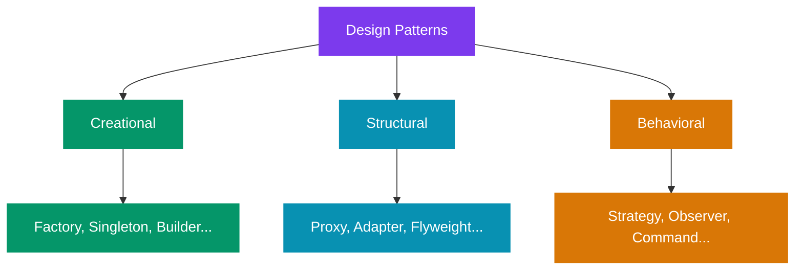

**② The J2EE / enterprise family — a separate catalog, not part of GoF:**

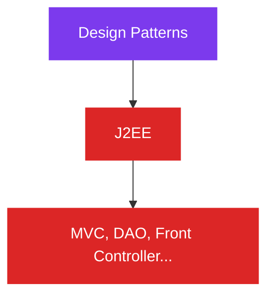

> Remember this split for interviews:
> - The three categories in ① are the **GoF 23**. Interviewers test them with code.
> - The family in ② comes from the J2EE catalog. You are expected to know it, but it is rarely coded in a round.

---

</details>

---

2. **🤔 Why do we need design patterns? 💤**

<!-- -->
<details>
<summary>Answer</summary>

**Answer:**

- 📖 Design patterns are well documented. Software architects, designers, and developers understand them. So when you use one in a solution, others will understand that solution too.
- ✅ Patterns give a developer a set of tested solutions to common problems.
  - You do not need to use a new and untested design, so the technical risk to the project goes down.
  - This saves time and effort during implementation.
- 🌐 They do not depend on one language. You can use them in any language that supports object orientation.
- 🔧 When you use well-understood and documented solutions, the final product is much easier to understand. A solution that is easier to understand is also easier to maintain.

🎯 **Interview Tip:** Say clearly that design patterns help reusability and maintainability, and give developers a shared vocabulary.

---

</details>

---

## 1. Creational Design Patterns

1. **🏗️ What are the Creational Patterns? ⚡**

<!-- -->
<details>
<summary>Answer</summary>

**Answer:**

- 🏗️ Creational design patterns deal with the way we create objects.
- ⚙️ We use these patterns to **define and describe how objects are created at class instantiation time**.

🛠️ **Example:** `Employee emp = new Employee();` — Here we are creating the instance using the `new` keyword.

Creational Design Patterns are:

1. Factory Method
2. Abstract Factory
3. Builder
4. Prototype
5. Singleton

---

</details>

---

### Simple Factory Pattern

2. **🏭 What is the Simple Factory Pattern? 🔥🔥**

<!-- -->
<details>
<summary>Answer</summary>

**Answer:**

- ⚙️ The **Simple Factory Pattern** (often just called the *Factory Pattern*) hides the object creation process. **One** factory class decides *which* concrete object to create, based on an input parameter.
- 🔒 We do not show the creation logic to the client. The client uses the created object through a common interface.
- 📖 ⚠️ Blog posts loosely call it the *Virtual Constructor*. But GoF gives that alias to **Factory Method** (§1 Q3). Do not use that name for Simple Factory in an interview.
- ⚠️ **Don't confuse this with the *Factory Method Pattern* (next question).**
  - Simple Factory = **one** class that picks a product from a key the caller passes.
  - Factory Method = **a creator hierarchy**. Each subclass overrides an abstract `create()` to return a different product. No key is involved.
  - The `getProfession(type)` example below is **Simple Factory**, not Factory Method.
- 📌 Simple Factory is **not one of the GoF 23**. It is a widely used coding idiom. The two real factory patterns build on it. Say this if asked. Interviewers check for it.

**Steps:**

1. Create the main class which calls the factory class.
2. Factory class returns the required class instance.

In the factory class:

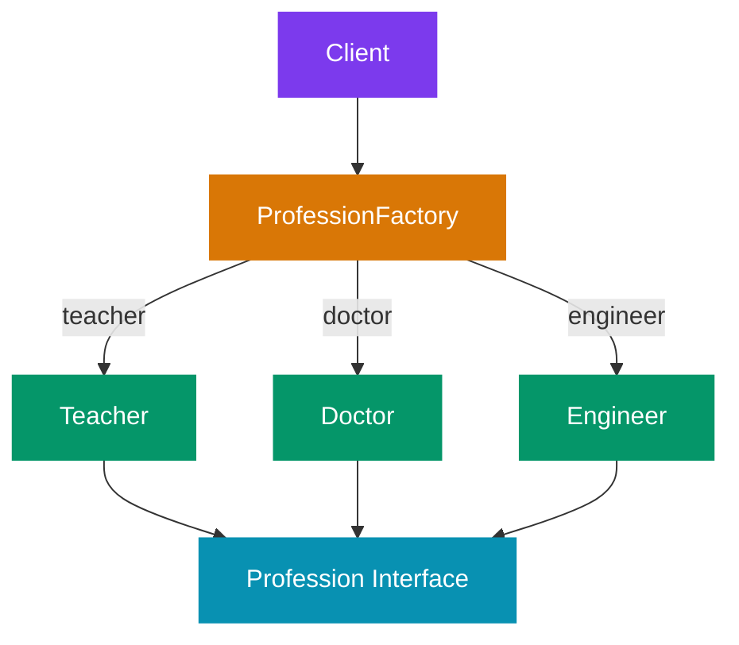

🛠️ **Example:**

```java
public interface Profession {
    void print();
}

public class Engineer implements Profession {
    @Override
    public void print() {
        System.out.println("Engineer.print()");
    }
}

public class Doctor implements Profession {
    @Override
    public void print() {
        System.out.println("Doctor.print()");
    }
}

public class Teacher implements Profession {
    @Override
    public void print() {
        System.out.println("Teacher.print()");
    }
}

public class ProfessionFactory {
    public static Profession getProfession(String typeOfProfession) {
        if (typeOfProfession == null || typeOfProfession.isBlank()) {
            return null;
        }
        if (typeOfProfession.equalsIgnoreCase("teacher")) {
            return new Teacher();
        } else if (typeOfProfession.equalsIgnoreCase("doctor")) {
            return new Doctor();
        } else if (typeOfProfession.equalsIgnoreCase("engineer")) {
            return new Engineer();
        }
        return null;
    }
}

public class Test {
    public static void main(String[] args) {
        Profession teacher = ProfessionFactory.getProfession("teacher");
        teacher.print(); // Teacher.print()

        Profession doctor = ProfessionFactory.getProfession("doctor");
        doctor.print(); // Doctor.print()
    }
}
```

---

</details>

---

### Factory Method Pattern

3. **🏭 What is the Factory Method Pattern (true GoF)? 🔥🔥**

<!-- -->
<details>
<summary>Answer</summary>

**Answer:**

- 🎯 **One-liner (GoF):** *"Define an interface for creating an object, but let **subclasses decide which class to instantiate**."*
  - A `Creator` class declares an **abstract creation method**. It returns the abstract `Product`.
  - Each `ConcreteCreator` overrides it to instantiate a **different** `ConcreteProduct`.
- 🏗️ It is a **creational** pattern. It answers *"which object do I create?"*. It does **not** answer *"in what order do steps run?"*. Template Method answers that second question (see the comparison below).
- 📖 Also known as the **Virtual Constructor**. The base class calls a constructor-like method. The subclass picks its implementation at runtime. So the subclass also picks the concrete type that is returned.
- 🔑 **vs Simple Factory (§1 Q2):**
  - Simple Factory = **one** class, usually one `static` method with a `switch`/`if` chain. The **caller passes a key** to choose the product.
  - Factory Method = **a creator hierarchy** with no key. The *concrete creator you are holding* decides the product.

**📖 The story (memory anchor):**

- A car company runs two plants. `NorthFactory` builds the premium model. `SouthFactory` builds the budget model.
- The company defines one abstract `CompanyFactory` with a single abstract `createCar()`. Each plant overrides it to build **its own** car.
- Client code holds a `CompanyFactory` and a `CompanyCar`. It never names a concrete car class.
- **Change the plant, and a different car comes out. That change is the entire pattern.**

**🏗️ Code shape (memorize this skeleton):**

```java
// ---- Product hierarchy ----
public abstract class CompanyCar {
    public abstract void drive();
}

public class PremiumCar extends CompanyCar {
    @Override
    public void drive() {
        System.out.println("PremiumCar.drive()");
    }
}

public class BudgetCar extends CompanyCar {
    @Override
    public void drive() {
        System.out.println("BudgetCar.drive()");
    }
}

// ---- Creator: declares the factory method. THIS IS THE WHOLE PATTERN ----
public abstract class CompanyFactory {
    public abstract CompanyCar createCar();   // <-- the factory method
}

// ---- ConcreteCreators: each decides a DIFFERENT concrete product ----
public class NorthFactory extends CompanyFactory {
    @Override
    public PremiumCar createCar() {   // narrowed (covariant) return type — the tell
        return new PremiumCar();
    }
}

public class SouthFactory extends CompanyFactory {
    @Override
    public BudgetCar createCar() {
        return new BudgetCar();
    }
}
```

**Client:**

```java
CompanyFactory factory = new NorthFactory(); // the ONLY place a concrete creator is named
CompanyCar car = factory.createCar();        // client never names PremiumCar
car.drive();                                 // PremiumCar.drive()
```

**🔧 The three mechanisms that make it work (memorize these):**

| Mechanism | What it does | Keyword |
|---|---|---|
| **Abstract creation method** | The creator declares `createCar()` with **no implementation**. It does not decide the concrete class. It forces every subclass to decide. | `abstract` on `createCar()` |
| **Dynamic dispatch** | When base-class code calls `createCar()`, the call goes to the **subclass** override at runtime. So the base gets a product it never named. | runtime polymorphism |
| **Covariant return type** | The override may **narrow** the return type (`CompanyCar` → `PremiumCar`). Legal since Java 5. It is the strongest visual sign that you are looking at Factory Method, not a plain overridden method. | narrowed return |

**🆚 Simple Factory vs Factory Method:**

| | Simple Factory (§1 Q2) | Factory Method |
|---|---|---|
| GoF pattern? | ❌️ No — a coding idiom | ✅ Yes — creational |
| Structure | **One** class, one (usually `static`) method | A **creator hierarchy**: abstract creator + N concrete creators |
| Who decides the product | The **caller**, via a key argument | The **subclass** you are using |
| Adding a new product | **Edit** the `switch` (breaks OCP) | **Add** a new subclass (obeys OCP) |

> 💡 They can **work together**. A *parameterized* factory method — `CompanyCar createCar(String model)` — can hold a Simple Factory `switch` **inside** each subclass override. That is a legal GoF variant. But the pattern is the *overridable creation method*, not the switch inside it.

**🆚 Factory Method vs Template Method (🔥🔥 the classic confusion):**

| Aspect | Factory Method 🏭 | Template Method 📝 |
|---|---|---|
| **Category** | Creational | Behavioral |
| **Question it answers** | *Which* object do I create? | In *what order* do the steps run? |
| **Subclass overrides** | A *creation* method returning a product | One or more *step* methods (hooks) |
| **The fixed part** | Base code that depends only on the `Product` type | The template method itself — usually `final`, the locked step sequence |
| **Subclass CANNOT** | Change how the base code uses the product | Reorder, add, or remove steps |

> 🧪 **The falsifiable delete-test** — use this line. It gives a clear answer: *"Delete the pipeline method and it is still a Factory Method; delete the `createX()` and it is not."*
> - Sometimes a `final orderCar()` wrapper sits around the creation call.
> - That wrapper is a **separate Template Method used together with** Factory Method. It is not part of Factory Method.

⚠️ **Two myths to never repeat:**

1. *"Factory Method is the locked-skeleton pattern"* — no, the locked skeleton **is** Template Method.
2. *"Template Method lets subclasses add/skip/reorder steps"* — no, that is backwards. The template method is typically `final` exactly so they **cannot**. A subclass may override a hook to a no-op. That removes a step's *effect*, but never its *position*.

**🎤 Best line for the interview:**

> *"Spring Data's `RepositoryFactorySupport` is Factory Method in production — `JpaRepositoryFactory` and `MongoRepositoryFactory` each override the creation method to return a **different** repository implementation, and the base code works only against the `Repository` abstraction. The JDK's `Collection.iterator()` is the same shape: `ArrayList` and `LinkedList` each return a different `Iterator` product."*

> ⚠️ **Weak example — know it, but do not start with it.** Spring's `AbstractBeanFactory.createBean()` *is* structurally Factory Method. But it is a poor example:
> - There is exactly **one** concrete overrider (`AbstractAutowireCapableBeanFactory`).
> - The product type is plain `Object`.
> - So it shows neither "several creators" nor "different products".
>
> Also, if you call the bean-creation *lifecycle order* Factory Method, you make the exact mistake above. That ordering is **Template Method**. Only the `createBean()` override is the Factory Method.

🔗 Full deep-dive: [`04_2_Factory_Method_Design_Pattern.md`](../2_design_patterns/04_2_Factory_Method_Design_Pattern.md) · [Three factories compared](../2_design_patterns/04_Factory_vs_Factory_Method_vs_Abstract_Factory_Design_Pattern.md)

---

</details>

---

### Abstract Factory Design Pattern

4. **🔲 What is the Abstract Factory Design Pattern? 🔥**

<!-- -->
<details>
<summary>Answer</summary>

**Answer:**

- 🎯 **One-liner (GoF):** *"Provide an interface for creating **families of related or dependent objects** without specifying their concrete classes."*
- 🏗️ The pattern **is the factory interface itself**. It declares **one create-method per product type**. Each concrete factory implements the whole interface, so it builds **one consistent family**.
- 🔒 **Why it exists:** mixing members from different families is a **correctness bug**, not just untidy code. Pick the factory once, and every product **co-varies** together (they change as one set). The compiler makes it impossible to pair a member of family A with a member of family B.
- 📖 It is also known as a *Kit*.
- ⚠️ **The "factory of factories" label is misleading — do not use it.** GoF defines **no** factory that returns other factories. The code that *selects* which concrete factory to use is a plain **Simple Factory**. It sits outside the pattern.
- 🔑 **vs Factory Method (§1 Q3):** they do not compete. Abstract Factory is *built from* Factory Methods.
  - **One** creation method = Factory Method.
  - A **co-varying set** of them behind one interface = Abstract Factory.
  - The counting test: **1 product type → Factory Method (or Strategy); ≥ 2 product types that must stay consistent → Abstract Factory.**

**Steps:**

- 1️⃣ Define **one abstract product type per product**. Do not use one shared type for all of them. If you do, you lose the compile-time family guarantee.
- 2️⃣ Define the **AbstractFactory** interface with one `createXxx()` method per product type.
- 3️⃣ Write **one ConcreteFactory per family**, each returning that family's products.
- 4️⃣ The client picks a factory **once**. Then it gets every product from it and talks only to the abstract types.

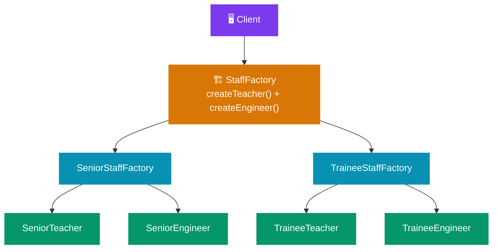

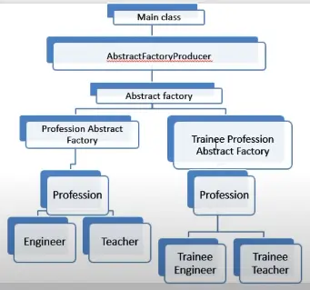

🛠️ **Example — two product types (`Teacher`, `Engineer`), two families (senior, trainee):**

```java
// ---- AbstractProducts: ONE abstract type PER product ----
public interface Teacher {
    void teach();
}

public interface Engineer {
    void build();
}

// ---- ConcreteProducts, grouped into two families ----
public class SeniorTeacher implements Teacher {
    @Override
    public void teach() {
        System.out.println("SeniorTeacher.teach()");
    }
}

public class SeniorEngineer implements Engineer {
    @Override
    public void build() {
        System.out.println("SeniorEngineer.build()");
    }
}

public class TraineeTeacher implements Teacher {
    @Override
    public void teach() {
        System.out.println("TraineeTeacher.teach()");
    }
}

public class TraineeEngineer implements Engineer {
    @Override
    public void build() {
        System.out.println("TraineeEngineer.build()");
    }
}

// ---- AbstractFactory: one create-method per product. THE PATTERN IS THIS INTERFACE ----
public interface StaffFactory {
    Teacher createTeacher();
    Engineer createEngineer();
}

// ---- ConcreteFactory: each produces ONE consistent family ----
public class SeniorStaffFactory implements StaffFactory {
    @Override
    public Teacher createTeacher() {
        return new SeniorTeacher();
    }

    @Override
    public Engineer createEngineer() {
        return new SeniorEngineer();
    }
}

public class TraineeStaffFactory implements StaffFactory {
    @Override
    public Teacher createTeacher() {
        return new TraineeTeacher();
    }

    @Override
    public Engineer createEngineer() {
        return new TraineeEngineer();
    }
}

// ---- Choosing a factory is a Simple Factory — NOT part of the pattern ----
public class StaffFactorySelector {
    public static StaffFactory forCohort(boolean isTrainee) {
        return isTrainee ? new TraineeStaffFactory() : new SeniorStaffFactory();
    }
}

public class Test {
    public static void main(String[] args) {
        // Commit to ONE family, once.
        StaffFactory factory = StaffFactorySelector.forCohort(true);

        Teacher teacher = factory.createTeacher();
        teacher.teach();    // TraineeTeacher.teach()

        Engineer engineer = factory.createEngineer();
        engineer.build();   // TraineeEngineer.build()

        // Every product co-varies with the factory. There is no way to
        // accidentally pair a TraineeTeacher with a SeniorEngineer.
    }
}
```

🔒 `StaffFactory` **names every product explicitly**. So a `TraineeStaffFactory` cannot forget to build an `Engineer`, and it cannot return a senior product. The compiler enforces family consistency. You do not depend on developers being careful.

⚖️ **The main trade-off (expect this follow-up):**

- Adding a **new family** is easy. Write one more factory class and change nothing else — this follows OCP.
- Adding a **new product type** is hard. You must add a method to `StaffFactory`, then implement it in **every** existing factory.
- Choose the pattern when families change often and the product list is stable.

🎯 **Interview line:** *"The Abstract Factory is the `StaffFactory` interface with one create-method per product; each concrete factory builds one whole family; and the thing that picks a factory is just a Simple Factory, not part of the pattern."*

🔗 Full deep-dive: [`04_3_Abstract_Factory_Design_Pattern.md`](../2_design_patterns/04_3_Abstract_Factory_Design_Pattern.md)

---

</details>

---

### Singleton Design Pattern

5. **1️⃣ What is the Singleton Design Pattern? 🔥🔥**

<!-- -->
<details>
<summary>Answer</summary>

**Answer:**

> 📚 **Deep dive:** [`2_design_patterns/03_Singleton_Design_Pattern_in_Java.md`](../2_design_patterns/03_Singleton_Design_Pattern_in_Java.md) — full mechanism, diagrams, and code. This answer is the **short version to say in an interview**.

The [**Singleton Design Pattern**](../2_design_patterns/03_Singleton_Design_Pattern_in_Java.md) is one of the simplest design patterns in Java. It uses a single class that is **responsible for creating an object while making sure that only a single object gets created**.

- Strictly speaking, that means **one instance per classloader**.
- People often simplify this to "one per JVM". See the classloader trap below for when that simple version is wrong.

The class gives a way to access its only object directly. You do not need to instantiate the class.

🧠 **In Simple Words:** A Singleton class is a class that can have only one instance at any given time. To be exact: **one instance per classloader**.

**Simple steps:**

1. Create a `private static` variable.
2. Create a `private` constructor so that an object can't be created using the `new` keyword.
3. Create a `static` method that returns the instance.

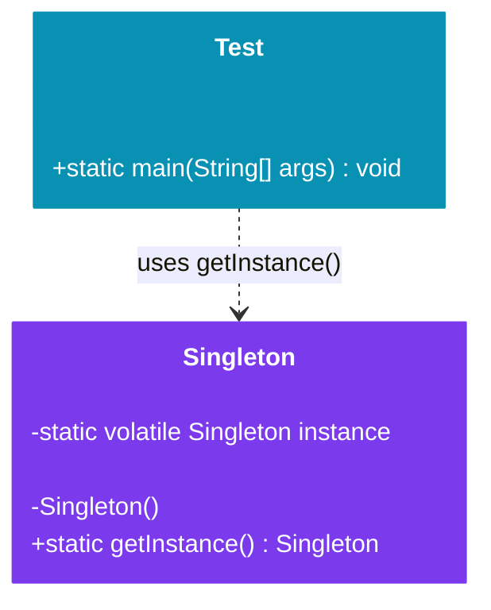

🛠️ **Example:**

```java
public class Singleton {
    private static volatile Singleton instance;

    private Singleton() { }

    public static Singleton getInstance() {
        if (instance == null) {
            synchronized (Singleton.class) {
                // double check
                if (instance == null) {
                    instance = new Singleton();
                }
            }
        }
        return instance;
    }
}

public class Test {
    public static void main(String[] args) {
        Singleton singleton1 = Singleton.getInstance();
        Singleton singleton2 = Singleton.getInstance();

        // == compares references — true means the SAME object
        System.out.println(singleton1 == singleton2);            // true
        System.out.println(System.identityHashCode(singleton1)); // 114935352
        System.out.println(System.identityHashCode(singleton2)); // 114935352
    }
}
```

> ⚠️ **Why `==`, not `hashCode()`?**
> - `Object.hashCode()` is **not guaranteed unique**. Two different objects can legally share a hash code. So equal hash codes do **not** prove identity.
> - Reference equality (`==`) is the only sure proof that two variables point to the same instance.
> - `System.identityHashCode()` is shown here only as extra support, never as proof.

💡 **Pro Tip:** In the [Singleton Design Pattern](../2_design_patterns/03_Singleton_Design_Pattern_in_Java.md), we use the `volatile` keyword, `synchronized` block scope, and **double checking**. Together they make lazy initialization thread-safe.

**🧭 How the approaches evolved (the main line of your interview answer):**

Explain Singleton as a chain of *problems and fixes*. Each approach exists to fix the flaw in the previous one.

```
Naive lazy init        → not thread-safe (two threads both pass null check)
  synchronized method  → thread-safe but SLOW (locks on every call)
    DCL                → fast, but reordering bug without volatile
      DCL + volatile   → correct, but boilerplate
        Bill Pugh      → ✅ best for production
          Enum         → ✅✅ also beats reflection / serialization / cloning
```

**🔑 DCL — why two `null` checks?**

- **Outer check = performance.** Once the instance exists, every call returns immediately and never touches the lock. (Synchronization is only needed the *first* time.)
- **Inner check = correctness.** Several threads may pass the outer check together. Only the first one creates the instance. The inner check stops the rest.

**⚡ Why `volatile` is mandatory in DCL (🔥🔥 follow-up):**

`instance = new Singleton()` is **not atomic**. It's 3 steps: **(1)** allocate memory, **(2)** run constructor, **(3)** assign address to `instance`.

- Without `volatile`, the JIT/CPU may reorder to **1 → 3 → 2**. So `instance` becomes non-null *before* the constructor runs.
- Another thread reaches the unlocked **outer check** and sees non-null. It skips the block and returns a **partially-constructed object** → it reads uninitialized fields.
- `volatile` adds a **memory barrier**. It stops the 3-before-2 reorder and sets up a **happens-before** edge. So a non-null reference always means a fully-built object.

**🏆 Bill Pugh — Initialization-on-Demand Holder (production default):**

```java
public class Singleton {
    private Singleton() { }

    private static class SingletonHolder {
        private static final Singleton INSTANCE = new Singleton();
    }

    public static Singleton getInstance() {
        return SingletonHolder.INSTANCE;   // no null check, no lock, no volatile
    }
}
```

- **Lazy:** `SingletonHolder` is **not loaded** when `Singleton` loads — only when `getInstance()` is first called.
- **Thread-safe:** the JVM runs static field initialization during class loading **under a class-init lock, by a single thread** → exactly one instance, with zero synchronization in your code.

**👑 Enum Singleton — the best choice (*Effective Java* Item 3):**

```java
public enum Singleton {
    INSTANCE;
    public void doSomething() { }
}
```

It is safe from the three classic attacks by default:

| Attack | Why enum is safe |
|---|---|
| **Reflection** | `Constructor.newInstance()` on an enum throws `IllegalArgumentException` |
| **Serialization** | `readObject()` always returns the **existing** constant, never a new one |
| **Cloning** | `Enum.clone()` throws `CloneNotSupportedException` |

⚠️ **Limitation:** an enum **cannot extend a class** (it can implement interfaces). Need inheritance → use Bill Pugh.

**💥 4 ways to break a *normal* Singleton + fixes:**

| Break | Fix 🛡️ |
|---|---|
| Reflection (bypasses private constructor) | Throw exception in constructor if `instance != null`. This guard works with eager init. On a lazy singleton, a reflective call made before `getInstance()` still succeeds. Only enum is fully safe |
| Serialization (deserialize creates a new one) | Implement `readResolve()` returning `instance` |
| Cloning | **Simply don't implement `Cloneable`**. Then `Object.clone()` throws `CloneNotSupportedException` on its own. If the class must implement `Cloneable` for another reason, override `clone()` to `throw new CloneNotSupportedException()` |
| Concurrent access (ExecutorService) | `volatile` + double-checked locking |

> ⚠️ **Why not "override `clone()` to return `instance`"?** Most blogs give that answer. But it **breaks the intent of the `Object.clone()` contract**. The Javadoc says the general intent is that `x.clone() != x` is true. A caller who correctly expects a copy gets the shared singleton back, with no warning. The correct fix is to refuse cloning. Enum gives you this with no extra code.

**🔀 Spring singleton ≠ GoF Singleton (🔥 trap):**

- **GoF** → one instance per **classloader**, enforced *in the class*.
- **Spring** → one instance per **`ApplicationContext`**, managed by a `ConcurrentHashMap<beanName, instance>` registry.
- 🎯 **Proof:** create **two** `ApplicationContext`s → you get **two** instances of the same `@Component`. GoF would never allow that.

**🧩 The classloader trap (why it's "per classloader", not "per JVM"):**

A class's runtime identity is the pair **`(defining classloader, fully-qualified name)`**. The *same* class loaded by *two different* classloaders is **two distinct classes** to the JVM. Each one:

- has its **own copy of the static `instance` field**,
- respects the private constructor,
- holds its own singleton.

Where this causes real problems:

- app servers (one classloader per WAR),
- OSGi bundles,
- plugin architectures,
- hot redeploy. The new classloader gets a new instance. The old static keeps the old classloader alive. This is the classic Metaspace leak.

> 🎯 **One-liner:** *"Singleton guarantees one instance per classloader, not per JVM. In a plain `java -jar` app those are the same thing; in app servers, OSGi, or after a hot redeploy they are not."*

**📊 Approaches — comparison:**

| Approach | Lazy | Thread-Safe | Reflection-Safe | Serialization-Safe | Performance |
|---|---|---|---|---|---|
| Eager Initialization | ❌️ | ✅ | ❌️ | ❌️ | ✅ Fast |
| Synchronized Method | ✅ | ✅ | ❌️ | ❌️ | ⚠️ Slow (lock every call) |
| DCL + `volatile` | ✅ | ✅ | ❌️ | ❌️ | ✅ Fast (lock only first) |
| **Bill Pugh Holder** | ✅ | ✅ | ❌️ | ❌️ | ✅✅ Best (no lock ever) |
| **Enum** | ⚠️ Partly (created when the enum class first loads) | ✅ | ✅ | ✅ | ✅ Fast |

**🎯 When to use which:** Bill Pugh = default · Enum = need reflection/serialization safety · DCL + `volatile` = the instance needs a runtime argument (the Bill Pugh holder cannot take one) + lazy + thread-safe · Eager = lightweight & always needed.

---

</details>

---

### Prototype Design Pattern

6. **🧬 What is the Prototype Design Pattern? 💤**

<!-- -->
<details>
<summary>Answer</summary>

**Answer:**

The Prototype pattern creates copies of objects, to improve performance. You implement a prototype interface. This interface says: create a **clone of the current object**. Use this pattern when creating an object directly is costly. For example:

- the creation needs database calls, or
- it needs too much processing that will take a lot of memory.

🧠 **In Simple Words:** We can cache the object, and return its clone on the next request.

**Steps:**

- 1️⃣ Create a client class (`Test`) which calls the `ProfessionCache` class.
- 2️⃣ `ProfessionCache` class has 2 methods. The 1st loads the key-value in the map and creates the cache. The 2nd returns the required cloned object.
- 3️⃣ The abstract parent class (`Profession`) contains the cloning logic. The concrete subclasses (`Doctor`, `Engineer`) are normal POJOs.

🛠️ **Example:**

```java
import java.util.ArrayList;
import java.util.List;

public abstract class Profession implements Cloneable {
    public int id;
    public String name;
    public List<String> skills = new ArrayList<>();   // a MUTABLE reference field

    abstract void print();

    @Override
    public Profession clone() {
        try {
            // super.clone() is a SHALLOW copy: the `skills` reference is copied,
            // NOT the ArrayList it points at.
            Profession copy = (Profession) super.clone();
            copy.skills = new ArrayList<>(this.skills);   // deep-copy the mutable field
            return copy;
        } catch (CloneNotSupportedException cnse) {
            throw new AssertionError("Profession is Cloneable", cnse);
        }
    }
}

public class Engineer extends Profession {
    @Override
    void print() {
        System.out.println("Engineer.print()");
    }
}

public class Doctor extends Profession {
    @Override
    void print() {
        System.out.println("Doctor.print()");
    }
}

import java.util.Map;
import java.util.concurrent.ConcurrentHashMap;

public class ProfessionCache {
    // ConcurrentHashMap, not the legacy Hashtable — the cache is shared across threads
    private static final Map<Integer, Profession> professionMap = new ConcurrentHashMap<>();

    public static Profession getCloneNewProfession(int id) {
        Profession cached = professionMap.get(id);
        if (cached == null) {
            throw new IllegalArgumentException("No prototype registered for id " + id);
        }
        return cached.clone();
    }

    public static void loadProfessionCache() {
        Doctor doc = new Doctor();
        doc.id = 1;
        professionMap.put(doc.id, doc);

        Engineer engineer = new Engineer();
        engineer.id = 2;
        professionMap.put(engineer.id, engineer);
    }
}

public class Test {
    public static void main(String[] args) {
        ProfessionCache.loadProfessionCache();

        Profession docProfession = ProfessionCache.getCloneNewProfession(1);
        Profession docProfession2 = ProfessionCache.getCloneNewProfession(1);

        System.out.println(docProfession == docProfession2);            // false — distinct copies
        System.out.println(docProfession.skills == docProfession2.skills); // false — deep-copied
    }
}
```

**🔪 Shallow vs deep copy — everything interviewers ask about Prototype (🔥 follow-up):**

| | Shallow copy | Deep copy |
|---|---|---|
| What `Object.clone()` gives you | ✅ This one — a field-by-field bitwise copy | ❌️ Never automatic |
| Primitives & `String` | Safe (values are copied; `String` is immutable) | Same |
| Mutable reference fields (`List`, `Map`, custom objects) | ⚠️ **Shared** — if you change the clone's list, the original's list changes too | Copied separately |
| How to get it | Free from `super.clone()` | Copy each mutable field by hand, or use a **copy constructor**, or a **serialization round-trip** (slow but recursive) |

> ⚠️ **The `Cloneable` API gets a lot of criticism** (*Effective Java* Item 13). The problems:
> - It is a **marker interface with no `clone()` method on it**.
> - `Object.clone()` is `protected`.
> - It skips constructors, so `final` fields cannot be assigned.
> - It forces callers to catch a checked exception, even when the class implements `Cloneable` and the exception cannot happen.
>
> Modern answer: *"I'd implement Prototype with a **copy constructor** or a static `copyOf()` factory rather than `Cloneable` — same pattern, none of the `clone()` contract landmines."*

---

</details>

---

### Builder Design Pattern

7. **🔨 What is the Builder Design Pattern? 🔥🔥**

<!-- -->
<details>
<summary>Answer</summary>

**Answer:**

The Builder Pattern **constructs a complex object from simple objects**. It does this step by step.

The main roles in this design pattern are:

- 🏠 **Complex Object / Final Product:** e.g. House. This is the complex object that we will create with the Builder design pattern.
- 🔧 **Builder:** An abstract class/interface that defines all ways to create the product. It also has the `getComplexHomeObject()` method, which returns the complex object at the end.
- 🏗️ **ConcreteBuilder:** Multiple Builder implementations. Each one gives a different final object that is complex to design.
- 🎯 **Director:** Controls the creation of the complex object. It has 2 main goals:
  - 1st: call the right concrete builder class to create the correct complex object.
  - 2nd: return that complex object.

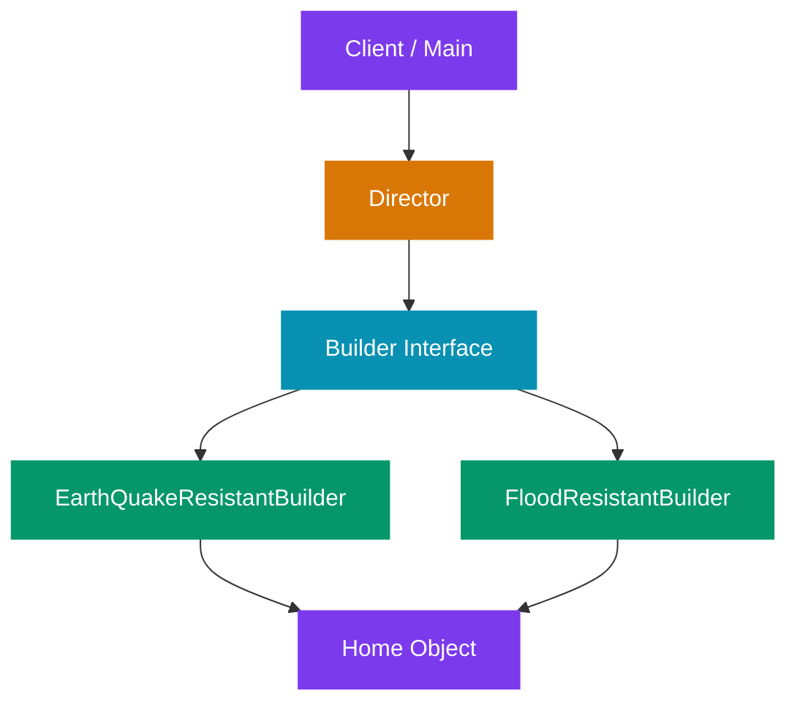

🛠️ **Example:**

**Step 1:** Create complex class POJO — `Home`.

```java
public class Home {
    public String floor;
    public String walls;
    public String terrace;
}
```

**Step 2:** Create a `Builder` interface/abstract class that has definitions.

```java
interface Builder {
    public void buildFloor();
    public void buildWalls();
    public void buildTerrace();
    public Home getComplexHomeObject();
}
```

**Step 3:** Create concrete builder classes that have implementations.

```java
public class EarthQuakeResistantBuilder implements Builder {
    private Home earthquakeResistanceHome = new Home();
    @Override
    public void buildFloor() {
        this.earthquakeResistanceHome.floor = "Wooden floor";
    }
    @Override
    public void buildWalls() {
        this.earthquakeResistanceHome.walls = "Wooden walls";
    }
    @Override
    public void buildTerrace() {
        this.earthquakeResistanceHome.terrace = "Wooden terrace";
    }
    @Override
    public Home getComplexHomeObject() {
        return this.earthquakeResistanceHome;
    }
}

public class FloodResistantBuilder implements Builder {
    private Home floodResistanceHome = new Home();
    @Override
    public void buildFloor() {
        this.floodResistanceHome.floor = "10 Feets Above The Ground Level";
    }
    @Override
    public void buildWalls() {
        this.floodResistanceHome.walls = "Water Resistant walls";
    }
    @Override
    public void buildTerrace() {
        this.floodResistanceHome.terrace = "Water leakage resistant terrace";
    }
    @Override
    public Home getComplexHomeObject() {
        return this.floodResistanceHome;
    }
}
```

**Step 4:** Create a `Director` who will call the correct concrete builder and return the final object.

```java
public class Director {
    private Builder builder;
    public Director(Builder builderType) {
        this.builder = builderType;
    }
    public Home getComplexObjectOfHome() {
        return this.builder.getComplexHomeObject();
    }
    public void manageRequiredHomeConstruction() {
        this.builder.buildFloor();
        this.builder.buildWalls();
        this.builder.buildTerrace();
    }
}
```

**Step 5:** Create a main class. It creates the Director and calls the method to get the complex object instance.

```java
public class Test {
    public static void main(String[] args) {

        // create object of required home builder
        EarthQuakeResistantBuilder earthQuakeResistantBuilder =
          new EarthQuakeResistantBuilder();

        // create object of director that will keep an eye on your builder
        Director director = new Director(earthQuakeResistantBuilder);

        director.manageRequiredHomeConstruction();
        Home home = director.getComplexObjectOfHome();

        System.out.println(home); // Home@5ca881b5
        System.out.println(home.floor + " - " + home.walls + " - " + home.terrace);
        // Wooden floor - Wooden walls - Wooden terrace
    }
}
```

**⚠️ Read this before the interview — the Director form above is *not* what you'll be asked to write.**

When an interviewer says *"implement Builder"*, they almost always mean the **fluent static-nested-builder** (Bloch, *Effective Java* Item 2). They do not mean the GoF Director/ConcreteBuilder pair. The two solve different problems:

| | GoF Builder (above) | Fluent / Bloch Builder |
|---|---|---|
| **Problem solved** | *Same* construction process, **different representations** (wooden house vs concrete house) | **Telescoping constructors** — too many parameters, most of them optional |
| **Who drives the steps** | A **Director** that fixes the build order | The **client**, chaining setters in any order |
| **Number of builders** | Many (one per representation) | Usually **one**, nested inside the product |
| **Result** | Typically a mutable POJO | **Immutable** object — `final` fields, no setters |
| **Asked at SDE II?** | Rarely | 🔥🔥 Almost always |

**🩹 The problem it fixes — the telescoping constructor:**

```java
// 4 fields => an unreadable ladder of overloads, and
// new Home("wood", "wood", null, null) tells the reader nothing.
public Home(String floor) { ... }
public Home(String floor, String walls) { ... }
public Home(String floor, String walls, String terrace) { ... }
public Home(String floor, String walls, String terrace, String roof) { ... }
```

**🏗️ The fluent form (memorize this skeleton):**

```java
public final class Home {

    private final String floor;     // all fields final -> immutable, thread-safe
    private final String walls;
    private final String terrace;   // optional

    private Home(Builder builder) {           // private ctor: only Builder can construct
        this.floor = builder.floor;
        this.walls = builder.walls;
        this.terrace = builder.terrace;
    }

    public static Builder builder() {
        return new Builder();
    }

    public String getFloor() {
        return floor;
    }

    public String getWalls() {
        return walls;
    }

    public String getTerrace() {
        return terrace;
    }

    @Override
    public String toString() {
        return "Home[floor=" + floor + ", walls=" + walls + ", terrace=" + terrace + "]";
    }

    public static class Builder {

        private String floor;
        private String walls;
        private String terrace;

        public Builder floor(String floor) {
            this.floor = floor;
            return this;                      // return `this` -> chaining
        }

        public Builder walls(String walls) {
            this.walls = walls;
            return this;
        }

        public Builder terrace(String terrace) {
            this.terrace = terrace;
            return this;
        }

        public Home build() {
            // Validation lives HERE — an invalid Home can never exist.
            if (floor == null || walls == null) {
                throw new IllegalStateException("floor and walls are mandatory");
            }
            return new Home(this);
        }
    }
}
```

**Client:**

```java
Home home = Home.builder()
        .floor("Wooden floor")
        .walls("Wooden walls")
        .build();                             // terrace omitted — legitimately optional

System.out.println(home);
// Home[floor=Wooden floor, walls=Wooden walls, terrace=null]
```

**🔑 The four points that interviewers look for:**

1. **Immutability** — every field is `final` and there are no setters. So a built `Home` is safe to publish across threads with no synchronization. This is the *reason* the pattern is better than "new + setters".
2. **Validation in `build()`** — cross-field invariants (rules that involve more than one field) are checked at one point: where the object becomes visible. With setters, the object is invalid for a short time, and other code can see it.
3. **Readable call sites** — `.walls("...")` explains itself. `new Home(a, b, null, null)` does not.
4. **The builder is mutable and NOT thread-safe** — this is fine and done on purpose. A builder is a short-lived temporary object used by a single thread. Say this before the interviewer asks.

**📚 Examples to name:** `StringBuilder`, `Stream.Builder`, `HttpRequest.newBuilder()` (JDK), `UriComponentsBuilder`, `MockMvcRequestBuilders` (Spring), `Locale.Builder`.

**🔧 Lombok in practice:**

🔗 Full deep-dive: [`06_Builder_Design_Pattern_in_Java.md`](../2_design_patterns/06_Builder_Design_Pattern_in_Java.md)

<details>
<summary><strong>🤔 Doubt: When is Builder the wrong choice?</strong></summary>

- **≤ 3–4 parameters, all mandatory** → a plain constructor is clearer. Builder adds a whole extra class for no benefit.
- **All fields mandatory and you want compile-time enforcement** → a constructor already forces every argument. A builder moves that check to *runtime* inside `build()`. (The *Step Builder* variant brings back compile-time enforcement. The cost is one interface per step.)
- **Java 16+ and you just need an immutable data carrier** → a `record` gives you `final` fields and `equals`/`hashCode`/`toString` for free. Add a **compact constructor** for validation. Use Builder only once optional parameters appear.
- **You need to build the object bit by bit across method boundaries and change it later** → that is not Builder. That is a mutable domain object. Don't pretend the object is immutable.

---

</details>
<br/>

---

</details>

---

## 2. Structural Design Pattern

1. **🧱 What is a Structural Design Pattern? ⚡**

<!-- -->
<details>
<summary>Answer</summary>

**Answer:**

- 🧱 Structural design patterns show how to put the pieces of a system together.
  The result is flexible and easy to extend.
- 🔧 They make sure that when one part changes, the whole structure does not need to change.

GOF lists these structural patterns:

| # | Pattern | One-line intent | Depth file |
|---|---|---|---|
| 1 | **Adapter** | **Converts** one interface into another one the client expects. It is a wrapper that fixes a mismatch | [`08_Adapter...`](../2_design_patterns/08_Adapter_Design_Pattern_in_Java.md) |
| 2 | **Bridge** | Splits an abstraction from its implementation, so the two hierarchies can change independently | *(master guide)* |
| 3 | **Composite** | Lets a client treat a single object and a tree of objects in the same way | *(master guide)* |
| 4 | **Decorator** | **Adds** behaviour to an object at runtime. It **preserves** the interface and can be stacked | [`07_Decorator...`](../2_design_patterns/07_Decorator_Design_Pattern_in_Java.md) |
| 5 | **Facade** | One simple entry point in front of a complex subsystem | *(master guide)* |
| 6 | **Flyweight** | Shares one object per unique intrinsic state, to cut a huge number of objects down to a few | [`09_Flyweight...`](../2_design_patterns/09_Flyweight_Design_Pattern.md) |
| 7 | **Proxy** | **Controls access** to a subject. It preserves the interface | [`13_Proxy...`](../2_design_patterns/13_Proxy_Design_Pattern_in_Java.md) |

> 🔍 **The three-way comparison interviewers often ask — Adapter vs Decorator vs Proxy.** All three wrap an object. The difference is what they do to the interface, and why.  
> - **Adapter *changes* the interface.** The client and the wrapped object are incompatible.  
> - **Decorator *preserves* the interface and adds behaviour.** It is meant to be stacked.  
> - **Proxy *preserves* the interface and controls access.** For the caller, the behaviour does not change. The wrapping is an internal detail that the caller does not see.

🔗 Master guide covering all 16 patterns: [`01_LLD_Interview_Patterns_Guide.md`](../2_design_patterns/01_LLD_Interview_Patterns_Guide.md)

---

</details>

---

### Proxy Design Pattern

2. **🛡️ What is the Proxy Design Pattern? 🔥**

<!-- -->
<details>
<summary>Answer</summary>

**Answer:**

It's a Structural design pattern. It lets you provide a **substitute or placeholder** for another object.

- A proxy controls access to the original object.
- It lets you do something before or after the request reaches the original object.

🧠 **In Simple Words:** The client should always call the Proxy class. The Proxy runs its checks first. Then it delegates to the real subject.

🔑 **The structural rule (if you get this wrong, the rest of the answer fails):** the Proxy **implements the same interface** as the RealSubject and **holds a reference to it**.

- It is composition + delegation.
- **Two objects exist**, and the client cannot tell which one it is holding.

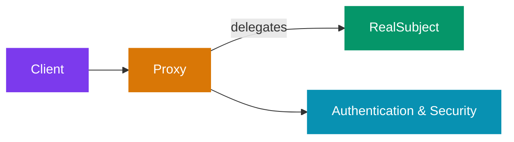

**🎭 The four GoF proxy kinds — name them. Interviewers usually ask this next:**

| Kind | What it controls | Standard example |
|---|---|---|
| **Virtual Proxy** | *When* the real object is created. It delays building an expensive object until first use | Hibernate lazy loading: `getReferenceById()` (formerly `getOne()`) hands back a proxy; the SELECT fires on the first getter |
| **Remote Proxy** | *Where* the real object lives. It is a local stand-in for an object in another address space | RMI stubs, gRPC/Feign clients, any generated service stub |
| **Protection Proxy** | *Who* may call. It runs authorization checks before delegating | Spring Security method-level `@PreAuthorize` |
| **Smart Reference / Smart Proxy** | *What else happens* around the call. It adds extra bookkeeping on access | Reference counting, `@Transactional` (open/commit around the call), caching, logging, metrics |

> 🔍 **Proxy vs Decorator (this question is almost certain to come).** *Identical structure (same interface, wrapped reference), opposite intent.*  
> - **Decorator adds behaviour** the caller asked for. It is meant to be stacked (`new BufferedReader(new FileReader(f))`).  
> - **Proxy controls access** to a subject. The caller usually does not even know the subject is being managed.  
> - The proxy typically **creates or owns** its subject, instead of being handed one.  
>
> If the client composes the wrappers on purpose, it's Decorator. If the wrapping is a hidden internal detail, it's Proxy.

🔗 Full deep-dive: [`13_Proxy_Design_Pattern_in_Java.md`](../2_design_patterns/13_Proxy_Design_Pattern_in_Java.md)

---

</details>

---

3. **🏛️ What is the architecture of the Proxy Design Pattern? 💤**

<!-- -->
<details>
<summary>Answer</summary>

**Answer:**

The client should always call the Proxy class.

- The Proxy **implements the Subject interface**. It does *not* extend the RealSubject.
- It **holds a reference** to the real object.
- It creates the real object lazily, on the first authorized use.


🛠️ **Example:**

```java
public interface Subject {
    void method();
}

public class RealSubjectClass implements Subject {

    public RealSubjectClass() {
        // pretend this is expensive: opens a connection, loads a file, ...
        System.out.println("RealSubjectClass constructed (expensive)");
    }

    @Override
    public void method() {
        System.out.println("I am the actual impl of Subject, the rest are proxies");
    }
}

public class ProxyClass implements Subject {          // SAME interface, not `extends`

    private RealSubjectClass real;                    // reference, created lazily
    private final String role;

    public ProxyClass(String role) {
        this.role = role;
    }

    @Override
    public void method() {
        System.out.println("Hi, I am the proxy — running authentication and security checks");

        if (!"ADMIN".equals(role)) {
            System.out.println("Access denied — the real object is never touched");
            return;                                   // access CONTROLLED: no delegation
        }

        if (real == null) {
            real = new RealSubjectClass();            // VIRTUAL proxy: built on first real use
        }

        System.out.println("Authenticated — delegating to the real subject");
        real.method();                                // DELEGATION, not super.method()
    }
}

public class Test {
    public static void main(String[] args) {
        Subject denied = new ProxyClass("VIEWER");
        denied.method();     // no RealSubjectClass is ever constructed

        Subject allowed = new ProxyClass("ADMIN");
        allowed.method();    // constructs the real subject, then delegates
    }
}
```

⚠️ **Why `implements` + a field, and never `extends` + `super.method()`:** with inheritance there is **only one object**. The proxy *is* the subject. This makes three of the pattern's main benefits structurally impossible:

- You cannot **lazily create** an object that is already yourself.
- You cannot stand in for a **remote** object. `super.method()` is always a direct local call.
- You cannot wrap an object that **already exists**. `extends` always builds a new object, so it cannot sit in front of an instance someone else created.

Composition is what gives you all three. Subclassing *is* how CGLIB generates a proxy at runtime. But that is an implementation technique, not the pattern's structure.

---

</details>

---

4. **🎭 What are the roles in the Proxy Design Pattern? 💤**

<!-- -->
<details>
<summary>Answer</summary>

**Answer:**

GoF names four roles:

| Role | Responsibility |
|---|---|
| 📑 **Subject** | The interface that exposes the functionality available to clients. **Both** RealSubject and Proxy implement it. This is what makes them interchangeable. |
| ⚙️ **RealSubject** | The concrete implementation that does the actual work and is hidden behind the proxy. |
| 🛡️ **Proxy** | **Implements `Subject` and holds a reference to a `RealSubject`**. It controls access to it. It delegates, and it may create the real object lazily, deny the call, cache, or add bookkeeping around it. |
| 🖥️ **Client** | Programs against `Subject` only. It does not know whether it holds the proxy or the real object. |

⚠️ **The trap:** *"the Proxy hides the real object **by extending it**"* is wrong. Extending gives you **one** object. Proxy needs **two**: the wrapper and the wrapped. See the composition note in §2 Q3.

**🔧 Static vs dynamic proxies:**

| | Static proxy | Dynamic proxy |
|---|---|---|
| **How it's built** | A class you write by hand. It implements `Subject` and forwards each method | Generated at runtime — `java.lang.reflect.Proxy` + `InvocationHandler`, or CGLIB bytecode |
| **Boilerplate** | One forwarding method per interface method | Zero. One `invoke()` handles every method through reflection |
| **Compile-time safety** | ✅ Type-checked | ❌️ Errors surface at runtime |
| **Used by** | Small, fixed interfaces (the §2 Q3 example) | Spring AOP, Feign, Mockito, Hibernate lazy loading |

---

</details>

---

5. **✅ What are the advantages of the Proxy Design Pattern? 💤**

<!-- -->
<details>
<summary>Answer</summary>

**Answer:**

- 🔒 **Control Access:** Proxies can control access to the real object. This is useful for building access control. It improves security, because only authorized users or processes can use the object.
- ⏳ **Lazy Initialization:** Proxies can delay creating and initializing expensive objects until they are actually needed. This improves performance and uses fewer resources.
- 📊 **Logging and Monitoring:** Proxies can add logging and monitoring. They intercept requests to the real object. So they can log usage statistics, monitor performance, and track access patterns.
- 🌐 **Remote Proxy:** In distributed systems, proxies can represent objects in different address spaces. You can then talk to remote objects as if they were local.
- 💾 **Caching:** Proxies can cache the results of expensive operations. If the same request comes many times, the proxy can return the cached result. It does not call the real object again.
- ✅ **Data Validation:** Proxies can validate input data before passing it to the real object. So only valid data is processed, and there is less risk of errors.
- 🔧 **Flexibility and Customization:** Proxies give a flexible way to customize how objects behave. They can add, modify, or override functionality without changing the real object's code.

> ✅ Some of these need the proxy and the subject to be **two separate objects** (§2 Q3). With an `extends`-based proxy, lazy initialization and remote proxying are structurally impossible.

---

</details>

---

6. **🌱 How does Spring implement proxies — JDK dynamic proxy vs CGLIB? 🔥🔥**

<!-- -->
<details>
<summary>Answer</summary>

**Answer:**

This is where Proxy actually appears in a Java backend interview.

- **`@Transactional`, `@Async`, `@Cacheable`, `@PreAuthorize` and every other Spring AOP annotation work by wrapping your bean in a proxy.**
- Spring never calls your object directly. It gives the caller a proxy.
- The proxy runs the advice and then delegates.

**⚔️ The two proxying mechanisms:**

| | **JDK dynamic proxy** | **CGLIB proxy** |
|---|---|---|
| **Mechanism** | `java.lang.reflect.Proxy` generates a class implementing your **interfaces**. All calls go into your `InvocationHandler.invoke()` | Generates a **subclass** of your class at the bytecode level and overrides each method |
| **Requires** | The bean must implement at least one interface | No interface needed |
| **Cannot proxy** | Methods not on the interface. They are simply not visible on the proxy | `final` classes: proxy creation fails with an error at startup. `final`, `private`, `static` methods: skipped silently (a subclass cannot override them) |
| **Injection type** | You must inject the **interface**. Injecting the impl class throws `BeanNotOfRequiredTypeException` | Either works |
| **Spring Boot default** | — | ✅ **CGLIB**, always (`spring.aop.proxy-target-class=true` since Boot 2.0) |

- ⚙️ Plain Spring Framework picks **JDK proxy when the target implements an interface**, and CGLIB otherwise.
- Spring **Boot** overrides that and forces CGLIB. It does this to avoid the "inject the interface, not the class" surprise.
- 🔁 Force JDK proxies back on with `spring.aop.proxy-target-class=false`.

**💣 Self-invocation — the #1 `@Transactional` bug (🔥🔥):**

```java
@Service
public class LoanService {

    @Transactional
    public void saveLoan(Loan loan) {
        // ... writes ...
    }

    public void processBatch(List<Loan> loans) {
        for (Loan loan : loans) {
            saveLoan(loan);   // ❌️ `this.saveLoan(...)` — bypasses the proxy entirely.
                              //    NO transaction is started. Silently.
        }
    }
}
```

- 🎯 **Why:** the **proxy** applies the annotation, not your class.
  - An external caller holds the proxy. So `proxy.saveLoan()` runs the advice and then delegates.
  - But inside `processBatch`, `saveLoan(loan)` compiles to `this.saveLoan(loan)`.
  - Here `this` is the **raw target object**, not the proxy.
  - The call never crosses the proxy boundary, so no advice runs.
  - The same trap applies to `@Async`, `@Cacheable`, `@Retryable`.
- 🔇 **Why it's dangerous:** it fails **silently**. Nothing throws. The writes just auto-commit one by one, and there is no rollback.

**🛠️ Four fixes, best first:**

| Fix | Notes |
|---|---|
| **Move the method to another bean** | The call now crosses a proxy boundary. ✅ Cleanest, and usually the right design anyway |
| **Self-inject** (`@Autowired @Lazy LoanService self;` then `self.saveLoan(...)`) | Works. But a self-reference is a code smell, and an interviewer will question it |
| **`AopContext.currentProxy()`** | Requires `@EnableAspectJAutoProxy(exposeProxy = true)`. It ties your code to Spring AOP |
| **Switch to AspectJ load-time weaving** | Weaves into the bytecode, so there is no proxy boundary at all. Self-invocation works. Heavyweight; rarely worth it |

**🚩 Two more proxy-boundary traps you should name:**

- **`final` / `private` methods are never advised under CGLIB.** The generated subclass cannot override them. So `@Transactional` on a `private` method is a no-op (again, silently).
- **A proxied bean is not your object.**
  - `getClass()` returns `LoanService$$SpringCGLIB$$0`.
  - Before Spring 4.0, CGLIB proxies called the target's constructor a second time. Since Spring 4.0, Spring uses Objenesis, so the proxy is created without calling the constructor. Still, keep side effects out of a proxied bean's constructor.
  - Use `AopUtils.getTargetClass(bean)` when you need the real type.

🎤 **The key line to say in the interview:** *"Spring AOP is the Proxy pattern applied by the container. Boot uses CGLIB subclass proxies by default, and the practical consequence is the self-invocation trap: calling an `@Transactional` method from another method of the same bean goes through `this`, not through the proxy, so the transaction silently never starts."*

🔗 Full deep-dive: [`13_Proxy_Design_Pattern_in_Java.md`](../2_design_patterns/13_Proxy_Design_Pattern_in_Java.md)

---

</details>

---

### Flyweight Design Pattern

7. **🪶 What is the Flyweight Design Pattern? 💤**

<!-- -->
<details>
<summary>Answer</summary>

**Answer:**

- 🧱 It's a **Structural design pattern**.
- 🔄 A flyweight is a shared object. It can be used in many contexts at the same time.
- In each context, the flyweight acts as an independent object.

---

</details>

---

8. **📍 Where and when to use the Flyweight Design Pattern? 💤**

<!-- -->
<details>
<summary>Answer</summary>

**Answer:**

Use the Flyweight design pattern when your application needs many objects, and:

- they share most of their attributes (called **intrinsic attributes/properties**), and
- they have only a few unique attributes (**extrinsic attributes/properties**).

The goal is to control the memory used by a large number of objects. You create fewer objects and share them.

- 📦 **Intrinsic attribute:** Context-**in**dependent, **immutable** data. It is stored **inside** the flyweight as a `final` field. Objects are shared based on this data.
- 🎯 **Extrinsic attribute:** Context-**dependent** data. It is **never stored** in the flyweight. The client passes it in as a **method argument** on every call. If you store it, sharing no longer works.

> ⚠️ **Common misreading:** intrinsic does *not* mean "identical for every instance of the class". It means "does not depend on the calling context, so two clients that need the same value can share one object". The rule is **one flyweight per unique combination of intrinsic values**.

**When to use:**

- 🔢 The application must create a huge number of objects.
- 💾 Creating an object uses a lot of memory. It can also take a lot of time.
- ⚖️ You can divide the object properties into intrinsic and extrinsic properties. The client program should define the extrinsic properties of an object.

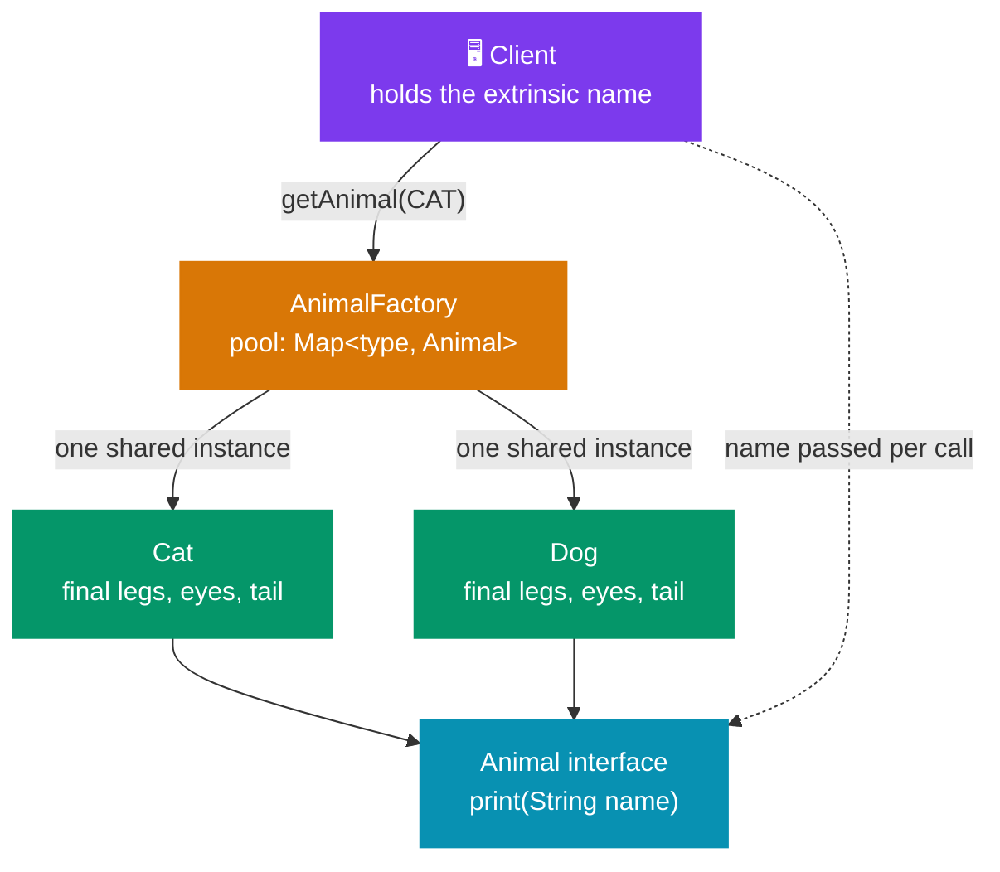

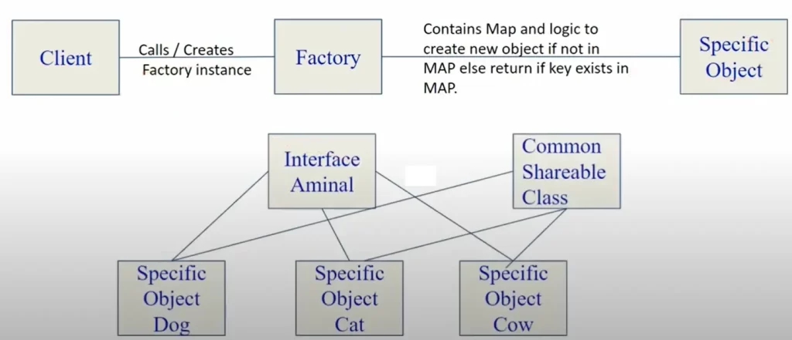

🛠️ **Example:**

```java
// The name is EXTRINSIC -> it is a method PARAMETER, never a field.
public interface Animal {
    void printAnimalAttributes(String name);
}

// Intrinsic state lives INSIDE the flyweight, as final fields.
public class Cat implements Animal {

    private final int legs;
    private final int eyes;
    private final int tail;

    public Cat() {
        this.legs = 4;
        this.eyes = 2;
        this.tail = 1;
    }

    @Override
    public void printAnimalAttributes(String name) {
        System.out.println("Name: " + name           // extrinsic — arrives per call
                + ", legs: " + this.legs             // intrinsic — shared
                + ", eyes: " + this.eyes
                + ", tail: " + this.tail);
    }
}

public class Dog implements Animal {

    private final int legs;
    private final int eyes;
    private final int tail;

    public Dog() {
        this.legs = 4;
        this.eyes = 2;
        this.tail = 1;
    }

    @Override
    public void printAnimalAttributes(String name) {
        System.out.println("Name: " + name
                + ", legs: " + this.legs
                + ", eyes: " + this.eyes
                + ", tail: " + this.tail);
    }
}

import java.util.Map;
import java.util.concurrent.ConcurrentHashMap;

public class AnimalFactory {

    public enum Type { CAT, DOG }

    // ConcurrentHashMap + computeIfAbsent: a shared pool is exactly where
    // two threads race on check-then-put. A plain HashMap here is a bug.
    private static final Map<Type, Animal> POOL = new ConcurrentHashMap<>();

    public static Animal getAnimal(Type type) {
        // The key is the INTRINSIC state only — never the name.
        return POOL.computeIfAbsent(type, t -> switch (t) {
            case CAT -> new Cat();
            case DOG -> new Dog();
        });
    }
}

public class Test {
    public static void main(String[] args) {

        Animal tom = AnimalFactory.getAnimal(AnimalFactory.Type.CAT);
        Animal jerry = AnimalFactory.getAnimal(AnimalFactory.Type.CAT);

        tom.printAnimalAttributes("Tom");
        jerry.printAnimalAttributes("Jerry");

        // THE WHOLE DEMONSTRATION: two differently-named cats, ONE object.
        System.out.println(tom == jerry);   // true

        Animal dog = AnimalFactory.getAnimal(AnimalFactory.Type.DOG);
        System.out.println(tom == dog);     // false — different intrinsic state
    }
}
```

🔑 **The three rules this example follows — and the three mistakes it avoids:**

| Rule | ✅ Here | ❌️ The common wrong version |
|---|---|---|
| Extrinsic state is a **parameter** | `printAnimalAttributes(String name)` | A `setName()` + a `name` field. Storing it makes the object un-shareable |
| The pool is keyed on **intrinsic state only** | key = `Type.CAT` | key = `name + "-CAT"`. Every distinct name creates a new object, so **nothing is ever shared** and the memory saving is zero |
| Intrinsic state is `final` and lives **in** the flyweight | `private final int legs` | A set of `public static` fields in a separate class. That is global mutable state, not a flyweight |

> ⚠️ **Use `==`, not `hashCode()`, to show sharing.** Equal hash codes do **not** prove that two references point to the same object. Different objects can have the same hash code. Reference equality is the only proof that the factory returned the pooled instance and not a new one.

📚 **Real examples:**

- `Integer.valueOf()` (the −128..127 cache). `Integer.valueOf(100) == Integer.valueOf(100)` is `true`, but `valueOf(1000)` is `false`.
- The String constant pool.
- `Character.valueOf()`.

Each one keeps one shared object per unique intrinsic value.

🔗 Full deep-dive: [`09_Flyweight_Design_Pattern.md`](../2_design_patterns/09_Flyweight_Design_Pattern.md)

---

</details>

---

## 3. Behavioral Design Pattern

1. **🔄 What is a Behavioral Design Pattern? ⚡**

<!-- -->
<details>
<summary>Answer</summary>

**Answer:**

Behavioral design patterns find **common communication patterns between objects**. They then put these patterns into code.

The 11 behavioral design patterns are:

| # | Pattern | One-line intent | Depth file |
|---|---|---|---|
| 1 | **Chain of Responsibility** | Pass a request along a chain until a handler deals with it | [`19_Chain_of_Responsibility...`](../2_design_patterns/19_Chain_of_Responsibility_Design_Pattern_in_Java.md) |
| 2 | **Command** | Wrap a request as an object so it can be queued, logged, or undone | *(master guide)* |
| 3 | **Interpreter** | Represent a grammar and evaluate sentences in it | *(master guide)* |
| 4 | **Iterator** | Traverse a collection without exposing its internal structure | *(master guide)* |
| 5 | **Mediator** | Centralize many-to-many communication into one hub object | *(master guide)* |
| 6 | **Memento** | Capture and restore an object's internal state without breaking encapsulation | *(master guide)* |
| 7 | **Observer** | One-to-many notification — subject publishes, subscribers react | [`11_Observer...`](../2_design_patterns/11_Observer_Design_Pattern_in_Java.md) |
| 8 | **State** | Behaviour changes as the object moves through its lifecycle; states know their successors | [`18_State...`](../2_design_patterns/18_State_Design_Pattern_in_Java.md) |
| 9 | **Strategy** | Interchangeable algorithms behind one interface; the **client** picks | [`10_Strategy...`](../2_design_patterns/10_Strategy_Design_Pattern_in_Java.md) |
| 10 | **Template Method** | A `final` algorithm skeleton with steps deferred to subclasses | [`05_Template_Method...`](../2_design_patterns/05_Template_Method_Design_Pattern.md) |
| 11 | **Visitor** | Add new operations to an object structure without modifying its classes | *(master guide)* |

---

</details>

---

### Strategy Design Pattern

2. **♟️ What is the Strategy Design Pattern in Java? 🔥🔥**

<!-- -->
<details>
<summary>Answer</summary>

**Answer:**

The Strategy design pattern is a behavioral design pattern. It lets you **select an algorithm at run-time**. The code does not implement a single algorithm directly. Instead, at run-time it gets instructions on which algorithm to use from a family of algorithms.

🛠️ **Example:** There are multiple encoding algorithms. Based on our requirement, we can use one of them while encoding.

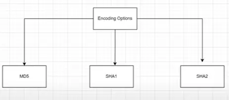

**The GoF structure — the `Context` is the most important part:**

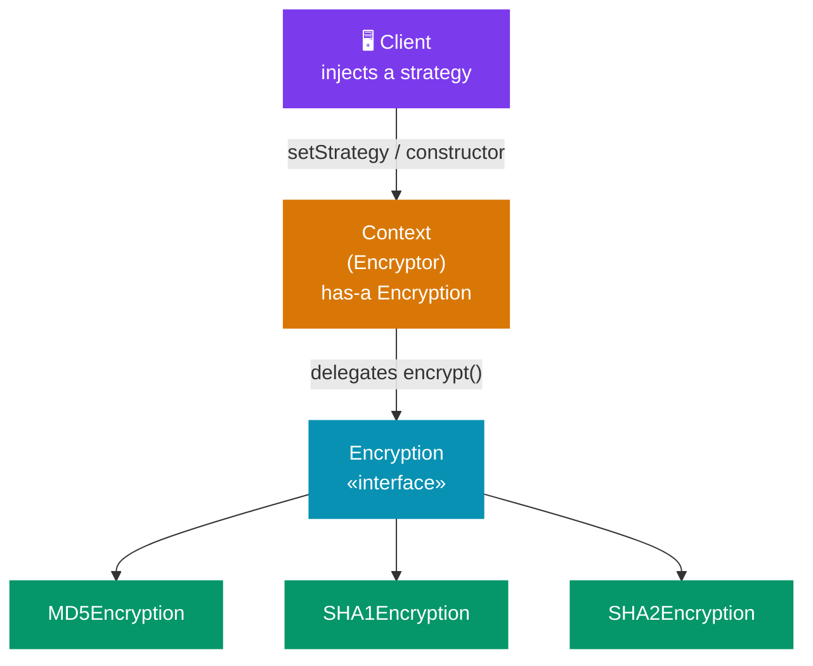

> 📌 **Note what is *not* in this diagram: a factory.** Strategy *selection* is a **separate concern**. Examples are a `switch`, an enum→bean `Map`, or a Spring lookup. It often sits next to Strategy, but it is not part of the pattern. If you draw the factory as the central node, you have drawn a Simple Factory, not Strategy.

<details>
<summary><strong>🤔 Doubt: Strategy and State have the same UML — how do you tell them apart?</strong></summary>

You can't tell them apart by structure. **Same UML, opposite intent.**

| Aspect | **Strategy** | **State** |
|---|---|---|
| **Why behaviour varies** | The **caller chose an algorithm** | The object's **lifecycle position** changed |
| **Who picks the implementation** | The client, injected from outside | The object itself — states transition into each other |
| **Do implementations know each other?** | ❌️ No — `MD5Encryption` knows nothing of `SHA2Encryption` | ✅ Yes — `SubmittedState` names `UnderReviewState` |
| **Changes over the object's life** | Usually set once per operation | Many times, in a defined order |
| **Legal operations** | Identical across strategies — same contract, different math | Differ per state (`disburse` is illegal while `Submitted`) |
| **Transition graph** | Meaningless — there is none | Central to the design |

🎯 **The one-liner:** *"Strategy is about **how** you do something; State is about **what you're allowed to do right now**. In Strategy the client chooses; in State the object chooses its own successor."*

💡 **They work together** — a loan's `ApprovedState` (State) can call an `InterestCalculationStrategy` (Strategy) to compute sanction terms. See [`18_State_Design_Pattern_in_Java.md`](../2_design_patterns/18_State_Design_Pattern_in_Java.md).

---

</details>
<br/>

🔗 Full deep-dive: [`10_Strategy_Design_Pattern_in_Java.md`](../2_design_patterns/10_Strategy_Design_Pattern_in_Java.md)

---

</details>

---

3. **❓ Why is the Strategy Design Pattern needed? 🔥**

<!-- -->
<details>
<summary>Answer</summary>

**Answer:**

Usually, we put all the algorithm logic in the host class. The result is one big class with many switch cases or conditional statements:

```java
public class Encryptor {
    public void encrypt() {
        if (algorithmName.equals("Aes")){
            System.out.println("Encrypting data using AES algorithm");
        } else if (algorithmName.equals("Blowfish")){
            System.out.println("Encrypting data using Blowfish algorithm");
        }
        /*More else if statements for other encryption algorithms*/
    }
}
```

⚠️ **Problems with this approach:**

- 🔒 At runtime, the code goes through the statements to encrypt, based on the algorithm the client gave. The result is tightly coupled, rigid software that is hard to change.
- 💥 To add a new encryption algorithm (e.g., TripleDES or a custom algorithm), you must open and change the `Encryptor` class.
- 🔧 To change an existing algorithm, you must again change the `Encryptor` class.
- 🚨 This clearly breaks the **Open/Closed Principle**, one of the SOLID design principles. You should add new features by writing new code, not by changing existing code.
- ✅ We can avoid these issues by using the Strategy pattern.

---

</details>

---

4. **⚙️ How does the Strategy Design Pattern work? 🔥**

<!-- -->
<details>
<summary>Answer</summary>

**Answer:**

- 📑 We define one abstract `Interface` and many classes that implement it.
- ⚙️ Clients can choose the algorithm at run time. For example, put the algorithm name in the properties file and read it at runtime. So the choice of algorithm happens only at run time.
- 🎯 Each algorithm class follows the **Single Responsibility Principle** (another SOLID principle). Each class only encrypts data with one specific algorithm.

---

</details>

---

5. **👥 What are the participants of the Strategy Design Pattern? ⚡**

<!-- -->
<details>
<summary>Answer</summary>

**Answer:**

⚠️ *"Participants"* is the exact GoF term, and GoF names **exactly three**. Answer with these first. The Spring setup code comes after.

| GoF participant | Role | In the example below |
|---|---|---|
| 📑 **Strategy** | The interface declaring the one operation, common to all algorithms | `Encryption` |
| ⚙️ **ConcreteStrategy** | Each independent implementation of the algorithm | `MD5Encryption`, `SHA1Encryption`, `SHA2Encryption` |
| 🎯 **Context** | **Holds a reference to a `Strategy` and delegates to it.** The client configures the Context with a concrete strategy; the Context never names one. | `DemoController` (it gets the selected `Encryption` for each call and calls `encrypt()`) |

> 🔑 **Candidates forget the Context. But the Context is what makes this the Strategy pattern.** You need an object that *has-a* strategy and delegates to it. Without it, you have a group of polymorphic classes, not the pattern. If you list only "interface + implementations", the interviewer marks the answer incomplete.

**🔧 Not GoF participants — but production Spring code adds these:**

- 🔢 An **`Enum`** of strategy types. It is a type-safe key for selection (it replaces magic strings).
- 🏭 A **selector / factory** that holds a `Map<Enum, Strategy>`. You fill it by injecting `Set<Strategy>`, so Spring supplies every implementation. This is *strategy selection*. It is a **separate concern**, added for convenience. Call it that. Don't call it a participant.
- 🔒 Spring registers each `ConcreteStrategy` as a **singleton shared across request threads**. So every strategy **must be stateless**. Per-request data goes in method parameters, never in mutable fields. Select the strategy **per call**. A `setStrategy()` on a shared Context is a data race.

🛠️ **Example (Spring Boot project):**

```java
package com.knowprogram.dp.enums;
public enum EncodingPatternEnum {
    MD5, SHA1, SHA2
}

package com.knowprogram.dp.encrypt;
public interface Encryption {
    public void encrypt(String toBeEncrypted);
    public EncodingPatternEnum getEncryptionType();
}

package com.knowprogram.dp.encrypt;
@Service
public class MD5Encryption implements Encryption {
    @Override
    public void encrypt(String toBeEncrypted) {
        System.out.println("MD5Encryption.encrypt()");
    }
    @Override
    public EncodingPatternEnum getEncryptionType() {
        return EncodingPatternEnum.MD5;
    }
}

package com.knowprogram.dp.encrypt;
@Service
public class SHA1Encryption implements Encryption {
    @Override
    public void encrypt(String toBeEncrypted) {
        System.out.println("SHA1Encryption.encrypt()");
    }
    @Override
    public EncodingPatternEnum getEncryptionType() {
        return EncodingPatternEnum.SHA1;
    }
}

package com.knowprogram.dp.encrypt;
@Service
public class SHA2Encryption implements Encryption {
    @Override
    public void encrypt(String toBeEncrypted) {
        System.out.println("SHA2Encryption.encrypt()");
    }
    @Override
    public EncodingPatternEnum getEncryptionType() {
        return EncodingPatternEnum.SHA2;
    }
}

package com.knowprogram.dp.factory;
@Component
public class EncryptionFactory {

    Map<EncodingPatternEnum, Encryption> map;

    public EncryptionFactory(Set<Encryption> encryptionTypeSet) {
        System.out.println("EncryptionFactory.EncryptionFactory()");
        createStrategy(encryptionTypeSet);
    }

    private void createStrategy(Set<Encryption> encryptionTypeSet) {
        map = new HashMap<>();
        encryptionTypeSet.stream()
                .forEach(encryptionTypes ->
             map.put(encryptionTypes.getEncryptionType(), encryptionTypes));
    }

    public Encryption findEncryptionType(EncodingPatternEnum encodingPatternEnum) {
        return map.get(encodingPatternEnum);
    }
}

package com.knowprogram.dp.restcontroller;
@RestController
public class DemoController {

    @Autowired
    EncryptionFactory factory;

    @GetMapping("/encrypt")
    public void encyptWithEncode(@RequestParam
                   EncodingPatternEnum encodingPatternEnum) {
        factory.findEncryptionType(encodingPatternEnum).encrypt("code decode");
    }
}
```

---

</details>

---

6. **🌍 What are real-time uses of the Strategy Design Pattern? ⚡**

<!-- -->
<details>
<summary>Answer</summary>

**Answer:**

- 📊 **Sorting class** that supports multiple sorting algorithms, such as bubble sort, merge sort, and quick sort.
- 📦 **File compression class** that can support different compression algorithms, such as ZIP, GZIP, and LZ4, or even a custom compression algorithm.
- 🔐 **Data hashing class** that hashes data using different hash algorithms, such as SHA1, SHA2, MD5, etc. (Strictly, these are hash functions, not encryption. The example above keeps the `Encryption` name for simplicity. AES and RSA are real encryption algorithms.)

🎯 **Interview Tip:** Use the Strategy pattern when you have a family of interchangeable algorithms. It lets you select one at runtime without changing existing code.

---

</details>

---

### Template Method Design Pattern

7. **📝 What is the Template Method Pattern, and how is it different from Factory Method? 🔥**

<!-- -->
<details>
<summary>Answer</summary>

**Answer:**

- 🎯 **One-liner (GoF):** *"Define the **skeleton of an algorithm** in an operation, deferring some steps to subclasses. Template Method lets subclasses redefine certain steps **without changing the algorithm's structure**."*
- 🔄 It is a **behavioral** pattern. It answers *"in what order do the steps run?"*. It never answers *"which object do I create?"*. Factory Method answers that second question (§1 Q3).
- 🔒 The **template method** is the one method that holds the fixed step sequence. It is usually declared `final` exactly so a subclass **cannot reorder, add, or skip** steps.
- 🧬 It **relies on inheritance rather than composition** for its variation point (the place where behaviour changes). Factory Method is another GoF pattern built on subclassing. This is also the main criticism of it.

**📚 The GoF types of operation — name these three. This shows you understand the pattern and did not just memorize it:**

| Kind of step | Declared as | Subclass |
|---|---|---|
| **Concrete operation** | A normal method with a body in the base class | Uses it as is — the invariant shared step |
| **Primitive operation** | `abstract` | **Must** implement it — the mandatory variable step |
| **Hook operation** | Concrete, with a default (often empty) body | **May** override it — the optional extension point |

**🏗️ Code shape (memorize this skeleton):**

```java
public abstract class DataImporter {

    // THE TEMPLATE METHOD — final: the ORDER is the invariant being protected.
    public final void importFile(String path) {
        openFile(path);            // concrete  — same for everyone
        String raw = readRows();   // primitive — every subclass MUST supply this
        validate(raw);             // hook      — default no-op, override if needed
        persist(raw);              // primitive
        closeFile();               // concrete
    }

    private void openFile(String path) {
        System.out.println("Opening " + path);
    }

    private void closeFile() {
        System.out.println("Closed");
    }

    protected abstract String readRows();     // primitive operation

    protected abstract void persist(String rows);  // primitive operation

    protected void validate(String rows) {    // HOOK — empty default body
        // subclasses may override; most don't
    }
}

public class CsvImporter extends DataImporter {

    @Override
    protected String readRows() {
        return "parsed CSV rows";
    }

    @Override
    protected void persist(String rows) {
        System.out.println("Bulk-inserting " + rows);
    }

    @Override
    protected void validate(String rows) {    // this one opts into the hook
        System.out.println("Checking CSV column count");
    }
}

public class XmlImporter extends DataImporter {

    @Override
    protected String readRows() {
        return "parsed XML rows";
    }

    @Override
    protected void persist(String rows) {
        System.out.println("Row-by-row insert of " + rows);
    }
    // validate() not overridden — the default no-op hook runs
}
```

**Client:**

```java
DataImporter importer = new CsvImporter();
importer.importFile("data.csv");
// Prints: Opening data.csv -> Checking CSV column count
//   -> Bulk-inserting parsed CSV rows -> Closed
// The ORDER is identical for XmlImporter. Only the step bodies differ.
```

**🆚 Factory Method vs Template Method (🔥🔥 the classic confusion — §1 Q3 carries the same table, learn it once):**

| Aspect | Factory Method 🏭 | Template Method 📝 |
|---|---|---|
| **Category** | Creational | Behavioral |
| **Question it answers** | *Which* object do I create? | In *what order* do the steps run? |
| **Subclass overrides** | A *creation* method returning a product | One or more *step* methods (primitives/hooks) |
| **The fixed part** | Base code that depends only on the `Product` type | The template method itself — usually `final`, the locked step sequence |
| **Subclass CANNOT** | Change how the base code uses the product | Reorder, add, or remove steps |

> 🧪 **The falsifiable delete-test** — the same test as §1 Q3, seen from the other side: *"Delete the pipeline method and it is still a Factory Method; delete the `createX()` and it is not."*  
> - If deleting the **step sequence** breaks the design, you were looking at Template Method.  
> - If deleting the **overridable creation method** breaks it, you were looking at Factory Method.  
> - A `final orderCar()` wrapper around a `createCar()` call is **two patterns combined**, not one.

⚠️ **Two myths to never repeat:**

1. *"Template Method lets subclasses add/skip/reorder steps"* — this is backwards. The template is `final` exactly so they **cannot**. If you override a hook to a no-op, you remove the step's *effect*, never its *position*.
2. *"Factory Method is the locked-skeleton pattern"* — no, the locked skeleton **is** Template Method.

Do **not** use the "resume template you download and freely edit" analogy. Free editing is the *opposite* of the pattern. The analogy shows the exact wrong idea above.

**⚖️ Limit the `final` claim before the interviewer does:**

- `final` is *how you enforce* the skeleton in code you own. It is not part of the pattern's definition.
- Real frameworks give up this guarantee to allow extension. `HttpServlet.service()`, `AbstractApplicationContext.refresh()`, `AbstractList.iterator()` and `JdbcTemplate.query()` are **none of them `final`**.
- The honest line: *"`final` when I author the base class and the order is a real invariant; convention plus documentation when the base class is a framework extension point."*

**📚 Examples to name:** `HttpServlet.service()` dispatching to `doGet()`/`doPost()` (the hooks *you* override), `AbstractApplicationContext.refresh()`, `JdbcTemplate.execute()`, `AbstractList.iterator()`, JUnit's `@Before` → `@Test` → `@After` lifecycle, and Spring Batch's read → process → write step.

- The shared transaction-interface library exposes `AbstractJSONRestServiceExecutor` and `AbstractSoapWebServiceExecutor`.
- Each has a **`public final void process(ExecutionContext)`** template method. The SOAP one runs `configurations()` → `processRequest()` → `processResponse()` → `prepareResponse()`. The JSON one runs `configurations()` → `doServiceCall()`.
- In the SOAP one, `configurations()`, `processRequest()` and `prepareResponse()` are `protected abstract` primitives. In the JSON one, `configurations()` and `doServiceCall()` are.
- Every downstream bank/partner integration extends one of these and fills in only the steps. It cannot change the order. That is exactly the point.

**🚫 When NOT to use it:**

- A Java class gets only **one** superclass. Template Method uses up that one inheritance slot.
- The base class and subclasses are tightly coupled (the "fragile base class" problem).
- Adding steps later breaks every existing subclass.

Sometimes the variation is a whole algorithm, not a few steps in a fixed order. Then use **Strategy** (composition) instead. It is the modern default.

🔗 Full deep-dive: [`05_Template_Method_Design_Pattern.md`](../2_design_patterns/05_Template_Method_Design_Pattern.md)

---

</details>

---

## 4. SOLID

1. **💎 Why do we need SOLID Principles? 🔥🔥**

<!-- -->
<details>
<summary>Answer</summary>

**Answer:**

The main goal of the SOLID principles is to **reduce dependencies**. Then engineers can change one area of software without affecting others. They also aim to make designs easier to understand, maintain, and extend.

✅ **Benefits:**

- 🔧 Better code readability and maintainability
- 🏗️ Better design patterns and architecture
- 🧪 Improved testability
- 🚀 Adaptive, effective, and agile software

---

</details>

---

2. **📜 What are the SOLID Principles? 🔥🔥**

<!-- -->
<details>
<summary>Answer</summary>

**Answer:**

The following five concepts make up the SOLID principles:

| Principle | Letter | Full Name |
|-----------|--------|-----------|
| **S** | 🅰️ | Single Responsibility |
| **O** | 🅱️ | Open/Closed |
| **L** | 🔹 | Liskov Substitution |
| **I** | 🔸 | Interface Segregation |
| **D** | ⚖️ | Dependency Inversion |


🔗 SOLID worked end-to-end, plus all 16 patterns: [`01_LLD_Interview_Patterns_Guide.md`](../2_design_patterns/01_LLD_Interview_Patterns_Guide.md)

---

</details>

---

3. **🎯 What is the Single Responsibility Principle in SOLID? 🔥🔥**

<!-- -->
<details>
<summary>Answer</summary>

**Answer:**

- 📖 It states that "**One class should have one and only one responsibility**".
- ⚙️ We should write, change, and maintain a class only for one purpose.
- 🔧 A class should have only **one reason to change**.

🛠️ **Example:** Well-split POJOs follow SRP.

- Suppose we have `Employee` and `Address` classes. To change the state of `Employee`, we do not need to modify `Address`. The reverse is also true.
- Now suppose you merge both into a single POJO. Then a change to one address field (like `state`) means you must modify the whole POJO, including the Employee part.

⚠️ **Worst Design:** Merging the Entity class with service code (CRUD) or business logic. That's why we keep the service layer, DAO layer, and Entities separate.

---

</details>

---

4. **⭐ Why is the Single Responsibility Principle important? 🔥**

<!-- -->
<details>
<summary>Answer</summary>

**Answer:**

💡 **Pro Tip:** Use layers in your application and break God classes (classes that do too much) into smaller classes or modules.

---

</details>

---

5. **🚪 What is the Open/Closed Principle in SOLID? 🔥🔥**

<!-- -->
<details>
<summary>Answer</summary>

**Answer:**

🧠 **In Simple Words:** In the real world, you change something for a new requirement. Then some other feature breaks because of your change. This principle exists to prevent that. It's one of the most important concepts in SOLID.

---

</details>

---

6. **🔧 How to implement the Open/Closed Principle? 🔥**

<!-- -->
<details>
<summary>Answer</summary>

**Answer:**

Design so that **new behaviour comes as a new class**. The existing, tested code is never opened again. In practice, you use an **abstraction as the extension point**. Two common forms:

- an interface plus polymorphic implementations (Strategy), or
- an `abstract` base with overridable steps (Template Method).

The caller depends only on the abstraction.

⚠️ **Careful — "extend the class and override some functions" is only half true.**

- Subclassing to add *data* is not OCP. It shows no change in behaviour.
- Every caller still has to change to use the new subclass.
- OCP is about **behaviour** dispatched polymorphically.

❌️ **Violating OCP** — every new discount type reopens `Invoice`:

```java
public class Invoice {
    public double discount(String customerType, double amount) {
        if ("REGULAR".equals(customerType)) {
            return amount * 0.05;
        } else if ("PREMIUM".equals(customerType)) {
            return amount * 0.10;
        }
        // A new tier => edit this method, retest this class, risk regressing both branches.
        return 0;
    }
}
```

✅ **Obeying OCP** — a new tier is a new class; `Invoice` is never touched again:

```java
public interface DiscountPolicy {
    double discount(double amount);
}

public class RegularDiscount implements DiscountPolicy {
    @Override
    public double discount(double amount) {
        return amount * 0.05;
    }
}

public class PremiumDiscount implements DiscountPolicy {
    @Override
    public double discount(double amount) {
        return amount * 0.10;
    }
}

// NEW requirement => NEW class. Nothing above is edited.
public class PartnerDiscount implements DiscountPolicy {
    @Override
    public double discount(double amount) {
        return amount * 0.20;
    }
}

public class Invoice {

    private final DiscountPolicy policy;   // closed for modification...

    public Invoice(DiscountPolicy policy) { // ...open for extension via injection
        this.policy = policy;
    }

    public double payable(double amount) {
        return amount - policy.discount(amount);
    }
}
```

🔑 **The test to apply:** *"When the next requirement lands, do I **edit** a working file or **add** one?"* Editing ⇒ OCP violated. This is the same structure as the Strategy pattern (§3 Q2–Q6). Strategy is the standard way to satisfy OCP.

In Spring, the OCP mechanism *is* this: the abstraction, plus `@Component` implementations, plus constructor injection. The container supplies the new implementation, with no edit to the consumer.

---

</details>

---

7. **🔀 What is the Liskov Substitution Principle? 🔥**

<!-- -->
<details>
<summary>Answer</summary>

**Answer:**

- 📖 LSP states that "**The software should not alter the desirable results when we replace a parent type with any of the subtypes**" or "**Derived types must be completely substitutable for their base types**".
- ⚙️ LSP means that classes created by extending our class should fit into the application without failure. This matters when we use polymorphic behavior through inheritance.
- 🔄 So objects of the subclasses must behave in the same way as objects of the superclass. You mostly see this where we do runtime type identification and then cast to the right reference type.

🧠 **In Simple Words:** Take the previous example. `Invoice` works with any `DiscountPolicy`. So every subtype must return a valid discount. It must not throw an unexpected exception or return a negative value. Then `Invoice` keeps working when you pass any subtype.

---

</details>

---

8. **💡 Why is the Liskov Substitution Principle important? ⚡**

<!-- -->
<details>
<summary>Answer</summary>

**Answer:**

- 🛡️ This avoids misusing inheritance.
- 📑 Subclasses must fulfill the **contract** defined by the base class:
  - the same preconditions (no stronger),
  - the same postconditions (no weaker),
  - the same invariants.
- ✅ **It replaces "IS-A" with "IS-SUBSTITUTABLE-FOR".** ⚠️ Most candidates get this point backwards. LSP's message is that **IS-A is not enough**. A relationship can be a fully correct IS-A and still violate LSP. The reason: LSP is about **behaviour**, not taxonomy (how things are classified).

⚠️ **The Square/Rectangle trap — get the reasoning in the correct direction:**

In maths and in the real world, a square **really is** a rectangle. That is exactly *why* the trap works. The taxonomy is perfect, so `Square extends Rectangle` looks clearly correct. The violation is only **behavioural**:

```java
public class Rectangle {
    protected int width;
    protected int height;

    public void setWidth(int width) {
        this.width = width;
    }

    public void setHeight(int height) {
        this.height = height;
    }

    public int area() {
        return width * height;
    }
}

public class Square extends Rectangle {
    @Override
    public void setWidth(int width) {   // must keep width == height
        this.width = width;
        this.height = width;            // ...and so it mutates height too
    }

    @Override
    public void setHeight(int height) {
        this.width = height;
        this.height = height;
    }
}

// Client written against Rectangle:
void resize(Rectangle r) {
    r.setWidth(5);
    r.setHeight(4);
    assert r.area() == 20;   // ✅ Rectangle: 20   ❌️ Square: 16 — the client breaks
}
```

`Rectangle` carries a hidden **postcondition**: *"setting the width leaves the height unchanged."* `Square` cannot keep it and still be a square. So `Square` is not substitutable for `Rectangle`, and the inheritance is wrong. This is true even though the IS-A statement is true.

🔧 **The fixes:**

- Make the shapes **immutable**. A `withWidth()` that returns a new object has no postcondition to break.
- Or drop the inheritance. Have both implement a `Shape` interface that exposes only `area()`.

🚩 **Smells that signal an LSP violation:**

- an override that throws `UnsupportedOperationException`
- an override that silently does nothing
- an override that tightens a precondition (rejects inputs the parent accepted)
- `if (x instanceof SubType)` checks in client code

---

</details>

---

9. **✂️ What is the Interface Segregation Principle? 🔥**

<!-- -->
<details>
<summary>Answer</summary>

**Answer:**

It states that "**Clients should not be forced to implement unnecessary methods which they will not use**".

ISP applies to interfaces in the same way the Single Responsibility Principle applies to classes. ISP says we should split our interfaces into smaller, more specific ones.

🛠️ **Example:** Assume we have an interface that accepts different types of payments. It also has different modes of order.

```java
public interface PizzaApp {
    public void acceptOrderOnline();
    public void acceptWalkInOrders();
    public void acceptTelephonicOrder();

    public void acceptPaymentsOnline();
    public void acceptCash();
}
```

⚠️ **Problem:** Every implementation class we create must implement **all** methods.

- A cloud kitchen accepts no walk-in or telephonic orders. It takes online payment only.
- So three of the five methods become `throw new UnsupportedOperationException()` stubs.
- Notice that those empty stubs are *also* an LSP violation. The class is no longer substitutable for `PizzaApp`. ISP and LSP fail together here.

✅ **Solution:** Split along the **two axes the problem really has**: *ordering channel* and *payment method*. The original interface mixed the two together. That is why no single split of "online vs offline" works:

- a walk-in customer can pay by card, and
- an online order can be cash-on-delivery.

```java
// Axis 1 — ordering channel
public interface OnlineOrdering {
    public void acceptOrderOnline();
}

public interface WalkInOrdering {
    public void acceptWalkInOrders();
}

public interface TelephonicOrdering {
    public void acceptTelephonicOrder();   // same name as the original — don't rename mid-answer
}

// Axis 2 — payment method
public interface OnlinePayment {
    public void acceptPaymentsOnline();
}

public interface CashPayment {
    public void acceptCash();
}

// Each outlet implements exactly the capabilities it has.
public class CloudKitchen implements OnlineOrdering, OnlinePayment {
    // implements acceptOrderOnline() and acceptPaymentsOnline() (bodies omitted)
    // no dead stubs, no UnsupportedOperationException
}

public class DineInRestaurant
        implements WalkInOrdering, TelephonicOrdering, OnlinePayment, CashPayment {
    // implements all four methods (bodies omitted)
}
```

🔑 **The simple rule:** ISP is to **interfaces** what SRP is to **classes**. Sometimes an implementer is forced to write a method it does not support. Then the interface is doing two jobs. Split it along the axis of *who needs what*. Do not split it along an easy-sounding label like "online/offline".

---

</details>

---

10. **🔃 What is the Dependency Inversion Principle? 🔥🔥**

<!-- -->
<details>
<summary>Answer</summary>

**Answer:**

- 📖 Robert Martin states it in two halves: **(a)** *High-level modules should not depend on low-level modules; **both** should depend on abstractions.* **(b)** *Abstractions should not depend on details; details should depend on abstractions.*
- 🔃 **What really gets "inverted":**
  - Without DIP, the arrow of dependency points **downwards**. The business rule points at the infrastructure.
  - With DIP, the **abstraction is owned by the high-level module**, and the low-level module implements it. So the arrow now points **upwards** into the policy layer.
  - That reversal is where the name comes from.

❌️ **Violation** — the high-level rule is tightly tied to a concrete low-level detail:

```java
public class EmailSender {
    public void send(String to, String message) {
        // SMTP specifics
    }
}

public class OrderService {
    private final EmailSender sender = new EmailSender();   // concrete, and self-constructed

    public void placeOrder(Order order) {
        // ... business rules ...
        sender.send(order.getCustomerEmail(), "Order confirmed");
    }
}
```

⚠️ **Problem:** `OrderService` (high-level policy) depends on `EmailSender` (low-level detail). To switch to SMS, you must edit `OrderService`. You must also edit it to unit-test without an SMTP server.

✅ **Solution** — add the abstraction, **owned by the high-level module**, and let the detail implement it:

```java
// Declared alongside OrderService, in the POLICY layer — this is the inversion.
public interface NotificationSender {
    void send(String recipient, String message);
}

// The low-level detail now depends on the abstraction, not the other way round.
public class EmailSender implements NotificationSender {
    @Override
    public void send(String recipient, String message) {
        // SMTP specifics
    }
}

public class SmsSender implements NotificationSender {
    @Override
    public void send(String recipient, String message) {
        // SMS gateway specifics
    }
}

public class OrderService {

    private final NotificationSender sender;   // depends on the ABSTRACTION

    public OrderService(NotificationSender sender) {   // supplied at the composition root
        this.sender = sender;
    }

    public void placeOrder(Order order) {
        // ... business rules ...
        sender.send(order.getCustomerEmail(), "Order confirmed");
    }
}
```

✅ Now:

- a new channel is a new class,
- `OrderService` never changes, and
- a unit test passes a two-line fake. No mocking framework is required.

<details>
<summary><strong>🤔 Doubt: What is the difference between Dependency Inversion and Dependency Injection?</strong></summary>

People often mix these two up. This is the standard follow-up on this question.

| | **Dependency Inversion (DIP)** | **Dependency Injection (DI)** |
|---|---|---|
| **What it is** | A **design principle** — the *what* | A **technique / mechanism** — the *how* |
| **Concerns** | *What type* you depend on: an abstraction, owned by the high-level module | *Who supplies* the instance: someone else hands it in rather than you calling `new` |
| **Satisfied by** | Depending on `NotificationSender`, not `EmailSender` | Constructor / setter / field injection, a Spring container, or plain `new` at the composition root |
| **Can you have one without the other?** | ✅ Yes — inject a **concrete** `EmailSender` and you have DI with **no** inversion | ✅ Yes — depend on an interface but call `new EmailSender()` yourself: inversion attempted, no injection |

🎯 **The line that settles it:** *"Injecting a concrete class changes **who constructs it**; it does not invert the dependency. Inversion happens only when the type you depend on is an abstraction that the high-level module owns. DI is just the most convenient way to deliver it."*

⚠️ Note also: a **value object** (`Address`, `Money`, `LocalDate`) is a valid concrete dependency. DIP targets **volatile** dependencies (ones likely to change). These are things that talk to the network, the filesystem, the clock, or a database. Don't put an interface in front of `Address` to "obey DIP".

---

</details>
<br/>

🌱 **In Spring:** the container is the composition root (the one place where objects are built and wired).

- `@Component` on each implementation + constructor injection of the interface satisfies both halves.
- When two implementations exist, `@Qualifier` or `@Primary` picks one. `OrderService` does **not** learn either concrete name.

---

</details>

---
