# JUnit Mockito Interview Questions

**JUnit Mockito Interview Question and Answer for fresher and experienced** | Also see:- [Unit Testing in Java](../3_spring/08_testing/01_Unit_Testing_in_Java.md), [JUnit Annotations with Examples](../3_spring/08_testing/02_JUnit_Annotations_with_Examples.md), [JUnit Assert Methods Example](../3_spring/08_testing/03_JUnit_Assert_Methods_Example.md), [Mockito With Examples](../3_spring/08_testing/04_Mockito_With_Examples.md), Spring Boot Rest API Unit Testing (JUnit with Mockito)

📊 **Question Count by Section**

| # | Section | Questions |
|---|---|---|
| 1 | [JUnit & Mockito Basics](#junit--mockito-basics) | 3 |
| 2 | [Mocking Concepts](#mocking-concepts) | 4 |
| 3 | [Stubbing & Verification](#stubbing--verification) | 3 |
| 4 | [Practical Example](#practical-example) | 1 |
| 5 | [Advanced Testing Patterns](#advanced-testing-patterns) | 22 |
| | **Total** | **33** |

> 🔥🔥 Very High — asked in almost every Tier-1 loop &nbsp;·&nbsp; 🔥 High — very frequent in Tier-1 interviews &nbsp;·&nbsp; ⚡ Medium — commonly asked &nbsp;·&nbsp; 💤 Low — good to know, rarely asked

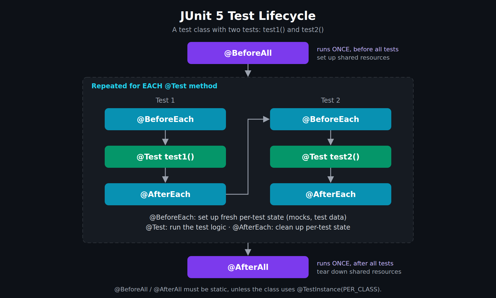

<a id="junit--mockito-basics"></a>

## 1. JUnit & Mockito Basics

1. **🔧 What is Mockito in JUnit? 🔥🔥**

<!-- -->
<details>
<summary>Answer</summary>

**Answer:**

Mockito is a Java-based mocking framework. We use it for unit testing of Java applications.

- It works together with other testing frameworks such as JUnit and TestNG.
- Internally, it generates mock classes at runtime with ByteBuddy (bytecode generation). It can mock both interfaces and classes.
- Mock objects are just proxies for the actual implementations.

🛠️ **Maven Dependency:**

We can use the following dependency:

```xml
<dependency>
    <groupId>org.mockito</groupId>
    <artifactId>mockito-core</artifactId>
    <version>5.12.0</version>
    <scope>test</scope>
</dependency>
```

In the Spring environment, `spring-boot-starter-test` bundles **JUnit Jupiter** (JUnit 5), **Mockito** (`mockito-core` + `mockito-junit-jupiter`), **AssertJ**, Hamcrest, JSONassert, JsonPath, XMLUnit, Spring Test and, since Spring Boot 3.2, **Awaitility**.

```xml
<dependency>
    <groupId>org.springframework.boot</groupId>
    <artifactId>spring-boot-starter-test</artifactId>
</dependency>
```

⚠️ **Out-of-date trap — vintage is *not* bundled.** Spring Boot removed `junit-vintage-engine` from `spring-boot-starter-test` in **Spring Boot 2.4**. On any Boot 2.4+/3.x project, old JUnit 4 tests are silently **not executed**. They run only if you add the vintage engine back yourself. Saying "starter-test includes vintage" is a common mistake that interviewers notice.

🛠️ **Example:**

```java
@ExtendWith(MockitoExtension.class)   // ✅ this is what initializes @Mock / @InjectMocks
public class EmployeeServiceImplTest {

    @InjectMocks
    EmployeeServiceImpl employeeServiceImpl;

    @Mock
    EmployeeCrudRepo repo;

    @Test
    public void getEmpByIdTest() {
        when(repo.findById(1L)).thenReturn(Optional.of(createEmployeeStub()));
        Employee testedEmp = employeeServiceImpl.getEmpById(1L);
        assertEquals("ABC", testedEmp.getName());   // JUnit order is (expected, actual)
    }

    private Employee createEmployeeStub() {
        Employee employee = new Employee();
        employee.setName("ABC");
        return employee;
    }
}
```

Here's a brief explanation of the annotations:

- 🏷️ `@InjectMocks`: Automatically injects mocked dependencies into the tested object.
- 🧪 `@Mock`: Creates a mock instance of a class.
- ✅ `@Test`: Marks a method as a test case.
- 🔌 `@ExtendWith(MockitoExtension.class)`: The JUnit 5 extension that actually **processes** `@Mock`/`@InjectMocks`/`@Captor`. Without it (or `MockitoAnnotations.openMocks(this)`), every annotated field stays `null`.

❌️ **The classic broken version of this example:**

```java
@SpringBootTest            // ❌️ wrong tool: Mockito annotations are not its job
public class EmployeeServiceImplTest {
    @InjectMocks EmployeeServiceImpl service;
    @Mock EmployeeCrudRepo repo;   // Boot 4: stays null → NPE on the first when(...)
}
```

`@SpringBootTest` is meta-annotated with `@ExtendWith(SpringExtension.class)` **only**. Three things are meant to initialize Mockito annotations:

- `MockitoExtension`
- the legacy `MockitoJUnitRunner`
- an explicit `MockitoAnnotations.openMocks(this)` call

Boot 2.x/3.x also did it through `MockitoTestExecutionListener`. Boot 3.4 deprecated it, and Boot 4.0 removed it. Do not rely on it.

A pure service unit test needs no Spring context at all. **§5 Q21** covers the full details of initialization + strictness.

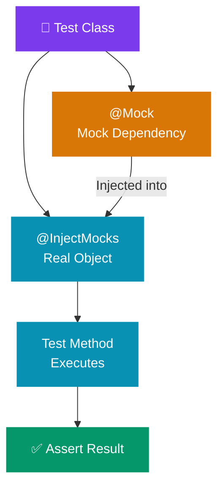

---

</details>

---

2. **🎭 What is Mocking? ⚡**

<!-- -->
<details>
<summary>Answer</summary>

**Answer:**

- 💡 Mocking means building objects that act like a copy of real objects. In other words, mocking is a testing technique. Tests use mock objects instead of real objects. A mock object gives a specific (dummy) output for a particular (dummy) input passed to it.
- 🧪 In unit testing, mocking means you create an object that imitates the behavior of a real subsystem in a controlled way. In short, a mock replaces a dependency.
- 📖 To mock objects, you need to know these key concepts of mocking: stub, fake, spy, dummy, and mock. Some unit tests use only stubs. Others use fakes and mocks.
- ⚙️ When you call a method on a mocked reference, it does not run the actual method body from the class file. Instead, you configure the method behavior with `when(…).thenReturn(…)` methods.

🧠 **In Simple Words:**

Mocking lets you replace real dependencies (like databases or APIs) with fake objects. Then you can test your code in isolation, without external systems.

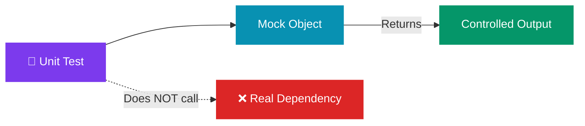

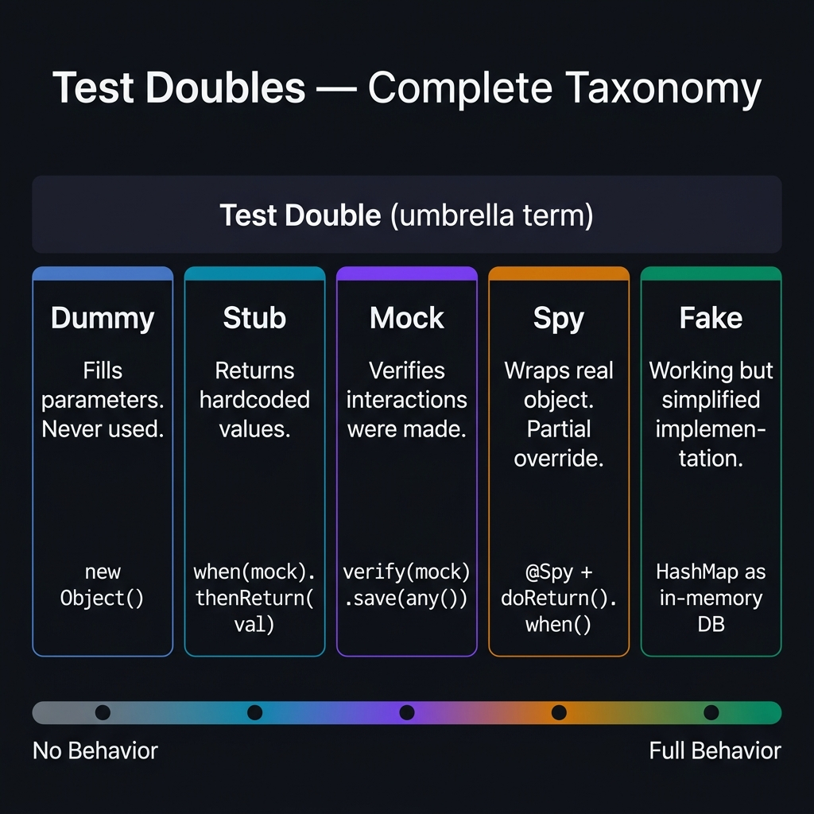

---

</details>

---

3. **🏷️ What are @Mock and @InjectMocks? 🔥🔥**

<!-- -->
<details>
<summary>Answer</summary>

**Answer:**

- 🧪 In mockito-based JUnit tests, **`@Mock` annotation creates mocks** and **`@InjectMocks` creates actual objects and injects mocked dependencies into it**.
- ⚙️ The test will call methods on some mock objects. For those mocks, we must define the `when(…).thenReturn(…)` methods.
- 🏗️ So in a JUnit test, **we create objects (`@InjectMocks`) for the class that needs to be tested**. We then call its methods through this inject-mock object.
- 🔄 We **create mocks (`@Mock`) for the dependencies that will not be present in the test environment**. The objects need these dependencies to complete the method call.

| Feature | `@Mock` 🅰️ | `@InjectMocks` 🅱️ |
|---------|-----------|-------------------|
| **Purpose** | Creates a mock (fake) object | Creates a real object with mocks injected |
| **Behavior** | ❌️ Does not execute real methods | ✅ Executes real methods |
| **Used For** | Dependencies (e.g., Repository) | Class under test (e.g., Service) |
| **Stubbing** | ✅ Requires `when().thenReturn()` | ❌️ Not needed — uses real logic |

🎯 **Interview Tip:** Always clarify that `@InjectMocks` creates a *real* instance of the class and only injects the `@Mock` dependencies into it.

---

</details>

---

<a id="mocking-concepts"></a>

## 2. Mocking Concepts

1. **✅ What are the benefits of Mocking? 💤**

<!-- -->
<details>
<summary>Answer</summary>

**Answer:**

✅ **Advantages:**

- 🚫 **No Hardcoding** — No need to write mock objects on your own.
- 🛡️ **Refactoring Safe** — Renaming interface methods or reordering parameters will not break the test code. This is because stubs use real method calls (`when(repo.findById(1L))`), so the compiler checks them and IDE refactoring updates them too.
- 🔄 **Return Value Support** — Supports return values: `when(repo.findById(1L)).thenReturn(Optional.of(createEmployeeStub()));`
- 💥 **Exception Support** — Supports exceptions.

```java
@Test
public void getEmpByIdThrowsExceptionTest() {
    when(repo.findById(2L)).thenThrow(new RuntimeException("Employee Not Found"));

    assertThrows(RuntimeException.class, () -> {
        employeeServiceImpl.getEmpById(2L);
    });
}
```

- 📊 **Order Check Support** — Supports checking the order of method calls.
- 🏷️ **Annotation Support** — Supports creating mocks using annotation.

---

</details>

---

2. **⚠️ What are the disadvantages of Mocking? 💤**

<!-- -->
<details>
<summary>Answer</summary>

**Answer:**

⚠️ **Disadvantages:**

- 🚧 Mockito still can't mock **everything**. But the list is much shorter than many people believe.
- 🔒 **Truly unmockable:** `equals()` and `hashCode()`. Mockito uses them internally to track invocations. So Mockito does not allow stubbing them, by design.
- 🧠 Over-mocking makes tests assert your **stub setup** instead of your code (see §5 Q16). Also, mock-heavy tests break on every refactor.
- 🧵 Mocks are **not thread-safe** for concurrent stubbing/verification. So they are not a good choice for testing truly concurrent code.

✅ **What is *no longer* a limitation (the outdated "you need PowerMock" answer):**

| Target | Modern Mockito | Since |
|---|---|---|
| `static` methods | `Mockito.mockStatic(Foo.class)` (try-with-resources) | 3.4 |
| **Constructors** | `Mockito.mockConstruction(Foo.class, ...)` | 3.5 |
| `final` classes / `final` methods | inline mock maker — **the default since Mockito 5.0** (opt-in on 2.1–4.x; the `mockito-inline` artifact exists from 2.7.2) | 2.1 / default 5.0 |
| `private` methods | ❌️ still not supported — and that's a design signal, not a gap | — |

💡 **Pro Tip:** The 2026 answer is: *"PowerMock is legacy. On Mockito 5.x the inline mock maker is the default, so static, final and constructor mocking all work out of the box — the only things left off the table are `equals()`/`hashCode()` and private methods."* If you say you need PowerMock for final classes, your knowledge sounds about ten years old (final-class mocking arrived in Mockito 2.1, in 2016).

---

</details>

---

3. **❓ Why do you need Mocking in the first place? ⚡**

<!-- -->
<details>
<summary>Answer</summary>

**Answer:**

Common targets for mocking are:

- 🗄️ **Database connections** — Sometimes the database queries can take 10, 20, or more seconds to execute.
- 🐢 Classes that are **slow**.
- 📧 Classes with **side effects** like those that send emails to clients.
- 🏗️ A component that another component depends on, but that is still **under development**. Without mocking, we must wait until the required parts are finished before we can test.
- 🌐 **Web services / External resources** — Connecting to an external resource can take too much time. The resource can also be down, and this affects our testing. Our CI/CD pipeline may break because of another web service.

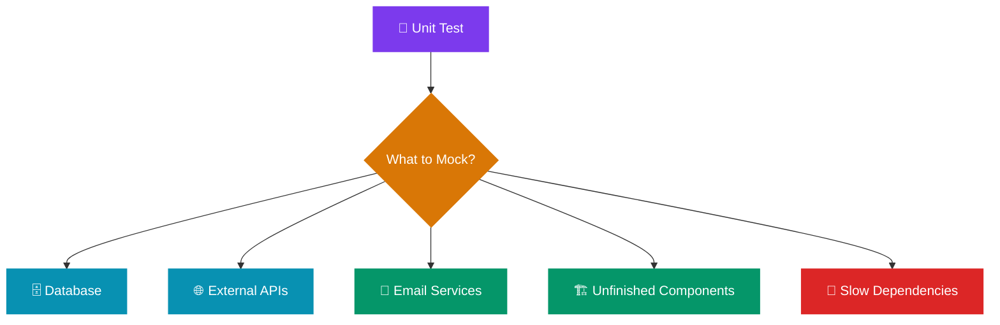

🧠 **In Simple Words:**

We mock anything that is external, slow, unreliable, or not yet built. This keeps our tests fast, isolated, and repeatable.

---

</details>

---

4. **📊 What is JUnit Coverage? 💤**

<!-- -->
<details>
<summary>Answer</summary>

**Answer:**

⚠️ **"80% is required" is a convention, not a rule.** No language or ecosystem requires it. 80% is simply the number most teams choose. It means nothing unless you also say **which** metric and **which** code:

| Dimension | Options | Why it matters |
|---|---|---|
| Metric | **line** vs **branch** (**instruction**, **complexity**) | 100% line coverage can still mean only 50% branch coverage, if every `if` went only one way |
| Scope | **total** vs **new code** | Most CI gates apply the threshold to *new/changed* code only, so legacy debt doesn't block every PR |

🛠️ **How it is actually enforced (Maven + JaCoCo):**

```xml
<plugin>
    <groupId>org.jacoco</groupId>
    <artifactId>jacoco-maven-plugin</artifactId>
    <executions>
        <execution>
            <goals><goal>prepare-agent</goal></goals>
        </execution>
        <execution>
            <id>coverage-check</id>
            <phase>verify</phase>
            <goals><goal>check</goal></goals>
            <configuration>
                <rules>
                    <rule>
                        <element>BUNDLE</element>
                        <limits>
                            <limit>
                                <counter>BRANCH</counter>
                                <value>COVEREDRATIO</value>
                                <minimum>0.70</minimum>
                            </limit>
                        </limits>
                    </rule>
                </rules>
            </configuration>
        </execution>
    </executions>
</plugin>
```

`mvn verify` then fails the build when the ratio drops below the limit. Teams often add a **SonarQube quality gate** on top (typically ~80% coverage **on new code**). This way the pipeline enforces the gate, not each developer's IDE.

🧪 **The honest follow-up — "how do you know your assertions are real?"** Coverage only proves a line *ran*. It does not prove the line was *checked*. A test with zero assertions still gives 100% coverage. **Mutation testing** (PIT / `pitest`) answers the real question:

- It mutates your bytecode (flips `>` to `>=`, removes calls). Each changed version is a "mutant".
- It reports how many mutants your tests actually kill (catch with a failing test).

🎯 **Interview Tip:** Say: *"Coverage is a floor, not a quality signal. I gate branch coverage on new code in CI, and if I want to know whether the assertions are meaningful I reach for mutation testing, not a higher coverage number."* Then mention that when a team chases a percentage, it writes tests with no assertions. The metric was meant to prevent exactly this problem.

---

</details>

---

<a id="stubbing--verification"></a>

## 3. Stubbing & Verification

1. **🔀 What is the difference between doReturn and thenReturn? 🔥**

<!-- -->
<details>
<summary>Answer</summary>

**Answer:**

Mockito provides two different syntaxes for creating stubs:

| Syntax Style | `when().thenX()` 🅰️ | `doX().when()` 🅱️ |
|-------------|---------------------|-------------------|
| **Return** | `when(mock.method()).thenReturn(value)` | `doReturn(value).when(mock).method()` |
| **Throw** | `when(mock.method()).thenThrow(ex)` | `doThrow(ex).when(mock).method()` |
| **Nothing** | ❌️ No equivalent | `doNothing().when(mock).method()` |
| **Type Safety** | ✅ Compile-time type check | ⚠️ No compile-time check |
| **Void Methods** | ❌️ Cannot stub void methods | ✅ Can stub void methods |
| **Spy Safe** | ⚠️ Calls real method during stubbing | ✅ Does not call real method |

🔑 **Key Point:** The `thenReturn` way of stubbing is type-safe. It checks, at compile time, the return types that you want to stub.

💡 **Pro Tip:** Use `doReturn().when()` with spies to avoid calling the real method during stub setup.

---

</details>

---

2. **🔍 What's the need to verify that the mock was called? 🔥🔥**

<!-- -->
<details>
<summary>Answer</summary>

**Answer:**

- ⚠️ You can set up a stub on a mocked object (or a spied instance). But this does not prove that the code ever called the stubbed method.
- 🔍 "Verification" matchers let you check:
  - whether the stub you set up was actually invoked or not
  - how many times the call was made
  - which arguments the stubbed method was called with, etc.
- 🛡️ In short, it gives a stronger check of the test setup and the expected result.

🛠️ **Example:**

```java
// Verify the method was called exactly once
verify(repo, times(1)).findById(1L);

// Verify the method was never called
verify(repo, never()).deleteById(1L);
```

**The full set of verification modes:**

| Mode | Meaning |
|---|---|
| `times(n)` | Exactly *n* invocations (`times(1)` is the default when you omit the mode) |
| `never()` | Zero invocations — same as `times(0)` |
| `atLeastOnce()` / `atLeast(n)` | At least once / at least *n* times |
| `atMost(n)` | At most *n* times |
| `only()` | This is the **only** method invoked on that mock |
| `timeout(ms)` | Waits up to *ms* for an **asynchronous** invocation before failing — pairs with §5 Q14 |

**Order verification — `InOrder` (this is what "supports order checking" in §2 Q1 means):**

```java
@Test
void shouldChargeBeforePersisting() {
    paymentService.processPayment(request);

    InOrder inOrder = inOrder(gateway, repository, auditLogger);
    inOrder.verify(gateway).charge(any(ChargeRequest.class));
    inOrder.verify(repository).save(any(Transaction.class));
    inOrder.verify(auditLogger).log(eq("PAYMENT"), anyString());
    // Fails if the transaction is persisted before the gateway is charged.
}
```

`InOrder` checks **relative** order across one or more mocks. It ignores unrelated calls in between. Use it only when the order is part of the contract (charge → persist → audit). Do not use it as a habit. Otherwise your tests become fragile: they break when harmless calls change order.

**`verifyNoInteractions` vs `verifyNoMoreInteractions`:**

```java
// The mock was NEVER touched at all
verifyNoInteractions(emailService);

// Everything I verified above is ALL that happened — nothing else
verify(repository).save(any(Order.class));
verifyNoMoreInteractions(repository);
```

⚠️ `verifyNoMoreInteractions` must come **after** your `verify(...)` calls. It is also easy to use too much:

- It fails on any invocation you didn't explicitly verify.
- So tests break whenever the production code adds a harmless extra call.

Use it when "nothing else happened" is truly the thing you check (e.g. a guard clause must short-circuit and stop early).

🎯 **Interview Tip:** Mention that `verify()` checks *behavior* (was the method called?) while `assert` checks *state* (is the result correct?). Both are important for complete testing. If they ask for a deeper answer, compare `verifyNoInteractions` ("this collaborator was never used") with `verifyNoMoreInteractions` ("I have accounted for every call").

---

</details>

---

3. **🕵️ When and why should a spy be used? 🔥🔥**

<!-- -->
<details>
<summary>Answer</summary>

**Answer:**

Spy is a type of **partial mock** supported by Mockito. This means it is a type of instance where:

- 📞 When no mock is set up, any interaction on the spy calls the **real methods**. But you can still verify the interactions with the spied object. For example: was a method actually called, how many times was it called, and which arguments was it called with, etc.
- ⚙️ It lets you set up **partial mocks**. You stub only specific methods and keep the rest real.

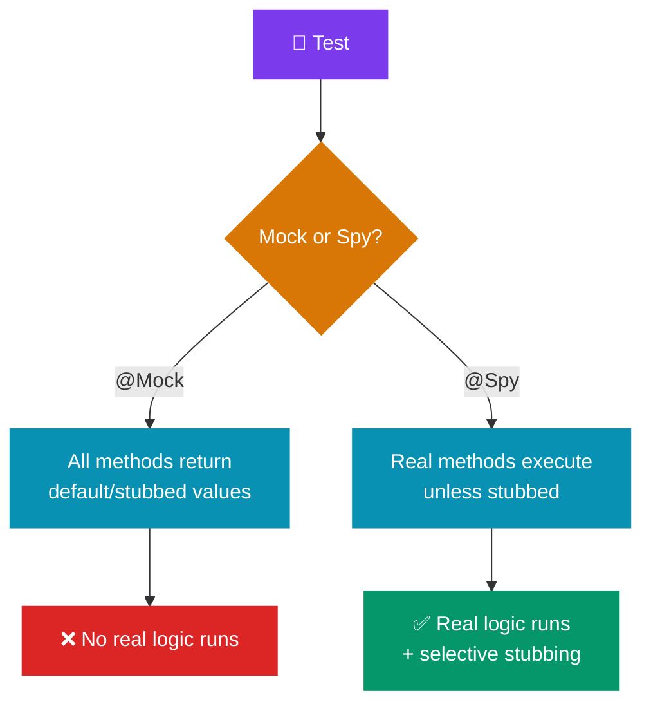

| Feature | `@Mock` 🅰️ | `@Spy` 🅱️ |
|---------|-----------|----------|
| **Default Behavior** | Returns null/defaults | ✅ Calls real methods |
| **Stubbing** | ✅ Required for all methods | ⚠️ Optional — only override specific methods |
| **Use Case** | Full isolation from dependency | Partial mocking — test real logic with some overrides |
| **Real Method Calls** | ❌️ Never | ✅ Yes, unless explicitly stubbed |

🧠 **In Simple Words:**

A mock is a completely fake object. A spy is a real object where you can override only the methods you choose.

---

</details>

---

<a id="practical-example"></a>

## 4. Practical Example

1. **🚀 Can you give a complete Spring Boot + Mockito test example? 🔥🔥**

<!-- -->
<details>
<summary>Answer</summary>

**Answer:**

Create a Spring starter project with the following dependencies: Spring Web, Spring Data JPA, MySQL Driver, and Lombok.

📝 **application.properties:**

```properties
spring.datasource.url=jdbc:mysql://localhost:3306/test
spring.datasource.username=root
spring.datasource.password=root
spring.jpa.hibernate.ddl-auto=update
```

🏷️ **Entity Class:**

```java
@Data
@NoArgsConstructor
@AllArgsConstructor
@Entity
public class Employee {
    @Id
    @GeneratedValue(strategy = GenerationType.IDENTITY)
    private Integer id;
    private String name;
}
```

🗂️ **Repository Interface:**

```java
public interface EmployeeRepo extends JpaRepository<Employee, Integer> { }
```

⚙️ **Service Class:**

```java
@Service
public class EmployeeService {

    private final EmployeeRepo repo;

    // ✅ constructor injection — this is also what @InjectMocks uses
    public EmployeeService(EmployeeRepo repo) {
        this.repo = repo;
    }

    public Employee getEmpById(Integer id) {
        Employee e = repo.findById(id)
            .orElseThrow(() -> new ResourceNotFoundException("Employee " + id + " not found"));
        if (e.getName().equalsIgnoreCase("jerry")) {
            throw new IllegalArgumentException("Not allowed to access this employee");
        }
        return e;
    }
}
```

> 💡 Two choices made on purpose:  
> 1. `orElseThrow(...)` instead of `Optional.get()`. Never call `get()` without a presence check.  
> 2. **No** `try { … } catch (X e) { throw e; }`. Catching an exception only to rethrow the same exception is dead code.

🧪 **Test Class:**

```java
import static org.junit.jupiter.api.Assertions.assertEquals;
import static org.junit.jupiter.api.Assertions.assertThrows;
import static org.mockito.Mockito.verify;
import static org.mockito.Mockito.when;

import java.util.Optional;

import org.junit.jupiter.api.Test;
import org.junit.jupiter.api.extension.ExtendWith;
import org.mockito.InjectMocks;
import org.mockito.Mock;
import org.mockito.junit.jupiter.MockitoExtension;

@ExtendWith(MockitoExtension.class)   // ✅ NOT @SpringBootTest — see the note below
public class EmployeeServiceTest {
    @InjectMocks
    EmployeeService employeeService;

    @Mock
    EmployeeRepo repo;

    @Test
    public void getEmpByIdTest() {
        when(repo.findById(1)).thenReturn(createEmployeeStub());

        Employee testedEmployee = employeeService.getEmpById(1);

        assertEquals("ABC", testedEmployee.getName());   // (expected, actual)
        verify(repo).findById(1);
    }

    @Test
    public void getEmpByIdTestWithException1() {
        when(repo.findById(1)).thenReturn(createRestrictedEmployeeStub());

        assertThrows(IllegalArgumentException.class, () -> employeeService.getEmpById(1));
    }

    @Test
    public void getEmpByIdTestWithException2() {
        when(repo.findById(1)).thenReturn(Optional.empty());

        ResourceNotFoundException ex = assertThrows(ResourceNotFoundException.class,
            () -> employeeService.getEmpById(1));
        assertEquals("Employee 1 not found", ex.getMessage());
    }

    private Optional<Employee> createEmployeeStub() {
        Employee stubEmp = new Employee();
        stubEmp.setName("ABC");
        return Optional.of(stubEmp);
    }

    private Optional<Employee> createRestrictedEmployeeStub() {
        Employee stubEmp = new Employee();
        stubEmp.setName("Jerry");
        return Optional.of(stubEmp);
    }
}
```

⚠️ **Why not `@SpringBootTest` here — two independent failures:**

1. `@SpringBootTest` is meta-annotated with `@ExtendWith(SpringExtension.class)` only, not `MockitoExtension`. On Boot 4.0+ nothing initializes `@Mock`/`@InjectMocks`, so `repo` stays `null` and the first `when(...)` throws `NullPointerException`. Boot 2.x/3.x did init them through `MockitoTestExecutionListener` (deprecated in 3.4). Do not rely on it.
2. Even if they were initialized, `@SpringBootTest` boots the **whole** context against the MySQL URL in `application.properties`. If no database runs on `localhost:3306`, the context fails before a single test method runs.

Keep `@SpringBootTest` for a *separate* integration test where you `@Autowired` real beans (with Testcontainers — §5 Q12). A service unit test uses `@ExtendWith(MockitoExtension.class)`.

The test class shows three scenarios:

- ✅ **Happy path** — `getEmpByIdTest()` verifies that a normal employee is fetched correctly.
- 💥 **Business exception** — `getEmpByIdTestWithException1()` verifies that the service throws `IllegalArgumentException` for restricted employees.
- 🚨 **Not found exception** — `getEmpByIdTestWithException2()` verifies `ResourceNotFoundException` when the employee doesn't exist.

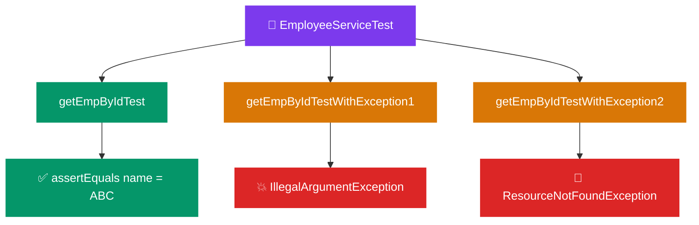

---

</details>

---

> 🎯 **Why this section matters:** Modern SDE II interviews test your approach to testing, not just syntax. Companies like Atlassian and Razorpay ask about test slicing, Testcontainers, and testing patterns used in real production work. Knowing when NOT to mock is as important as knowing how to mock.

<a id="advanced-testing-patterns"></a>

## 5. Advanced Testing Patterns

1. **🎯 How do you use ArgumentCaptor in Mockito to capture method arguments? 🔥**

<!-- -->
<details>
<summary>Answer</summary>

**Answer:**

`ArgumentCaptor` lets you capture the arguments passed to a mocked method. You can then check them later in your assertions. This is especially useful when the method under test builds the object itself. Then your test has no direct reference to that object.

**When to use ArgumentCaptor:**
- When the argument is created internally by the method under test
- When you need to assert on specific fields of a complex object passed to a dependency
- When verifying that a transformation or mapping happened correctly before calling a downstream service

🛠️ **Example — Capturing an entity saved to a repository:**

```java
@ExtendWith(MockitoExtension.class)
class OrderServiceTest {

    @Mock
    private OrderRepository orderRepository;

    @Mock
    private NotificationService notificationService;

    @InjectMocks
    private OrderService orderService;

    @Captor
    private ArgumentCaptor<Order> orderCaptor;

    @Captor
    private ArgumentCaptor<String> messageCaptor;

    @Test
    void shouldCreateOrderWithCorrectFields() {
        // Arrange
        OrderRequest request = new OrderRequest("ITEM-101", 3, "John Doe");
        when(orderRepository.save(any(Order.class)))
            .thenAnswer(invocation -> {
                Order saved = invocation.getArgument(0);
                saved.setId(1L);
                return saved;
            });

        // Act
        orderService.createOrder(request);

        // Assert — capture the argument passed to save()
        verify(orderRepository).save(orderCaptor.capture());
        Order capturedOrder = orderCaptor.getValue();

        assertEquals("ITEM-101", capturedOrder.getItemCode());
        assertEquals(3, capturedOrder.getQuantity());
        assertEquals("John Doe", capturedOrder.getCustomerName());
        assertEquals("PENDING", capturedOrder.getStatus());

        // Also capture notification message
        verify(notificationService).send(eq("John Doe"), messageCaptor.capture());
        assertTrue(messageCaptor.getValue().contains("ITEM-101"));
    }

    @Test
    void shouldCaptureMultipleInvocations() {
        // Arrange
        when(orderRepository.save(any(Order.class)))
            .thenAnswer(invocation -> invocation.getArgument(0));

        // Act — create two orders
        orderService.createOrder(new OrderRequest("ITEM-A", 1, "Alice"));
        orderService.createOrder(new OrderRequest("ITEM-B", 2, "Bob"));

        // Assert — capture all invocations
        verify(orderRepository, times(2)).save(orderCaptor.capture());
        List<Order> allCapturedOrders = orderCaptor.getAllValues();

        assertEquals("ITEM-A", allCapturedOrders.get(0).getItemCode());
        assertEquals("ITEM-B", allCapturedOrders.get(1).getItemCode());
    }
}
```

**Key methods on ArgumentCaptor:**

| Method | Purpose |
|--------|---------|
| `capture()` | Used inside `verify()` to capture the argument |
| `getValue()` | Returns the last captured argument |
| `getAllValues()` | Returns all captured arguments across multiple calls |

**Two ways to create an ArgumentCaptor:**

```java
// Way 1: Using @Captor annotation (preferred — cleaner)
@Captor
private ArgumentCaptor<Order> orderCaptor;

// Way 2: Inline creation
ArgumentCaptor<Order> orderCaptor = ArgumentCaptor.forClass(Order.class);
```

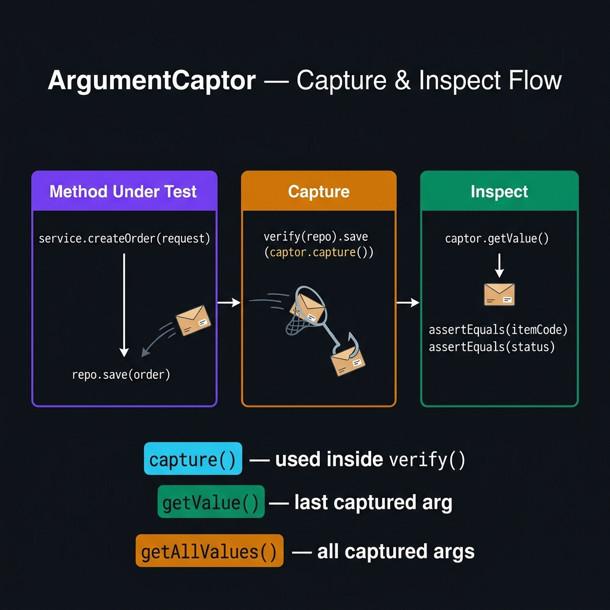

🎯 **Interview Tip:** Always prefer the `@Captor` annotation over inline creation. It is easier to read. Also mention that `ArgumentCaptor` is for assertions at verification time, not for stubbing. Using it in `when()` makes the test harder to read.

---

</details>

---

2. **🧩 What are Mockito argument matchers and when should you use each one? 🔥**

<!-- -->
<details>
<summary>Answer</summary>

**Answer:**

Mockito argument matchers let you set flexible rules for matching method arguments. You use them during stubbing and verification, instead of exact values. They are in the `org.mockito.ArgumentMatchers` class.

**Full Matcher Reference:**

| Matcher | Matches | Use When |
|---------|---------|----------|
| `any()` | Any object including null | You don't care about the argument at all |
| `any(Class<T>)` | Any non-null object of the given type | You need type-safe matching but don't care about value |
| `anyString()` | Any non-null String | Matching any string argument |
| `anyInt()` / `anyLong()` | Any int/long (including 0) | Matching primitive number arguments |
| `anyList()` / `anySet()` / `anyMap()` | Any non-null collection of the type | Matching collection arguments |
| `eq(value)` | Exact value match (uses `.equals()`) | Mixing matchers with exact values |
| `isNull()` | Only null | Explicitly expecting null |
| `isNotNull()` | Any non-null value | Ensuring argument is not null |
| `argThat(predicate)` | Custom predicate logic | Complex matching conditions |
| `matches(regex)` | String matching regex | Pattern-based string matching |
| `startsWith(prefix)` | String starting with prefix | Prefix-based string matching |
| `contains(substring)` | String containing substring | Substring matching |

🛠️ **Code Examples:**

```java
@ExtendWith(MockitoExtension.class)
class MatcherExamplesTest {

    @Mock
    private UserRepository userRepository;

    @Mock
    private EmailService emailService;

    @InjectMocks
    private UserService userService;

    @Test
    void anyMatcherExample() {
        // Matches any Integer passed to findById
        when(userRepository.findById(any(Integer.class)))
            .thenReturn(Optional.of(new User("Alice")));

        User result = userService.getUser(42);
        assertEquals("Alice", result.getName());
    }

    @Test
    void eqMatcherExample() {
        // IMPORTANT: When mixing matchers with raw values, wrap raw values in eq()
        // ❌️ WRONG: when(emailService.send("admin@test.com", anyString()))
        // ✅ RIGHT:
        when(emailService.send(eq("admin@test.com"), anyString()))
            .thenReturn(true);

        assertTrue(userService.notifyAdmin("Server restarted"));
    }

    @Test
    void argThatMatcherExample() {
        // Custom matcher — match users with specific criteria
        when(userRepository.save(argThat(user ->
            user.getRole().equals("ADMIN") && user.getAge() > 18
        ))).thenReturn(new User("SavedAdmin"));

        User result = userService.createAdmin("Bob", 25);
        assertEquals("SavedAdmin", result.getName());
    }

    @Test
    void assertOnCapturedArgument() {
        userService.registerUser("Charlie", "charlie@test.com");

        // ✅ Capture, then assert OUTSIDE the matcher
        ArgumentCaptor<User> captor = ArgumentCaptor.forClass(User.class);
        verify(userRepository).save(captor.capture());

        User saved = captor.getValue();
        assertEquals("charlie@test.com", saved.getEmail());
        assertEquals("Charlie", saved.getName());
        assertEquals("USER", saved.getRole()); // default role
    }

    @Test
    void stringMatchers() {
        when(userRepository.findByNameContaining(contains("john")))
            .thenReturn(List.of(new User("John Doe"), new User("Johnny")));
        when(userRepository.findByEmail(matches(".*@company\\.com")))
            .thenReturn(Optional.of(new User("Employee")));

        // ✅ exercise BOTH stubs through the class under test — never call the mock directly
        assertEquals(2, userService.searchByName("john").size());
        assertTrue(userService.findCorporateUser("bob@company.com").isPresent());
    }
}
```

⚠️ **Two traps this example avoids on purpose:**

**1. Never put assertions inside `argThat`.** Say an assertion fails inside the predicate. Mockito reports it as *"argument did not match"*, not as the assertion that failed. You lose the expected-vs-actual message completely. Use `ArgumentCaptor` and assert after `verify()`:

```java
// ❌️ assertion failure is swallowed into a confusing "no matching invocation" message
verify(userRepository).save(argThat(u -> {
    assertEquals("charlie@test.com", u.getEmail());
    return true;
}));
```

Use `argThat` only for **pure boolean predicates** (`argThat(u -> u.getAge() > 18)`). As soon as you want to assert on fields, use `ArgumentCaptor`.

**2. Every stub you declare must be used.** `MockitoExtension` runs with `Strictness.STRICT_STUBS`. So say you declare the `findByEmail(...)` stub and never trigger it. The test fails with `UnnecessaryStubbingException`. Mockito reports it **after the test method ends**, even when every assertion passed.

Strict stubs also affect `argThat`. Say `createAdmin` calls `save()` with a user that does not match the predicate. Mockito does not return `null`. It throws `PotentialStubbingProblem` (a stub-argument mismatch).

Also, do not call `userRepository.findByNameContaining("john")` directly on the mock and assert the result. That only proves the mock returned what you told it to return (the anti-pattern §5 Q16 names). Call the mock through `userService` instead. If a stub is really conditional, mark it `lenient().when(...)` — see §5 Q21.

**Critical Rule — All or Nothing:**

```java
// ❌️ WRONG — Cannot mix raw values with matchers
when(service.process("literal", anyInt())).thenReturn(result);

// ✅ CORRECT — Wrap the literal in eq()
when(service.process(eq("literal"), anyInt())).thenReturn(result);
```

If **any** argument uses a matcher, **all** arguments must use matchers. This is the most common Mockito mistake in interviews.

🎯 **Interview Tip:** You may be asked "What's the difference between `any()` and `any(Class)`?". Answer that `any()` also matches null, but `any(SomeClass.class)` does not match null. Also, `any(Class)` gives type safety at compile time.

---

</details>

---

3. **🔒 How do you mock static methods with MockedStatic in Mockito? ⚡**

<!-- -->
<details>
<summary>Answer</summary>

**Answer:**

Since Mockito 3.4+, you can mock static methods with `Mockito.mockStatic()`. You do not need PowerMock. It returns a `MockedStatic` object. You must close this object after use (it implements `AutoCloseable`).

**Why this matters:** Many utility classes use static methods (e.g., `UUID.randomUUID()`, `LocalDateTime.now()`, custom utility methods). To test code that depends on them, you need static mocking.

🛠️ **Example — Mocking a utility class:**

```java
// Production code
public class OrderIdGenerator {
    public static String generate() {
        return "ORD-" + UUID.randomUUID().toString().substring(0, 8).toUpperCase();
    }
}

public class OrderService {
    private final OrderRepository orderRepository;

    public OrderService(OrderRepository orderRepository) {
        this.orderRepository = orderRepository;
    }

    public Order createOrder(OrderRequest request) {
        Order order = new Order();
        order.setOrderId(OrderIdGenerator.generate());
        order.setItemCode(request.getItemCode());
        order.setStatus("CREATED");
        return orderRepository.save(order);
    }
}
```

```java
// Test code
@ExtendWith(MockitoExtension.class)
class OrderServiceStaticTest {

    @Mock
    private OrderRepository orderRepository;

    @InjectMocks
    private OrderService orderService;

    @Test
    void shouldCreateOrderWithGeneratedId() {
        // Arrange — mock static method using try-with-resources
        try (MockedStatic<OrderIdGenerator> mockedStatic =
                mockStatic(OrderIdGenerator.class)) {

            mockedStatic.when(OrderIdGenerator::generate)
                .thenReturn("ORD-TEST1234");

            when(orderRepository.save(any(Order.class)))
                .thenAnswer(invocation -> invocation.getArgument(0));

            // Act
            Order result = orderService.createOrder(
                new OrderRequest("ITEM-101", 2, "John Doe"));

            // Assert
            assertEquals("ORD-TEST1234", result.getOrderId());
            assertEquals("CREATED", result.getStatus());

            // Verify static method was called
            mockedStatic.verify(OrderIdGenerator::generate, times(1));
        }
        // MockedStatic is automatically closed here
    }

    @Test
    void shouldMockStaticWithArguments() {
        try (MockedStatic<StringUtils> mockedStatic =
                mockStatic(StringUtils.class)) {

            mockedStatic.when(() -> StringUtils.capitalize("hello"))
                .thenReturn("HELLO_CUSTOM");

            assertEquals("HELLO_CUSTOM", StringUtils.capitalize("hello"));
        }
    }

}
```

🕰️ **The design change to try first — inject a `Clock`.**

Mocking `LocalDateTime.now()` is the standard example of static mocking. It is also the standard example of a case where you *do not need it*. `java.time.Clock` exists for exactly this reason. It makes "now" an injected dependency:

```java
// Production code — the clock is a normal dependency
@Service
public class SubscriptionService {

    private final Clock clock;
    private final SubscriptionRepository repository;

    public SubscriptionService(Clock clock, SubscriptionRepository repository) {
        this.clock = clock;
        this.repository = repository;
    }

    public Subscription renew(String id) {
        Subscription sub = repository.findById(id).orElseThrow();
        sub.setRenewedAt(LocalDateTime.now(clock));   // ← not LocalDateTime.now()
        sub.setExpiresAt(LocalDateTime.now(clock).plusMonths(1));
        return repository.save(sub);
    }
}

// Spring config — one bean, used everywhere
@Bean
public Clock clock() {
    return Clock.systemDefaultZone();
}
```

```java
// Test — deterministic time, no static mocking, no MockedStatic to close
@ExtendWith(MockitoExtension.class)
class SubscriptionServiceTest {

    private final Clock fixedClock = Clock.fixed(
        Instant.parse("2026-03-21T10:00:00Z"), ZoneOffset.UTC);

    @Mock
    private SubscriptionRepository repository;

    private SubscriptionService service;

    @BeforeEach
    void setUp() {
        service = new SubscriptionService(fixedClock, repository);
    }

    @Test
    void shouldSetRenewalTimestampFromClock() {
        Subscription sub = new Subscription("SUB-1");
        when(repository.findById("SUB-1")).thenReturn(Optional.of(sub));
        when(repository.save(any(Subscription.class)))
            .thenAnswer(inv -> inv.getArgument(0));

        Subscription result = service.renew("SUB-1");

        assertEquals(LocalDateTime.of(2026, 3, 21, 10, 0), result.getRenewedAt());
        assertEquals(LocalDateTime.of(2026, 4, 21, 10, 0), result.getExpiresAt());
    }
}
```

This is faster and thread-safe. It is also different from `mockStatic(LocalDateTime.class)`: it really tests **your** code. It does more than check that a mocked JDK method returns the value you just gave it.

**Important Rules for MockedStatic:**

| Rule | Details |
|------|---------|
| Must be closed | Always use try-with-resources to avoid leaking mocks |
| Thread-scoped | Static mock only applies within the thread that created it |
| One mock per class per thread | Cannot have two active `MockedStatic` for the same class in the same thread |
| Performance | Slower than regular mocking — use sparingly |

**Do you need an extra dependency? Depends on your Mockito version:**

| Mockito version | What you need |
|---|---|
| **5.x (current)** | ✅ **Nothing.** The inline mock maker is the default — `mockStatic`, `mockConstruction` and final-class mocking all work with plain `mockito-core`. |
| **2.1 – 4.x** | Add `mockito-inline` (2.7.2+) **or** create `src/test/resources/mockito-extensions/org.mockito.plugins.MockMaker` containing the single line `mock-maker-inline`. |

⚠️ Don't put `mockito-inline` in a Mockito 5.x build. The artifact was **deprecated at 5.0.0**, and `5.2.0` is its final release. Adding it makes your build depend on a dead artifact. And the only thing it turns on is a feature you already have.

🎯 **Interview Tip:** Always mention that you prefer design changes over static mocking. Examples: dependency injection, a `Clock` bean, a thin wrapper class. Use static mocking only when nothing else works: for legacy code or third-party libraries you can't modify. If you think "I can't test this without `mockStatic`", you usually have a design problem, not a Mockito problem.

---

</details>

---

4. **📖 What is BDDMockito and how does it improve test readability? ⚡**

<!-- -->
<details>
<summary>Answer</summary>

**Answer:**

BDDMockito is a Mockito API that follows **Behavior-Driven Development (BDD)** style. It uses `given/when/then` instead of Mockito's default `when/thenReturn`. It only makes tests easier to read. The behavior underneath is the same.

**The problem with standard Mockito in BDD context:**

In BDD, the test structure is **Given-When-Then**. But standard Mockito uses `when()` for stubbing. Stubbing belongs in the "Given" section, so this is confusing:

```java
// Standard Mockito — confusing: "when" appears in the "Given" section
// Given
when(userRepository.findById(1L)).thenReturn(Optional.of(user)); // ← "when" in "Given"?

// When
User result = userService.getUser(1L);

// Then
assertEquals("Alice", result.getName());
```

**BDDMockito solves this:**

```java
import static org.mockito.BDDMockito.*;

// Given
given(userRepository.findById(1L)).willReturn(Optional.of(user)); // ← reads naturally

// When
User result = userService.getUser(1L);

// Then
then(userRepository).should(times(1)).findById(1L); // ← reads naturally
assertEquals("Alice", result.getName());
```

🛠️ **Full Comparison Example:**

```java
@ExtendWith(MockitoExtension.class)
class PaymentServiceTest {

    @Mock
    private PaymentGateway paymentGateway;

    @Mock
    private TransactionRepository transactionRepository;

    @InjectMocks
    private PaymentService paymentService;

    // ❌️ Traditional Mockito style
    @Test
    void traditionalStyle_shouldProcessPayment() {
        // Arrange (but using "when" keyword feels odd here)
        when(paymentGateway.charge(anyString(), anyDouble()))
            .thenReturn(new PaymentResult("TXN-123", true));
        when(transactionRepository.save(any(Transaction.class)))
            .thenAnswer(inv -> inv.getArgument(0));

        // Act
        Transaction result = paymentService.processPayment("CARD-456", 100.0);

        // Assert
        assertEquals("TXN-123", result.getTransactionId());
        verify(paymentGateway, times(1)).charge("CARD-456", 100.0);
        verify(transactionRepository, times(1)).save(any(Transaction.class));
    }

    // ✅ BDDMockito style — reads like a specification
    @Test
    void bddStyle_shouldProcessPayment() {
        // Given
        given(paymentGateway.charge(anyString(), anyDouble()))
            .willReturn(new PaymentResult("TXN-123", true));
        given(transactionRepository.save(any(Transaction.class)))
            .willAnswer(inv -> inv.getArgument(0));

        // When
        Transaction result = paymentService.processPayment("CARD-456", 100.0);

        // Then
        assertEquals("TXN-123", result.getTransactionId());
        then(paymentGateway).should(times(1)).charge("CARD-456", 100.0);
        then(transactionRepository).should(times(1)).save(any(Transaction.class));
    }

    // ✅ BDDMockito exception stubbing
    @Test
    void bddStyle_shouldHandlePaymentFailure() {
        // Given
        given(paymentGateway.charge(anyString(), anyDouble()))
            .willThrow(new PaymentException("Insufficient funds"));

        // When & Then
        assertThrows(PaymentException.class, () ->
            paymentService.processPayment("CARD-789", 5000.0));

        then(transactionRepository).should(never()).save(any());
    }
}
```

**BDDMockito Method Mapping:**

| Traditional Mockito | BDDMockito Equivalent | Section |
|---------------------|-----------------------|---------|
| `when(mock.method()).thenReturn(val)` | `given(mock.method()).willReturn(val)` | Given |
| `when(mock.method()).thenThrow(ex)` | `given(mock.method()).willThrow(ex)` | Given |
| `when(mock.method()).thenAnswer(ans)` | `given(mock.method()).willAnswer(ans)` | Given |
| `doReturn(val).when(mock).method()` | `willReturn(val).given(mock).method()` | Given |
| `doNothing().when(mock).method()` | `willDoNothing().given(mock).method()` | Given |
| `verify(mock).method()` | `then(mock).should().method()` | Then |
| `verify(mock, times(n)).method()` | `then(mock).should(times(n)).method()` | Then |
| `verify(mock, never()).method()` | `then(mock).should(never()).method()` | Then |

🎯 **Interview Tip:** BDDMockito is popular at companies that follow BDD/Agile practices. The interviewer may not ask about it directly. But if you use BDD style in your code examples during the interview, it shows testing experience.

---

</details>

---

5. **🔁 What are Parameterized Tests in JUnit 5 and why should you use them? ⚡**

<!-- -->
<details>
<summary>Answer</summary>

**Answer:**

Parameterized tests let you run the **same test logic multiple times with different input data**. You do not write a separate test method for each data point. You define the test once and give it multiple sets of arguments.

**Why use parameterized tests:**
- Remove duplicate test code
- Easy to add new test cases (just add a row of data)
- Better coverage with less boilerplate (repeated code)
- You can clearly see all tested scenarios

**Maven dependency:**

```xml
<dependency>
    <groupId>org.junit.jupiter</groupId>
    <artifactId>junit-jupiter-params</artifactId>
    <scope>test</scope>
</dependency>
```

> **Note:** Already included in `spring-boot-starter-test`.

🛠️ **Basic Example:**

```java
class StringUtilsTest {

    // ❌️ Without parameterization — repetitive
    @Test
    void shouldReturnTrueForEmptyString() {
        assertTrue(StringUtils.isEmpty(""));
    }

    @Test
    void shouldReturnTrueForNull() {
        assertTrue(StringUtils.isEmpty(null));
    }

    @Test
    void shouldReturnFalseForNonEmpty() {
        assertFalse(StringUtils.isEmpty("hello"));
    }

    // ✅ With parameterization — clean and extensible
    @ParameterizedTest
    @CsvSource({
        "'',      true",
        ",        true",
        "'hello', false",
        "' ',     false"
    })
    void shouldCheckIsEmpty(String input, boolean expected) {
        assertEquals(expected, StringUtils.isEmpty(input));
    }
}
```

The `@ParameterizedTest` annotation replaces `@Test`. You must also give an argument source annotation like `@CsvSource`.

⚠️ **The `@CsvSource` detail interviewers ask about — quoted-empty vs bare-empty:**

| CSV cell | Value handed to the test |
|---|---|
| `''` (quoted empty) | `""` — an **empty String** |
| *(nothing between commas)* | `null` |
| `' '` (quoted space) | `" "` — a one-character String |

This rule is why the example above covers three different cases in four rows:

- row 1 (`''`) tests the empty string
- row 2 (bare) tests `null`
- row 4 (`' '`) tests whitespace

Say you write `''` and expect `null`, or leave a cell empty and expect `""`. Then the test checks the wrong branch. It gives no warning. You can also state the intent directly with `@NullSource` / `@EmptySource` / `@NullAndEmptySource`. Then you do not depend on the quoting rule.

🎯 **Interview Tip:** Mention that parameterized tests make PR reviews easier. Reviewers can see all edge cases in one place. This shows you think about team workflow, not just code correctness.

---

</details>

---

6. **📋 What are the different argument sources for @ParameterizedTest? 💤**

<!-- -->
<details>
<summary>Answer</summary>

**Answer:**

JUnit 5 gives several built-in argument source annotations. Each one has a specific use case:

**1. @ValueSource — Single argument, primitive/string types:**

```java
@ParameterizedTest
@ValueSource(strings = {"racecar", "madam", "level", "kayak"})
void shouldDetectPalindromes(String word) {
    assertTrue(PalindromeChecker.isPalindrome(word));
}

@ParameterizedTest
@ValueSource(ints = {2, 4, 6, 8, 100})
void shouldDetectEvenNumbers(int number) {
    assertTrue(number % 2 == 0);
}
```

**2. @CsvSource — Multiple arguments per test case:**

```java
@ParameterizedTest
@CsvSource({
    "1,  1,  2",
    "5,  3,  8",
    "-1, 1,  0",
    "0,  0,  0"
})
void shouldAddTwoNumbers(int a, int b, int expectedSum) {
    assertEquals(expectedSum, Calculator.add(a, b));
}

// Using named columns for readability
@ParameterizedTest(name = "{0} + {1} = {2}")
@CsvSource({
    "1,  1,  2",
    "5,  3,  8",
    "-1, 1,  0"
})
void shouldAddWithCustomName(int a, int b, int expected) {
    assertEquals(expected, Calculator.add(a, b));
}
```

**3. @CsvFileSource — Load test data from a CSV file:**

```java
// src/test/resources/test-data/users.csv:
// username,age,expectedValid
// john,25,true
// ,30,false
// alice,-1,false

@ParameterizedTest
@CsvFileSource(resources = "/test-data/users.csv", numLinesToSkip = 1)
void shouldValidateUser(String username, int age, boolean expectedValid) {
    assertEquals(expectedValid, UserValidator.isValid(username, age));
}
```

**4. @EnumSource — Iterate over enum values:**

```java
@ParameterizedTest
@EnumSource(Month.class)
void shouldHaveValidMonthNumber(Month month) {
    assertTrue(month.getValue() >= 1 && month.getValue() <= 12);
}

// Filter specific enum values
@ParameterizedTest
@EnumSource(value = OrderStatus.class, names = {"PENDING", "PROCESSING"})
void shouldAllowCancellationForActiveStatuses(OrderStatus status) {
    assertTrue(OrderService.canCancel(status));
}

// Exclude specific values
@ParameterizedTest
@EnumSource(value = OrderStatus.class, mode = EnumSource.Mode.EXCLUDE,
            names = {"DELIVERED", "CANCELLED"})
void shouldAllowModificationForNonFinalStatuses(OrderStatus status) {
    assertTrue(OrderService.canModify(status));
}
```

**5. @MethodSource — Complex objects or dynamic data:**

```java
@ParameterizedTest
@MethodSource("provideOrderTestData")
void shouldCalculateOrderTotal(Order order, double expectedTotal) {
    assertEquals(expectedTotal, OrderCalculator.calculateTotal(order), 0.01);
}

// Method must be static (unless PER_CLASS). It may return a Stream, Collection, Iterable or array
private static Stream<Arguments> provideOrderTestData() {
    return Stream.of(
        Arguments.of(new Order("ITEM-A", 2, 10.0), 20.0),
        Arguments.of(new Order("ITEM-B", 1, 99.99), 99.99),
        Arguments.of(new Order("ITEM-C", 5, 3.50), 17.50)
    );
}

// For single argument, return Stream of the type directly
@ParameterizedTest
@MethodSource("provideInvalidEmails")
void shouldRejectInvalidEmails(String email) {
    assertFalse(EmailValidator.isValid(email));
}

private static Stream<String> provideInvalidEmails() {
    return Stream.of(
        "plaintext",
        "@no-local-part.com",
        "no-domain@",
        "spaces in@email.com",
        null
    );
}
```

**Quick Reference Table:**

| Source | Best For | Multiple Args | External Data |
|--------|----------|---------------|---------------|
| `@ValueSource` | Simple single-arg tests | ❌️ | ❌️ |
| `@CsvSource` | Multi-arg inline data | ✅ | ❌️ |
| `@CsvFileSource` | Large datasets from files | ✅ | ✅ |
| `@EnumSource` | Enum values (all, or filtered with `names` / `mode`) | ❌️ | ❌️ |
| `@MethodSource` | Complex objects, dynamic data | ✅ | ❌️ |
| `@NullSource` | Testing null input | ❌️ | ❌️ |
| `@EmptySource` | Testing empty input | ❌️ | ❌️ |
| `@NullAndEmptySource` | Testing both null and empty | ❌️ | ❌️ |

🎯 **Interview Tip:** `@MethodSource` is the most flexible source. It is also the one interviewers ask about most often. Always mention that the provider method must be `static`. The exception is when the test class uses `@TestInstance(Lifecycle.PER_CLASS)`.

---

</details>

---

7. **⚖️ When should you use parameterized tests vs separate test methods? 💤**

<!-- -->
<details>
<summary>Answer</summary>

**Answer:**

This question tests your design judgment. Interviewers use it to check how experienced you are at testing. The answer depends on what changes across test cases.

**Use Parameterized Tests when:**
- Only the **input data and expected output** change
- The **test logic (arrange-act-assert flow)** stays the same
- You are testing **boundary values, equivalence classes, or data validation**
- You have a **pure function** or a method with predictable input-output mapping

```java
// ✅ Good candidate for parameterization — same logic, different data
@ParameterizedTest
@CsvSource({
    "100,  10,  10.0",
    "200,  20,  10.0",
    "0,    10,  0.0",
    "100,  0,   Infinity"
})
void shouldCalculateRate(double amount, double quantity, double expectedRate) {
    assertEquals(expectedRate, calculator.rate(amount, quantity), 0.001);
}
```

**Use Separate Test Methods when:**
- The **setup (arrange) differs** a lot between cases
- Different cases need **different mock configurations**
- The **assertion logic varies** between cases
- Each test case represents a **distinct business scenario** with its own meaning
- The test needs **different exception types or messages**

```java
// ✅ Good candidate for separate methods — different setups and assertions
@Test
void shouldProcessPayment_whenCardIsValid() {
    given(cardValidator.validate(any())).willReturn(ValidationResult.valid());
    given(paymentGateway.charge(any())).willReturn(ChargeResult.success("TXN-1"));

    PaymentResult result = paymentService.process(validCard, 100.0);

    assertEquals("SUCCESS", result.getStatus());
    then(notificationService).should().sendReceipt(any());
}

@Test
void shouldDeclinePayment_whenCardIsExpired() {
    given(cardValidator.validate(any()))
        .willReturn(ValidationResult.invalid("Card expired"));

    PaymentResult result = paymentService.process(expiredCard, 100.0);

    assertEquals("DECLINED", result.getStatus());
    assertEquals("Card expired", result.getReason());
    then(paymentGateway).should(never()).charge(any());
    then(notificationService).should(never()).sendReceipt(any());
}
```

**Decision Guide:**

| Question | If Yes → | If No → |
|----------|----------|---------|
| Is only the data changing? | Parameterized | Separate |
| Are the mocks/setup identical? | Parameterized | Separate |
| Does each case have a unique business meaning? | Separate | Parameterized |
| Would a failure message like "test[3]" be unclear? | Separate | Parameterized |
| Are you testing boundary values of a single method? | Parameterized | Separate |

🎯 **Interview Tip:** The best answer is: "I use parameterized tests for data-driven scenarios and separate methods for behavior-driven scenarios." This one sentence shows you understand the difference.

---

</details>

---

8. **🧪 What is the difference between @SpringBootTest, @WebMvcTest, @DataJpaTest, and other test slices? 🔥🔥**

<!-- -->
<details>
<summary>Answer</summary>

**Answer:**

Spring Boot provides **test slice annotations**. They load only the relevant part of the application context. This makes tests faster and more focused. In large applications, the right slice is very important for test performance.

**Full Comparison:**

| Annotation | What It Loads | Use For | Context Size | Speed |
|------------|---------------|---------|-------------|-------|
| `@SpringBootTest` | Full application context | Integration tests, end-to-end flows | 🔴 Large | 🐢 Slow |
| `@WebMvcTest` | Web layer only (Controllers, Filters, ControllerAdvice) | REST controller testing | 🟢 Small | 🚀 Fast |
| `@DataJpaTest` | JPA layer only (Repositories, EntityManager, TestEntityManager) | Repository/query testing | 🟢 Small | 🚀 Fast |
| `@JsonTest` | JSON serialization only (ObjectMapper, @JsonComponent) | JSON ser/deser testing | 🟢 Tiny | 🚀 Very Fast |
| `@RestClientTest` | REST client layer (beans built with `RestTemplateBuilder` / `RestClient.Builder`, plus `MockRestServiceServer`) | External API client testing | 🟢 Small | 🚀 Fast |
| `@WebFluxTest` | WebFlux layer only (Reactive controllers) | Reactive controller testing | 🟢 Small | 🚀 Fast |

**What each slice does NOT load:**

| Annotation | Does NOT Load |
|------------|---------------|
| `@WebMvcTest` | ❌️ Service layer, ❌️ Repository layer, ❌️ plain `@Component`/`@Service`/`@Repository` beans |
| `@DataJpaTest` | ❌️ Controllers, ❌️ Service layer, ❌️ Web filters |
| `@JsonTest` | ❌️ Controllers, ❌️ Services, ❌️ Repositories |
| `@RestClientTest` | ❌️ Controllers, ❌️ Services, ❌️ Repositories |

🎯 **The exact rule for `@WebMvcTest` (this is the follow-up):** the slice does not "scan everything except services". It scans a **fixed allow-list of web-layer types**. It excludes everything else:

> ✅ Included: `@Controller`, `@ControllerAdvice` / `@RestControllerAdvice`, `@JsonComponent`, `Converter` / `GenericConverter`, `Filter`, `HandlerInterceptor`, `WebMvcConfigurer`, `HandlerMethodArgumentResolver`, and Spring Security `SecurityFilterChain` beans. A `@Configuration` class that only declares a `SecurityFilterChain` `@Bean` is not picked up, so add it with `@Import`.  
> ❌️ Excluded: plain `@Component`, `@Service`, `@Repository`, and `@Configuration` classes that aren't on the list.

That is why the slice **does** pick up a `@RestControllerAdvice` (it's on the allow-list), but not a `@Component`. These two facts seem to conflict only if you think the filter is "not a `@Component`".

**Key Configuration Details:**

```java
// @SpringBootTest — loads EVERYTHING
@SpringBootTest
class FullIntegrationTest {
    @Autowired
    private UserService userService; // Real bean
    @Autowired
    private UserRepository userRepository; // Real bean
    // Everything is real — tests against actual DB (use Testcontainers)
}

// @WebMvcTest — loads MVC infrastructure + only the listed controller
@WebMvcTest(UserController.class)
class UserControllerTest {
    @Autowired
    private MockMvc mockMvc; // Auto-configured

    @MockitoBean
    private UserService userService; // Must mock — not loaded by slice

    // Test HTTP request/response, validation, serialization
}

// @DataJpaTest — loads JPA + embedded DB
@DataJpaTest
class UserRepositoryTest {
    @Autowired
    private TestEntityManager entityManager; // Auto-configured

    @Autowired
    private UserRepository userRepository; // Real repository

    // Tests run in a transaction and rollback by default
    // Replaces the DataSource with an embedded DB (H2, HSQLDB or Derby — whichever
    // is on the classpath). Use @AutoConfigureTestDatabase(replace = NONE) for a real DB
}

// @JsonTest — loads Jackson ObjectMapper
@JsonTest
class UserJsonTest {
    @Autowired
    private JacksonTester<User> json; // Auto-configured

    @Test
    void shouldSerialize() throws Exception {
        User user = new User("Alice", "alice@test.com");
        assertThat(json.write(user)).extractingJsonPathStringValue("$.name")
            .isEqualTo("Alice");
    }
}
```

**① First question — is it the web layer?**

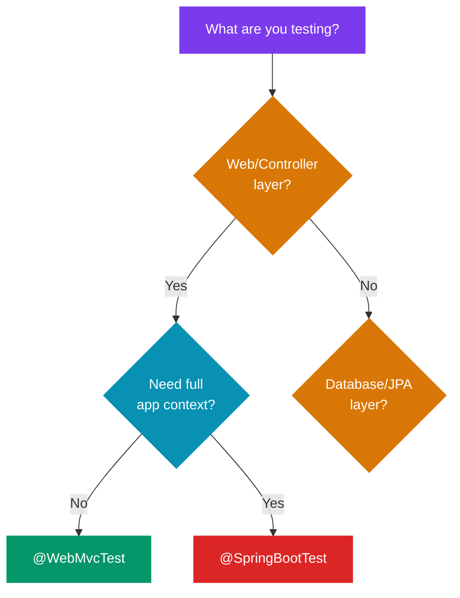

**② Not web — check the other slices, narrowest first:**

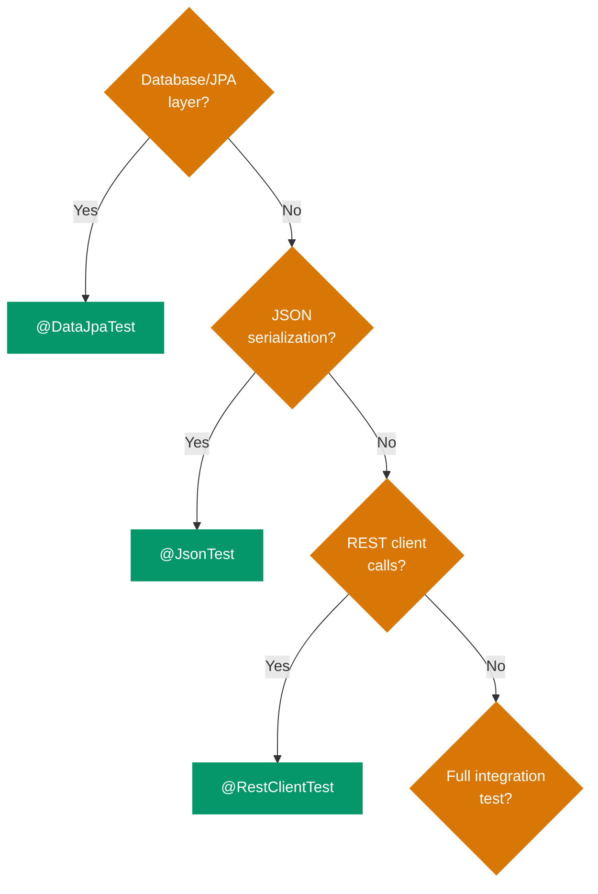

**③ No slice fits — the last choice is "whole app" vs "no Spring at all":**

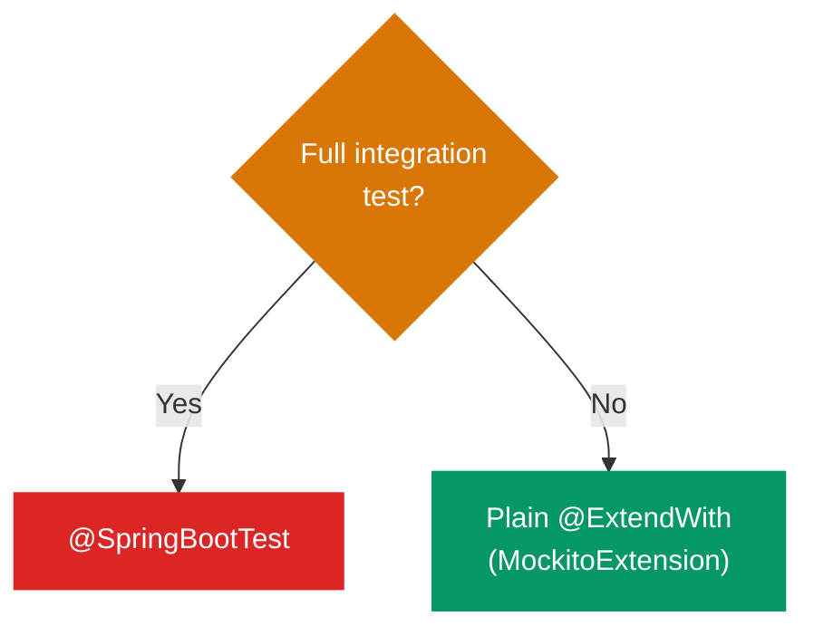

> One decision tree, split into three parts: `F` joins ① to ② and `L` joins ② to ③. `@SpringBootTest` (red) is the last choice in both ① and ③, on purpose. It is the slowest option. So you pick it only when no narrower option covers the test.

---

</details>

---

9. **🌐 How do you test REST controllers using MockMvc? 🔥**

<!-- -->
<details>
<summary>Answer</summary>

**Answer:**

`MockMvc` lets you test Spring MVC controllers without starting a real server. It sends fake (simulated) HTTP requests to them. It checks the full request-response flow: routing, serialization, validation, and exception handling.

🛠️ **Complete Example — Testing a User CRUD Controller:**

```java
@WebMvcTest(UserController.class)
class UserControllerTest {

    @Autowired
    private MockMvc mockMvc;

    @Autowired
    private ObjectMapper objectMapper;

    @MockitoBean
    private UserService userService;

    // --- GET endpoint test ---
    @Test
    void shouldReturnUserById() throws Exception {
        UserResponse user = new UserResponse(1L, "Alice", "alice@test.com");
        given(userService.getUserById(1L)).willReturn(user);

        mockMvc.perform(get("/api/users/{id}", 1L)
                .accept(MediaType.APPLICATION_JSON))
            .andExpect(status().isOk())
            .andExpect(jsonPath("$.id").value(1))
            .andExpect(jsonPath("$.name").value("Alice"))
            .andExpect(jsonPath("$.email").value("alice@test.com"))
            .andDo(print()); // prints request/response to console
    }

    // --- POST endpoint test ---
    @Test
    void shouldCreateUser() throws Exception {
        CreateUserRequest request = new CreateUserRequest("Bob", "bob@test.com");
        UserResponse response = new UserResponse(2L, "Bob", "bob@test.com");
        given(userService.createUser(any(CreateUserRequest.class)))
            .willReturn(response);

        mockMvc.perform(post("/api/users")
                .contentType(MediaType.APPLICATION_JSON)
                .content(objectMapper.writeValueAsString(request)))
            .andExpect(status().isCreated())
            .andExpect(jsonPath("$.id").value(2))
            .andExpect(jsonPath("$.name").value("Bob"))
            .andExpect(header().string("Location", "/api/users/2"));
    }

    // --- Validation test ---
    @Test
    void shouldReturn400WhenNameIsBlank() throws Exception {
        CreateUserRequest request = new CreateUserRequest("", "bob@test.com");

        mockMvc.perform(post("/api/users")
                .contentType(MediaType.APPLICATION_JSON)
                .content(objectMapper.writeValueAsString(request)))
            .andExpect(status().isBadRequest())
            .andExpect(jsonPath("$.errors[0].field").value("name"))
            .andExpect(jsonPath("$.errors[0].message").value("Name is required"));
    }

    // --- 404 test ---
    @Test
    void shouldReturn404WhenUserNotFound() throws Exception {
        given(userService.getUserById(999L))
            .willThrow(new ResourceNotFoundException("User not found"));

        mockMvc.perform(get("/api/users/{id}", 999L))
            .andExpect(status().isNotFound())
            .andExpect(jsonPath("$.message").value("User not found"));
    }

    // --- PUT endpoint test ---
    @Test
    void shouldUpdateUser() throws Exception {
        UpdateUserRequest request = new UpdateUserRequest("Alice Updated", "alice.new@test.com");
        UserResponse response = new UserResponse(1L, "Alice Updated", "alice.new@test.com");
        given(userService.updateUser(eq(1L), any(UpdateUserRequest.class)))
            .willReturn(response);

        mockMvc.perform(put("/api/users/{id}", 1L)
                .contentType(MediaType.APPLICATION_JSON)
                .content(objectMapper.writeValueAsString(request)))
            .andExpect(status().isOk())
            .andExpect(jsonPath("$.name").value("Alice Updated"));
    }

    // --- DELETE endpoint test ---
    @Test
    void shouldDeleteUser() throws Exception {
        willDoNothing().given(userService).deleteUser(1L);

        mockMvc.perform(delete("/api/users/{id}", 1L))
            .andExpect(status().isNoContent());

        then(userService).should(times(1)).deleteUser(1L);
    }

    // --- Query parameter test ---
    @Test
    void shouldSearchUsersWithPagination() throws Exception {
        Page<UserResponse> page = new PageImpl<>(
            List.of(new UserResponse(1L, "Alice", "alice@test.com")),
            PageRequest.of(0, 10), 1);
        given(userService.searchUsers(eq("alice"), any(Pageable.class)))
            .willReturn(page);

        mockMvc.perform(get("/api/users")
                .param("query", "alice")
                .param("page", "0")
                .param("size", "10"))
            .andExpect(status().isOk())
            .andExpect(jsonPath("$.content", hasSize(1)))
            .andExpect(jsonPath("$.content[0].name").value("Alice"))
            .andExpect(jsonPath("$.totalElements").value(1));
    }
}
```

⚠️ **If Spring Security is on the classpath, these tests fail as written.** `@WebMvcTest` auto-configures the security filter chain. So:

- An unauthenticated `GET` returns 401/403.
- **Every** state-changing request (`POST`/`PUT`/`DELETE`) returns 403 without a CSRF token.

Fix it like this:

```java
// ✅ Authenticate the request
@Test
@WithMockUser(username = "alice", roles = "ADMIN")
void shouldReturnUserById() throws Exception { /* ... */ }

// ✅ POST/PUT/DELETE need a CSRF token
mockMvc.perform(post("/api/users")
        .with(csrf())                                   // org.springframework.security.test...
        .contentType(MediaType.APPLICATION_JSON)
        .content(objectMapper.writeValueAsString(request)))
    .andExpect(status().isCreated());
```

Related annotations: `@WithMockUser`, `@WithAnonymousUser`, `@WithUserDetails`, and `with(csrf())` / `with(user("alice"))` request post-processors from `spring-security-test`.

You *can* switch the filters off with `@AutoConfigureMockMvc(addFilters = false)`. But know the cost: then you cannot test your security rules at all. So:

- Use it only when the test really has nothing to do with authorization.
- Keep at least one test that asserts an unauthenticated call is rejected.

**Useful MockMvc Assertions:**

| Assertion | Purpose |
|-----------|---------|
| `status().isOk()` | HTTP 200 |
| `status().isCreated()` | HTTP 201 |
| `status().isBadRequest()` | HTTP 400 |
| `status().isNotFound()` | HTTP 404 |
| `jsonPath("$.field")` | Assert JSON response body |
| `content().string(containsString("text"))` | Assert response body string |
| `header().string("name", "value")` | Assert response header |
| `cookie().value("name", "value")` | Assert response cookie |

🎯 **Interview Tip:** Prefer `@WebMvcTest` (not `@SpringBootTest`) for controller-layer tests. It only loads the web layer, so tests start much faster. Mention that `@MockitoBean` replaces real service beans with mocks in the Spring context. Also mention that it is the **current** name for what used to be `@MockBean` (see §5 Q10).

---

</details>

---

10. **🔄 What is the difference between @MockitoBean (@MockBean) and @Mock? 🔥**

<!-- -->
<details>
<summary>Answer</summary>

**Answer:**

This is one of the most often confused ideas in Spring Boot testing. The key difference is **where the mock lives**: in the Mockito world, or in the Spring application context.

🚨 **Name check first — `@MockBean` is gone.** `@MockBean` and `@SpyBean` (`org.springframework.boot.test.mock.mockito.*`) were **deprecated in Spring Boot 3.4.0** and **removed in Spring Boot 4.0**. The replacements are `@MockitoBean` and `@MockitoSpyBean` in `org.springframework.test.context.bean.override.mockito.*`.

| Old (Boot ≤ 3.3, deprecated 3.4, removed 4.0) | New (Spring Framework 6.2 / Boot 3.4+) |
|---|---|
| `@MockBean` | **`@MockitoBean`** |
| `@SpyBean` | **`@MockitoSpyBean`** |
| — | `@TestBean` (replace a bean with a *real* test instance from a static factory method) |

**Why it moved:** the Spring team made bean overriding general and moved it out of Spring Boot into **Spring Framework**. It is now a single `BeanOverride` mechanism (`@TestBean` / `@MockitoBean` / `@MockitoSpyBean`). So it now works in any `spring-test` context, not only a Boot one. Interviewers really want to hear this "why".

| Feature | `@Mock` | `@MockitoBean` (ex-`@MockBean`) |
|---------|---------|-------------|
| **From** | Mockito framework | Spring Framework Test (`spring-test`, 6.2+) |
| **Context** | No Spring context needed | Requires Spring context (`@SpringBootTest`, `@WebMvcTest`, etc.) |
| **Injection** | Injected via `@InjectMocks` | Replaces or adds a bean in the `ApplicationContext` |
| **Scope** | Lives only in the test class | Registered in Spring context — available to all beans |
| **Speed** | 🚀 Fast (no context loading) | 🐢 Slower (requires context) |
| **Use With** | `@ExtendWith(MockitoExtension.class)` | `@SpringBootTest`, `@WebMvcTest`, `@DataJpaTest`, etc. |
| **Best For** | Unit tests (service layer, utils) | Slice tests and integration tests |

⚠️ **The hidden cost of `@MockitoBean` — the context cache.** Spring caches application contexts across test classes. The *set of bean overrides* is part of the cache key.

- Two test classes that declare different `@MockitoBean` fields get **two separate cached contexts**.
- Adding different mock beans across dozens of test classes is one of the top causes of a slow Spring test suite.
- Keep the override set identical across classes (a shared base class). Then they share one cached context.

🛠️ **Example — When to use @Mock:**

```java
// Pure unit test — no Spring context needed
@ExtendWith(MockitoExtension.class)
class OrderServiceTest {

    @Mock
    private OrderRepository orderRepository;

    @Mock
    private PaymentService paymentService;

    @InjectMocks
    private OrderService orderService;

    @Test
    void shouldCreateOrder() {
        given(orderRepository.save(any())).willReturn(new Order(1L, "CREATED"));
        given(paymentService.processPayment(any())).willReturn(true);

        Order result = orderService.createOrder(new OrderRequest("ITEM-1", 2, "Alice"));

        assertEquals("CREATED", result.getStatus());
    }
}
```

🛠️ **Example — When to use @MockitoBean:**

```java
// Web slice test — Spring context is loaded for MockMvc
@WebMvcTest(OrderController.class)
class OrderControllerTest {

    @Autowired
    private MockMvc mockMvc;

    @MockitoBean  // Replaces the real OrderService bean in the Spring context
    private OrderService orderService;

    @Test
    void shouldReturnOrder() throws Exception {
        given(orderService.getOrder(1L)).willReturn(new OrderResponse(1L, "DELIVERED"));

        mockMvc.perform(get("/api/orders/1"))
            .andExpect(status().isOk())
            .andExpect(jsonPath("$.status").value("DELIVERED"));
    }
}
```

**What happens internally with @MockitoBean:**

1. Spring builds the application context
2. The `BeanOverride` infrastructure finds the `@MockitoBean` field
3. It creates a Mockito mock of that type
4. It **replaces** the real bean definition with the mock (or adds it if no real bean exists)
5. All other beans that inject this dependency now receive the mock

**Common Mistakes:**

```java
// ❌️ WRONG — Using @Mock with @WebMvcTest won't work
@WebMvcTest(OrderController.class)
class OrderControllerTest {
    @Mock  // A plain Mockito field — NOT a bean in the Spring context
    private OrderService orderService;

    @Autowired
    private MockMvc mockMvc;
}

// ❌️ WRONG — Using @MockitoBean without a Spring context
@ExtendWith(MockitoExtension.class)
class OrderServiceTest {
    @MockitoBean  // No Spring context to override — nothing happens
    private OrderRepository repo;
}
```

🔍 **What really breaks in the first example? Be exact — this *is* the question.** It is **not** "the controller silently gets the real bean." `@WebMvcTest` never loads the service layer. So there is no real `OrderService` bean to fall back to. Two things happen:

1. The `@Mock` field is never a Spring bean. On Boot 4 it also stays `null`, because nothing processes `@Mock`. On Boot 2.x/3.x, Boot's `MockitoTestExecutionListener` does create it, but only as a test field.
2. The context **fails to start** with `NoSuchBeanDefinitionException: No qualifying bean of type 'OrderService'`. The reason: Spring has no bean to pass to `OrderController`'s constructor.

You get a context-startup error. You do not get a test that quietly runs production code. "It falls back to the real bean" is the wrong mechanism. An interviewer will ask follow-up questions on it.

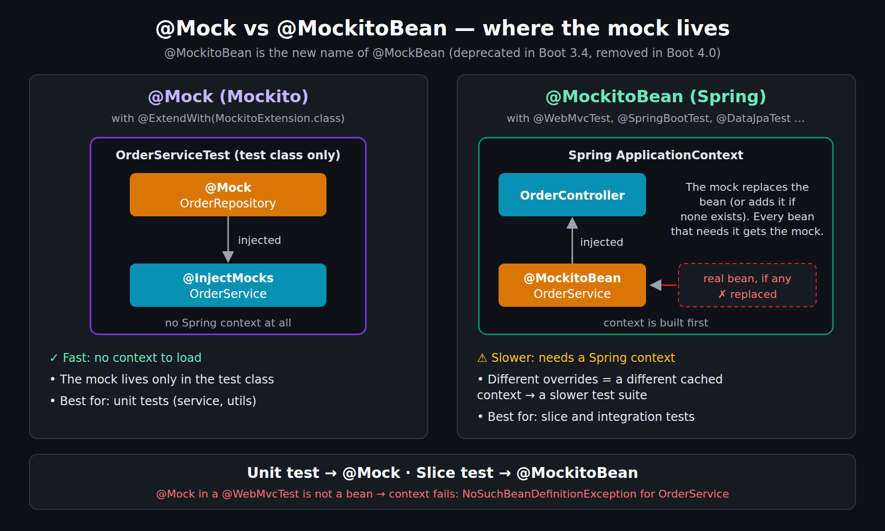

🎯 **Interview Tip:** The one line to remember: "`@Mock` is Mockito. `@MockitoBean` is Spring. Use `@Mock` for unit tests, `@MockitoBean` for slice tests." Then add the line that shows you are up to date: *"it was `@MockBean` until Boot 3.4 deprecated it — the mechanism moved into Spring Framework as `@TestBean`/`@MockitoBean`/`@MockitoSpyBean`."* Interviewers at companies like Atlassian test this difference on purpose. The rename is a common 2026 follow-up question.

---

</details>

---

11. **💥 How do you test exception handling with MockMvc? ⚡**

<!-- -->
<details>
<summary>Answer</summary>

**Answer:**

Testing exception handling with MockMvc checks that your `@ControllerAdvice` and `@ExceptionHandler` methods return the correct HTTP status codes, error messages, and response structure.

🛠️ **Setup — Global Exception Handler:**

```java
@RestControllerAdvice
public class GlobalExceptionHandler {

    @ExceptionHandler(ResourceNotFoundException.class)
    @ResponseStatus(HttpStatus.NOT_FOUND)
    public ErrorResponse handleNotFound(ResourceNotFoundException ex) {
        return new ErrorResponse("NOT_FOUND", ex.getMessage(), LocalDateTime.now());
    }

    @ExceptionHandler(MethodArgumentNotValidException.class)
    @ResponseStatus(HttpStatus.BAD_REQUEST)
    public ValidationErrorResponse handleValidation(MethodArgumentNotValidException ex) {
        // ⚠️ name the DTO FieldErrorDto — NOT FieldError.
        // getFieldErrors() returns org.springframework.validation.FieldError, which is
        // already bound in this scope and has no (field, message) constructor.
        List<FieldErrorDto> errors = ex.getBindingResult().getFieldErrors().stream()
            .map(err -> new FieldErrorDto(err.getField(), err.getDefaultMessage()))
            .toList();
        return new ValidationErrorResponse("VALIDATION_FAILED", errors);
    }

    @ExceptionHandler(DuplicateResourceException.class)
    @ResponseStatus(HttpStatus.CONFLICT)
    public ErrorResponse handleDuplicate(DuplicateResourceException ex) {
        return new ErrorResponse("CONFLICT", ex.getMessage(), LocalDateTime.now());
    }

    @ExceptionHandler(Exception.class)
    @ResponseStatus(HttpStatus.INTERNAL_SERVER_ERROR)
    public ErrorResponse handleGeneric(Exception ex) {
        return new ErrorResponse("INTERNAL_ERROR", "An unexpected error occurred",
            LocalDateTime.now());
    }
}

// Response DTOs — deliberately NOT named FieldError
public record FieldErrorDto(String field, String message) { }

public record ValidationErrorResponse(String code, List<FieldErrorDto> errors) { }

public record ErrorResponse(String code, String message, LocalDateTime timestamp) { }
```

⚠️ **A naming trap to know.** `ex.getBindingResult().getFieldErrors()` returns `List<org.springframework.validation.FieldError>`. If your own DTO is also called `FieldError`, the import wins. Then `new FieldError(field, message)` won't compile. Spring's `FieldError` has only `(objectName, field, defaultMessage)` and a 7-argument constructor. Rename the DTO (`FieldErrorDto`, `ValidationError`). Do not try to work around the import.

🛠️ **Test Class — Testing All Exception Scenarios:**

```java
@WebMvcTest(UserController.class)
class UserControllerExceptionTest {

    @Autowired
    private MockMvc mockMvc;

    @Autowired
    private ObjectMapper objectMapper;

    @MockitoBean
    private UserService userService;

    // --- 404 Not Found ---
    @Test
    void shouldReturn404WithErrorBody() throws Exception {
        given(userService.getUserById(999L))
            .willThrow(new ResourceNotFoundException("User with id 999 not found"));

        mockMvc.perform(get("/api/users/999"))
            .andExpect(status().isNotFound())
            .andExpect(jsonPath("$.code").value("NOT_FOUND"))
            .andExpect(jsonPath("$.message").value("User with id 999 not found"))
            .andExpect(jsonPath("$.timestamp").exists());
    }

    // --- 400 Validation Error ---
    @Test
    void shouldReturn400WithFieldErrors() throws Exception {
        // Send invalid request — blank name and invalid email
        String invalidJson = """
            {
                "name": "",
                "email": "not-an-email"
            }
            """;

        mockMvc.perform(post("/api/users")
                .contentType(MediaType.APPLICATION_JSON)
                .content(invalidJson))
            .andExpect(status().isBadRequest())
            .andExpect(jsonPath("$.code").value("VALIDATION_FAILED"))
            .andExpect(jsonPath("$.errors", hasSize(2)))
            .andExpect(jsonPath("$.errors[*].field",
                containsInAnyOrder("name", "email")));
    }

    // --- 409 Conflict ---
    @Test
    void shouldReturn409WhenDuplicateEmail() throws Exception {
        given(userService.createUser(any()))
            .willThrow(new DuplicateResourceException(
                "User with email alice@test.com already exists"));

        CreateUserRequest request = new CreateUserRequest("Alice", "alice@test.com");

        mockMvc.perform(post("/api/users")
                .contentType(MediaType.APPLICATION_JSON)
                .content(objectMapper.writeValueAsString(request)))
            .andExpect(status().isConflict())
            .andExpect(jsonPath("$.code").value("CONFLICT"))
            .andExpect(jsonPath("$.message")
                .value("User with email alice@test.com already exists"));
    }

    // --- 500 Internal Server Error ---
    @Test
    void shouldReturn500ForUnexpectedErrors() throws Exception {
        given(userService.getUserById(1L))
            .willThrow(new RuntimeException("Database connection failed"));

        mockMvc.perform(get("/api/users/1"))
            .andExpect(status().isInternalServerError())
            .andExpect(jsonPath("$.code").value("INTERNAL_ERROR"))
            .andExpect(jsonPath("$.message").value("An unexpected error occurred"));
    }

    // --- Testing that exception handler is actually invoked ---
    @Test
    void shouldUseGlobalExceptionHandler() throws Exception {
        given(userService.getUserById(1L))
            .willThrow(new ResourceNotFoundException("Not found"));

        MvcResult result = mockMvc.perform(get("/api/users/1"))
            .andExpect(status().isNotFound())
            .andReturn();

        // You can also deserialize and assert on the full object
        String responseBody = result.getResponse().getContentAsString();
        ErrorResponse error = objectMapper.readValue(responseBody, ErrorResponse.class);

        assertEquals("NOT_FOUND", error.code());   // record accessor, not getCode()
        assertNotNull(error.timestamp());
    }
}
```

**Key Points:**
- `@WebMvcTest` automatically picks up `@RestControllerAdvice` classes
- You can test validation by sending invalid JSON directly
- Use `jsonPath` with Hamcrest matchers (`hasSize`, `containsInAnyOrder`) for collection assertions
- Use `andReturn()` to get the `MvcResult` for more complex assertions

🎯 **Interview Tip:** Mention that testing exception handling is just as important as testing happy paths (the normal, no-error flow). In production APIs, a well-structured error response helps frontend teams and API consumers debug issues. This shows professional-level testing.

---

</details>

---

12. **🐳 How do you use Testcontainers for integration testing? 🔥**

<!-- -->
<details>
<summary>Answer</summary>

**Answer:**

Testcontainers is a Java library that runs real Docker containers during tests. An embedded H2 database behaves differently from production PostgreSQL/MySQL. So instead of H2, you start the actual database in a container.

**Why Testcontainers over H2:**
- H2 doesn't support all PostgreSQL/MySQL features (e.g., `JSONB`, `ON CONFLICT ... DO UPDATE`)
- Queries that pass on H2 may fail in production
- Testcontainers gives you **the same database engine** as production

**Maven Dependencies:**

```xml
<dependency>
    <groupId>org.testcontainers</groupId>
    <artifactId>testcontainers</artifactId>
    <scope>test</scope>
</dependency>
<dependency>
    <groupId>org.testcontainers</groupId>
    <artifactId>postgresql</artifactId>
    <scope>test</scope>
</dependency>
<dependency>
    <groupId>org.testcontainers</groupId>
    <artifactId>junit-jupiter</artifactId>
    <scope>test</scope>
</dependency>
<!-- Spring Boot 3.1+ — enables @ServiceConnection -->
<dependency>
    <groupId>org.springframework.boot</groupId>
    <artifactId>spring-boot-testcontainers</artifactId>
    <scope>test</scope>
</dependency>
```

🛠️ **Example — Repository Test with PostgreSQL Testcontainer (`@ServiceConnection`):**

```java
@DataJpaTest
@AutoConfigureTestDatabase(replace = AutoConfigureTestDatabase.Replace.NONE)
@Testcontainers
class UserRepositoryIntegrationTest {

    @Container
    @ServiceConnection   // ✅ Boot 3.1+ — derives url/username/password automatically
    static PostgreSQLContainer<?> postgres = new PostgreSQLContainer<>("postgres:15-alpine")
        .withDatabaseName("testdb")
        .withUsername("test")
        .withPassword("test");

    // ❌️ No @DynamicPropertySource needed — @ServiceConnection replaces all three lines:
    //    registry.add("spring.datasource.url",      postgres::getJdbcUrl);
    //    registry.add("spring.datasource.username", postgres::getUsername);
    //    registry.add("spring.datasource.password", postgres::getPassword);

    @Autowired
    private UserRepository userRepository;

    @Autowired
    private TestEntityManager entityManager;

    @Test
    void shouldFindUserByEmail() {
        // Arrange
        User user = new User("Alice", "alice@test.com", "ACTIVE");
        entityManager.persistAndFlush(user);

        // Act
        Optional<User> found = userRepository.findByEmail("alice@test.com");

        // Assert
        assertTrue(found.isPresent());
        assertEquals("Alice", found.get().getName());
    }

    @Test
    void shouldFindActiveUsersByNamePattern() {
        // Arrange
        entityManager.persistAndFlush(new User("Alice Smith", "alice@test.com", "ACTIVE"));
        entityManager.persistAndFlush(new User("Alice Johnson", "alicej@test.com", "ACTIVE"));
        entityManager.persistAndFlush(new User("Alice Brown", "aliceb@test.com", "INACTIVE"));
        entityManager.flush();

        // Act — custom query using LIKE
        List<User> activeAlices = userRepository
            .findByNameContainingAndStatus("Alice", "ACTIVE");

        // Assert
        assertEquals(2, activeAlices.size());
    }

    @Test
    void shouldUseNativeQueryWithPostgresFeatures() {
        // Arrange
        entityManager.persistAndFlush(new User("Alice", "a@test.com", "ACTIVE"));
        entityManager.persistAndFlush(new User("Bob", "b@test.com", "ACTIVE"));
        entityManager.flush();

        // Act — this uses PostgreSQL-specific features that H2 doesn't support
        List<UserStats> stats = userRepository.getUserStatsByStatus();

        // Assert
        assertFalse(stats.isEmpty());
    }
}
```

❌️ **The base-class trap — do NOT put `@Testcontainers` + `@Container` on a shared parent:**

```java
// ❌️ WRONG — restarts PostgreSQL once per test class
@Testcontainers
public abstract class BaseIntegrationTest {

    @Container
    static PostgreSQLContainer<?> postgres = new PostgreSQLContainer<>("postgres:15-alpine");
}
```

What goes wrong:

- `@Testcontainers` registers `TestcontainersExtension`.
- This extension starts a `static @Container` in `beforeAll` and **stops it in `afterAll`**. It does this per test class.
- `@ExtendWith` is `@Inherited`, so every subclass repeats the whole cycle: **N subclasses → N PostgreSQL startups**. Each startup uses a new random port.
- Worse, Spring caches application contexts. So a later test class can get a cached context that still points at the *previous* container's port.

✅ **The singleton container pattern — start it once per JVM, never stop it:**

```java
// ✅ Base class — one container for the entire test run
public abstract class BaseIntegrationTest {

    static final PostgreSQLContainer<?> POSTGRES =
        new PostgreSQLContainer<>("postgres:15-alpine")
            .withDatabaseName("testdb")
            .withUsername("test")
            .withPassword("test");

    static {
        POSTGRES.start();   // runs once, on first class load
        // No stop() and no @Container: Ryuk (the Testcontainers sidecar)
        // reaps the container when the JVM exits.
    }

    @DynamicPropertySource
    static void configureProperties(DynamicPropertyRegistry registry) {
        registry.add("spring.datasource.url", POSTGRES::getJdbcUrl);
        registry.add("spring.datasource.username", POSTGRES::getUsername);
        registry.add("spring.datasource.password", POSTGRES::getPassword);
    }
}

// Each test class extends the base
@DataJpaTest
@AutoConfigureTestDatabase(replace = AutoConfigureTestDatabase.Replace.NONE)
class OrderRepositoryTest extends BaseIntegrationTest {

    @Autowired
    private OrderRepository orderRepository;

    @Test
    void shouldSaveAndRetrieveOrder() {
        Order order = new Order("ORD-001", "PENDING", LocalDateTime.now());
        Order saved = orderRepository.save(order);
        assertNotNull(saved.getId());
    }
}
```

✅ **The Boot-native alternative** — a shared `@TestConfiguration` bean with `@ServiceConnection`, imported with `@Import(...)`. Spring manages the container's lifecycle (start and stop). Spring also derives the connection details for you:

```java
@TestConfiguration(proxyBeanMethods = false)
public class ContainersConfig {

    @Bean
    @ServiceConnection
    PostgreSQLContainer<?> postgresContainer() {
        return new PostgreSQLContainer<>("postgres:15-alpine");
    }
}

@SpringBootTest
@Import(ContainersConfig.class)
class OrderIntegrationTest { /* ... */ }
```

**Key Annotations Explained:**

| Annotation | Purpose |
|------------|---------|
| `@Testcontainers` | JUnit 5 extension that manages `@Container` lifecycle (start `beforeAll`, **stop `afterAll`**) |
| `@Container` | Marks a container field for the extension to manage — **per test class**, which is why a shared base class needs the singleton pattern instead |
| `@ServiceConnection` | **Boot 3.1+** — auto-derives connection properties from a supported container (Postgres, MySQL, Redis, Kafka, MongoDB, Elasticsearch, …). Prefer this. |
| `@DynamicPropertySource` | Manual property wiring — still needed for containers Boot has no `ConnectionDetails` factory for, and for custom properties |
| `@AutoConfigureTestDatabase(replace = NONE)` | Prevents Spring from replacing your datasource with an embedded DB (H2, HSQLDB or Derby) |

🎯 **Interview Tip:** Testcontainers is a common topic at companies like Razorpay, PhonePe, and CRED that use PostgreSQL heavily. Start with **`@ServiceConnection`** (not `@DynamicPropertySource`) and the **singleton container** pattern. These two answers show you have read the current docs, not 2021 blog posts.

⚖️ **Be honest about your experience level.**

---

</details>

---

13. **⚙️ What is @DynamicPropertySource and why is it needed with Testcontainers? ⚡**

<!-- -->
<details>
<summary>Answer</summary>

**Answer:**

`@DynamicPropertySource` lets you inject **properties known only at runtime** into the Spring `Environment`.

- It lives in `org.springframework.test.context`.
- It is a **Spring Framework** annotation, not a Spring Boot one. It was added in Framework **5.2.5**, which shipped with Boot 2.2.6.
- It was added specifically to support Testcontainers.

> 📌 **Read this question with 2026 in mind:** since **Spring Boot 3.1**, `@ServiceConnection` handles the common cases with no property wiring at all. Use `@DynamicPropertySource` as the fallback in two cases: services Boot has no `ConnectionDetails` factory for, and properties that aren't connection details at all (feature flags, an external API base URL, a bucket name).

**The Problem It Solves:**

When a Testcontainer starts, Docker assigns it a **random port**. Your `application.properties` can't know this port ahead of time:

```properties
# ❌️ This won't work — port is random!
spring.datasource.url=jdbc:postgresql://localhost:????/testdb
```

`@DynamicPropertySource` solves this by setting properties **after** the container starts but **before** Spring loads the context:

```java
@DynamicPropertySource
static void configureProperties(DynamicPropertyRegistry registry) {
    // These are evaluated lazily — when Spring reads the property
    registry.add("spring.datasource.url", postgres::getJdbcUrl);
    registry.add("spring.datasource.username", postgres::getUsername);
    registry.add("spring.datasource.password", postgres::getPassword);
}
```

🛠️ **Multi-Container Example (Database + Redis + Kafka):**

```java
@SpringBootTest
@Testcontainers
class FullIntegrationTest {

    @Container
    static PostgreSQLContainer<?> postgres = new PostgreSQLContainer<>("postgres:15-alpine")
        .withDatabaseName("testdb");

    @Container
    static GenericContainer<?> redis = new GenericContainer<>("redis:7-alpine")
        .withExposedPorts(6379);

    // Current Testcontainers: org.testcontainers.kafka.KafkaContainer (apache/kafka image).
    // The legacy org.testcontainers.containers.KafkaContainer + confluentinc/cp-kafka
    // pairing is now ConfluentKafkaContainer.
    @Container
    static KafkaContainer kafka = new KafkaContainer(
        DockerImageName.parse("apache/kafka:3.8.0"));

    @DynamicPropertySource
    static void configureProperties(DynamicPropertyRegistry registry) {
        // PostgreSQL + Kafka could both use @ServiceConnection instead of these lines.
        registry.add("spring.datasource.url", postgres::getJdbcUrl);
        registry.add("spring.datasource.username", postgres::getUsername);
        registry.add("spring.datasource.password", postgres::getPassword);
        registry.add("spring.kafka.bootstrap-servers", kafka::getBootstrapServers);

        // Redis could use @ServiceConnection too: Boot matches a GenericContainer by its
        // image name "redis". These two lines only show the manual form.
        registry.add("spring.data.redis.host", redis::getHost);
        registry.add("spring.data.redis.port", () -> redis.getMappedPort(6379));
    }

    @Autowired
    private UserService userService;

    @Test
    void shouldCreateUserAndPublishEvent() {
        User user = userService.createUser(new CreateUserRequest("Alice", "a@test.com"));
        assertNotNull(user.getId());
        // Verify the Kafka event was published, Redis cache was updated, etc.
    }
}
```

**Key Rules:**

| Rule | Details |
|------|---------|
| Method must be `static` | Runs before Spring context initialization |
| Method must take `DynamicPropertyRegistry` | The registry is provided by Spring |
| Values are resolved lazily | Lambdas/method references are called when Spring reads the property |
| Works with any `@...Test` annotation | Compatible with `@SpringBootTest`, `@DataJpaTest`, `@WebMvcTest`, etc. |

**Before @DynamicPropertySource (the old way):**

```java
// ❌️ Old approach — using ApplicationContextInitializer (verbose)
@Testcontainers
@ContextConfiguration(initializers = MyTest.Initializer.class)
class MyTest {
    @Container
    static PostgreSQLContainer<?> postgres = new PostgreSQLContainer<>("postgres:15-alpine");

    static class Initializer implements ApplicationContextInitializer<ConfigurableApplicationContext> {
        @Override
        public void initialize(ConfigurableApplicationContext ctx) {
            TestPropertyValues.of(
                "spring.datasource.url=" + postgres.getJdbcUrl()
            ).applyTo(ctx.getEnvironment());
        }
    }
}

// ✅ New approach — clean and concise
@DynamicPropertySource
static void props(DynamicPropertyRegistry registry) {
    registry.add("spring.datasource.url", postgres::getJdbcUrl);
}
```

🎯 **Interview Tip:** If asked *"How do you configure Testcontainers with Spring Boot?"*, start with **`@ServiceConnection`**:

- Say: "On Boot 3.1+ I annotate the container and Boot derives the connection details. I only use `@DynamicPropertySource` when there's no `ConnectionDetails` factory for that service, or when I need to set a property that isn't a connection detail."
- Then add that `@DynamicPropertySource` itself replaced the older `ApplicationContextInitializer` + `TestPropertyValues` boilerplate.
- Calling `@DynamicPropertySource` "the officially recommended way" is the pre-3.1 answer. It shows your knowledge is several Boot releases old.

---

</details>

---

14. **⏱️ How do you test @Async methods in Spring Boot? 🔥**

<!-- -->
<details>
<summary>Answer</summary>

**Answer:**

Testing `@Async` methods is hard because the method runs on a different thread and returns immediately. You have two options:

- wait for the async operation to complete, or
- use a library like **Awaitility** to poll for the expected result.

**The Problem:**

```java
@Service
public class NotificationService {

    @Async
    public CompletableFuture<Boolean> sendNotification(String userId, String message) {
        // Simulates slow external API call
        externalApi.send(userId, message);
        return CompletableFuture.completedFuture(true);
    }

    @Async
    public void sendEmailAsync(String to, String subject, String body) {
        // void return — fire and forget
        emailClient.send(to, subject, body);
    }
}
```

**Awaitility Dependency:**

```xml
<dependency>
    <groupId>org.awaitility</groupId>
    <artifactId>awaitility</artifactId>
    <scope>test</scope>
</dependency>
```

> **Note:** Included in `spring-boot-starter-test` since Spring Boot 3.2. On older versions you must add it yourself. Spring Boot manages its version, so you do not need a `<version>` tag.

🛠️ **Example 1 — Testing @Async with CompletableFuture return:**

```java
@SpringBootTest
class NotificationServiceAsyncTest {

    @Autowired
    private NotificationService notificationService;

    @MockitoBean
    private ExternalApi externalApi;

    @Test
    void shouldSendNotificationAsync() throws Exception {
        // Arrange
        given(externalApi.send(anyString(), anyString())).willReturn(true);

        // Act
        CompletableFuture<Boolean> future = notificationService
            .sendNotification("USER-1", "Hello");

        // Assert — wait for async result
        Boolean result = future.get(5, TimeUnit.SECONDS);
        assertTrue(result);
        then(externalApi).should(times(1)).send("USER-1", "Hello");
    }
}
```

🛠️ **Example 2 — Testing void @Async with Awaitility:**

```java
@SpringBootTest
class NotificationServiceAwaitilityTest {

    @Autowired
    private NotificationService notificationService;

    @MockitoBean
    private EmailClient emailClient;

    @Test
    void shouldSendEmailAsynchronously() {
        // Arrange — no stubbing needed: a mock's void methods already do nothing.
        // doNothing().when(emailClient).send(...) here would be redundant.

        // Act — this returns immediately (void async)
        notificationService.sendEmailAsync("bob@test.com", "Subject", "Body");

        // Assert — use Awaitility to wait for async execution
        await()
            .atMost(5, TimeUnit.SECONDS)
            .untilAsserted(() ->
                then(emailClient).should(times(1))
                    .send("bob@test.com", "Subject", "Body")
            );
    }

    @Test
    void shouldHandleMultipleAsyncCalls() {
        // Act — fire multiple async calls
        notificationService.sendEmailAsync("a@test.com", "Sub1", "Body1");
        notificationService.sendEmailAsync("b@test.com", "Sub2", "Body2");
        notificationService.sendEmailAsync("c@test.com", "Sub3", "Body3");

        // Assert — all three should complete
        await()
            .atMost(10, TimeUnit.SECONDS)
            .untilAsserted(() ->
                then(emailClient).should(times(3))
                    .send(anyString(), anyString(), anyString())
            );
    }

    @Test
    void shouldHandleAsyncFailure() {
        doThrow(new RuntimeException("SMTP down"))
            .when(emailClient).send(anyString(), anyString(), anyString());

        // Act
        notificationService.sendEmailAsync("bob@test.com", "Sub", "Body");

        // Assert — verify the call was attempted
        await()
            .atMost(5, TimeUnit.SECONDS)
            .untilAsserted(() ->
                then(emailClient).should(times(1))
                    .send("bob@test.com", "Sub", "Body")
            );
    }
}
```

**Awaitility Key Methods:**

| Method | Purpose |
|--------|---------|
| `await().atMost(duration)` | Maximum wait time before failing |
| `await().atLeast(duration)` | Minimum wait time (for timing assertions) |
| `await().pollInterval(duration)` | How often to check the condition |
| `await().untilAsserted(runnable)` | Wait until assertions pass |
| `await().until(callable, matcher)` | Wait until callable returns matching value |

**Important — @Async requires Spring context:**

```java
// ❌️ This won't test async behavior — @Async is ignored without Spring
@ExtendWith(MockitoExtension.class)
class WrongAsyncTest {
    @InjectMocks
    private NotificationService service; // @Async is NOT proxied!
}

// ✅ Use @SpringBootTest to get the async proxy
@SpringBootTest
class CorrectAsyncTest {
    @Autowired  // Spring proxy that handles @Async
    private NotificationService service;
}
```

⚠️ **Where to put `@EnableAsync` in a test.**

- `@EnableAsync` is `@Import`-based.
- In a Boot test (`@SpringBootTest`, `@WebMvcTest`, …), `@Import` on the test class works. Boot's `ImportsContextCustomizer` also finds meta-annotations like `@EnableAsync`. So `@EnableAsync` on the test class does turn async on.
- The cost: it changes the context cache key, so this class gets its own context.
- Without Spring Boot's test support (`spring-boot-test`) on the classpath, the test class is not a configuration class. There, `@EnableAsync` on the test class does nothing.

Two clean placements:

```java
// ✅ Option 1 — rely on the application's own @EnableAsync (the normal case)
@SpringBootTest
class NotificationServiceAsyncTest { /* ... */ }

// ✅ Option 2 — a nested static @TestConfiguration IS registered
@SpringBootTest
class NotificationServiceAsyncTest {

    @TestConfiguration
    @EnableAsync
    static class AsyncTestConfig { }
}
```

🎯 **Interview Tip:** The key point interviewers look for: "`@Async` works through a Spring AOP proxy, so you MUST get the bean from the context with `@Autowired`. `@InjectMocks` constructs the object with `new`. A raw instance is never proxied, so `@Async` is simply ignored." Also know that `@EnableAsync` normally lives on the application's own config class. Then you're ahead of most candidates.

---

</details>

---

15. **📝 How do you use @Sql annotation for test data setup? ⚡**

<!-- -->
<details>
<summary>Answer</summary>

**Answer:**

The `@Sql` annotation runs SQL scripts before or after a test method. You use it to set up or clean up test data. It is an alternative to setting up data in code with `TestEntityManager` or repository calls.

**When to use @Sql:**
- When you have complex test data that is easier to express in SQL
- When you want to reuse the same test dataset across multiple test classes
- When testing native queries and stored procedures
- When setting up reference/lookup data

🛠️ **Examples:**

```java
@DataJpaTest
@AutoConfigureTestDatabase(replace = AutoConfigureTestDatabase.Replace.NONE)
class OrderRepositoryTest extends BaseIntegrationTest {

    @Autowired
    private OrderRepository orderRepository;

    // --- Execute SQL before a single test method ---
    @Test
    @Sql("/sql/insert-orders.sql")
    void shouldFindPendingOrders() {
        List<Order> pending = orderRepository.findByStatus("PENDING");
        assertEquals(3, pending.size());
    }

    // --- Execute SQL before AND after ---
    @Test
    @Sql(scripts = "/sql/insert-orders.sql", executionPhase = Sql.ExecutionPhase.BEFORE_TEST_METHOD)
    @Sql(scripts = "/sql/cleanup-orders.sql", executionPhase = Sql.ExecutionPhase.AFTER_TEST_METHOD)
    void shouldCalculateOrderTotal() {
        Double total = orderRepository.sumTotalByStatus("COMPLETED");
        assertEquals(450.0, total, 0.01);
    }

    // --- Multiple scripts in order ---
    @Test
    @Sql({"/sql/insert-users.sql", "/sql/insert-orders.sql"})
    void shouldFindOrdersWithUserDetails() {
        List<OrderWithUser> orders = orderRepository.findAllWithUserDetails();
        assertFalse(orders.isEmpty());
        assertNotNull(orders.get(0).getUserName());
    }

    // --- Using @SqlGroup for complex setups ---
    @Test
    @SqlGroup({
        @Sql(value = "/sql/insert-test-data.sql",
             executionPhase = Sql.ExecutionPhase.BEFORE_TEST_METHOD),
        @Sql(value = "/sql/cleanup-test-data.sql",
             executionPhase = Sql.ExecutionPhase.AFTER_TEST_METHOD)
    })
    void shouldProcessBatchOrders() {
        int processed = orderRepository.markOldOrdersAsArchived(30);
        assertTrue(processed > 0);
    }

    // --- Apply @Sql at class level (runs before every test) ---
    // Can also put @Sql on the class itself
}
```

**SQL Script Example (`src/test/resources/sql/insert-orders.sql`):**

```sql
INSERT INTO users (id, name, email, status) VALUES
    (1, 'Alice', 'alice@test.com', 'ACTIVE'),
    (2, 'Bob', 'bob@test.com', 'ACTIVE');

INSERT INTO orders (id, user_id, order_number, status, total, created_at) VALUES
    (1, 1, 'ORD-001', 'PENDING', 100.00, '2026-01-15'),
    (2, 1, 'ORD-002', 'PENDING', 200.00, '2026-02-10'),
    (3, 2, 'ORD-003', 'PENDING', 50.00, '2026-03-01'),
    (4, 2, 'ORD-004', 'COMPLETED', 150.00, '2026-01-20'),
    (5, 1, 'ORD-005', 'COMPLETED', 300.00, '2026-02-28');
```

**@Sql Configuration Options:**

| Attribute | Purpose | Default |
|-----------|---------|---------|
| `scripts` / `value` | Path to SQL scripts | — |
| `executionPhase` | `BEFORE_TEST_METHOD` or `AFTER_TEST_METHOD` (Spring 6.1+ also `BEFORE_TEST_CLASS` / `AFTER_TEST_CLASS`) | `BEFORE_TEST_METHOD` |
| `config` | Error handling and separator config | Defaults |
| `statements` | Inline SQL statements (instead of files) | — |

**Inline SQL Statements (no external file needed):**

```java
@Test
@Sql(statements = {
    "INSERT INTO users (id, name, email) VALUES (1, 'Alice', 'alice@test.com')",
    "INSERT INTO users (id, name, email) VALUES (2, 'Bob', 'bob@test.com')"
})
void shouldFindAllUsers() {
    List<User> users = userRepository.findAll();
    assertEquals(2, users.size());
}
```

🎯 **Interview Tip:** Mention that `@DataJpaTest` rolls back transactions after each test by default. So you often don't need cleanup scripts. But with `@SpringBootTest`, you may need explicit cleanup, or `@Transactional` on the test class.

---

</details>

---

16. **🚫 When should you NOT mock? The anti-patterns of over-mocking. 🔥**

<!-- -->
<details>
<summary>Answer</summary>

**Answer:**

Over-mocking is one of the most common testing mistakes. When you mock too much, your tests check your mock setup, not the real behavior of your code. The tests pass, but the code is broken.

**Don't Mock These:**

| What | Why Not |
|------|---------|
| **Value objects / DTOs** | Just create real instances. They have no side effects |
| **Simple data transformations** | Mocking a mapper hides actual mapping bugs |
| **The class under test** | You're testing it, so don't mock it (use `@InjectMocks` or `new`) |
| **Collections / Streams** | Use real `List`, `Map`. Mocking them makes tests break easily |
| **Third-party libraries you trust** | Don't mock `ObjectMapper`, `String`, `List` |
| **Private methods** | If you feel the need, refactor instead |
| **The database, in repository tests** | When the query itself is under test, run it against a real DB (Testcontainers). In service unit tests, mocking the repository is fine — it is the boundary |

🛠️ **Anti-Pattern Examples:**

```java
// ❌️ Anti-pattern 1: Mocking value objects
@Test
void overMocked_shouldCalculateTotal() {
    Order mockOrder = mock(Order.class);
    when(mockOrder.getQuantity()).thenReturn(5);
    when(mockOrder.getPrice()).thenReturn(10.0);

    double total = calculator.calculateTotal(mockOrder);
    assertEquals(50.0, total);
    // Problem: If Order adds a discount field, this test still passes!
}

// ✅ Correct: Use real value object
@Test
void correct_shouldCalculateTotal() {
    Order order = new Order("ITEM-1", 5, 10.0);

    double total = calculator.calculateTotal(order);
    assertEquals(50.0, total);
    // If Order changes, we catch it here
}
```

```java
// ❌️ Anti-pattern 2: Mocking everything in a chain
@Test
void overMocked_shouldProcessOrder() {
    when(orderMapper.toEntity(any())).thenReturn(orderEntity);
    when(orderRepository.save(any())).thenReturn(savedEntity);
    when(orderMapper.toResponse(any())).thenReturn(expectedResponse);

    OrderResponse result = orderService.processOrder(request);
    assertEquals(expectedResponse, result);
    // Problem: You're testing that mocks return what you told them to return!
}

// ✅ Correct: Only mock what crosses a boundary
@Test
void correct_shouldProcessOrder() {
    when(orderRepository.save(any(Order.class)))
        .thenAnswer(inv -> {
            Order o = inv.getArgument(0);
            o.setId(1L);
            return o;
        });

    OrderResponse result = orderService.processOrder(request);

    assertEquals(1L, result.getId());
    assertEquals("PENDING", result.getStatus()); // Real mapping logic tested!
    assertEquals(request.getItemCode(), result.getItemCode());
}
```

**The Mock Boundary Rule:**

> Mock at the **architectural boundary**. If a dependency crosses a boundary (network, filesystem, database, external API), mock it. If it's internal logic, use the real object.

```
┌─────────────────────────────────────┐
│  Your Application                   │
│                                     │
│  Controller → Service → Mapper      │  ← Don't mock between these
│                  │                   │
│                  ▼                   │
│            Repository ──────────────┼──→ Database     ← Mock this boundary
│            HttpClient ──────────────┼──→ External API ← Mock this boundary
│            EmailSender ─────────────┼──→ SMTP Server  ← Mock this boundary
│                                     │
└─────────────────────────────────────┘
```

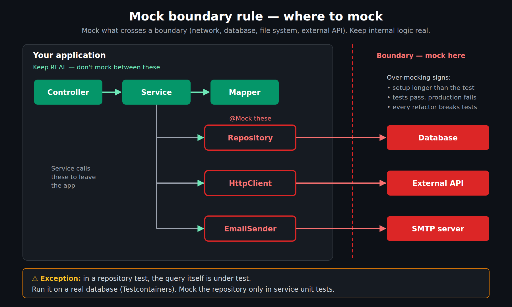

**Signs You're Over-Mocking:**
1. Your test setup is longer than the test itself
2. Tests pass but production fails
3. Every refactoring breaks tests (brittle tests)
4. You're mocking methods that have no side effects
5. You need to mock static methods of your own code (a sign of poor design)

🎯 **Interview Tip:** Say: "I follow the rule — mock at the boundary, not at every layer. If my test setup is longer than my assertions, I'm probably over-mocking." This shows mature testing habits. Senior engineers value this.

---

</details>

---

17. **📐 What is the Arrange-Act-Assert (AAA) pattern? 🔥**

<!-- -->
<details>
<summary>Answer</summary>

**Answer:**

Arrange-Act-Assert (AAA) is the standard structure for organizing unit tests. It splits the test into three clear phases. This makes tests easy to read and easy to maintain.

| Phase | Purpose | Also Called |
|-------|---------|------------|
| **Arrange** | Set up test data, mocks, and preconditions | Given (BDD) |
| **Act** | Execute the method under test | When (BDD) |
| **Assert** | Verify the result and side effects | Then (BDD) |

🛠️ **Example — Well-Structured Test:**

```java
@ExtendWith(MockitoExtension.class)
class PaymentServiceTest {

    @Mock
    private PaymentGateway gateway;

    @Mock
    private TransactionRepository repository;

    @Mock
    private AuditLogger auditLogger;

    @InjectMocks
    private PaymentService paymentService;

    @Test
    void shouldProcessPaymentAndSaveTransaction() {
        // ====== Arrange ======
        PaymentRequest request = PaymentRequest.builder()
            .cardNumber("4111111111111111")
            .amount(250.00)
            .currency("INR")
            .merchantId("MERCHANT-001")
            .build();

        GatewayResponse gatewayResponse = new GatewayResponse("TXN-123", "SUCCESS");
        given(gateway.charge(any(ChargeRequest.class))).willReturn(gatewayResponse);
        given(repository.save(any(Transaction.class)))
            .willAnswer(inv -> {
                Transaction t = inv.getArgument(0);
                t.setId(1L);
                return t;
            });

        // ====== Act ======
        PaymentResult result = paymentService.processPayment(request);

        // ====== Assert ======
        // 1. Verify the return value
        assertNotNull(result);
        assertEquals("TXN-123", result.getTransactionId());
        assertEquals("SUCCESS", result.getStatus());

        // 2. Verify interactions
        then(gateway).should(times(1)).charge(any(ChargeRequest.class));
        then(repository).should(times(1)).save(any(Transaction.class));
        then(auditLogger).should(times(1)).log(eq("PAYMENT"), anyString());
    }
}
```

**AAA Violations to Avoid:**

```java
// ❌️ Bad: Assert mixed into Arrange
@Test
void badTest() {
    User user = userService.createUser("Alice"); // This is Act, not Arrange!
    assertNotNull(user);
    when(orderRepository.findByUserId(user.getId())).thenReturn(orders); // Arrange after Act?
    List<Order> result = orderService.getOrders(user.getId()); // Another Act?
    assertEquals(3, result.size());
}

// ✅ Good: Clear separation
@Test
void goodTest() {
    // Arrange
    User user = new User(1L, "Alice");
    List<Order> orders = List.of(new Order("ORD-1"), new Order("ORD-2"));
    given(orderRepository.findByUserId(1L)).willReturn(orders); // mock the dependency, not orderService

    // Act
    List<Order> result = orderService.getOrders(user.getId());

    // Assert
    assertEquals(2, result.size());
}
```

**Best Practices:**
- Use blank lines or comments to separate the three sections
- Keep each section to one job. Arrange should not assert. Act should be a single call
- If Act needs multiple lines, ask yourself: are you testing too much in one test?
- The Assert section should verify both **state** (return values) and **behavior** (method calls)

🎯 **Interview Tip:** If you use BDDMockito, use Given-When-Then naming instead of AAA. It matches the BDDMockito style better. Both are the same idea with different words. Mention that some teams write `// given // when // then` comments. These comments make the pattern clear to see.

---

</details>

---

18. **🏷️ What are the best practices for test naming and asserting exceptions? 🔥**

<!-- -->
<details>
<summary>Answer</summary>

**Answer:**

**Test Naming Conventions:**

There are several popular conventions. The key point is to stay consistent within a project.

| Convention | Example | Used By |
|-----------|---------|---------|
| `should_ExpectedBehavior_When_Condition` | `should_ThrowException_When_UserNotFound` | Many Java teams |
| `shouldDoSomethingWhenCondition` | `shouldThrowExceptionWhenUserNotFound` | Spring team style |
| `methodName_scenario_expectedResult` | `getUser_withInvalidId_throwsException` | Google style |
| `givenX_whenY_thenZ` | `givenInvalidId_whenGetUser_thenThrowsException` | BDD style |
| `@DisplayName` with plain English | `"Should return 404 when user does not exist"` | JUnit 5 recommended |

🛠️ **@DisplayName Examples:**

```java
@Nested
@DisplayName("User Registration")
class UserRegistrationTest {

    @Test
    @DisplayName("Should create user with valid details")
    void shouldCreateUserWithValidDetails() { ... }

    @Test
    @DisplayName("Should reject duplicate email")
    void shouldRejectDuplicateEmail() { ... }

    @Test
    @DisplayName("Should hash password before saving")
    void shouldHashPasswordBeforeSaving() { ... }
}
```

**Testing Exceptions — assertThrows:**

```java
// Basic — just check exception type
@Test
void shouldThrowWhenUserNotFound() {
    given(userRepository.findById(999L)).willReturn(Optional.empty());

    assertThrows(ResourceNotFoundException.class, () ->
        userService.getUser(999L));
}

// Advanced — check exception message
@Test
void shouldThrowWithCorrectMessage() {
    given(userRepository.findById(999L)).willReturn(Optional.empty());

    ResourceNotFoundException exception = assertThrows(
        ResourceNotFoundException.class,
        () -> userService.getUser(999L)
    );

    assertEquals("User with id 999 not found", exception.getMessage());
    assertEquals("USER_NOT_FOUND", exception.getErrorCode());
}

// Verify exception is NOT thrown
@Test
void shouldNotThrowForValidInput() {
    given(userRepository.findById(1L)).willReturn(Optional.of(new User("Alice")));

    assertDoesNotThrow(() -> userService.getUser(1L));
}

// Multiple assertions on exception
@Test
void shouldThrowWithFullDetails() {
    given(paymentGateway.charge(any()))
        .willThrow(new PaymentException("DECLINED", "Insufficient funds", "TXN-FAIL"));

    PaymentException ex = assertThrows(PaymentException.class, () ->
        paymentService.processPayment(request));

    assertAll("Payment exception details",
        () -> assertEquals("DECLINED", ex.getCode()),
        () -> assertEquals("Insufficient funds", ex.getMessage()),
        () -> assertEquals("TXN-FAIL", ex.getTransactionId())
    );
}
```

**@Nested for Grouping Related Tests:**

```java
@ExtendWith(MockitoExtension.class)
class OrderServiceTest {

    @Mock private OrderRepository orderRepository;
    @InjectMocks private OrderService orderService;

    @Nested
    @DisplayName("createOrder")
    class CreateOrder {

        @Test
        @DisplayName("should create order with PENDING status")
        void shouldCreateWithPendingStatus() { ... }

        @Test
        @DisplayName("should throw when item is out of stock")
        void shouldThrowWhenOutOfStock() { ... }
    }

    @Nested
    @DisplayName("cancelOrder")
    class CancelOrder {

        @Test
        @DisplayName("should cancel PENDING orders")
        void shouldCancelPendingOrders() { ... }

        @Test
        @DisplayName("should throw when order is already delivered")
        void shouldThrowWhenAlreadyDelivered() { ... }
    }
}
```

**assertAll for Multiple Assertions:**

```java
@Test
void shouldReturnCompleteUserProfile() {
    User user = userService.getUser(1L);

    // All assertions run even if earlier ones fail
    assertAll("User profile",
        () -> assertEquals("Alice", user.getName()),
        () -> assertEquals("alice@test.com", user.getEmail()),
        () -> assertEquals("ACTIVE", user.getStatus()),
        () -> assertNotNull(user.getCreatedAt()),
        () -> assertTrue(user.getRoles().contains("USER"))
    );
}
```

🎯 **Interview Tip:** Use `@DisplayName` and `@Nested` in your interview code examples, even if the interviewer does not ask. It shows that you know modern JUnit 5. When you talk about multiple assertions, mention `assertAll`. It avoids the "first failure hides other failures" problem.

---

</details>

---

19. **🔺 What is the Test Pyramid and how does it guide testing strategy? 🔥**

<!-- -->
<details>
<summary>Answer</summary>

**Answer:**

The Test Pyramid is a testing strategy framework. It defines the ideal ratio of different test types. Mike Cohn introduced it, and it is widely used in modern software engineering.

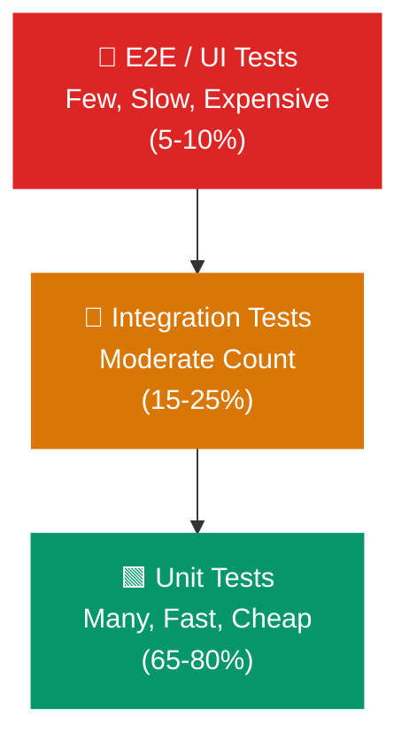

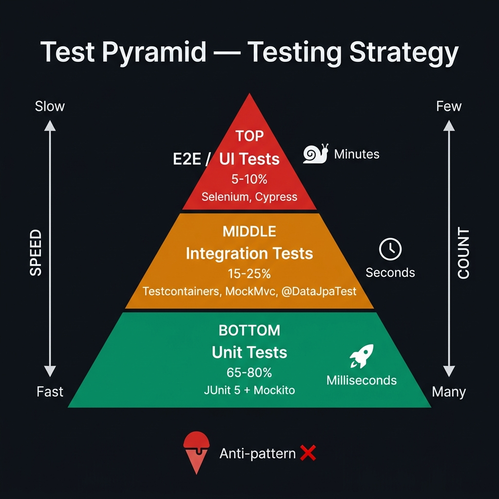

**Detailed Breakdown:**

**What Each Layer Validates:**

```java
// 🟩 Unit Test — tests business logic in isolation
@ExtendWith(MockitoExtension.class)
class PricingServiceTest {
    @Mock private DiscountRepository discountRepo;
    @InjectMocks private PricingService pricingService;

    @Test
    void shouldApplyBulkDiscount() {
        given(discountRepo.getDiscountRate("BULK")).willReturn(0.15);
        double price = pricingService.calculatePrice(100.0, "BULK");
        assertEquals(85.0, price);
    }
}

// 🔶 Integration Test — tests repository + real database
@DataJpaTest
@AutoConfigureTestDatabase(replace = AutoConfigureTestDatabase.Replace.NONE)
class DiscountRepositoryTest extends BaseIntegrationTest {
    @Autowired private DiscountRepository discountRepo;

    @Test
    @Sql("/sql/discounts.sql")
    void shouldFetchActiveDiscounts() {
        List<Discount> active = discountRepo.findByStatus("ACTIVE");
        assertEquals(3, active.size());
    }
}

// 🔺 E2E Test — tests full HTTP flow
@SpringBootTest(webEnvironment = SpringBootTest.WebEnvironment.RANDOM_PORT)
class OrderE2ETest extends BaseIntegrationTest {
    @Autowired private TestRestTemplate restTemplate;

    @Test
    void shouldCreateAndRetrieveOrder() {
        // Create
        OrderRequest request = new OrderRequest("ITEM-1", 5, "Alice");
        ResponseEntity<OrderResponse> createResp = restTemplate
            .postForEntity("/api/orders", request, OrderResponse.class);
        assertEquals(HttpStatus.CREATED, createResp.getStatusCode());

        // Retrieve
        Long orderId = createResp.getBody().getId();
        ResponseEntity<OrderResponse> getResp = restTemplate
            .getForEntity("/api/orders/" + orderId, OrderResponse.class);
        assertEquals("PENDING", getResp.getBody().getStatus());
    }
}
```

**Anti-Patterns (Inverted Pyramid):**

| Anti-Pattern | Problem |
|-------------|---------|
| **Ice Cream Cone** 🍦 | Too many E2E tests, few unit tests — slow CI, flaky tests |
| **Hourglass** ⏳ | Many unit + E2E tests but no integration tests — misses component interaction bugs |
| **No pyramid at all** | Random mix with no strategy — gaps in coverage |

**Practical Guidelines for a Spring Boot Microservice:**

| Test Type | Target | Example |
|-----------|--------|---------|
| Unit (70%) | Services, Mappers, Utils, Validators | `@ExtendWith(MockitoExtension.class)` |
| Integration (20%) | Repositories, Controllers, External clients | `@DataJpaTest`, `@WebMvcTest`, Testcontainers |
| E2E (10%) | Critical user journeys only | `@SpringBootTest` with `TestRestTemplate` |

🎯 **Interview Tip:** When they ask about testing strategy, draw the pyramid. Explain why unit tests should be the majority. Mention: "Unit tests run in milliseconds, so developers get fast feedback. E2E tests validate critical paths but are slow and flaky — keep them minimal." This shows you think about CI/CD pipeline efficiency.

---

</details>

---

20. **🧭 How do you decide which Spring test annotation to use? (Decision Framework) 🔥🔥**

<!-- -->
<details>
<summary>Answer</summary>

**Answer:**

Choosing the right test annotation is one of the most practical decisions in Spring Boot testing. Using `@SpringBootTest` everywhere works, but it creates a slow test suite. Here is a step-by-step way to decide:

**Decision Matrix:**

| I am testing... | Annotation | Mock With | Rough speed |
|-----------------|-----------|-----------|-------|
| Service logic (no Spring needed) | `@ExtendWith(MockitoExtension.class)` | `@Mock` + `@InjectMocks` | 🚀 < 100ms |
| REST controller endpoints | `@WebMvcTest(Controller.class)` | `@MockitoBean` | 🚀 < 2s |
| JPA repository / custom queries | `@DataJpaTest` | Real DB or Testcontainer | ⚡ < 5s |
| JSON serialization/deserialization | `@JsonTest` | — | 🚀 < 1s |
| REST client (RestTemplate/RestClient) | `@RestClientTest(Client.class)` | `MockRestServiceServer` | 🚀 < 2s |
| Multiple components together | `@SpringBootTest` | `@MockitoBean` for externals | 🐢 10-30s |
| Full E2E with real HTTP | `@SpringBootTest(webEnvironment = RANDOM_PORT)` | `@MockitoBean` or Testcontainers | 🐢 15-45s |

```java
// 1. Service logic → Pure unit test (fastest)
@ExtendWith(MockitoExtension.class)
class LoanEligibilityServiceTest {
    @Mock private CreditScoreClient creditScoreClient;
    @Mock private LoanPolicyRepository policyRepo;
    @InjectMocks private LoanEligibilityService service;

    @Test
    void shouldApproveWhenCreditScoreAboveThreshold() {
        given(creditScoreClient.getScore("PAN123")).willReturn(750);
        given(policyRepo.getMinScore("HOME_LOAN")).willReturn(700);

        EligibilityResult result = service.checkEligibility("PAN123", "HOME_LOAN");
        assertTrue(result.isEligible());
    }
}

// 2. Controller → Web slice test
@WebMvcTest(LoanController.class)
class LoanControllerTest {
    @Autowired private MockMvc mockMvc;
    @MockitoBean private LoanService loanService;

    @Test
    void shouldReturnLoanDetails() throws Exception {
        given(loanService.getLoan(1L)).willReturn(new LoanResponse(1L, "HOME_LOAN", "APPROVED"));

        mockMvc.perform(get("/api/loans/1"))
            .andExpect(status().isOk())
            .andExpect(jsonPath("$.status").value("APPROVED"));
    }
}

// 3. Repository → Data slice with Testcontainers
@DataJpaTest
@AutoConfigureTestDatabase(replace = AutoConfigureTestDatabase.Replace.NONE)
class LoanRepositoryTest extends BaseIntegrationTest {
    @Autowired private LoanRepository loanRepository;

    @Test
    @Sql("/sql/loans.sql")
    void shouldFindOverdueLoans() {
        List<Loan> overdue = loanRepository
            .findOverdueLoans(LocalDate.now());
        assertFalse(overdue.isEmpty());
    }
}

// 4. Full E2E → only for critical path
@SpringBootTest(webEnvironment = SpringBootTest.WebEnvironment.RANDOM_PORT)
class LoanApplicationE2ETest extends BaseIntegrationTest {
    @Autowired private TestRestTemplate restTemplate;
    @MockitoBean private CreditScoreClient creditScoreClient; // External API mocked

    @Test
    void shouldSubmitAndApproveLoanApplication() {
        given(creditScoreClient.getScore(anyString())).willReturn(800);

        // Submit application
        LoanApplication app = new LoanApplication("PAN123", "HOME_LOAN", 5000000.0);
        ResponseEntity<LoanResponse> response = restTemplate
            .postForEntity("/api/loans/apply", app, LoanResponse.class);

        assertEquals(HttpStatus.CREATED, response.getStatusCode());
        assertEquals("APPROVED", response.getBody().getStatus());
    }
}
```

**① Spring context or not — and if yes, which single layer:**

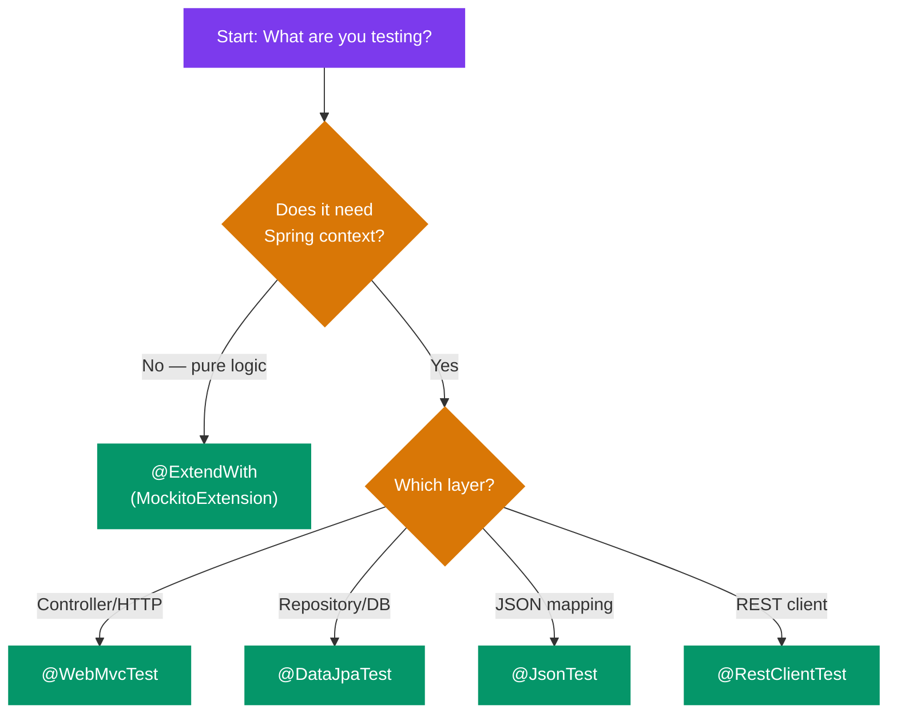

**② Multiple layers together — the only fork left is whether you need a real port:**

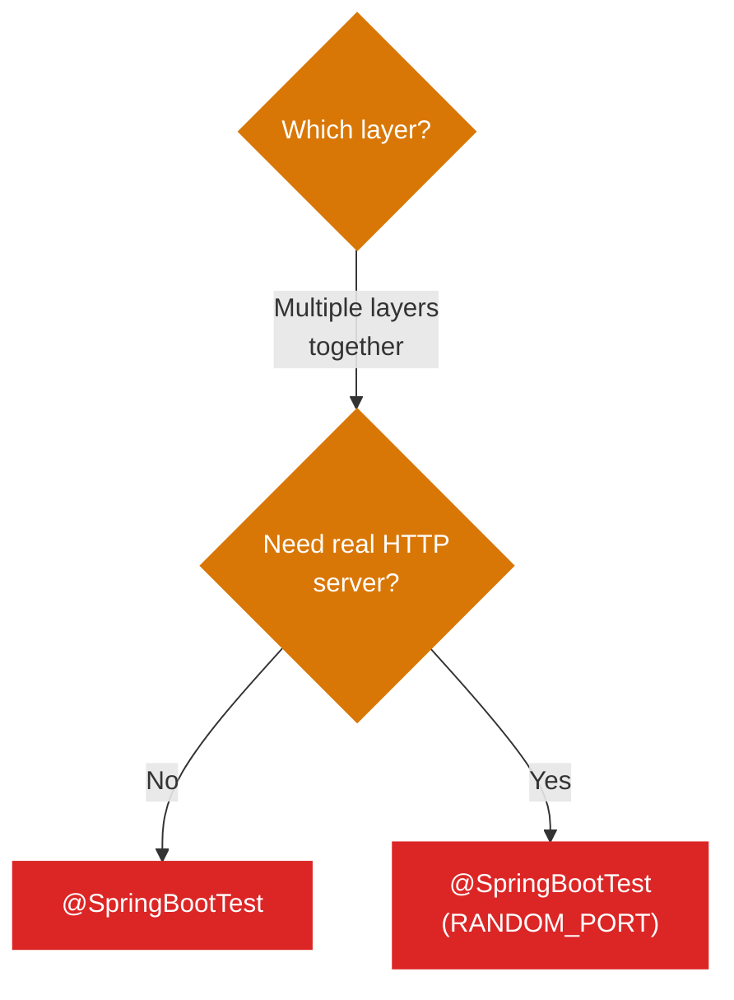

> `D` ("which layer?") is the shared branch node. Diagram ② only shows its last outgoing edge in more detail. You need `RANDOM_PORT` when the test calls the app over real HTTP (`TestRestTemplate` / `WebTestClient`) instead of through `MockMvc`.

**Impact on CI/CD Pipeline Speed:**

| Approach | 200 Tests (example) | CI Pipeline |
|----------|-----------|-------------|
| All `@SpringBootTest` | ~15 min | 🐢 Slow — developers avoid running tests |
| Proper slicing | ~2 min | 🚀 Fast — tests run on every commit |

🎯 **Interview Tip:** When you talk about testing in interviews, always mention test slicing. Also mention how it affects CI/CD speed. Say: "My rule of thumb: `@ExtendWith(MockitoExtension.class)` for about 70% of tests, test slices for about 20%, and `@SpringBootTest` only for critical integration paths." This shows production-grade thinking.

---

</details>

---

21. **🎚️ How are @Mock/@InjectMocks actually initialized, and what is Mockito strictness? 🔥🔥**

<!-- -->
<details>
<summary>Answer</summary>

**Answer:**

Every Mockito test depends on two things, and almost nobody can name them:

- **who processes the annotations**
- **how strictly Mockito checks your stubs**

**Part 1 — the three ways to initialize `@Mock` / `@Spy` / `@InjectMocks` / `@Captor`:**

| Mechanism | Style | Default strictness | Status |
|---|---|---|---|
| `@ExtendWith(MockitoExtension.class)` | JUnit 5 extension (`mockito-junit-jupiter`) | **`STRICT_STUBS`** | ✅ Current — use this |
| `@RunWith(MockitoJUnitRunner.class)` | JUnit **4** runner | fails on unused stubs only (`MockitoJUnitRunner.StrictStubs` = full `STRICT_STUBS`; `.Silent` = lenient) | ⚠️ Legacy — JUnit 4 only |
| `MockitoAnnotations.openMocks(this)` in `@BeforeEach` | manual | **none** (nothing is checked) | ✅ Valid — for when you can't add the extension |

```java
// ✅ JUnit 5 — the form you should write
@ExtendWith(MockitoExtension.class)
class OrderServiceTest {
    @Mock private OrderRepository repository;
    @InjectMocks private OrderService service;
}

// ✅ Manual — note openMocks returns AutoCloseable, so close it
class OrderServiceManualTest {

    @Mock private OrderRepository repository;
    @InjectMocks private OrderService service;

    private AutoCloseable closeable;

    @BeforeEach
    void openMocks() {
        closeable = MockitoAnnotations.openMocks(this);
    }

    @AfterEach
    void releaseMocks() throws Exception {
        closeable.close();
    }
}
```

⚠️ **Do not rely on `@SpringBootTest` / `@WebMvcTest` / `@DataJpaTest` to initialize `@Mock`.** Boot 2.x/3.x did it through `MockitoTestExecutionListener`. Boot 3.4 deprecated that listener, and Boot 4.0 removed it. Even when `@Mock` is created, it is only a field, not a bean. In a Spring context you want `@MockitoBean` (§5 Q10), not `@Mock`.

**Part 2 — strictness: why your test fails with `UnnecessaryStubbingException`**

`MockitoExtension` runs `Strictness.STRICT_STUBS` by default. That enables three checks:

| Check | Failure |
|---|---|
| Every declared stub must be **used** | `UnnecessaryStubbingException` (reported in `afterEach`, after the test body) |
| A stubbed method called with **different arguments** | `PotentialStubbingProblem` — thrown immediately, with both argument sets printed |
| Stubbed calls count as **verified** | `verifyNoMoreInteractions()` does not fail on a call you already stubbed |

```java
@ExtendWith(MockitoExtension.class)
class StrictnessDemoTest {

    @Mock private UserRepository repository;
    @InjectMocks private UserService service;

    // ❌️ FAILS: UnnecessaryStubbingException — the second stub is never triggered
    @Test
    void unusedStub() {
        when(repository.findById(1L)).thenReturn(Optional.of(new User("Alice")));
        when(repository.findByEmail("a@b.com")).thenReturn(Optional.empty()); // never called

        assertEquals("Alice", service.getUser(1L).getName());
    }

    // ✅ Fix 1 — mark the genuinely conditional stub lenient
    @Test
    void lenientStub() {
        when(repository.findById(1L)).thenReturn(Optional.of(new User("Alice")));
        lenient().when(repository.findByEmail("a@b.com")).thenReturn(Optional.empty());

        assertEquals("Alice", service.getUser(1L).getName());
    }
}

// ✅ Fix 2 — relax the whole class (use sparingly; it turns the safety net off)
@ExtendWith(MockitoExtension.class)
@MockitoSettings(strictness = Strictness.LENIENT)
class LegacyStyleTest { /* ... */ }
```

**The three strictness levels:**

| Level | Behaviour |
|---|---|
| `LENIENT` | No checks at all — the pre-2.x behaviour |
| `WARN` | Prints a warning to the console; the test still passes |
| **`STRICT_STUBS`** | Fails the test — **the default** for `MockitoExtension` (on JUnit 4, use `MockitoJUnitRunner.StrictStubs`) |

🧠 **In Simple Words:**

An unused stub is almost always a bug in the test. There are two usual causes:

- the code path you thought you were testing isn't running, or
- the stub is left over from a refactor.

Strict stubs turn a test that passes silently into a clear failure. If you switch to `LENIENT` just to hide the message, you lose the only warning you had.

🎯 **Interview Tip:** The question usually comes as *"your test fails with `UnnecessaryStubbingException` — what happened?"* The senior answer is three sentences: *"`MockitoExtension` defaults to `STRICT_STUBS`, so every stub must be exercised. First I check whether the stub is unused because the production path changed — that's a real bug. Only if the stubbing is genuinely conditional do I mark that single stub `lenient()`, never the whole class."*

---

</details>

---

22. **🔄 How do you migrate a JUnit 4 test suite to JUnit 5? (annotation mapping) 🔥**

<!-- -->
<details>
<summary>Answer</summary>

**Answer:**

**The annotation mapping — know this by heart:**

| JUnit 4 | JUnit 5 (Jupiter) | Notes |
|---|---|---|
| `@Before` | `@BeforeEach` | |
| `@After` | `@AfterEach` | |
| `@BeforeClass` | `@BeforeAll` | must be `static` unless `@TestInstance(PER_CLASS)` |
| `@AfterClass` | `@AfterAll` | same `static` rule |
| `@Ignore` | `@Disabled` | |
| `@Category(X.class)` | `@Tag("x")` | tags are plain strings, not marker classes |
| `@RunWith(X.class)` | `@ExtendWith(X.class)` | **one** runner → **many** extensions |
| `@RunWith(MockitoJUnitRunner.class)` | `@ExtendWith(MockitoExtension.class)` | see §5 Q21 |
| `@RunWith(SpringRunner.class)` | `@ExtendWith(SpringExtension.class)` | already implied by `@SpringBootTest` (Boot 2.1+) |
| `@Test(expected = X.class)` | `assertThrows(X.class, () -> ...)` | scoped to one statement, not the whole method |
| `@Test(timeout = 500)` | `assertTimeout(...)` / `@Timeout(value = 500, unit = MILLISECONDS)` | `assertTimeoutPreemptively` aborts on a separate thread |
| `@Rule` / `@ClassRule` | custom `Extension` (`BeforeEachCallback`, `AfterEachCallback`, …) | the biggest real migration cost |
| `@RunWith(Parameterized.class)` + `@Parameters` | `@ParameterizedTest` + a source (§5 Q5–Q7) | |
| `org.junit.Assert` | `org.junit.jupiter.api.Assertions` | ⚠️ see the message-argument trap below |
| `Assume.assumeTrue` | `Assumptions.assumeTrue` | `org.junit.jupiter.api.Assumptions` |
| — | `@DisplayName`, `@Nested`, `assertAll` | new capabilities with no JUnit 4 equivalent |

⚠️ **The silent-breakage trap — the assertion message moved.** JUnit 4 takes the message **first**; Jupiter takes it **last**:

```java
// JUnit 4
org.junit.Assert.assertEquals("names should match", expected, actual);

// JUnit 5 — message is the LAST parameter
org.junit.jupiter.api.Assertions.assertEquals(expected, actual, "names should match");
```

Both overloads accept `(String, String, String)`. So if you only swap the import on `assertEquals(msg, a, b)`, the code still **compiles**. But it then compares your *message* against your *expected value*. Migrate the import and the argument order together.

**Running both engines during the migration:**

```xml
<!-- Boot 2.4+ removed vintage from spring-boot-starter-test — add it back explicitly -->
<dependency>
    <groupId>org.junit.vintage</groupId>
    <artifactId>junit-vintage-engine</artifactId>
    <scope>test</scope>
</dependency>
```

⚠️ Without this, JUnit 4 tests in a Boot 2.4+/3.x project are **silently skipped**. The build stays green, but the tests never run. This silent skip is the single most dangerous thing about this migration.

⚠️ **The `@RunWith(JUnitPlatform.class)` half-migration.** A common in-between state is a JUnit 5 test class that *also* has `@RunWith(JUnitPlatform.class)`. This lets an old JUnit 4-only build/IDE launch it. It works, but it is only a temporary step:

- `junit-platform-runner` was deprecated on the JUnit Platform and has since been removed.
- While a class runs through it, you lose Jupiter features the runner can't support.

If you find this pattern, do not keep `@RunWith(JUnitPlatform.class)`. Upgrade Surefire (2.22+) so it talks to the Platform directly. Then delete the runner.

**A safe migration sequence:**

1. Upgrade the build plugin first (Surefire 2.22+ / Gradle `useJUnitPlatform()`). Add `junit-jupiter` **and** `junit-vintage-engine`. Nothing changes yet — both engines run side by side.
2. Migrate **new tests only** to Jupiter. Do not rewrite everything at once.
3. Convert the mechanical annotations file by file (`@Before` → `@BeforeEach`, `@RunWith` → `@ExtendWith`). Fix the assertion argument order as you go.
4. Port `@Rule`s to `Extension`s. This part needs real thought, so do it in batches.
5. Delete `junit-vintage-engine` last. Only its removal *proves* that nothing is left behind.

🎯 **Interview Tip:** Don't just repeat the table from memory. Start with the sequence and the two traps: *"the vintage engine is the safety net that lets both run side by side, and the two things that bite are silently-skipped JUnit 4 tests when vintage is missing, and `assertEquals` moving the message argument from first to last."* This answer shows you have actually done a migration, not just read about one.

---

</details>

---
