# Spring Microservices Interview Questions

**Spring Microservices Interview Questions** | A full guide to microservices architecture, service discovery, API gateway, resilience patterns, distributed data, observability, and deployment. Also see: [Spring Core](09_Spring_Core_Interview_Questions.md) | [Kafka](https://github.com/vikas9dev/system-design/blob/main/iq/04_Kafka_Interview_Questions.md) | [REST API Design](https://github.com/vikas9dev/system-design/blob/main/iq/05_REST_API_Design_Interview_Questions.md)

📊 **Question Count by Section**

| # | Section | Questions |
|---|---|---|
| 1 | [Microservices Fundamentals](#microservices-fundamentals) | 7 |
| 2 | [Service Discovery](#service-discovery) | 5 |
| 3 | [API Gateway](#api-gateway) | 5 |
| 4 | [Inter-Service Communication](#inter-service-communication) | 6 |
| 5 | [Resilience Patterns](#resilience-patterns) | 13 |
| 6 | [Distributed Data Patterns](#distributed-data-patterns) | 9 |
| 7 | [Observability](#observability) | 10 |
| 8 | [Config and Deployment](#config-and-deployment) | 7 |
| | **Total** | **62** |

> 🔥🔥 Very High — asked in almost every Tier-1 loop &nbsp;·&nbsp; 🔥 High — very frequent in Tier-1 interviews &nbsp;·&nbsp; ⚡ Medium — commonly asked &nbsp;·&nbsp; 💤 Low — good to know, rarely asked

---

<a id="microservices-fundamentals"></a>

## 1. Microservices Fundamentals

1. **🏗️ What are microservices and how do they differ from a monolithic architecture? 🔥🔥**

<!-- -->
<details>
<summary>Answer</summary>

**Answer:**

Microservices is a way to design an application. The application is made of small services. You can deploy each one on its own.

- Each service runs in its own process.
- Services talk to each other over lightweight protocols (usually HTTP/REST or messaging).
- Each service is built around one specific business capability.
- You can develop, deploy, and scale each service independently.

A monolithic application is different. It puts all modules (UI, business logic, data access) into a single deployable unit (`.jar`/`.war`).

| Aspect | Monolithic 🅰️ | Microservices 🅱️ |
|--------|--------------|-----------------|
| **Deployment** | Single `.jar`/`.war` deployed to one server | Each service deployed independently |
| **Scaling** | Entire application must be scaled together | Individual services scaled independently |
| **Communication** | Internal method calls (in-process) | Network calls (REST, gRPC, messaging) |
| **Technology Stack** | ❌️ Single technology stack for all modules | ✅ Each service can use a different stack (polyglot) |
| **Cohesion** | ❌️ High coupling between modules | ✅ Low coupling, high cohesion per service |
| **Failure Isolation** | ❌️ One bug can bring down the entire app | ✅ Failures are isolated to individual services |
| **Data Management** | Single shared database | Database-per-service pattern |
| **CI/CD** | One pipeline, full rebuild on any change | Independent pipelines per service |

**① Monolith — one deployable, one shared database:**

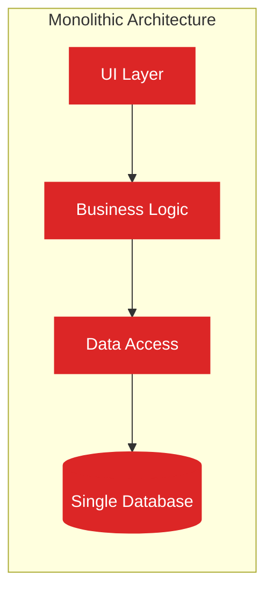

**② Microservices — gateway in front, database-per-service, service-to-service calls:**

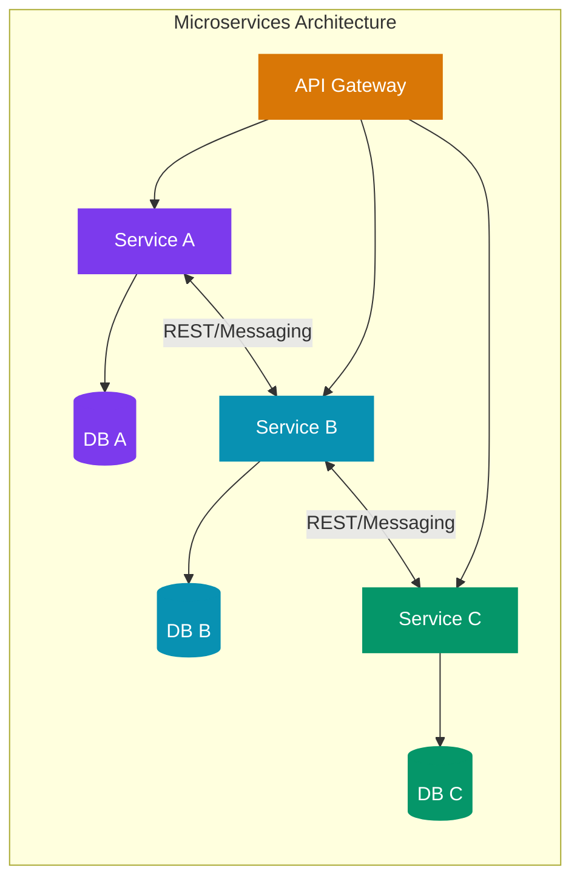

> Read the two diagrams together. The three layers of the monolith now sit inside **each** microservice. Each service owns its own part, from UI to data. That is why each service in ② also owns its own database.

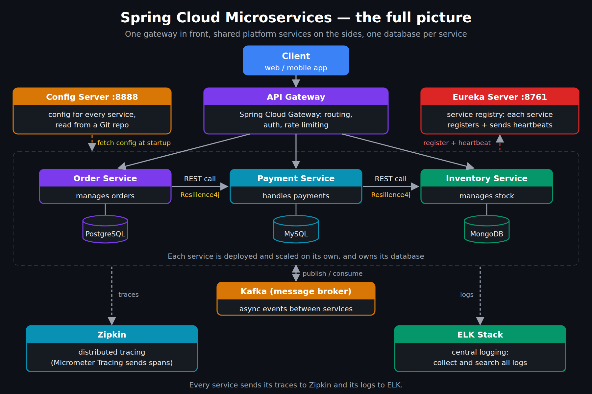

✅ **Microservices Advantages:**

- ⚡ Better use of resources -- scale only the services that need it
- 🔄 Parallel development by independent teams
- 🚀 CI/CD is easier per service -- no full rebuild for a small change
- 🔗 Low coupling -- a failure in one service is easier to contain. With timeouts and circuit breakers, it does not have to spread to others
- ➕ Adding a new module is a new service with its own deployment

❌️ **Microservices Challenges:**

- 🖥️ Operational complexity -- many services to deploy, monitor, and maintain
- 🔍 Debugging distributed systems is harder (distributed tracing needed)
- 🧪 Integration testing across services is complex
- 🌐 Network latency and partial failures must be handled
- 🗄️ Data consistency across services requires patterns like Saga

🎯 **Interview Tip:** Say clearly that microservices is not only about splitting code. It is also about:

- matching services to the team structure (Conway's Law)
- independent deployability
- bounded contexts from DDD

---

</details>

---

2. **🧩 What are the common strategies for decomposing a monolith into microservices? 🔥🔥**

<!-- -->
<details>
<summary>Answer</summary>

**Answer:**

Decomposition means breaking a monolithic application into smaller microservices. You can deploy each of them on its own. There are two main strategies:

**1. Decomposition by Business Capability:**

- 📊 Align services to what the business *does* (e.g., Order Management, Payment Processing, Inventory)
- 🏢 Each business capability maps to a team and a service
- 🎯 Matches the structure of the organization (Conway's Law)
- ✅ Most commonly used in practice

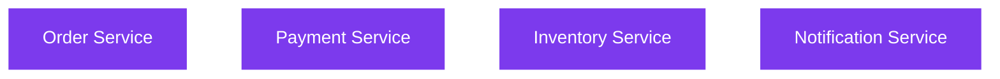

**2. Decomposition by Subdomain (DDD):**

- 📖 Based on Domain-Driven Design (DDD) -- identify bounded contexts
- 🗺️ Each subdomain (Core, Supporting, Generic) becomes a service
- 🔑 Core subdomains get the most investment (they are what makes the business better than competitors)
- 🏗️ Supporting subdomains are important, but they do not set you apart from competitors
- ⚙️ Generic subdomains can be given to an outside company, or can use ready-made (off-the-shelf) solutions


**Other Decomposition Guidelines:**

| Guideline | Description |
|-----------|-------------|
| **Single Responsibility** | Each service should do one thing well |
| **Common Closure** | Things that change together should live together |
| **Strangler Fig Pattern** | Incrementally migrate from monolith by routing requests to new services |
| **Anti-Corruption Layer** | Protect new services from legacy monolith data models |

🧠 **In Simple Words:**
Think of decomposition as splitting a restaurant.

- By business capability: separate kitchen, billing, delivery, reservations.
- By subdomain: separate the core recipe engine (competitive advantage) from generic things like payment processing.

💡 **Pro Tip:** In interviews, mention the Strangler Fig pattern as a practical migration strategy. You do not rewrite everything at once. You slowly redirect traffic from the monolith to new microservices.

---

</details>

---

3. **📐 What is a Bounded Context in Domain-Driven Design and why is it important for microservices? ⚡**

<!-- -->
<details>
<summary>Answer</summary>

**Answer:**

A **Bounded Context** is a main idea in Domain-Driven Design (DDD). It is a clear boundary. One domain model is defined inside that boundary, and it is valid only there. Inside a bounded context, every term, entity, and rule has one specific, clear meaning.

🔑 **Key Points:**

- 🗺️ Each bounded context has its own **ubiquitous language** (the shared set of terms the team and code use). The same word (e.g., "Account") can mean different things in different contexts (banking account vs. user account)
- 📦 A bounded context maps naturally to a microservice. Each service owns its domain model
- 🔗 Bounded contexts talk to each other through well-defined interfaces (APIs, events)
- 🚫 One bounded context should never directly access another's database

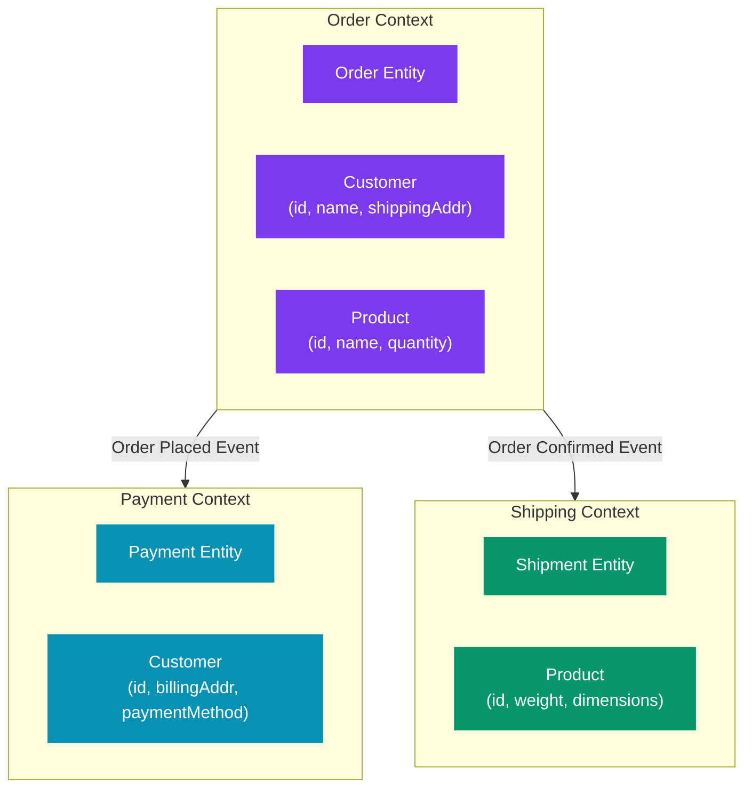

Notice that "Customer" has different attributes in each context:

- In Order Context it has `shippingAddr`.
- In Payment Context it has `billingAddr` and `paymentMethod`.

This is correct. It is what you want.

**Bounded Context vs Microservice:**

| Aspect | Bounded Context | Microservice |
|--------|----------------|--------------|
| **Nature** | Logical/conceptual boundary | Physical/deployment boundary |
| **Scope** | Domain model boundary | Service deployment unit |
| **Relationship** | One bounded context = one or more microservices | One microservice belongs to exactly one bounded context |

🎯 **Interview Tip:** Say clearly that bounded contexts prevent the "big ball of mud" problem (a system with no clear structure) in microservices. Without clear boundaries, services start to share data models. Then they become a distributed monolith.

---

</details>

---

4. **📋 What are the 12-Factor App principles and how do they apply to microservices? ⚡**

<!-- -->
<details>
<summary>Answer</summary>

**Answer:**

The **12-Factor App** method (created by Heroku) is a set of best practices for building modern, cloud-native applications. These principles are especially important for microservices. They make services portable, scalable, and easy to deploy.

| Factor | Principle | Microservices Relevance |
|--------|-----------|------------------------|
| **II. Dependencies** | Explicitly declare and isolate dependencies | Use Maven/Gradle; no implicit system-level deps |
| **III. Config** | Store config in the environment | Use Spring Cloud Config Server, environment variables |
| **IV. Backing Services** | Treat backing services as attached resources | Databases, message queues are swappable via config |
| **V. Build, Release, Run** | Strictly separate build and run stages | CI/CD pipelines: build JAR, create Docker image, deploy |
| **VI. Processes** | Execute the app as stateless processes | Microservices should be stateless; state in DB/cache |
| **VII. Port Binding** | Export services via port binding | Embedded Tomcat in Spring Boot binds to a port |
| **VIII. Concurrency** | Scale out via the process model | Horizontal scaling with multiple instances |
| **IX. Disposability** | Fast startup and graceful shutdown | Spring Boot graceful shutdown; Kubernetes liveness probes |
| **X. Dev/Prod Parity** | Keep dev, staging, and prod as similar as possible | Docker containers ensure environment consistency |
| **XI. Logs** | Treat logs as event streams | Write to stdout; aggregate with ELK/Fluentd |
| **XII. Admin Processes** | Run admin/management tasks as one-off processes | Database migrations, data cleanup as separate jobs |

🔑 **Most Critical for Microservices:**

- ⚙️ **Factor III (Config):** Keep configuration outside the code. Use Spring Cloud Config Server or environment variables. Never hardcode connection strings or secrets
- 📦 **Factor VI (Processes):** Horizontal scaling needs stateless services. Store session data in Redis, not in-memory
- 🔄 **Factor IX (Disposability):** Services must start fast and shut down gracefully for auto-scaling and rolling deployments

🧠 **In Simple Words:**
The 12-Factor App is a checklist for building cloud-ready microservices. If your service follows these principles, it is easy to deploy, scale, and maintain in any cloud environment.

---

</details>

---

5. **⚠️ What are the key challenges of a microservices architecture and how do you address them? 🔥**

<!-- -->
<details>
<summary>Answer</summary>

**Answer:**

Microservices give many benefits. But they also bring big problems. You must handle them with the right patterns and tools.

| Challenge | Description | Solution |
|-----------|-------------|----------|
| **Data Consistency** | No ACID transactions across services | Saga pattern (orchestration/choreography), eventual consistency |
| **Distributed Tracing** | Hard to trace a request across multiple services | Micrometer Tracing + Zipkin/Jaeger, correlation IDs |
| **Service Discovery** | Services need to find each other dynamically | Eureka, Consul, or Kubernetes Service Discovery |
| **Network Failures** | Calls between services can fail | Circuit Breaker (Resilience4j), retries, timeouts |
| **Configuration Management** | Many services with overlapping configs | Spring Cloud Config Server |
| **Testing** | Integration testing across services is complex | Contract testing (Spring Cloud Contract), consumer-driven contracts |
| **Security** | Securing inter-service communication | OAuth2, JWT tokens, mTLS, API Gateway authentication |
| **Deployment Complexity** | Many services to deploy and manage | Docker + Kubernetes, CI/CD pipelines per service |
| **Cross-cutting Concerns** | mTLS, retries, observability needed in every service | Service mesh (Istio, Linkerd) for transparent service-to-service communication |
| **Logging** | Logs scattered across many services | Centralized logging with ELK stack (Elasticsearch, Logstash, Kibana) |

**① Correctness & resilience challenges → their remedies:**

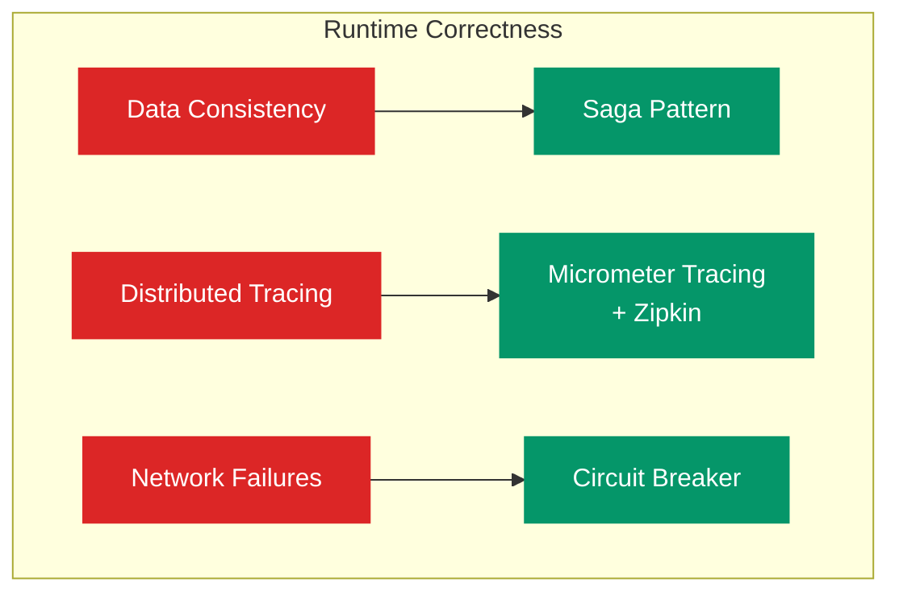

**② Operational challenges → their remedies:**

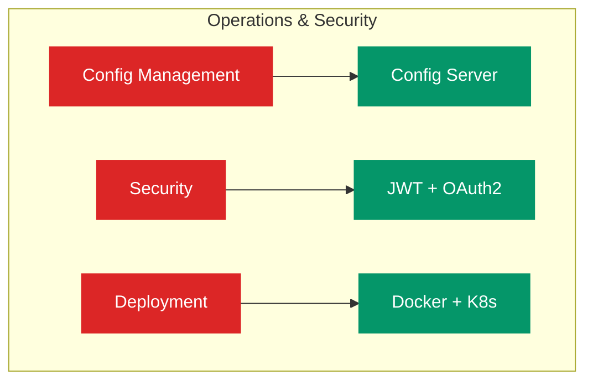

> Read both diagrams the same way. 🔴 left = the problem microservices *create*. 🟢 right = the pattern or tool that solves it.

**The Distributed Monolith Anti-Pattern:**

A common mistake is building a "distributed monolith". The services look separate in the design. But they are tightly coupled through shared databases, synchronous call chains, or shared libraries. Signs of it:

- 🚨 Deploying one service requires deploying others at the same time
- 🔗 Services share a database schema
- 📦 Services share domain model libraries
- ⏱️ Long synchronous call chains cause cascading failures

🎯 **Interview Tip:** When you talk about challenges, always give each challenge together with its solution. This shows you have practical experience. Mention that you have used tools like Resilience4j for circuit breaking and Zipkin for distributed tracing in your projects.

---

</details>

---

6. **🔀 What is the difference between orchestration and choreography in microservices? 🔥**

<!-- -->
<details>
<summary>Answer</summary>

**Answer:**

Orchestration and choreography are two ways to coordinate a workflow that runs across multiple microservices.

**Orchestration:**

- 🎭 A central **orchestrator** service controls the entire workflow
- 📡 The orchestrator explicitly tells each service what to do and when
- 🔄 Uses request-response (synchronous or async command messages)
- 📊 Easy to understand the overall flow from a single place

**Choreography:**

- 💃 No central coordinator. Each service reacts to **events** independently
- 📢 Services publish domain events; other services subscribe and react
- 🔗 Loosely coupled -- services do not know about each other
- 📊 Harder to trace the overall flow, but it handles failures better (more resilient)

| Aspect | Orchestration 🎭 | Choreography 💃 |
|--------|------------------|-----------------|
| **Coordination** | Central orchestrator controls flow | Decentralized, event-driven |
| **Coupling** | ❌️ Higher -- orchestrator knows all services | ✅ Lower -- services are independent |
| **Visibility** | ✅ Easy to see full workflow in one place | ❌️ Flow is distributed across services |
| **Critical component** | ⚠️ Orchestrator is a critical dependency — run it replicated, with durable state | ✅ No central component |
| **Complexity scaling** | ✅ Scales with *workflow* complexity -- one place to read a 12-step flow | ✅ Scales with *service count* -- adding a consumer needs no orchestrator change |
| **Error Handling** | ✅ Easier -- centralized compensation logic | ❌️ Harder -- each service handles its own |
| **Use Case** | Complex business processes (e.g., loan origination) | Simple event-driven flows (e.g., notifications) |

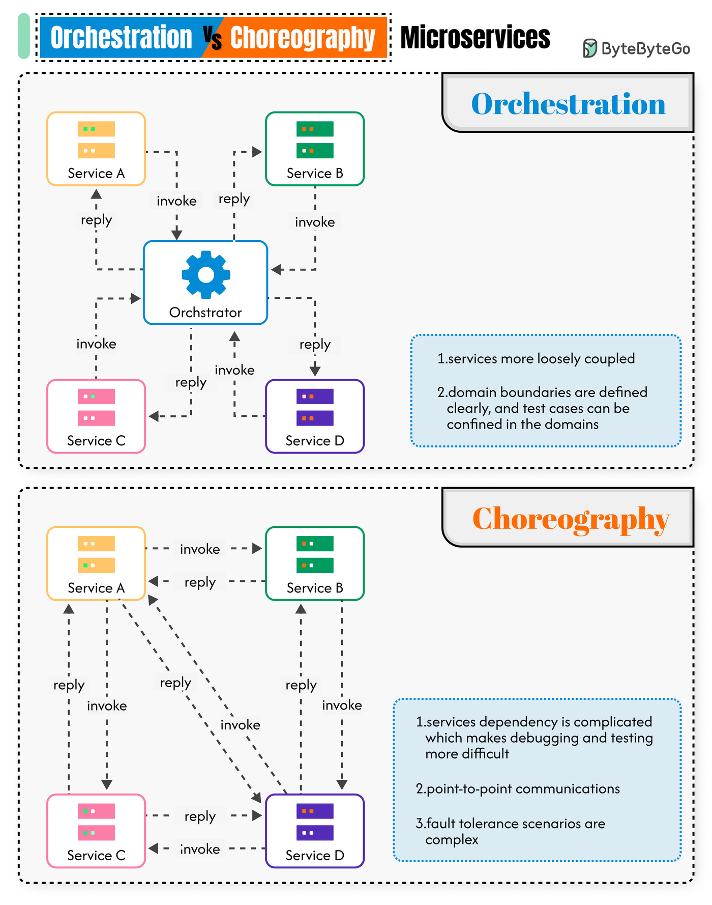

*Source: [ByteByteGo](https://bytebytego.com).*

> ⚠️ **Read this diagram with two notes:**  
> 1. **It draws choreography as direct `invoke`/`reply` calls between services.** In this file (and in most interviews), choreography means **events through a broker** like Kafka, as in the Mermaid diagram below. The diagram's "point-to-point" box describes the *mess* you get without a broker — it is not the definition.  
> 2. **"Orchestration: services more loosely coupled"** does not contradict the table above. The *services* do not know each other — each one only talks to the orchestrator. But the *orchestrator* knows every service. Both are true at once.

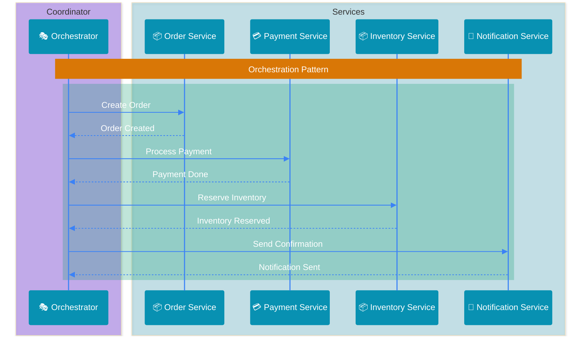

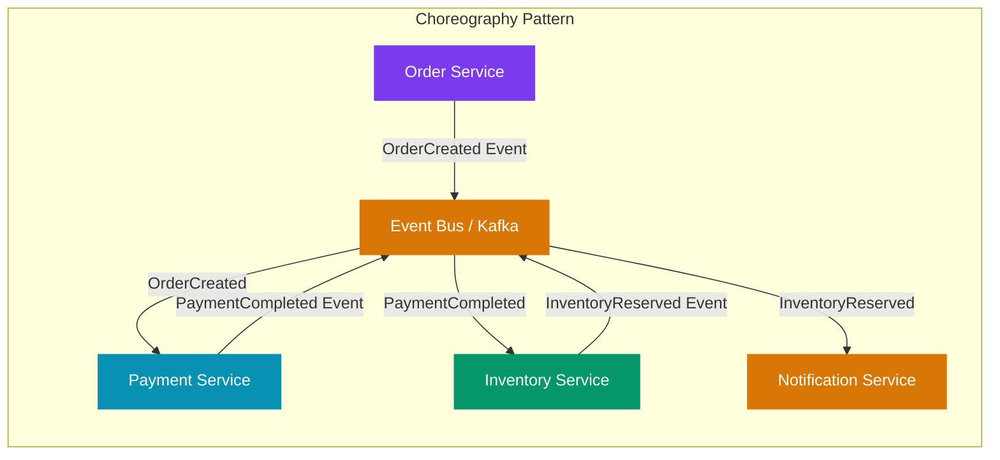


🧠 **In Simple Words:**
- **Orchestration** is like a conductor leading an orchestra. One person tells everyone what to play and when.
- **Choreography** is like a dance. Each dancer knows their moves and reacts to the music (events) independently.

💡 **Pro Tip:** In real projects, teams often mix both approaches.

- Use orchestration for complex business workflows (e.g., loan origination, payment processing).
- Use choreography for simpler event-driven notifications and audit logging.

---

</details>

---

7. **🌱 What is the Strangler Fig pattern and how do you migrate a monolith incrementally? 🔥**

<!-- -->
<details>
<summary>Answer</summary>

**Answer:**

The **Strangler Fig pattern** is a step-by-step (incremental) way to move from a monolith to microservices. The name comes from a plant (a vine) that slowly grows around a tree and replaces it.

- You do not do a risky "big bang" rewrite (replacing everything at once).
- You extract services one capability at a time.
- You route traffic to them through a gateway.
- You keep going until the new services fully replace the monolith.

**How It Works:**

1. 🌐 Place a **facade/proxy** (API Gateway or reverse proxy) in front of the monolith
2. ✂️ Identify and extract one business capability as a new microservice
3. 🔀 Redirect traffic for that capability from the monolith to the new service via the gateway
4. 🔁 Repeat until the new services have fully replaced the monolith ("strangled" it) and you can shut it down

**① Phases 1–2 — gateway added, then the first capability is moved out:**

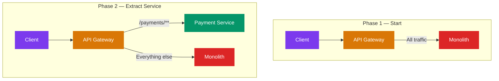

**② Phase 3 — every capability extracted, the monolith is shut down:**

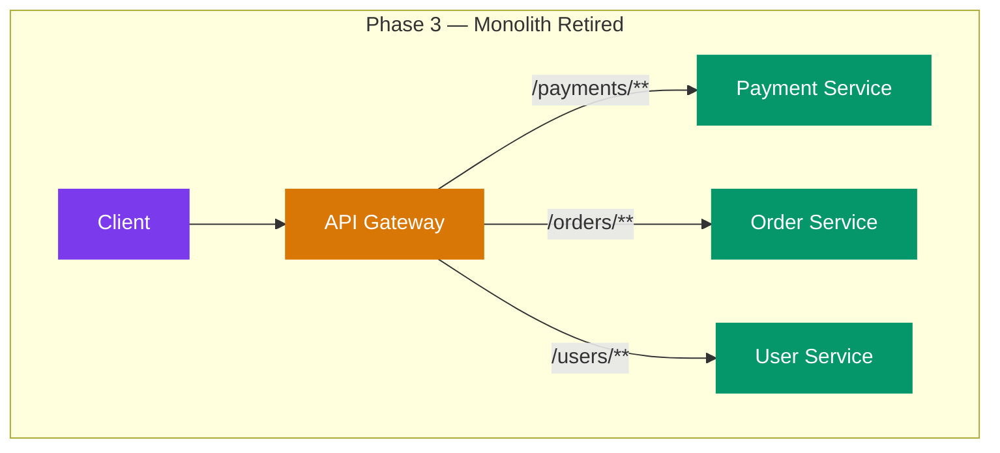

> The 🟠 gateway stays the same in all three phases. It is the point where you switch a route from the 🔴 monolith to a 🟢 service. The client never knows about the move.

**Strangler Fig vs Big Bang Rewrite:**

| Aspect | Strangler Fig ✅ | Big Bang Rewrite ❌️ |
|--------|----------------|---------------------|
| **Risk** | Low — incremental, rollback per service | Very high — entire system replaced at once |
| **Value delivery** | Continuous — each extracted service ships immediately | Nothing until full rewrite is done |
| **Duration** | Manageable chunks over months | Often delayed, over budget |
| **Team disruption** | Minimal — work continues in parallel | High — whole team focused on rewrite |
| **Rollback** | Easy — redirect gateway traffic back | Very difficult after cutover |

**Key Practices:**

- 🚪 **Anti-Corruption Layer (ACL):** Sometimes a new microservice must read data from the monolith's database. Then create an ACL. It converts the old (legacy) model into the new domain model. So the new service does not inherit the technical debt of the monolith.
- 🗄️ **Database Strangling:** Move the service's tables into its own database. Use event-driven sync (CDC or the outbox pattern) during the transition period. ⚠️ Avoid a plain dual-write (the code writes to both databases): the two writes are not atomic, so the copies drift apart when one write fails.
- 🎯 **Which service to extract first?** Start with the capability that changes most often (biggest gain in deployment speed). Or start with the one that causes the most problems in operations. Avoid starting with the most tightly coupled module.
- 📡 **Traffic shifting:** Use API Gateway routing rules to shift traffic step by step (e.g., 10% → 50% → 100%). This is canary validation (testing on a small share of traffic) before the full cutover.

🧠 **In Simple Words:**
The Strangler Fig is like rebuilding your house one room at a time while you still live in it. You never move out (no big bang rewrite). But after some time, your whole house is new.

🎯 **Interview Tip:** Use this to answer "How would you migrate your current monolith to microservices?" Add these points:

1. Put an API Gateway in front first.
2. Start with the service that changes most often.
3. Use the Anti-Corruption Layer to isolate from legacy data models.
4. Mark the monolith's module as read-only once the new service owns that domain.

---

</details>

---

<a id="service-discovery"></a>

## 2. Service Discovery

1. **📡 What is service discovery and how does Eureka Server/Client architecture work? 🔥**

<!-- -->
<details>
<summary>Answer</summary>

**Answer:**

**Service Discovery** lets microservices find and call each other at runtime. You do not hardcode hostnames and ports. In the cloud, services scale up and down, and IP addresses change. So you need service discovery.

**Spring Cloud Netflix Eureka** is the most widely used service discovery solution in the Spring ecosystem. It uses the client-server model:

🔑 **Key Components:**

- 🗄️ **Eureka Server** -- The service registry. It keeps a list of all registered service instances. Each registration is an `InstanceInfo`. It holds: app name (service ID) + instance ID + hostname/IP + port(s) + status (`UP`/`DOWN`/`STARTING`/`OUT_OF_SERVICE`) + lease info (renewal timestamps) + a free-form `metadata` map. ⚠️ Eureka does **not** track per-instance load. The registry has no load metric. So load-aware routing must come from the client-side load balancer, not from Eureka.
- 📡 **Eureka Client** -- A library inside each microservice. It registers the service with Eureka. It also downloads the registry at regular intervals to find other services

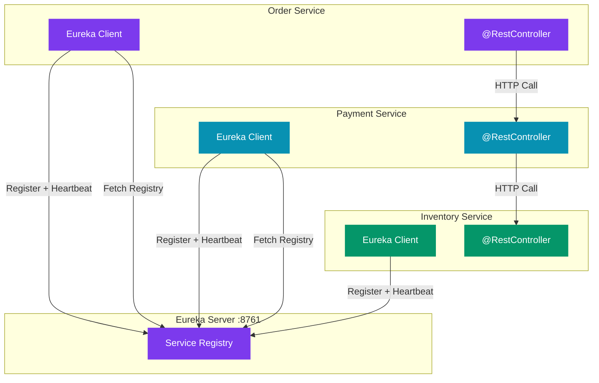

**Service Instance Data in Eureka:**

| ServiceId (appName) | InstanceId | Host | Port | Status |
|-----------|-----------|------|------|-------------|
| **ORDER-SERVICE** | OS-5210256 | 192.168.0.10 | 8080 | UP |
| **ORDER-SERVICE** | OS-0056250 | 192.168.2.32 | 8081 | UP |
| **PAYMENT-SERVICE** | PS-8840856 | 202.6.11.109 | 9090 | UP |

**Eureka Server Setup:**

```java
@SpringBootApplication
@EnableEurekaServer
public class EurekaServerApplication {
    public static void main(String[] args) {
        SpringApplication.run(EurekaServerApplication.class, args);
    }
}
```

```properties
# Eureka Server - application.properties
server.port=8761
eureka.client.register-with-eureka=false
eureka.client.fetch-registry=false
```

**Eureka Client (Microservice) Setup:**

```yaml
# Microservice - application.yml
server:
  port: 8080

spring:
  application:
    name: ORDER-SERVICE

eureka:
  client:
    service-url:
      defaultZone: http://localhost:8761/eureka
  instance:
    instance-id: ${spring.application.name}:${random.value}
```

📝 **Note:** The default values for `eureka.client.register-with-eureka` and `eureka.client.fetch-registry` are both `true`. So microservices do not need to set them. Only the Eureka Server itself sets them to `false`, so it does not register with itself.

🎯 **Interview Tip:** Mention that `@EnableDiscoveryClient` is optional in recent Spring Boot versions. The Eureka Client dependency on the classpath is enough for auto-registration.

---

</details>

---

2. **💓 What is the Eureka heartbeat mechanism and self-preservation mode? ⚡**

<!-- -->
<details>
<summary>Answer</summary>

**Answer:**

**Heartbeat Mechanism:**

Eureka uses a heartbeat (renewal) mechanism. It tracks whether registered services are still alive.

- 🔄 Every Eureka Client sends a **heartbeat** to the Eureka Server at a regular interval (default: **30 seconds**)
- ⏱️ The timeout is configurable (default: **90 seconds** = 3 missed heartbeats). If no heartbeat arrives from a service in that time, the server evicts (deregisters) that instance from the registry
  - ⚠️ In practice, a **crashed** instance stays for about **2 × 90 s = ~180 s**. A known bug in Eureka's `Lease` class adds the duration twice. A comment in Eureka's code says it will not be fixed. A clean shutdown is not affected, because the client deregisters itself.
- 📡 Clients also fetch the updated registry from the server at regular intervals (default: every **30 seconds**)

```yaml
# Heartbeat configuration
eureka:
  instance:
    lease-renewal-interval-in-seconds: 30    # heartbeat interval (default 30s)
    lease-expiration-duration-in-seconds: 90  # eviction timeout (default 90s)
  client:
    registry-fetch-interval-seconds: 30       # how often client fetches registry
```

**Self-Preservation Mode:**

Self-preservation is a safety feature in Eureka Server. It stops Eureka from evicting many services at once during network partitions.

- 🛡️ Sometimes heartbeat renewals drop below a threshold (default: **85%** of expected renewals). When the Eureka Server detects this, it enters self-preservation mode
- 🚫 In this mode, Eureka **stops evicting** instances even if their heartbeats are missing
- 📋 Eureka assumes that a network problem is more likely than all services really being down
- ⚠️ The Eureka dashboard shows a red warning: *"EMERGENCY! EUREKA MAY BE INCORRECTLY CLAIMING INSTANCES ARE UP WHEN THEY'RE NOT"*

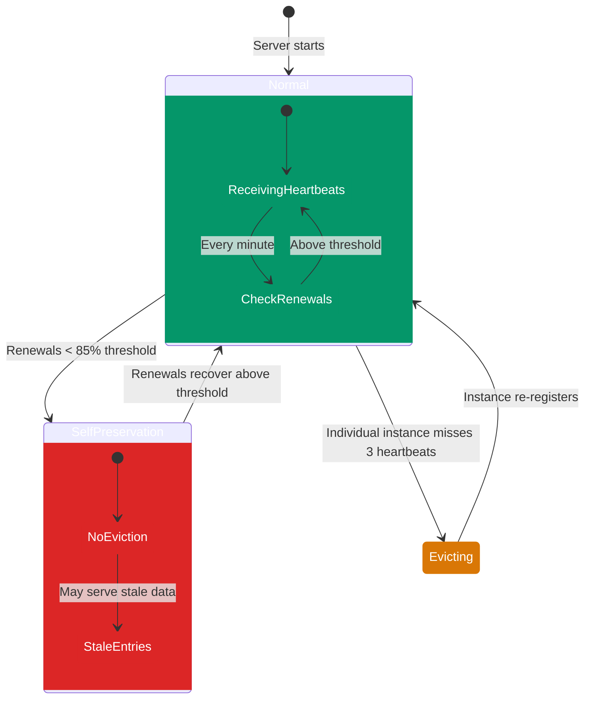

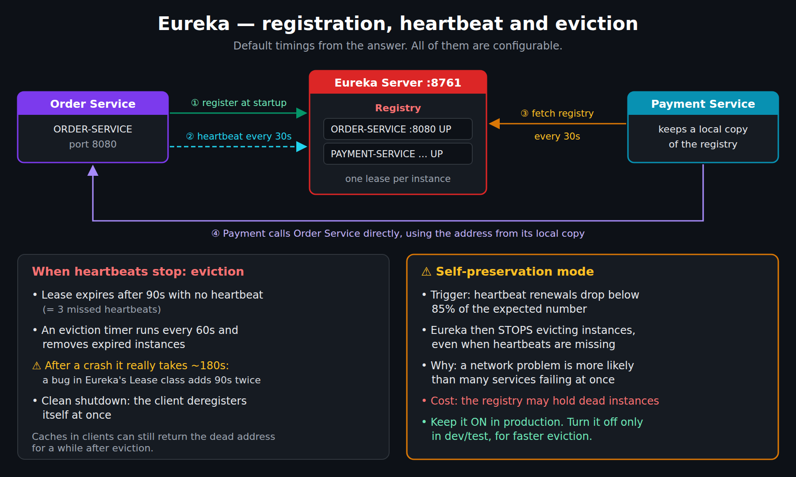

```yaml
# Self-preservation configuration
eureka:
  server:
    enable-self-preservation: true              # default is true
    renewal-percent-threshold: 0.85             # 85% threshold
    eviction-interval-timer-in-ms: 60000        # eviction check interval (60s)
```

🧠 **In Simple Words:**
- **Heartbeat:** "I am still alive" -- each service tells Eureka every 30 seconds
- **Self-preservation:** Eureka may suddenly stop getting heartbeats from many services at once. Then it assumes a network problem, not that all of them failed. It keeps all registrations as they are

💡 **Pro Tip:** In development/testing, you might want to disable self-preservation (`eureka.server.enable-self-preservation=false`). This gives faster eviction. But in production, always keep it enabled. This stops failures from spreading to other services during network partitions.

**⚡ The follow-up that many people get wrong: "why does a new pod take minutes to receive traffic?"**

Everything above describes a *benefit*. Clients keep a cached registry, so traffic continues even when Eureka is down. Interviews often ask about the **cost** of that same caching. There are four independent caches between "instance registers" and "callers use it". Their delays **add up**:

| Layer | Property | Typical delay |
|---|---|---|
| Client → server registration | `eureka.client.initial-instance-info-replication-interval-seconds` | ~0s in Spring Cloud (the UP status change registers at once); up to ~40s in a plain Eureka client |
| Eureka server's response cache | `eureka.server.response-cache-update-interval-ms` | up to ~30s |
| Client's registry fetch | `eureka.client.registry-fetch-interval-seconds` | up to ~30s |
| Spring Cloud LoadBalancer's instance cache | `spring.cloud.loadbalancer.cache.ttl` | up to ~35s |

In the worst case, a healthy new instance waits **well over a minute** for its first request. So a scale-up during a traffic spike helps more slowly than the HPA graph shows.

⚠️ **Scale-down is worse.** For a *removed* instance, the same caches keep returning a **dead address**. Callers get connection errors until every layer refreshes. Eviction needs three things:
- the lease must expire — `lease-expiration-duration-in-seconds` is 90s by default, but after a crash it really takes ~180s (the `Lease` bug above), *and*
- the eviction timer must fire, *and*
- the caches above must refresh.

If self-preservation is active, the dead instance is **never evicted at all**. This is exactly why client-side retry + circuit breakers are mandatory with Eureka. It is also why Kubernetes-native discovery has mostly replaced it. Kubernetes updates Endpoints when a pod becomes ready or not ready.

To make it faster in dev, shorten all four. But know the cost. Shorter intervals mean more registry traffic. Also, a short network problem can now make the Eureka server evict instances much more easily.

---

</details>

---

3. **⚖️ What is the difference between client-side and server-side service discovery? 🔥**

<!-- -->
<details>
<summary>Answer</summary>

**Answer:**

Service discovery has two patterns. They differ in who decides which service instance to call.

**Client-Side Discovery:**

- 🖥️ The **client** (calling service) queries the service registry and gets a list of available instances. It selects one with a load-balancing algorithm
- 📡 The client knows the address of each instance
- ⚖️ Load balancing happens at the client (**Spring Cloud LoadBalancer**; Netflix Ribbon was the predecessor and is now removed)
- 🔧 Used by: Netflix Eureka + Spring Cloud LoadBalancer

**⚡ What actually happens inside `@LoadBalanced`? Interviewers usually ask this after any Eureka question:**

| Piece | Role |
|---|---|
| `@LoadBalanced` | Marks a `RestTemplate`/`RestClient.Builder`/`WebClient.Builder`. Spring then attaches a `ClientHttpRequestInterceptor` (or `ExchangeFilterFunction`). It rewrites `http://SERVICE-ID/path` into `http://10.0.1.7:8080/path` before the call goes out. **That is the whole mechanism**. No proxy, no extra hop. |
| `ServiceInstanceListSupplier` | Supplies the candidate instance list. This is the extension point. Built-in decorators add **caching** (default on), **health-check** filtering, **zone preference**, and **hints**. |
| `ReactiveLoadBalancer` | Picks one instance from that list. Default implementation: **`RoundRobinLoadBalancer`**. The other built-in is `RandomLoadBalancer`. |

⚠️ **There is no built-in least-connections or least-load option.** The reason: the discovery server does not report load (see Q2.1 — Eureka's `InstanceInfo` has no load field).

For **weighted** routing, newer Spring Cloud versions ship `WeightedServiceInstanceListSupplier` (`spring.cloud.loadbalancer.configurations=weighted`). It reads each instance's weight from its **metadata**. On older versions you write this supplier yourself. ⚠️ Check your release train.

💡 You can switch the algorithm per service. Use a `@LoadBalancerClient(name = "payment-service", configuration = CustomLbConfig.class)` class that exposes a `ReactorLoadBalancer<ServiceInstance>` bean.

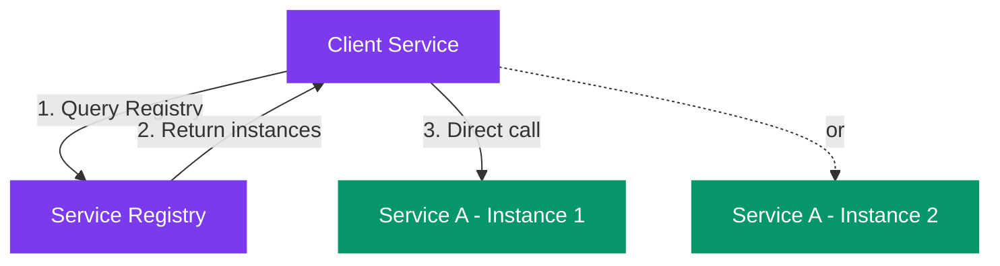

**Server-Side Discovery:**

- 🏗️ The client sends a request to a **load balancer/router** (e.g., AWS ALB, Kubernetes Service). The load balancer asks the registry for instances and forwards the request to one of them
- 🔒 The client does not know about individual instances
- ⚖️ Load balancing happens at the infrastructure level
- 🔧 Used by: Kubernetes, AWS ELB/ALB, Consul + Nginx

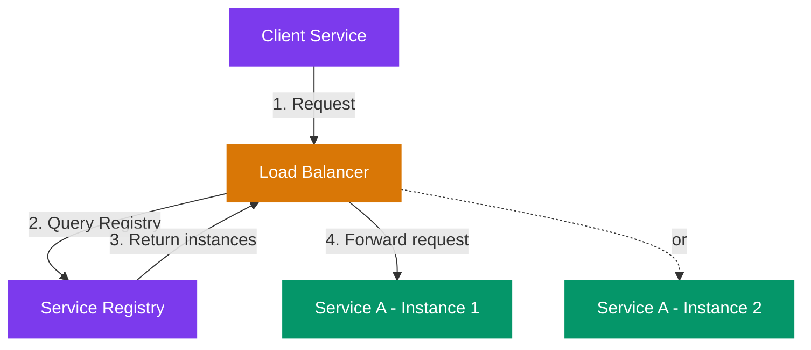

| Aspect | Client-Side Discovery 🖥️ | Server-Side Discovery 🏗️ |
|--------|--------------------------|--------------------------|
| **Who selects instance** | Client application | Load balancer / proxy |
| **Client complexity** | ❌️ Higher -- client needs discovery logic | ✅ Lower -- client just calls one endpoint |
| **Network hops** | ✅ Fewer -- direct client-to-service | ❌️ Extra hop through load balancer |
| **Load balancer dependency** | ✅ None -- no SPOF | ❌️ Load balancer is a potential SPOF |
| **Language support** | ❌️ Requires client library per language | ✅ Language-agnostic |
| **Examples** | Eureka + Spring Cloud LoadBalancer | Kubernetes Service, AWS ALB |

📝 **Note:** In Kubernetes environments, server-side discovery is built in via `kube-proxy` and Kubernetes Services. With Spring Cloud on Kubernetes, you can choose either approach. But many teams use Kubernetes-native discovery. Then they do not need to run a separate Eureka Server.

🎯 **Interview Tip:** You may be asked which one to prefer. Say this:
- Client-side discovery (Eureka) gives more control and avoids an extra network hop.
- Server-side (Kubernetes) is simpler for polyglot environments (services in many languages). It also removes the need for a separate registry.

---

</details>

--- 

4. **📋 What are the different service registry patterns and when would you use each? ⚡**

<!-- -->
<details>
<summary>Answer</summary>

**Answer:**

A Service Registry is a database of available service instances. There are two main patterns for how services get registered:

**1. Self-Registration Pattern:**

- 📡 Each service instance registers and deregisters itself with the registry
- 🔄 The service sends periodic heartbeats to keep its registration alive
- 🔧 Used by: Eureka, where each microservice has an embedded Eureka Client

**2. Third-Party Registration Pattern:**

- 🤖 A separate component (called a **registrar**) tracks instances and registers them
- 📦 The service itself does not know about the registry
- 🔧 Used by: Kubernetes (the EndpointSlice controller adds ready pods to the Service), Netflix Prana (sidecar registrar)

| Pattern | Self-Registration | Third-Party Registration |
|---------|-------------------|--------------------------|
| **Who registers** | Service itself | External registrar component |
| **Service complexity** | ❌️ Service must include registration logic | ✅ Service is simpler -- unaware of registry |
| **Coupling** | ❌️ Services coupled to specific registry | ✅ Services are registry-agnostic |
| **Health checks** | Service sends heartbeats | Registrar polls or observes health |
| **Example** | Spring Cloud Eureka Client | Kubernetes EndpointSlice controller, Consul + Registrator |

**Common Service Registry Implementations:**

| Registry | Type | Key Features |
|----------|------|--------------|
| **Netflix Eureka** | AP (Available + Partition-tolerant) | Self-preservation, client-side caching, Spring Cloud integration |
| **HashiCorp Consul** | CP (Consistent + Partition-tolerant) | KV store, health checks, multi-datacenter, DNS interface |
| **Apache ZooKeeper** | CP | Strong consistency, leader election, used by older Kafka (Kafka 4.0 removed it for KRaft) |
| **Kubernetes Services** | Built-in | DNS-based, kube-proxy load balancing, no separate registry |
| **etcd** | CP | Distributed KV store, used by Kubernetes internally |

🧠 **In Simple Words:**
- **Self-registration:** Each microservice says "I am here" to the registry (like checking yourself into a hotel)
- **Third-party registration:** Someone else checks you in (like a travel agent who handles your hotel booking)

💡 **Pro Tip:**
- Eureka is AP (it puts availability before consistency). During network partitions, it may serve stale data, but it stays available.
- Consul and ZooKeeper are CP. They guarantee consistency, but may become unavailable during partitions.
- For most microservices, AP is the better choice. Slightly old service locations are better than no answer at all.

---

</details>

---

5. **⚙️ How do you configure Eureka for high availability in production? 💤**

<!-- -->
<details>
<summary>Answer</summary>

**Answer:**

In production, a single Eureka Server is a single point of failure. For high availability, you deploy **multiple Eureka Server instances**. They connect to each other as peers (a Eureka Server cluster).

**Eureka Peer-to-Peer Replication:**

- 🔄 Each Eureka Server registers with other Eureka Servers as peers
- 📡 When a service registers with one Eureka Server, that registration is replicated to all peers
- 🛡️ If one Eureka Server goes down, clients can switch (fail over) to other peers

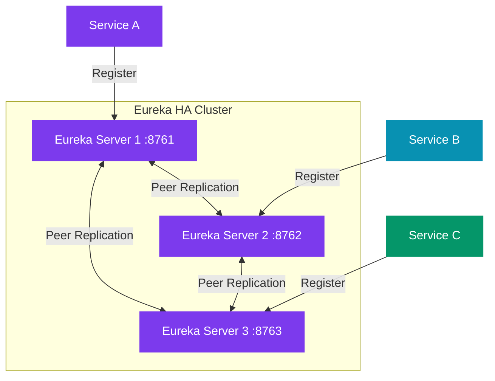

**Eureka Server 1 Configuration:**

```yaml
# eureka-server-1 (application.yml)
server:
  port: 8761
spring:
  application:
    name: eureka-server
eureka:
  instance:
    hostname: eureka-server-1
  client:
    register-with-eureka: true
    fetch-registry: true
    service-url:
      defaultZone: http://eureka-server-2:8762/eureka,http://eureka-server-3:8763/eureka
```

**Eureka Server 2 Configuration:**

```yaml
# eureka-server-2 (application.yml)
server:
  port: 8762
spring:
  application:
    name: eureka-server
eureka:
  instance:
    hostname: eureka-server-2
  client:
    register-with-eureka: true
    fetch-registry: true
    service-url:
      defaultZone: http://eureka-server-1:8761/eureka,http://eureka-server-3:8763/eureka
```

**Microservice Client Configuration (pointing to all peers):**

```yaml
# Microservice application.yml
eureka:
  client:
    service-url:
      defaultZone: http://eureka-server-1:8761/eureka,http://eureka-server-2:8762/eureka,http://eureka-server-3:8763/eureka
```

🔑 **Key Points:**

- 🔄 This is different from a single-node setup. HA Eureka Servers set `register-with-eureka: true` and `fetch-registry: true`, so they can connect to each other as peers
- 📡 Microservices list all Eureka Servers in `defaultZone` for failover
- 🛡️ The Eureka client caches the registry locally. So even if all Eureka Servers go down for a short time, services can still talk to each other using cached data

📝 **Note:** In Kubernetes environments, many teams do not manage Eureka HA themselves. They use Kubernetes-native service discovery (Kubernetes Services + DNS) instead. It has built-in high availability.

---

</details>

---

<a id="api-gateway"></a>

## 3. API Gateway

1. **🚪 What is Spring Cloud Gateway and how does its architecture work? 🔥🔥**

<!-- -->
<details>
<summary>Answer</summary>

**Answer:**

**Spring Cloud Gateway** is the official API Gateway in the Spring ecosystem. It replaces Netflix Zuul. It gives one entry point for all client requests. It handles cross-cutting concerns (logic that every service needs), such as routing, security, rate limiting, and monitoring.

🔑 **Key Features:**

- 🔀 **Dynamic Routing** -- Routes requests to microservices based on URL patterns, headers, etc.
- 🔒 **Security** -- Centralized authentication/authorization (JWT, OAuth2)
- 📊 **Filters** -- Pre/Post processing of requests and responses
- ⚖️ **Load Balancing** -- Client-side load balancing via the `lb://` prefix (Spring Cloud LoadBalancer, with instances from Eureka or another discovery client)
- 🛡️ **Rate Limiting** -- Limit the number of requests to protect backend services

**Architecture:**

Spring Cloud Gateway is built on **Project Reactor** and **Spring WebFlux** (non-blocking, reactive). Each request passes through a pipeline of **Route**, **Predicate**, and **Filter**.

| Component | Purpose |
|-----------|---------|
| **Route** | Maps a request to a backend service (defined by ID, URI, predicates, filters) |
| **Predicate** | Conditions that must match for a route to apply (Path, Header, Method, etc.) |
| **Filter** | Modify request/response before or after routing (add headers, rate limit, etc.) |

**① Inbound path — predicate match → pre-filters → instance lookup in Eureka:**

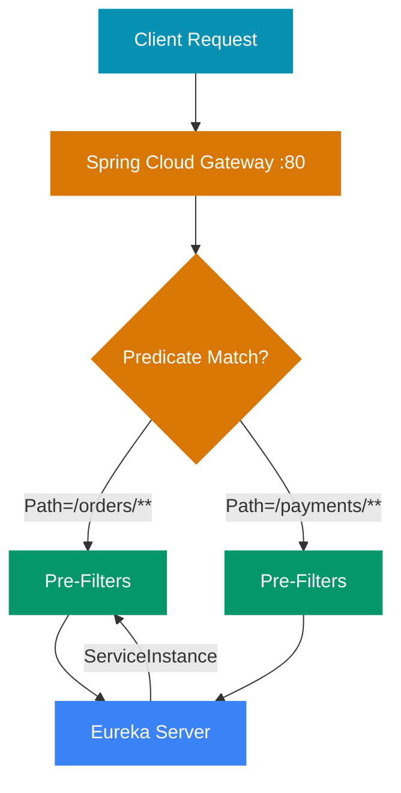

**② Outbound path — forward to the resolved service, then post-filters back to the client:**

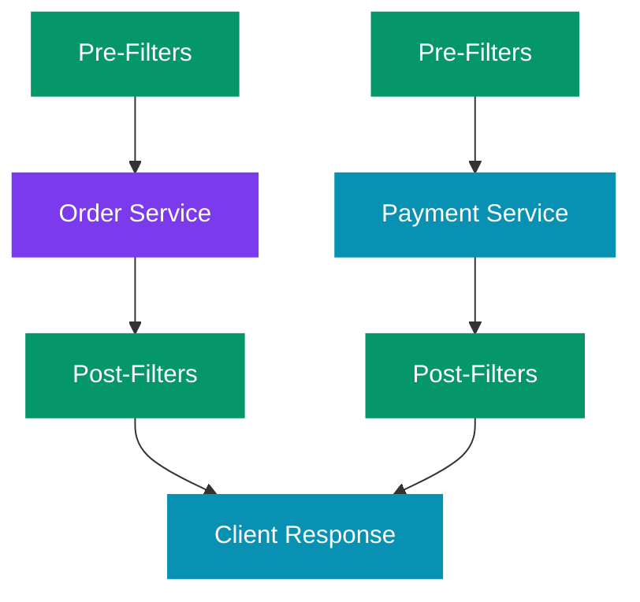

> The 🟢 filter nodes connect the two diagrams. In diagram ①, pre-filters run first, and then the gateway gets an instance from Eureka. The same pre-filter nodes start diagram ②, where the gateway forwards the request.

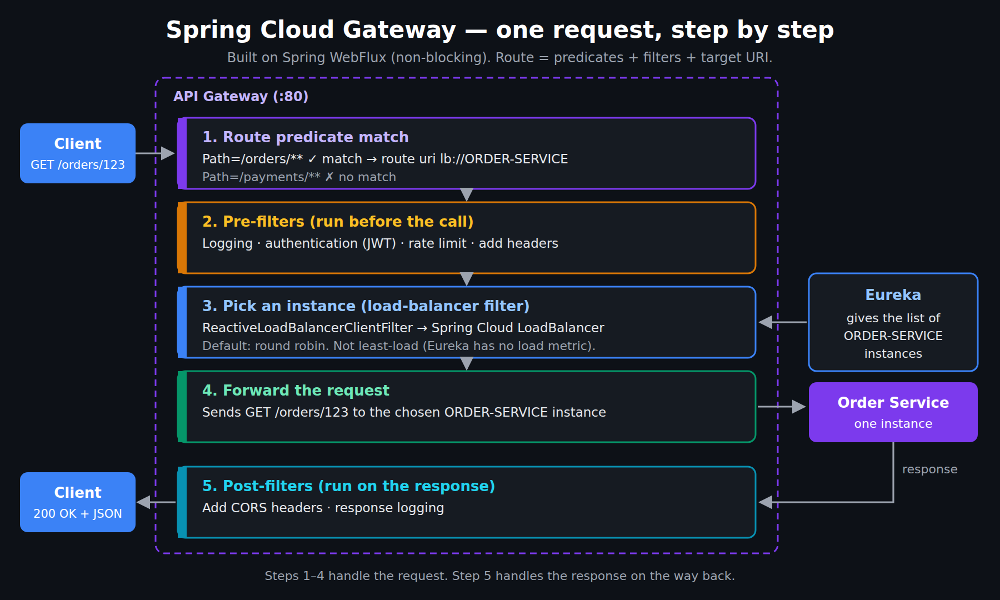

**How Dynamic Routing Works:**

1. The client sends a request to the API Gateway (e.g., `http://gateway:80/orders/123`)
2. The Gateway checks the route predicates to find a matching route
3. Pre-filters run (logging, authentication, header changes)
4. For an `lb://SERVICE-ID` route, the load-balancer global filter (`ReactiveLoadBalancerClientFilter`) runs late in the chain. It passes the service ID to **Spring Cloud LoadBalancer**. The LoadBalancer reads the instance list from the discovery client (Eureka) and picks one. The default algorithm is `RoundRobinLoadBalancer`. `RandomLoadBalancer` is the other built-in one. ⚠️ It is **not** least-load: Eureka has no load metric to choose by
5. The Gateway forwards the request to the chosen microservice instance
6. Post-filters run on the response (add CORS headers, logging)
7. The response goes back to the client

```
RateLimiter(3) → SessionValidation(4) → Authentication(6) → Authorization(8)
```

**Why this order matters (be ready for the follow-up):**

- **Throttle first, then authenticate.** A caller who sends many requests with one token is stopped by a cheap check. The gateway does no expensive auth work for those requests.
- ⚠️ **The limit is only as strong as its key.** The bucket is keyed on the raw token, not a verified identity. An attacker who sends a new token on each request gets a fresh bucket each time. So throttling first only protects against a caller who reuses one token. A **per-IP or global limit** is what stops token rotation.
- **Authentication and authorization are separate filters.** *Who are you* is a different question from *may you call this endpoint*. Only the second one needs the API-to-permission mapping.

This is a *better* interview answer than pretending you used Spring Cloud Gateway. It lets you show the difference the interviewer wants:

| | Servlet filter chain | Gateway `GlobalFilter` |
|---|---|---|
| Threads | One thread per request | Event loop |
| Style | Plain method calls | `Mono` chaining |
| A blocking call | Fine | A bug |
| Ordering | `setOrder` | `Ordered.getOrder()` |

See the blocking-filter trap in Q3.4 below.

📝 **Note:** The API Gateway is itself a microservice registered with Eureka. Clients usually reach it on **:80/:443** without giving a port.

- ⚠️ But the JVM does not bind :80 itself. Ports below 1024 need root or `CAP_NET_BIND_SERVICE`.
- That conflicts with running the container as a non-root user.
- In practice, the gateway process listens on **8080**. A Kubernetes `Service`/Ingress or an ALB maps :80/:443 onto it.

---

</details>

---

2. **🛤️ How do you configure route predicates and filters in Spring Cloud Gateway? 💤**

<!-- -->
<details>
<summary>Answer</summary>

**Answer:**

You configure routes in Spring Cloud Gateway in two ways: in YAML/properties files, or in code with the Java DSL.

**YAML Configuration (Most Common):**

```yaml
spring:
  cloud:
    gateway:
      routes:
        # Route 1: Order Service
        - id: order-service-route
          uri: lb://ORDER-SERVICE
          predicates:
            - Path=/api/orders/**
            - Method=GET,POST,PUT,DELETE
          filters:
            - StripPrefix=1
            - AddRequestHeader=X-Request-Source, API-Gateway
            - name: RequestRateLimiter
              args:
                redis-rate-limiter.replenishRate: 10
                redis-rate-limiter.burstCapacity: 20

        # Route 2: Payment Service
        - id: payment-service-route
          uri: lb://PAYMENT-SERVICE
          predicates:
            - Path=/api/payments/**
            - Header=X-Api-Version, v2
          filters:
            - StripPrefix=1
            - AddResponseHeader=X-Served-By, api-gateway

        # Route 3: Auth Service (no Eureka - direct URL)
        - id: auth-service-route
          uri: http://localhost:9000
          predicates:
            - Path=/auth/**
          filters:
            - RewritePath=/auth/(?<segment>.*), /$\{segment}
```

**Java DSL Configuration (Programmatic):**

```java
@Configuration
public class GatewayConfig {

    @Bean
    public RouteLocator customRouteLocator(RouteLocatorBuilder builder) {
        return builder.routes()
            .route("order-route", r -> r
                .path("/api/orders/**")
                .and()
                .method(HttpMethod.GET, HttpMethod.POST)
                .filters(f -> f
                    .stripPrefix(1)
                    .addRequestHeader("X-Request-Source", "API-Gateway")
                    .circuitBreaker(config -> config
                        .setName("orderCircuitBreaker")
                        .setFallbackUri("forward:/fallback/orders"))
                )
                .uri("lb://ORDER-SERVICE"))
            .route("payment-route", r -> r
                .path("/api/payments/**")
                .filters(f -> f
                    .stripPrefix(1)
                    .retry(retryConfig -> retryConfig
                        .setRetries(3)
                        .setStatuses(HttpStatus.SERVICE_UNAVAILABLE)))
                .uri("lb://PAYMENT-SERVICE"))
            .build();
    }
}
```

**Common Built-in Predicates:**

| Predicate | Example | Matches When |
|-----------|---------|-------------|
| `Path` | `Path=/api/orders/**` | URL path matches the pattern |
| `Method` | `Method=GET,POST` | HTTP method matches |
| `Header` | `Header=X-Api-Version, v2` | Request header matches |
| `Query` | `Query=category, electronics` | Query param matches |
| `Host` | `Host=**.example.com` | Host header matches |
| `After` | `After=2025-01-01T00:00:00+05:30[Asia/Kolkata]` | Request is after given datetime (needs a zoned datetime) |
| `Between` | `Between=datetime1,datetime2` | Request is between two datetimes |

**Common Built-in Filters:**

| Filter | Purpose |
|--------|---------|
| `StripPrefix=1` | Removes first path segment before forwarding |
| `AddRequestHeader` | Adds a header to the downstream request |
| `AddResponseHeader` | Adds a header to the client response |
| `RewritePath` | Rewrites the request path using regex |
| `RequestRateLimiter` | Rate limits requests (the default `RedisRateLimiter` needs Redis) |
| `CircuitBreaker` | Applies circuit breaker pattern |
| `Retry` | Retries failed requests |

🔑 **Key Point:** The `lb://` prefix in the URI tells Gateway to use load-balanced routing through Spring Cloud LoadBalancer. The instance list comes from the discovery client (for example, Eureka). Without it (e.g., `http://host:port`), the request goes straight to the given URL.

🧠 **In Simple Words:**
Say a client calls `/api/orders/123`. With `StripPrefix=1`, the gateway removes `/api` and forwards `/orders/123` to the Order Service. So the gateway URLs and the internal service paths can be different.

---

</details>

---

3. **🚦 How do you implement rate limiting at the API Gateway level? ⚡**

<!-- -->
<details>
<summary>Answer</summary>

**Answer:**

Rate limiting at the gateway protects backend microservices from too many requests. Spring Cloud Gateway has a built-in `RequestRateLimiter` filter. Its default implementation, `RedisRateLimiter`, uses **Redis** and the **Token Bucket algorithm**.

**Dependencies:**

```xml
<dependency>
    <groupId>org.springframework.boot</groupId>
    <artifactId>spring-boot-starter-data-redis-reactive</artifactId>
</dependency>
<dependency>
    <groupId>org.springframework.cloud</groupId>
    <artifactId>spring-cloud-starter-gateway</artifactId>
</dependency>
```

**Rate Limiter Configuration:**

```yaml
spring:
  cloud:
    gateway:
      routes:
        - id: order-service
          uri: lb://ORDER-SERVICE
          predicates:
            - Path=/api/orders/**
          filters:
            - StripPrefix=1
            - name: RequestRateLimiter
              args:
                redis-rate-limiter.replenishRate: 10       # 10 requests/second steady rate
                redis-rate-limiter.burstCapacity: 20       # max burst of 20 requests
                redis-rate-limiter.requestedTokens: 1      # tokens consumed per request
                key-resolver: "#{@userKeyResolver}"        # how to identify the client

  data:
    redis:
      host: localhost
      port: 6379
```

**Key Resolver (identifies who to rate limit):**

```java
@Configuration
public class RateLimiterConfig {

    // Rate limit per user (using a header or JWT claim), falling back to IP.
    @Bean
    public KeyResolver userKeyResolver() {
        return exchange -> Mono.justOrEmpty(
                    exchange.getRequest().getHeaders().getFirst("X-User-Id"))
                .switchIfEmpty(Mono.fromSupplier(() -> clientIp(exchange.getRequest())))
                .defaultIfEmpty("anonymous");
    }

    // Rate limit per IP address
    @Bean
    public KeyResolver ipKeyResolver() {
        return exchange -> Mono.justOrEmpty(clientIp(exchange.getRequest()))
                .defaultIfEmpty("anonymous");
    }

    // getRemoteAddress() is @Nullable (e.g. null under WebTestClient). Behind a
    // proxy/LB it is the proxy's address. getAddress() is null if unresolved.
    // Behind ONE trusted proxy (e.g. an ALB), use the entry that proxy added:
    // the RIGHT-most one. Everything to its left was written by the client.
    private String clientIp(ServerHttpRequest request) {
        String forwarded = request.getHeaders().getFirst("X-Forwarded-For");
        if (forwarded != null && !forwarded.isBlank()) {
            String[] hops = forwarded.split(",");
            return hops[hops.length - 1].trim();   // added by our proxy, not by the client
        }
        InetSocketAddress remote = request.getRemoteAddress();
        if (remote == null || remote.getAddress() == null) {
            return null;
        }
        return remote.getAddress().getHostAddress();
    }

    // Rate limit per API path
    @Bean
    public KeyResolver pathKeyResolver() {
        return exchange -> Mono.just(
            exchange.getRequest().getPath().toString()
        );
    }
}
```

⚠️ **Why the null-handling matters (it is a real production bug, not a small detail).** The simple version is `Mono.just(exchange.getRequest().getRemoteAddress().getAddress().getHostAddress())`. It can throw an NPE in two ways:

- `getRemoteAddress()` is `@Nullable`. It can be null, for example under `WebTestClient`. Behind a proxy/LB it is not null, but it is the proxy's address, not the client's.
- `Mono.just(null)` throws right away anyway.

The failure shows up as a **500 from the gateway**, not as a rate-limit decision. So every request fails. It is not just slowed down or limited. Use `Mono.justOrEmpty(...)` + `defaultIfEmpty(...)`.

💡 **`X-Forwarded-For` — take the right entry, or per-IP limits stop working.**

- Each proxy *adds* the address it saw to the **end** of the header. The client can write anything at the **start**.
- So the left-most entry is not safe, even behind your own proxy. A client sends `X-Forwarded-For: 1.2.3.4`, the ALB adds the real IP after it, and the left-most entry is the fake one.
- Behind N trusted proxies, take the N-th entry from the right. Spring Cloud Gateway has this built in: `XForwardedRemoteAddressResolver.maxTrustedIndex(1)`.
- If clients can reach the gateway directly (no proxy in front), ignore the header and use the socket address.

**Token Bucket Algorithm:**

| Parameter | Description |
|-----------|-------------|
| `replenishRate` | Number of tokens added per second (steady request rate) |
| `burstCapacity` | Maximum number of tokens in the bucket (peak burst) |
| `requestedTokens` | Tokens consumed per request (usually 1) |

🧠 **In Simple Words:**
Imagine a bucket that holds 20 tokens (burstCapacity). Tokens are added at 10/second (replenishRate). Each request takes 1 token. If the bucket is empty, the gateway rejects the request with HTTP 429 (Too Many Requests). This allows short bursts but keeps a steady average rate.

⚠️ **When rate limit is exceeded:** The gateway returns `HTTP 429 Too Many Requests` with headers `X-RateLimit-Remaining` and `X-RateLimit-Burst-Capacity`.

---

</details>

---

4. **🔐 How do you implement authentication and authorization at the API Gateway? 🔥**

<!-- -->
<details>
<summary>Answer</summary>

**Answer:**

The API Gateway is the best place for centralized security, because it is the single entry point for all requests. Each microservice does not need to validate JWT tokens on its own. The gateway handles authentication and passes verified user information downstream.

**Approach: JWT Validation at Gateway with GlobalFilter:**

```java
@Component
public class AuthenticationFilter implements GlobalFilter, Ordered {

    @Autowired
    private JwtUtil jwtUtil;

    // Paths that don't require authentication
    private final List<String> openEndpoints = List.of(
        "/auth/login", "/auth/register", "/actuator/health"
    );

    @Override
    public Mono<Void> filter(ServerWebExchange exchange, GatewayFilterChain chain) {
        // Remove identity headers the client may have sent. Only this filter may set them,
        // so a client cannot send "X-User-Roles: ROLE_ADMIN" on any route, open or not.
        ServerHttpRequest cleaned = exchange.getRequest().mutate()
            .headers(h -> {
                h.remove("X-User-Id");
                h.remove("X-User-Roles");
                h.remove("X-User-Email");
            })
            .build();
        exchange = exchange.mutate().request(cleaned).build();

        String path = exchange.getRequest().getPath().toString();

        // Skip authentication for open endpoints. Match whole path segments:
        // a plain startsWith("/auth/login") would also open "/auth/loginAdmin".
        if (openEndpoints.stream().anyMatch(e -> path.equals(e) || path.startsWith(e + "/"))) {
            return chain.filter(exchange);
        }

        // Extract Authorization header
        String authHeader = exchange.getRequest().getHeaders()
            .getFirst(HttpHeaders.AUTHORIZATION);

        if (authHeader == null || !authHeader.startsWith("Bearer ")) {
            exchange.getResponse().setStatusCode(HttpStatus.UNAUTHORIZED);
            return exchange.getResponse().setComplete();
        }

        String token = authHeader.substring(7);

        try {
            // Validate JWT and extract claims
            Claims claims = jwtUtil.validateToken(token);

            // Pass user info to downstream services via headers
            ServerHttpRequest modifiedRequest = exchange.getRequest().mutate()
                .header("X-User-Id", claims.getSubject())
                .header("X-User-Roles", claims.get("roles", String.class))
                .header("X-User-Email", claims.get("email", String.class))
                .build();

            return chain.filter(exchange.mutate().request(modifiedRequest).build());

        } catch (ExpiredJwtException e) {
            exchange.getResponse().setStatusCode(HttpStatus.UNAUTHORIZED);
            return exchange.getResponse().setComplete();
        } catch (Exception e) {
            // Invalid token = not authenticated → 401 (403 means "known user, no permission")
            exchange.getResponse().setStatusCode(HttpStatus.UNAUTHORIZED);
            return exchange.getResponse().setComplete();
        }
    }

    @Override
    public int getOrder() {
        return -1; // Execute before other filters
    }
}
```

⚠️ **The blocking-filter trap — interviewers ask this right after you say "Gateway is reactive".** `jwtUtil.validateToken(token)` above is a **synchronous** call. It runs on a Netty event-loop thread. That is fine *only* while it is pure CPU work (verifying an HMAC/RSA signature with a key already in memory).

But it may do I/O, for example:

- a DB lookup for a token-revocation list
- a JWKS (the identity provider's public signing keys) fetch from the identity provider
- a Redis session check

Then it **blocks every other request that runs on that event-loop worker**. There are only a few workers (≈ CPU count). Under load, throughput drops sharply. You see a sudden jump in latency with no clear reason, not an error.

Rules for any `GlobalFilter`:

| Do | Don't |
|---|---|
| Keep filters non-blocking: return `Mono`/`Flux` and chain (`flatMap`) | Call a blocking JDBC/HTTP client inline |
| Use `WebClient` for any lookup the filter needs | Use `RestTemplate` inside a filter |
| If you *must* block, isolate it: `Mono.fromCallable(...).subscribeOn(Schedulers.boundedElastic())` | Assume "it's only a few ms" — a few ms × every request on one worker is the outage |
| Cache the JWKS key set in memory with a refresh, so signature verification stays CPU-only | Fetch JWKS per request |

📝 **Note:** Spring Cloud Gateway also ships a **servlet (Spring MVC) variant** next to the reactive WebFlux one. It is for teams that do not want to use WebFlux. It runs on the standard blocking servlet filter chain. There, a blocking call costs you a Tomcat thread, not an event-loop worker. ⚠️ *The exact starter artifact id has changed between Spring Cloud release trains. Check the id for the release train your project uses. Do not quote one from memory.*

**Role-Based Route Protection:**

```yaml
spring:
  cloud:
    gateway:
      routes:
        - id: admin-route
          uri: lb://ADMIN-SERVICE
          predicates:
            - Path=/api/admin/**
            - Header=X-User-Roles, .*ROLE_ADMIN.*
          filters:
            - StripPrefix=1
```

⚠️ **This example is not safe.** Predicates run during route matching, before any filter. That includes `AuthenticationFilter`. So this `Header` predicate checks the header **the client sent**. A client can send `X-User-Roles: ROLE_ADMIN` itself and match the route. Check roles from the JWT claims inside the filter, or in the admin service.

**Security Flow:**

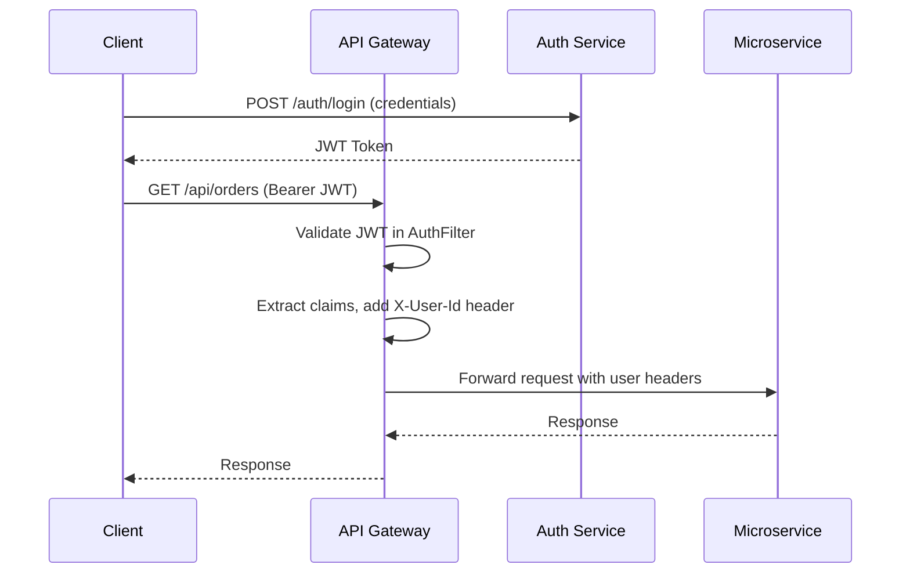

🔑 **Key Points:**

- 🔒 JWT validation happens once at the gateway, not in every microservice
- 📡 User identity is passed to downstream services via trusted headers (`X-User-Id`, `X-User-Roles`)
- 🛡️ Internal services trust these headers **only because the network setup makes the gateway the only entry point (ingress)**. ⚠️ That is an assumption, not a guarantee.
  - Any pod that can reach a service directly can simply set `X-User-Roles: ROLE_ADMIN` itself. Examples: same namespace, a compromised sidecar, a misconfigured `NetworkPolicy`.
  - Header-stripping at the gateway (the first lines of the filter above) stops *external* spoofing. It does nothing against an internal caller.
  - For anything beyond a trusted-network deployment, add mTLS or per-service token validation. See **Q4.6 (mTLS / zero-trust)**.
- ⚙️ Microservices can still do fine-grained authorization based on the headers

🎯 **Interview Tip:** Explain the difference:

- Authentication (who are you?) happens at the gateway.
- Authorization (what can you do?) can be at the gateway (coarse-grained) or at individual services (fine-grained).

---

</details>

---

5. **🔄 What is the difference between an API Gateway, a reverse proxy, and a load balancer? 🔥**

<!-- -->
<details>
<summary>Answer</summary>

**Answer:**

These three components often do some of the same work. But each has a different main purpose.

| Feature | API Gateway | Reverse Proxy | Load Balancer |
|---------|-------------|---------------|---------------|
| **Primary Purpose** | API management, routing, cross-cutting concerns | Forward client requests to backend servers | Distribute traffic across server instances |
| **Routing Logic** | ✅ Complex (path, headers, query params, methods) | ✅ Basic URL-based routing | ❌️ Typically round-robin or least-connections |
| **Authentication** | ✅ JWT/OAuth2 validation | ⚠️ Basic (client certs, IP whitelist) | ❌️ Not applicable |
| **Rate Limiting** | ✅ Built-in | ⚠️ Possible with plugins | ❌️ Not its job |
| **Request/Response Transformation** | ✅ Modify headers, body, rewrite paths | ⚠️ Limited (add headers) | ❌️ No |
| **Protocol Translation** | ✅ HTTP to gRPC, REST to SOAP | ⚠️ Limited | ❌️ No |
| **Service Discovery** | ✅ Integrates with Eureka/Consul | ❌️ Typically static config | ⚠️ Some support (e.g., Kubernetes) |
| **Circuit Breaking** | ✅ Built-in | ⚠️ Some (Envoy, Traefik middleware) | ❌️ No |
| **SSL Termination** | ✅ Yes | ✅ Yes | ✅ Yes |
| **Caching** | ⚠️ Possible | ✅ Common (Nginx, Varnish) | ❌️ Not typical |
| **Examples** | Spring Cloud Gateway, Kong, Apigee | Nginx, HAProxy, Traefik | AWS ALB/NLB, Nginx, HAProxy |

🧠 **In Simple Words:**
- **Load Balancer:** Spreads requests evenly across servers
- **Reverse Proxy:** Sits between clients and backend servers. It hides the servers from clients and can cache/compress
- **API Gateway:** Handles routing, security, rate limiting, monitoring, and transformation. It does everything the other two do, and more

📝 **Note:** In practice, tools like Nginx and Traefik do more than one of these roles. Nginx can act as all three. Spring Cloud Gateway is built specifically as an API Gateway. It has deep Spring ecosystem integration (Eureka, Resilience4j, Spring Security).

💡 **Pro Tip:** In Kubernetes, an **Ingress Controller** (like Nginx Ingress) acts as both reverse proxy and load balancer. A separate API Gateway (like Kong or Spring Cloud Gateway) handles API-specific concerns.

🎯 **Interview Tip:** Also explain the difference between an **API Gateway** and a **Service Mesh** (see Q4.5):

- The gateway handles **north-south** traffic: external clients calling into your services.
- A service mesh (Istio, Linkerd) handles **east-west** traffic: one service calling another inside the system. It adds mTLS, retries, and tracing between services.

---

</details>

---

<a id="inter-service-communication"></a>

## 4. Inter-Service Communication

1. **📡 What are the differences between FeignClient, RestTemplate, and WebClient? 🔥🔥**

<!-- -->
<details>
<summary>Answer</summary>

**Answer:**

These are three ways to make HTTP calls between microservices in Spring. They differ in programming model, in features, and in the use cases they suit best.

| Feature | RestTemplate 🅰️ | FeignClient 🅱️ | WebClient 🅲 |
|---------|-----------------|----------------|-------------|
| **Type** | Synchronous, blocking | Declarative, interface-based | Reactive, non-blocking |
| **Programming Model** | Imperative (manual URL, headers, body) | Declarative (annotated interface) | Reactive (Mono/Flux) |
| **Load Balancing** | One `@LoadBalanced` annotation | ✅ Wired for you | One `@LoadBalanced` annotation |
| **Code Complexity** | ❌️ High -- manual URL construction, error handling | ✅ Low -- just define interface | ⚠️ Medium -- reactive learning curve |
| **Error Handling** | `RestClientException` | `FeignException`, `ErrorDecoder` | `WebClientResponseException` |
| **Status** | 🕰️ Maintenance mode — deprecation announced for Framework 7.1 | ⚠️ Feature-complete — fixes only; Spring points to `@HttpExchange` | ✅ The reactive choice |
| **Performance** | ❌️ Thread-per-request (blocking) | ❌️ Thread-per-request (blocking) | ✅ Non-blocking, event-loop |
| **Spring WebFlux** | ❌️ Not compatible | ❌️ Not compatible | ✅ Designed for it |
| **Retry/Circuit Breaker** | Manual integration | ✅ Via Spring Cloud CircuitBreaker (opt-in flag) | Manual integration |

⚠️ **Be exact about RestTemplate's status.**
- Today it is in **maintenance mode**: no new features. Its Javadoc points to `RestClient` for new code.
- The Spring team has **announced** formal deprecation in Spring Framework 7.1 and removal in 8.0. ⚠️ Check the current state before an interview — 7.1 was planned for around Nov 2026.
- Safe wording: *"RestTemplate is in maintenance mode, and its deprecation is announced. For new blocking code I use `RestClient`."*

**All three use the same load balancer.** `@LoadBalanced` is not a weaker option. It registers a `ClientHttpRequestInterceptor` (`ExchangeFilterFunction` for `WebClient`). This interceptor uses **Spring Cloud LoadBalancer** to rewrite `http://SERVICE-ID/...` into a real `host:port`. Feign resolves through the exact same `LoadBalancerClient`. The only difference: Feign sets it up for you, and the others need one annotation.

**⚡ The modern answer (Spring Boot 3.2+): `RestClient`.** This is the new-generation *blocking* client. It has a fluent API that looks like `WebClient`, but it has no reactive dependency. It is the real replacement for `RestTemplate` in the table above. You will very likely be asked: "Boot 3, blocking call, what do you use?"

```java
@Bean
@LoadBalanced
public RestClient.Builder restClientBuilder() {
    return RestClient.builder();
}

@Service
public class OrderService {

    private final RestClient restClient;

    public OrderService(RestClient.Builder builder) {
        this.restClient = builder.baseUrl("http://PAYMENT-SERVICE").build();
    }

    public PaymentResponse getPayment(Long orderId) {
        return restClient.get()
                .uri("/payments/order/{id}", orderId)
                .retrieve()
                .onStatus(HttpStatusCode::is4xxClientError, (req, res) -> {
                    throw new PaymentNotFoundException(orderId);
                })
                .body(PaymentResponse.class);
    }
}
```

**⚡ The framework-native alternative to Feign: HTTP Interfaces (`@HttpExchange`).** Since Spring Framework 6.0, you can declare a client as an annotated interface. You do not need Spring Cloud OpenFeign at all. It is also declarative, like Feign. `RestClient` or `WebClient` makes the actual calls:

```java
@HttpExchange("/payments")
public interface PaymentApi {

    @GetExchange("/order/{orderId}")
    PaymentResponse getPayment(@PathVariable Long orderId);

    @PostExchange
    PaymentResponse create(@RequestBody PaymentRequest request);
}

@Bean
public PaymentApi paymentApi(RestClient.Builder builder) {
    RestClient client = builder.baseUrl("http://PAYMENT-SERVICE").build();
    HttpServiceProxyFactory factory = HttpServiceProxyFactory
            .builderFor(RestClientAdapter.create(client))
            .build();
    return factory.createClient(PaymentApi.class);
}
```

💡 **How to explain the choice:** Feign is still better for its extra features (`ErrorDecoder`, `RequestInterceptor`, `fallbackFactory`, Spring Cloud CircuitBreaker integration). `@HttpExchange` is better because it needs zero extra dependency and is part of Spring Framework. Both give you the same easy declarative-interface style.

**RestTemplate (legacy -- maintenance mode, still fully supported):**

```java
@Configuration
public class RestTemplateConfig {
    @Bean
    @LoadBalanced  // Spring Cloud LoadBalancer; instances from Eureka or any DiscoveryClient
    public RestTemplate restTemplate() {
        return new RestTemplate();
    }
}

@Service
public class OrderService {
    @Autowired
    private RestTemplate restTemplate;

    public PaymentResponse getPayment(Long orderId) {
        return restTemplate.getForObject(
            "http://PAYMENT-SERVICE/payments/order/" + orderId,
            PaymentResponse.class
        );
    }
}
```

```java
@FeignClient(name = "PAYMENT-SERVICE", fallback = PaymentFallback.class)
public interface PaymentClient {

    @GetMapping("/payments/order/{orderId}")
    PaymentResponse getPaymentByOrderId(@PathVariable Long orderId);

    @PostMapping("/payments")
    PaymentResponse createPayment(@RequestBody PaymentRequest request);
}

@Component
public class PaymentFallback implements PaymentClient {
    @Override
    public PaymentResponse getPaymentByOrderId(Long orderId) {
        return PaymentResponse.builder().status("UNAVAILABLE").build();
    }

    @Override
    public PaymentResponse createPayment(PaymentRequest request) {
        return PaymentResponse.builder().status("UNAVAILABLE").build();
    }
}
```

**WebClient (Recommended for Reactive/Spring WebFlux):**

```java
@Configuration
public class WebClientConfig {
    @Bean
    @LoadBalanced
    public WebClient.Builder webClientBuilder() {
        return WebClient.builder();
    }
}

@Service
public class OrderService {
    private final WebClient webClient;

    public OrderService(WebClient.Builder builder) {
        this.webClient = builder.baseUrl("http://PAYMENT-SERVICE").build();
    }

    public Mono<PaymentResponse> getPayment(Long orderId) {
        return webClient.get()
            .uri("/payments/order/{id}", orderId)
            .retrieve()
            .bodyToMono(PaymentResponse.class)
            .onErrorReturn(PaymentResponse.builder()
                .status("UNAVAILABLE").build());
    }
}
```

🎯 **Interview Tip:** For a **new** Spring Boot 3+ project, say: *"`RestClient`, or an `@HttpExchange` interface on top of it."* It is declarative like Feign, it is part of Spring Framework, and it needs no extra dependency.

---

</details>

---

2. **🔄 What is the difference between synchronous and asynchronous communication in microservices? 🔥**

<!-- -->
<details>
<summary>Answer</summary>

**Answer:**

Microservices talk to each other in two basic ways: synchronous (request-response) and asynchronous (event-driven/messaging).

| Aspect | Synchronous | Asynchronous |
|--------|-------------|--------------|
| **Pattern** | Request-Response | Event-driven / Message-driven |
| **Blocking** | ❌️ Caller waits for response | ✅ Caller does not wait (fire-and-forget or callback) |
| **Coupling** | ❌️ Temporal coupling -- both services must be up | ✅ No temporal coupling -- message broker buffers |
| **Latency** | ❌️ Accumulated latency in call chains | ✅ Lower perceived latency for the caller |
| **Failure Handling** | ❌️ Cascading failures if downstream is down | ✅ Message broker provides durability/retry |
| **Consistency** | ✅ Easier to reason about (immediate response) | ❌️ Eventual consistency -- harder to reason about |
| **Debugging** | ✅ Easier -- linear call flow | ❌️ Harder -- distributed, async flow |
| **Tools** | REST (FeignClient/WebClient), gRPC | Kafka, RabbitMQ, AWS SQS/SNS |
| **Use Case** | Reads, queries, real-time responses | Writes, events, notifications, long-running processes |

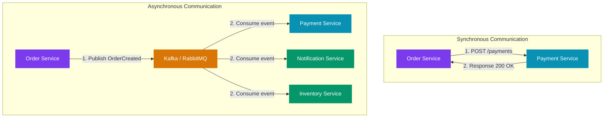

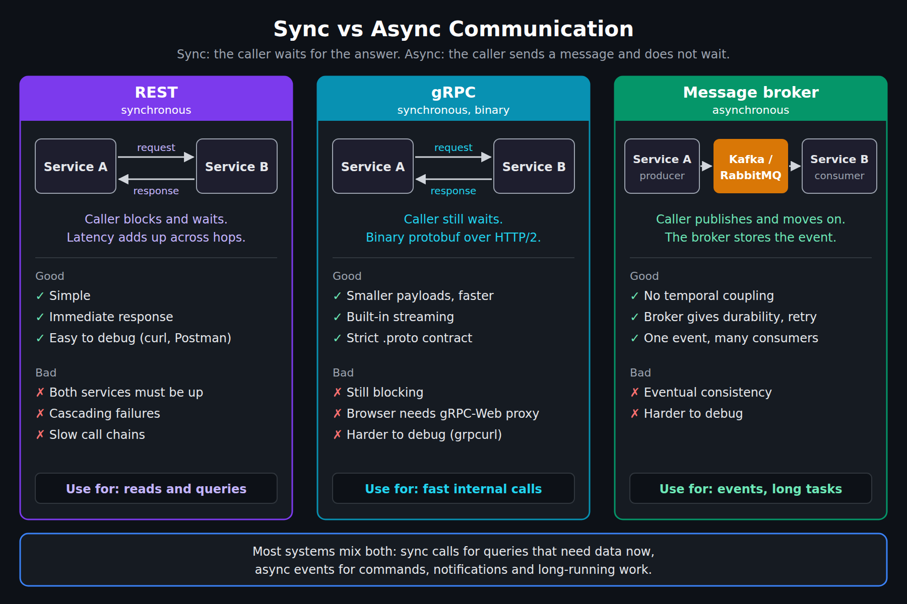

**When to Use Each:**

| Scenario | Recommended |
|----------|-------------|
| User needs immediate response (e.g., get account balance) | Synchronous (REST/gRPC) |
| Order placed -- trigger payment, inventory, notification | Asynchronous (Kafka events) |
| Long-running process (e.g., PDF generation, email sending) | Asynchronous |
| Service-to-service query (e.g., get user details) | Synchronous (FeignClient) |
| Audit logging, analytics | Asynchronous (fire-and-forget) |

💡 **Pro Tip:** In practice, most microservices architectures use a **hybrid approach** (a mix of both):
- Use synchronous calls for queries, where the caller needs the data right away.
- Use asynchronous messaging for commands/events, where the caller does not need an immediate response.

🧠 **In Simple Words:**
- **Synchronous** is like a phone call -- you stay on the line until the other person answers
- **Asynchronous** is like sending a text message -- you send it and continue with your work. The other person replies when they can.

---

</details>

---

3. **🔧 How do you configure FeignClient with error handling and interceptors? 🔥**

<!-- -->
<details>
<summary>Answer</summary>

**Answer:**

For inter-service calls in production, you can customize FeignClient with error decoders, request interceptors, logging, and timeouts.

**Complete FeignClient Setup with Error Handling:**

```java
// 1. FeignClient Interface
@FeignClient(
    name = "PAYMENT-SERVICE",
    configuration = FeignConfig.class,
    fallbackFactory = PaymentFallbackFactory.class
)
public interface PaymentClient {

    @GetMapping("/payments/order/{orderId}")
    PaymentResponse getPaymentByOrderId(@PathVariable Long orderId);

    @PostMapping("/payments")
    PaymentResponse createPayment(@RequestBody PaymentRequest request);
}
```

```java
// 2. Feign Configuration
@Configuration
public class FeignConfig {

    @Bean
    public ErrorDecoder errorDecoder() {
        return new CustomErrorDecoder();
    }

    @Bean
    public RequestInterceptor requestInterceptor() {
        return template -> {
            // Forward correlation ID for distributed tracing
            String correlationId = MDC.get("correlationId");
            if (correlationId != null) {
                template.header("X-Correlation-Id", correlationId);
            }
            // Forward auth token
            ServletRequestAttributes attrs = (ServletRequestAttributes)
                RequestContextHolder.getRequestAttributes();
            if (attrs != null) {
                String authHeader = attrs.getRequest()
                    .getHeader(HttpHeaders.AUTHORIZATION);
                if (authHeader != null) {
                    template.header(HttpHeaders.AUTHORIZATION, authHeader);
                }
            }
        };
    }

    @Bean
    public Logger.Level feignLoggerLevel() {
        return Logger.Level.FULL; // NONE, BASIC, HEADERS, FULL
    }

    @Bean
    public Request.Options requestOptions() {
        return new Request.Options(
            5, TimeUnit.SECONDS,   // connect timeout
            10, TimeUnit.SECONDS,  // read timeout
            true                   // follow redirects
        );
    }
}
```

```java
// 3. Custom Error Decoder
public class CustomErrorDecoder implements ErrorDecoder {

    @Override
    public Exception decode(String methodKey, Response response) {
        switch (response.status()) {
            case 400:
                return new BadRequestException("Invalid request to " + methodKey);
            case 404:
                return new ResourceNotFoundException("Resource not found");
            case 503:
                return new ServiceUnavailableException("Service unavailable");
            default:
                return new RuntimeException("Unknown error: " + response.status());
        }
    }
}
```

```java
// 4. Fallback Factory (with access to the cause of failure)
@Component
public class PaymentFallbackFactory implements FallbackFactory<PaymentClient> {

    private static final Logger log = LoggerFactory.getLogger(PaymentFallbackFactory.class);

    @Override
    public PaymentClient create(Throwable cause) {
        return new PaymentClient() {
            @Override
            public PaymentResponse getPaymentByOrderId(Long orderId) {
                log.error("Fallback: getPayment failed for orderId={}", orderId, cause);
                return PaymentResponse.builder()
                    .status("FALLBACK")
                    .message("Payment service is unavailable")
                    .build();
            }

            @Override
            public PaymentResponse createPayment(PaymentRequest request) {
                log.error("Fallback: createPayment failed", cause);
                throw new ServiceUnavailableException("Cannot create payment right now");
            }
        };
    }
}
```

```yaml
# 5. Feign properties in application.yml
spring:
  cloud:
    openfeign:
      client:
        config:
          default:
            connect-timeout: 5000
            read-timeout: 10000
            logger-level: FULL
          PAYMENT-SERVICE:
            connect-timeout: 3000
            read-timeout: 5000

# Enable Feign logging
logging:
  level:
    com.example.client.PaymentClient: DEBUG
```

🔑 **Key Difference: `fallback` vs `fallbackFactory`:**

- `fallback = PaymentFallback.class` -- Simple fallback, no access to the exception cause
- `fallbackFactory = PaymentFallbackFactory.class` -- Gives access to the `Throwable` that caused the fallback. This allows better logging and different responses for different errors.

📝 **Note:** `fallback` and `fallbackFactory` work only when the Spring Cloud CircuitBreaker integration is enabled (Resilience4j is the usual implementation): `spring.cloud.openfeign.circuitbreaker.enabled=true`.

---

</details>

---

4. **⚡ What is gRPC and when would you use it over REST for inter-service communication? ⚡**

<!-- -->
<details>
<summary>Answer</summary>

**Answer:**

**gRPC** (first built at Google; the name officially means "gRPC Remote Procedure Calls") is a high-performance RPC framework. It works with any language. It uses Protocol Buffers (protobuf) for serialization and HTTP/2 for transport.

| Feature | REST (JSON, usually over HTTP/1.1) | gRPC (Protobuf over HTTP/2) |
|---------|---------------------------|----------------------------|
| **Serialization** | JSON (text-based, human-readable) | Protobuf (binary, compact) |
| **Performance** | ❌️ Slower -- larger payloads, text parsing | ✅ Faster -- smaller payloads, binary parsing |
| **Streaming** | ❌️ Limited (SSE, WebSocket separate) | ✅ Built-in bidirectional streaming |
| **Contract** | ⚠️ Loose (OpenAPI/Swagger optional) | ✅ Strict (`.proto` file is the contract) |
| **Code Generation** | ❌️ Manual or tools (Swagger Codegen) | ✅ Automatic client/server stubs from `.proto` |
| **Browser Support** | ✅ Full native support | ❌️ Requires gRPC-Web proxy |
| **Debugging** | ✅ Easy (curl, Postman, browser) | ❌️ Harder (need gRPC tools like grpcurl) |
| **Adoption** | ✅ Universal -- every language/framework | ⚠️ Growing but less common |

**When to Use gRPC:**

- ⚡ High-performance internal service-to-service calls (low latency critical)
- 📡 Streaming use cases (real-time data feeds, chat, file transfer)
- 🔗 Polyglot environments (auto-generated clients for Java, Go, Python, etc.)
- 📦 Large payloads where binary serialization saves a lot of bandwidth

**When to Stick with REST:**

- 🌐 Public-facing APIs consumed by browsers and third parties
- 🔍 Simple CRUD operations where debugging ease matters
- 📊 Small teams with limited gRPC experience

🧠 **In Simple Words:**
- REST is like sending letters: human-readable, slower, and everyone understands them.
- gRPC is like a private phone line: faster and more efficient. But both sides need the same phone system.

🎯 **Interview Tip:** Mention that many companies use:
- **REST for external APIs** (public-facing)
- **gRPC for internal service-to-service** communication, where performance matters

Google, Netflix, and Uber use this hybrid approach.

---

</details>

---

5. **🕸️ What is a Service Mesh and how does Istio relate to Spring microservices? ⚡**

<!-- -->
<details>
<summary>Answer</summary>

**Answer:**

A **Service Mesh** is a separate infrastructure layer that handles service-to-service communication. It manages traffic routing, security, and observability. It does this without any change to your application code.

**Key Components:**

- 🔧 **Data Plane** -- Sidecar proxies (like Envoy) deployed next to each service instance. All network traffic goes through these proxies.
- 🎛️ **Control Plane** -- A central management layer (Istio, Linkerd). It configures the sidecar proxies with routing rules, security policies, and telemetry collection.

```mermaid
graph TD
    subgraph ServiceA["Service A Pod"]
        A_APP[App Container] <--> A_PROXY[Envoy Sidecar]
    end

    subgraph ServiceB["Service B Pod"]
        B_APP[App Container] <--> B_PROXY[Envoy Sidecar]
    end

    A_PROXY <-->|mTLS encrypted| B_PROXY

    CP[Istio Control Plane] -.->|Config| A_PROXY
    CP -.->|Config| B_PROXY

    classDef purple fill:#7C3AED,stroke:#7C3AED,color:#fff
    classDef cyan fill:#0891B2,stroke:#0891B2,color:#fff
    classDef green fill:#059669,stroke:#059669,color:#fff
    classDef orange fill:#D97706,stroke:#D97706,color:#fff

    class A_APP,B_APP purple
    class A_PROXY,B_PROXY cyan
    class CP orange
```

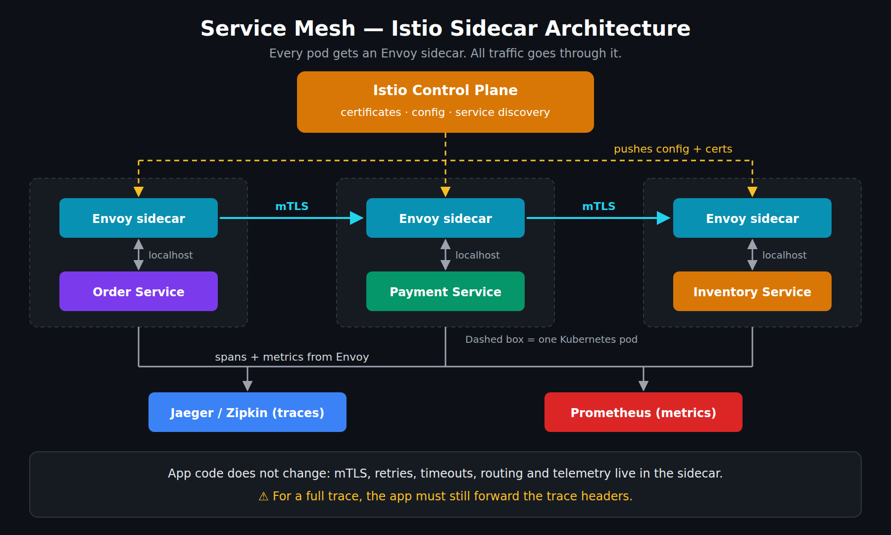

**What Istio Provides:**

| Feature | Without Service Mesh | With Istio Service Mesh |
|---------|---------------------|------------------------|
| **mTLS** | Manual cert management per service | Automatic mTLS between all services |
| **Traffic Management** | Spring Cloud Gateway + Eureka | Istio VirtualService, DestinationRule |
| **Circuit Breaking** | Resilience4j in each service | Configured at Envoy proxy level |
| **Retry/Timeout** | Code-level in each service | Configured via Istio policies |
| **Observability** | Micrometer Tracing + Zipkin instrumented in code | Sidecars send spans (Jaeger/Zipkin); the app must still forward trace headers |
| **Canary Deployments** | Manual traffic splitting | Istio traffic shifting (90/10 split) |

**Spring Cloud vs Service Mesh:**

- 🏗️ **Spring Cloud** -- Application-level solution. The libraries live inside your application code (Eureka Client, Resilience4j, FeignClient). Works for Java only.
- 🕸️ **Service Mesh** -- Infrastructure-level solution. Transparent proxies handle cross-cutting concerns (features every service needs, like security and retries). Works with any language.

🧠 **In Simple Words:**
A service mesh is like a postal service just for your microservices. Each service does not manage its own mail delivery (encryption, retries, routing). The postal service (the sidecar proxies) handles all of it, and the services do not see it.

📝 **Note:** Service meshes add operational complexity (you must manage the Envoy proxies and the Istio control plane).
- For smaller teams with Java-only microservices, Spring Cloud is often enough.
- A service mesh becomes useful in large, polyglot environments (many languages) with hundreds of services.

---

</details>

---

6. **🔒 How do you secure inter-service communication with mTLS? ⚡**

<!-- -->
<details>
<summary>Answer</summary>

**Answer:**

**mTLS (Mutual TLS)** extends standard TLS. It requires **both** the client and the server to present and verify certificates. In microservices, this makes sure that an untrusted service or a network attacker cannot pretend to be a real service and make unauthorized internal calls. This is the foundation of zero-trust networking (no caller is trusted just because it is inside the network).

**Standard TLS vs mTLS:**

| Aspect | Standard TLS | mTLS |
|--------|-------------|------|
| **Server authentication** | ✅ Server presents cert to client | ✅ Server presents cert to client |
| **Client authentication** | ❌️ Not required | ✅ Client presents cert to server |
| **Use case** | Browser-to-server (HTTPS) | Service-to-service (zero-trust) |
| **Complexity** | Simple — one cert per server | Higher — cert for every service |
| **Zero-trust** | ❌️ Trusts any client | ✅ Both parties cryptographically verified |

```mermaid
sequenceDiagram
    participant A as Order Service
    participant B as Payment Service
    participant CA as Certificate Authority

    Note over A,CA: Setup — both services get certs from CA
    CA-->>A: Issue cert for order-service
    CA-->>B: Issue cert for payment-service

    Note over A,B: Runtime — mTLS handshake
    A->>B: ClientHello
    B-->>A: ServerHello + Payment Service Cert
    A->>A: Verify cert against CA trust store
    A-->>B: Order Service Cert
    B->>B: Verify cert against CA trust store
    A-->>B: Encrypted request (mutual trust established)
    B-->>A: Encrypted response
```

**Implementing mTLS in Spring Boot:**

```yaml
# application.yml — Server side (Payment Service)
server:
  ssl:
    enabled: true
    key-store: classpath:keystore/payment-service.p12
    key-store-password: ${KEYSTORE_PASSWORD}
    key-store-type: PKCS12
    trust-store: classpath:keystore/truststore.p12
    trust-store-password: ${TRUSTSTORE_PASSWORD}
    client-auth: need   # need = require client cert | want = optional
```

```java
// Client side (Order Service) — configure RestTemplate with client cert.
// Spring Boot 3 ships Apache HttpClient 5 (org.apache.hc.client5), where
// HttpClientBuilder.setSSLContext(..) NO LONGER EXISTS — TLS is configured
// on the connection manager instead.
@Configuration
public class SecureHttpClientConfig {

    @Bean
    public RestTemplate secureRestTemplate() throws Exception {
        SSLContext sslContext = SSLContextBuilder.create()
            .loadKeyMaterial(
                new ClassPathResource("keystore/order-service.p12").getURL(),
                "keystorePassword".toCharArray(),
                "keyPassword".toCharArray()
            )
            .loadTrustMaterial(
                new ClassPathResource("keystore/truststore.p12").getURL(),
                "truststorePassword".toCharArray()
            )
            .build();

        // TLS goes on the connection manager, not on HttpClients.custom()
        SSLConnectionSocketFactory sslSocketFactory =
            SSLConnectionSocketFactoryBuilder.create()
                .setSslContext(sslContext)
                .build();

        HttpClientConnectionManager connectionManager =
            PoolingHttpClientConnectionManagerBuilder.create()
                .setSSLSocketFactory(sslSocketFactory)
                .build();

        CloseableHttpClient httpClient = HttpClients.custom()
            .setConnectionManager(connectionManager)
            .build();

        return new RestTemplate(new HttpComponentsClientHttpRequestFactory(httpClient));
    }
}
```

- Every blog post you will find uses `HttpClients.custom().setSSLContext(sslContext)`. That is Apache **HttpClient 4** (`org.apache.http.*`).
  - Boot 3 ships **HttpClient 5** (`org.apache.hc.client5.*`), which removed that method. TLS moves to the connection manager, as shown above.
  - *(In HttpClient **5.4+**, `setTlsSocketStrategy(new DefaultClientTlsStrategy(sslContext))` replaces the socket-factory setter too. Check which 5.x version your BOM sets.)*
- `RestTemplateBuilder.requestFactory(Function<ClientHttpRequestFactorySettings, …>)` is **deprecated as of Boot 3.4**. Use `requestFactoryBuilder(...)` instead. The `requestFactory(Supplier)` version is *not* deprecated. The code above builds the `RestTemplate` directly with the request factory, so it does not use either overload.

**mTLS with Istio (Recommended for Production):**

Managing certificates for each service by hand is complex, and mistakes are easy at scale. In production, use a **service mesh like Istio**. It handles mTLS for you through Envoy sidecar proxies, with **zero code changes** to your Spring Boot services:

```yaml
# Enforce strict mTLS for all services in the namespace
apiVersion: security.istio.io/v1beta1
kind: PeerAuthentication
metadata:
  name: default
  namespace: production
spec:
  mtls:
    mode: STRICT   # All inter-service traffic must use mTLS
```

With Istio, certificate issuance, rotation, and enforcement are fully automated. The Spring Boot service just makes a normal HTTP call. The sidecar handles the whole mTLS handshake.

🔑 **Key Points:**

- 🔐 mTLS provides **mutual authentication**. Both services prove who they are before they exchange any data.
- 🏭 Use a **Certificate Authority** (HashiCorp Vault PKI, AWS ACM Private CA) to automate cert issuance and rotation.
- 🕸️ For polyglot or large-scale environments, use a service mesh (Istio) to handle mTLS for you — no code changes.
- 🔄 Automate cert rotation. At scale, tracking cert expiry by hand always fails in the end.

🎯 **Interview Tip:** Explain the difference between two kinds of auth:
- **Gateway-level auth** — JWT checks *who the end user is*.
- **Service-level auth** — mTLS checks *which service is making the call*.

JWT alone cannot stop a compromised internal service from calling another service directly. A zero-trust architecture needs both layers.

---

</details>

---

<a id="resilience-patterns"></a>

## 5. Resilience Patterns

1. **🛡️ What is the Circuit Breaker pattern and how does Resilience4j implement it? 🔥🔥**

<!-- -->
<details>
<summary>Answer</summary>

**Answer:**

The **Circuit Breaker** pattern prevents cascading failures in distributed systems. It stops calls to a failing service and gives that service time to recover. It works like an electrical circuit breaker. When too many failures occur, the circuit "opens". It then short-circuits (rejects right away) the calls that come after.

**Why it matters — how one slow service brings down others (cascading failure):**

```
Service A calls Service B. B is down, so each call waits 5s for a timeout.
100 concurrent requests to A → 100 threads blocked for 5s each
A's thread pool is used up → A starts failing too
→ Service C (which calls A) starts failing
→ the failure spreads through the whole system
```

With a circuit breaker, the circuit opens after enough failures. A returns a fallback at once (cached data or a clear error). A's threads stay free, so A stays healthy. B gets time to recover.

**Resilience4j Circuit Breaker States:**

```mermaid
stateDiagram-v2
    [*] --> CLOSED
    CLOSED --> OPEN: Failure rate >= threshold
    OPEN --> HALF_OPEN: Wait duration expires
    HALF_OPEN --> CLOSED: Permitted calls succeed
    HALF_OPEN --> OPEN: Permitted calls fail

    state CLOSED {
        [*] --> Monitoring
        Monitoring: Calls pass through
        Monitoring: Failures counted in sliding window
    }

    state OPEN {
        [*] --> Rejecting
        Rejecting: All calls rejected immediately
        Rejecting: Returns fallback response
        Rejecting: Waits for timeout duration
    }

    state HALF_OPEN {
        [*] --> Testing
        Testing: Limited calls permitted
        Testing: Evaluates success/failure
    }

    classDef success fill:#059669,stroke:#059669,color:#fff
    classDef danger fill:#DC2626,stroke:#DC2626,color:#fff
    classDef warning fill:#D97706,stroke:#D97706,color:#fff

    class CLOSED,Monitoring success
    class OPEN,Rejecting danger
    class HALF_OPEN,Testing warning
```

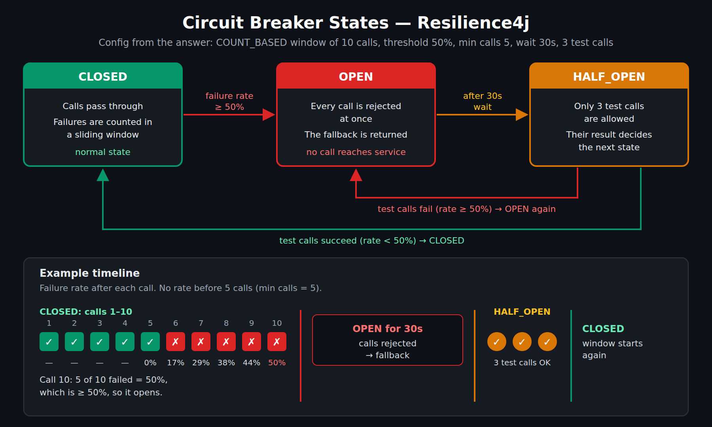

| State | Behavior |
|-------|----------|
| **CLOSED** | ✅ Normal operation. Calls pass through. Failures are counted in a sliding window. |
| **OPEN** | ❌️ All calls are immediately rejected with a fallback. No calls reach the downstream service. |
| **HALF_OPEN** | ⚠️ A limited number of test calls are permitted. If they succeed, the circuit closes. If they fail, the circuit opens again. |

**Implementation with Resilience4j:**

```java
// 1. Service with Circuit Breaker
@Service
public class PaymentService {

    private final PaymentClient paymentClient;

    public PaymentService(PaymentClient paymentClient) {
        this.paymentClient = paymentClient;
    }

    @CircuitBreaker(name = "paymentService", fallbackMethod = "paymentFallback")
    public PaymentResponse processPayment(PaymentRequest request) {
        return paymentClient.createPayment(request);
    }

    // Fallback method -- must have same return type + Throwable param
    private PaymentResponse paymentFallback(PaymentRequest request, Throwable t) {
        log.error("Circuit breaker fallback for payment: {}", t.getMessage());
        return PaymentResponse.builder()
            .status("PENDING")
            .message("Payment service is currently unavailable. " +
                     "Your order has been queued.")
            .build();
    }
}
```

```yaml
# 2. Configuration in application.yml
resilience4j:
  circuitbreaker:
    instances:
      paymentService:
        register-health-indicator: true
        sliding-window-type: COUNT_BASED
        sliding-window-size: 10                    # last 10 calls evaluated
        failure-rate-threshold: 50                 # open circuit if 50% fail
        minimum-number-of-calls: 5                 # min calls before evaluating
        wait-duration-in-open-state: 30s           # wait 30s before half-open
        permitted-number-of-calls-in-half-open-state: 3  # 3 test calls in half-open
        automatic-transition-from-open-to-half-open-enabled: true
        record-exceptions:
          - java.io.IOException
          - java.net.ConnectException
          - feign.FeignException.ServiceUnavailable
        ignore-exceptions:
          - com.example.exception.BusinessException
```

⚙️ **Know the defaults.** "What happens if you configure nothing?" is a common interview question. Every value above overrides one default:

| Property | Default | Why it causes problems |
|---|---|---|
| `sliding-window-type` | `COUNT_BASED` | — |
| `sliding-window-size` | **100** | 10× wider than the block above. The failure rate reacts much more slowly |
| `minimum-number-of-calls` | **100** | ⚠️ The breaker will **not open at all** until 100 calls have been recorded. On a low-traffic endpoint it never trips, so it looks broken. |
| `failure-rate-threshold` | **50%** | — |
| `wait-duration-in-open-state` | **60s** | — |
| `permitted-number-of-calls-in-half-open-state` | **10** | — |
| `automatic-transition-from-open-to-half-open-enabled` | **`false`** | ⚠️ The one above is set to `true` **because it is not the default**. With the default, the OPEN→HALF_OPEN move happens *lazily on the next incoming call*. No scheduler thread does it. If traffic stops, the breaker stays in OPEN with no end and looks stuck. |
| `slow-call-duration-threshold` | **60s** | Slow-call detection is off in practice unless you lower it |
| `slow-call-rate-threshold` | **100%** | Same — every call must be slow before it counts |

⚠️ **`minimum-number-of-calls` with a TIME_BASED window — the breaker that never trips.**

- Resilience4j does not compute a failure rate until `minimum-number-of-calls` calls are **recorded**. Until then the rate is `-1`, and the breaker stays CLOSED.
- The circuit opens when the failure rate is **≥** `failure-rate-threshold` (equal counts, not only "greater than").
- For a **COUNT_BASED** window, Resilience4j caps the minimum at the window size at runtime (`Math.min` in `CircuitBreakerMetrics`). So a size-10 window still starts to compute the rate after 10 calls.
- For a **TIME_BASED** window, there is **no such cap**. Take `sliding-window-size: 10` (10 seconds) with the default minimum of 100. A service that gets fewer than 100 calls in 10 seconds **never trips the breaker**.

This config bug is easy to copy and paste. It looks correct, passes startup checks, and fails silently in production. Say it without being asked: *"`minimum-number-of-calls` defaults to 100, so on a low-traffic time-based window the breaker never trips unless you lower it."* It shows you have tuned a breaker, not just pasted a config.

Retry defaults:

- `max-attempts: 3` and `wait-duration: 500ms`.
- An **empty `retry-exceptions` list, which means retry on every exception**. This includes the `BusinessException` you never wanted retried.

TimeLimiter defaults to `timeout-duration: 1s` with `cancel-running-future: true`. Semaphore Bulkhead defaults to `max-concurrent-calls: 25`, `max-wait-duration: 0`.

```xml
<!-- 3. Dependencies -->
<dependency>
    <groupId>org.springframework.cloud</groupId>
    <artifactId>spring-cloud-starter-circuitbreaker-resilience4j</artifactId>
</dependency>
<dependency>
    <groupId>org.springframework.boot</groupId>
    <artifactId>spring-boot-starter-aop</artifactId>
</dependency>
```

**Sliding Window Types:**

| Type | Description |
|------|-------------|
| **COUNT_BASED** | Evaluates the last N calls (e.g., last 10 calls) |
| **TIME_BASED** | Evaluates calls within a time window (e.g., last 60 seconds) |

🔑 **Key Configuration Parameters:**

- ⚙️ `sliding-window-size` -- How many calls to use when calculating the failure rate
- 📊 `failure-rate-threshold` -- Percentage of failures that triggers OPEN state (e.g., 50%)
- ⏱️ `wait-duration-in-open-state` -- How long to stay OPEN before trying HALF_OPEN
- 🧪 `permitted-number-of-calls-in-half-open-state` -- How many test calls to allow in HALF_OPEN

🎯 **Interview Tip:** Say clearly that the fallback method must have the **same return type** as the original method. It must also take an extra `Throwable` parameter. This is a common mistake in interviews.

Then pair the circuit breaker with two other patterns. Together they form the usual resilience set for a service call:

- **Bulkhead** — a separate thread pool (or semaphore) per dependency, so one slow dependency cannot use up all threads (Q5.4).
- **Retry with exponential backoff + jitter** — jitter adds a small random delay to each wait. Without it, all clients retry at the same moment and hit the recovering service together (Q5.2).

---

</details>

---

2. **🔁 How does the Retry pattern work with exponential backoff in Resilience4j? 🔥**

<!-- -->
<details>
<summary>Answer</summary>

**Answer:**

The **Retry pattern** automatically retries a failed operation a configurable number of times. Then it gives up. With **exponential backoff**, the wait time between retries grows exponentially (1s, 2s, 4s, 8s...). This prevents a thundering herd (many clients retrying at the same moment) on a service that is recovering.

**Implementation:**

```java
@Service
public class OrderService {

    @Retry(name = "orderService", fallbackMethod = "orderRetryFallback")
    public OrderResponse createOrder(OrderRequest request) {
        return orderClient.createOrder(request);
    }

    private OrderResponse orderRetryFallback(OrderRequest request, Throwable t) {
        log.error("All retries exhausted for createOrder: {}", t.getMessage());
        throw new ServiceUnavailableException(
            "Order service unavailable after multiple retries");
    }
}
```

```yaml
resilience4j:
  retry:
    instances:
      orderService:
        max-attempts: 3                    # total attempts (1 original + 2 retries)
        wait-duration: 1s                  # initial wait before first retry
        enable-exponential-backoff: true   # enables exponential backoff
        exponential-backoff-multiplier: 2  # wait doubles each retry: 1s, then 2s
        retry-exceptions:
          - java.io.IOException
          - java.net.ConnectException
          - feign.RetryableException
        ignore-exceptions:
          - com.example.exception.BusinessValidationException
```

**Retry Timeline with Exponential Backoff:**

```
Attempt 1 (original call) --FAIL--> Wait 1s
Attempt 2 (1st retry)     --FAIL--> Wait 2s  (1s * 2^1)
Attempt 3 (2nd retry)     --FAIL--> Fallback method invoked
```

**Defaults, and why you add jitter:**

- Resilience4j Retry defaults: `max-attempts: 3` (1 call + 2 retries) and `wait-duration: 500ms`. The wait is **fixed** unless you turn on exponential backoff.
- Backoff alone is not enough. Say 1,000 clients fail at the same moment. With plain backoff, they all wait 1s, then 2s, then 4s — and all retry **at the same moment** again. The spikes just move later.
- **Jitter** adds a random part to each wait, so the retries spread out. The most common form is **full jitter**:

```
wait = random(0, min(cap, base × 2^attempt))
```

| Attempt | Backoff only | Full jitter (base 500 ms, cap 10 s) |
|---|---|---|
| 1 | 500 ms for everyone | any value in 0–500 ms |
| 2 | 1 s for everyone | any value in 0–1 s |
| 3 | 2 s for everyone | any value in 0–2 s |

In Resilience4j, turn on `enable-randomized-wait: true` with `randomized-wait-factor` (for example `0.5` = ±50% of the wait).

⚠️ Version check: older Resilience4j versions reject `enable-exponential-backoff` and `enable-randomized-wait` together. Newer versions combine them (`IntervalFunction.ofExponentialRandomBackoff`). The default `exponential-backoff-multiplier` is `1.5`.

**Combining Retry with Circuit Breaker:**

When you use both patterns together, the **order matters**. By default, Resilience4j puts **Retry on the outside**. Retry wraps the Circuit Breaker:

```
Request → Retry → CircuitBreaker → Actual Call
```

So each retry attempt passes through the circuit breaker, and the breaker records it. Every failed attempt counts toward the failure rate. This makes the breaker trip faster than the number of real requests suggests.

⚠️ **The trap this creates:** Retry is outermost, so an **OPEN circuit does not give you a fast fail**. The Retry aspect still calls the method again. It just gets `CallNotPermittedException` on every attempt. So it uses up the full retry budget (and its backoff waits) on a circuit that is already open. There are two ways to fix it:

- Add `CallNotPermittedException` to the retry's `ignore-exceptions`. Then an open circuit stops the retry loop immediately. This is usually what you want.
- Or reverse the nesting with `resilience4j.retry.retry-aspect-order` / `resilience4j.circuitbreaker.circuit-breaker-aspect-order`. Then the breaker is the outer layer and short-circuits the call before Retry runs.

```yaml
resilience4j:
  circuitbreaker:
    instances:
      paymentService:
        sliding-window-size: 10
        failure-rate-threshold: 50
        wait-duration-in-open-state: 30s

  retry:
    instances:
      paymentService:
        max-attempts: 3
        wait-duration: 500ms
        enable-exponential-backoff: true
        exponential-backoff-multiplier: 2
        ignore-exceptions:
          # circuit already OPEN -> stop retrying immediately instead of
          # burning all 3 attempts on CallNotPermittedException
          - io.github.resilience4j.circuitbreaker.CallNotPermittedException
```

```java
@CircuitBreaker(name = "paymentService", fallbackMethod = "fallback")
@Retry(name = "paymentService")
public PaymentResponse processPayment(PaymentRequest request) {
    return paymentClient.createPayment(request);
}
```

📝 **Note:** The annotations above do **not** set the order. Putting `@CircuitBreaker` above `@Retry` in the source has no effect on the nesting. The order comes only from the aspect-order properties (see the note below).

⚠️ **Caution:** Be careful with retries on **non-idempotent** operations. Retrying a `POST /payments` could create duplicate payments, unless the operation is idempotent (e.g., using an idempotency key).

**What to retry — and what never to retry:**

| Failure | Retry? | Why |
|---|---|---|
| Connect timeout, connection refused | ✅ Yes | The request never reached the server |
| `503 Service Unavailable` | ✅ Yes, with backoff | The server says "try later" |
| `429 Too Many Requests` | ✅ Yes, but wait for `Retry-After` | The server tells you how long to wait |
| `502` / `504` from a proxy | ⚠️ Only if the call is idempotent | The server may have done the work |
| **Read timeout** | ⚠️ Only if the call is idempotent | The outcome is **unknown**, not "failed" |
| `400`, `401`, `403`, `404`, `409`, `422` | ❌️ Never | The same request fails the same way every time |
| Business validation error | ❌️ Never | Retrying only adds load |

> 💡 **A read timeout does not mean "it failed".** The server may have charged the card and then been slow to reply. So a retry of a non-idempotent call is safe **only** with an idempotency key (Q5.8).

📝 **Note:** The default order of Resilience4j decorators is: `Retry > CircuitBreaker > RateLimiter > TimeLimiter > Bulkhead`. You can change this with `resilience4j.circuitbreaker.circuit-breaker-aspect-order`.

**Retries multiply across layers — the retry storm:**

```
Gateway  → Service A → Service B → Database
3 tries  ×  3 tries  ×  3 tries   = 27 calls hit the database for ONE user request
```

- Each layer "only" retries 3 times. But the attempts multiply, not add.
- The database is slow, so it gets **27× more load** at the worst moment. A slow-down becomes an outage.
- **Rule: retry at one layer only.** Usually that is the layer closest to the failing dependency. Every other layer fails fast and passes the error up.

**Retry budget — cap retries for the whole client, not only per request:**

- `max-attempts` limits retries for **one** request. It does not stop 10,000 requests from all retrying at once.
- A **retry budget** limits retries as a share of normal traffic. Example: "retries may be at most 10% of requests in the last minute". Above that, fail at once and do not retry.
- Google's SRE book describes this exact pair: at most 3 attempts per request, and a per-client retry ratio of 10%.
- You also see it in tools. Envoy has `retry_budget`. The AWS SDK "standard" retry mode uses a retry quota: a token bucket that empties when retries keep failing.

**Backpressure — the server tells clients to slow down:**

- **Bounded queues.** A thread pool with an unbounded queue hides overload until memory runs out. A bounded queue rejects early, while the service still works.
- **Load shedding.** When the queue or the latency crosses a limit, reject new work at once. Drop low-priority traffic first (for example, recommendations before payments).
- **Say why you rejected.** Return `429` (this client sent too much) or `503` (the server is overloaded). Add `Retry-After` — a number of seconds or an HTTP date.
- **Clients must respect it.** A retry policy that ignores `Retry-After` turns the server's protection into more load.

**How the pieces fit:**

| Pattern | Its job |
|---|---|
| Timeout | Stop waiting for one slow call |
| Retry (+ backoff + jitter) | Recover from a short, transient failure |
| Retry budget | Stop retries from making an overload worse |
| Circuit breaker | Stop calling a dependency that keeps failing |
| Bulkhead | Stop one slow dependency from taking all threads |
| Load shedding / `429` + `Retry-After` | Let the server protect itself and tell clients to wait |

🎯 **Interview Tip:** Say the multiplication without being asked: *"3 attempts at each of 3 layers is 27 calls on the database. So I retry at one layer only, with jitter and a retry budget."* That one line shows you have thought about what retries do under load, not only how to configure them.

---

</details>

---

3. **🚰 What is the Rate Limiter pattern in Resilience4j? ⚡**

<!-- -->
<details>
<summary>Answer</summary>

**Answer:**

The **Rate Limiter** pattern controls the rate of requests to a service, so the service is not overloaded. The gateway-level rate limiter limits external client requests. This one is different: it works at the service level to protect downstream calls.

Resilience4j's Rate Limiter uses **fixed refresh cycles**, not a token bucket. At the start of each cycle, the permission count resets to `limit-for-period`.

```java
@Service
public class NotificationService {

    @RateLimiter(name = "emailService", fallbackMethod = "emailRateLimitFallback")
    public void sendEmail(EmailRequest request) {
        emailClient.send(request);
    }

    private void emailRateLimitFallback(EmailRequest request, Throwable t) {
        log.warn("Rate limit exceeded for email service, queuing: {}", request.getTo());
        emailQueue.add(request);  // Queue for later processing
    }
}
```

```yaml
resilience4j:
  ratelimiter:
    instances:
      emailService:
        limit-for-period: 50           # max 50 calls per period
        limit-refresh-period: 1s       # refresh period (50 calls per second)
        timeout-duration: 5s           # max wait time for a permission
        register-health-indicator: true
        event-consumer-buffer-size: 100
```

| Parameter | Description |
|-----------|-------------|
| `limit-for-period` | Number of permissions available in each refresh period |
| `limit-refresh-period` | How often the permission count resets |
| `timeout-duration` | How long a thread waits for permission before throwing `RequestNotPermitted` |

🧠 **In Simple Words:**
Rate Limiter is like a ticket counter that gives out 50 tickets per second. If you arrive and all 50 tickets are taken, you wait up to 5 seconds. If no ticket becomes available, you are rejected.

---

</details>

---

4. **🧱 What is the Bulkhead pattern and what are the differences between thread pool and semaphore isolation? ⚡**

<!-- -->
<details>
<summary>Answer</summary>

**Answer:**

The **Bulkhead** pattern isolates failures. It limits the number of concurrent calls to a particular service. The name comes from ship bulkheads. If one compartment floods, the others stay unaffected.

Without bulkhead isolation, a slow downstream service can use up all threads in the calling service. The calling service then stops responding to all requests, not just those to the slow service.

**Two Bulkhead Types in Resilience4j:**

| Feature | Semaphore Bulkhead | Thread Pool Bulkhead |
|---------|-------------------|---------------------|
| **Mechanism** | Limits concurrent calls using a semaphore counter | Uses a separate thread pool for isolated calls |
| **Thread Model** | Runs on the caller's thread | Runs on a dedicated thread pool |
| **Overhead** | ✅ Low -- no thread context switching | ❌️ Higher -- thread pool management |
| **Wait for a slot** | ✅ `max-wait-duration` — waits for a free permit | ❌️ No timed wait — calls wait in the queue; rejects when threads and queue are full |
| **Use Case** | Lightweight isolation, reactive/non-blocking | Full isolation, blocking I/O calls |

**Semaphore Bulkhead:**

```java
@Bulkhead(name = "inventoryService", type = Bulkhead.Type.SEMAPHORE,
          fallbackMethod = "inventoryBulkheadFallback")
public InventoryResponse checkInventory(String productId) {
    return inventoryClient.check(productId);
}

private InventoryResponse inventoryBulkheadFallback(String productId, Throwable t) {
    log.warn("Bulkhead limit reached for inventory check: {}", productId);
    return InventoryResponse.builder().available(false)
        .message("Inventory check temporarily unavailable").build();
}
```

```yaml
resilience4j:
  bulkhead:
    instances:
      inventoryService:
        max-concurrent-calls: 25         # max 25 concurrent calls
        max-wait-duration: 500ms         # wait time when max is reached
```

**Thread Pool Bulkhead:**

```java
@Bulkhead(name = "reportService", type = Bulkhead.Type.THREADPOOL)
public CompletableFuture<ReportResponse> generateReport(ReportRequest request) {
    // The aspect already runs this method on the bulkhead pool.
    // supplyAsync() here would move the blocking call to the common ForkJoinPool.
    return CompletableFuture.completedFuture(reportClient.generate(request));
}
```

```yaml
resilience4j:
  thread-pool-bulkhead:
    instances:
      reportService:
        max-thread-pool-size: 10         # max threads in dedicated pool
        core-thread-pool-size: 5         # core threads always alive
        queue-capacity: 20               # queue size when all threads busy
        keep-alive-duration: 60s         # idle thread timeout
```

**① Without bulkhead — one shared pool. A slow dependency starves everyone:**

```mermaid
graph TD
    subgraph NoBulkhead["Without Bulkhead"]
        REQ1[Request A] --> TP1[Shared Thread Pool - 200 threads]
        REQ2[Request B] --> TP1
        REQ3[Request C - Slow Service] --> TP1
        TP1 -->|All threads consumed by slow service| FAIL[Other requests starved]
    end

    classDef red fill:#DC2626,stroke:#DC2626,color:#fff
    classDef purple fill:#7C3AED,stroke:#7C3AED,color:#fff

    class REQ1,REQ2,REQ3 purple
    class TP1 red
    class FAIL red
```

**② With bulkhead — a dedicated pool per dependency. A failure affects only one pool:**

```mermaid
graph TD
    subgraph WithBulkhead["With Bulkhead"]
        REQ4[Request A] --> TP2[Pool A - 50 threads]
        REQ5[Request B] --> TP3[Pool B - 50 threads]
        REQ6[Request C - Slow Service] --> TP4[Pool C - 25 threads]
        TP4 -->|Only Pool C affected| OK[Pools A and B unaffected]
    end

    classDef green fill:#059669,stroke:#059669,color:#fff
    classDef purple fill:#7C3AED,stroke:#7C3AED,color:#fff
    classDef cyan fill:#0891B2,stroke:#0891B2,color:#fff
    classDef orange fill:#D97706,stroke:#D97706,color:#fff

    class REQ4,REQ5,REQ6 purple
    class TP2 green
    class TP3 cyan
    class TP4 orange
    class OK green
```

> The same three callers appear in both. The only change is pool **partitioning** (splitting). That is the whole bulkhead idea.

🎯 **Interview Tip:** Use Semaphore Bulkhead for most cases (simpler, lower overhead). Use Thread Pool Bulkhead when you need full thread isolation for blocking I/O calls that could hang forever.

---

</details>

---

5. **⏱️ What is the TimeLimiter pattern and how does it work with other Resilience4j patterns? ⚡**

<!-- -->
<details>
<summary>Answer</summary>

**Answer:**

The **TimeLimiter** pattern limits how long the caller waits for a call. If the call does not finish in time, TimeLimiter stops waiting and throws a `TimeoutException`. ⚠️ It does **not** stop the work itself — see the warning below the config.

```java
@TimeLimiter(name = "reportService", fallbackMethod = "reportTimeoutFallback")
public CompletableFuture<ReportResponse> generateReport(ReportRequest request) {
    // Own pool for blocking I/O — without an executor this runs on ForkJoinPool.commonPool()
    return CompletableFuture.supplyAsync(() -> reportClient.generate(request), reportExecutor);
}

private CompletableFuture<ReportResponse> reportTimeoutFallback(
        ReportRequest request, Throwable t) {
    log.warn("Report generation timed out for: {}", request.getId());
    return CompletableFuture.completedFuture(
        ReportResponse.builder()
            .status("TIMEOUT")
            .message("Report generation is taking longer than expected. " +
                     "It will be emailed when ready.")
            .build()
    );
}
```

```yaml
resilience4j:
  timelimiter:
    instances:
      reportService:
        timeout-duration: 5s             # max 5 seconds for the call
        cancel-running-future: true      # calls future.cancel(true) — see the warning below
```

⚠️ **TimeLimiter stops waiting, not working.**

- On timeout it calls `future.cancel(true)`. But `CompletableFuture.cancel()` ignores the interrupt flag. The task keeps running on its thread until `reportClient.generate()` returns.
- So the caller gets a fast fallback, but the thread, the DB connection and the downstream call stay busy. Under load, these leftover tasks can fill the pool.
- Fix: also set a timeout on the client itself (Feign / `RestClient` / WebClient read timeout). That timeout really ends the call.

📝 **Note:** TimeLimiter works with `CompletableFuture` return types. For synchronous calls, use Feign/WebClient timeouts instead.

**Combining All Resilience4j Patterns:**

The recommended order of decorators (outer to inner) is:

```
Retry → CircuitBreaker → RateLimiter → TimeLimiter → Bulkhead → Actual Call
```

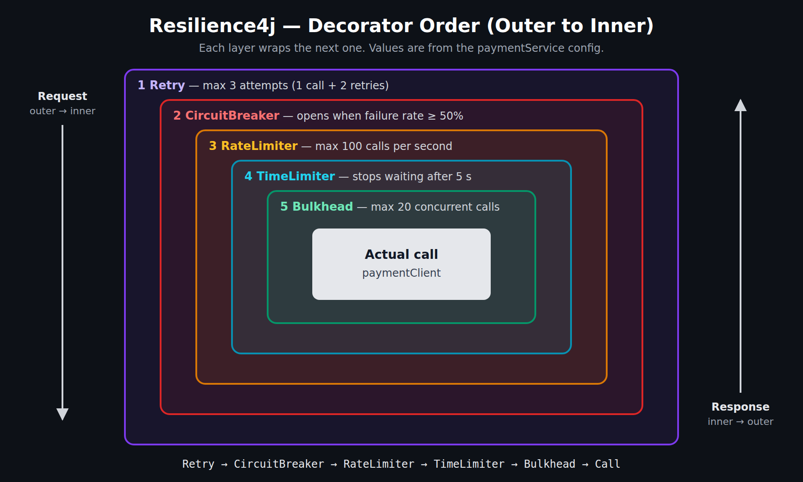

```java
@CircuitBreaker(name = "paymentService", fallbackMethod = "paymentFallback")
@Retry(name = "paymentService")
@Bulkhead(name = "paymentService")
@RateLimiter(name = "paymentService")
public PaymentResponse processPayment(PaymentRequest request) {
    return paymentClient.createPayment(request);
}
```

```yaml
# Combined configuration
resilience4j:
  circuitbreaker:
    instances:
      paymentService:
        sliding-window-size: 10
        failure-rate-threshold: 50
        wait-duration-in-open-state: 30s

  retry:
    instances:
      paymentService:
        max-attempts: 3
        wait-duration: 1s

  bulkhead:
    instances:
      paymentService:
        max-concurrent-calls: 20

  ratelimiter:
    instances:
      paymentService:
        limit-for-period: 100
        limit-refresh-period: 1s
```

🧠 **In Simple Words:**
Think of it as layers of protection, from the outside in (the same order as the decorator chain above):
1. **Retry** -- "If you fail, try again" (`max-attempts: 3` = 1 call + 2 retries)
2. **Circuit Breaker** -- "If too many people are getting sick, shut the door"
3. **Rate Limiter** -- "Only 100 people per second can go in"
4. **TimeLimiter** -- "If it takes more than 5 seconds, stop waiting" (not in the code above — add `@TimeLimiter` on a method that returns `CompletableFuture`)
5. **Bulkhead** -- "Only 20 people can be served at a time"

---

</details>

---

6. **🔄 What are the different fallback strategies in microservices? 🔥**

<!-- -->
<details>
<summary>Answer</summary>

**Answer:**

A fallback strategy says what to do when a service call fails. Good fallbacks give graceful degradation (the system still works, with less data or fewer features). Without them, you get hard failures.

| Strategy | Description | Example |
|----------|-------------|---------|
| **Default Value** | Return a static/cached default response | Return empty list for product recommendations |
| **Cached Response** | Return the last successful response from cache | Return cached stock price if real-time feed is down |
| **Queued for Retry** | Queue the operation for later processing | Queue email notification for async retry |
| **Alternative Service** | Call a backup/secondary service | Use backup payment gateway if primary is down |
| **Graceful Degradation** | Return partial data with a warning | Show product details without reviews if review service is down |
| **Error Response** | Return a meaningful error with retry guidance | Return 503 with "Retry-After" header |

```java
@Service
public class ProductService {

    @Autowired
    private ProductCacheService cache;

    @Autowired
    private BackupRecommendationService backupService;

    // Strategy 1: Cached Response Fallback
    @CircuitBreaker(name = "productService", fallbackMethod = "getProductCachedFallback")
    public ProductResponse getProduct(String productId) {
        return productClient.getProduct(productId);
    }

    private ProductResponse getProductCachedFallback(String productId, Throwable t) {
        log.warn("Using cached product for {}: {}", productId, t.getMessage());
        return cache.getCachedProduct(productId)
            .orElse(ProductResponse.builder()
                .id(productId)
                .status("UNAVAILABLE")
                .message("Product details temporarily unavailable")
                .build());
    }

    // Strategy 2: Alternative Service Fallback
    @CircuitBreaker(name = "recommendationService",
                    fallbackMethod = "getRecommendationsFallback")
    public List<Product> getRecommendations(String userId) {
        return recommendationClient.getRecommendations(userId);
    }

    private List<Product> getRecommendationsFallback(String userId, Throwable t) {
        log.warn("Primary recommendation failed, using backup: {}", t.getMessage());
        try {
            return backupService.getPopularProducts(); // top selling products
        } catch (Exception e) {
            return Collections.emptyList(); // ultimate fallback: empty list
        }
    }

    // Strategy 3: Graceful Degradation
    @CircuitBreaker(name = "reviewService",
                    fallbackMethod = "getProductWithReviewsFallback")
    public ProductDetailResponse getProductWithReviews(String productId) {
        Product product = productClient.getProduct(productId);
        List<Review> reviews = reviewClient.getReviews(productId);
        return new ProductDetailResponse(product, reviews, true);
    }

    private ProductDetailResponse getProductWithReviewsFallback(
            String productId, Throwable t) {
        // ⚠️ This call has no breaker. If productClient caused the failure, it throws again.
        // In real code, keep the product call outside the breaker; wrap only the reviews call.
        Product product = productClient.getProduct(productId);
        return new ProductDetailResponse(product, Collections.emptyList(), false);
        // reviewsAvailable = false tells UI to show "Reviews unavailable"
    }
}
```

🎯 **Interview Tip:** The best fallback strategy depends on the business context.

- For read operations, cached/default values work well.
- For write operations, queuing for retry is preferred.
- Always log the original failure for debugging.
- Mention that you implement **multi-level fallbacks** -- try cache first, then backup service, then default value.

---

</details>

---

7. **⚖️ How does Resilience4j compare to Netflix Hystrix? 💤**

<!-- -->
<details>
<summary>Answer</summary>

**Answer:**

Netflix Hystrix was the original circuit breaker library for Java microservices. It entered maintenance mode in 2018. **Resilience4j** is its modern replacement. It is the recommended choice for new Spring Cloud projects.

| Feature | Hystrix (Deprecated) 🕰️ | Resilience4j (Current) ✅ |
|---------|-------------------------|--------------------------|
| **Status** | ❌️ Maintenance mode (no new features) | ✅ Actively maintained |
| **Architecture** | Monolithic library | Modular (use only what you need) |
| **Patterns** | Circuit Breaker, Bulkhead, Timeout | Circuit Breaker, Retry, Rate Limiter, Bulkhead, TimeLimiter, Cache |
| **Design** | Thread pool isolation by default | Semaphore isolation by default |
| **Configuration** | Archaius (Netflix config) | Spring Boot `application.yml` native |
| **Reactive Support** | ❌️ Limited | ✅ Full (Project Reactor, RxJava) |
| **Metrics** | Hystrix Stream + Dashboard | Micrometer (Prometheus, Grafana compatible) |
| **Dependencies** | ❌️ Heavy (pulls in many Netflix libs) | ✅ Lightweight (minimal dependencies) |
| **Java Version** | Java 6+ | Java 8+ (1.x), Java 17+ (2.x) |
| **Spring Cloud Integration** | `spring-cloud-starter-netflix-hystrix` | `spring-cloud-starter-circuitbreaker-resilience4j` |
| **Annotations** | `@HystrixCommand` | `@CircuitBreaker`, `@Retry`, `@RateLimiter`, `@Bulkhead` |

**Migration from Hystrix to Resilience4j:**

Hystrix:
```java
@HystrixCommand(fallbackMethod = "fallback",
    commandProperties = {
        @HystrixProperty(name = "circuitBreaker.requestVolumeThreshold", value = "10"),
        @HystrixProperty(name = "circuitBreaker.errorThresholdPercentage", value = "50")
    })
public String callService() {
    return restTemplate.getForObject("http://SERVICE/api", String.class);
}
```

Resilience4j (equivalent):
```java
@CircuitBreaker(name = "myService", fallbackMethod = "fallback")
public String callService() {
    return restTemplate.getForObject("http://SERVICE/api", String.class);
}
```

🔑 **Key Reasons to Choose Resilience4j:**

- ⚡ Lightweight and modular -- add only the patterns you need
- 🔧 Native Spring Boot configuration via `application.yml`
- 📊 Built-in Micrometer metrics for Prometheus/Grafana monitoring
- 🔄 First-class support for reactive programming (WebFlux)
- ➕ More patterns: Retry, Rate Limiter are built-in (Hystrix needed separate libs)

🎯 **Interview Tip:** If asked "Why not Hystrix?", simply say: Hystrix is in maintenance mode and gets no new features. Resilience4j is the replacement that Spring recommends. It has better modularity, configuration, and reactive support.

---

</details>

---

8. **🔑 What is the idempotency pattern and how do you implement idempotency keys? 🔥🔥**

<!-- -->
<details>
<summary>Answer</summary>

**Answer:**

**Idempotency** means you can run an operation many times and it always gives the same result. In microservices, network failures make clients retry requests. Without idempotency, a retry of `POST /payments` could charge a customer twice.

An **idempotency key** is a unique ID. The client sends one for each logical operation. The server stores this key. For any duplicate request, it returns the cached result.

**The Problem Without Idempotency:**

```
Client → POST /payments (₹5000) → Server processes → Response lost (network timeout)
Client → POST /payments (₹5000) → Server processes AGAIN → Customer charged twice ❌️
```

**The Solution — Idempotency Keys:**

```
Client → POST /payments + Idempotency-Key: uuid-abc123 → Server processes → stores result
Client → POST /payments + Idempotency-Key: uuid-abc123 → Server finds key → returns cached result ✅
```

**Implementation:**

```java
// 1. Idempotency record entity
@Entity
@Table(name = "idempotency_keys")
@Getter @Setter  // Lombok
public class IdempotencyRecord {
    @Id
    private String idempotencyKey;
    private String responseBody;      // cached JSON response
    private int responseStatus;
    private LocalDateTime createdAt;
    private LocalDateTime expiresAt;  // TTL: 24 hours typical
}
```

```java
// 2. Interceptor — check cache before processing
@Component
public class IdempotencyInterceptor implements HandlerInterceptor {

    @Autowired private IdempotencyRepository idempotencyRepo;

    @Override
    public boolean preHandle(HttpServletRequest request,
                             HttpServletResponse response,
                             Object handler) throws Exception {

        String key = request.getHeader("Idempotency-Key");

        if (!List.of("POST", "PUT", "PATCH").contains(request.getMethod())
                || key == null) {
            return true;
        }

        Optional<IdempotencyRecord> existing = idempotencyRepo.findById(key);

        if (existing.isPresent()) {
            IdempotencyRecord record = existing.get();
            response.setStatus(record.getResponseStatus());
            response.setContentType(MediaType.APPLICATION_JSON_VALUE);
            response.getWriter().write(record.getResponseBody());
            return false;  // Short-circuit — return cached response
        }

        return true;
    }
}
```

```java
// 3. Service — process + store result atomically
@Service
public class PaymentService {

    private final IdempotencyRepository idempotencyRepo;
    private final PaymentRepository paymentRepo;
    private final ObjectMapper objectMapper;

    public PaymentService(IdempotencyRepository idempotencyRepo,
                          PaymentRepository paymentRepo,
                          ObjectMapper objectMapper) {
        this.idempotencyRepo = idempotencyRepo;
        this.paymentRepo = paymentRepo;
        this.objectMapper = objectMapper;
    }

    @Transactional
    public PaymentResponse processPayment(PaymentRequest request, String idempotencyKey) {
        // Double-check inside the transaction. This alone does NOT stop a race:
        // the primary key on idempotencyKey does — the 2nd insert fails and rolls back.
        if (idempotencyKey != null) {
            Optional<IdempotencyRecord> existing = idempotencyRepo.findById(idempotencyKey);
            if (existing.isPresent()) {
                return fromJson(existing.get().getResponseBody(), PaymentResponse.class);
            }
        }

        Payment payment = paymentRepo.save(Payment.from(request));
        PaymentResponse response = PaymentResponse.from(payment);

        if (idempotencyKey != null) {
            IdempotencyRecord record = new IdempotencyRecord();
            record.setIdempotencyKey(idempotencyKey);
            record.setResponseBody(toJson(response));
            record.setResponseStatus(200);
            record.setCreatedAt(LocalDateTime.now());
            record.setExpiresAt(LocalDateTime.now().plusHours(24));
            idempotencyRepo.save(record);
        }

        return response;
    }

    // Jackson 2 (Boot 3): readValue/writeValueAsString throw the CHECKED
    // JsonProcessingException -- it must be handled, not ignored.
    // Jackson 3 (Boot 4) makes these exceptions unchecked.
    private <T> T fromJson(String json, Class<T> type) {
        try {
            return objectMapper.readValue(json, type);
        } catch (JsonProcessingException e) {
            throw new IllegalStateException("Corrupt idempotency record", e);
        }
    }

    private String toJson(Object value) {
        try {
            return objectMapper.writeValueAsString(value);
        } catch (JsonProcessingException e) {
            throw new IllegalStateException("Cannot serialize response", e);
        }
    }
}
```

```java
// 4. Controller
@PostMapping("/payments")
public ResponseEntity<PaymentResponse> createPayment(
        @RequestBody PaymentRequest request,
        @RequestHeader(value = "Idempotency-Key", required = false) String key) {
    return ResponseEntity.ok(paymentService.processPayment(request, key));
}
```

**HTTP contract:**

| Scenario | Response |
|----------|----------|
| First request with key | Process and store result — return 200 |
| Duplicate (same key + same body) | Return cached result — no reprocessing |
| Same key + different body | Return 422 Unprocessable Entity (needs a stored hash of the body to compare — the code above does not do this check) |
| Same key while the first request is **still running** | Return 409 Conflict. This needs an `IN_PROGRESS` row inserted **before** processing starts. The code above does not do this: a parallel duplicate fails on the primary key and gets a 500 instead |
| No key provided | Process normally (no idempotency guarantee) |

🔑 **Implementation Notes:**

- ⚙️ Store records with a TTL (24–48 hours typical) — use a scheduled job to clean up expired records
- 🔴 For high-throughput scenarios use **Redis `SETNX`** (atomic check-and-set) instead of a DB table
- 🛡️ Always handle the race condition. Two concurrent retries can both pass the DB check at the same time. Put a DB unique constraint on the key column. Then the DB makes sure the key is inserted only once.
- 🌐 Generate idempotency keys on the **client side** (UUID v4) before the first request attempt

🧠 **In Simple Words:**
An idempotency key is like a receipt number for a payment. Say you show the same receipt number twice. The cashier says "I already processed this — here's your receipt again". The cashier does not charge you twice.

🎯 **Interview Tip:** This is very important for fintech interviews (Razorpay, PhonePe, CRED). Always mention idempotency when you discuss retries, Saga compensation, or Kafka consumers. The complete answer includes:

- a unique key per operation
- a short-lived cache
- handling race conditions with a DB unique constraint
- client-side key generation

---

</details>

---

9. **⏱️ How do you configure timeouts at different layers in a microservices stack? 🔥🔥**

<!-- -->
<details>
<summary>Answer</summary>

**Answer:**

In a microservices stack, a single request passes through many layers. Each layer can add latency. If you do not configure timeouts, each layer can also hang forever. Without layered timeouts, one slow downstream service can use up all threads in the thread pools. Then the failures spread through the entire system.

**Timeout Layers:**

```mermaid
graph LR
    C[Client] -->|Client timeout| GW[API Gateway]
    GW -->|Route timeout| SVC1[Service A]
    SVC1 -->|FeignClient timeout| SVC2[Service B]
    SVC2 -->|Connection pool timeout| DB[(Database)]

    classDef purple fill:#7C3AED,stroke:#7C3AED,color:#fff
    classDef cyan fill:#0891B2,stroke:#0891B2,color:#fff
    classDef green fill:#059669,stroke:#059669,color:#fff
    classDef orange fill:#D97706,stroke:#D97706,color:#fff

    class C orange
    class GW purple
    class SVC1,SVC2 cyan
    class DB green
```

**1. API Gateway Timeout (Spring Cloud Gateway):**

```yaml
spring:
  cloud:
    gateway:
      httpclient:                   # ⚠️ newer releases move this under spring.cloud.gateway.server.webflux.* — check your version
        connect-timeout: 5000       # 5s to establish TCP connection
        response-timeout: 30s       # 30s for full response
      routes:
        - id: payment-service
          uri: lb://PAYMENT-SERVICE
          predicates:
            - Path=/api/payments/**
          metadata:
            response-timeout: 10000  # Per-route override — 10s
            connect-timeout: 3000
```

**2. FeignClient Timeout:**

```yaml
spring:
  cloud:
    openfeign:
      client:
        config:
          default:
            connect-timeout: 5000
            read-timeout: 10000
          PAYMENT-SERVICE:           # Per-client override
            connect-timeout: 3000
            read-timeout: 8000
```

**3. WebClient Timeout:**

```java
@Bean
public WebClient webClient() {
    HttpClient httpClient = HttpClient.create()
        .option(ChannelOption.CONNECT_TIMEOUT_MILLIS, 5000)
        .responseTimeout(Duration.ofSeconds(10))
        .doOnConnected(conn ->
            conn.addHandlerLast(new ReadTimeoutHandler(10))
                .addHandlerLast(new WriteTimeoutHandler(5)));

    return WebClient.builder()
        .clientConnector(new ReactorClientHttpConnector(httpClient))
        .build();
}
```

**4. Database Connection Pool (HikariCP):**

```yaml
spring:
  datasource:
    hikari:
      connection-timeout: 30000    # Max wait to borrow a connection (30s)
      idle-timeout: 600000         # Remove idle connections after 10 min
      max-lifetime: 1800000        # Replace connection after 30 min
      maximum-pool-size: 10
      validation-timeout: 5000     # Validate connection health within 5s
```

**5. JPA Query Timeout:**

```java
@Repository
public interface OrderRepository extends JpaRepository<Order, Long> {

    @QueryHints(@QueryHint(
        name = "jakarta.persistence.query.timeout",
        value = "5000"))  // 5 second query timeout
    List<Order> findByStatus(OrderStatus status);
}
```

**Timeout Hierarchy Rule — Inner timeout must be shorter than outer:**

| Layer | Recommended Timeout | Rule |
|-------|--------------------|-|
| DB query | 3–5s | Fastest — should always complete quickly |
| FeignClient read | 8–10s | Must be > DB query timeout |
| Gateway route | 15–20s | Must be > FeignClient timeout |
| Client (browser/mobile) | 30s | Must be > gateway timeout |

**Connect timeout vs read timeout — they measure different things:**

| Timeout | What it limits |
|---|---|
| **Connect** | Time to open the TCP connection |
| **Read / socket** | The longest **gap between two packets** of the response — **not** the total time |
| **Pool / connection request** | Time to borrow a connection from the client's pool |
| **Response / total** | The whole call, end to end |

- A server that sends one byte every 9 seconds never trips a 10s read timeout. The call can take minutes.
- So add a **total** limit too: WebClient `responseTimeout`, or a Resilience4j `TimeLimiter`.
- ⚠️ Some clients have **no timeout by default**. `RestTemplate` with the default `SimpleClientHttpRequestFactory` waits forever. OpenFeign's own defaults are 10s connect and 60s read. Always set them yourself.

**Retries must fit inside the caller's timeout:**

- Take the table above: Feign read timeout 10s, 3 attempts, gateway timeout 20s.
- 3 × 10s is already 30s, before any backoff. The gateway gives up at 20s. The third attempt runs for nobody.
- Rule: `attempts × per-attempt timeout + backoff waits` must be **less than** the caller's timeout.

**Deadline propagation — pass the remaining time down the chain:**

- Fixed timeouts per hop do not know how much time the *user* has left.
- With a **deadline**, the edge sets one end time (for example, "now + 3s"). Each hop passes the **remaining** time to the next hop.
- Each service uses `min(its own timeout, remaining time − a small margin)`. If no time is left, it does not start the work at all.
- gRPC supports deadlines natively (the `grpc-timeout` header). HTTP has no standard header for it. So teams add their own (for example `X-Request-Deadline`) and read it in a filter.

⚠️ **Critical Mistake:** Setting gateway timeout < FeignClient timeout. The gateway cancels the request and returns an error to the client. But the downstream service keeps running. It uses CPU, DB connections, and external API credits for a result that nobody will read.

🎯 **Interview Tip:** You may be asked "how do you prevent cascading failures?". Timeouts are the first protection. They act before the Circuit Breaker. Combine them:

- Timeouts fire fast.
- Once a service starts timing out again and again, the circuit breaker opens.
- Then it short-circuits future calls immediately (fails them without calling the service).

---

</details>

---

10. **📮 What is a Dead Letter Queue (DLQ) and how does it improve async resilience? ⚡**

<!-- -->
<details>
<summary>Answer</summary>

**Answer:**

A **Dead Letter Queue (DLQ)** is a special message queue. A message goes there when it still fails after all retries are used up. So the message is moved, not lost. The DLQ keeps failed messages so you can investigate them. After you fix the root cause, you can replay them.

**Why DLQ is Needed:**

A Kafka consumer can fail to process a message for these reasons:

- bugs in consumer code
- malformed payload (poison pill — a message that fails every time you process it)
- downstream service unavailable
- database constraint violations

Without a DLQ, the consumer has two bad choices:

- It retries forever. This blocks all the messages that come after it.
- It silently drops the message.

```mermaid
graph LR
    P[Producer] -->|Publish| T[Kafka Topic]
    T -->|Consume| C[Consumer]
    C -->|OK| OK[Success]
    C -->|Fail after 3 retries| DLQ[Dead Letter Topic]
    DLQ --> MON[Alert / Monitoring]
    DLQ --> REPLAY[Manual Replay Tool]

    classDef purple fill:#7C3AED,stroke:#7C3AED,color:#fff
    classDef cyan fill:#0891B2,stroke:#0891B2,color:#fff
    classDef green fill:#059669,stroke:#059669,color:#fff
    classDef orange fill:#D97706,stroke:#D97706,color:#fff
    classDef red fill:#DC2626,stroke:#DC2626,color:#fff

    class P purple
    class T cyan
    class C cyan
    class OK green
    class DLQ red
    class MON,REPLAY orange
```

**Kafka DLQ with Spring Kafka:**

```java
// 1. Configure retry + DLQ in container factory
@Bean
public KafkaListenerContainerFactory<?> kafkaListenerContainerFactory(
        ConsumerFactory<String, OrderEvent> cf,
        KafkaTemplate<String, Object> kafkaTemplate) {

    ConcurrentKafkaListenerContainerFactory<String, OrderEvent> factory =
        new ConcurrentKafkaListenerContainerFactory<>();
    factory.setConsumerFactory(cf);

    // Retry 3 times, then route to DLQ topic
    DeadLetterPublishingRecoverer recoverer =
        new DeadLetterPublishingRecoverer(kafkaTemplate,
            (record, ex) -> new TopicPartition(
                record.topic() + ".DLT",  // Convention: append .DLT suffix
                record.partition()
            ));

    DefaultErrorHandler errorHandler = new DefaultErrorHandler(
        recoverer,
        new FixedBackOff(1000L, 3)  // 3 retries, 1 second apart
    );

    // Don't retry on data errors (poison pills — go straight to DLQ).
    // Both are already on DefaultErrorHandler's default not-retryable list;
    // add your own types here (for example, validation errors).
    errorHandler.addNotRetryableExceptions(
        DeserializationException.class,  // thrown via ErrorHandlingDeserializer
        ClassCastException.class
    );

    factory.setCommonErrorHandler(errorHandler);
    return factory;
}
```

```java
// 2. Main consumer (unchanged — error handling is in the factory)
@Service
public class OrderEventConsumer {

    @KafkaListener(topics = "order-events", groupId = "order-processor")
    public void handleOrderEvent(OrderEvent event) {
        orderService.processOrder(event);
    }
}

// 3. DLQ consumer for alerting and replay
@Service
public class OrderEventDLQConsumer {

    @KafkaListener(topics = "order-events.DLT", groupId = "order-dlq-monitor")
    public void handleDeadLetter(
            @Payload OrderEvent event,
            @Header(KafkaHeaders.DLT_EXCEPTION_MESSAGE) String errorMsg,
            @Header(KafkaHeaders.DLT_ORIGINAL_TOPIC) String originalTopic) {

        log.error("DLQ message from topic={}, error={}", originalTopic, errorMsg);
        alertingService.sendAlert("DLQ alert on " + originalTopic + ": " + errorMsg);
        dlqRepository.save(new DLQRecord(event, errorMsg, originalTopic));
    }
}
```

**DLQ Best Practices:**

| Practice | Description |
|----------|-------------|
| **Alert on DLQ lag** | Monitor DLQ consumer lag in Grafana. Alert when messages pile up |
| **Include failure metadata** | Store original topic, partition, offset, exception class and message |
| **Build a replay UI** | An ops tool that sends DLQ messages back to the original topic after the bug is fixed |
| **Separate DLQ per topic** | `order-events.DLT`, `payment-events.DLT` — not one shared DLQ for everything |
| **Distinguish poison pills** | Deserialization/format errors → skip retry, go directly to DLQ |
| **DLQ consumers must be idempotent** | A replayed message may already be partly processed |

🧠 **In Simple Words:**
A DLQ is like a "return to sender" pile at a post office. The post office does not throw away mail it cannot deliver. It also does not keep trying forever. It puts the mail in a special tray and tells the postmaster. When the address problem is fixed, it sends the mail again.

🎯 **Interview Tip:** Always mention DLQ when you talk about Kafka or async communication. "We retry N times with a backoff, and if all retries fail, the message goes to the DLQ where we alert on-call and investigate. After fixing the bug, we replay from the DLQ." This shows you have real production experience.

---

</details>

---

11. **🧪 What is Chaos Engineering and how do you apply it to test microservices resilience? ⚡**

<!-- -->
<details>
<summary>Answer</summary>

**Answer:**

**Chaos Engineering** means you add failures to a distributed system on purpose, in a controlled way. You do this to check that the system can survive real-world problems. The goal is to find weak points before they cause production incidents.

> *"The best time to discover your circuit breakers don't work is during a scheduled chaos experiment — not during a Black Friday outage."*

**The Chaos Engineering Process:**

1. 📊 **Establish steady state** — Define what "normal" looks like (error rate, latency, throughput)
2. 🔮 **Form a hypothesis** — "If Payment Service fails, Order Service should degrade gracefully with fallbacks"
3. 💥 **Inject the fault** — Kill a service, add latency, use up a resource
4. 👀 **Observe** — Does the system behave as you expected?
5. 🔧 **Fix and document** — Fix any gaps you found

**Types of Failures to Test:**

| Failure Type | What to Verify | How to Inject |
|-------------|---------------|--------------|
| **Service crash** | Circuit breaker opens, fallback activates | Kill K8s pod: `kubectl delete pod` |
| **Latency injection** | Timeout config fires, no cascading | Istio fault injection, Chaos Monkey |
| **Network partition** | Self-preservation mode, graceful degradation | `iptables` DROP rule |
| **CPU/Memory pressure** | Bulkhead limits work | `stress-ng` tool |
| **Database failure** | Connection pool timeout handled cleanly | Stop DB container |
| **Kafka broker down** | Producer buffer, consumer retry, DLQ | Stop Kafka broker |

**Chaos Monkey for Spring Boot:**

```xml
<dependency>
    <groupId>de.codecentric</groupId>
    <artifactId>chaos-monkey-spring-boot</artifactId>
    <version>3.1.0</version>
</dependency>
```

```yaml
# Only enable in test/staging — never blindly in production
# The app must also run with the `chaos-monkey` Spring profile, or nothing is attacked
chaos:
  monkey:
    enabled: true
    watcher:
      service: true           # Inject into @Service beans
      rest-controller: true   # Inject into @RestController
    assaults:
      level: 3                # 1 in 3 requests affected
      latency-active: true
      latency-range-start: 2000   # 2–5 second random delay
      latency-range-end: 5000
      exceptions-active: false
      kill-application-active: false
```

```bash
# Toggle at runtime via Actuator
curl -X POST http://localhost:8080/actuator/chaosmonkey/enable
curl -X POST http://localhost:8080/actuator/chaosmonkey/disable
```

**What Good Resilience Looks Like Under Chaos:**

| Scenario | Expected Behavior |
|----------|------------------|
| Payment Service killed | ✅ Circuit breaker opens, Order Service returns fallback |
| DB connection pool exhausted | ✅ Requests fail fast with 503, not hang forever |
| Kafka broker down | ✅ Producer buffers messages, consumer retries when broker recovers |
| High latency injection | ✅ TimeLimiter fires, fallback returned within SLA |
| Network partition | ✅ Eureka self-preservation, stale registrations served from cache |

🧠 **In Simple Words:**
Chaos Engineering is a fire drill for your software. You start a small, controlled fire. You check that your fire safety systems (circuit breakers, fallbacks, alerts) really work. You do this before a real fire burns everything down.

🎯 **Interview Tip:** Chaos engineering shows that you understand production at a senior level. Say that experiments run in **staging first**. Each one has a clear hypothesis and a rollback plan. In production, start with small experiments that can affect only a little of the system. For example, add latency on non-critical paths. Do not kill critical services blindly.

---

</details>

---

12. **🎯 How do you decide which resilience patterns to apply to a service? ⚡**

<!-- -->
<details>
<summary>Answer</summary>

**Answer:**

If you apply all Resilience4j patterns everywhere, you add complexity and noise you do not need. The right patterns depend on three things:

- the communication type (sync vs async)
- whether the operation is idempotent
- how critical the downstream service is

**Decision Framework:**

**① First two questions — communication style, then how critical the downstream is:**

```mermaid
graph TD
    Q1{Sync or Async?}
    Q2{Is downstream critical?}

    Q1 -->|Async Kafka| ARET[Retry in consumer + DLQ]
    Q1 -->|Sync HTTP| Q2

    Q2 -->|Critical - payment, inventory| CB[CircuitBreaker + Bulkhead + Retry]
    Q2 -->|Optional - recommendations| GD[CircuitBreaker + Fallback only]

    classDef purple fill:#7C3AED,stroke:#7C3AED,color:#fff
    classDef cyan fill:#0891B2,stroke:#0891B2,color:#fff

    class Q1,Q2 purple
    class ARET,CB,GD cyan
```

**② Two extra checks applied on top — idempotency (can you retry at all?) and duration:**

```mermaid
graph TD
    Q3{Is operation idempotent?}
    Q4{Long-running?}

    Q3 -->|Yes - GET or idempotent POST| RET[Retry with backoff OK]
    Q3 -->|No - non-idempotent POST| IDEM[Idempotency Key + then Retry]

    Q4 -->|Yes - report gen, batch| TL[TimeLimiter + ThreadPool Bulkhead]
    Q4 -->|No| DEF[Default: CB + Retry + Semaphore Bulkhead]

    classDef purple fill:#7C3AED,stroke:#7C3AED,color:#fff
    classDef cyan fill:#0891B2,stroke:#0891B2,color:#fff

    class Q3,Q4 purple
    class RET,IDEM,TL,DEF cyan
```

> Read ① for the **baseline** pattern set. Then apply ② on top of it to change it. Candidates often skip the idempotency question in ②. But a retry on a non-idempotent POST can charge a customer twice.

**Pattern Selection Guide:**

| Scenario | Apply These Patterns |
|----------|---------------------|
| Sync call to critical service (payment, inventory) | Circuit Breaker + Retry + Bulkhead + TimeLimiter |
| Sync call to optional service (recommendations, ads) | Circuit Breaker + Fallback (no retry — return default fast) |
| High-traffic endpoint with expensive downstream | Rate Limiter at gateway + Circuit Breaker |
| Kafka consumer | Retry with backoff + DLQ |
| Non-idempotent POST with retry | Idempotency key first, then Circuit Breaker + Retry |
| Long-running background task | TimeLimiter + Thread Pool Bulkhead |

**Minimum baseline every synchronous service call should have:**

```java
@CircuitBreaker(name = "serviceName", fallbackMethod = "fallback")
@Retry(name = "serviceName")
public Response callExternalService(Request request) {
    return client.call(request);
}
```

**Anti-Patterns to Avoid:**

| Anti-Pattern | Risk |
|-------------|------|
| No Circuit Breaker | Cascading failures — one slow service takes down the caller |
| No timeout at any layer | Threads hang forever, pool exhaustion |
| Retry on non-idempotent operations | Duplicate charges, duplicate orders |
| Retry with no backoff | Thundering herd — too many requests hit a service that is trying to recover |
| No DLQ for async | Failed messages silently lost |
| Bulkhead with too-small pool | Rejecting valid requests under normal load |

🎯 **Interview Tip:** When asked "how do you make services resilient?", give your answer in this order:

1. timeout at every layer
2. Circuit Breaker for cascading failures
3. Retry + backoff for transient errors
4. Bulkhead for thread isolation
5. Fallback for graceful degradation
6. DLQ for async flows
7. Idempotency before retry on writes

This shows you understand the whole system. You are not just listing pattern names.

---

</details>

---

> **Options:**  
> - A) Increase the database connection pool size  
> - B) Implement a circuit breaker pattern  
> - C) Add a load balancer before services  
> - D) Deploy services across multiple availability zones

<!-- -->
<details>
<summary>Answer</summary>

**✅ Correct answer: B) Implement a circuit breaker pattern.**

This question is tricky. The circuit breaker does **NOT** fix the load, and that confuses people. A circuit breaker adds **zero capacity**:

- It doesn't process more orders.
- It doesn't speed up the DB.
- It doesn't make the spike go away.

So people object: "it just stops the call, it doesn't fix the problem". This is technically true *about the capacity problem*. The mistake is in **which problem the question asks you to solve.**

**There are two separate problems here:**

| Problem | Symptom | What fixes it |
|---|---|---|
| **Capacity** (root cause) | Order service can't handle peak load | Autoscaling, load shedding, rate limiting, async queue (Kafka) |
| **Cascade** (how far the damage spreads) | *Entire system* goes down, not just ordering | **Circuit breaker** + bulkhead |

Read the question carefully: *"cascading failures bring down the **entire system**"* and *"isolate failures **between microservices**."* The question never asks you to handle the load. It asks you to stop **one service's failure from taking down everything else.** That is the cascade problem. Circuit breaker is the standard answer for it.

**🔥 Why the whole system crashes (the mechanism):** On its own, an overloaded order service should not kill unrelated services. This is how the failure spreads:

1. Cart / gateway / payment call the order service **synchronously**.
2. The order service is slow → those callers' threads **block waiting** for a response (until timeout).
3. At peak request rate, the callers' **thread pools fill up** with threads stuck waiting on the order service.
4. Now a caller can't serve *any* request — even ones that don't need ordering. It looks dead too.
5. Its callers block on *it* → the failure moves upstream → **entire system down.**

That is the cascade: one slow dependency uses up everyone's threads.

**What the circuit breaker actually does:**

- After N failures/timeouts, it **opens**.
- Calls to the order service now **fail instantly** (fallback / fast error). They do not block.
- The callers' threads are freed. Cart, search and browse stay alive. They degrade gracefully ("ordering temporarily unavailable") instead of crashing.
- Also, retries stop flooding the order service. So it gets time to recover.

So it doesn't fix ordering. It **keeps the damage inside ordering.** "Isolate failures" means exactly this.

**❌️ Why C) load balancer is wrong** (the common wrong choice): A load balancer spreads requests across instances of **the same service**. It fails here for two reasons:

- It does nothing to stop failures spreading **between different microservices**. That is the whole question.
- Total load can be more than total capacity. Then an LB just spreads the overload evenly, and **every** instance is still overloaded. An LB spreads load. It does not add capacity or isolate faults.

**❌️ Why A) and D) are wrong:**

- A bigger DB connection pool can make the overload *worse*. More concurrent queries hit a DB that is already struggling. It also does nothing to isolate failures between services.
- Multi-AZ deployment handles **zone/availability outages**. It does not handle cascading failures caused by load.

**🎯 The honest, interview-grade answer:** In a real incident you need **both**:

- circuit breaker + bulkhead to stop the cascade
- **and** autoscaling / queue / rate-limiting to handle the actual spike

Circuit breaker is **needed, but it is not enough.** But look at these four options and the clear phrase "isolate failures between microservices." Circuit breaker is clearly the intended answer. You can say: *"a circuit breaker isolates failures but doesn't fix capacity — I'd pair it with autoscaling and a bulkhead"*. This small detail makes a strong answer different from just naming a pattern.

---

</details>

---

<a id="distributed-data-patterns"></a>

## 6. Distributed Data Patterns

1. **🔄 What is the Saga pattern and how do orchestration and choreography differ? 🔥🔥**

<!-- -->
<details>
<summary>Answer</summary>

**Answer:**

The **Saga pattern** keeps data consistent across microservices without distributed transactions.

- A saga is a sequence of local transactions.
- Each service runs its own transaction. Then it publishes an event/message to start the next step.
- If any step fails, the saga runs **compensating transactions**. They undo the earlier steps that succeeded.

**Why Saga?** In microservices, each service has its own database. So traditional ACID transactions (spanning multiple databases) are not possible. Two-Phase Commit (2PC) exists, but it is slow, blocking, and a single point of failure. Saga gives eventual consistency without the problems of 2PC.

**Saga Orchestration:**

```mermaid
%%{init: {'theme':'base','themeVariables':{'actorBkg':'#0891B2','actorBorder':'#0891B2','actorTextColor':'#fff','actorLineColor':'#3B82F6','signalColor':'#3B82F6','signalTextColor':'#fff','noteBkgColor':'#D97706','noteBorderColor':'#D97706','noteTextColor':'#fff'}}}%%
sequenceDiagram
    box rgba(124,58,237,0.35) Coordinator
        participant O as 🎭 Saga Orchestrator
    end
    box rgba(8,145,178,0.20) Services
        participant OS as 📦 Order Service
        participant PS as 💳 Payment Service
        participant IS as 📦 Inventory Service
    end

    rect rgba(5,150,105,0.25)
        Note over O,IS: Happy path
        O->>OS: 1. Create Order
        OS-->>O: Order Created
        O->>PS: 2. Process Payment
        PS-->>O: Payment Success
        O->>IS: 3. Reserve Inventory
        IS-->>O: Inventory Reserved
        O->>OS: 4. Confirm Order
    end

    rect rgba(220,38,38,0.30)
        Note over O,IS: If step 3 fails — compensate in reverse order
        O->>PS: Compensate: Refund Payment
        O->>OS: Compensate: Cancel Order
    end
```

**Saga Choreography:**

**① Happy path — each service reacts to the previous service's event, no orchestrator:**

```mermaid
graph LR
    OS[Order Service] -->|OrderCreated| K1[Kafka]
    K1 -->|OrderCreated| PS[Payment Service]
    PS -->|PaymentCompleted| K2[Kafka]
    K2 -->|PaymentCompleted| IS[Inventory Service]
    IS -->|InventoryReserved| K3[Kafka]
    K3 -->|InventoryReserved| NS[Notification Service]

    classDef purple fill:#7C3AED,stroke:#7C3AED,color:#fff
    classDef cyan fill:#0891B2,stroke:#0891B2,color:#fff
    classDef green fill:#059669,stroke:#059669,color:#fff
    classDef orange fill:#D97706,stroke:#D97706,color:#fff

    class OS purple
    class PS cyan
    class IS green
    class NS orange
    class K1,K2,K3 orange
```

**② Compensation path — a failure event undoes the committed steps in reverse order:**

```mermaid
graph LR
    IS[Inventory Service] -.->|InventoryFailed| K4[Kafka]
    K4 -.->|InventoryFailed| PS[Payment Service]
    PS -.->|PaymentRefunded| K5[Kafka]
    K5 -.->|PaymentRefunded| OS[Order Service]

    classDef purple fill:#7C3AED,stroke:#7C3AED,color:#fff
    classDef cyan fill:#0891B2,stroke:#0891B2,color:#fff
    classDef green fill:#059669,stroke:#059669,color:#fff
    classDef red fill:#DC2626,stroke:#DC2626,color:#fff

    class OS purple
    class PS cyan
    class IS green
    class K4,K5 red
```

> Same three services, same broker. Only the event names differ. This is exactly the cost of choreography: no code states the compensation flow in ② directly (it is *implicit*). It is spread across consumers, and no single place shows the whole flow.

**Comparison:**

| Aspect | Orchestration | Choreography |
|--------|---------------|--------------|
| **Coordinator** | Central orchestrator service | No coordinator -- event-driven |
| **Flow visibility** | ✅ Clear -- all logic in orchestrator | ❌️ Distributed across services |
| **Coupling** | ❌️ Orchestrator coupled to all services | ✅ Services only know about events |
| **Compensation** | ✅ Easier -- orchestrator manages rollback | ❌️ Each service must handle compensation |
| **Complexity scaling** | ✅ Scales with *workflow* complexity -- one place to read a 12-step flow | ✅ Scales with *service count* -- adding a consumer needs no orchestrator change |
| **Critical component** | ⚠️ Orchestrator — a SPOF only if it keeps state in memory; durable engines are replicated | ✅ None |
| **Testing** | ✅ Easier to test centrally | ❌️ Harder -- distributed flow |

**Example: Order Processing Saga (Orchestration with Spring):**

⚠️ **The single most important rule: the orchestrator method must NOT be `@Transactional`.** Almost every Saga snippet on the internet makes this mistake. Interviewers also like to use it as a trap. Two things go wrong if you add the annotation:

1. **The transaction rolls back your own compensation.** `cancelOrder(...)` writes `status = CANCELLED` inside the orchestrator's own transaction. The rethrown exception will roll back that transaction. So the order insert *and* its cancellation both disappear. But the remote refund (a network call, not transactional) has already happened. Local and remote state no longer match. This is exactly the failure Saga exists to prevent.
2. **One DB connection stays held across three network calls.** The Hikari connection is held for the full time of payment + inventory + confirm. This is the classic way to use up a 10-connection pool under load.

The whole point of Saga is that **no** transaction spans the steps. Put `@Transactional` on each *local* step inside each service. Never put it on the orchestrator.

```java
@Service
public class OrderSagaOrchestrator {

    private final OrderService orderService;
    private final PaymentClient paymentClient;
    private final InventoryClient inventoryClient;
    private final SagaStateRepository sagaStateRepository;

    public OrderSagaOrchestrator(OrderService orderService,
                                 PaymentClient paymentClient,
                                 InventoryClient inventoryClient,
                                 SagaStateRepository sagaStateRepository) {
        this.orderService = orderService;
        this.paymentClient = paymentClient;
        this.inventoryClient = inventoryClient;
        this.sagaStateRepository = sagaStateRepository;
    }

    // NOTE: deliberately NOT @Transactional -- each step commits on its own.
    public OrderResponse processOrder(OrderRequest request) {
        SagaState saga = sagaStateRepository.start(request.getCorrelationId());
        Order order = null;
        PaymentResponse payment = null;

        try {
            // Step 1: Create Order (its own local transaction inside OrderService)
            order = orderService.createOrder(request);
            saga.record("ORDER_CREATED", order.getId());

            // Step 2: Process Payment
            payment = paymentClient.processPayment(
                new PaymentRequest(order.getId(), request.getAmount()));
            saga.record("PAYMENT_DONE", payment.getId());

            // Step 3: Reserve Inventory
            inventoryClient.reserveInventory(
                new InventoryRequest(order.getId(), request.getItems()));
            saga.record("INVENTORY_RESERVED", order.getId());

            // Step 4: Confirm Order
            orderService.confirmOrder(order.getId());
            saga.complete();
            return OrderResponse.success(order);

        } catch (PaymentException e) {
            compensate(saga, order, null);
            throw new OrderProcessingException("Payment failed", e);

        } catch (InventoryException e) {
            compensate(saga, order, payment);
            throw new OrderProcessingException("Inventory reservation failed", e);
        }
    }

    // Compensations run in reverse order, each committing independently.
    private void compensate(SagaState saga, Order order, PaymentResponse payment) {
        saga.markCompensating();
        if (payment != null) {
            paymentClient.refundPayment(payment.getId());   // remote, idempotent
        }
        if (order != null) {
            orderService.cancelOrder(order.getId());        // REQUIRES_NEW -- see below
        }
        saga.markCompensated();
    }
}
```

```java
@Service
public class OrderService {

    // Each local step is its own transaction. REQUIRES_NEW on the compensation
    // guarantees the cancellation commits even if a caller's transaction rolls back.
    @Transactional(propagation = Propagation.REQUIRES_NEW)
    public void cancelOrder(Long orderId) {
        Order order = orderRepository.findById(orderId).orElseThrow();
        order.setStatus(OrderStatus.CANCELLED);
        orderRepository.save(order);
    }
}
```

💡 **Three properties every compensation needs:**

- It must be **idempotent**, because it will be retried.
- It must be **commutative-safe** against a success that arrives late (the result must not depend on which one comes first). A refund must survive the payment webhook arriving afterwards.
- It is **never allowed to fail silently**. If `refundPayment` throws, the saga must stay in `COMPENSATING` so a reconciliation job can pick it up. It must not hide the error.

**Orchestrator tools you can name:** BPMN workflow engines (**Camunda**, **Flowable**), **AWS Step Functions**, **Temporal**, **Axon Framework**. Name only the ones you can talk about. One engine you have run is better than three you have only read about.

Be ready for the follow-up *"is every step idempotent?"*. Do not claim that. The safe claim is the one above: the **rollback** skips rows it already rolled back. Also do not present the flow as perfect. If asked what you would improve, use weak point ① in the doubt block below.

🎯 **Interview Tip:** Use **orchestration** for complex business workflows (e.g., loan origination, order processing). There you need clear visibility and centralized error handling. Use **choreography** for simpler, loosely coupled flows (e.g., notifications, audit logging). There you want maximum independence between services.

---

</details>

---

2. **🗄️ What is the Database-per-Service pattern and what are its tradeoffs? 🔥**

<!-- -->
<details>
<summary>Answer</summary>

**Answer:**

In the **Database-per-Service** pattern, each microservice has its own private database (or schema). No other service can directly access another service's data. All access goes through the service's API.

```mermaid
graph TD
    subgraph OrderMS["Order Service"]
        O_API["Order API"]
        O_DB[(Order DB - PostgreSQL)]
        O_API --> O_DB
    end

    subgraph PaymentMS["Payment Service"]
        P_API["Payment API"]
        P_DB[(Payment DB - MySQL)]
        P_API --> P_DB
    end

    subgraph CatalogMS["Catalog Service"]
        C_API["Catalog API"]
        C_DB[(Catalog DB - MongoDB)]
        C_API --> C_DB
    end

    O_API -->|REST API| P_API
    O_API -->|REST API| C_API

    classDef purple fill:#7C3AED,stroke:#7C3AED,color:#fff
    classDef cyan fill:#0891B2,stroke:#0891B2,color:#fff
    classDef green fill:#059669,stroke:#059669,color:#fff

    class O_API,O_DB purple
    class P_API,P_DB cyan
    class C_API,C_DB green
```

| Aspect | Shared Database (Anti-Pattern) | Database-per-Service ✅ |
|--------|-------------------------------|------------------------|
| **Data ownership** | ❌️ Multiple services read/write same tables | ✅ Each service owns its data |
| **Schema changes** | ❌️ One change can break other services | ✅ Independent schema evolution |
| **Technology choice** | ❌️ All services use same DB | ✅ Polyglot persistence (SQL + NoSQL) |
| **Scaling** | ❌️ Single DB is bottleneck | ✅ Scale each DB independently |
| **Data consistency** | ✅ ACID transactions across tables | ❌️ Eventual consistency (Saga needed) |
| **Queries** | ✅ Easy cross-service joins | ❌️ No cross-service joins (use API composition) |
| **Coupling** | ❌️ High -- schema coupling between services | ✅ Low -- only API contracts |

**Challenges and Solutions:**

| Challenge | Solution |
|-----------|----------|
| Cross-service queries | API Composition pattern or CQRS |
| Cross-service transactions | Saga pattern |
| Data duplication | Event-driven data sync via Kafka |
| Reporting across services | Dedicated reporting database populated via events |

🧠 **In Simple Words:**
Database-per-service is like each department in a company having its own filing cabinet. The HR department cannot search through Finance's files. They must send a formal request (API call). This keeps things organized, but it makes cross-department reports harder.

---

</details>

---

3. **📊 What is the CQRS pattern and when should you use it? 🔥**

<!-- -->
<details>
<summary>Answer</summary>

**Answer:**

🧠 **In simple words:** most applications use **one** model — one set of classes and tables — both to save data and to show data. CQRS splits it into two sides:

| Side | Also called | What it does | Example |
|---|---|---|---|
| **Command** side | Write side | Creates, updates and deletes. Checks the business rules. | `POST /orders` — place an order |
| **Query** side | Read side | Only answers questions. Never changes data. | `GET /orders/42` — show an order |

Once the two sides are separate, each one can be built, stored and **scaled** in its own way.

**① The big picture — two models, two databases, kept in sync:**

```mermaid
graph TD
    C[Client] -->|Write Commands| CMD[Command Service]
    C -->|Read Queries| QRY[Query Service]

    CMD -->|Insert/Update/Delete| WDB[(Write DB - PostgreSQL)]
    WDB -->|"Change events, CDC,<br/>or a batch job"| SYNC[Sync / Projection]
    SYNC -->|Materialize Views| RDB[(Read DB - Elasticsearch / Redis)]
    QRY -->|Optimized Reads| RDB

    classDef purple fill:#7C3AED,stroke:#7C3AED,color:#fff
    classDef cyan fill:#0891B2,stroke:#0891B2,color:#fff
    classDef green fill:#059669,stroke:#059669,color:#fff
    classDef orange fill:#D97706,stroke:#D97706,color:#fff

    class C cyan
    class CMD purple
    class QRY green
    class WDB purple
    class RDB green
    class SYNC orange
```

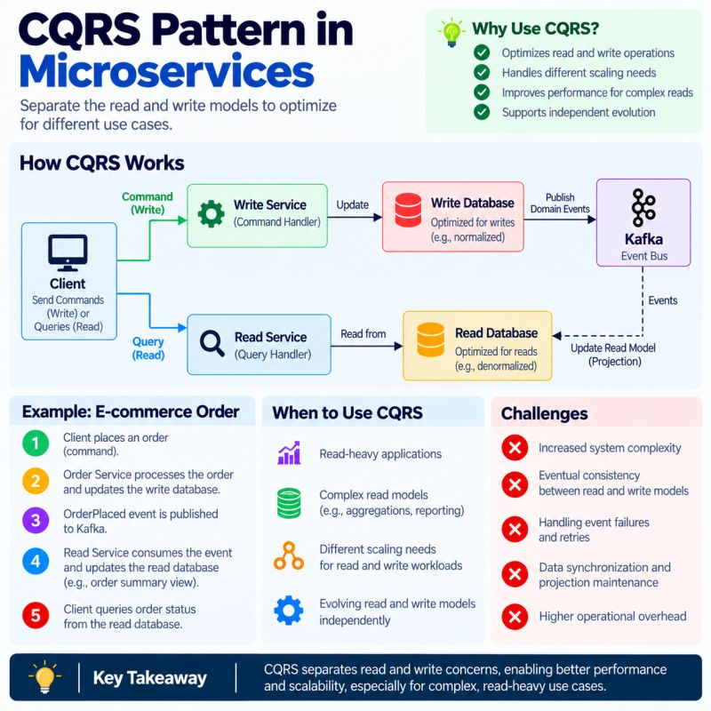

*Source: a LinkedIn post.*

> ⚠️ **Read this image with one note:** it shows Kafka events as the way the read database is updated. That is one option. A CDC tool or a scheduled batch job also works — see the sync table further below.

🎥 **Watch:** [What is CQRS Design Pattern](https://www.youtube.com/watch?v=NIYxiA_WDh4) (CodeOps Trek)

**② How it is deployed — one service, two roles:**

Each role is a separate Kubernetes Deployment, so each one **scales horizontally on its own**. For example: 1 write pod and 2 read pods.

```mermaid
graph TD
    GW[API Gateway]

    subgraph SVC["order-service — one codebase, one image, deployed twice"]
        W1["Write pod<br/>role = command"]
        R1["Read pod 1<br/>role = query"]
        R2["Read pod 2<br/>role = query"]
    end

    WDB[(Write DB)]
    RDB[(Read DB)]

    GW -->|POST / PUT / DELETE| W1
    GW -->|GET| R1
    GW -->|GET| R2
    W1 --> WDB
    WDB -.->|sync| RDB
    R1 --> RDB
    R2 --> RDB

    classDef purple fill:#7C3AED,stroke:#7C3AED,color:#fff
    classDef green fill:#059669,stroke:#059669,color:#fff
    classDef orange fill:#D97706,stroke:#D97706,color:#fff

    class GW orange
    class W1,WDB purple
    class R1,R2,RDB green
```

> 🟣 = write side, 🟢 = read side. The gateway sends each request to the right role by its HTTP method. The write DB and the read DB are kept in sync (the sync options are in the table further below).

```java
// Write side: loaded only when the "command" profile is active
@RestController
@Profile("command")
@RequestMapping("/orders")
public class OrderCommandController {

    private final OrderCommandService commandService;

    public OrderCommandController(OrderCommandService commandService) {
        this.commandService = commandService;
    }

    @PostMapping
    public OrderId placeOrder(@RequestBody PlaceOrder command) {
        return commandService.placeOrder(command);
    }
}

// Read side: loaded only when the "query" profile is active
@RestController
@Profile("query")
@RequestMapping("/orders")
public class OrderQueryController {

    private final OrderQueryService queryService;

    public OrderQueryController(OrderQueryService queryService) {
        this.queryService = queryService;
    }

    @GetMapping("/{id}")
    public OrderView getOrder(@PathVariable String id) {
        return queryService.findById(id);
    }
}
```

```yaml
# Two Kubernetes Deployments, same image, different role (shortened)
order-command:                         # write role
  image: order-service:1.4.0
  replicas: 1
  env: { SPRING_PROFILES_ACTIVE: command }

order-query:                           # read role
  image: order-service:1.4.0
  replicas: 2                          # an HPA can add more pods when read traffic grows
  env: { SPRING_PROFILES_ACTIVE: query }
```

**Why deploy it this way?**

- **Reads are usually much more frequent than writes** — often 10× to 100× more. With two roles you add read pods only, and you do not pay for extra write pods.
- **Each role scales on its own.** For example: 1 write + 2 read pods on a normal day, and 2 write + 10 read pods during a sale. Each Deployment has its own HPA.
- **A slow report on the read side cannot slow down order placement**, because the two roles run in different pods.

⚠️ **More write pods do not make writes faster beyond a point.** All write pods save to the **same** write database, so the database sets the limit. The read side scales much more easily: read pods can read from read replicas or a cache.

**This is only one way to run CQRS.** CQRS means *separate read and write models*. How you deploy them is a separate choice:

| Setup | What it looks like | When to use it |
|---|---|---|
| **A. One process, two models** | One deployment. Separate command and query classes, and maybe a separate read table | Start here. You get clean code and fast reads with no extra deployment |

All three are CQRS. Pick the simplest one that solves your real problem.

| Aspect | Traditional CRUD | CQRS |
|--------|-----------------|------|
| **Model** | Same model for reads and writes | Separate read and write models |
| **Database** | Single database | Can use different databases (write: SQL, read: Elasticsearch) |
| **Optimization** | ⚠️ Compromise between read/write performance | ✅ Each side optimized independently |
| **Complexity** | ✅ Simple | ❌️ Higher -- two models to maintain |
| **Consistency** | ✅ Strong (same DB) | ❌️ Eventual (async sync between write and read DBs) |
| **Scalability** | ❌️ Limited -- reads and writes contend | ✅ Scale reads and writes independently |

**When to Use CQRS:**

- ⚡ Read-heavy systems where read and write patterns are very different
- 📊 Complex queries that require denormalized/materialized views (e.g., dashboard, search)
- 🔄 When read model needs a different database (Elasticsearch for full-text search, Redis for caching)
- 📈 When reads and writes need to scale independently
- 👥 When different teams own the read path and the write path

**When NOT to Use CQRS:**

- 🛑 Simple CRUD applications
- 🛑 When strong consistency is a hard requirement
- 🛑 Small teams that cannot maintain the added complexity
- 🛑 When read and write load is about the same — there is nothing to scale separately

```java
// Command side
@Service
public class OrderCommandService {

    @Autowired private OrderRepository orderRepository;
    @Autowired private KafkaTemplate<String, OrderEvent> kafkaTemplate;

    @Transactional
    public Order createOrder(OrderRequest request) {
        Order order = orderRepository.save(Order.from(request));
        // Publish event for read side to consume.
        // ⚠️ Dual write (DB + Kafka, not atomic) — use the outbox (Q6.7) in real code.
        kafkaTemplate.send("order-events",
            new OrderCreatedEvent(order.getId(), order.getItems(), order.getTotal()));
        return order;
    }
}

// Query side
@Service
public class OrderQueryService {

    @Autowired private OrderReadRepository readRepository; // Elasticsearch

    public List<OrderView> searchOrders(String query) {
        return readRepository.search(query); // Optimized full-text search
    }
}

// Event consumer that syncs write → read
@Component
public class OrderEventConsumer {

    @Autowired private OrderReadRepository readRepository;

    @KafkaListener(topics = "order-events")
    public void handleOrderEvent(OrderCreatedEvent event) {
        OrderView view = OrderView.from(event);
        readRepository.save(view); // Update read model
    }
}
```

**The sync mechanism decides the lag:**

The code above syncs the read side with Kafka events. That is only **one** way. Streaming is not part of the definition of CQRS. *Separate read and write models* is the definition.

| Sync mechanism | Lag | Cost |
|---|---|---|
| **Change events** (Kafka, via an outbox — Q6.7) | Milliseconds to seconds | A consumer to run, and duplicate events to handle |
| **CDC** (Debezium reads the DB log) | Seconds | Debezium + Kafka Connect to run |
| **Batch / scheduled projection job** | The job interval (an hour, a day) | Simple. But the read model is stale between runs |

- Every option gives **eventual consistency**. A user may write and then not see the change on the read side.
- That is fine for dashboards, reports, and search.
- It is **not** fine for a "read-your-own-write" screen (the user expects to see what they just saved). Serve that screen from the write side.

📝 **Note — CQRS ≠ Event Sourcing.** People often combine them, but they are **independent** patterns:

- In Event Sourcing, you do not store the current state. You store all the events that led to it. This gives a full audit trail.
- CQRS over two plain relational tables is common, with no event sourcing. Event sourcing with a single model is also valid.
- People bundle them because an append-only event log is very hard to query. So event sourcing almost always needs a CQRS read model.
- Event sourcing has three costs that CQRS alone does not have (see Q6.8):
  - replay cost, so you need snapshots
  - schema changes for old events
  - no way to edit a bad event — you add a correcting event instead

⚠️ **"Rebuild the read model from events" — only if the events still exist.** If the events live only in Kafka, you can replay them only within the topic's **retention** period. The default is **7 days** (`log.retention.hours=168`). Older events are deleted. A full rebuild needs a compacted topic, tiered storage, infinite retention, or a real event store as the source.

🎯 **Interview Tip:** When you claim CQRS, be ready to name **the sync mechanism and its lag**. "Separate read model" is the easy half. The other half shows you have run one: *"It is updated by a daily batch job, so it can be a day stale. That is why no screen that shows a user's own change reads from it."*

---

</details>

---

4. **🔗 What is eventual consistency, and how do compensating transactions keep a saga correct when a step fails? 🔥**

<!-- -->
<details>
<summary>Answer</summary>

**Answer:**

The two ideas are linked:

1. Each service has its own database, so there is no ACID transaction across services.
2. So the system accepts **eventual consistency**: for a short time, the services disagree.
3. If a step fails halfway, waiting does not fix it. **Compensating transactions** undo the finished steps, so the services agree again.

**Part 1 — Eventual consistency**

**Eventual consistency** means: after a write, the copies of the data may disagree for a short time. If no new writes come in, all copies reach the same value. "Eventually" is a **delay** (the lag). It does not mean "maybe never".

| | Strong consistency | Eventual consistency |
|---|---|---|
| The read right after a write | Always sees the new value | May see the old value for a short time |
| Cost | Every write waits for locks or for all copies | Writes are fast, and services stay available |
| Example | One database, one ACID transaction | A read replica, a CQRS read model, a saga across services |

**Why microservices get it:** each service commits to its own database and tells the others with an event. Between "service A committed" and "service B processed the event", the two disagree.

The **CAP theorem** says that during a network partition, a distributed system must choose between Consistency and Availability. (People often say "pick two of three", but partitions are not optional.) Most microservices architectures choose Availability during a partition (AP) and accept eventual consistency.

**Where you meet it:**

| Place | What is behind | How far behind |
|---|---|---|
| Database read replica | The replica is behind the primary | Milliseconds to seconds, more under load |
| Cache (Redis) | The cached value is older than the database | Up to the TTL |
| CQRS read model (Q6.3) | The read database is behind the write database | Milliseconds (events) to a day (batch job) |
| Saga (Q6.1) | Some services are updated, others not yet | Until the last step, or the compensation, finishes |

**How long is "eventually"? Measure it — do not guess:**

- **Kafka consumers:** consumer lag — how many messages, or seconds, the consumer is behind.
- **Read replicas:** replication lag (in PostgreSQL, `replay_lag` in `pg_stat_replication`).
- **Batch read models:** the time since the last successful run.
- Alert when the lag is larger than the business accepts. This is a freshness SLO (Q7.10).

**The problem users notice — "my change is gone":**

A user saves a new address. The page reloads and reads from a replica that is 2 seconds behind. The old address appears. The user thinks the save failed and saves again. This is the **read-your-own-writes** problem.

| Fix | How it works |
|---|---|
| Read your own data from the write side | For a few seconds after a write, or always for the user's own records |
| Return the new state in the write response | The UI shows it without a second read |
| Version number | The write returns version 7. The read side retries until it has version 7 or newer |
| Show a pending state | "Payment processing…" instead of a wrong final answer |

⚠️ **Eventual consistency is a business decision, not only a technical one.** A balance on a dashboard can be a few seconds old. The balance you check before you allow a withdrawal cannot. That check must read the write side.

**Part 2 — Compensating transactions: how a saga still ends correct**

Eventual consistency assumes every step finally succeeds. If a step fails halfway, the services would stay in disagreement forever. Compensation brings them back to one correct state.

The earlier steps were committed local transactions, so you cannot "roll them back". Instead, you run **compensating transactions** that reverse their effect in business terms (a semantic reversal).

| Original Transaction | Compensating Transaction |
|---------------------|--------------------------|
| Create Order | Cancel Order (set status to CANCELLED) |
| Process Payment | Refund Payment |
| Reserve Inventory | Release Inventory |
| Send Confirmation Email | Send Cancellation Email |
| Debit Account | Credit Account |

🔑 **Key Points about Compensation:**

- 🔄 **It is a semantic reversal, not a delete.** A refund is a *new* record. The original payment stays in the history.
- ⚠️ **Some actions cannot be undone** (for example, an email that was already sent). Send a corrective action instead (a cancellation email).
- 📝 **It must be idempotent.** Retries may call it more than once — the code below returns early if the payment is already refunded.
- 🗄️ **Keep the saga state**, so you know which steps finished and need compensation.

```java
// Compensation for the payment step: refund
@Transactional
public void compensatePayment(Long paymentId) {
    Payment payment = paymentRepository.findById(paymentId)
        .orElseThrow(() -> new PaymentNotFoundException(paymentId));
    if (payment.getStatus() == PaymentStatus.REFUNDED) {
        return;  // already compensated — a retry must not refund twice
    }
    payment.setStatus(PaymentStatus.REFUNDED);
    paymentRepository.save(payment);
    // Remote call inside the transaction: if the commit fails after it, the money
    // is already refunded. Send an idempotency key so the gateway ignores a repeat.
    paymentGateway.refund(payment.getTransactionId(), payment.getAmount(),
        "refund-" + paymentId);
}
```

📌 **The full saga flow is in Q6.1:** the reverse order, the saga state, what to do when a compensation itself fails, and the portfolio-transfer example.

🧠 **In Simple Words:**
Eventual consistency is like a bank transfer between two banks. Your bank debits your account at once. The other bank credits the receiver a little later. For a short time, the two banks disagree — then they agree.

If the other bank rejects the transfer (for example, a wrong account number), your bank does not delete the debit. It adds a new credit entry that returns your money. That new entry is a compensating transaction.

🎯 **Interview Tip:** Say the chain in one breath: *"Each service has its own database, so we accept eventual consistency. We measure the lag and hide it from users where it matters. When a step fails, compensating transactions undo the finished steps, so the system still ends in one correct state."*

---

</details>

---

5. **🛒 Flash sale: Redis DECRBY succeeds but payment fails — how do you compensate idempotently? 🔥🔥**

<!-- -->
<details>
<summary>Answer</summary>

**Answer:**

This is the most common follow-up after the "use Redis DECR to prevent overselling" answer. The simple fix adds a new failure mode:

- Redis says the stock is reserved.
- Then the downstream payment/fraud check fails.
- Now the stock stays stuck at the decremented value forever.

**The failure scenario:**

```
1. User clicks Buy
2. Redis DECRBY(stock:iphone, 1)  → stock: 1 → 0  ✅ success
3. Payment service called
4. Payment FAILS (card declined / fraud / timeout)
5. Stock never restored
6. iPhone shows "Out of Stock" — but no one actually bought it ❌️
```

**The fix — Saga compensation with idempotent restore:**

```java
@Service
public class OrderSagaOrchestrator {

    private final RedisTemplate<String, String> redis;
    private final PaymentClient paymentClient;
    private final OrderRepository orderRepository;

    public OrderResult placeOrder(OrderRequest request) {
        String stockKey = "stock:" + request.getProductId();
        String compensationKey = "compensated:order:" + request.getIdempotencyKey();

        // Step 1 — Atomic inventory deduction via Lua (read-check-deduct)
        Long deducted = deductStock(stockKey, request.getQuantity());
        if (deducted == null || deducted == 0) {
            return OrderResult.outOfStock();
        }

        // Step 2 — Persist order in PENDING state (before payment)
        Order order = orderRepository.save(Order.pending(request));

        try {
            // Step 3 — Attempt payment
            PaymentResult payment = paymentClient.charge(order.getId(), request.getAmount());

            if (payment.isSuccess()) {
                order.markConfirmed(payment.getTransactionId());
                orderRepository.save(order);
                return OrderResult.confirmed(order.getId());
            } else {
                // Step 4a — Payment failed: compensate inventory
                compensateStock(stockKey, compensationKey, request.getQuantity());
                order.markFailed("Payment declined");
                orderRepository.save(order);
                return OrderResult.paymentFailed();
            }

        } catch (Exception e) {
            // Step 4b — Timeout or unexpected failure: the outcome is UNKNOWN.
            // The charge may have gone through, so do NOT restore stock here.
            // Leave the order PENDING. The reconciliation job below asks the
            // payment service and compensates only if the charge really failed.
            log.warn("Payment outcome unknown for order {}", order.getId(), e);
            return OrderResult.pending(order.getId());
        }
    }

    // Idempotent compensation — the compensationKey ensures INCRBY runs exactly once
    // even if this method is retried (network timeout, pod crash, etc.)
    private void compensateStock(String stockKey, String compensationKey, int quantity) {
        String luaScript = """
            if redis.call('EXISTS', KEYS[2]) == 1 then
                return 0  -- already compensated, skip
            end
            redis.call('INCRBY', KEYS[1], ARGV[1])
            redis.call('SET', KEYS[2], '1', 'EX', 86400)  -- mark done, TTL 24h
            return 1
            """;
        // KEYS[1] = stock key, KEYS[2] = compensation guard key
        // ARGV[1] = quantity to restore
        DefaultRedisScript<Long> script = new DefaultRedisScript<>(luaScript, Long.class);
        redis.execute(script,
            List.of(stockKey, compensationKey),
            String.valueOf(quantity));
    }
}
```

**Why the compensation itself must be idempotent:**

| Failure scenario | Without idempotency | With compensation guard key |
|---|---|---|
| Saga orchestrator crashes after DECRBY, restarts | Compensation runs twice → stock +2 for 1 failed order | Guard key exists → second INCRBY skipped |
| Network timeout on `compensateStock()`, retried | Double restore | Guard key exists → skipped |
| Kafka consumer processes compensation event twice | Double restore | Guard key exists → skipped |

<details>
<summary><strong>🤔 Doubt: Where exactly is the idempotency in this code — which part stops a double restore?</strong></summary>

Two parts work together. Neither one is enough alone.

**Part 1 — the guard key: "has this order already been compensated?"**

```java
String compensationKey = "compensated:order:" + request.getIdempotencyKey();
```

- This Redis key is a **marker**. If it exists, the stock for this order was already put back.
- It is built from the **order's idempotency key**, so it is the **same key on every retry** of the same order. A retry, a pod restart, or a duplicate Kafka event for order 42 all check the same marker.
- ❌️ If the key used a new random UUID on every call, each retry would see "not compensated yet" and restore the stock again. The protection would be gone.

**Part 2 — the Lua script: check and act as one step**

```lua
if redis.call('EXISTS', KEYS[2]) == 1 then   -- ① marker exists? already done
    return 0                                  --    -> skip, change nothing
end
redis.call('INCRBY', KEYS[1], ARGV[1])        -- ② put the stock back
redis.call('SET', KEYS[2], '1', 'EX', 86400)  -- ③ write the marker (kept 24 h)
return 1
```

- Redis runs a Lua script **as one unit**. No other command runs between ①, ② and ③.
- So "check the marker", "restore the stock" and "write the marker" happen together, or not at all.

**Why the script matters — the race without it:**

| Time | Retry A | Retry B |
|---|---|---|
| 1 | `EXISTS` → no marker | |
| 2 | | `EXISTS` → no marker |
| 3 | `INCRBY` stock +1 | |
| 4 | | `INCRBY` stock +1 ❌️ restored twice |

With three separate Redis calls, both retries pass the check before either one writes the marker. Inside one Lua script, Retry B runs only after Retry A has finished, so B sees the marker and skips.

**One limit to know:** the marker expires after 24 hours (`EX 86400`). A retry that arrives later than that would restore the stock again. Keep the TTL longer than your longest possible retry.

**A second guard in the reconciliation job:** `markFailedIfPending` (`UPDATE … WHERE status = 'PENDING'`) lets only **one** job run decide to compensate an order. So the database update stops two replicas from *deciding* to compensate, and the Redis marker stops the restore from being *applied* twice.

---

</details>
<br/>

**The complete flow with all failure modes handled:**

```
Happy path:   DECRBY → Payment OK  → Confirm order
Failure path: DECRBY → Payment FAIL → INCRBY (idempotent) → Mark order FAILED
Timeout path: DECRBY → Payment TIMEOUT → keep order PENDING → reconciliation job decides
Crash path:   DECRBY → Pod crashes  → On restart: check order status
                                       → if PENDING + no payment → compensate + mark FAILED
```

**Handling the crash path (order stuck in PENDING):**

```java
// Scheduled job — runs every 5 minutes.
// @SchedulerLock (ShedLock) so only ONE replica runs it: a plain @Scheduled
// method fires on every pod, and at replicas: 3 the reconciliation races itself.
@Scheduled(fixedDelay = 300_000)
@SchedulerLock(name = "reconcilePendingOrders",
               lockAtMostFor = "4m", lockAtLeastFor = "1m")
public void reconcilePendingOrders() {
    List<Order> stuckOrders = orderRepository
        .findByStatusAndCreatedAtBefore(OrderStatus.PENDING,
            Instant.now().minus(10, MINUTES));

    for (Order order : stuckOrders) {
        PaymentStatus status = paymentClient.queryStatus(order.getId());
        if (status == PaymentStatus.NOT_FOUND || status == PaymentStatus.FAILED) {
            // Claim the order first with a conditional update:
            // UPDATE orders SET status='FAILED' WHERE id=? AND status='PENDING'
            // If a late payment callback already moved it, 0 rows change → no compensation.
            int claimed = orderRepository.markFailedIfPending(order.getId());
            if (claimed == 1) {
                compensateStock("stock:" + order.getProductId(),
                    "compensated:order:" + order.getIdempotencyKey(),
                    order.getQuantity());
            }
        }
    }
}
```

<details>
<summary><strong>🤔 Doubt: Payment takes 2–3 minutes. During that time, do other users see the stock as 0?</strong></summary>

**Yes.** The `DECRBY` is a **reservation (a hold)**, not a sale. From that moment the unit belongs to this buyer until payment finishes. Every other user reads `stock = 0` for those 2–3 minutes.

**What happens to the hold:**

| Payment result | Stock | What other users see next |
|---|---|---|
| ✅ Success | Stays 0 | Sold out — for real |
| ❌️ Fails | `INCRBY` → 1 | The item comes back on sale |
| ⏳ No answer | Stays 0 until the reconciliation job runs (orders older than 10 min) | The item comes back later, if the payment never went through |

**Why this is correct, not a bug:**

- If the stock stayed at 1 during payment, a second user could also buy it.
- Then two people pay for one iPhone. One of them gets a refund and a bad experience.
- Showing 0 for a few minutes is the smaller problem.

**How to make it better for users:**

- 💡 **Show a different message.** Say *"All units are reserved — check back in a few minutes"*, not *"Sold out"*. To do this, keep a second counter (for example `held:iphone`). Then the page can tell "held" apart from "sold".
- ⏱️ **Give the buyer a timer.** Ticket-booking sites show a countdown (for example "complete payment in 10:00"). When it ends, the hold is released.

**The trade-off — how long should the hold last?**

| Hold too long | Hold too short |
|---|---|
| Buyers who left the page still block the stock | The hold ends while payment is still running |
| Real buyers see 0 and leave → lost sales | Stock goes back to 1 → a second buyer can take it → oversell |

⚠️ **Rule:** the hold must be **longer than the payment gateway's own timeout**. Otherwise a payment can succeed *after* you released the stock.

If a late success still arrives after the order is `FAILED`, the conditional update (`markFailedIfPending`) has already moved the order. The late payment cannot confirm it, so you **refund** that payment. You never sell the same unit twice.

🔑 **Interview line:** "The decrement is a reservation. Other users see 0 while payment runs — that is what stops overselling. I keep the hold time longer than the payment timeout, release it on failure, and show 'reserved' instead of 'sold out'."

---

</details>
<br/>

🔑 **Interview one-liner:** "Redis DECRBY prevents overselling, but compensation is equally critical. Payment can fail after the decrement. The fix: INCRBY as a Saga compensating step. A Redis idempotency key guards it, so retries and crashes don't double-restore. For crash recovery, a reconciliation job finds PENDING orders older than N minutes and compensates them."

**Cross-ref:** `03_Redis_Interview_Questions.md` — atomic Lua script for deductInventory · `17_Spring_Microservices_Interview_Questions.md` Q6.1 — Saga orchestration/choreography

---

</details>

---

6. **🚫 Why is Two-Phase Commit (2PC) problematic in microservices, and why is Saga preferred? 🔥**

<!-- -->
<details>
<summary>Answer</summary>

**Answer:**

**Two-Phase Commit (2PC)** is a distributed transaction protocol. It makes sure all participants either commit or rollback a transaction atomically. It has two phases:

- **Prepare** — all participants vote yes/no.
- **Commit** — the coordinator tells all of them to commit or rollback.

**Why 2PC is Problematic in Microservices:**

| Problem | Description |
|---------|-------------|
| **Blocking** | ❌️ All participants hold locks during the protocol, blocking other transactions |
| **Single Point of Failure** | ❌️ If the coordinator crashes after participants vote YES, they are stuck and keep their locks |
| **Latency** | ❌️ Synchronous protocol -- all participants must respond before commit |
| **Availability** | ❌️ If any participant is unavailable, the entire transaction fails |
| **Scalability** | ❌️ Does not scale well with many participants |
| **Heterogeneous DBs** | ❌️ Requires all databases to support XA transactions (not all NoSQL DBs do) |

**Why Saga is Preferred:**

| Aspect | 2PC | Saga |
|--------|-----|------|
| **Locking** | ❌️ Global locks across DBs | ✅ Local transactions, no distributed locks |
| **Availability** | ❌️ All participants must be up | ✅ Async -- tolerates temporary unavailability |
| **Performance** | ❌️ Slow -- synchronous coordination | ✅ Fast -- local commits + async events |
| **Database support** | ❌️ Requires XA-compatible DBs | ✅ Works with any database |
| **Consistency** | ✅ Strong consistency (ACID) | ⚠️ Eventual consistency |
| **Failure recovery** | Complex -- coordinator crash recovery | Compensating transactions |
| **Scalability** | ❌️ Poor -- contention grows with participants | ✅ Good -- each service is independent |

🧠 **In Simple Words:**
2PC is like a group photo where everyone must stay still at exactly the same time. If one person blinks, everyone has to start over. Saga is like a relay race. Each runner completes their part of the race independently. If someone drops the baton, the system reverses (compensates) the work of the earlier runners.

🎯 **Interview Tip:** Saga is preferred for most microservices use cases. But mention that 2PC is still useful in some cases, for example when you need strong consistency between two tightly coupled databases within a single service.

---

</details>

---

7. **📤 What is the Outbox pattern and how does it solve the dual-write problem? 🔥🔥**

<!-- -->
<details>
<summary>Answer</summary>

**Answer:**

The **Outbox pattern** solves the **dual-write problem**. This problem happens when a service needs to both update its database and publish an event to a message broker. If only one of the two operations fails, data can become inconsistent.

**The Dual-Write Problem:**

```
1. Service updates database   → SUCCESS
2. Service publishes to Kafka → FAILS (network issue)
Result: DB is updated but no event is published → other services are out of sync
```

Or worse:
```
1. Service publishes to Kafka → SUCCESS
2. Service updates database   → FAILS (DB error)
Result: Event is published but data is not persisted → phantom event
```

⚠️ **`@Transactional` does not protect you here.** The annotation covers only the database. A rollback cannot un-send a Kafka message. And a send that failed is not repeated when the transaction is retried.

```java
@Transactional
public void placeOrder(Order order) {
    orderRepository.save(order);              // ① DB commit
    kafkaTemplate.send("orders", event);      // ② network call — NOT in the transaction
}
```

**The Outbox Solution:**

The service does not publish directly to Kafka. Instead, it writes the event to an **outbox table**. It does this in the same database transaction as the business data. A separate process (CDC or poller) reads the outbox table and publishes events to Kafka.

```mermaid
graph TD
    SVC[Order Service] -->|1. Single Transaction| DB[(Database)]

    subgraph Transaction["Same DB Transaction"]
        T1["INSERT INTO orders (...)"]
        T2["INSERT INTO outbox (event_data)"]
        T1 --> T2
    end

    DB -->|2. CDC / Debezium| CDC[Change Data Capture]
    CDC -->|3. Publish events| KAFKA[Kafka]
    KAFKA -->|4. Consume| OTHER[Other Services]

    classDef purple fill:#7C3AED,stroke:#7C3AED,color:#fff
    classDef cyan fill:#0891B2,stroke:#0891B2,color:#fff
    classDef green fill:#059669,stroke:#059669,color:#fff
    classDef orange fill:#D97706,stroke:#D97706,color:#fff

    class SVC purple
    class DB cyan
    class CDC orange
    class KAFKA orange
    class OTHER green
    class T1,T2 purple
```

**Implementation:**

```java
// 1. Outbox table entity
@Entity
@Table(name = "outbox_events")
@Getter @Setter  // Lombok
public class OutboxEvent {
    @Id
    @GeneratedValue(strategy = GenerationType.IDENTITY)
    private Long id;

    private String aggregateType;  // e.g., "Order"
    private String aggregateId;    // e.g., order ID
    private String eventType;      // e.g., "OrderCreated"

    @Column(columnDefinition = "TEXT")
    private String payload;        // JSON event data

    private LocalDateTime createdAt;
    private boolean published;
}

// 2. Service writes business data + outbox event in same transaction
@Service
public class OrderService {

    @Autowired private OrderRepository orderRepository;
    @Autowired private OutboxRepository outboxRepository;
    @Autowired private ObjectMapper objectMapper;

    @Transactional  // Both writes in same transaction
    public Order createOrder(OrderRequest request) {
        // Business data
        Order order = orderRepository.save(Order.from(request));

        // Outbox event (same transaction)
        OutboxEvent event = new OutboxEvent();
        event.setAggregateType("Order");
        event.setAggregateId(order.getId().toString());
        event.setEventType("OrderCreated");
        try {
            // Jackson 2: writeValueAsString throws the CHECKED JsonProcessingException
            // (unchecked in Jackson 3 / Boot 4)
            event.setPayload(objectMapper.writeValueAsString(
                new OrderCreatedEvent(order.getId(), order.getItems())));
        } catch (JsonProcessingException e) {
            throw new IllegalStateException("Cannot serialize outbox payload", e);
        }
        event.setCreatedAt(LocalDateTime.now());
        event.setPublished(false);
        outboxRepository.save(event);

        return order;
    }
}
```

```java
// 3. Poller that publishes outbox events (alternative to CDC)
@Component
public class OutboxPoller {

    @Autowired private OutboxRepository outboxRepository;
    @Autowired private KafkaTemplate<String, String> kafkaTemplate;

    @Scheduled(fixedDelay = 1000)  // Poll every second
    @Transactional
    public void publishOutboxEvents() {
        // SKIP LOCKED + a batch limit: each replica claims a disjoint slice,
        // so running this on 3 pods does not publish every row 3 times.
        List<OutboxEvent> events = outboxRepository.claimUnpublishedBatch(100);

        for (OutboxEvent event : events) {
            // .join() waits for the broker ack, so a failed send is not marked published.
            // aggregateId is the record key → all events of one order go to one partition.
            kafkaTemplate.send(event.getAggregateType(), event.getAggregateId(),
                               event.getPayload()).join();
            event.setPublished(true);
            outboxRepository.save(event);
        }
    }
}

public interface OutboxRepository extends JpaRepository<OutboxEvent, Long> {

    @Query(value = """
            SELECT * FROM outbox_events
            WHERE published = false
            ORDER BY created_at
            LIMIT :limit
            FOR UPDATE SKIP LOCKED
            """, nativeQuery = true)
    List<OutboxEvent> claimUnpublishedBatch(@Param("limit") int limit);
}
```

⚠️ **The multi-replica trap (almost always a follow-up question).** A plain `@Scheduled` method runs on **every** replica. Suppose you deploy this at `replicas: 3`:

- All three pods poll the same table on the same one-second tick.
- Every outbox row gets published up to 3×.
- The pollers fight over the same rows.

Three standard fixes, from lightest to heaviest:

| Fix | How it works | When to use |
|---|---|---|
| **`SELECT … FOR UPDATE SKIP LOCKED`** | Each pod locks a disjoint batch; others skip locked rows | ✅ Default for outbox/queue tables when event order does not matter — no extra infra, and it *parallelises* rather than serialises. ⚠️ Breaks per-aggregate order (see below) |
| **ShedLock** | A shared lock row/key (JDBC, Redis, Mongo) that lets exactly one instance enter the method | Jobs that must run once globally (reports, reconciliation) |
| **Leader election** | Kubernetes lease or Spring Cloud Kubernetes leader; only the leader schedules | When a whole set of jobs should live on one instance |

The same trap applies to **any** `@Scheduled` job in this file. Two examples need one of the fixes above: the reconciliation job in Q6.5 and the idempotency-record cleanup mentioned in Q5.8.

⚠️ **`SKIP LOCKED` fixes duplicates, but it can break event order.**

- Pod 1 claims `OrderCreated` for order 42. Pod 2 skips that locked row and claims `OrderPaid` for the same order.
- Pod 2 may publish first. Now `OrderPaid` reaches Kafka before `OrderCreated`.
- Using `aggregateId` as the partition key does not save you. Kafka keeps order only in the order the events are **produced**. It cannot fix an order that was already wrong.

Fixes, when per-aggregate order matters:

| Fix | Trade-off |
|---|---|
| **A single relay** (ShedLock or leader election, from the table above) | Simple and ordered. Throughput is one poller |
| **Lock per aggregate** — a pod claims *all* pending rows of an aggregate, or rows are split by `hash(aggregate_id) % pods` | Ordered and parallel. More complex to build |
| **CDC (Debezium)** | Reads the DB log in commit order. No poller race at all |

**CDC vs Polling:**

| Approach | Pros | Cons |
|----------|------|------|
| **CDC (Debezium)** | ✅ Real-time, no polling overhead | ❌️ Requires CDC infrastructure setup |
| **Polling** | ✅ Simple to implement | ❌️ Latency (polling interval), DB load |

**The other half of the pattern — the idempotent consumer:**

The outbox gives **at-least-once** delivery, never exactly-once. The relay can publish a row and crash before it marks the row. You cannot avoid this: the publish and the mark are themselves a dual write. So the consumer must remove duplicates by **event id** (the outbox row id, or a UUID in the payload).

```java
@Transactional   // ONE local transaction for both writes
public void handle(OrderCreatedEvent e) {
    // INSERT INTO processed_events (event_id) ... ON CONFLICT (event_id) DO NOTHING
    int inserted = processedEvents.insertIfAbsent(e.eventId());
    if (inserted == 0) {
        return;                                  // duplicate → already handled
    }
    shipmentRepository.save(Shipment.from(e));   // business write
}
```

⚠️ **The `processed_events` insert must be in the same local transaction as the business write.** If they are two separate commits, the consumer has its own dual write:

- Mark first, then crash → the event is marked but never processed. It is lost.
- Process first, then crash → the event is processed but not marked. It runs twice.

One transaction makes "processed" and "marked" commit together, or not at all.

🧠 **In Simple Words:** You cannot make two systems commit together, so stop trying. Make it **one** commit plus a relay that can safely repeat. Then make the receiver accept duplicates safely.

🎯 **Interview Tip:** The Outbox pattern is a critical concept for senior-level interviews. Always mention that it guarantees **at-least-once delivery**. Then name *both* causes of duplicates:

1. The poller crashes after publishing but before marking the row as published.
2. Multiple replicas poll the same table without `SKIP LOCKED` or a distributed lock.

Consumers must be **idempotent** in both cases. Then add this line: *"exactly-once delivery across a network does not really exist. What exists is at-least-once delivery plus idempotent processing, which looks exactly-once from the outside."* Kafka's own "exactly-once semantics" means transactions **inside** Kafka (read-process-write between topics). It does not cover your database.

---

</details>

---

8. **📝 What is Event Sourcing and how does it complement CQRS? 🔥**

<!-- -->
<details>
<summary>Answer</summary>

**Answer:**

**Event Sourcing** is a persistence pattern. You do not store the current state of an entity. Instead, you store the **immutable sequence of events** that led to that state. You get the current state by replaying all events from the beginning (or from a recent snapshot).

🎥 **Watch:** [Event Sourcing Explained](https://www.youtube.com/watch?v=yFjzGRb8NOk) (Drawing Boxes)

**Traditional (State-Based) vs Event Sourcing:**

| Aspect | Traditional CRUD | Event Sourcing |
|--------|-----------------|----------------|
| **What is stored** | Current state snapshot | Immutable event log |
| **Update operation** | Overwrite existing record | Append new event |
| **History** | ❌️ Lost — only current state | ✅ Complete audit trail forever |
| **Temporal queries** | ❌️ Can't reconstruct past state | ✅ Replay to any point in time |
| **Debugging** | ❌️ Can't trace how we got here | ✅ Replay events to reproduce any state |
| **Complexity** | ✅ Simple | ❌️ Higher — event schema evolution is hard |
| **Storage** | ✅ Minimal | ❌️ Grows over time — archive old events (snapshots speed up replay; they do not save space) |

**Event Store Schema:**

```sql
-- Instead of: UPDATE orders SET status = 'SHIPPED' WHERE id = 1
-- You store the full history:
CREATE TABLE order_events (
    id            BIGINT AUTO_INCREMENT PRIMARY KEY,
    aggregate_id  VARCHAR(36) NOT NULL,  -- order ID
    event_type    VARCHAR(100) NOT NULL, -- OrderCreated, OrderShipped, etc.
    payload       JSON NOT NULL,
    version       INT NOT NULL,          -- for optimistic concurrency
    occurred_at   TIMESTAMP NOT NULL,
    UNIQUE (aggregate_id, version)       -- two writers cannot both save version N
);

-- Order #123 history:
-- OrderCreated      {"items": [...], "total": 5000}     version=1
-- PaymentProcessed  {"paymentId": "PAY-456"}            version=2
-- OrderShipped      {"trackingId": "TRK-789"}           version=3
```

**Implementation in Spring:**

```java
// Domain events
public record OrderCreated(String orderId, List<OrderItem> items,
                           BigDecimal total, LocalDateTime occurredAt) {}
public record OrderShipped(String orderId, String trackingId,
                           LocalDateTime occurredAt) {}

// Aggregate — state rebuilt by applying event history
public class Order {
    private String orderId;
    private OrderStatus status;
    private List<OrderItem> items;
    private BigDecimal total;

    public static Order reconstitute(List<Object> events) {
        Order order = new Order();
        events.forEach(order::apply);
        return order;
    }

    public void apply(Object event) {  // not private: the snapshot load() in the event store calls it
        if (event instanceof OrderCreated e) {
            this.orderId = e.orderId();
            this.items = e.items();
            this.total = e.total();
            this.status = OrderStatus.CREATED;
        } else if (event instanceof OrderShipped e) {
            this.status = OrderStatus.SHIPPED;
        }
    }
}

// Event store service
@Service
public class OrderEventStore {

    @Transactional
    public void append(String orderId, Object event, int expectedVersion) {
        int current = eventRepo.getLatestVersion(orderId);
        if (current != expectedVersion) {
            throw new ConcurrentModificationException(
                "Version conflict: expected " + expectedVersion + " found " + current);
        }
        eventRepo.save(new OrderEventRecord(orderId, event, expectedVersion + 1));
        // ⚠️ Dual write: the DB commit and the Kafka send are not atomic.
        // In real code, publish through the outbox (Q6.7) or CDC on the event table.
        kafkaTemplate.send("order-events", orderId, event); // Feed read model
    }

    public Order load(String orderId) {
        List<Object> events = eventRepo.findByOrderIdOrderByVersion(orderId);
        return Order.reconstitute(events);
    }
}
```

**Event Sourcing + CQRS Together:**

```mermaid
graph LR
    CMD[Command] --> ES[Event Store]
    ES -->|Publish events| K[Kafka]
    K -->|Project into read model| RM[Read DB - Elasticsearch / Redis]
    QRY[Query] --> RM
    ES -.->|Snapshot every N events| SNAP[Snapshot Store]

    classDef purple fill:#7C3AED,stroke:#7C3AED,color:#fff
    classDef cyan fill:#0891B2,stroke:#0891B2,color:#fff
    classDef green fill:#059669,stroke:#059669,color:#fff
    classDef orange fill:#D97706,stroke:#D97706,color:#fff

    class CMD,QRY orange
    class ES purple
    class K cyan
    class RM green
    class SNAP cyan
```

> ⚠️ The **event store** is the source of truth here, not Kafka. Kafka only carries the events. To rebuild a read model, replay from the event store. A Kafka topic keeps events only for its retention period (default **7 days**, `log.retention.hours=168`), unless it is compacted, uses tiered storage, or has infinite retention.

**Snapshots — Performance Optimization:**

Replaying 10,000 events to compute the current state is slow. So take a snapshot at regular intervals:

```java
// Snapshot every 100 events
if (event.version() % 100 == 0) {
    snapshotStore.save(new Snapshot(orderId, order.toJson(), event.version()));
}

// Load: use latest snapshot + only events after it
public Order load(String orderId) {
    Snapshot snap = snapshotStore.findLatest(orderId);
    if (snap == null) {  // no snapshot yet → full replay
        return Order.reconstitute(eventRepo.findByOrderIdOrderByVersion(orderId));
    }
    List<Object> recent = eventRepo.findByOrderIdAndVersionGreaterThan(
        orderId, snap.version());
    Order order = Order.fromSnapshot(snap);
    recent.forEach(order::apply);
    return order;
}
```

**When to Use Event Sourcing:**

- ✅ **Audit requirements** — fintech, compliance, healthcare (complete history is mandatory)
- ✅ **Temporal queries** — "What was the order status at 3 PM on 15 Jan?"
- ✅ **Event-driven architecture** — events are the natural integration contract between services
- ❌️ **Simple CRUD** — too much for basic entity management
- ❌️ **Teams new to eventual consistency** — hard to learn

🧠 **In Simple Words:**
Event sourcing is like a bank ledger. Your bank never stores "balance = ₹10,000". It records every debit and credit, and your balance is the sum of them. This gives you a complete history. You can also rebuild any past state.

🎯 **Interview Tip:** Always pair Event Sourcing with CQRS:

- The event store is append-only (write side).
- You build read models by projecting events into structures that are easy to query (Elasticsearch, Redis).

Mention the key costs:

- Event schema evolution is hard (you can't alter past events).
- Read model lag (eventual consistency) must be acceptable.

---

</details>

---

9. **🔗 What is the API Composition pattern and how do you handle cross-service queries? 🔥**

<!-- -->
<details>
<summary>Answer</summary>

**Answer:**

In a microservices architecture, each service owns its own database. You cannot JOIN across them.

Sometimes a client needs data from many services. For example, an order detail page needs order data, payment status, and shipping info. The **API Composition** pattern solves this:

- A composer calls the services in parallel.
- It merges the results into one response.

**The Problem:**

```
Client wants: { order + payment status + shipping info }

❌️ Cannot do: SELECT o.*, p.status, s.tracking
              FROM orders o
              JOIN payments p ON p.order_id = o.id
              JOIN shipments s ON s.order_id = o.id
              WHERE o.id = 123
              -- Each lives in a separate database!
```

**The Solution — API Composition:**

```mermaid
graph TD
    C[Client] --> COMP[API Composer]

    COMP -->|GET /orders/123| OS[Order Service]
    COMP -->|GET /payments?orderId=123| PS[Payment Service]
    COMP -->|GET /shipments?orderId=123| SS[Shipping Service]

    OS --> COMP
    PS --> COMP
    SS --> COMP
    COMP -->|Merged response| C

    classDef purple fill:#7C3AED,stroke:#7C3AED,color:#fff
    classDef cyan fill:#0891B2,stroke:#0891B2,color:#fff
    classDef green fill:#059669,stroke:#059669,color:#fff
    classDef orange fill:#D97706,stroke:#D97706,color:#fff

    class C orange
    class COMP purple
    class OS,PS,SS cyan
```

**Implementation — Parallel Calls with CompletableFuture:**

```java
@Service
public class OrderDetailComposer {

    @Autowired private OrderClient orderClient;
    @Autowired private PaymentClient paymentClient;
    @Autowired private ShippingClient shippingClient;
    @Autowired private Executor ioExecutor;  // own pool — not the shared commonPool

    public OrderDetailResponse getOrderDetail(String orderId) {
        // All three calls in parallel — total latency = slowest call, not sum.
        // orTimeout: one hung service cannot hang the whole request.
        CompletableFuture<OrderResponse> orderFuture = CompletableFuture
            .supplyAsync(() -> orderClient.getOrder(orderId), ioExecutor)
            .orTimeout(2, TimeUnit.SECONDS);

        CompletableFuture<PaymentResponse> paymentFuture = CompletableFuture
            .supplyAsync(() -> paymentClient.getByOrderId(orderId), ioExecutor)
            .orTimeout(2, TimeUnit.SECONDS);

        CompletableFuture<ShippingResponse> shippingFuture = CompletableFuture
            .supplyAsync(() -> shippingClient.getByOrderId(orderId), ioExecutor)
            .orTimeout(2, TimeUnit.SECONDS);

        return CompletableFuture.allOf(orderFuture, paymentFuture, shippingFuture)
            .thenApply(v -> OrderDetailResponse.builder()
                .order(orderFuture.join())
                .payment(paymentFuture.join())
                .shipping(shippingFuture.join())
                .build())
            .exceptionally(ex -> buildPartialResponse(orderFuture, paymentFuture, shippingFuture))
            .join();
    }

    // Graceful degradation — return partial data if one service fails
    private OrderDetailResponse buildPartialResponse(
            CompletableFuture<OrderResponse> o,
            CompletableFuture<PaymentResponse> p,
            CompletableFuture<ShippingResponse> s) {

        return OrderDetailResponse.builder()
            .order(getResult(o))
            .payment(getResult(p))
            .shipping(getResult(s))
            .partialResponse(true)
            .build();
    }

    private <T> T getResult(CompletableFuture<T> f) {
        try {
            return f.isDone() && !f.isCompletedExceptionally() ? f.get() : null;
        } catch (Exception e) {
            return null;
        }
    }
}
```

**API Composition vs CQRS Read Model:**

| Aspect | API Composition | CQRS Read Model |
|--------|----------------|-----------------|
| **Complexity** | ✅ Lower — compose at query time | ❌️ Higher — maintain separate read DB |
| **Data freshness** | ✅ Always fresh — real-time calls | ❌️ Eventual — async sync lag |
| **Query latency** | ⚠️ Slowest of the parallel calls | ✅ Pre-materialized — very fast |
| **Large result sets** | ❌️ Expensive — many parallel calls | ✅ Single optimized query |
| **Best for** | Single-record detail views | List views, search, dashboards |

**Backend for Frontend (BFF) Pattern:**

A **BFF** is a common next step after API Composition. It is a separate aggregation service for each client type:

```mermaid
graph LR
    WEB[Web App] --> BFF1[Web BFF]
    MOB[Mobile App] --> BFF2[Mobile BFF]
    BFF1 --> SVCS[Microservices]
    BFF2 --> SVCS

    classDef purple fill:#7C3AED,stroke:#7C3AED,color:#fff
    classDef cyan fill:#0891B2,stroke:#0891B2,color:#fff
    classDef green fill:#059669,stroke:#059669,color:#fff

    class WEB,MOB green
    class BFF1,BFF2 purple
    class SVCS cyan
```

- Mobile gets a small response that saves bandwidth. Web gets a richer one.
- Each BFF collects and formats data for its own client.
- So there is no over-fetching (getting more data than needed) or under-fetching (getting too little).

🧠 **In Simple Words:**
API Composition is like ordering from many stalls at a food court. You do not go to each stall yourself. One person (the composer) collects all items. They bring them to your table on a single tray.

🎯 **Interview Tip:** When asked about cross-service queries, compare both options:

- **API Composition** — simpler, always fresh, good for single-record views.
- **CQRS read model** — better for search/list queries, pre-materialized, eventual consistency.

The choice depends on the access pattern. Fresh single-record = composition. Large dataset with complex search = CQRS.

---

</details>

---

<a id="observability"></a>

## 7. Observability

1. **🔍 What is distributed tracing and how do you implement it with Micrometer Tracing and Zipkin? 🔥**

<!-- -->
<details>
<summary>Answer</summary>

**Answer:**

**Distributed tracing** tracks a request as it moves through many microservices. It gives you an end-to-end view of:

- the path the request takes
- the latency at each hop
- where failures happen

**Key Concepts:**

| Concept | Description |
|---------|-------------|
| **Trace** | A complete journey of a request across all services (identified by a unique Trace ID) |
| **Span** | A single unit of work within a trace (e.g., one service call). Each span has a unique Span ID |
| **Trace ID** | Unique identifier propagated across all services for one request |
| **Span ID** | Unique identifier for a single operation within a trace |
| **Parent Span ID** | Links child spans to their parent |

**Spring Boot 3+ uses Micrometer Tracing.** With the Brave bridge it exports traces to **Zipkin**. With the OpenTelemetry bridge it exports over OTLP (to Jaeger, Tempo, etc.). Then you see them in a UI.

⚠️ **Spring Cloud Sleuth has no Spring Boot 3 line.** It ended at Boot 2.x. Its instrumentation moved into Micrometer Tracing.

- If you say "we use Sleuth" and also claim a Boot 3 stack, the interviewer will notice the mistake at once.
- Say this instead: "Micrometer Tracing (formerly Sleuth in Boot 2.x)".

```mermaid
sequenceDiagram
    participant C as Client
    participant GW as API Gateway
    participant OS as Order Service
    participant PS as Payment Service
    participant IS as Inventory Service
    participant Z as Zipkin Server

    C->>GW: Request (no trace context)
    Note over GW: Generate TraceId=abc123, SpanId=span1
    GW->>OS: Forward (TraceId=abc123, SpanId=span2, ParentSpan=span1)
    OS->>PS: Call (TraceId=abc123, SpanId=span3, ParentSpan=span2)
    PS-->>OS: Response
    OS->>IS: Call (TraceId=abc123, SpanId=span4, ParentSpan=span2)
    IS-->>OS: Response
    OS-->>GW: Response
    GW-->>C: Response

    GW->>Z: Report spans (async)
    OS->>Z: Report spans (async)
    PS->>Z: Report spans (async)
    IS->>Z: Report spans (async)
```

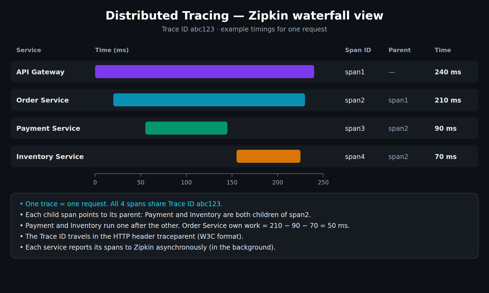

**Setup:**

```xml
<!-- Dependencies -->
<dependency>
    <groupId>io.micrometer</groupId>
    <artifactId>micrometer-tracing-bridge-brave</artifactId>
</dependency>
<dependency>
    <groupId>io.zipkin.reporter2</groupId>
    <artifactId>zipkin-reporter-brave</artifactId>
</dependency>
```

```yaml
# application.yml
management:
  tracing:
    sampling:
      probability: 1.0     # 1.0 = trace 100% of requests (use 0.1 in prod)
  zipkin:
    tracing:
      endpoint: http://localhost:9411/api/v2/spans

logging:
  pattern:
    level: "%5p [${spring.application.name},%X{traceId},%X{spanId}]"
```

**Log output with trace context:**

```
INFO [order-service,abc123def456,span789] c.e.OrderController : Processing order #42
INFO [payment-service,abc123def456,span101] c.e.PaymentController : Processing payment
```

The Trace ID `abc123def456` is the same in all services. So you can link the logs from different services for one request.

🔑 **Key Points:**

- 📡 Trace context (Trace ID, Span ID) travels automatically in HTTP headers (`traceparent` in W3C format)
- 📊 Zipkin UI shows a waterfall view of all spans in a trace. This shows you the latency bottlenecks
- ⚙️ In production, set sampling probability to 0.1 (10%) to reduce overhead
- 🔄 Micrometer Tracing automatically instruments Spring MVC, WebFlux, and `RestTemplate` / `WebClient` built from Spring's builders. Feign and JDBC need extra libraries (`feign-micrometer`, `datasource-micrometer`)

🎯 **Interview Tip:** Say that you use distributed tracing for more than debugging. You also use it to find:

- **latency bottlenecks** (which service is slow?)
- **dependency mapping** (which services call which?)

---

</details>

---

2. **🏷️ How do you implement correlation IDs across microservices? 🔥**

<!-- -->
<details>
<summary>Answer</summary>

**Answer:**

A **Correlation ID** is a unique identifier. The system:

- attaches it to every request when the request enters the system
- passes it on to all downstream service calls
- includes it in all log messages

It lets you trace one business transaction across all services.

Distributed tracing tools (Micrometer/Zipkin) give you Trace IDs automatically. But teams often use Correlation IDs as a **business-level identifier**. For example, the client passes it, or the API Gateway generates it.

**Implementation:**

```java
// 1. Gateway Filter to generate/propagate Correlation ID
@Component
public class CorrelationIdFilter implements GlobalFilter, Ordered {

    private static final String CORRELATION_ID_HEADER = "X-Correlation-Id";

    @Override
    public Mono<Void> filter(ServerWebExchange exchange, GatewayFilterChain chain) {
        String correlationId = exchange.getRequest().getHeaders()
            .getFirst(CORRELATION_ID_HEADER);

        if (correlationId == null) {
            correlationId = UUID.randomUUID().toString();
        }

        final String finalCorrelationId = correlationId;

        ServerHttpRequest request = exchange.getRequest().mutate()
            .header(CORRELATION_ID_HEADER, finalCorrelationId)
            .build();

        // Add the response header just before the response is committed.
        // After the chain ends, the headers are read-only.
        exchange.getResponse().beforeCommit(() -> {
            exchange.getResponse().getHeaders()
                .add(CORRELATION_ID_HEADER, finalCorrelationId);
            return Mono.empty();
        });

        return chain.filter(exchange.mutate().request(request).build());
    }

    @Override
    public int getOrder() {
        return -2; // Run before auth filter
    }
}
```

```java
// 2. Interceptor in downstream services to read Correlation ID
@Component
public class CorrelationIdInterceptor implements HandlerInterceptor {

    private static final String CORRELATION_ID_HEADER = "X-Correlation-Id";

    @Override
    public boolean preHandle(HttpServletRequest request,
                             HttpServletResponse response,
                             Object handler) {
        String correlationId = request.getHeader(CORRELATION_ID_HEADER);
        if (correlationId != null) {
            MDC.put("correlationId", correlationId);
        }
        return true;
    }

    @Override
    public void afterCompletion(HttpServletRequest request,
                                HttpServletResponse response,
                                Object handler, Exception ex) {
        MDC.remove("correlationId");
    }
}
```

```java
// 3. FeignClient interceptor to propagate Correlation ID
@Configuration
public class FeignInterceptorConfig {

    @Bean
    public RequestInterceptor correlationIdInterceptor() {
        return template -> {
            String correlationId = MDC.get("correlationId");
            if (correlationId != null) {
                template.header("X-Correlation-Id", correlationId);
            }
        };
    }
}
```

```yaml
# 4. Include correlation ID in log pattern
logging:
  pattern:
    console: "%d{yyyy-MM-dd HH:mm:ss} [%thread] %-5level [%X{correlationId}] %logger{36} - %msg%n"
```

**Log output:**

```
2026-03-21 10:15:30 [http-nio-8080-exec-1] INFO  [f47ac10b-58cc-4372-a567-0e02b2c3d479] OrderController - Order received
2026-03-21 10:15:31 [http-nio-9090-exec-3] INFO  [f47ac10b-58cc-4372-a567-0e02b2c3d479] PaymentController - Payment processed
```

🧠 **In Simple Words:**
A Correlation ID is like a tracking number for a package. The package may pass through many warehouses (services). The same tracking number stays with it. So you can trace its journey.

---

</details>

---

3. **📊 How do you set up centralized logging with the ELK stack in a microservices environment? ⚡**

<!-- -->
<details>
<summary>Answer</summary>

**Answer:**

The **ELK Stack** (Elasticsearch, Logstash, Kibana) gives microservices one central place to collect, search, and view logs.

| Component | Purpose |
|-----------|---------|
| **Elasticsearch** | Distributed search engine that stores and indexes log data |
| **Logstash** | Log pipeline -- collects, parses, transforms, and forwards logs to Elasticsearch |
| **Kibana** | Web UI for searching, visualizing, and creating dashboards from Elasticsearch data |
| **Filebeat** (optional) | Lightweight log shipper that forwards logs from services to Logstash |

**① Collection — a Filebeat sidecar per service tails stdout/log files:**

```mermaid
graph LR
    subgraph Services["Microservices"]
        S1[Order Service]
        S2[Payment Service]
        S3[Inventory Service]
    end

    S1 -->|stdout/file| FB1[Filebeat]
    S2 -->|stdout/file| FB2[Filebeat]
    S3 -->|stdout/file| FB3[Filebeat]

    classDef purple fill:#7C3AED,stroke:#7C3AED,color:#fff
    classDef cyan fill:#0891B2,stroke:#0891B2,color:#fff

    class S1,S2,S3 purple
    class FB1,FB2,FB3 cyan
```

**② Aggregation — all shippers send to Logstash, then to Elasticsearch and Kibana:**

```mermaid
graph LR
    FB1[Filebeat] --> LS[Logstash]
    FB2[Filebeat] --> LS
    FB3[Filebeat] --> LS

    LS -->|Parse and Transform| ES[(Elasticsearch)]
    ES --> KB[Kibana Dashboard]

    classDef cyan fill:#0891B2,stroke:#0891B2,color:#fff
    classDef green fill:#059669,stroke:#059669,color:#fff
    classDef orange fill:#D97706,stroke:#D97706,color:#fff

    class FB1,FB2,FB3 cyan
    class LS orange
    class ES green
    class KB green
```

> The 🔵 Filebeat nodes join the two diagrams. They end diagram ① (one shipper per service). They start diagram ② (all shippers send to a single Logstash pipeline).

**Spring Boot Logging Configuration:**

```xml
<!-- Logback Logstash Encoder dependency -->
<dependency>
    <groupId>net.logstash.logback</groupId>
    <artifactId>logstash-logback-encoder</artifactId>
    <version>7.4</version>
</dependency>
```

```xml
<!-- logback-spring.xml -->
<configuration>
    <!-- Logback cannot read Spring properties directly; springProperty copies one in -->
    <springProperty scope="context" name="appName" source="spring.application.name"/>

    <appender name="CONSOLE" class="ch.qos.logback.core.ConsoleAppender">
        <encoder>
            <pattern>%d{yyyy-MM-dd HH:mm:ss} [%thread] %-5level [%X{traceId},%X{spanId}] %logger{36} - %msg%n</pattern>
        </encoder>
    </appender>

    <appender name="LOGSTASH" class="net.logstash.logback.appender.LogstashTcpSocketAppender">
        <destination>localhost:4560</destination>  <!-- Logstash tcp input (json_lines); 5044 is the Beats port -->
        <encoder class="net.logstash.logback.encoder.LogstashEncoder">
            <customFields>{"service_name":"${appName}"}</customFields>
        </encoder>
    </appender>

    <root level="INFO">
        <appender-ref ref="CONSOLE"/>
        <appender-ref ref="LOGSTASH"/>
    </root>
</configuration>
```

**Key Practices for Microservices Logging:**

- 📝 Use **structured logging** (JSON format) for easy parsing by Logstash
- 🏷️ Include `service_name`, `traceId`, `spanId`, `correlationId` in every log entry
- ⚡ Use **async appenders** so that logging does not block your application threads
- 📊 Create Kibana dashboards for: error rates per service, latency percentiles, request volumes
- 🔍 Use Kibana filters to search by `traceId` and see all logs for a single request across services

📝 **Note:** In Kubernetes environments, many teams use **Fluentd** instead of Logstash. This gives the **EFK stack**: Elasticsearch + Fluentd + Kibana. Fluentd uses fewer resources than Logstash. Many teams go lighter still: they run **Fluent Bit** on each node as the log shipper.

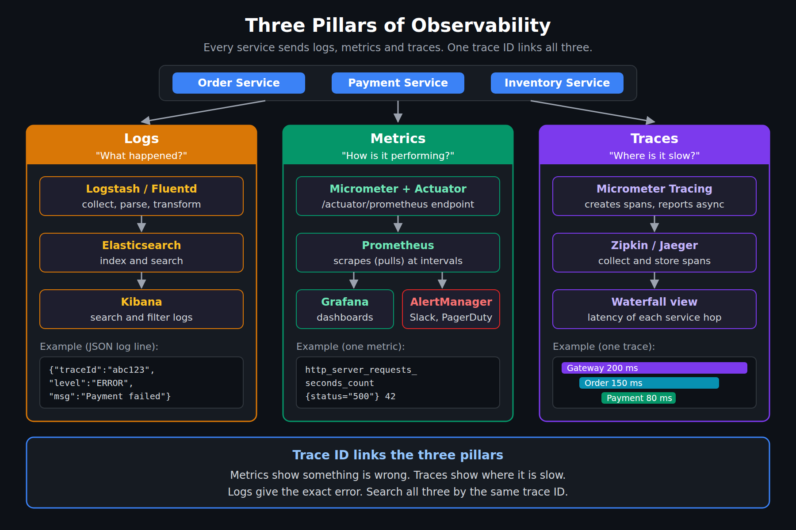

---

</details>

---

4. **📈 How do you implement metrics and monitoring with Prometheus and Grafana? ⚡**

<!-- -->
<details>
<summary>Answer</summary>

**Answer:**

- **Prometheus** scrapes (pulls) metrics from microservices at regular intervals.
- **Grafana** gives you rich dashboards to view them.
- Spring Boot Actuator with Micrometer exposes metrics in Prometheus format.

**Setup:**

```xml
<!-- Dependencies -->
<dependency>
    <groupId>org.springframework.boot</groupId>
    <artifactId>spring-boot-starter-actuator</artifactId>
</dependency>
<dependency>
    <groupId>io.micrometer</groupId>
    <artifactId>micrometer-registry-prometheus</artifactId>
</dependency>
```

```yaml
# application.yml
management:
  endpoints:
    web:
      exposure:
        include: health,info,prometheus,metrics
  endpoint:
    health:
      show-details: always
  metrics:
    tags:
      application: ${spring.application.name}
```

**Custom Business Metrics:**

```java
@Service
public class OrderService {

    private final Counter orderCounter;
    private final Timer orderProcessingTimer;
    private final Gauge activeOrdersGauge;

    private final OrderRepository orderRepository;

    public OrderService(MeterRegistry meterRegistry, OrderRepository orderRepository) {
        this.orderRepository = orderRepository;
        this.orderCounter = Counter.builder("orders.created.total")
            .description("Total number of orders created")
            .tag("service", "order-service")
            .register(meterRegistry);

        this.orderProcessingTimer = Timer.builder("orders.processing.duration")
            .description("Order processing duration")
            .tag("service", "order-service")
            .register(meterRegistry);

        this.activeOrdersGauge = Gauge.builder("orders.active.count",
                orderRepository, repo -> repo.countByStatus(OrderStatus.PROCESSING))
            .description("Number of orders currently being processed")
            .register(meterRegistry);
    }

    public OrderResponse createOrder(OrderRequest request) {
        return orderProcessingTimer.record(() -> {
            Order order = orderRepository.save(Order.from(request));
            orderCounter.increment();
            return OrderResponse.from(order);
        });
    }
}
```

**Prometheus scrapes the endpoint:** `GET http://order-service:8080/actuator/prometheus`

**Key Metrics to Monitor:**

| Metric Type | Examples |
|-------------|---------|
| **RED Metrics** | Rate (requests/sec), Errors (error rate), Duration (latency) |
| **JVM** | Heap memory, GC pauses, thread count |
| **HTTP** | Request count, response times, 4xx/5xx rates |
| **Circuit Breaker** | State (open/closed), failure rate, call count |
| **Custom Business** | Orders created, payments processed, active users |

🔑 **Four Golden Signals** (Google SRE):
1. **Latency** -- Time to serve a request
2. **Traffic** -- Requests per second
3. **Errors** -- Rate of failed requests
4. **Saturation** -- How full your service is (CPU, memory, threads)

---

</details>

---

5. **💚 How do health checks and readiness/liveness probes work in microservices? ⚡**

<!-- -->
<details>
<summary>Answer</summary>

**Answer:**

Health checks tell you if a microservice is running correctly. In Kubernetes and other container orchestration tools, **liveness** and **readiness** probes manage the service lifecycle automatically.

| Probe | Purpose | Failure Action |
|-------|---------|----------------|
| **Liveness** | "Is the service alive?" (not stuck/deadlocked) | ❌️ Kubernetes **restarts** the container |
| **Readiness** | "Can the service handle requests?" (fully initialized, dependencies available) | ⚠️ Kubernetes **removes from load balancer** (stops sending traffic) |
| **Startup** | "Has the service finished starting?" (for slow-starting apps) | ❌️ Kubernetes **restarts** if not ready within timeout |

**Spring Boot Actuator Health Endpoints:**

```yaml
management:
  endpoint:
    health:
      show-details: always
      probes:
        enabled: true      # Enables /actuator/health/liveness and /readiness
  health:
    livenessstate:
      enabled: true
    readinessstate:
      enabled: true
    # Built-in health indicators (already on by default)
    db:
      enabled: true
    diskspace:
      enabled: true
```

**Custom Health Indicator:**

```java
@Component
public class PaymentGatewayHealthIndicator implements HealthIndicator {

    @Autowired
    private PaymentGatewayClient paymentGateway;

    @Override
    public Health health() {
        try {
            boolean isReachable = paymentGateway.ping();
            if (isReachable) {
                return Health.up()
                    .withDetail("paymentGateway", "Reachable")
                    .withDetail("responseTime", "45ms")
                    .build();
            } else {
                return Health.down()
                    .withDetail("paymentGateway", "Not reachable")
                    .build();
            }
        } catch (Exception e) {
            return Health.down()
                .withException(e)
                .build();
        }
    }
}
```

**Kubernetes Deployment with Probes:**

```yaml
apiVersion: apps/v1
kind: Deployment
metadata:
  name: order-service
spec:
  replicas: 3
  template:
    spec:
      containers:
        - name: order-service
          image: order-service:latest
          ports:
            - containerPort: 8080
          livenessProbe:
            httpGet:
              path: /actuator/health/liveness
              port: 8080
            initialDelaySeconds: 30
            periodSeconds: 10
            failureThreshold: 3
          readinessProbe:
            httpGet:
              path: /actuator/health/readiness
              port: 8080
            initialDelaySeconds: 15
            periodSeconds: 5
            failureThreshold: 3
          startupProbe:
            httpGet:
              path: /actuator/health/liveness
              port: 8080
            initialDelaySeconds: 10
            periodSeconds: 5
            failureThreshold: 30     # 10s + 30 * 5s = up to ~160s startup time
```

🧠 **In Simple Words:**
- **Liveness:** "Are you alive?" -- If the app is stuck in an infinite loop or deadlocked, restart it
- **Readiness:** "Are you ready for work?" -- The app may be alive but still connecting to the database or loading data into caches (warming caches). If so, do not send traffic yet
- **Startup:** "Have you finished booting?" -- For apps that take a long time to start, do not check liveness until startup completes

---

</details>

---

6. **🔭 What are the three pillars of observability and how do logs, metrics, and traces differ? 🔥🔥**

<!-- -->
<details>
<summary>Answer</summary>

**Answer:**

**Observability** is the ability to understand the internal state of a distributed system from its external outputs. The three pillars are **Logs**, **Metrics**, and **Traces**. Together they give you a complete picture of how the system behaves.

| Pillar | What It Is | What It Answers | Spring Boot Tool |
|--------|-----------|----------------|----------------|
| **Logs** | Timestamped records of discrete events | "What happened?" — events, errors, stack traces | Logback + SLF4J → ELK / Grafana Loki |
| **Metrics** | Numerical measurements aggregated over time | "How is it performing?" — latency, throughput, error rate | Micrometer → Prometheus + Grafana |
| **Traces** | End-to-end record of a single request across services | "Where is it slow?" — which span is the bottleneck | Micrometer Tracing → Zipkin / Jaeger |

```mermaid
graph TD
    subgraph Pillars["Three Pillars of Observability"]
        L["📝 Logs<br/>What happened?"]
        M["📊 Metrics<br/>How is it performing?"]
        T["🔍 Traces<br/>Where is it slow?"]
    end

    L --> ELK[ELK Stack / Loki]
    M --> PROM[Prometheus + Grafana]
    T --> ZIP[Zipkin / Jaeger]

    classDef purple fill:#7C3AED,stroke:#7C3AED,color:#fff
    classDef cyan fill:#0891B2,stroke:#0891B2,color:#fff
    classDef green fill:#059669,stroke:#059669,color:#fff
    classDef orange fill:#D97706,stroke:#D97706,color:#fff

    class L purple
    class M cyan
    class T green
    class ELK,PROM,ZIP orange
```

**How They Work Together — Typical Incident Investigation:**

```
1. 🚨 Metric alert fires: "Payment service error rate > 5%" (Grafana)
   → Dashboard shows spike at 14:32

2. 🔍 Check traces in Zipkin: filter by service=payment, time=14:32
   → Trace shows P95 latency jumped from 200ms → 8s
   → Slow span identified: PaymentRepository.findByOrderId()

3. 📝 Search logs in Kibana: traceId=abc123
   → "HikariPool connection timeout — pool exhausted"
   → Root cause: maxPoolSize=5, traffic spike exhausted all connections
```

Metrics tell you *something is wrong*. Traces tell you *where*. Logs tell you *why*.

**Log Level Guidelines:**

| Level | Use For |
|-------|---------|
| `ERROR` | Unexpected failures requiring investigation (DB down, NPE) |
| `WARN` | Expected failures / degraded behaviour (retry attempt, CB open, validation fail) |
| `INFO` | Significant business events (order created, payment processed) |
| `DEBUG` | Diagnostic details — disabled in production |
| `TRACE` | Very granular flow — disabled in production |

**Metrics — The RED Method:**

Every service should expose at least these three. In Spring Boot you get all three for free: Actuator + Micrometer record every HTTP request in the built-in `http.server.requests` timer.

| RED | PromQL on the built-in timer |
|---|---|
| **R**ate | `sum(rate(http_server_requests_seconds_count[5m]))` |
| **E**rrors | `sum(rate(http_server_requests_seconds_count{status=~"5.."}[5m]))` |
| **D**uration | `histogram_quantile(0.95, sum by (le) (rate(http_server_requests_seconds_bucket[5m])))` |

Do not hand-write counters for these. They would only duplicate the built-in timer. Write custom meters for **business** events instead (see Q7.4).

**Traces — Key Concepts:**

| Concept | Description |
|---------|-------------|
| **Trace** | Complete journey of one request across all services (one unique Trace ID) |
| **Span** | Single unit of work within a trace (one service call, one DB query) |
| **Trace ID** | Propagated via HTTP headers across all services |
| **Sampling** | 100% in dev, 10% in production (to reduce overhead) |

🧠 **In Simple Words:**
- **Metrics** = car dashboard (speed, fuel, temperature — aggregated numbers)
- **Logs** = trip journal (specific events at specific times)
- **Traces** = GPS route (the full path, showing exactly which road was slow)

🎯 **Interview Tip:** Build your observability answer around all three pillars. "Metrics alert us that something is wrong, traces show us where the bottleneck is, and logs give us the specific error. We use Prometheus + Grafana for metrics, Micrometer Tracing + Zipkin for traces, and ELK for logs — all correlated via Trace ID."

---

</details>

---

7. **📡 What is OpenTelemetry and how does it relate to Micrometer Tracing in Spring Boot? ⚡**

<!-- -->
<details>
<summary>Answer</summary>

**Answer:**

**OpenTelemetry (OTel)** is a vendor-neutral, open-source observability framework. It sets one standard for how applications collect and export metrics, logs, and traces. It is the CNCF standard that replaces vendor-specific agents. Your application code stays the same, whether you export to Zipkin, Jaeger, Datadog, or Grafana Tempo.

**Spring Boot Observability Stack:**

```mermaid
graph TD
    APP[Spring Boot App] -->|Instrumented via| MICRO[Micrometer API]
    MICRO -->|Tracing bridge| OT[OpenTelemetry / Brave]
    OT -->|OTLP or Zipkin format| BACKEND{Backend}

    BACKEND --> ZIPKIN[Zipkin]
    BACKEND --> JAEGER[Jaeger]
    BACKEND --> DD[Datadog]
    BACKEND --> TEMPO[Grafana Tempo]

    classDef purple fill:#7C3AED,stroke:#7C3AED,color:#fff
    classDef cyan fill:#0891B2,stroke:#0891B2,color:#fff
    classDef green fill:#059669,stroke:#059669,color:#fff
    classDef orange fill:#D97706,stroke:#D97706,color:#fff

    class APP orange
    class MICRO purple
    class OT cyan
    class BACKEND cyan
    class ZIPKIN,JAEGER,DD,TEMPO green
```

| Feature | Micrometer | OpenTelemetry |
|---------|-----------|--------------|
| **Purpose** | Application metrics (counters, timers, gauges) | Metrics + Traces + Logs — unified standard |
| **Scope** | JVM-focused | Vendor-neutral, all languages |
| **Tracing** | Via `micrometer-tracing` bridge | Native distributed tracing |
| **Spring integration** | ✅ Native — Spring Boot auto-configures it | ✅ Via `micrometer-tracing-bridge-otel` |
| **Backends** | Prometheus, Datadog, CloudWatch, etc. (Grafana only shows the data) | Zipkin, Jaeger, Datadog, Grafana Tempo, etc. |

**Setup — OpenTelemetry with Spring Boot 3:**

```xml
<!-- Option A: OpenTelemetry bridge (modern, recommended for new projects) -->
<dependency>
    <groupId>io.micrometer</groupId>
    <artifactId>micrometer-tracing-bridge-otel</artifactId>
</dependency>
<dependency>
    <groupId>io.opentelemetry</groupId>
    <artifactId>opentelemetry-exporter-otlp</artifactId>
</dependency>

<!-- Option B: Brave/Zipkin bridge (legacy, widely used) -->
<dependency>
    <groupId>io.micrometer</groupId>
    <artifactId>micrometer-tracing-bridge-brave</artifactId>
</dependency>
<dependency>
    <groupId>io.zipkin.reporter2</groupId>
    <artifactId>zipkin-reporter-brave</artifactId>
</dependency>
```

```yaml
# application.yml — export via OTLP
management:
  tracing:
    sampling:
      probability: 0.1      # 10% in production
  otlp:
    tracing:
      endpoint: http://otel-collector:4318/v1/traces
```

**OTel Collector — Route to Multiple Backends:**

```yaml
# otel-collector-config.yaml
receivers:
  otlp:
    protocols:
      http:
        endpoint: 0.0.0.0:4318

exporters:
  otlp/jaeger:              # Jaeger takes OTLP natively; the old `jaeger` exporter was removed
    endpoint: jaeger:4317
    tls:
      insecure: true
  datadog:
    api:
      key: ${DD_API_KEY}

service:
  pipelines:
    traces:
      receivers: [otlp]
      exporters: [otlp/jaeger, datadog]   # Fan out to both backends
```

🔑 **Why OpenTelemetry Matters:**

- 🔓 **Avoids vendor lock-in** — switch from Zipkin to Datadog by changing only config, not application code
- 🌍 **Polyglot** — Java, Go, Python, Node.js all use the same OTel standard
- 📦 **Auto-instrumentation** — OTel Java agent instruments Spring MVC, JDBC, Kafka, FeignClient automatically, with no code changes
- 🔄 **Future-proof** — OpenTelemetry is the CNCF-backed industry standard. It replaces all the separate vendor agents

🎯 **Interview Tip:** At Tier-1 product companies, the observability backend is usually one of two things:
- a commercial tool (Datadog, New Relic), or
- a self-hosted Grafana stack (Prometheus + Loki + Tempo).

The key value of OpenTelemetry: your application code and instrumentation stay the same for any backend you choose. Only the exporter config changes.

---

</details>

---

8. **🚨 How do you set up alerting with Prometheus AlertManager? 🔥**

<!-- -->
<details>
<summary>Answer</summary>

**Answer:**

**Prometheus AlertManager** handles the alerts that Prometheus creates from metric threshold rules. When a metric crosses a threshold, Prometheus fires an alert to AlertManager. AlertManager then removes duplicate alerts and groups the rest. It routes the notifications to Slack, PagerDuty, email, etc.

**The Alerting Pipeline:**

```mermaid
graph LR
    APP[Spring Boot Service] -->|/actuator/prometheus| PROM[Prometheus]
    PROM -->|Evaluate rules| RULE{Alert Rules}
    RULE -->|Threshold exceeded| AM[AlertManager]
    AM --> SLACK[Slack - Warning]
    AM --> PD[PagerDuty - Critical]

    classDef purple fill:#7C3AED,stroke:#7C3AED,color:#fff
    classDef cyan fill:#0891B2,stroke:#0891B2,color:#fff
    classDef green fill:#059669,stroke:#059669,color:#fff
    classDef orange fill:#D97706,stroke:#D97706,color:#fff
    classDef red fill:#DC2626,stroke:#DC2626,color:#fff

    class APP cyan
    class PROM purple
    class RULE purple
    class AM orange
    class SLACK green
    class PD red
```

**1. Prometheus Alert Rules:**

```yaml
# prometheus-rules.yml
groups:
  - name: microservices-alerts
    rules:

      - alert: HighErrorRate
        expr: |
          sum by (application) (rate(http_server_requests_seconds_count{status=~"5.."}[5m]))
          /
          sum by (application) (rate(http_server_requests_seconds_count[5m])) > 0.05
        for: 2m      # Must be true for 2 min before firing (prevents flapping)
        labels:
          severity: critical
        annotations:
          summary: "High error rate on {{ $labels.application }}"
          description: "Error rate is {{ $value | humanizePercentage }}"

      - alert: HighLatency     # needs management.metrics.distribution.percentiles-histogram.http.server.requests=true
        # sum by (le, application): one P95 per service. Without it you get one P95
        # (and one alert) per instance, URI and status code.
        expr: |
          histogram_quantile(0.95,
            sum by (le, application) (rate(http_server_requests_seconds_bucket[5m]))) > 1
        for: 5m
        labels:
          severity: warning
        annotations:
          summary: "P95 latency > 1s on {{ $labels.application }}"

      - alert: CircuitBreakerOpen
        expr: resilience4j_circuitbreaker_state{state="open"} == 1
        for: 1m
        labels:
          severity: critical
        annotations:
          summary: "Circuit breaker open: {{ $labels.name }}"

      - alert: ServiceDown
        expr: up{job="microservice"} == 0
        for: 1m
        labels:
          severity: critical
        annotations:
          summary: "Service {{ $labels.instance }} is down"
```

**2. AlertManager Configuration:**

```yaml
# alertmanager.yml
global:
  resolve_timeout: 5m

route:
  group_by: ['alertname', 'application']
  group_wait: 30s          # Wait to batch related alerts together
  group_interval: 5m
  repeat_interval: 4h      # Re-notify if still firing after 4h
  receiver: slack-warning

  routes:
    - matchers:              # `match:` is deprecated
        - severity="critical"
      receiver: pagerduty-critical

receivers:
  - name: slack-warning
    slack_configs:
      - channel: '#alerts-warning'
        title: '{{ .GroupLabels.alertname }}'
        text: '{{ range .Alerts }}{{ .Annotations.description }}{{ end }}'
        send_resolved: true

  - name: pagerduty-critical
    pagerduty_configs:
      - routing_key_file: /etc/alertmanager/secrets/pagerduty-key   # Alertmanager does NOT expand ${ENV} variables
        severity: critical

inhibit_rules:
  # Suppress warning when critical is already firing for the same service
  - source_matchers:        # `source_match` / `target_match` are deprecated
      - severity="critical"
    target_matchers:
      - severity="warning"
    equal: ['application']
```

**Essential Alerts for Every Microservice:**

| Alert | Threshold | Severity |
|-------|-----------|---------|
| Error rate | > 1% (warn), > 5% (critical) | Warning / Critical |
| P95 latency | > 1s (warn), > 3s (critical) | Warning / Critical |
| Service instance down | Any instance | Critical — immediate |
| Circuit breaker open > 1 min | Any CB | Critical |
| DLQ messages accumulating | Consumer lag growing | Warning |
| JVM heap usage | > 85% (warn), > 95% (critical) | Warning / Critical |
| DB connection pool > 80% | Pool use | Warning |

For user-facing endpoints, fixed thresholds like "> 5% errors" are the simple version. The stronger version alerts on how fast the **error budget** is being spent — see Q7.10.

🔑 **Alert Tuning Concepts:**

| Concept | Purpose |
|---------|---------|
| `for` duration | Stops alerts on short, temporary spikes — alert only if the condition stays true |
| `group_wait` | Puts related alerts that fire at the same time into one notification |
| `inhibit_rules` | Hide low-severity alerts when a higher-severity alert covers the same issue |
| `repeat_interval` | Prevents alert fatigue (people start to ignore too many alerts) — re-notify only every few hours if still firing |

🎯 **Interview Tip:** Don't just say "we use Prometheus and Grafana." Explain the pipeline: metric scraped → rule evaluated → alert fired → AlertManager groups and routes → on-call notified. Also mention:
- the `for` clause, which prevents false positives from short, temporary spikes
- `inhibit_rules`, which prevent alert storms (many alerts at once for one problem)

---

</details>

---

9. **📋 What are logging best practices for production microservices? ⚡**

<!-- -->
<details>
<summary>Answer</summary>

**Answer:**

Logging in microservices needs stricter rules than logging in monoliths. The logs are spread across many services. You must collect them in one place, search them, and link them together. Poor practices lead to one of two problems when you debug an incident: too many logs, or missing context.

**1. Use Structured Logging (JSON):**

```xml
<!-- logback-spring.xml — JSON output for ELK ingestion -->
<configuration>
    <springProperty scope="context" name="appName" source="spring.application.name"/>
    <springProperty scope="context" name="activeProfile" source="spring.profiles.active"/>

    <appender name="JSON" class="ch.qos.logback.core.ConsoleAppender">
        <encoder class="net.logstash.logback.encoder.LogstashEncoder">
            <customFields>
                {"service": "${appName}", "env": "${activeProfile}"}
            </customFields>
        </encoder>
    </appender>

    <root level="INFO">
        <appender-ref ref="JSON"/>
    </root>
</configuration>
```

JSON log (machine-parseable, ELK can index every field):
```json
{
  "timestamp": "2026-04-25T10:30:00Z",
  "level": "INFO",
  "service": "payment-service",
  "traceId": "abc123",
  "correlationId": "f47ac10b",
  "message": "Payment processed orderId=ORD-123 amount=5000"
}
```

**2. Always Include Request Context via MDC:**

```java
@Component
public class MdcContextFilter extends OncePerRequestFilter {   // not "RequestContextFilter": Spring Boot already registers a bean with that name

    @Override
    protected void doFilterInternal(HttpServletRequest request,
                                    HttpServletResponse response,
                                    FilterChain chain) throws IOException, ServletException {
        try {
            MDC.put("correlationId", getOrGenerate(request, "X-Correlation-Id"));
            MDC.put("userId", extractUserId(request));
            chain.doFilter(request, response);
        } finally {
            MDC.clear();  // MUST clear — threads are reused in pools
        }
    }
}
```

**3. Log Level per Environment:**

```yaml
# application.yml — production
logging:
  level:
    root: WARN
    com.example: INFO
    org.hibernate.SQL: WARN       # Never log SQL in prod (PII risk + noise)

# application-dev.yml
logging:
  level:
    com.example: DEBUG
    org.hibernate.SQL: DEBUG
    org.hibernate.orm.jdbc.bind: TRACE   # bind values (Hibernate 6; was org.hibernate.type.descriptor.sql in 5)
```

**4. What NEVER to Log (Security):**

```java
// ❌️ NEVER log these
log.info("Login: user={} password={}", username, password);   // Credentials
log.debug("Card: {}", creditCard);                            // PAN / CVV
log.info("JWT: {}", token);                                   // Auth tokens
log.info("Request body: {}", body);                           // May contain PII

// ✅ Log these instead
log.info("Login attempt userId={}", userId);
log.info("Payment processed cardLast4={} amount={}", card.getLast4(), amount);
log.info("Token validated userId={}", claims.getSubject());
```

**5. Log at the Right Level:**

```java
public OrderResponse createOrder(OrderRequest request) {

    log.info("Creating order customerId={} items={}",
        request.getCustomerId(), request.getItems().size());  // INFO: business event

    try {
        Order saved = orderRepository.save(Order.from(request));
        log.info("Order created orderId={} total={}", saved.getId(), saved.getTotal());
        return OrderResponse.from(saved);

    } catch (InventoryException e) {
        log.warn("Insufficient inventory orderId={} productId={}",
            request.getId(), e.getProductId());   // WARN: expected failure
        throw e;

    } catch (Exception e) {
        log.error("Failed to create order customerId={}",
            request.getCustomerId(), e);           // ERROR: unexpected — pass exception last for stack trace
        throw new OrderProcessingException(e);
    }
}
```

**Logging Checklist:**

| Practice | Why |
|----------|-----|
| ✅ Write to stdout | Container orchestrators (K8s) collect stdout automatically |
| ✅ Include service name | Identify source in aggregated log search |
| ✅ Include traceId + correlationId | Correlate across services for one request |
| ✅ Use async appender in production | Stops logging from blocking request threads |
| ✅ Set log retention policy | 30 days is typical — don't keep forever |
| ❌️ Never log in tight loops | Creates too many logs and hides the important ones |
| ❌️ Never swallow exceptions silently | `catch(e) { log.error("failed"); }` loses stack trace |
| ❌️ Never log PII / credentials | Compliance and security violation |

🧠 **In Simple Words:**
Good logging in microservices is like leaving marks along a path, so you can follow the path later. Each mark:
- has enough context (traceId, userId, service)
- has the right level of detail (not too many, not too few)
- never reveals secrets (no credentials or PII — personal data about users)

---

</details>

---

10. **🎯 What are SLIs, SLOs and error budgets, and how do you alert on them? 🔥**

<!-- -->
<details>
<summary>Answer</summary>

**Answer:**

These three ideas come from Google SRE. They turn "is the service reliable enough?" into a number that engineering and product agree on.

| Term | Meaning | Example |
|---|---|---|
| **SLI** (indicator) | A measured number about what users feel | Share of `POST /payments` calls that return a non-5xx response within 500 ms |
| **SLO** (objective) | The target for that SLI over a time window | 99.9% of calls are good, over 30 days |
| **Error budget** | What the SLO allows to fail: 100% − SLO | 0.1% of calls — about **43 minutes** of full outage in 30 days |

An **SLA** is different. It is a contract with customers, with a penalty when it is missed. Set the SLA looser than your internal SLO, so you see problems before the customer contract is at risk.

**How to choose SLIs:**

- Measure from the **user's side**, ideally at the gateway or load balancer. A pod that is "up" but returns errors is not good service.
- **Availability:** good requests ÷ all requests.
- **Latency:** the share of requests faster than a threshold (for example, 95% under 300 ms). Do not use the average — it hides the slow tail.
- **Async work** (Kafka consumers, batch jobs): freshness — how old the oldest unprocessed item is.

**Why fixed thresholds are weak (Q7.8 uses one):**

Take an SLO of 99.9%. The error budget is 0.1%.

| What happens | Threshold alert "> 5% for 2 m" | Effect on the 30-day budget |
|---|---|---|
| 4% errors for a whole day | ❌️ Never fires | 40× too fast — the month's budget is gone in about **18 hours** |
| 6% errors for 3 minutes | ✅ Pages someone at night | Uses well under **1%** of the month's budget |

The threshold misses the real problem and pages for a small one.

**Burn-rate alerts — the better way:**

- **Burn rate** = how fast you spend the budget. A burn rate of 1 uses exactly the whole budget in 30 days. A burn rate of 10 uses it in 3 days.
- Alert when the burn rate is high over **two windows at once**:
  - The **long** window proves the problem is big enough to matter.
  - The **short** window proves it is still happening. So the alert clears soon after you fix it.

The usual starting values (Google SRE Workbook, 30-day SLO):

| Burn rate | Long window | Short window | Budget used | Action |
|---|---|---|---|---|
| 14.4 | 1 h | 5 m | 2% in 1 hour | Page |
| 6 | 6 h | 30 m | 5% in 6 hours | Page |
| 1 | 3 days | 6 h | 10% in 3 days | Ticket |

```yaml
# Fast-burn page for a 99.9% availability SLO on POST /payments
- alert: PaymentsErrorBudgetFastBurn
  expr: |
    (
      sum(rate(http_server_requests_seconds_count{uri="/payments",status=~"5.."}[1h]))
      /
      sum(rate(http_server_requests_seconds_count{uri="/payments"}[1h]))
    ) > (14.4 * 0.001)
    and
    (
      sum(rate(http_server_requests_seconds_count{uri="/payments",status=~"5.."}[5m]))
      /
      sum(rate(http_server_requests_seconds_count{uri="/payments"}[5m]))
    ) > (14.4 * 0.001)
  labels:
    severity: critical
  annotations:
    summary: "Payments is spending its 30-day error budget 14.4x too fast"
```

**What the budget is for — the part senior interviews ask about:**

- **Budget left:** ship fast, run experiments, do risky migrations.
- **Budget spent:** stop risky releases. The team works on reliability until the budget recovers.
- Agree on this rule with product **before** an incident. Then "features or reliability?" is decided by a number, not by an argument.
- **Never set 100%.** Each extra nine costs much more, and your dependencies set a limit. A service that calls three services at 99.9% each cannot promise more than about 99.7% (0.999³).

🧠 **In Simple Words:**
The error budget is a monthly allowance for failure. While you have some left, you can spend it on speed. When it runs out, you stop and fix reliability first.

🎯 **Interview Tip:** Say it in this order: *"I define SLIs from the user's side at the gateway. I agree an SLO with product. I alert on error-budget burn rate over two windows, not on fixed thresholds. When the budget is spent, we slow down releases."* That shows you have owned a service in production, not only built it.

---

</details>

---

<a id="config-and-deployment"></a>

## 8. Config and Deployment

1. **⚙️ What is Spring Cloud Config Server and how does it work? 🔥**

<!-- -->
<details>
<summary>Answer</summary>

**Answer:**

**Spring Cloud Config Server** gives all microservices one central place for their configuration. The configuration lives outside the service code (externalized configuration).

- Without it, you copy common configuration (database URLs, Eureka locations, security keys) into every service.
- With it, you store this configuration once, in a Git repository or a local file system.
- All services fetch their config from the Config Server at startup.

```mermaid
graph TD
    subgraph ConfigInfra["Configuration Infrastructure"]
        GIT[(Git Repository)]
        CS[Config Server :8888]
        GIT -->|Read configs| CS
    end

    subgraph Services["Microservices"]
        S1[Order Service]
        S2[Payment Service]
        S3[Inventory Service]
    end

    S1 -->|Fetch config on startup| CS
    S2 -->|Fetch config on startup| CS
    S3 -->|Fetch config on startup| CS

    EU[Eureka Server] -.-> S1
    EU -.-> S2
    EU -.-> S3
    EU -.-> CS

    classDef purple fill:#7C3AED,stroke:#7C3AED,color:#fff
    classDef cyan fill:#0891B2,stroke:#0891B2,color:#fff
    classDef green fill:#059669,stroke:#059669,color:#fff
    classDef orange fill:#D97706,stroke:#D97706,color:#fff
    classDef pink fill:#7C3AED,stroke:#7C3AED,color:#fff

    class GIT orange
    class CS purple
    class S1,S2,S3 green
    class EU pink
```

**Config Server Setup:**

```java
@SpringBootApplication
@EnableConfigServer
public class ConfigServerApplication {
    public static void main(String[] args) {
        SpringApplication.run(ConfigServerApplication.class, args);
    }
}
```

```yaml
# Config Server - application.yml
server:
  port: 8888
spring:
  cloud:
    config:
      server:
        git:
          uri: https://github.com/myorg/config-repo.git
          default-label: main
          search-paths: "{application}"   # also look in a folder named after the service; the repo root is always searched
          # For private repos:
          username: ${GIT_USERNAME}
          password: ${GIT_PASSWORD}
```

**Git Repository Structure:**

```
config-repo/
├── application.yml              # Common to ALL services
├── application-dev.yml          # Common dev profile
├── application-prod.yml         # Common prod profile
├── order-service.yml            # Specific to order-service
├── order-service-prod.yml       # Order service prod profile
├── payment-service.yml          # Specific to payment-service
└── payment-service-prod.yml     # Payment service prod profile
```

**Microservice Client Configuration:**

```yaml
# Microservice - application.yml
spring:
  application:
    name: order-service
  config:
    import: optional:configserver:http://localhost:8888
  profiles:
    active: dev
```

**Config Resolution Order:**

1. `application.yml` (common to all services)
2. `{service-name}.yml` (service-specific)
3. `application-{profile}.yml` (common profile-specific)
4. `{service-name}-{profile}.yml` (service + profile specific)

Later files override earlier ones. A profile file always wins over a non-profile file, even the common `application-{profile}.yml` over `{service-name}.yml`.

📝 **Note:** The recommended port for Config Server is **8888** (the default). For HA (high availability), deploy multiple Config Server instances behind a load balancer. All of them point to the same Git repository.

---

</details>

---

2. **🔃 How does @RefreshScope work and how do you refresh configuration without restarting services? 🔥**

<!-- -->
<details>
<summary>Answer</summary>

**Answer:**

When you update configuration in the Git repository, running microservices do not pick up the changes automatically. Use `@RefreshScope` together with the Actuator `/actuator/refresh` endpoint. Together they let you reload configuration without restarting the service.

**How It Works:**

1. Developer updates config in Git
2. An HTTP POST is sent to `/actuator/refresh` on the microservice
3. The Config Client re-fetches configuration from Config Server
4. Beans annotated with `@RefreshScope` are **destroyed and re-created** with the new config values
5. `@Value` injected properties in those beans now reflect the updated values

```java
@RestController
@RequestMapping("/orders")
@RefreshScope   // This bean will be re-created on refresh
public class OrderController {

    @Value("${order.max-items-per-order:50}")
    private int maxItemsPerOrder;

    @Value("${order.discount-percentage:0}")
    private double discountPercentage;

    @GetMapping("/config")
    public Map<String, Object> getConfig() {
        return Map.of(
            "maxItemsPerOrder", maxItemsPerOrder,
            "discountPercentage", discountPercentage
        );
    }
}
```

```yaml
# Required: expose refresh endpoint
management:
  endpoints:
    web:
      exposure:
        include: health,info,refresh
```

**Manual Refresh:**

```bash
# Trigger refresh on a single service
curl -X POST http://localhost:8080/actuator/refresh
```

**Automated Refresh with Spring Cloud Bus:**

With many service instances, calling `/refresh` by hand on each instance is not practical. **Spring Cloud Bus** solves this. It uses a message broker (RabbitMQ/Kafka) to broadcast refresh events to all instances.

```xml
<dependency>
    <groupId>org.springframework.cloud</groupId>
    <artifactId>spring-cloud-starter-bus-kafka</artifactId>
</dependency>
```

```bash
# Refresh ALL instances of ALL services at once
curl -X POST http://localhost:8080/actuator/busrefresh
```

```mermaid
sequenceDiagram
    participant Dev as Developer
    participant Git as Git Repository
    participant CS as Config Server
    participant Bus as Kafka / RabbitMQ
    participant S1 as Service Instance 1
    participant S2 as Service Instance 2
    participant S3 as Service Instance 3

    Dev->>Git: Update config values
    Dev->>S1: POST /actuator/busrefresh
    S1->>Bus: Broadcast RefreshEvent
    Bus->>S1: Receive RefreshEvent
    Bus->>S2: Receive RefreshEvent
    Bus->>S3: Receive RefreshEvent
    S1->>CS: Re-fetch config
    S2->>CS: Re-fetch config
    S3->>CS: Re-fetch config
    CS->>Git: Read latest values
```

⚠️ **Caution:** `@RefreshScope` destroys and re-creates the bean. Any in-memory state in that bean will be lost. Only use it on beans that hold configuration values, not on beans with important runtime state.

🎯 **Interview Tip:** Mention that in production, you would set up a **Git webhook**. It calls the Config Server's `/monitor` endpoint (from `spring-cloud-config-monitor`) whenever someone pushes config to the Git repository. The Config Server then sends the refresh event over the bus. This gives you fully automated config refresh.

---

</details>

---

3. **🚀 What are the differences between Blue-Green, Canary, and Rolling deployment strategies? 🔥**

<!-- -->
<details>
<summary>Answer</summary>

**Answer:**

These are zero-downtime deployment strategies. Teams use them to release new versions of microservices safely.

| Feature | Blue-Green | Canary | Rolling |
|---------|------------|--------|---------|
| **Approach** | Two identical environments; switch traffic all at once | Route a small percentage of traffic to new version | Gradually replace instances in small batches (K8s: `maxSurge` / `maxUnavailable`, default 25%) |
| **Risk** | ✅ Low -- instant rollback by switching back | ✅ Very low -- only small % exposed to new version | ⚠️ Medium -- mixed versions during rollout |
| **Resource Cost** | ❌️ High -- need 2x infrastructure | ✅ Low -- only a few extra instances | ✅ Low -- same instance count |
| **Rollback Speed** | ✅ Instant -- switch load balancer back | ✅ Fast -- stop routing to canary | ⚠️ Slower -- need to re-deploy old version |
| **Validation** | ⚠️ Smoke-test Green before the switch; no gradual real-traffic check | ✅ Validate with real traffic on small % | ⚠️ Partial -- each batch is validated |
| **Database Migrations** | ❌️ Must be backward-compatible | ❌️ Must be backward-compatible | ❌️ Must be backward-compatible |
| **Use Case** | Critical services where instant rollback is needed | Testing new features with real users gradually | Standard Kubernetes deployments |

**① Blue-Green — two full environments, traffic flipped all at once:**

```mermaid
graph TD
    subgraph BlueGreen["Blue-Green Deployment"]
        LB1[Load Balancer] -->|100% traffic| BLUE[Blue - v1.0]
        LB1 -.->|0% traffic| GREEN[Green - v2.0]
        LB1 -.->|Switch| SWITCH{Switch Traffic}
        SWITCH -->|100% traffic| GREEN
    end

    classDef purple fill:#7C3AED,stroke:#7C3AED,color:#fff
    classDef green fill:#059669,stroke:#059669,color:#fff
    classDef orange fill:#D97706,stroke:#D97706,color:#fff

    class LB1 orange
    class BLUE purple
    class GREEN green
    class SWITCH orange
```

**② Canary vs Rolling — gradual by *traffic share* vs gradual by *instance count*:**

```mermaid
graph TD
    subgraph Canary["Canary Deployment"]
        LB2[Load Balancer] -->|90% traffic| STABLE[Stable - v1.0]
        LB2 -->|10% traffic| CANARY[Canary - v2.0]
    end

    subgraph Rolling["Rolling Deployment"]
        LB3[Load Balancer] --> R1[Instance 1 - v2.0]
        LB3 --> R2[Instance 2 - v2.0]
        LB3 --> R3[Instance 3 - v1.0 updating...]
    end

    classDef purple fill:#7C3AED,stroke:#7C3AED,color:#fff
    classDef cyan fill:#0891B2,stroke:#0891B2,color:#fff
    classDef green fill:#059669,stroke:#059669,color:#fff
    classDef orange fill:#D97706,stroke:#D97706,color:#fff

    class LB2,LB3 orange
    class STABLE purple
    class CANARY green
    class R1,R2 green
    class R3 cyan
```

> Diagram ① keeps **two environments alive** and switches traffic from one to the other. Diagram ② keeps **one environment**. It changes either the traffic split (Canary) or the instance versions (Rolling).

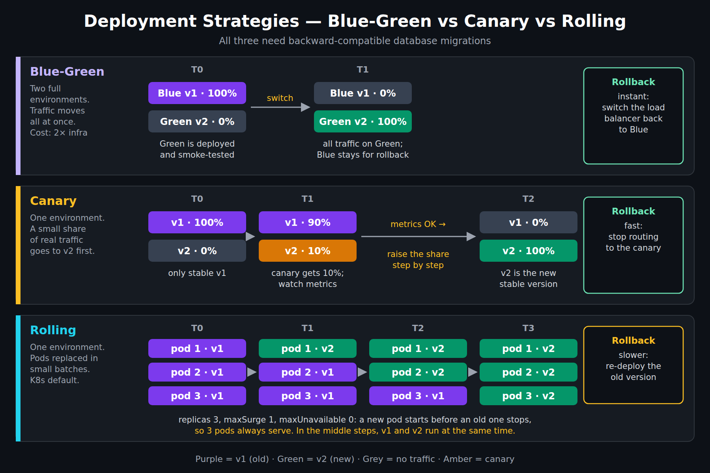

**Kubernetes Rolling Update (Default):**

```yaml
apiVersion: apps/v1
kind: Deployment
metadata:
  name: order-service
spec:
  replicas: 3
  strategy:
    type: RollingUpdate
    rollingUpdate:
      maxSurge: 1         # Max extra pods during update
      maxUnavailable: 0   # No downtime -- always at least 3 running
  template:
    spec:
      containers:
        - name: order-service
          image: order-service:v2.0
```

**Canary with Istio:**

```yaml
apiVersion: networking.istio.io/v1beta1
kind: VirtualService
metadata:
  name: order-service
spec:
  hosts:
    - order-service
  http:
    - route:
        - destination:
            host: order-service
            subset: stable
          weight: 90
        - destination:
            host: order-service
            subset: canary
          weight: 10
```

🧠 **In Simple Words:**
- **Blue-Green:** Like having two apartments. You furnish the new one (Green), then move all your stuff at once. If something is wrong, move back to the old one (Blue).
- **Canary:** Like testing a new recipe on 10% of your restaurant customers before putting it on the full menu.
- **Rolling:** Like renovating an office one room at a time while people keep working in the other rooms.

🎯 **Interview Tip:** Point out that **all three strategies require backward-compatible database migrations**. Suppose v2.0 changes a database schema. The v1.0 instances still run during the transition. They must be able to work with the new schema.

**How to make a schema change backward compatible — expand and contract:**

The follow-up is always *"so how do you rename a column?"*. You never do it in one release. Example: rename `cust_name` to `customer_name`. Each step is its own release (and its own Flyway migration):

| Step | Database | Application | Can old and new pods run together? |
|---|---|---|---|
| **1. Expand** | Add `customer_name` (nullable) | v2 writes **both** columns, still reads `cust_name` | ✅ v1 ignores the new column |
| **2. Backfill** | Copy old values in small batches | — | ✅ |
| **3. Switch reads** | — | v3 reads `customer_name`, still writes both | ✅ v2 and v3 both keep both columns filled |
| **4. Stop old writes** | — | v4 no longer uses `cust_name` | ✅ |
| **5. Contract** | Drop `cust_name` | — | ✅ only once no pod runs v3 or older |

- Every step can be rolled back by one release, because the previous version still works with the schema.
- Add a `NOT NULL` constraint only after the backfill (step 2), never in step 1.
- The same idea works for API fields and Kafka events: add the new field, move readers, and remove the old one last.

---

</details>

---

4. **🏁 How do you implement feature flags in a microservices architecture? ⚡**

<!-- -->
<details>
<summary>Answer</summary>

**Answer:**

**Feature flags** (feature toggles) let you enable or disable features in production without deploying new code. They separate deployment from feature release. You can deploy code with a feature disabled, then enable it later through configuration.

**Types of Feature Flags:**

| Type | Purpose | Lifespan |
|------|---------|----------|
| **Release Toggle** | Hide incomplete features behind a flag | Short (remove after release) |
| **Experiment Toggle** | A/B testing different implementations | Short to medium |
| **Ops Toggle** | Enable/disable features for operational reasons (kill switch) | Long-lived |
| **Permission Toggle** | Enable features for specific users/roles (beta program) | Long-lived |

**Implementation with Spring Cloud Config:**

```yaml
# In Config Server (Git repository)
feature:
  flags:
    new-payment-gateway:
      enabled: false
    premium-recommendations:
      enabled: true
      allowed-users: "user1,user2,user3"
    experimental-search:
      enabled: true
      percentage: 20    # Enable for 20% of requests
```

```java
@Service
@RefreshScope  // Allows toggling without restart
public class PaymentService {

    @Value("${feature.flags.new-payment-gateway.enabled:false}")
    private boolean newPaymentGatewayEnabled;

    public PaymentResponse processPayment(PaymentRequest request) {
        if (newPaymentGatewayEnabled) {
            return newPaymentGateway.process(request);
        } else {
            return legacyPaymentGateway.process(request);
        }
    }
}
```

**Advanced: Custom Feature Flag Service:**

```java
@Service
@RefreshScope
@ConfigurationProperties(prefix = "feature")
public class FeatureFlagService {

    private Map<String, FeatureFlag> flags = new HashMap<>();

    public Map<String, FeatureFlag> getFlags() {   // binding needs a getter or setter
        return flags;
    }

    public boolean isEnabled(String featureName) {
        FeatureFlag flag = flags.get(featureName);
        return flag != null && flag.isEnabled();
    }

    public boolean isEnabledForUser(String featureName, String userId) {
        FeatureFlag flag = flags.get(featureName);
        if (flag == null || !flag.isEnabled()) return false;
        if (flag.getAllowedUsers() == null) return true;
        return flag.getAllowedUsers().contains(userId);
    }

    public boolean isEnabledByPercentage(String featureName, String requestId) {
        FeatureFlag flag = flags.get(featureName);
        if (flag == null || !flag.isEnabled()) return false;
        // Deterministic: same requestId always gets same result
        int hash = Math.abs(requestId.hashCode() % 100);
        return hash < flag.getPercentage();
    }

    @Data
    public static class FeatureFlag {
        private boolean enabled;
        private List<String> allowedUsers;
        private int percentage = 100;
    }
}
```

```java
// Usage in controller
@RestController
public class SearchController {

    @Autowired private FeatureFlagService featureFlags;
    @Autowired private SearchServiceV1 searchV1;
    @Autowired private SearchServiceV2 searchV2;

    @GetMapping("/search")
    public SearchResponse search(@RequestParam String query,
                                 @RequestHeader("X-User-Id") String userId) {
        // Percentage rollout: the same user always lands in the same bucket
        if (featureFlags.isEnabledByPercentage("experimental-search", userId)) {
            return searchV2.search(query);
        }
        return searchV1.search(query);
    }
}
```

🔑 **Best Practices:**

- 🧹 **Clean up** short-lived feature flags after the feature is fully released (old flags become technical debt)
- 📊 **Monitor** flag states -- know which flags are active in production
- 🧪 **Test** both paths (flag on and off) in your test suite
- 🔄 Use `@RefreshScope` + Spring Cloud Config to toggle flags without deployments
- 📡 For large-scale flag management, consider dedicated tools like **LaunchDarkly**, **Unleash**, or **Flagsmith**

🧠 **In Simple Words:**
Feature flags are like light switches for your code. You deploy the wiring (code) once. Then you can turn the lights (features) on and off at any time. You do not need to rewire (redeploy).

🎯 **Interview Tip:** Mention that feature flags enable **trunk-based development**. Developers commit to the main branch daily. Incomplete features stay hidden behind flags. So teams no longer need long-lived feature branches, and the merge conflicts they cause go away.

---

</details>

---

5. **🔒 How do you manage secrets in a microservices architecture? 🔥**

<!-- -->
<details>
<summary>Answer</summary>

**Answer:**

Secrets are things like database passwords, API keys and JWT signing keys. Never store them in code, Git repositories, or plain-text config files. Microservices need a secrets management solution that is centralized, secure, and auditable (every access is recorded).

**What NOT to Do:**

```yaml
# ❌️ NEVER commit secrets to Git
spring:
  datasource:
    password: myDatabasePassword123
  security:
    jwt-secret: myJwtSecretKey
```

**Options for Secrets Management:**

| Solution | Type | Use Case |
|----------|------|---------|
| **HashiCorp Vault** | Self-hosted | Full-featured: dynamic secrets, lease TTL, audit logs |
| **AWS Secrets Manager** | Cloud-managed | AWS-native, auto-rotation, IAM integration |
| **AWS Parameter Store** | Cloud-managed | Simpler and cheaper — good for config + secrets |
| **Kubernetes Secrets** | K8s-native | Simple but base64-encoded (not encrypted at rest by default) |

**Option 1: HashiCorp Vault with Spring Boot:**

```xml
<dependency>
    <groupId>org.springframework.cloud</groupId>
    <artifactId>spring-cloud-starter-vault-config</artifactId>
</dependency>
```

```yaml
# application.yml (Spring Cloud 2020+; bootstrap.yml is the legacy way)
spring:
  config:
    import: vault://
  cloud:
    vault:
      host: vault.internal
      port: 8200
      scheme: https
      authentication: KUBERNETES    # Authenticate using K8s service account
      kubernetes:
        role: payment-service
      kv:
        enabled: true
        default-context: payment-service
```

```java
// Vault injects secrets as Spring properties at startup
@Service
public class PaymentService {

    @Value("${payment.gateway.api-key}")   // Fetched from Vault
    private String paymentGatewayApiKey;

    @Value("${database.password}")          // Static KV secret. Dynamic DB creds go to spring.datasource.*
    private String dbPassword;
}
```

**Option 2: AWS Secrets Manager with Spring Boot:**

```xml
<dependency>
    <groupId>io.awspring.cloud</groupId>
    <artifactId>spring-cloud-aws-starter-secrets-manager</artifactId>
</dependency>
```

```yaml
# application.yml
spring:
  config:
    import: aws-secretsmanager:/production/payment-service
  cloud:
    aws:
      region:
        static: ap-south-1
```

```json
// AWS Secrets Manager secret value (JSON stored in AWS):
{
  "database.password": "prod-db-pass-xyz",
  "payment.gateway.api-key": "pk_live_abc123",
  "jwt.secret": "hs512-signing-key"
}
```

**Option 3: Kubernetes Secrets:**

```bash
# Create secret
kubectl create secret generic payment-secrets \
  --from-literal=db-password=myPass \
  --from-literal=api-key=myKey \
  -n production
```

```yaml
# Reference in Deployment
env:
  - name: DB_PASSWORD
    valueFrom:
      secretKeyRef:
        name: payment-secrets
        key: db-password
  - name: PAYMENT_API_KEY
    valueFrom:
      secretKeyRef:
        name: payment-secrets
        key: api-key
```

⚠️ **Note:** Kubernetes Secrets are base64-encoded, not encrypted. For production-grade security, do one of these:

- Enable **etcd encryption at rest**.
- Use **Sealed Secrets** (encrypts before committing to Git).

**Secret Rotation with @RefreshScope:**

```java
// When AWS/Vault rotates a secret, trigger a refresh to pick up the new value
@Service
@RefreshScope
public class JwtConfig {

    @Value("${jwt.secret}")
    private String jwtSecret;
}
```

```bash
# Trigger refresh after rotation (busrefresh needs Spring Cloud Bus;
# without Bus, call /actuator/refresh on each instance)
curl -X POST http://service:8080/actuator/busrefresh
```

**Best Practices:**

| Practice | Description |
|----------|-------------|
| ✅ Least privilege | Each service accesses only the secrets it needs |
| ✅ Audit logging | Every secret access logged — Vault provides this natively |
| ✅ Automatic rotation | Never manually rotate — automate with Vault/AWS |
| ✅ Dynamic secrets | Vault generates unique DB credentials per service instance with a short TTL |
| ✅ Never log secrets | Ensure secrets never appear in log output |
| ❌️ No secrets in Git | Not even encrypted values (except Sealed Secrets tooling) |
| ❌️ No secrets in Docker images | Not in ENV in Dockerfile or image layers |

🧠 **In Simple Words:**
Secrets management is like a bank vault for your passwords. You do not write the combination on a sticky note (hardcoding in code). Instead, you use a secure vault:

- Access is controlled.
- Access is logged.
- The combination changes automatically.

🎯 **Interview Tip:** Mention the **hierarchy** (">" means "is better than"): env vars > config files, K8s Secrets > env vars, Vault/AWS Secrets Manager > K8s Secrets. The best option is **dynamic secrets**. Vault generates a unique DB password per service instance, and it expires automatically. So there is no long-lived credential to steal.

---

</details>

---

6. **🐳 How do you optimize Docker images for Spring Boot microservices? ⚡**

<!-- -->
<details>
<summary>Answer</summary>

**Answer:**

Unoptimized Spring Boot Docker images are slow to build and large to pull. They are also a security risk. Good optimization uses three things:

- multi-stage builds
- layered JARs, so the cache works well
- non-root users

**Problem with the Naive Approach:**

```dockerfile
# ❌️ Naive — 500MB+ image, no layer caching, runs as root
FROM openjdk:17
COPY target/payment-service.jar app.jar
ENTRYPOINT ["java", "-jar", "/app.jar"]
```

Problems:

- It uses the full JDK (~500MB).
- The entire JAR is one layer, so every code change re-uploads 150MB.
- It runs as root (security risk).
- No heap setting, so the JVM uses the default of only 25% of the container memory.

**Optimized Multi-Stage Build with Layered JARs:**

```dockerfile
# Stage 1: Extract JAR layers
FROM eclipse-temurin:17-jre AS builder
WORKDIR /app
COPY target/payment-service.jar app.jar
# Boot 3.3+ deprecates layertools: use -Djarmode=tools extract --layers --launcher
# (check before using layertools on Boot 4)
RUN java -Djarmode=layertools -jar app.jar extract

# Stage 2: Lean production image
FROM eclipse-temurin:17-jre-alpine
WORKDIR /app

# Non-root user for security
RUN addgroup -S appgroup && adduser -S -G appgroup appuser   # Alpine (BusyBox) flags

# Copy layers in order of change frequency (least frequent first)
COPY --from=builder /app/dependencies ./           # ~120MB — changes with pom.xml
COPY --from=builder /app/spring-boot-loader ./     # ~1MB — almost never changes
COPY --from=builder /app/snapshot-dependencies ./  # ~5MB — changes on snapshot bumps
COPY --from=builder /app/application ./            # ~2MB — changes every commit ✅

USER appuser
EXPOSE 8080

ENV JAVA_OPTS="-XX:+UseContainerSupport \
               -XX:MaxRAMPercentage=75.0 \
               -XX:+UseG1GC \
               -Djava.security.egd=file:/dev/./urandom"

# Boot 3.2+ launcher class; before 3.2 it was org.springframework.boot.loader.JarLauncher
# exec: java replaces the shell as PID 1, so it receives SIGTERM (graceful shutdown, Q8.7)
ENTRYPOINT ["sh", "-c", "exec java $JAVA_OPTS org.springframework.boot.loader.launch.JarLauncher"]
```

**Why Layered JARs Save Build Time:**

```
Without layers:  code change → rebuild entire 150MB layer → re-upload 150MB

With layers:
  dependencies/          ~120MB  → cached  (only re-uploaded when pom.xml changes)
  spring-boot-loader/    ~1MB    → cached  (almost never changes)
  snapshot-dependencies/ ~5MB    → cached  (changes rarely)
  application/           ~2MB    → rebuilt (only this layer re-uploaded per commit)
```

Docker only re-uploads changed layers → **2MB instead of 150MB** per deploy.

**Alternative: Spring Boot Buildpacks (No Dockerfile):**

```xml
<!-- pom.xml — build image without writing a Dockerfile -->
<plugin>
    <groupId>org.springframework.boot</groupId>
    <artifactId>spring-boot-maven-plugin</artifactId>
    <configuration>
        <image>
            <name>myrepo/payment-service:${project.version}</name>
        </image>
    </configuration>
</plugin>
```

```bash
mvn spring-boot:build-image   # Buildpacks apply all best practices automatically
```

**JVM Container Awareness:**

```yaml
# Kubernetes — always set resource limits
resources:
  requests:
    memory: "512Mi"
    cpu: "500m"
  limits:
    memory: "1Gi"
    cpu: "1000m"
```

```
# UseContainerSupport is ON by default since JDK 10 / 8u191 (the flag above only makes it explicit)
# Old JVM without it: JVM sees host memory (e.g., 64GB), allocates 16GB heap → OOMKilled
# With it: JVM sees container limit (1Gi); MaxRAMPercentage=75 → ~768Mi heap ✅ (default is 25%)
```

**.dockerignore (always add):**

```
.git
target/*.jar.original
*.md
.idea
*.iml
```

**Best Practices Summary:**

| Practice | Impact |
|----------|--------|
| JRE-only base (`eclipse-temurin:17-jre-alpine`) | Image size ~200MB vs ~500MB |
| Layered JARs | Only 2MB re-uploaded per code change instead of 150MB |
| Non-root user | Reduces container escape attack surface |
| `UseContainerSupport` (default since JDK 10 / 8u191) + `MaxRAMPercentage` | JVM respects container memory limits and sizes the heap from them — prevents OOMKill |
| Pin image versions | Reproducible builds — no surprise updates |
| `.dockerignore` | Smaller build context — faster builds |

🎯 **Interview Tip:** When asked about containerization, cover five points:

1. multi-stage layered build, so the cache works well
2. JRE-only Alpine base image
3. `MaxRAMPercentage` for correct heap size (`UseContainerSupport` is on by default since JDK 10)
4. non-root user for security
5. `exec java …` in the entrypoint, so the JVM gets SIGTERM and can shut down gracefully

These points show you know production. A basic answer only says "just copy the JAR".

---

</details>

---

7. **🛑 How do you make a rolling deployment safe — graceful shutdown, connection draining and probes? 🔥**

<!-- -->
<details>
<summary>Answer</summary>

**Answer:**

In a rolling update, Kubernetes stops old pods while traffic is still arriving. Without care, two things go wrong:

- requests that are **in progress** on the old pod are cut off
- **new** requests are still sent to a pod that is already stopping

Both show up as a burst of 502/503 errors on every deploy.

**What Kubernetes does when it stops a pod — two things happen at the same time:**

1. The pod is marked *Terminating*.
2. In parallel:
   - **a)** The pod is removed from the Service endpoints. kube-proxy, the Ingress and any load balancer learn this a few seconds later.
   - **b)** The kubelet runs the `preStop` hook, then sends **SIGTERM** to the container's PID 1.
3. If the container is still running after `terminationGracePeriodSeconds` (default **30 s**, counted from step 1 and including `preStop`), Kubernetes sends **SIGKILL**.

⚠️ **The race:** step b) is often faster than step a). The app stops accepting connections while load balancers still send it traffic. Those requests fail.

**The fix — one setting per problem:**

| Problem | Setting | Why it helps |
|---|---|---|
| Load balancers still send traffic | `preStop` sleep of ~5–10 s | The app keeps serving while the endpoint removal reaches every load balancer |
| In-progress requests are cut off | `server.shutdown=graceful` + `spring.lifecycle.timeout-per-shutdown-phase` | Spring stops taking new requests and lets running ones finish. ⚠️ This became the default in Boot 3.4 — before that it was `immediate`. Check your version |
| Shutdown is cut short | `terminationGracePeriodSeconds` **>** preStop + shutdown phase | Otherwise SIGKILL arrives in the middle of the graceful shutdown |
| The JVM never gets SIGTERM | `exec java …` in the entrypoint (Q8.6) | If a shell stays as PID 1, the signal may never reach Java |

```yaml
# Deployment (pod spec)
spec:
  terminationGracePeriodSeconds: 45        # > 10 s preStop + 25 s shutdown phase
  containers:
    - name: order-service
      lifecycle:
        preStop:
          exec:
            command: ["sleep", "10"]       # Kubernetes 1.30+ also has a built-in sleep action
      readinessProbe:
        httpGet:
          path: /actuator/health/readiness
          port: 8080
```

```yaml
# application.yml
server:
  shutdown: graceful
spring:
  lifecycle:
    timeout-per-shutdown-phase: 25s
```

- **Kafka consumers** stop too. On shutdown the consumer leaves its group, which starts a rebalance. Offsets not yet committed are read again by another consumer. This is one more reason consumers must be idempotent (Q6.7).

**Probes during a rollout — the shared-dependency trap:**

- **Liveness** must check only the app itself. Never put the database or a downstream service in liveness. One short database problem would then restart **every** pod at once (a restart storm).
- **Readiness** needs care too. If every pod's readiness checks the same database, a database outage takes **all** pods out of the load balancer. Users then get "no healthy upstream" instead of a clear 503 and a fallback.
- Spring Boot's `liveness` and `readiness` groups contain only `livenessState` / `readinessState` by default, not `db`. Keep it that way unless you have a clear reason. You add a dependency with `management.endpoint.health.group.readiness.include=readinessState,db`.

**Rollout settings that catch a bad version:**

| Setting | What it does |
|---|---|
| `maxUnavailable: 0`, `maxSurge: 1` | Never drop below full capacity (Q8.3) |
| `minReadySeconds` | A new pod must stay ready for N seconds before the rollout moves on. This catches a pod that crashes right after it starts |
| `progressDeadlineSeconds` | Marks a stuck rollout as failed. ⚠️ It does **not** roll back by itself |
| Argo Rollouts / Flagger | Canary steps with automatic rollback when error rate or latency gets worse |

🧠 **In Simple Words:**
A shop closing for the night first turns the sign to "closed" and waits a moment, so nobody new walks in. Then it serves the people already inside. Only then does it lock the door. `preStop` is the sign, graceful shutdown is serving the people inside, and SIGKILL is the lock.

🎯 **Interview Tip:** Explain the race: *"Endpoint removal and SIGTERM happen in parallel. So I add a short preStop sleep and turn on graceful shutdown. The grace period must be longer than both."* Then add the readiness trap. Together they show you have watched a real deploy, not only written the YAML.

---

</details>

---
