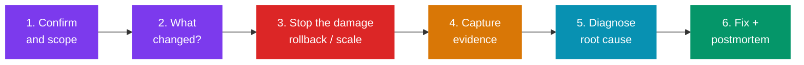

# Production Debugging Interview Questions

**Production Debugging Interview Questions** | "Production is slow / CPU is at 100% / the pod was OOM-killed — walk me through it." Covers the debugging method, high CPU, memory leaks, latency and thread problems, connection pools, Kafka lag and the incident story. Also see: [Database Design and Internals](https://github.com/vikas9dev/system-design/blob/main/iq/02_Database_Design_and_Internals_Interview_Questions.md) · [Kafka](https://github.com/vikas9dev/system-design/blob/main/iq/04_Kafka_Interview_Questions.md) · [Multithreading](04_Java_Multithreading_Interview_Questions.md)

📊 **Question Count by Section**

| # | Section | Questions |
|---|---|---|
| 1 | [The Debugging Method](#1-the-debugging-method) | 3 |
| 2 | [High CPU](#2-high-cpu) | 3 |
| 3 | [Memory Leaks and OutOfMemoryError](#3-memory-leaks-and-outofmemoryerror) | 4 |
| 4 | [Latency Spikes, Hung Threads and Deadlocks](#4-latency-spikes-hung-threads-and-deadlocks) | 3 |
| 5 | [Database and Connection Pool](#5-database-and-connection-pool) | 3 |
| 6 | [Kafka Consumer Lag](#6-kafka-consumer-lag) | 2 |
| 7 | [Incident Story and Postmortem](#7-incident-story-and-postmortem) | 2 |
| | **Total** | **20** |

> 🔥🔥 Very High — asked in almost every Tier-1 loop &nbsp;·&nbsp; 🔥 High — very frequent in Tier-1 interviews &nbsp;·&nbsp; ⚡ Medium — commonly asked &nbsp;·&nbsp; 💤 Low — good to know, rarely asked

> 🎯 **Why this file exists.** At SDE III, interviewers check that you have *run* production systems, not only read about them. A scenario question ("p99 doubled after a deploy — what do you do?") shows this in five minutes. The facts already sit in files 02, 04, 05, 13, 17 and 28. This file puts them in the order you use them during an incident.  
>
> **Every scenario answer has the same five parts:** symptom → first commands → what you look for → fix → how to stop it happening again.

---

## 1. The Debugging Method

1. **🚨 Production is slow and users are complaining. Walk me through your first 10 minutes. 🔥🔥**

<!-- -->
<details>
<summary>Answer</summary>

**Answer:**

The goal of the first 10 minutes is to **restore service**, not to find the root cause. Root cause comes after users are safe.



| Step | What you do | Question you answer |
|---|---|---|
| **1. Confirm and scope** | Check the dashboards, not only the complaint. | Which endpoints? All pods or one? Since when? How many users? |
| **2. What changed?** | Look at deploys, config changes, feature flags, traffic, and downstream status. | Did a deploy go out just before the graph changed? |
| **3. Stop the damage** | Roll back, scale out, turn off a feature flag, shed load, or fail over. | What is the fastest safe way to stop the damage? |
| **4. Capture evidence** | Before you restart a bad pod, take a thread dump and (if memory) a heap dump. Take it out of the load balancer first. | Will I still have proof after the restart? |
| **5. Diagnose** | Use metrics → logs → traces → dumps to find the cause. | Where is the time going? |
| **6. Fix and postmortem** | Ship the real fix, then write a blameless postmortem. | How do we stop this happening again? |

**Two rules a senior candidate states clearly:**

- **"If a deploy happened in the last hour, I roll back first and debug second."** A rollback is quick and safe. Debugging on a live, broken system is neither.
- **"A restart destroys the evidence."** Restarting fixes the symptom for now. Without a dump, the same incident comes back next week with no new information.

---

</details>

---

2. **📈 Which metrics do you look at first, and why is the average latency not enough? 🔥**

<!-- -->
<details>
<summary>Answer</summary>

**Answer:**

Use two simple checklists: **RED** for each service and **USE** for each resource.

| Checklist | Applies to | Metrics |
|---|---|---|
| **RED** | A service or endpoint | **R**ate (requests/s) · **E**rrors (error rate) · **D**uration (latency percentiles) |
| **USE** | A resource (CPU, memory, disk, pool, thread pool) | **U**tilization (% busy) · **S**aturation (queue length, waiting work) · **E**rrors |

Google's **four golden signals** are close to RED + saturation: latency, traffic, errors, saturation.

**Why the average lies:**

- 99 requests take 50 ms and 1 request takes 5 seconds. The average is about 100 ms and looks fine.
- But the **p99** is 5 seconds. 1 user in 100 waits 5 seconds.
- A page that makes 20 backend calls hits at least one slow call on about 1 page load in 5 (1 − 0.99²⁰ ≈ 18%). So p99 is what users feel.

| Metric | What it tells you |
|---|---|
| **p50** | The normal request |
| **p99 / p99.9** | The slow tail — GC pauses, lock waits, pool waits, slow downstreams |
| **Max** | Often one outlier; useful for timeouts, noisy for trends |

**Saturation is the early warning.** A connection pool at 100% busy with 40 requests waiting is the problem *before* latency gets bad. Watch queue lengths: pool pending count, executor queue size, Kafka consumer lag.

<details>
<summary><strong>🤔 Doubt: What exactly are p50, p99 and p99.9?</strong></summary>

They are **percentiles of latency**. Sort all response times from fastest to slowest. **pXX** is the time that XX% of requests finish within.

| Metric | Meaning | If the value is 120 ms |
|---|---|---|
| **p50** (median) | 50% of requests are faster than this | Half of users wait ≤ 120 ms |
| **p99** | 99% are faster — the slowest **1 in 100** are slower | 1 request in 100 takes > 120 ms |
| **p99.9** | 99.9% are faster — the slowest **1 in 1,000** are slower | 1 request in 1,000 takes > 120 ms |

**Example — 100 requests:** 98 take 20 ms, 1 takes 500 ms, 1 takes 2 s.

- **Average** ≈ 45 ms → looks fine, hides the problem.
- **p50** = 20 ms → the normal user is fine.
- **p99** = 500 ms → the slow tail is visible.

**Fan-out turns the tail into the normal case.** If one page calls 100 services, and each call has a 1% chance of being slow, then 1 − 0.99¹⁰⁰ ≈ **63%** of pages hit at least one slow call.

**Read p50 and p99 together — the pair points to the cause:**

| What moved | What it means | Where to look |
|---|---|---|
| p99 up, p50 flat | *Some* requests wait on something | GC pauses, a lock, pool waits, one slow shard, cold cache |
| p50 and p99 both up | The *whole* system is slow | CPU saturation, a bad deploy on every pod, a slow DB |

**⚠️ Two traps:**

1. **You cannot average percentiles.** The average of each pod's p99 is not the cluster's p99. Merge the histograms instead (Prometheus: `histogram_quantile` over summed buckets).
2. **p99.9 needs traffic.** At 100 requests/min, p99.9 rests on about 1 request every 10 minutes, so it is noisy. Use it only on high-traffic paths.

💡 **Interview line:** *"p99 doubled after the deploy but p50 didn't move. So it isn't general slowness — some requests are waiting on something: GC, a lock or the pool. Next I check GC logs and the Hikari pending-threads metric."*

---

</details>
<br/>

---

</details>

---

3. **↩️ When do you roll back, and when do you fix forward? 🔥**

<!-- -->
<details>
<summary>Answer</summary>

**Answer:**

| Situation | Choice | Why |
|---|---|---|
| A deploy just went out and the problem started with it | ✅ **Roll back** | Fastest way back to a known-good state |
| The deploy ran a DB migration that the old code cannot read | ⚠️ **Fix forward** (or roll back the app only if the old code still works with the new schema) | Rolling back the code can break on the new schema |
| The cause is outside your service (a downstream, the DB, a traffic spike) | **Stop the damage**: scale out, shed load, open a circuit breaker, fail over | A rollback changes nothing |
| You know the one-line fix and the pipeline is fast | Fix forward is acceptable | Only if it is truly faster than a rollback |

**The senior point:** design for rollback *before* the incident.

- **Expand–contract migrations:** add the new column first, deploy code that writes both, remove the old column in a later release. The old code keeps working during a rollback.
- **Feature flags:** turn off the new code path without a deploy.
- **Canary releases:** send 5% of traffic to the new version first, so a bad release hurts 5% of users, not all of them.

<details>
<summary><strong>🤔 Doubt: What exactly is "fix forward"?</strong></summary>

**Fix forward** = solve the production problem by shipping a **new fix**, instead of redeploying the old version (**rollback**).

| | Roll back | Fix forward |
|---|---|---|
| What you do | Redeploy the last good version | Write a fix → review → CI → deploy a new version |
| Speed | Fast (minutes), no new code | Slower |
| Risk | Low — the old version is already proven | Higher — new code written under pressure |
| Default? | ✅ Yes, when the deploy caused the problem | Only when rollback is unsafe or useless |

**When fix forward is the right choice:**

1. **A DB migration ran that the old code cannot handle** — e.g. a column was dropped or renamed. The old code would crash on the new schema.
2. **Data has already changed** — the new code wrote records in a new format, and the old code cannot read them.
3. **The cause is not in the deploy** — a rollback changes nothing.
4. **The fix is a known one-line change and the pipeline is fast** — only if it is truly faster than a rollback.

💡 **Interview line:** *"My default is roll back first, debug later — getting users back to a working state matters more than finding the cause. I fix forward only when the rollback itself is unsafe, usually because of a schema change. That's why we use expand–contract migrations and feature flags: they keep rollback possible."*

---

</details>
<br/>

<details>
<summary><strong>🤔 Doubt: How does an expand–contract migration work, step by step?</strong></summary>

**Expand–contract** (also called **parallel change**) splits one breaking schema change into several small steps. After each step, **both the old and the new app version still work** with the database.

**Why it is needed:**

1. **Rolling deploy** — for a few minutes, old pods and new pods run together against the **same** database. Rename a column, and the old pods break at once.
2. **Rollback** — if the new version is bad, the old code meets the new schema and crashes. Now you are forced to fix forward.

**The rule:** the database must always work with **both** the current app version and the previous one.

**Example — rename `customer.name` → `customer.full_name`:**

| Step | Database change | App change | Rollback safe? |
|---|---|---|---|
| **1. Expand** | `ADD COLUMN full_name VARCHAR(200) NULL` | None — old code ignores the new column | ✅ |
| **2. Dual write** | — | Write **both** `name` and `full_name`; still read `name` | ✅ |
| **3. Backfill** | `UPDATE customer SET full_name = name WHERE full_name IS NULL` (in batches) | — | ✅ |
| **4. Switch reads** | — | Read `full_name`; still write both | ✅ |
| **5. Stop old writes** | — | Write only `full_name` | ✅ |
| **6. Contract** | `DROP COLUMN name`; add `NOT NULL` to `full_name` if needed | — | ⚠️ Only when no running version uses `name` |

**Expand** = steps 1–3 (add, never remove). **Contract** = step 6 (remove only when nothing uses it). Each step is a **separate release**, and teams often wait days before the contract step.

**Details that show real experience:**

- **Backfill in batches** (1,000–10,000 rows per transaction, with a short pause). One huge `UPDATE` on a 50M-row table holds locks, makes replicas fall behind and fills the undo/WAL logs.
- **Add the column as nullable first.** Add `NOT NULL` only in the contract step. Otherwise the old code, which does not send `full_name`, gets insert errors.
- **⚠️ Locks on big tables.** In PostgreSQL 11+, adding a nullable column (or one with a constant default) is metadata-only and fast. Changing a column type can rewrite the whole table. In MySQL it depends on the version and the online DDL algorithm (`ALGORITHM=INSTANT/INPLACE`). Full 300M-row walkthrough: [02 Database Design §5 Q3](https://github.com/vikas9dev/system-design/blob/main/iq/02_Database_Design_and_Internals_Interview_Questions.md) · 🎥 [Add a Column to 300M Rows With Zero Downtime](https://www.youtube.com/shorts/GLjRyZTU2ms)
- **Indexes:** use `CREATE INDEX CONCURRENTLY` in PostgreSQL so writes are not blocked. In Flyway this must run outside a transaction.
- **Flyway / Liquibase:** each step is its own versioned script, shipped with its own app release. Never put "add new" and "drop old" in one migration.
- **Same idea for APIs and events:** add the new field → consumers read both → switch → remove the old field. This is backward-compatible schema evolution for Kafka messages too.

**Cost:** one change becomes 3–6 releases, plus a period of double writes. Use it for breaking changes on live tables (rename, type change, split a column, move data to a new table). A purely additive change, such as a new nullable column, does not need it.

💡 **Interview line:** *"I never ship a breaking schema change in one step. I expand first — add the new column and dual-write — then backfill in batches, switch reads, and drop the old column only after a release or two. At every step both the current and the previous app version work with the schema, so a rollback is always safe and I am never forced to fix forward."*

---

</details>
<br/>

---

</details>

---

## 2. High CPU

1. **🔥 CPU is at 100% on one pod. Walk me through finding the line of code. 🔥🔥**

<!-- -->
<details>
<summary>Answer</summary>

**Answer:**

The idea: find the **OS thread** using the CPU, then find the **Java thread** with the same id in a thread dump.

```bash
# 1. Find the Java process
top                                  # or: jps -l

# 2. Show threads inside that process, sorted by CPU
top -H -p <pid>                      # note the TID of the hottest thread, e.g. 12345

# 3. Convert the thread id to hex — thread dumps show it in hex
printf '%x\n' 12345                  # → 3039

# 4. Take a thread dump and search for nid=0x3039
jcmd <pid> Thread.print > dump1.txt  # or: jstack <pid>
```

In the dump, the matching thread looks like this:

```
"http-nio-8080-exec-7" #45 daemon prio=5 os_prio=0 tid=0x00007f... nid=0x3039 runnable
   java.lang.Thread.State: RUNNABLE
        at java.util.regex.Pattern$Loop.match(Pattern.java:4785)
        at com.example.validation.InputValidator.isValid(InputValidator.java:42)
```

**Take 3 dumps, 5–10 seconds apart.** One dump is a single moment. If the same thread is at the same line in all three, that line is the hot spot.

**Common causes of high CPU:**

| Cause | What the dump shows |
|---|---|
| **GC thrashing** (heap almost full) | GC threads are hot; app threads look normal → see §2 Q2 |
| **Infinite loop** | The same frame in a loop in every dump |
| **Catastrophic regex backtracking** | Deep `java.util.regex.Pattern` frames |
| **Busy spin / polling loop** | `while (!done) {}` with no sleep or wait |
| **Heavy serialization or logging** | Jackson or logger frames on many threads |
| **`HashMap` used by many threads (Java 7 and older)** | A thread stuck in `HashMap.get` / `transfer` — a cycle formed during resize |

**In Kubernetes:** run the commands inside the container with `kubectl exec`. If the image has no JDK tools (for example a distroless image), use `kubectl debug` to attach a debug container, or rely on JFR (§2 Q3).

---

</details>

---

2. **♻️ How do you tell if high CPU is the garbage collector or your own code? 🔥**

<!-- -->
<details>
<summary>Answer</summary>

**Answer:**

Look at GC activity first, because GC thrashing is the most common hidden cause.

```bash
jstat -gcutil <pid> 1000        # prints GC stats every 1 second
```

| Column | Meaning | Bad sign |
|---|---|---|
| `O` | Old generation % used | Stays near 100% after each full GC |
| `FGC` / `FGCT` | Full GC count / total time | Count rises every few seconds |
| `GCT` | Total GC time | Grows almost as fast as wall-clock time |

**GC logs** give the same answer with history. Turn them on in every service (Java 9+ unified logging):

```bash
-Xlog:gc*:file=/logs/gc.log:time,uptime:filecount=5,filesize=20m
```

**How to read the answer:**

- **Old gen near 100% and full GCs back to back** → memory problem, not CPU. The JVM spends its time trying to free memory and fails. Go to §3. On the Parallel collector this ends in `OutOfMemoryError: GC overhead limit exceeded`.
- **GC time is small, app threads are hot** → your own code. Go back to §2 Q1 and the thread dumps.
- **Young GCs very often but each one is short** → a high allocation rate (lots of short-lived objects). Profile allocations (§2 Q3).

---

</details>

---

3. **🔬 Thread dumps only show one moment. How do you profile a live service safely? 🔥**

<!-- -->
<details>
<summary>Answer</summary>

**Answer:**

Use a **sampling profiler** that is safe to run in production.

| Tool | How you start it | Overhead | Good for |
|---|---|---|---|
| **JFR (Java Flight Recorder)** | Built into the JDK (free since JDK 11): `jcmd <pid> JFR.start duration=60s filename=/tmp/rec.jfr` | About 1% | CPU, allocations, locks, GC, I/O — open the file in JDK Mission Control |
| **async-profiler** | `asprof -d 30 -e cpu -f /tmp/flame.html <pid>` (older versions: `profiler.sh`) | Low | CPU and allocation **flame graphs**; also sees native and kernel frames |

**Reading a flame graph:**

- Each box is a method. **Width = share of samples** (time on CPU). Height is only stack depth.
- Look for the **widest box near the top** that is your own code. That is where the CPU goes.

**Why not a normal IDE profiler?** Most older profilers sample only at **safepoints** (points where the JVM can pause threads). They miss hot code between safepoints and give wrong answers. JFR and async-profiler do not have this "safepoint bias".

**Senior habit:** keep a JFR recording running all the time in a rolling buffer (`-XX:StartFlightRecording=maxage=1h`). When an incident happens, dump the last hour. You get evidence from *before* anyone noticed.

---

</details>

---

## 3. Memory Leaks and OutOfMemoryError

1. **💥 Name the different kinds of `OutOfMemoryError`. What does each one tell you? 🔥**

<!-- -->
<details>
<summary>Answer</summary>

**Answer:**

The message after `OutOfMemoryError:` tells you **which memory area** ran out. Each needs a different fix.

| Message | What ran out | Usual cause | First fix to try |
|---|---|---|---|
| `Java heap space` | The heap | A leak, or the heap is too small for the load | Heap dump → find what holds the memory (§3 Q2) |
| `GC overhead limit exceeded` | The heap (Parallel GC) — over 98% of time in GC, under 2% of heap freed | Almost always a leak | Same as heap space |
| `Metaspace` | Class metadata | Class loader leak: redeploys, dynamic proxies, Groovy/scripts creating classes | Find the class loader that is never freed; set `-XX:MaxMetaspaceSize` |
| `unable to create native thread` | OS threads | Too many threads (unbounded thread pools), or OS/container limits | Use bounded pools; check `ulimit -u` and the container's PID limit |
| `Direct buffer memory` | Off-heap NIO buffers | Netty/NIO buffers not released | Fix the release; set `-XX:MaxDirectMemorySize` |
| `Requested array size exceeds VM limit` | One huge array | Reading a whole file or result set into memory | Stream or page the data |

**There is a seventh case with no Java message at all:** the container is killed by the kernel. See §3 Q3.

---

</details>

---

2. **🧯 How do you capture and analyse a heap dump? 🔥🔥**

<!-- -->
<details>
<summary>Answer</summary>

**Answer:**

**Capture — two ways:**

```bash
# 1. Automatic, at the moment of OOM — set this on every service
-XX:+HeapDumpOnOutOfMemoryError -XX:HeapDumpPath=/dumps

# 2. On demand, from a running JVM
jcmd <pid> GC.heap_dump /dumps/heap.hprof
jcmd <pid> GC.class_histogram | head -20      # quick view: object counts by class
```

**Before you take one in production:**

- A heap dump **pauses the JVM** while it writes. A 4 GB heap can pause for many seconds. Take the pod out of the load balancer first.
- The file is about the size of the used heap. Write it to a volume with enough space.
- ⚠️ **A heap dump contains real data** — customer names, PAN numbers, tokens. Treat the file like production data: restricted access, delete it after analysis. In fintech this point matters.

**Analyse with Eclipse MAT:**

| MAT view | What it shows |
|---|---|
| **Leak Suspects report** | MAT's automatic guess at the biggest problem — start here |
| **Dominator tree** | Objects sorted by **retained heap** — the memory that would be freed if this object were gone |
| **Path to GC roots** | The chain of references that keeps the object alive — this chain names the leak |

**Shallow vs retained heap:** a `HashMap` object itself is small (shallow heap). The entries it holds can be gigabytes (retained heap). Always sort by retained heap.

**One dump is not proof of a leak.** A big cache can look like a leak. Take **two dumps some minutes apart** under the same load. If the same objects keep growing, it is a leak.

---

</details>

---

3. **📦 The pod restarted with exit code 137, but there is no `OutOfMemoryError` in the logs. What happened? 🔥🔥**

<!-- -->
<details>
<summary>Answer</summary>

**Answer:**

**Exit code 137 = 128 + 9 = killed by `SIGKILL`.** In Kubernetes, `kubectl describe pod` shows `Reason: OOMKilled`. The **Linux kernel** killed the process because the container used more memory than its limit. The JVM never got a chance to throw an error or write a heap dump.

**Why this happens even with a heap limit:** the JVM uses much more memory than the heap.

| Memory area | Inside `-Xmx`? |
|---|---|
| Heap | ✅ Yes |
| Metaspace (class metadata) | ❌️ No |
| Thread stacks (about 1 MB per thread by default) | ❌️ No |
| Code cache (JIT-compiled code) | ❌️ No |
| Direct / NIO buffers | ❌️ No |
| GC data structures, native libraries | ❌️ No |

So `-Xmx` set equal to the container limit **will** get OOMKilled. 200 threads alone need about 200 MB of stack.

**The fix:**

- **Size the heap as a share of the container, not as a fixed number:** `-XX:MaxRAMPercentage=75.0` (container-aware since JDK 10 and 8u191). The JVM reads the container limit and leaves 25% for non-heap memory.
- **Measure non-heap memory** with Native Memory Tracking: start with `-XX:NativeMemoryTracking=summary`, then run `jcmd <pid> VM.native_memory summary`.
- **Use `-XX:+ExitOnOutOfMemoryError`** so a Java OOM kills the process cleanly and Kubernetes restarts it. A JVM that keeps running after an OOM is often half-broken.

---

</details>

---

4. **🕳️ What are the most common memory leaks in a Spring Boot service? 🔥**

<!-- -->
<details>
<summary>Answer</summary>

**Answer:**

Java has a garbage collector, so a "leak" means: **something still holds a reference to objects you no longer need.**

| Leak | Why it leaks | Fix |
|---|---|---|
| **Static `Map` used as a cache** | Static fields live as long as the class loader, and nothing removes old entries | Use a bounded cache with eviction (Caffeine `maximumSize` + `expireAfterWrite`) |
| **`ThreadLocal` in a thread pool** | Pool threads never die, so the value stays after the request ends | Always `remove()` in a `finally` block |
| **Listeners / callbacks never removed** | The event source keeps a reference to every listener | Unregister on shutdown; use weak references where it fits |
| **Unbounded queues** | Producers are faster than consumers; the queue grows until OOM | Bounded queue + a rejection policy |
| **Hibernate session holding too many entities** | A batch job loads 1 million rows into one persistence context | `flush()` + `clear()` every N rows, or use a stateless session / JDBC streaming |
| **Loading a full result set** | `findAll()` on a large table | Paging, or a streaming `Stream<T>` query with a fetch size |
| **Class loader leak on redeploy** | A thread or driver keeps the old class loader alive | Stop your threads and deregister drivers on shutdown |

**The ThreadLocal case is the one interviewers love**, because it needs both concurrency and memory knowledge:

```java
try {
    UserContext.set(user);
    chain.doFilter(request, response);
} finally {
    UserContext.clear();   // ✅ without this, the next request on this pool thread sees the old user
}
```

Missing `remove()` causes two bugs: a memory leak, and a **data leak** — the next request on the same thread can read the previous user's data.

---

</details>

---

## 4. Latency Spikes, Hung Threads and Deadlocks

1. **🐢 p99 latency doubled, but CPU and memory look normal. Where do you look? 🔥🔥**

<!-- -->
<details>
<summary>Answer</summary>

**Answer:**

Low CPU + high latency means **the threads are waiting, not working.** Find out what they are waiting for.

Take a thread dump and **count threads by state and by top frame**:

| What many threads show | Meaning | Next step |
|---|---|---|
| `WAITING (parking)` in `HikariPool.getConnection` | Waiting for a DB connection | §5 Q1 |
| `BLOCKED (on object monitor)` | Waiting for a `synchronized` lock another thread holds | Find the thread that **holds** the lock (`- locked <0x...>`) |
| `RUNNABLE` in `SocketInputStream.socketRead0` | Waiting for a reply from the network (a downstream or the DB) | Check that downstream's latency; check timeouts (§4 Q3) |
| `TIMED_WAITING` in `Thread.sleep` / retry code | Retries with backoff | Check the error rate of the thing being retried |

⚠️ **A trap:** a thread blocked on a socket read shows as `RUNNABLE`, but it uses no CPU. Do not read `RUNNABLE` as "busy".

**Other causes to check:**

- **GC pauses:** a long stop-the-world pause stops every request. GC logs show the pause times.
- **One slow downstream:** distributed tracing (OpenTelemetry, Zipkin) shows which span in the request is slow.
- **A noisy neighbour:** CPU throttling in Kubernetes. If the CPU *limit* is low, the kernel pauses the container every 100 ms period after it uses its share. Check the `container_cpu_cfs_throttled_periods_total` metric.
- **One bad pod:** if only one pod is slow, compare it with the others (node, recent restart, cold cache).

---

</details>

---

2. **🔒 How do you find a deadlock in a running Java service? 🔥**

<!-- -->
<details>
<summary>Answer</summary>

**Answer:**

**The JVM finds Java-level deadlocks for you.** A thread dump ends with a section like this:

```
Found one Java-level deadlock:
=============================
"worker-2":
  waiting to lock monitor 0x00007f... (object 0x000000076ab0, a com.example.Account),
  which is held by "worker-1"
"worker-1":
  waiting to lock monitor 0x00007f... (object 0x000000076ac8, a com.example.Account),
  which is held by "worker-2"
```

It works for `synchronized` monitors and for `java.util.concurrent` locks. From code, `ThreadMXBean.findDeadlockedThreads()` gives the same answer, and you can expose it as a health check.

**Fixes:**

- **Lock ordering:** always take locks in the same order (for example, lower account id first). A cycle cannot form.
- **`tryLock(timeout)`** from `ReentrantLock`: give up and retry instead of waiting forever.
- **Hold locks for less time:** never call a remote service while holding a lock.

**Database deadlocks are different.** The JVM cannot see them. The database detects the cycle and aborts one transaction. In Spring you get an exception such as `CannotAcquireLockException` or `DeadlockLoserDataAccessException`. The fix is the same idea — update rows in a fixed order — plus a retry outside the transaction. See `system-design/iq/02` §2.

---

</details>

---

3. **⏱️ Every request thread is stuck waiting on one slow downstream. How did this happen, and how do you prevent it? 🔥**

<!-- -->
<details>
<summary>Answer</summary>

**Answer:**

**How it happens:** a downstream accepts the connection but answers very slowly or never. With **no read timeout**, each request thread waits forever. Tomcat has 200 threads by default. After 200 stuck requests, the service stops answering *everything* — even endpoints that never call that downstream. CPU stays low the whole time.

This is a **cascading failure**: one slow dependency takes down its callers.

**Prevention, in order:**

| Guard | What it does |
|---|---|
| **Connect timeout + read timeout on every client** | A slow call fails after N seconds instead of hanging. Most HTTP clients default to **no read timeout**. |
| **Circuit breaker** (Resilience4j) | After enough failures, stop calling the downstream for a while and fail fast |
| **Bulkhead** | Give each downstream its own small thread pool or concurrency limit, so one slow dependency cannot use all threads |
| **Timeout budget** | Each hop's timeout is shorter than its caller's, so the caller does not give up while work still runs below it |
| **Retries only with backoff + jitter, and only for idempotent calls** | Retrying a slow service at once makes it slower |

---

</details>

---

## 5. Database and Connection Pool

1. **🚰 Logs show `Connection is not available, request timed out after 30000ms`. What is wrong? 🔥🔥**

<!-- -->
<details>
<summary>Answer</summary>

**Answer:**

This is HikariCP saying: **all connections are in use, and no connection came back within `connectionTimeout`** (30 seconds by default). The pool is not the problem. Something is **holding connections too long**.

| Cause | How to recognise it |
|---|---|
| **A slow query** | Connections are busy running SQL; `pg_stat_statements` shows the query (§5 Q2) |
| **An external call inside `@Transactional`** | The method holds a DB connection while it waits on an HTTP call or Kafka send. A slow downstream now drains your DB pool. |
| **A connection leak** | Code borrows a connection and never returns it (plain JDBC without try-with-resources) |
| **Long transactions / `idle in transaction`** | The DB shows sessions in state `idle in transaction` — open transaction, no work |
| **A traffic spike** | More concurrent requests than the pool size, for a short time |

**What to check:**

- **Pool metrics** (Micrometer): `hikaricp.connections.active`, `hikaricp.connections.pending`, `hikaricp.connections.acquire`. Active = max and pending > 0 means saturation.
- **Leak detection:** set `leakDetectionThreshold` (for example 60000 ms). Hikari logs `Connection leak detection triggered` with the **stack trace of the code that borrowed the connection**.
- **A thread dump:** many threads in `HikariPool.getConnection` = waiting; then look at what the threads *holding* connections are doing.

**The fix is rarely "make the pool bigger".** A bigger pool sends more parallel work to the same database and can make it slower. Fix the holder: shorten the transaction, move the remote call outside `@Transactional`, fix the query. Pool sizing itself is in `system-design/iq/02` §4.

---

</details>

---

2. **🐌 How do you find the slow or blocked query behind an incident? 🔥**

<!-- -->
<details>
<summary>Answer</summary>

**Answer:**

**Step 1 — what is running right now** (PostgreSQL):

```sql
SELECT pid, state, wait_event_type, now() - query_start AS running_for, left(query, 80)
FROM pg_stat_activity
WHERE state <> 'idle'
ORDER BY running_for DESC;
```

| What you see | Meaning |
|---|---|
| `wait_event_type = 'Lock'` | The query is waiting for a lock. `pg_blocking_pids(pid)` names the session that blocks it. |
| `state = 'idle in transaction'` for minutes | An open transaction doing nothing — it holds locks and stops VACUUM from cleaning |
| One query running for minutes | A slow query, or a missing index |

**Step 2 — which queries cost the most over time:** `pg_stat_statements`, sorted by `total_exec_time`. It finds the query that runs 50,000 times at 20 ms each — more total load than one slow report, and you would never notice it in a single trace.

**Step 3 — why it is slow:** `EXPLAIN (ANALYZE, BUFFERS)` on that query. Look for a `Seq Scan` on a big table, a big gap between estimated and actual rows (stale statistics), or a sort that spills to disk.

**Guard rails to set before the next incident:**

- `statement_timeout` — no query runs forever.
- `idle_in_transaction_session_timeout` — no transaction is left open forever.
- `lock_timeout` — a migration waits for a lock for a few seconds, not for minutes while it blocks every query queued behind it.

For MySQL the same tools are the **slow query log**, `performance_schema` and `SHOW ENGINE INNODB STATUS` (last deadlock).

---

</details>

---

3. **🔁 A batch job runs every night and now takes 4 hours instead of 40 minutes. How do you approach it? 🔥**

<!-- -->
<details>
<summary>Answer</summary>

**Answer:**

First find **what grew**: the data, the work per row, or the waiting.

| Check | Usual finding |
|---|---|
| **Row counts vs last month** | The table grew 10×; an `OFFSET` query or a missing index now scans much more |
| **Time per chunk across the run** | Chunks get slower over the run → the persistence context grows (no `clear()`), or `OFFSET` paging gets slower page by page |
| **Queries per row** | An N+1: one query per row for a lookup that could be loaded once |
| **Lock waits** | The job now overlaps with daytime traffic or another job |
| **GC logs** | The job loads everything into memory and the heap is full |

**Common fixes:**

- **Keyset paging** (`WHERE id > :lastId ORDER BY id LIMIT 1000`) instead of `OFFSET` — each page costs the same.
- **Batch inserts / updates** (`hibernate.jdbc.batch_size`, and avoid `IDENTITY` id generation, which turns batching off).
- **Cache reference data** once per job, not once per row.
- **Partition the work** across threads or pods by id range, if the database can take the extra load.

---

</details>

---

## 6. Kafka Consumer Lag

1. **📉 Consumer lag keeps growing. How do you diagnose it? 🔥**

<!-- -->
<details>
<summary>Answer</summary>

**Answer:**

**Lag** = the newest offset in the partition − the offset the group has committed. Growing lag means consumers read slower than producers write.

```bash
kafka-consumer-groups.sh --bootstrap-server <broker:9092> --describe --group <group-id>
# columns: TOPIC  PARTITION  CURRENT-OFFSET  LOG-END-OFFSET  LAG  CONSUMER-ID
```

**First question: is the lag on all partitions or on one?**

| Pattern | Likely cause |
|---|---|
| **One partition only** | A **hot key** (one key gets most messages), or a **poison message** that fails and retries forever |
| **All partitions, steady growth** | Processing is too slow for the input rate |
| **Lag jumps, consumers keep changing** | **Rebalance storm** — consumers keep leaving and joining the group (§6 Q2) |
| **Some partitions have no consumer** | Fewer consumers than you think — a crashed pod |

**Fixes:**

- **Make each message cheaper:** batch DB writes, remove a slow remote call per message, cache lookups.
- **Add consumers — but only up to the partition count.** A group can use at most one consumer per partition. With 6 partitions, the 7th consumer sits idle.
- **Poison message:** send it to a **dead-letter topic** after N retries (Spring Kafka: `DefaultErrorHandler` + `DeadLetterPublishingRecoverer`), so one bad message does not stop the partition.
- **Hot key:** change the key, or split the work for that key.

---

</details>

---

2. **🔄 The consumer group rebalances every few minutes and the same messages are processed again. Why? 🔥**

<!-- -->
<details>
<summary>Answer</summary>

**Answer:**

**The usual cause: `max.poll.interval.ms` is exceeded.**

- The consumer calls `poll()`, gets up to `max.poll.records` messages (default **500**), and processes them.
- If the next `poll()` does not come within `max.poll.interval.ms` (default **300000 ms = 5 minutes**), Kafka thinks the consumer is stuck. It removes it from the group and **rebalances**.
- The batch was not committed, so another consumer gets the same messages and **processes them again**. The slow consumer then rejoins, and the cycle repeats.

**The other cause:** missed heartbeats. If no heartbeat arrives within `session.timeout.ms` (default 45 s since Kafka 3.0), the broker also removes the consumer. Long GC pauses or a crashed pod cause this.

**Fixes:**

| Fix | Effect |
|---|---|
| **Lower `max.poll.records`** | Smaller batches finish inside the interval |
| **Make processing faster** | The real fix — see §6 Q1 |
| **Move slow work off the poll thread** | Hand it to a worker pool; pause the partition while it runs; commit when done |
| **Raise `max.poll.interval.ms`** | Hides the problem, and a truly stuck consumer is now found later |
| **Cooperative rebalancing** (`CooperativeStickyAssignor`) | A rebalance moves only some partitions instead of stopping the whole group |
| **Static membership** (`group.instance.id`) | A pod restart does not trigger a rebalance if it comes back within the session timeout |

**Because messages can be processed twice, the consumer must be idempotent** — for example, store the processed message id and skip duplicates. See `system-design/iq/04`.

---

</details>

---

## 7. Incident Story and Postmortem

1. **🗣️ "Tell me about a production incident you handled." How do you structure the answer? 🔥**

<!-- -->
<details>
<summary>Answer</summary>

**Answer:**

This is a behavioral question with a technical core. A hiring manager uses it to check **ownership** and **depth** at the same time. Use STAR, but give most of the time to the Action.

| Part | What to say | Time |
|---|---|---|
| **Situation** | The system, the symptom, the impact in numbers (users, money, minutes) | ~15 s |
| **Task** | Your role — on-call, owner of the service, or the person who picked it up | ~5 s |
| **Action** | How you **stopped the damage** first, then how you **found the root cause** — the tools and the evidence | ~60 s |
| **Result** | Time to recover, and the **permanent fix** | ~15 s |
| **Prevention** | What you changed so it cannot happen again: an alert, a test, a timeout, a runbook | ~15 s |

**What makes it senior:**

- **Numbers:** "p99 went from 300 ms to 8 s for 40 minutes", not "it was slow".
- **Stop the damage before you diagnose:** "I rolled back first, then debugged."
- **The prevention step.** A junior answer ends at "I fixed the bug". A senior answer ends at "and I added an alert on pool saturation, so we would see it 20 minutes earlier".
- **Honesty about mistakes:** if your change caused it, say so, and say what you changed in the process.

---

</details>

---

2. **📝 What goes into a good postmortem? 🔥**

<!-- -->
<details>
<summary>Answer</summary>

**Answer:**

A postmortem is **blameless**: it asks *what in the system allowed this*, not *who made the mistake*. People who fear blame hide information, and then the same incident happens again.

| Section | Content |
|---|---|
| **Summary** | Two or three sentences: what broke, for how long, for whom |
| **Impact** | Users affected, failed requests, money, SLA breach |
| **Timeline** | Times for: start, **detected**, damage stopped, resolved |
| **Root cause** | Ask "why?" until you reach something you can change (the "5 whys") |
| **What went well / badly** | Detection, communication, tools, runbooks |
| **Action items** | Each one has an **owner and a due date** — otherwise nothing happens |

**Two numbers to track:**

- **MTTD** (mean time to detect) — improved by better alerts.
- **MTTR** (mean time to recover) — improved by fast rollbacks, feature flags and runbooks.

**The senior point:** most root causes have **two parts** — the bug itself, and the missing guard that let it reach users (no timeout, no alert, no canary, no test). Good action items fix both.

---

</details>

---
