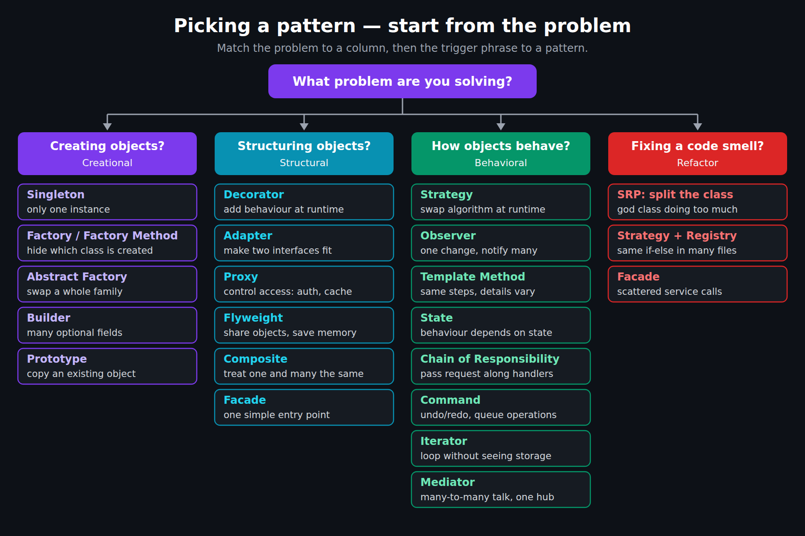
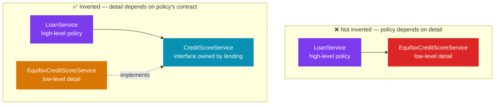
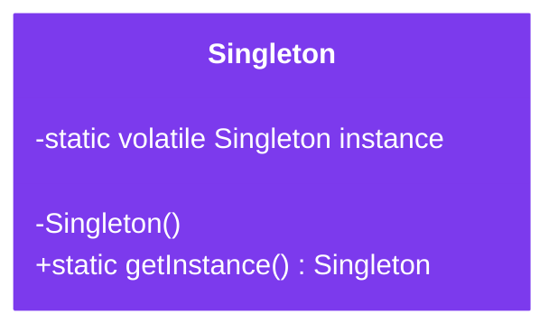
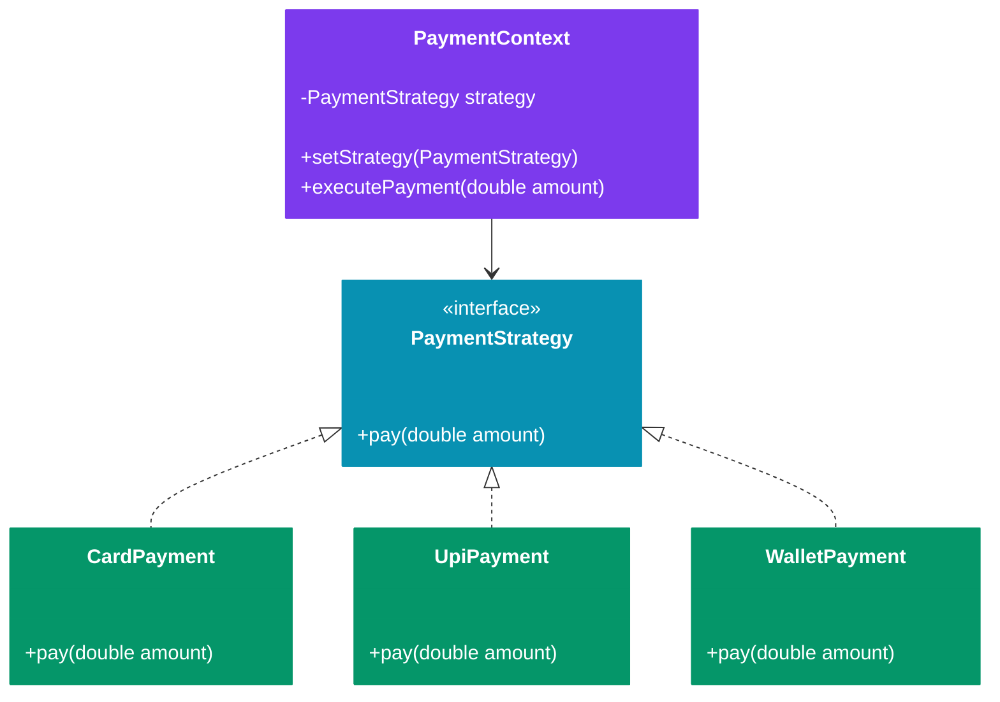
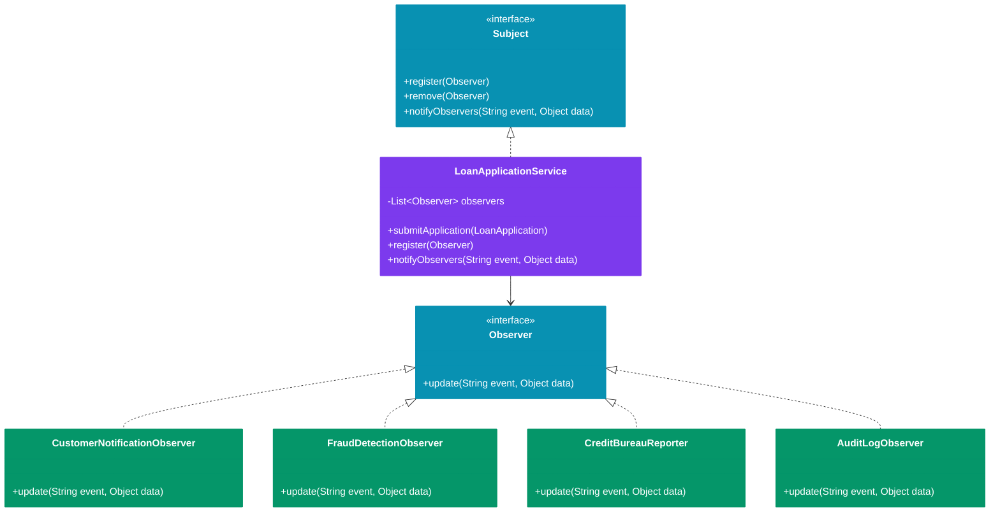
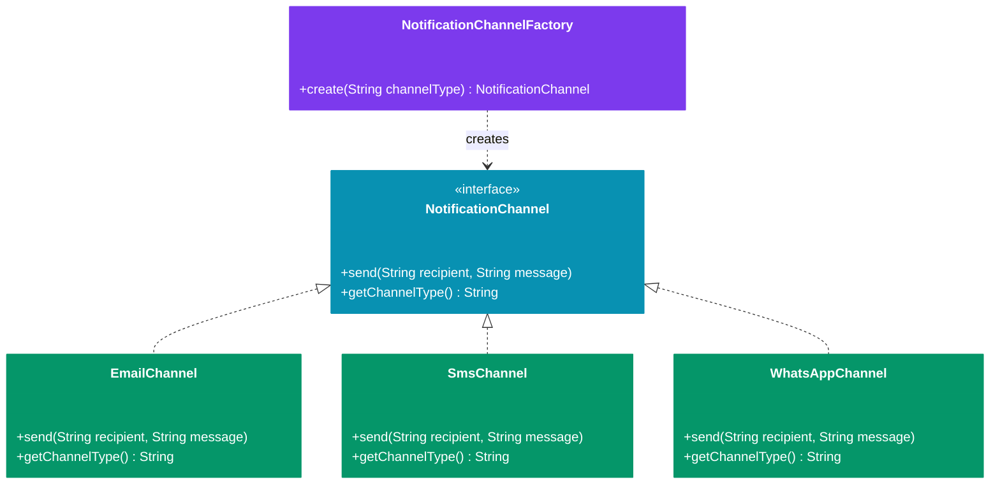
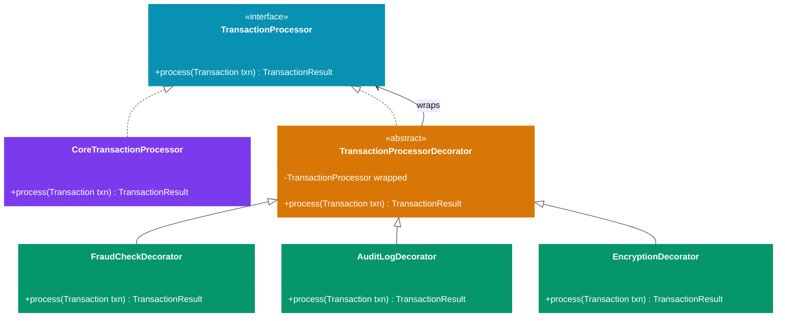
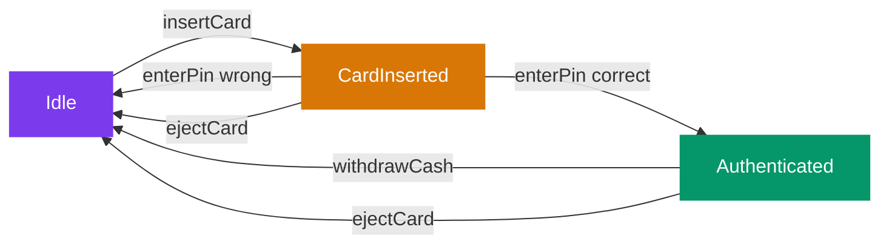
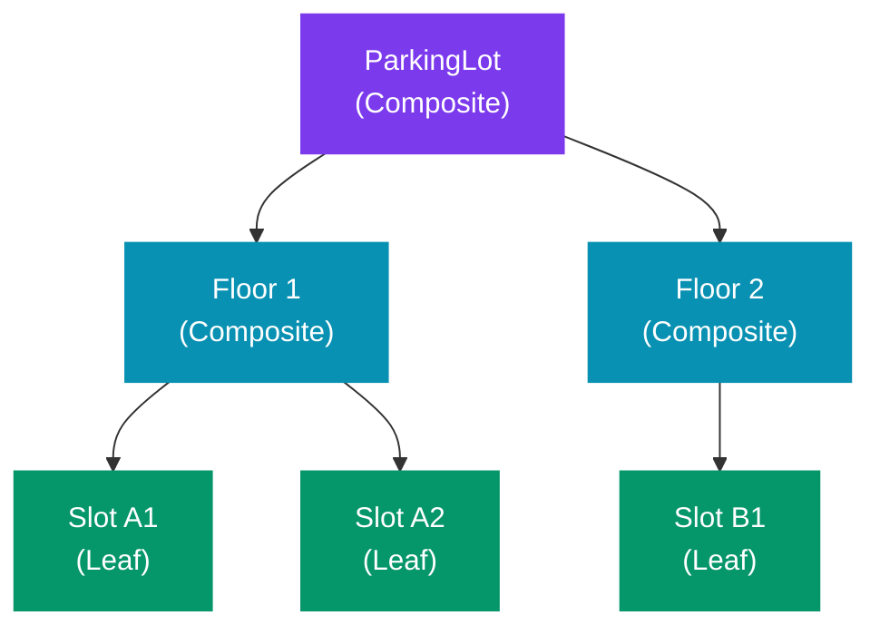

# LLD Interview — Design Patterns Master Guide

**Purpose:** This is not a list of all 23 GoF patterns. It is a focused guide for interviews. It covers **exactly what you need for LLD rounds at SDE II level** (PhonePe, CRED, Swiggy, Atlassian, Walmart Global Tech tier).

---

## 📑 Table of Contents

> 🔥🔥 Must know — asked in almost every Tier-1 LLD round &nbsp;·&nbsp; 🔥 High priority — very frequently asked &nbsp;·&nbsp; ⚡ Medium priority — skim once &nbsp;·&nbsp; 💤 Low priority — rarely asked

1. [The Right Mental Model for LLD Interviews 🔥](#1-the-right-mental-model-for-lld-interviews)
2. [SOLID Principles (More Important Than Patterns) 🔥🔥](#2-solid-principles-more-important-than-patterns)
   - [S — SRP 🔥🔥](#s--single-responsibility-principle-srp) · [O — OCP 🔥🔥](#o--openclosed-principle-ocp) · [L — LSP 🔥🔥](#l--liskov-substitution-principle-lsp) · [I — ISP 🔥](#i--interface-segregation-principle-isp) · [D — DIP 🔥🔥](#d--dependency-inversion-principle-dip)
   - [📋 SOLID — Summary Table 🔥🔥](#solid--summary-table)
3. [How to Structure Your LLD Answer 🔥🔥](#3-how-to-structure-your-lld-answer)
4. [The 7 Core Patterns 🔥🔥](#4-the-7-core-patterns)
   - [1. Singleton 🔥🔥](#1-singleton-pattern) · [2. Strategy 🔥🔥](#2-strategy-pattern) · [3. Observer 🔥🔥](#3-observer-pattern) · [4. Factory 🔥🔥](#4-factory-pattern) · [5. Builder 🔥🔥](#5-builder-pattern) · [6. Decorator 🔥](#6-decorator-pattern) · [7. Template Method 🔥](#7-template-method-pattern)
5. [Additional Patterns Worth Knowing (8–18) 🔥](#5-additional-patterns-worth-knowing)
   - [8. State 🔥](#8-state-pattern) · [9. Chain of Responsibility 🔥](#9-chain-of-responsibility-pattern) · [10. Command ⚡](#10-command-pattern) · [11. Proxy 🔥](#11-proxy-pattern) · [12. Composite 🔥](#12-composite-pattern) · [13. Iterator ⚡](#13-iterator-pattern) · [14. Mediator ⚡](#14-mediator-pattern) · [15. Prototype ⚡](#15-prototype-pattern) · [16. Flyweight ⚡](#16-flyweight-pattern) · [17. Adapter ⚡](#17-adapter-pattern) · [18. Facade ⚡](#18-facade-pattern)
   - [⚠️ Pattern Confusions — Easy to Mix Up 🔥🔥](#pattern-confusions--easy-to-mix-up)
6. [Pattern-to-LLD Problem Quick Reference 🔥](#6-pattern-to-lld-problem-quick-reference)
7. [Making Your LLD Thread-Safe 🔥🔥](#7-making-your-lld-thread-safe)
   - [7.1 The three questions to ask about any design 🔥](#71-the-three-questions-to-ask-about-any-design)
   - [7.2 The canonical race — allocating the last parking slot 🔥🔥](#72-the-canonical-race--allocating-the-last-parking-slot)
   - [7.3 Thread-safety by pattern — the follow-ups you'll actually get 🔥🔥](#73-thread-safety-by-pattern--the-follow-ups-youll-actually-get)
   - [7.4 The four tools, in order of preference 🔥](#74-the-four-tools-in-order-of-preference)
8. [Worked Example — Parking Lot, End-to-End 🔥🔥](#8-worked-example--parking-lot-end-to-end)
   - [8.1 Step 1 — Clarify requirements (2–3 min) 🔥](#81-step-1--clarify-requirements-23-min)
   - [8.2 Step 2 — Identify core entities (2 min) 💤](#82-step-2--identify-core-entities-2-min)
   - [8.3 Step 3 — Define relationships (3 min) ⚡](#83-step-3--define-relationships-3-min)
   - [8.4 Step 4 — Apply SOLID and name the patterns (5 min) 🔥🔥](#84-step-4--apply-solid-and-name-the-patterns-5-min)
   - [8.5 Step 5 — Key interfaces and classes 🔥](#85-step-5--key-interfaces-and-classes)
   - [8.6 Step 6 — Walk a use case through the design ⚡](#86-step-6--walk-a-use-case-through-the-design)
   - [8.7 The follow-ups this design is ready for 🔥🔥](#87-the-follow-ups-this-design-is-ready-for)
9. [Patterns in the Spring Framework 🔥](#9-patterns-in-the-spring-framework)
10. [Quick Revision Card 🔥](#10-quick-revision-card)
11. [Quick Pattern Picker — Problem → Pattern ⚡](#11-quick-pattern-picker--problem--pattern)

---



<a id="1-the-right-mental-model-for-lld-interviews"></a>
## 1. The Right Mental Model for LLD Interviews ⚡

Most candidates think LLD = "name and apply design patterns." That is wrong.

**What interviewers really check:**
1. Can you find the right classes and interfaces from an unclear problem?
2. Are your classes SOLID — single responsibility, loosely coupled, easy to extend?
3. When the problem needs a pattern, do you pick the right one without effort? And can you name it?

Design patterns are **not the goal**. They are the words you use to describe a well-designed solution.

- A SOLID design will end up using patterns on its own.
- A design that forces patterns in without SOLID thinking will feel unnatural. Interviewers can tell.

**Rule:** Learn SOLID well first. Then patterns will feel obvious.

---

<a id="2-solid-principles-more-important-than-patterns"></a>
## 2. SOLID Principles (More Important Than Patterns) 🔥

At its core, every LLD problem is a test of SOLID. Know these well enough to answer without thinking.

---

<a id="s--single-responsibility-principle-srp"></a>
### S — Single Responsibility Principle (SRP) 🔥🔥

> A class should have only one reason to change.

❌️ **Wrong:**
```java
class Invoice {
    void calculateTotal() { ... }
    void printInvoice() { ... }      // printing concern mixed in
    void saveToDatabase() { ... }    // persistence concern mixed in
}
```

✅ **Right:**
```java
class Invoice {
    void calculateTotal() { ... }
}
class InvoicePrinter {
    void print(Invoice invoice) { ... }
}
class InvoiceRepository {
    void save(Invoice invoice) { ... }
}
```

**In an interview:** When you start designing classes, always ask *"what is the one job of this class?"* If you can describe two jobs, split the class.

---

<a id="o--openclosed-principle-ocp"></a>
### O — Open/Closed Principle (OCP) 🔥🔥

> Classes should be open for extension, closed for modification.

Does a new feature force you to edit existing, working code? Then your design is wrong.

❌️ **Wrong:** Adding a new payment type means editing `PaymentProcessor`:
```java
class PaymentProcessor {
    void pay(String type) {
        if (type.equals("CARD")) { ... }
        else if (type.equals("UPI")) { ... }
        // Adding CRYPTO means editing this class ← violation
    }
}
```

✅ **Right:** Add a new payment type by adding a new class. Existing code gets zero edits:
```java
interface PaymentStrategy {
    void pay(double amount);
}
class CardPayment implements PaymentStrategy { ... }
class UpiPayment implements PaymentStrategy { ... }
class CryptoPayment implements PaymentStrategy { ... }  // new class, no old code touched
```

**In an interview:** OCP is the reason you pick the **Strategy** and **Factory** patterns. Do you see `if-else` chains that would grow with each new type? Then the code breaks OCP.

---

<a id="l--liskov-substitution-principle-lsp"></a>
### L — Liskov Substitution Principle (LSP) 🔥🔥

> You must be able to use a subclass in place of its parent class without breaking the program.

#### Classic Example — Rectangle / Square (the canonical interview example)

❌️ **Wrong:**
```java
class Rectangle {
    protected int width;
    protected int height;

    public void setWidth(int w) {
        this.width = w;
    }
    public void setHeight(int h) {
        this.height = h;
    }
    public int area() {
        return width * height;
    }
}

class Square extends Rectangle {
    @Override
    public void setWidth(int w) {
        this.width = w;
        this.height = w;   // must stay equal
    }

    @Override
    public void setHeight(int h) {
        this.width = h;    // overwrites width silently
        this.height = h;
    }
}
```

✅ **Right:** Don't model IS-A with inheritance when the behaviour contracts differ. Here they do. Use a shared interface:
```java
interface Shape { int area(); }

class Rectangle implements Shape {
    private final int width, height;
    Rectangle(int w, int h) { this.width = w; this.height = h; }
    public int area() {
        return width * height;
    }
}

class Square implements Shape {
    private final int side;
    Square(int side) { this.side = side; }
    public int area() {
        return side * side;
    }
}
// Neither can be substituted for the other — and nothing expects it to be
```

> 💡 **Key point to say in an interview:** *"In maths, a square IS a rectangle. But in OOP, IS-A is about behaviour contracts, not about real-world categories. Rectangle's contract says you can change width and height independently. Square can't keep that contract. So inheritance is the wrong tool here."*

#### Fintech Example — BankAccount / FixedDepositAccount

❌️ **Wrong:**
```java
class BankAccount {
    void deposit(double amount) { ... }
    void withdraw(double amount) { ... }
}
class FixedDepositAccount extends BankAccount {
    void withdraw(double amount) {
        throw new UnsupportedOperationException("Cannot withdraw before maturity"); // breaks contract
    }
}
// Any code that accepts BankAccount and calls withdraw() will blow up on FixedDepositAccount
```

✅ **Right:**
```java
interface BankAccount { void deposit(double amount); double getBalance(); }
interface LiquidAccount extends BankAccount { void withdraw(double amount); }

class SavingsAccount implements LiquidAccount { ... }
class CurrentAccount implements LiquidAccount { ... }
class FixedDepositAccount implements BankAccount { ... }  // no withdraw — correct
```

#### The four rules — what LSP *precisely* says

Start your answer with the simple idea above. The interviewer may ask for the formal statement. Then give these four behavioural-subtyping rules. Naming them shows you know the principle, not just a blog post about it:

| Rule | A subtype must not… | Where the bug shows up |
|---|---|---|
| **Preconditions** | …**strengthen** them. It can't ask more of the caller than the supertype did | `FixedDepositAccount.withdraw()` above does exactly this. It adds "only after maturity" to a method the parent said always works |
| **Postconditions** | …**weaken** them. It must give at least what the supertype promised | `Square.setHeight(5)` breaks `Rectangle`'s promise that width stays the same |
| **Invariants** | …break them. Anything true of the supertype for its whole life must stay true | `Rectangle`'s "width and height are independent" is an invariant `Square` cannot keep |
| **History constraint** | …allow state changes the supertype does not allow | A `MutablePoint` extends an immutable `Point` and adds `setX()`. Callers holding a `Point` fairly assume it never changes |

> 💡 **The one-liner:** *"LSP doesn't mean 'a subclass must compile in the parent's place'. It means a subtype may weaken preconditions and strengthen postconditions, never the reverse. It must also keep the supertype's invariants and its history constraint. An `UnsupportedOperationException` in an override is the clearest sign that a precondition was strengthened."*

**In an interview:** Look out for deep inheritance chains. Does a subclass throw `UnsupportedOperationException` for an inherited method? Then it breaks LSP. Flatten the hierarchy or use interfaces.

---

<a id="i--interface-segregation-principle-isp"></a>
### I — Interface Segregation Principle (ISP) 🔥

> Clients should not be forced to depend on methods they do not use.

❌️ **Wrong:** One large ("fat") interface forces every gateway to implement methods it doesn't support:
```java
interface PaymentGateway {
    void processCardPayment(CardDetails card);
    void processUpiPayment(String vpa);
    void processNetBankingPayment(String accountId);
    void processWalletPayment(String walletId);
    // A UPI-only gateway is forced to implement card/netbanking/wallet methods it doesn't support
}
```

✅ **Right:** Split by payment capability:
```java
interface CardPayable       { void processCardPayment(CardDetails card); }
interface UpiPayable        { void processUpiPayment(String vpa); }
interface NetBankingPayable { void processNetBankingPayment(String accountId); }
interface WalletPayable     { void processWalletPayment(String walletId); }

class RazorpayGateway implements CardPayable, UpiPayable, NetBankingPayable, WalletPayable { ... }
class BharatPeGateway implements UpiPayable { ... }  // UPI-only — implements only what it supports
```

**In an interview:** Keep interfaces small and focused. Does an implementing class leave a method body empty, or throw from it? Then the design breaks ISP. In fintech, payment gateways are a perfect example. Not every gateway supports every payment mode.

---

<a id="d--dependency-inversion-principle-dip"></a>
### D — Dependency Inversion Principle (DIP) 🔥🔥

> (a) High-level modules must not depend on low-level modules — **both depend on abstractions**.  
> (b) Abstractions must not depend on details — **details depend on abstractions**.

#### What actually gets inverted

"Depend on interfaces" is only **half** of clause (a). It's the half everyone says. The other half is **who owns the interface**. That ownership *is* the inversion.

Normally the arrow points downward. High-level policy (`LoanService`) depends on a low-level detail (`EquifaxCreditScoreService`). DIP turns this around. The **high-level module declares the abstraction in its own language**. So the low-level module is the one that has to follow it:



The dotted arrow in the right-hand box is the whole principle: **it points *up*.** The vendor now depends on *your* contract.

> ⚠️ **Coding to an interface is not DIP by itself.** Say you code against `EquifaxSdkClient`, an interface that the **vendor's JAR** defines. The arrow still points down. You are just as coupled as before. You have only put an interface in the middle. Ask: "If the vendor deleted this type tomorrow, would my domain stop compiling?" If yes, you never inverted anything.

**Clause (b) stops vendor details from leaking back into the abstraction and undoing the inversion.** The abstraction must not expose the vendor's types:
- no `EquifaxReportDto` in a return type
- no Equifax error codes in a thrown exception

Once the abstraction uses the detail's language, a vendor swap also changes the abstraction. Then you're back where you started.

---

❌️ **Wrong:** `LoanService` is tightly coupled to a specific credit score provider:
```java
class LoanService {
    private EquifaxCreditScoreService creditService = new EquifaxCreditScoreService();
    // Switching to CIBIL means editing LoanService — violation
}
```

✅ **Right:** the lending domain owns both the policy and the contract. The vendor package follows the contract:
```java
// ── package com.lending.underwriting ── high-level module: owns BOTH of these
public interface CreditScoreService {
    int fetchScore(String applicantId);          // lending's language, not Equifax's
}

public class LoanService {
    private final CreditScoreService creditService;   // depends on its OWN abstraction

    public LoanService(CreditScoreService creditService) {
        this.creditService = creditService;
    }

    public Decision underwrite(LoanApplication app) {
        int score = creditService.fetchScore(app.getApplicantId());
        return score >= 700 ? Decision.APPROVE : Decision.REFER;
    }
}

// ── package com.lending.integration.equifax ── low-level module: conforms to the contract
public class EquifaxCreditScoreService implements CreditScoreService {
    private final EquifaxSdkClient sdk;

    EquifaxCreditScoreService(EquifaxSdkClient sdk) {
        this.sdk = sdk;
    }

    @Override
    public int fetchScore(String applicantId) {
        EquifaxReportDto dto = sdk.pullReport(applicantId);   // vendor type never escapes
        return dto.getScoreBand().getValue();                 // ← clause (b) honoured here
    }
}
// Inject Equifax, CIBIL, or a stub in tests — zero changes to LoanService
```

#### DIP vs DI vs IoC — say these apart

Candidates mix up these three terms. Interviewers ask about them on purpose, to see if you can tell them apart.

| Term | What it is | How to tell |
|---|---|---|
| **DIP** | A **design principle** — which direction dependencies point, and which module owns the abstraction | It's about *package/module structure*. Holds with zero frameworks. |
| **DI** | A **technique** — a dependency is passed in from outside (constructor, setter, method arg). The class does not create it inside | It's about *how the object arrives*. |
| **IoC** | The **broad idea** — the framework calls your code, not the reverse. DI is one type; Template Method's Hollywood Principle is another | It's about *who controls the flow*. |

> 💡 **The difference interviewers reward:** *"You can have DI without DIP. Constructor-injecting a concrete `EquifaxCreditScoreService` is dependency injection. But the arrow still points at the vendor, so nothing was inverted. You can also have DIP without any container. Declaring the interface in your domain and wiring it by hand in `main()` is standard DIP. Spring makes DI easy. It doesn't give you DIP for free."*

**In an interview:**

---

<a id="solid--summary-table"></a>
### 📋 SOLID — Summary Table 🔥🔥

The whole section on one screen. Every example below is the same one explained above. So this table is also your night-before revision card.

| | Principle | The rule in one line | ❌️ Violation | ✅ The fix |
|---|---|---|---|---|
| **S** | **S**ingle Responsibility | A class should have exactly **one reason to change** | `Invoice` calculates totals **and** prints **and** saves to the DB — three teams can force an edit | Split into `Invoice` (calculate), `InvoicePrinter` (print), `InvoiceRepository` (persist) |
| **O** | **O**pen/Closed | Open for **extension**, closed for **modification** — new features add code, never edit working code | `PaymentProcessor.pay(String type)` with an `if/else` chain; adding CRYPTO means editing a tested class | `PaymentStrategy` interface — add `CryptoPayment` as a new class, zero edits to old code |
| **L** | **L**iskov Substitution | A subclass must work **anywhere its parent works**, without surprising the caller <br/> (You must be able to use a subclass in place of its parent class without breaking the program.) | `Square extends Rectangle` — `setHeight(5)` silently also sets width, so `area()` returns 25 not 100. `FixedDepositAccount.withdraw()` throws | Shared `Shape` interface instead of inheritance; split `BankAccount` / `LiquidAccount` so FD simply has no `withdraw` |
| **I** | **I**nterface Segregation | No client should be forced to depend on **methods it doesn't use** | One fat `PaymentGateway` forces a UPI-only gateway to implement card, netbanking and wallet methods | Role interfaces — `CardPayable`, `UpiPayable`, `NetBankingPayable`; each gateway implements only what it supports |
| **D** | **D**ependency Inversion | Both sides depend on **abstractions** — and the **high-level module owns** the abstraction (that's the *inversion*) | `LoanService` does `new EquifaxCreditScoreService()`, so switching to CIBIL edits `LoanService`. Equally wrong: coding to an interface the *vendor* defines | Declare `CreditScoreService` in the lending domain and constructor-inject it — the vendor implements *your* contract; swap providers, or pass a mock, with zero changes |

**How they fit together:**
- **SRP** comes first. You can't extend a class that does five things.
- **OCP** is the goal: extend without editing.
- **DIP** and **ISP** are the tools that make OCP possible. You depend on small abstractions you can swap.
- **LSP** is the safety rule. It makes sure your abstractions really do what they promise.

#### The smell → principle → pattern lookup

In an interview you use it in this direction. First you *notice a smell* (a sign of a design problem) in your own design. Then you name the principle and pick the fix.

| Smell you notice in your design | Principle violated | Usual fix |
|---|---|---|
| A class name needs "And" to describe it; unrelated concerns in one file | **SRP** | Extract classes; [**Facade**](#18-facade-pattern) if callers need one entry point |
| An `if/else` or `switch` on a type field that grows with every new feature | **OCP** | **Strategy**, **Factory** (registry variant), **State** |
| A subclass throws `UnsupportedOperationException` or no-ops an inherited method | **LSP** | Flatten the hierarchy, split the interface, favour composition over inheritance |
| An implementing class leaves method bodies empty just to satisfy the interface | **ISP** | Split the fat interface into small role interfaces |
| `new ConcreteThing()` inside business logic; you can't unit test without a real DB or third-party API | **DIP** | Constructor injection + **Factory**; code to the interface |

> 💡 **The line interviewers want to hear:** *"I treat SOLID as the design, and patterns as the words to describe it. If I must edit a working class to add a feature, that breaks OCP. The fix is almost always to move the part that changes behind an interface. That is exactly what Strategy and Factory do."*

---

<a id="3-how-to-structure-your-lld-answer"></a>
## 3. How to Structure Your LLD Answer 🔥

Follow this structure every time. Interviewers look for a step-by-step method, not just code.

**Step 1 — Clarify requirements (2–3 min)**
Ask: *"Should I focus on core flows or cover edge cases too?"*, *"Is this a single-node system?"*, *"Any specific limits on scale?"*

**Step 2 — Identify core entities/nouns (2 min)**
Read the problem and pick out the nouns. These are your possible classes.
> Parking Lot problem → `ParkingLot`, `ParkingFloor`, `ParkingSlot`, `Vehicle`, `Ticket`, `Payment`

**Step 3 — Define relationships (3 min)**
- `ParkingLot` has many `ParkingFloor`s
- `ParkingFloor` has many `ParkingSlot`s
- `Vehicle` is an interface implemented by `Car`, `Bike`, `Bus`

**Step 4 — Apply SOLID + name the patterns (5 min)**
- *"Pricing changes by vehicle — I'll use Strategy"*
- *"Vehicle creation — Factory, so ParkingLot doesn't know Car vs Bus"*
- *"One manager for the lot — Singleton"*

**Step 5 — Write key interfaces and classes**
Start with interfaces. Then concrete classes. Then the composition.

**Step 6 — Walk through a use case with your design**
*"When a car enters: `VehicleFactory.create("CAR")` → `ParkingLotManager.allocateSlot(vehicle)` → generates `Ticket` → on exit, `PricingStrategy.calculate(ticket)` → `Payment` processed."*

---

<a id="4-the-7-core-patterns"></a>
## 4. The 7 Core Patterns 🔥🔥

These patterns cover most LLD interview problems. Know them fully before you start anything in §5.

| Pattern | Category | One-Line Purpose | Deep Dive |
|---|---|---|---|
| **Singleton** | Creational | Exactly one instance of a class in the JVM | [📄](./03_Singleton_Design_Pattern_in_Java.md) |
| **Factory** | Creational | Put object creation in one place, behind one `create(type)` call (Simple Factory). GoF Factory Method leaves the choice to subclasses | [📄 Simple Factory](./04_1_Simple_Factory_Pattern_in_Java.md) · [📄 Method](./04_2_Factory_Method_Design_Pattern.md) · [📄 vs Abstract](./04_Factory_vs_Factory_Method_vs_Abstract_Factory_Design_Pattern.md) |
| **Builder** | Creational | Build complex objects step by step | [📄](./06_Builder_Design_Pattern_in_Java.md) |
| **Strategy** | Behavioural | Swap algorithms/behaviours at runtime | [📄](./10_Strategy_Design_Pattern_in_Java.md) |
| **Observer** | Behavioural | Notify many objects when one object changes | [📄](./11_Observer_Design_Pattern_in_Java.md) |
| **Decorator** | Structural | Add behaviour to objects without changing their class | [📄](./07_Decorator_Design_Pattern_in_Java.md) |
| **Template Method** | Behavioural | Define the fixed outline of an algorithm. Subclasses fill in the steps | [📄](./05_Template_Method_Design_Pattern.md) |

**Other pattern files in this folder** (not core LLD, but available for reference):

| File | Covered here? |
|---|---|
| [Adapter](./08_Adapter_Design_Pattern_in_Java.md) | Covered here as [pattern 17](#17-adapter-pattern) |
| [Abstract Factory](./04_3_Abstract_Factory_Design_Pattern.md) | Explained with code in [§4.4 Factory](#abstract-factory--the-third-member-of-the-family). Compared in the [Pattern Confusions](#pattern-confusions--easy-to-mix-up) table |
| [Prototype](./12_Prototype_Design_Pattern_in_Java.md) · [Flyweight](./09_Flyweight_Design_Pattern.md) · [Proxy](./13_Proxy_Design_Pattern_in_Java.md) | Covered in depth in [§5](#5-additional-patterns-worth-knowing) as patterns 11, 15, 16 |
| [State](./18_State_Design_Pattern_in_Java.md) · [Chain of Responsibility](./19_Chain_of_Responsibility_Design_Pattern_in_Java.md) | Longer notes for patterns [8](#8-state-pattern) and [9](#9-chain-of-responsibility-pattern): persistence, concurrency, chain assembly, filter-chain internals |
| [Anti-Patterns in Java](./14_Anti_Patterns_in_Java.md) | Not covered here. Worth a separate read (God object, singleton abuse, anemic domain model) |
| [Concurrent Design Patterns](./16_Concurrent_Design_Patterns_in_Java.md) | Adds to [§7 Thread-Safety](#7-making-your-lld-thread-safe) |
| [CQRS & Event Sourcing](./15_CQRS_and_Event_Sourcing.md) · [Repository & Unit of Work](./17_Repository_and_Unit_of_Work_Pattern.md) | Architecture patterns for the HLD/persistence layer, not GoF LLD |
| [Design Pattern Interview Q&A](../1_interview_questions/15_Design_Pattern_Interview_Questions.md) | Q&A drill format for all of the above |

---

<a id="1-singleton-pattern"></a>
### 1. Singleton Pattern — [Deep Dive →](./03_Singleton_Design_Pattern_in_Java.md) 🔥🔥

**Intent:** Make sure a class has only one instance. Give one global way to reach it.

**When to use it:** You need exactly one shared object. Examples: a logger, a configuration manager, a connection pool, a thread pool.

**The trigger words in an interview problem:** *"shared"*, *"global"*, *"only one"*, *"centralized"*.



**Thread-safe implementation (Double-Checked Locking — the most-discussed version):**

```java
public class ConnectionPool {
    private static final int POOL_SIZE = 10;

    // volatile: establishes a happens-before edge so a reader sees the FULLY
    // constructed object, and bars the specific publish-before-init reorder (below)
    private static volatile ConnectionPool instance;

    private final List<Connection> pool;

    private ConnectionPool() {
        pool = new ArrayList<>(POOL_SIZE);
        for (int i = 0; i < POOL_SIZE; i++) {
            pool.add(createConnection());   // actually open the connections up front
        }
    }

    private Connection createConnection() { ... }   // open a real DB connection

    public static ConnectionPool getInstance() {
        if (instance == null) {                       // First check (no lock)
            synchronized (ConnectionPool.class) {
                if (instance == null) {               // Second check (with lock)
                    instance = new ConnectionPool();
                }
            }
        }
        return instance;
    }

    public Connection getConnection() { ... }
}
```

**Why `volatile`?** It does two things.

- (1) **Visibility / happens-before:** a write to a `volatile` field happens-before any later read of it. So a thread that sees a non-null `instance` is guaranteed to see the fully-initialized object behind it.
- (2) **Blocks one specific reorder:** `instance = new ConnectionPool()` is really three steps: *allocate → construct → assign reference*.
  - Without `volatile`, the JIT/CPU may reorder this to *allocate → assign reference → construct*.
  - This publishes a non-null but **partially constructed** object.
  - Another thread that passes the first null-check would then use it.
  - `volatile` forbids that reorder.

**Why double-checked?**

- The outer `null` check avoids acquiring the lock on every call (for performance).
- The inner `null` check stops a second problem. Two threads may both pass the outer check. Without the inner check, both would create an instance.

> ⚠️ **Don't claim DCL (double-checked locking) is "the best" Singleton.** Interviewers often ask back, "why not the holder idiom?" Know these two other options. You can argue both are cleaner than DCL:

**Bill Pugh — static holder idiom (the version many interviewers prefer):** lazy, thread-safe, *no* `synchronized` and *no* `volatile`.

- The JVM guarantees that a class is initialized lazily, exactly once, on its first reference.
- So `INSTANCE` is created only when `getInstance()` is first called.
- The classloader does the locking for you.

```java
public class ConnectionPool {
    private ConnectionPool() { /* init pool... */ }

    private static class Holder {                       // not loaded until first use
        private static final ConnectionPool INSTANCE = new ConnectionPool();
    }

    public static ConnectionPool getInstance() {
        return Holder.INSTANCE;                          // triggers Holder init exactly once
    }
}
```

**Enum singleton (Joshua Bloch's recommendation — *Effective Java* Item 3):** the only approach that is safe against serialization and reflection with no extra code. Use it when you do not need lazy init for the singleton.

```java
public enum ConnectionPool {
    INSTANCE;
    public Connection getConnection() { ... }
}
// Usage: ConnectionPool.INSTANCE.getConnection();
```

> 💡 **One-liner to say:** *"For interviews I'd use the static holder idiom. It's lazy and thread-safe without any explicit locking. If serialization/reflection safety matters, Bloch recommends the enum singleton. DCL is worth knowing because it's the classic question. But it's the easiest of the three to get wrong."*

**Where it appears in LLD problems:**

| LLD Problem | Singleton Use |
|---|---|
| Parking Lot | `ParkingLotManager` — one manager for the whole lot |
| Logger system | `Logger` — one logger per application |
| Rate Limiter | `RateLimiterRegistry` — one registry of all limiters |
| Cache (LRU) | `CacheManager` — one cache instance |

**What to say in an interview:**
> *"I'll make `ParkingLotManager` a Singleton because there's only one physical parking lot. We never want two instances managing the same slots and fighting over them. I'll use the static holder idiom to make it thread-safe and lazy."*

**When NOT to use Singleton:**
- Don't use it for objects that hold mutable per-request state. Every thread shares the same instance, so you get race conditions.
- Don't use it too much as a replacement for a global variable. Hidden global state makes unit testing hard, because you can't inject a mock.
- Sometimes a class needs more than one instance in tests but not in production. Then Singleton is the wrong choice.

> ⚠️ **Interview trap:** If asked "what's wrong with Singleton?", say: *"It adds hidden global state. It makes classes hard to test in isolation. And if you don't implement it carefully, it can become a bottleneck under high concurrency."*

> ⚠️ **A Spring singleton is *not* a GoF Singleton.** This is the most common follow-up after "is `getInstance()` thread-safe?"
> - Singleton scope means **one instance per `ApplicationContext`**. It is not one per JVM, and not one per classloader.
> - Two contexts in one JVM give you **two instances of the same bean**. Examples: a parent/child web context, or several `@SpringBootTest` slices in one test run. So the GoF "exactly one" guarantee does not hold.
> - The bean is also a *managed* singleton. The container owns its lifecycle and gives it to you by injection. That is exactly why it doesn't have Singleton's testability problem.
> - The opposite case to name is `prototype` scope. It gives a new instance on every lookup. It is the same class, registered as the opposite of a singleton.

> ⚠️ **Serialization also breaks a hand-written Singleton.**
> - Deserializing a serialized singleton creates a **second** instance.
> - To stop this, the class must define `private Object readResolve() { return instance; }`. This method returns the one real instance in place of the new copy.
> - Reflection can also call a private constructor.
> - The enum singleton is safe from both, with no extra code. That is the main reason Bloch prefers it.

> ⚠️ **The trap inside the JDK question.** `Runtime.getRuntime()` is the expected answer (a classic eager Singleton — the instance is created at class-load time).
> - But `java.lang.System` is **not** a Singleton. It's a *non-instantiable static utility class* (private constructor, only static members like `System.out`). So there is no single *instance* at all.
> - Many candidates wrongly name System as a Singleton. It is an easy way to lose the interviewer's trust.
> - `java.awt.Desktop.getDesktop()` is a safe second example.

> **🎯 Interview footer — Singleton**  
> **Seen in:** `Runtime.getRuntime()` (eager JDK singleton). Spring beans are singleton-scoped by default — but one per `ApplicationContext`, not per JVM (see the note above).  
> **This invites:** *"Is `getInstance()` thread-safe?"* → holder idiom. *"Is a Spring singleton a GoF Singleton?"* → no, one per context. *"How do you unit-test a class that calls `getInstance()`?"* → you can't inject a stub. That is the honest argument against it. Then move to: "I'd register it as a single Spring bean and inject it."

---

<a id="2-strategy-pattern"></a>
### 2. Strategy Pattern — [Deep Dive →](./10_Strategy_Design_Pattern_in_Java.md) 🔥🔥

**Intent:** Define a family of algorithms. Put each one in its own class, and make them replaceable with each other. The client can switch algorithms without changing its own code.

**When to use it:** There are many ways to do the same thing. You need to switch between them at runtime, or add new ones without editing existing code.

**The trigger words:** *"multiple types of X"*, *"pluggable"*, *"configurable behaviour"*, *"can change at runtime"*.



```java
// Strategy interface
interface PaymentStrategy {
    void pay(double amount);
}

// Concrete strategies
class CardPayment implements PaymentStrategy {
    private final String cardNumber;
    CardPayment(String cardNumber) { this.cardNumber = cardNumber; }

    @Override
    public void pay(double amount) {
        System.out.println("Paid ₹" + amount + " via Card ending " + last4(cardNumber));
    }

    // Don't hardcode substring(12) — card numbers are 13–19 digits (Amex is 15)
    private static String last4(String pan) {
        return pan.substring(Math.max(0, pan.length() - 4));
    }
}

class UpiPayment implements PaymentStrategy {
    private final String upiId;
    UpiPayment(String upiId) { this.upiId = upiId; }

    @Override
    public void pay(double amount) {
        System.out.println("Paid ₹" + amount + " via UPI: " + upiId);
    }
}

// Context — holds a reference to the strategy, doesn't know which one
class PaymentContext {
    private PaymentStrategy strategy;

    public void setStrategy(PaymentStrategy strategy) {
        this.strategy = strategy;
    }

    public void executePayment(double amount) {
        strategy.pay(amount);
    }
}

// Usage
PaymentContext ctx = new PaymentContext();
ctx.setStrategy(new UpiPayment("alice@okicici"));
ctx.executePayment(1500.0);
// Switch at runtime — zero code change
ctx.setStrategy(new CardPayment("4111111111111234"));
ctx.executePayment(3000.0);
```

**Where it appears in LLD problems:**

| LLD Problem | Strategy Use |
|---|---|
| Parking Lot | `PricingStrategy` — hourly, daily, flat-rate |
| Make My Trip | `SortingStrategy` — sort by price, duration, rating |
| Inventory System | `DiscountStrategy` — seasonal, loyalty, bulk |
| Rate Limiter | `RateLimitAlgorithm` — token bucket, leaky bucket, fixed window |
| Cache | `EvictionStrategy` — LRU, LFU, FIFO |

**What to say in an interview:**
> *"I'll use Strategy for the pricing logic. Different vehicle types have different pricing — motorbike, car, bus. If I hardcode `if-else` in the `ParkingLot` class, adding electric vehicle pricing means editing existing code. With Strategy, I just add a new `ElectricVehiclePricing` class and inject it. Existing code stays untouched."*

#### `Comparator` — the JDK's Strategy, and why chaining matters

> 💡 The JDK answer here is **`Comparator`**. It is worth more than a one-line answer, because it shows strategies combined together:

```java
// Comparator IS a Strategy — it encapsulates the "how to compare" algorithm
List<Transaction> txns = getTransactions();

// Strategy 1: sort by amount ascending
txns.sort(Comparator.comparingDouble(Transaction::getAmount));

// Strategy 2: sort by date descending
txns.sort(Comparator.comparing(Transaction::getDate).reversed());

// Strategy 3: sort by account, then by amount
txns.sort(Comparator.comparing(Transaction::getAccountId)
                    .thenComparingDouble(Transaction::getAmount));
```

`Collections.sort(list, comparator)` takes the comparator as a Strategy.

- The sort algorithm stays the same. Only the comparison logic changes.
- This is exactly the Strategy pattern: the client (`sort`) is decoupled from the algorithm (`comparator`).

> **🎯 Interview footer — Strategy**  
> **Seen in:** `Comparator` passed to `Collections.sort` / `List.sort`; Spring Security's `AuthenticationProvider`; `RejectedExecutionHandler` on a thread pool.  
> **This invites:** *"Where do you choose the strategy?"* → factory, enum-keyed map, or Spring's injected `Map<String, Strategy>`. *"Can one instance be shared across threads?"* → only if it's stateless, which it should be.

---

<a id="3-observer-pattern"></a>
### 3. Observer Pattern — [Deep Dive →](./11_Observer_Design_Pattern_in_Java.md) 🔥🔥

**Intent:** When one object changes state, all objects that depend on it get notified automatically.

**When to use it:** One source of truth, and many consumers that need to react to its changes. Examples: event-driven systems, pub-sub, notification systems.

**The trigger words:** *"notify"*, *"alert"*, *"event"*, *"subscribe"*, *"broadcast"*, *"when X happens, do Y"*.



```java
// Observer interface
interface Observer {
    void update(String event, Object data);
}

// Subject interface
interface Subject {
    void register(Observer observer);
    void remove(Observer observer);
    void notifyObservers(String event, Object data);
}

// Concrete subject — fires events on loan lifecycle changes
class LoanApplicationService implements Subject {
    // CopyOnWriteArrayList, not ArrayList: observers can register/remove on one
    // thread while another thread is iterating in notifyObservers() — a plain
    // ArrayList would throw ConcurrentModificationException (or worse, miss updates).
    private final List<Observer> observers = new CopyOnWriteArrayList<>();

    @Override
    public void register(Observer observer) {
        observers.add(observer);
    }

    @Override
    public void remove(Observer observer) {
        observers.remove(observer);
    }

    @Override
    public void notifyObservers(String event, Object data) {
        observers.forEach(o -> o.update(event, data));
    }

    public void submitApplication(LoanApplication application) {
        // save application...
        notifyObservers("LOAN_APPLICATION_SUBMITTED", application);  // broadcasts to all observers
    }
}

// Concrete observers — each handles its own concern independently
class CustomerNotificationObserver implements Observer {
    @Override
    public void update(String event, Object data) {
        LoanApplication app = (LoanApplication) data;
        if ("LOAN_APPLICATION_SUBMITTED".equals(event)) {
            System.out.println("SMS sent to " + app.getApplicantPhone() +
                ": Your loan application #" + app.getId() + " has been received.");
        } else if ("LOAN_APPROVED".equals(event)) {
            System.out.println("Email sent: Your loan of ₹" + app.getAmount() + " is approved!");
        }
    }
}

class FraudDetectionObserver implements Observer {
    @Override
    public void update(String event, Object data) {
        if ("LOAN_APPLICATION_SUBMITTED".equals(event)) {
            LoanApplication app = (LoanApplication) data;
            System.out.println("Fraud check triggered for applicant: " + app.getApplicantId());
            // async fraud scoring...
        }
    }
}

// Wiring
LoanApplicationService loanService = new LoanApplicationService();
loanService.register(new CustomerNotificationObserver());
loanService.register(new FraudDetectionObserver());

loanService.submitApplication(new LoanApplication("APP-001", "CUST-101", 500000));
// Both observers fire independently — zero coupling between them
```

> ⚙️ **Sync vs async notify (mention this in interviews):**
> - The `observers.forEach(...)` above is **synchronous**. `submitApplication` blocks until every observer finishes.
> - So one slow or throwing observer stalls (or breaks) the rest.
> - In production you'd usually dispatch on an `ExecutorService`, or pass the event to a message broker / Spring's `@Async @EventListener`. Then observers run independently, and a failure in one does not affect the others.
> - The cost: async loses ordering. It also loses the simple guarantee "all observers are done when notify returns".

**Where it appears in LLD problems:**

| LLD Problem | Observer Use |
|---|---|
| Payment System | `PaymentService` → LedgerUpdater, FraudChecker, ReceiptEmailer, WalletSync |
| Notification System | `NotificationService` notifies Email, SMS, Push, WhatsApp observers |
| Stock ticker | `StockMarket` notifies all registered portfolio trackers |
| ATM / Locker System | `LockerAllocation` notifies user + logging service |

**What to say in an interview:**
> *"When a loan application is submitted, many systems need to react. We send an SMS to the customer, trigger fraud scoring, report to CIBIL, and write an audit log. If I call each of these directly from `LoanApplicationService`, it becomes tightly coupled to every downstream system. With Observer, `LoanApplicationService` just fires `LOAN_APPLICATION_SUBMITTED`. Each subscriber handles its own logic independently. Adding a new action, like a welcome email, needs zero change to `LoanApplicationService`. Spring's `ApplicationEventPublisher` works the same way internally."*

> **🎯 Interview footer — Observer**  
> **Seen in:** Spring's `ApplicationEventPublisher` / `@EventListener` (and `@TransactionalEventListener`); `PropertyChangeListener`. Note: `java.util.Observable` is **deprecated since Java 9**. Don't name it as current practice.  
> **This invites:** *"Sync or async?"* → the trade-off is already in this section, so use it. *"One observer throws — what happens to the others?"* *"Why Kafka rather than in-process events?"* → durability, cross-service delivery and replay. In-process is fine until you need any of those. Your real answer is the broker one, so this follow-up works in *your* favour.

---

<a id="4-factory-pattern"></a>
### 4. Factory Pattern — [Simple Factory →](./04_1_Simple_Factory_Pattern_in_Java.md) · [Factory Method →](./04_2_Factory_Method_Design_Pattern.md) · [All Three Compared →](./04_Factory_vs_Factory_Method_vs_Abstract_Factory_Design_Pattern.md) 🔥🔥

> ⚠️ **Use the exact name — interviewers test this.**
> - The code below is a **Simple Factory**: a static `create(type)` method with a `switch`. It is convenient and the most common in LLD. But it is *not* one of the 23 GoF patterns.
> - The GoF **Factory Method** is different. It leaves the choice of which class to create to *subclasses*, through an overridden method, not a `switch`.
> - Don't call the snippet below "Factory Method". Call it "a Simple Factory." A real Factory Method snippet comes after it.

**Intent (Simple Factory):** Put object-creation logic in one method and hide it there. Then callers depend only on the product interface, not on concrete classes or constructors.

**When to use it:** You need to create objects, but you don't know the exact type until runtime. Or you want to hide the creation logic from the caller.

**The trigger words:** *"create based on type"*, *"different kinds of X"*, *"don't expose constructor"*, *"decouple creation from usage"*.



```java
// Product interface
interface NotificationChannel {
    void send(String recipient, String message);
    String getChannelType();
}

// Concrete products
class EmailChannel implements NotificationChannel {
    public void send(String recipient, String message) {
        System.out.println("Email → " + recipient + ": " + message);
    }
    public String getChannelType() {
        return "EMAIL";
    }
}

class SmsChannel implements NotificationChannel {
    public void send(String recipient, String message) {
        System.out.println("SMS → " + recipient + ": " + message);
    }
    public String getChannelType() {
        return "SMS";
    }
}

class WhatsAppChannel implements NotificationChannel {
    public void send(String recipient, String message) {
        System.out.println("WhatsApp → " + recipient + ": " + message);
    }
    public String getChannelType() {
        return "WHATSAPP";
    }
}

class PushNotificationChannel implements NotificationChannel {
    public void send(String recipient, String message) {
        System.out.println("Push → device:" + recipient + ": " + message);
    }
    public String getChannelType() {
        return "PUSH";
    }
}

// Factory — the only place that knows about concrete channel classes
class NotificationChannelFactory {
    public static NotificationChannel create(String channelType) {
        return switch (channelType.toUpperCase()) {
            case "EMAIL"    -> new EmailChannel();
            case "SMS"      -> new SmsChannel();
            case "WHATSAPP" -> new WhatsAppChannel();
            case "PUSH"     -> new PushNotificationChannel();
            default         -> throw new IllegalArgumentException("Unknown channel: " + channelType);
        };
    }
}

// Caller knows nothing about EmailChannel, SmsChannel, etc.
NotificationChannel channel = NotificationChannelFactory.create("SMS");
channel.send("+919999999999", "Your EMI of ₹12,500 is due on 10 May.");
```

> ⚠️ **The `switch` breaks OCP (Open/Closed Principle), which this guide teaches, and it is easy to miss.**
> - Adding a new channel (say RCS) means *editing* the factory's `switch`.
> - That is exactly the "edit existing, working code" problem that OCP warns against.
> - It's fine for 4–5 stable types: it is readable, and there is one place to look.
> - But it doesn't scale. Every change to the factory forces a recompile and retest, so it becomes a bottleneck.

**Registry variant — closed for modification, open for extension.** Replace the `switch` with a `Map<String, Supplier<NotificationChannel>>`. Adding a channel becomes a one-line `register(...)` call, with zero edits to existing branches:

```java
class NotificationChannelFactory {
    // each value is a fresh-instance supplier, so callers still get a new channel per create()
    private static final Map<String, Supplier<NotificationChannel>> REGISTRY = new ConcurrentHashMap<>();

    static {
        register("EMAIL",    EmailChannel::new);
        register("SMS",      SmsChannel::new);
        register("WHATSAPP", WhatsAppChannel::new);
        register("PUSH",     PushNotificationChannel::new);
    }

    public static void register(String type, Supplier<NotificationChannel> supplier) {
        REGISTRY.put(type.toUpperCase(), supplier);     // extend without editing create()
    }

    public static NotificationChannel create(String channelType) {
        Supplier<NotificationChannel> supplier = REGISTRY.get(channelType.toUpperCase());
        if (supplier == null) throw new IllegalArgumentException("Unknown channel: " + channelType);
        return supplier.get();
    }
}
```

> **Trade-off:**
> - You gain: the registry lets you add types at runtime.
> - You lose: the `switch`'s compile-time check that all cases are covered, and its easy readability.
> - A key with a typo now fails at runtime. With the `switch`, it would be a missing `case`.
> - Use the `switch` for a small, fixed set. Use the registry once channels work like plugins or other modules register them.

**The Spring idiom (what you'd actually do in a Spring app).**

- Make each channel a `@Component`. Let Spring inject a `Map<String, NotificationChannel>`.
- Spring fills this map automatically, keyed by **bean name**.
- So the factory needs no `switch` *and* no manual registry.
- Adding a channel = adding a `@Component`:

```java
@Component("EMAIL")    class EmailChannel implements NotificationChannel { ... }
@Component("SMS")      class SmsChannel   implements NotificationChannel { ... }
@Component("WHATSAPP") class WhatsAppChannel implements NotificationChannel { ... }

@Service
class NotificationChannelFactory {
    private final Map<String, NotificationChannel> channels;   // bean name → bean

    // Spring injects every NotificationChannel bean, keyed by its bean name
    NotificationChannelFactory(Map<String, NotificationChannel> channels) {
        this.channels = channels;
    }

    public NotificationChannel create(String channelType) {
        NotificationChannel channel = channels.get(channelType.toUpperCase());
        if (channel == null) throw new IllegalArgumentException("Unknown channel: " + channelType);
        return channel;
    }
}
```

> 💡 **One-liner:** *"A `switch` factory is simplest, but it breaks OCP — every new type edits it. I'd move to a `Map` registry. In Spring, I'd just inject `Map<String, NotificationChannel>`. The container wires every channel bean by name, so adding a channel only means adding a new `@Component`."*
>
> Note: these Spring beans are singletons. So the injected map returns the **same** instance per type. That is fine for stateless channels. Use the `Supplier` registry if you need a new instance per call.

**The *real* GoF Factory Method** (for when an interviewer insists on the difference): the creator is abstract. Each subclass overrides the factory method to decide the concrete product. There is no `switch`. The choice comes from *which subclass you use*.

```java
// Creator declares the factory method; the rest of its logic depends only on the interface
abstract class NotificationService {
    protected abstract NotificationChannel createChannel();   // ← the factory method

    public void notify(String recipient, String message) {    // shared flow, type-agnostic
        NotificationChannel channel = createChannel();
        channel.send(recipient, message);
    }
}

// Each subclass decides the concrete product
class EmailNotificationService extends NotificationService {
    protected NotificationChannel createChannel() {
        return new EmailChannel();
    }
}
class SmsNotificationService extends NotificationService {
    protected NotificationChannel createChannel() {
        return new SmsChannel();
    }
}
```

> 💡 **One-liner:** *"In practice I'd use a Simple Factory — one `create(type)` method. In the GoF Factory Method, subclasses override the creator. You use it when the surrounding workflow is shared, but each subclass fixes its own product type."*

<a id="abstract-factory--the-third-member-of-the-family"></a>
#### Abstract Factory — the third member of the family

**Intent:** Create **families of related products** through one interface. Then the client can't mix products from different families by mistake.

The key difference: **Factory Method creates one product. Abstract Factory creates a set of products that must match each other.** Use it when two or more objects only work together if they come from the same vendor/theme/platform.

A credit-bureau integration is the obvious fintech example. Parsing a CIBIL report with an Experian score-mapper is a bug that gives no error and costs a lot:

```java
// The family of related products
interface CreditReportParser { CreditReport parse(String rawPayload); }
interface ScoreMapper        { int toInternalBand(CreditReport report); }

// The abstract factory — one interface, one method per product in the family
interface BureauIntegrationFactory {
    CreditReportParser createParser();
    ScoreMapper        createScoreMapper();
}

// Concrete factory 1 — every product it hands back is CIBIL-shaped
class CibilIntegrationFactory implements BureauIntegrationFactory {
    public CreditReportParser createParser() {
        return new CibilReportParser();
    }
    public ScoreMapper createScoreMapper() {
        return new CibilScoreMapper();          // CIBIL band: 300–900
    }
}

// Concrete factory 2 — a different family, internally consistent
class ExperianIntegrationFactory implements BureauIntegrationFactory {
    public CreditReportParser createParser() {
        return new ExperianReportParser();
    }
    public ScoreMapper createScoreMapper() {
        return new ExperianScoreMapper();
    }
}

// Client — swaps the whole family in one line; can't mix a CIBIL parser with an Experian mapper
class UnderwritingService {
    private final CreditReportParser parser;
    private final ScoreMapper mapper;

    UnderwritingService(BureauIntegrationFactory factory) {   // one swap point
        this.parser = factory.createParser();
        this.mapper = factory.createScoreMapper();
    }
}
```

> 💡 **One-liner:** *"You use Abstract Factory when the products come in sets that must match. With a plain Factory, I could pass a CIBIL parser to an Experian score-mapper. I'd get a wrong band with no error. The abstract factory makes that combination impossible to build. You pick the family once, and every product you get matches it."*

> ⚠️ **The cost — mention it before you're asked:**
> - Adding a *new product to the family* (say a `PullClient`) means editing the factory interface and **every** implementation.
> - So Abstract Factory is open to new families, but closed to new products.
> - That's the standard criticism. Naming it before you're asked is worth more than the pattern itself.

**Where it appears in LLD problems:**

| LLD Problem | Factory Use |
|---|---|
| Notification System | `NotificationChannelFactory.create("SMS")` — Email, SMS, WhatsApp, Push |
| Payment Gateway | `PaymentGatewayFactory.create("RAZORPAY")` — Razorpay, Stripe, PayU |
| KYC Verification | `KycProviderFactory.create("DIGILOCKER")` — DigiLocker, UIDAI, Video KYC |
| Rate Limiter | `RateLimiterFactory.create("TOKEN_BUCKET")` — token bucket, leaky bucket |
| Chess | `PieceFactory.create("KNIGHT")` — King, Queen, Rook, Knight |

**What to say in an interview:**

> **🎯 Interview footer — Factory**  
> **Seen in:** Spring's `BeanFactory` / `ApplicationContext` (the IoC container is one giant factory); `DriverManager.getConnection()`; `Calendar.getInstance()`; `Integer.valueOf()` (which is also a Flyweight factory).  
> **This invites:** *"Your `switch` violates OCP — fix it"* → registry or Spring `Map` injection, both in this section. *"Simple Factory or Factory Method?"* → use the exact name. That difference is the trap.

---

<a id="5-builder-pattern"></a>
### 5. Builder Pattern — [Deep Dive →](./06_Builder_Design_Pattern_in_Java.md) 🔥🔥

**Intent:** Build a complex object step by step. Keep the building of a complex object separate from its representation (the final object).

**When to use it:** An object has many fields, especially optional ones. Telescoping constructors (many overloads of one constructor) are a code smell. Builder fixes them.

**The trigger words:** *"many optional fields"*, *"complex object construction"*, *"step-by-step"*, *"immutable object with many params"*.

```java
// Without Builder — telescoping constructor problem
// (matches the 6-field class below: applicantId, amount, tenure, loanType, coApplicantId, isEmployed)
new LoanApplication(applicantId, amount, 24, "HOME", null, true);
// What does 'true' mean? What is that null? Unreadable, and swapping two same-typed
// args compiles silently.

// With Builder — readable, safe, and immutable
LoanApplication loan = new LoanApplication.Builder(applicantId, amount)
    .tenure(24)
    .loanType("HOME")
    .isEmployed(true)
    .build();
```

```java
public class LoanApplication {
    // All fields final — immutable after build
    private final String applicantId;
    private final double amount;
    private final int tenure;           // optional
    private final String loanType;      // optional
    private final String coApplicantId; // optional
    private final boolean isEmployed;   // optional

    // Private constructor — only Builder can call it
    private LoanApplication(Builder builder) {
        this.applicantId   = builder.applicantId;
        this.amount        = builder.amount;
        this.tenure        = builder.tenure;
        this.loanType      = builder.loanType;
        this.coApplicantId = builder.coApplicantId;
        this.isEmployed    = builder.isEmployed;
    }

    public static class Builder {
        // Required fields
        private final String applicantId;
        private final double amount;
        // Optional fields — default values
        private int tenure        = 12;
        private String loanType   = "PERSONAL";
        private String coApplicantId = null;
        private boolean isEmployed   = false;

        public Builder(String applicantId, double amount) {
            this.applicantId = applicantId;
            this.amount      = amount;
        }

        public Builder tenure(int tenure) {
            this.tenure = tenure; return this;
        }
        public Builder loanType(String loanType) {
            this.loanType = loanType; return this;
        }
        public Builder coApplicant(String coApplicantId) {
            this.coApplicantId = coApplicantId; return this;
        }
        public Builder isEmployed(boolean isEmployed) {
            this.isEmployed = isEmployed; return this;
        }

        public LoanApplication build() {
            // Validation logic here — before the object is created
            if (amount <= 0) throw new IllegalArgumentException("Amount must be positive");
            return new LoanApplication(this);
        }
    }
}

// Usage
LoanApplication homeLoan = new LoanApplication.Builder("APP-001", 5000000)
    .tenure(240)
    .loanType("HOME")
    .coApplicant("APP-002")
    .isEmployed(true)
    .build();
```

> 💡 **In real code you rarely write this by hand.** Put Lombok's `@Builder` on the class. At compile time it generates the whole static `Builder`: the fluent setters, `build()`, and a package-private all-args constructor. Add `@Value` to make the class immutable.
>
> - For interviews, know the manual version. Interviewers want to see that you understand how it works.
> - Also say that `@Builder` is what teams use every day.

**Where it appears in LLD problems:**

| LLD Problem | Builder Use |
|---|---|
| Make My Trip | `FlightBooking.Builder` — passengers, seat class, meal, baggage |
| Inventory System | `Product.Builder` — name, SKU, price, dimensions, weight |
| Parking Lot | `ParkingTicket.Builder` — vehicle, slot, entry time, charges |
| Chess | `GameConfig.Builder` — timer, variant, player names |

**What to say in an interview:**

#### The two JDK Builders — and how they differ

> 💡 `HttpClient` (Java 11+) and `StringBuilder` are both Builders, but of **different kinds**. Know which one you mean:

```java
// java.net.http.HttpClient — fluent Builder in the standard library
HttpClient client = HttpClient.newBuilder()
    .connectTimeout(Duration.ofSeconds(10))
    .followRedirects(HttpClient.Redirect.NORMAL)
    .version(HttpClient.Version.HTTP_2)
    .build();

// java.lang.StringBuilder — the classic, simpler variant
String result = new StringBuilder()
    .append("Account: ")
    .append(accountId)
    .append(" | Balance: ₹")
    .append(balance)
    .toString();
```

- `HttpClient.newBuilder()` is Bloch's fluent Builder. It handles complex optional config, and the result is immutable once built.
- `StringBuilder` is the simpler variant. It collects values in a mutable object, and `toString()` is the final step.
- Both avoid telescoping constructors.

> **🎯 Interview footer — Builder**  
> **Seen in:** `HttpClient.newBuilder()` (Java 11+), `StringBuilder`, `Stream.builder()`, `Locale.Builder`; Lombok's `@Builder` in day-to-day code.  
> **This invites:** *"Why not just setters?"* → then the object is mutable and can exist half-built. *"Builder vs a record with a static factory?"* → records are better for 3–4 fields; Builder is better for more. *"Is the Builder thread-safe?"* → no, and it doesn't need to be.

---

<a id="6-decorator-pattern"></a>
### 6. Decorator Pattern — [Deep Dive →](./07_Decorator_Design_Pattern_in_Java.md) 🔥

**Intent:** Add new behaviour to an object at runtime by wrapping it. You do not change the original class, and you avoid a subclass explosion (too many subclasses).

**When to use it:** You need to stack optional behaviours on top of a base object. A subclass for each new combination would cause a class explosion.

**The trigger words:** *"add features optionally"*, *"layers of behaviour"*, *"wrap"*, *"middleware"*, *"enhance without changing"*.



```java
// Component interface
interface TransactionProcessor {
    TransactionResult process(Transaction txn);
}

// Concrete base — core debit/credit logic, nothing else
class CoreTransactionProcessor implements TransactionProcessor {
    @Override
    public TransactionResult process(Transaction txn) {
        System.out.println("Processing ₹" + txn.getAmount() +
            " [" + txn.getType() + "] for account: " + txn.getAccountId());
        return TransactionResult.success(txn.getId());
    }
}

// Abstract decorator — wraps a TransactionProcessor
abstract class TransactionProcessorDecorator implements TransactionProcessor {
    protected final TransactionProcessor wrapped;
    TransactionProcessorDecorator(TransactionProcessor wrapped) { this.wrapped = wrapped; }
}

// Concrete decorators — each adds exactly one concern
class FraudCheckDecorator extends TransactionProcessorDecorator {
    FraudCheckDecorator(TransactionProcessor wrapped) { super(wrapped); }

    @Override
    public TransactionResult process(Transaction txn) {
        if (txn.getAmount() > 100000) {
            System.out.println("[FRAUD CHECK] High-value transaction flagged for review: ₹" + txn.getAmount());
            // could throw or return PENDING_REVIEW here
        }
        return wrapped.process(txn);
    }
}

class AuditLogDecorator extends TransactionProcessorDecorator {
    AuditLogDecorator(TransactionProcessor wrapped) { super(wrapped); }

    @Override
    public TransactionResult process(Transaction txn) {
        System.out.println("[AUDIT] START — txnId: " + txn.getId() + ", amount: ₹" + txn.getAmount());
        TransactionResult result = wrapped.process(txn);
        System.out.println("[AUDIT] END — status: " + result.getStatus());
        return result;
    }
}

class EncryptionDecorator extends TransactionProcessorDecorator {
    EncryptionDecorator(TransactionProcessor wrapped) { super(wrapped); }

    @Override
    public TransactionResult process(Transaction txn) {
        System.out.println("[ENCRYPT] Masking sensitive fields for txn: " + txn.getId());
        // Pass a masked COPY downstream — never mutate the caller's object in place.
        // An in-place txn.maskSensitiveData() would leak the change back to whoever
        // constructed the Transaction, and to any sibling that still holds the original.
        return wrapped.process(txn.withMaskedPan());
    }
}

// Usage — stack behaviours at runtime, no subclass explosion
TransactionProcessor processor =
    new AuditLogDecorator(
        new FraudCheckDecorator(
            new EncryptionDecorator(
                new CoreTransactionProcessor())));

processor.process(new Transaction("TXN-001", "DEBIT", 250000, "ACC-101"));
// Flow: AuditLog START → FraudCheck → Encrypt → Core debit → AuditLog END
```

> ⚠️ **Decorators should transform, not mutate.**
>
> - Some decorators edit the object they receive, instead of passing a modified copy downstream. Then the decorator is no longer a transparent wrapper.
> - The caller's object changes without the caller knowing. The order of decorators then matters, and nothing warns you.
> - So keep the component's input immutable. Return or forward new values.
>
> This also matters for **ordering**. Take `AuditLog(FraudCheck(Encrypt(Core)))`. Audit and fraud-check both sit outside the encrypt layer. So both see the *unmasked* transaction, PAN included. Only `Core` gets the masked copy. Interviewers do ask "what happens if you reorder these?"

**Where it appears in LLD problems:**

| LLD Problem | Decorator Use |
|---|---|
| Payment Processing | Wrap `CoreTransactionProcessor` with FraudCheck + AuditLog + Encryption decorators |
| Loan Eligibility | Wrap base checker with CreditScore + Blacklist + Dedupe + IncomeVerification decorators |
| Notification System | Wrap base notifier with Retry + RateLimit + Logging decorators |
| API Gateway | Chain auth + rate-limit + logging middleware (same concept) |
| KYC Pipeline | Wrap base verifier with OCR + Liveness + Sanctions-check decorators |

**What to say in an interview:**
> *"A payment transaction needs fraud-checking, audit logging, and field encryption. But it does not always need the same combination. A high-value NEFT needs all three. A micro-payment might skip fraud-check. A subclass for every combination causes a class explosion: `FraudAuditEncryptProcessor`, `AuditEncryptProcessor`, and so on. Decorator lets me compose exactly what I need: `new AuditLogDecorator(new FraudCheckDecorator(new CoreTransactionProcessor()))`. Each decorator does one thing. I can add or remove layers at runtime without touching existing code."*

#### Java I/O Streams — Decorator in the standard library

> 💡 The expected answer is **Java I/O**. Show the full stack, not just one class name. The point is that each layer adds exactly one capability:

```java
// Each class wraps the same InputStream interface and adds one behaviour
InputStream raw        = new FileInputStream("transactions.csv");     // base component
InputStream buffered   = new BufferedInputStream(raw);               // adds buffering
InputStream unzipped   = new GZIPInputStream(buffered);              // adds decompression
Reader      reader     = new InputStreamReader(unzipped, "UTF-8");   // Adapter, not Decorator: bytes → chars
BufferedReader lines   = new BufferedReader(reader);                 // adds line-by-line reading

// Or the familiar one-liner — stacked wrappers (InputStreamReader is the Adapter):
BufferedReader br = new BufferedReader(new InputStreamReader(new FileInputStream("data.csv")));
```

Each decorator has the same type as the object it wraps (`InputStream` wraps `InputStream`, `Reader` wraps `Reader`). It delegates to that object. That's Decorator. `InputStreamReader` is the exception: it turns an `InputStream` into a `Reader`, so it is an [Adapter](#17-adapter-pattern). `BufferedInputStream` does not know or care whether it wraps a `FileInputStream` or a `GZIPInputStream`.

> *"The Java I/O library is a standard Decorator implementation. `BufferedInputStream` wraps an `InputStream`, and `BufferedReader` wraps a `Reader`. Each keeps the same type and adds one capability, like buffering. `InputStreamReader` in the middle is an Adapter, not a Decorator: it turns bytes into chars. I'd use exactly the same structure for a `TransactionProcessor` pipeline."*

> **🎯 Interview footer — Decorator**  
> **Seen in:** Java I/O — `BufferedReader(new InputStreamReader(new FileInputStream(...)))`; `Collections.unmodifiableList()` / `synchronizedList()`; Servlet `HttpServletRequestWrapper`.  
> **This invites:** *"What if you reorder the layers?"* This is the strongest follow-up here. The callout above answers it. *"How is this different from Proxy?"* *"Why not just use Spring AOP?"* → AOP is the right answer for cross-cutting concerns across many beans. Explicit decorators are better when the ordering is domain logic you want visible.

---

<a id="7-template-method-pattern"></a>
### 7. Template Method Pattern — [Deep Dive →](./05_Template_Method_Design_Pattern.md) 🔥

**Intent:** Define the skeleton of an algorithm in a base class. Leave some steps to subclasses. Subclasses can override specific steps without changing the algorithm's overall structure.

**When to use it:** Multiple classes share the same process flow, but differ only in specific steps.

**The trigger words:** *"same overall flow"*, *"steps vary by type"*, *"common process"*, *"hook methods"*.

```java
// Abstract class with the template method
abstract class LoanDisbursementFlow {

    // Template method — fixed disbursement flow, cannot be overridden
    public final void disburse(LoanApplication application) {
        validateApplication(application);       // fixed — same for all loan types
        performCreditCheck(application);        // fixed — always hits credit bureau
        calculateInterestAndEmi(application);   // VARIES — personal vs home loan formula differs
        if (requiresCollateralCheck(application)) {  // HOOK — drives an optional step
            verifyCollateral(application);
        }
        executeDisbursement(application);       // VARIES — NEFT for home loan, instant for personal
        notifyCustomerAndAuthorities(application); // fixed — always SMS + audit log
    }

    // Hook method — overridable no-op with a sensible default.
    // Base returns false; a subclass opts in by overriding. Subclasses that
    // don't care simply ignore it — that's the point of a hook.
    protected boolean requiresCollateralCheck(LoanApplication app) {
        return false;
    }

    protected void verifyCollateral(LoanApplication app) {
        System.out.println("Verifying pledged collateral for application #" + app.getId());
    }

    // Common steps — identical for all loan types
    private void validateApplication(LoanApplication app) {
        System.out.println("Validating application #" + app.getId() + " — KYC, age, income docs...");
    }

    private void performCreditCheck(LoanApplication app) {
        System.out.println("Fetching CIBIL score for " + app.getApplicantId() + "...");
    }

    private void notifyCustomerAndAuthorities(LoanApplication app) {
        System.out.println("SMS sent to customer. Audit log written. CIBIL notified.");
    }

    // Abstract steps — each loan type implements differently
    protected abstract void calculateInterestAndEmi(LoanApplication application);
    protected abstract void executeDisbursement(LoanApplication application);
}

// Concrete implementations — only override the steps that differ
class PersonalLoanDisbursement extends LoanDisbursementFlow {
    @Override
    protected void calculateInterestAndEmi(LoanApplication app) {
        // Flat-rate interest, short tenure. Flat rate means interest is charged on the
        // ORIGINAL principal for the whole tenure, then principal + interest are divided
        // evenly across the months — that is the whole formula:
        double years   = app.getTenureMonths() / 12.0;
        double payable = app.getAmount() * (1 + 0.14 * years);
        System.out.println("Personal Loan: flat 14% p.a., EMI = ₹" +
            (payable / app.getTenureMonths()));
    }

    @Override
    protected void executeDisbursement(LoanApplication app) {
        System.out.println("Instant disbursal via IMPS to account: " + app.getBankAccountId());
    }
}

class HomeLoanDisbursement extends LoanDisbursementFlow {
    @Override
    protected boolean requiresCollateralCheck(LoanApplication app) {
        return true;   // home loans are secured — opt in to the hook step
    }

    @Override
    protected void calculateInterestAndEmi(LoanApplication app) {
        // reducing-balance interest, long tenure, legal/valuation involved
        System.out.println("Home Loan: reducing balance 8.5% p.a. over " +
            app.getTenureMonths() + " months. Legal verification required.");
    }

    @Override
    protected void executeDisbursement(LoanApplication app) {
        System.out.println("Staged disbursal via NEFT to builder account: " + app.getBankAccountId() +
            " (tranche 1 of 3)");
    }
}

// Usage
LoanDisbursementFlow flow = new PersonalLoanDisbursement();
flow.disburse(new LoanApplication("APP-001", "CUST-101", 500000, 24));
// Validate → CreditCheck → CalcEMI(Personal) → InstantIMPS → Notify — automatically in order
```

> 🎬 **Hollywood Principle — "Don't call us, we'll call you."** This is the main trait of Template Method. Use this phrase in an interview.
>
> - The subclass never calls the base flow. The base class's `final` template method calls *down* into the subclass's overridden steps.
> - Control is **inverted**. The framework owns the flow. It gives control back to your code at fixed extension points.
> - That's **Inversion of Control (IoC)** at the class level. It is exactly why `JdbcTemplate`, `RestTemplate`, and JUnit's lifecycle hooks (`@BeforeEach`) all feel the same. You fill in the parts that vary. The template runs them in the right order.
> - **Hooks** (the no-op above) are optional extension points. Override one only if you have something to add. Otherwise, ignore it.

**Where it appears in LLD problems:**

| LLD Problem | Template Method Use |
|---|---|
| KYC Verification | `KycVerificationFlow` — collect → validate → verify → approve; verify step varies (Video/Document) |
| Payment Processing | `PaymentFlow` — authenticate → deduct → record → notify; deduct varies by provider |
| Game design (Chess, TicTacToe) | `Game.play()` — initialize → takeTurns → checkWinner is fixed; `takeTurns` varies |
| Data Import Pipeline | `DataImportFlow` — validate → parse → transform → save; parse step varies (CSV vs XML) |

**What to say in an interview:**
> *"Personal loans and home loans share the same disbursement flow. Validate the application, run a credit check, calculate EMI, disburse funds, notify the customer. But two steps differ completely. One is how you calculate EMI (flat-rate vs reducing-balance). The other is how you disburse (instant IMPS vs staged NEFT). Template Method puts the fixed flow in `LoanDisbursementFlow`. Each subclass only overrides the steps unique to it."*

> ⚠️ **Careful with the `*Template` classes as examples.**
>
> - `AbstractList` and `HttpServlet.service()` dispatching to `doGet`/`doPost` are clean GoF Template Method. The varying step is a **subclass override**.
> - `JdbcTemplate.execute(StatementCallback)` and `RestTemplate.execute(…, ResponseExtractor)` are the **callback flavour**. The surrounding flow is fixed. But an injected object supplies the varying step. In structure, that is Strategy.
>
> Say this before the interviewer does: *"the `*Template` classes vary the step by composition rather than inheritance"*. Then a weak point becomes a point in your favour.

> **🎯 Interview footer — Template Method**  
> **Seen in:** `AbstractList`; `HttpServlet.service()` dispatching to `doGet`/`doPost`; JUnit's `@BeforeEach` → test → `@AfterEach` lifecycle. `JdbcTemplate` / `RestTemplate` / `KafkaTemplate` have the name, but they are the callback flavour. See the warning above.  
> **This invites:** *"Why inheritance instead of Strategy + composition?"* This is the hardest follow-up. Answer that the *flow itself* is the shared part, and subclasses can't reorder it. But agree that Strategy is more flexible if the varying steps need to change at runtime. *"How do you keep 700 subclasses from drifting?"* → the `final` point above. Also: *"How do you test one overridden step in isolation?"*

---

<a id="5-additional-patterns-worth-knowing"></a>
## 5. Additional Patterns Worth Knowing (8–18) 🔥

These patterns appear less often than the core 7. But they come up in some LLD problems. They also come up as follow-up questions in Tier-1 interviews. **The numbering continues from §4.** Patterns 1–7 are the core set above. Patterns 8–18 are here.

---

<a id="8-state-pattern"></a>
### 8. State Pattern — [Deep Dive →](./18_State_Design_Pattern_in_Java.md) 🔥

**Category:** Behavioural

**One-liner:** Let an object change its behaviour when its internal state changes. The object will seem to change its class.

**When to use:**
- The object's behaviour depends on its current state and must change at runtime
- You have large if-else or switch blocks that check the same state field again and again
- State transitions are complex and must be explicit

**Participants:**

| Participant | Role |
|---|---|
| Context | Holds a reference to the current State object |
| State (interface) | Declares methods for each behaviour that varies per state |
| ConcreteState | Implements behaviour for one specific state |

**Classic example — ATM:**

```java
// State interface
public interface ATMState {
    void insertCard();
    void enterPin(int pin);
    void withdrawCash(double amount);
    void ejectCard();
}

// Context
public class ATMMachine {
    private ATMState currentState;
    private double cashAvailable;

    public ATMMachine(double cash) {
        this.cashAvailable = cash;
        this.currentState = new IdleState(this);
    }

    public void setState(ATMState state) {
        this.currentState = state;
    }

    public void insertCard() {
        currentState.insertCard();
    }
    public void enterPin(int pin) {
        currentState.enterPin(pin);
    }
    public void withdrawCash(double amount) {
        currentState.withdrawCash(amount);
    }
    public void ejectCard() {
        currentState.ejectCard();
    }

    public double getCashAvailable() {
        return cashAvailable;
    }
    public void setCashAvailable(double cash) {
        this.cashAvailable = cash;
    }
}

// ConcreteState 1 — Idle
public class IdleState implements ATMState {
    private final ATMMachine atm;

    public IdleState(ATMMachine atm) {
        this.atm = atm;
    }

    @Override
    public void insertCard() {
        System.out.println("Card inserted. Please enter PIN.");
        atm.setState(new CardInsertedState(atm));
    }

    @Override
    public void enterPin(int pin) {
        System.out.println("Insert card first.");
    }

    @Override
    public void withdrawCash(double amount) {
        System.out.println("Insert card first.");
    }

    @Override
    public void ejectCard() {
        System.out.println("No card to eject.");
    }
}

// ConcreteState 2 — Card Inserted
public class CardInsertedState implements ATMState {
    private final ATMMachine atm;

    public CardInsertedState(ATMMachine atm) {
        this.atm = atm;
    }

    @Override
    public void insertCard() {
        System.out.println("Card already inserted.");
    }

    @Override
    public void enterPin(int pin) {
        if (pin == 1234) {
            System.out.println("PIN correct. You may withdraw.");
            atm.setState(new AuthenticatedState(atm));
        } else {
            System.out.println("Wrong PIN. Card ejected.");
            atm.setState(new IdleState(atm));
        }
    }

    @Override
    public void withdrawCash(double amount) {
        System.out.println("Enter PIN first.");
    }

    @Override
    public void ejectCard() {
        System.out.println("Card ejected.");
        atm.setState(new IdleState(atm));
    }
}

// ConcreteState 3 — Authenticated
public class AuthenticatedState implements ATMState {
    private final ATMMachine atm;

    public AuthenticatedState(ATMMachine atm) {
        this.atm = atm;
    }

    @Override
    public void insertCard() {
        System.out.println("Session already active.");
    }

    @Override
    public void enterPin(int pin) {
        System.out.println("Already authenticated.");
    }

    @Override
    public void withdrawCash(double amount) {
        if (amount <= atm.getCashAvailable()) {
            System.out.println("Dispensing ₹" + amount);
            atm.setCashAvailable(atm.getCashAvailable() - amount);
            atm.setState(new IdleState(atm));
        } else {
            System.out.println("Insufficient cash in ATM.");
        }
    }

    @Override
    public void ejectCard() {
        System.out.println("Card ejected without withdrawal.");
        atm.setState(new IdleState(atm));
    }
}
```

**State machine diagram:**



**LLD problems that need State:**

| Problem | States |
|---|---|
| ATM Machine | Idle → CardInserted → Authenticated → Dispensing |
| Vending Machine | Idle → CoinInserted → ItemSelected → Dispensing |
| Traffic Light | Red → Green → Yellow → Red |
| Order Lifecycle | Placed → Confirmed → Shipped → Delivered → Returned |
| Loan Application | Submitted → UnderReview → Approved → Disbursed → Closed |

**What to say in an interview:**
> *"I'd use State pattern here. The ATM has separate states, and each state allows different operations. I don't write one class with huge switch statements that check `this.state` in every method. Instead, I give each state its own class. Adding a new state (like `BlockedState` after 3 wrong PINs) needs one new class. Only `CardInsertedState` changes, because it must move to the new state. The other states stay the same."*

> **🎯 Interview footer — State**  
> **Seen in:** the Spring Statemachine library. `Thread.State` and JDBC connection states model the idea, but not the pattern's class structure.  
> **This invites:** *"Why not just an enum and a `switch`?"* → this is exactly your real answer. It is fine for 3 states. State wins once transitions have rules and each state allows different operations. *"Where is the state persisted?"* → the DB column is the source of truth. The State object is rebuilt from it. *"Two threads transition at once?"* → CAS (compare-and-swap) on the state field.

---

<a id="9-chain-of-responsibility-pattern"></a>
### 9. Chain of Responsibility Pattern — [Deep Dive →](./19_Chain_of_Responsibility_Design_Pattern_in_Java.md) 🔥

**Category:** Behavioural

**One-liner:** Pass a request along a chain of handlers. Each handler decides to process it or pass it to the next handler.

**When to use:**
- More than one object may handle a request, and you don't know the handler ahead of time
- You want to send a request to one of several objects without naming the receiver explicitly
- The set of handlers should be set dynamically (configurable chain)

**Classic example — Loan approval by amount:**

```java
// Handler base class — holds the `next` link and owns the "pass it on" rule,
// so no concrete handler can silently drop a request
public abstract class LoanApprovalHandler {
    protected LoanApprovalHandler next;

    /** Returns `next` so `a.setNext(b).setNext(c)` builds a → b → c.
     *  (Returning `this` instead would make every setNext() re-link `a`.) */
    public LoanApprovalHandler setNext(LoanApprovalHandler next) {
        this.next = next;
        return next;
    }

    public abstract void approve(double amount);

    /** The terminal behaviour, in ONE place: nobody in the chain could handle it. */
    protected void passOn(double amount) {
        if (next == null) {
            throw new NoApproverFoundException("No approval authority for ₹" + amount);
        }
        next.approve(amount);
    }
}

// Concrete handlers
public class BranchManagerHandler extends LoanApprovalHandler {
    @Override
    public void approve(double amount) {
        if (amount <= 100000) {
            System.out.println("Branch Manager approved loan of ₹" + amount);
        } else {
            passOn(amount);
        }
    }
}

public class RegionalManagerHandler extends LoanApprovalHandler {
    @Override
    public void approve(double amount) {
        if (amount <= 500000) {
            System.out.println("Regional Manager approved loan of ₹" + amount);
        } else {
            passOn(amount);
        }
    }
}

// Terminal handler — has the highest ceiling, and rejects rather than
// approving anything at all. Every chain needs one of these at the end.
public class HeadOfficeHandler extends LoanApprovalHandler {
    @Override
    public void approve(double amount) {
        if (amount <= 50000000) {
            System.out.println("Head Office approved loan of ₹" + amount);
        } else {
            throw new NoApproverFoundException("₹" + amount + " exceeds all approval limits — board sign-off required");
        }
    }
}

// Client — build chain
public class Main {
    public static void main(String[] args) {
        LoanApprovalHandler branch = new BranchManagerHandler();
        LoanApprovalHandler regional = new RegionalManagerHandler();
        LoanApprovalHandler head = new HeadOfficeHandler();

        branch.setNext(regional).setNext(head);  // chain: branch → regional → head

        branch.approve(80000);    // Branch Manager handles
        branch.approve(300000);   // Regional Manager handles
        branch.approve(1000000);  // Head Office handles
    }
}
```

**Where you've already seen CoR without knowing:**

| Framework | CoR Implementation |
|---|---|
| **Spring Security filter chain** | Each filter (auth, CSRF, CORS, or a custom rate-limit filter you add) processes the request or passes it to the next |
| **Java Servlet filters** | `FilterChain.doFilter()` passes the request down the chain |
| **Spring MVC interceptors** | The `HandlerInterceptor` chain: `preHandle` → handler → `postHandle`. (The old `HandlerInterceptorAdapter` base class was deprecated in Spring 5.3, once the interface got default methods. It was removed in Spring 6 / Boot 3. Don't mention it.) |
| **Logging frameworks** | Logger hierarchy: an event goes to its logger's appenders, then up to each parent logger's appenders (additivity in Logback/Log4j2) |
| **Exception handling** | `HandlerExceptionResolver` chain — `DispatcherServlet` asks each resolver in order until one handles the exception |

> 💡 **Interview connection:** When you mention Spring Security, you can say: *"Spring Security's filter chain is a Chain of Responsibility. Each filter in `SecurityFilterChain` handles its own job (CSRF check, auth token validation, or a custom rate-limit filter). It either stops the chain or passes to the next filter."*

**What to say in an interview:**
> *"Chain of Responsibility is useful when you have a pipeline of handlers. Each handler decides on its own whether to act. It decouples the sender from the specific handler. The loan approval example is typical. A request moves up the hierarchy until someone with enough authority approves it."*

---

<a id="10-command-pattern"></a>
### 10. Command Pattern ⚡

**Category:** Behavioural

**One-liner:** Wrap a request as an object. Then you can parameterize, queue, log, and *undo* operations.

**When to use:**
- You need **undo/redo** (text editors, drawing apps, games)
- You want to **queue, schedule, or log** operations as first-class objects (job queues, transaction logs)
- You want to decouple the object that *invokes* an operation from the one that *performs* it

**The trigger words:** *"undo/redo"*, *"command history"*, *"queue of operations"*, *"replay"*, *"transactional rollback"*.

**Classic example — account operations with undo:**

```java
// Command interface
public interface Command {
    void execute();
    void undo();
}

// Receiver — the object the command acts on
public class Account {
    private double balance;
    public Account(double balance) {
        this.balance = balance;
    }
    public void debit(double amt) {
        this.balance -= amt;
    }
    public void credit(double amt) {
        this.balance += amt;
    }
    public double getBalance() {
        return balance;
    }
}

// Concrete command — captures receiver + arguments
public class DebitCommand implements Command {
    private final Account account;
    private final double amount;
    public DebitCommand(Account account, double amount) {
        this.account = account;
        this.amount  = amount;
    }
    @Override public void execute() {
        account.debit(amount);
    }
    @Override
    public void undo() {
        account.credit(amount);   // inverse operation
    }
}

// Invoker — runs commands and keeps history for undo
public class TransactionManager {
    private final Deque<Command> history = new ArrayDeque<>();

    public void run(Command cmd) {
        cmd.execute();
        history.push(cmd);
    }

    public void undoLast() {
        if (!history.isEmpty()) history.pop().undo();
    }
}
```

**LLD problems that need Command:**

| Problem | Command Use |
|---|---|
| Text editor / IDE | Each edit is a command; `Ctrl+Z` pops the history and calls `undo()` |
| Snake / board games | Each move is a command. This allows replay and rollback |
| Job / task queue | Commands queued and executed by workers |
| Remote control / smart home | Each button press is a command bound to a device action |
| Transaction system | Each operation logged as a command for audit + rollback |

**What to say in an interview:**
> *"When the problem needs undo/redo or an operation history, I use Command. Each operation becomes an object with `execute()` and `undo()` (its inverse). An invoker keeps a stack of executed commands. This is also how job queues work. The command is just enqueued and run later, fully decoupled from whoever created it."*

> **🎯 Interview footer — Command**  
> **Seen in:** `Runnable` / `Callable` submitted to an `ExecutorService`. This is the single best JDK example, because the pool has no idea what the task does. Also: Swing `Action`; `Timer`/`ScheduledExecutorService` tasks.  
> **This invites:** *"How do you undo something with real side effects?"* → you don't truly undo a sent SMS or a settled payment. You issue a *compensating* command. Saying that makes you stand out. *"How does this relate to event sourcing?"* → they are close, but not the same. A command is a request, and it can be rejected. An event is a fact that already happened. Event sourcing stores events, not commands.

---

<a id="11-proxy-pattern"></a>
### 11. Proxy Pattern — [Deep Dive →](./13_Proxy_Design_Pattern_in_Java.md) 🔥

**Category:** Structural

**One-liner:** Give a stand-in for another object to **control access** to it. The stand-in does not change what the object does.

**When to use:** You need to do something *around* an object's real work:
- lazy-load it
- cache its results
- authorize the caller
- count invocations
- talk to it remotely

**The trigger words:** *"lazy initialization"*, *"access control"*, *"cache the result"*, *"audit every call"*, *"expensive to create"*, *"remote object"*.

**The four classic proxy flavours:**

| Flavour | Purpose | Real example |
|---|---|---|
| **Virtual** | Defer creating an expensive object until first use | Hibernate lazy-loaded `@ManyToOne` association |
| **Protection** | Authorize before delegating | Spring Security `@PreAuthorize` |
| **Caching** | Return a memoized result instead of re-invoking | Spring `@Cacheable` |
| **Remote** | Represent an object living in another JVM/host | Feign client, RMI stub |

```java
// Subject — proxy and real object share this interface (the caller can't tell them apart)
public interface CreditScoreService {
    int fetchScore(String applicantId);
}

// RealSubject — the genuinely expensive call (paid bureau API, ~800ms)
public class CibilCreditScoreService implements CreditScoreService {
    @Override
    public int fetchScore(String applicantId) {
        System.out.println("[CIBIL] Live bureau hit for " + applicantId + " (billed ₹35)");
        return 742;
    }
}

// Caching proxy — same interface, controls *when* the real call happens
public class CachingCreditScoreProxy implements CreditScoreService {
    private final CreditScoreService delegate;
    private final Map<String, Integer> cache = new ConcurrentHashMap<>();

    public CachingCreditScoreProxy(CreditScoreService delegate) {
        this.delegate = delegate;
    }

    @Override
    public int fetchScore(String applicantId) {
        // computeIfAbsent is atomic — two threads asking for the same applicant
        // won't both trigger a billed bureau hit
        return cache.computeIfAbsent(applicantId, delegate::fetchScore);
    }
}

// Usage — the caller is coded against CreditScoreService and never knows
CreditScoreService scores = new CachingCreditScoreProxy(new CibilCreditScoreService());
scores.fetchScore("CUST-101");  // live bureau hit
scores.fetchScore("CUST-101");  // served from cache — zero cost
```

> ⚠️ **The exam question: Proxy vs Decorator.** They have the same structure. Both implement the component interface and hold a reference to it. The difference is **intent**:
> - A Decorator *adds* behaviour the caller wanted (buffering, audit logging). It always delegates.
> - A Proxy *controls access*. It may **not** delegate at all (cache hit, authorization failure, object not yet created).
>
> If your wrapper can validly skip calling the wrapped object, it's a Proxy.

**Where you've already seen Proxy:**

| Framework | Proxy use |
|---|---|
| **Spring AOP** | Every `@Transactional`, `@Cacheable`, `@Async`, `@PreAuthorize` bean is a JDK dynamic proxy or CGLIB subclass |
| **Hibernate** | Lazy associations return a proxy; touching a getter triggers the real SELECT (and `LazyInitializationException` if the session closed) |
| **Spring Data JPA** | Your `interface UserRepository` has no implementation. Spring generates a proxy at runtime |
| **Feign / RMI** | Remote proxy: a local object that marshals the call over the network |

> 💡 **The self-invocation trap (asked very often).** Spring's `@Transactional` works through a proxy. So if you call an annotated method **from inside the same class**, the call skips the proxy completely. The annotation silently does nothing. Fix: inject the bean into itself, split into two beans, or use `AopContext.currentProxy()`.

**What to say in an interview:**
> *"I'd put a Proxy in front of the credit bureau call. Each bureau hit is a paid API with ~800ms latency. During underwriting we ask for the same applicant's score several times. The proxy implements the same `CreditScoreService` interface, so `LoanService` is unchanged. The proxy decides whether to serve from cache or make the real call. This is exactly what Spring's `@Cacheable` does internally. It wraps your bean in a proxy."*

> **🎯 Interview footer — Proxy**  
> **Seen in:** Spring AOP (every `@Transactional`, `@Cacheable`, `@Async`, `@PreAuthorize` bean); Hibernate lazy-loading proxies; Spring Data repository interfaces (no implementation exists, it's generated); Feign clients; `java.lang.reflect.Proxy`.  
> **This invites:** *"Why does `@Transactional` silently do nothing on self-invocation?"* This is asked very often, and the answer is right above. *"JDK dynamic proxy vs CGLIB?"* → interface vs subclass. This is why `final` methods aren't proxied. *"Decorator or Proxy?"*

---

<a id="12-composite-pattern"></a>
### 12. Composite Pattern 🔥

**Category:** Structural

**One-liner:** Build objects into a tree. Then treat single objects and whole groups **uniformly** (in the same way) through one interface.

**When to use:** The problem has a part–whole hierarchy. Without the pattern, you write `if (isLeaf) … else loop over children …` at every call site.

**The trigger words:** *"hierarchy"*, *"tree"*, *"nested"*, *"folders and files"*, *"group of groups"*, *"roll up a total".*



```java
// Component — the SAME interface for a single slot and for a whole floor.
// countFree takes the vehicle type, because "how many free?" is only ever
// asked about a specific size of slot. (§8's worked example uses this exact
// signature — one interface, one contract, across the whole guide.)
public interface ParkingUnit {
    int countFree(VehicleType type);   // works on a slot, a floor, or the entire lot
    String describe();
}

// Leaf — one physical slot, no children
public class ParkingSlot implements ParkingUnit {
    private final String id;
    private final VehicleType type;    // a slot is sized for exactly one vehicle type
    private boolean occupied;

    public ParkingSlot(String id, VehicleType type) {
        this.id = id;
        this.type = type;
    }

    @Override
    public int countFree(VehicleType requested) {
        return (this.type == requested && !occupied) ? 1 : 0;
    }

    @Override
    public String describe() {
        return "Slot " + id + " (" + type + ")" + (occupied ? " [taken]" : " [free]");
    }
}

// Composite — holds children, which may themselves be Composites
public class ParkingArea implements ParkingUnit {
    private final String name;
    private final List<ParkingUnit> children = new ArrayList<>();

    public ParkingArea(String name) {
        this.name = name;
    }

    public ParkingArea add(ParkingUnit unit) {
        children.add(unit);
        return this;
    }

    @Override
    public int countFree(VehicleType type) {
        // Recurses without knowing or caring whether a child is a slot or another area
        return children.stream().mapToInt(child -> child.countFree(type)).sum();
    }

    @Override
    public String describe() {
        return name + " (" + countFree(VehicleType.CAR) + " car slots free)";
    }
}

// Usage — the client treats one slot and the whole multi-storey lot identically
ParkingUnit lot = new ParkingArea("Lot")
    .add(new ParkingArea("Floor 1")
            .add(new ParkingSlot("A1", VehicleType.CAR))
            .add(new ParkingSlot("A2", VehicleType.CAR)))
    .add(new ParkingArea("Floor 2")
            .add(new ParkingSlot("B1", VehicleType.BIKE)));

System.out.println(lot.countFree(VehicleType.CAR));   // 2 — recursion handled by the structure
System.out.println(lot.countFree(VehicleType.BIKE));  // 1
```

> ⚠️ **Note the cost you just accepted:** `countFree` walks the entire tree on every call.
> - That is fine for a "show me the breakdown per floor" query.
> - It is wrong for a display board that refreshes on every park event.
> - §8 keeps an `AtomicInteger` per type for the O(1) lot-level number. It uses the tree only for the per-floor breakdown.
>
> If you mention this split before the interviewer asks, it is a strong answer.

> ⚠️ **The design conflict that GoF points out.** Where do `add()`/`remove()` belong?
> - **On the `Component` interface:** uniform. But a Leaf must throw `UnsupportedOperationException`. That is an **LSP violation**.
> - **Only on `Composite`:** type-safe. But the client must downcast.
>
> The version above puts them only on `ParkingArea`. It chooses safety over uniformity. If you name this trade-off clearly, your LLD answer stands out from an average one.

**Where it appears:**

| Problem / Framework | Composite use |
|---|---|
| File system | `File` (leaf) and `Directory` (composite) both expose `getSize()` |
| Parking Lot | Lot → Floor → Slot, all answering `countFree(type)` |
| UI toolkits (Swing, React) | A `Container` holds `Component`s; both render |
| Org chart / approval tree | Employee (leaf) vs Manager (composite) — roll up headcount or cost |
| Menu / navigation trees | `MenuItem` vs `SubMenu` |

**What to say in an interview:**
> *"The parking lot is a natural part–whole hierarchy. The lot contains floors, and floors contain slots. If `countFree(type)` lives only on the lot, it has to know the whole tree structure. With Composite, `ParkingArea` and `ParkingSlot` share one `ParkingUnit` interface. So the recursion comes from the structure itself. Adding a new level, like zones within a floor, needs no client change."*

> **🎯 Interview footer — Composite**  
> **Seen in:** Swing/AWT `Container` holding `Component`s; the browser DOM; Spring Boot Actuator's `CompositeHealthContributor`; `CompositeMeterRegistry` in Micrometer.  
> **This invites:** *"Do `add()`/`remove()` belong on the Component interface?"* — the LSP trade-off named above, and the best answer here. *"What about a very deep tree?"* → recursion risks a stack overflow. Mention an explicit stack/queue traversal. *"How do you cache the rolled-up total?"* → invalidate up the parent chain.

---

<a id="13-iterator-pattern"></a>
### 13. Iterator Pattern ⚡

**Category:** Behavioural

**One-liner:** Traverse the elements of a collection **without exposing how the collection stores them**.

**When to use:** You are designing a custom collection. Or you want multiple independent traversals of the same structure. In Java you rarely write one from scratch. But "make your class work in a for-each loop" is a real interview question.

```java
// Implementing Iterable is all it takes to work in a for-each loop
public class ParkingFloor implements Iterable<ParkingSlot> {
    private final ParkingSlot[] slots;

    public ParkingFloor(ParkingSlot[] slots) {
        this.slots = slots;
    }

    @Override
    public Iterator<ParkingSlot> iterator() {
        return new Iterator<>() {           // caller never learns it's backed by an array
            private int cursor = 0;

            @Override
            public boolean hasNext() {
                return cursor < slots.length;
            }

            @Override
            public ParkingSlot next() {
                if (!hasNext()) throw new NoSuchElementException();
                return slots[cursor++];
            }
        };
    }
}

// Usage — works because ParkingFloor is Iterable. Swap the array for a List
// or a tree tomorrow and this loop is untouched.
for (ParkingSlot slot : floor) {
    System.out.println(slot.describe());
}
```

> 💡 **Interview notes to have ready.** (1) The `Iterator` returned is *stateful*. Two `for` loops over the same floor each get a fresh cursor, and that is the point. (2) JDK collection iterators are **fail-fast**. If you structurally change the collection during iteration, it throws `ConcurrentModificationException`. A `modCount` check detects this. It is *not* a thread-safety guarantee, just a bug detector. (3) `CopyOnWriteArrayList`'s iterator is **fail-safe**. It iterates a snapshot. That is exactly why the Observer example earlier uses it.

**What to say in an interview:**
> *"I'd have `ParkingFloor` implement `Iterable<ParkingSlot>` rather than exposing `getSlots()`. Handing out the internal list leaks the representation and lets callers mutate it. An iterator gives read access to the elements. It keeps the storage completely private, whether it is an array, a list, or something else later."*

> **🎯 Interview footer — Iterator**  
> **Seen in:** every `Collection` (`Iterable` is what makes for-each work); `Scanner`; `ResultSet` in JDBC; `Stream` as the lazy, one-shot relative.  
> **This invites:** *"Fail-fast vs fail-safe?"* → `modCount` and `ConcurrentModificationException` vs `CopyOnWriteArrayList`'s snapshot. *"Is fail-fast a thread-safety guarantee?"* → **no**, it is a best-effort bug detector. Knowing that is the point of the question.

---

<a id="14-mediator-pattern"></a>
### 14. Mediator Pattern ⚡

**Category:** Behavioural

**One-liner:** Route all communication between a set of objects through one central object, so they never reference each other directly.

**When to use:** N objects each hold references to the other N−1 (an N×N coupling problem). Mediator reduces that to N×1.

**The trigger words:** *"objects need to talk to each other"*, *"chat room"*, *"coordinate"*, *"everything is coupled to everything".*

```java
// Mediator — the only thing any participant knows about
public interface ChatRoom {
    void send(String from, String message);
    void join(Participant participant);
}

public class LoanReviewRoom implements ChatRoom {
    private final List<Participant> participants = new CopyOnWriteArrayList<>();

    @Override
    public void join(Participant participant) {
        participants.add(participant);
        participant.setRoom(this);
    }

    @Override
    public void send(String from, String message) {
        // The mediator owns the routing rule — broadcast to everyone but the sender
        participants.stream()
                    .filter(p -> !p.getName().equals(from))
                    .forEach(p -> p.receive(from, message));
    }
}

// Colleague — knows the mediator, knows nothing about the other participants
public class Participant {
    private final String name;
    private ChatRoom room;

    public Participant(String name) {
        this.name = name;
    }

    public String getName() {
        return name;
    }
    public void setRoom(ChatRoom room) {
        this.room = room;
    }

    public void send(String message) {
        if (room == null) throw new IllegalStateException(name + " has not joined a room");
        room.send(name, message);
    }

    public void receive(String from, String message) {
        System.out.println("[" + name + "] " + from + ": " + message);
    }
}
```

> ⚠️ **Mediator vs Observer — the confusion.** Both decouple senders from receivers.
> - **Observer** is one-to-many broadcast. The subject knows *nothing* about who listens. Observers don't talk back.
> - **Mediator** is many-to-many coordination with *logic in the middle*. It decides who hears what. It can enforce rules between participants.
>
> Watch the failure mode. A Mediator that collects every interaction rule becomes a god object. That is the SRP violation you were trying to avoid.

**Where it appears:** chat rooms, air traffic control, UI dialogs where enabling one control depends on several others, workflow orchestrators. (An orchestrated Saga coordinator is a Mediator. A choreographed Saga is an Observer.)

> **🎯 Interview footer — Mediator**  
> **Seen in:** Spring MVC's `DispatcherServlet` (controllers never reference each other); orchestrated Sagas. Note: some sources list `ExecutorService` as Mediator. But it is the cleaner **Command** example (see pattern 10). Don't use the same class for both in one answer.  
> **This invites:** *"Mediator vs Observer?"* *"Orchestration or choreography — which did you pick and why?"* → orchestration gives you one place to see the flow. Choreography gives looser coupling. *"How do you stop the mediator becoming a god object?"* → this is the honest failure mode. Answer that routing belongs in it, but business rules don't.

---

<a id="15-prototype-pattern"></a>
### 15. Prototype Pattern — [Deep Dive →](./12_Prototype_Design_Pattern_in_Java.md) ⚡

**Category:** Creational

**One-liner:** Create new objects by **copying an existing instance** rather than constructing one from scratch.

**When to use:**
- Construction is really expensive (it hits a DB, parses a config, does heavy computation), and you need many near-identical objects.
- Or the exact runtime class isn't known, but you have a live instance of it.

**The trigger words:** *"clone"*, *"copy an existing"*, *"expensive to create"*, *"template object"*, *"duplicate this configuration"*.

> ⚠️ **The real interview value of Prototype is not the pattern — it's deep vs shallow copy.** Interviewers rarely ask "implement Prototype". They ask "what's the difference between a shallow and a deep copy, and what does `Object.clone()` give you?" Know that answer well enough to give it without thinking.

❌️ **The `Cloneable` version — shallow, and you cannot see the bug:**

```java
// A loan product template — expensive to build (rate matrix pulled from config/DB at startup)
public class LoanProductShallow implements Cloneable {
    private String productCode;
    private BigDecimal interestRate;
    private List<String> requiredDocuments;   // ← MUTABLE reference field

    public LoanProductShallow(String productCode, BigDecimal interestRate, List<String> requiredDocuments) {
        this.productCode = productCode;
        this.interestRate = interestRate;
        this.requiredDocuments = requiredDocuments;
    }

    // Object.clone() copies field-by-field. `requiredDocuments` is a REFERENCE,
    // so the clone and the original share the SAME list. Mutating the clone's
    // list corrupts the template.
    @Override
    protected LoanProductShallow clone() throws CloneNotSupportedException {
        return (LoanProductShallow) super.clone();
    }
}
```

✅ **DEEP copy via a copy constructor — the standard modern Java answer.** No `Cloneable`, no `CloneNotSupportedException`, no casting:

```java
public class LoanProduct {
    private final String productCode;
    private final BigDecimal interestRate;      // immutable type → safe to share
    private final List<String> requiredDocuments;

    public LoanProduct(String productCode, BigDecimal interestRate, List<String> requiredDocuments) {
        this.productCode = productCode;
        this.interestRate = interestRate;
        this.requiredDocuments = List.copyOf(requiredDocuments);   // defensive copy on the way IN
    }

    /** Copy constructor — new list, so the copy and the original share nothing mutable. */
    public LoanProduct(LoanProduct other) {
        this(other.productCode, other.interestRate, new ArrayList<>(other.requiredDocuments));
    }

    /** Prototype-style variation: copy the template, change one thing. */
    public LoanProduct withRate(BigDecimal newRate) {
        return new LoanProduct(productCode, newRate, requiredDocuments);
    }
}

// Usage — build the expensive template once, then stamp out variants cheaply
LoanProduct homeLoanTemplate = loadFromConfig("HOME");            // expensive, done once
LoanProduct festiveOffer = homeLoanTemplate.withRate(new BigDecimal("8.10"));
```

**Shallow vs deep — the table to memorize:**

| | Shallow copy | Deep copy |
|---|---|---|
| What's copied | Field values; reference fields point at the **same** objects | Reference fields point at **new** copies, recursively |
| Given by | `Object.clone()` (default), `new ArrayList<>(list)` (one level) | Copy constructor that recurses, serialization round-trip, or `Cloneable` + manual clone of each field |
| Safe when | Every reference field is **immutable** (`String`, `BigDecimal`, `LocalDate`, records of immutables) | Any reference field is mutable |
| Fails how | Mutating the copy silently corrupts the original — the classic "why did my template change?" bug | Slower; recursion must handle cycles |

> ⚠️ **`Cloneable` is a known Java design mistake — say so.** Joshua Bloch (*Effective Java* Item 13) advises against it:
> - `Cloneable` is a marker interface with **no `clone()` method** on it.
> - `Object.clone()` is `protected`.
> - It throws a checked `CloneNotSupportedException`.
> - It bypasses constructors (so `final` fields can't be set).
> - It gives a shallow copy by default.
>
> **Prefer a copy constructor or a static `copyOf` factory.** Saying this in an interview shows that you know Java well.

**Where it appears:**

| Use case | Prototype use |
|---|---|
| Loan/insurance product templates | Clone a configured base product, tweak the rate or tenure |
| Game object spawning | Clone a prepared enemy/piece prototype rather than re-initializing |
| Document / report templates | Copy a pre-built template, fill in the specifics |
| JDK | `ArrayList`, `HashMap` copy constructors; `Arrays.copyOf`; `List.copyOf` |

**What to say in an interview:**
> *"If building the object is expensive and I need many near-identical variants, I'd keep one fully-built prototype and copy it. In Java I'd use a copy constructor rather than `Cloneable`. `Object.clone()` gives a shallow copy, bypasses constructors, and can't set `final` fields. That is why Bloch recommends against it. Be careful with any mutable reference field. A shallow copy shares it, so mutating the copy would corrupt the template."*

> **🎯 Interview footer — Prototype**  
> **Seen in:** `ArrayList` / `HashMap` copy constructors; `Arrays.copyOf`; `List.copyOf`; `Object.clone()` itself (the version Bloch tells you not to use).  
> **This invites:** *"Shallow or deep?"* — the real question behind Prototype. *"Why is `Cloneable` considered broken?"* → marker interface with no `clone()` method, protected, checked exception, bypasses constructors, can't set `final` fields. *"How do you deep-copy an object graph with cycles?"* → an identity map of already-copied objects.

---

<a id="16-flyweight-pattern"></a>
### 16. Flyweight Pattern — [Deep Dive →](./09_Flyweight_Design_Pattern.md) ⚡

**Category:** Structural

**One-liner:** When you need a huge number of similar objects, **share the state they have in common** and pass the rest in as arguments.

**When to use:** Object count is so high that memory (or GC pressure) becomes the problem. And most of each object's data is duplicated across instances.

**The trigger words:** *"millions of objects"*, *"out of memory"*, *"most of the data is the same"*, *"reduce footprint"*, *"object pool of shared instances"*.

> ⚠️ **⚡ is the label for the *pattern*, not for this section — don't skip it.** Flyweight rarely drives an LLD design. But its main follow-up (*"why is `127 == 127` true but `128 == 128` false?"*) is asked in almost every Java round. Read up to the `Integer` cache part, even when you are choosing by priority.

**The one distinction the whole pattern rests on:**

| State | Meaning | Where it lives |
|---|---|---|
| **Intrinsic** | Shared, immutable, identical across many objects | **Inside** the flyweight — stored once, reused |
| **Extrinsic** | Varies per use — position, owner, timestamp | **Outside** — passed in as a method parameter by the caller |

```java
// Flyweight — holds ONLY intrinsic state, and is immutable so sharing is safe
public final class ChessPieceType {
    private final String name;        // "KNIGHT"
    private final String colour;      // "WHITE"
    private final String spriteData;  // heavy: the rendering asset

    private ChessPieceType(String name, String colour, String spriteData) {
        this.name = name;
        this.colour = colour;
        this.spriteData = spriteData;
    }

    // Extrinsic state (the square) is a PARAMETER, never a field
    public void drawAt(String square) {
        System.out.println(colour + " " + name + " rendered at " + square);
    }

    // Flyweight factory — hands back a shared instance, creating it at most once
    private static final Map<String, ChessPieceType> CACHE = new ConcurrentHashMap<>();

    public static ChessPieceType of(String name, String colour) {
        return CACHE.computeIfAbsent(name + "-" + colour,
            key -> new ChessPieceType(name, colour, loadSprite(name, colour)));
    }

    // The expensive bit the flyweight exists to avoid duplicating — reads the
    // rendering asset off disk once per (name, colour) pair
    private static String loadSprite(String name, String colour) {
        return "sprite:" + colour + "/" + name + ".png";   // stand-in for a real asset load
    }
}

// The per-instance object stays tiny — a reference plus its own extrinsic state
public record PieceOnBoard(ChessPieceType type, String square) {
    public void draw() {
        type.drawAt(square);
    }
}

// Usage — 1000 boards × 32 pieces = 32,000 PieceOnBoard records,
// but only 12 ChessPieceType objects exist (6 piece kinds × 2 colours)
PieceOnBoard p = new PieceOnBoard(ChessPieceType.of("KNIGHT", "WHITE"), "g1");
```

> ⚠️ **Flyweights must be immutable — this is a hard rule.** The instance is shared across every caller. So a single mutable field would let one board's move corrupt every other board. If you can't make it immutable, it isn't intrinsic state. Then it doesn't belong in the flyweight.

**Where the JDK uses Flyweight (the answer interviewers want):**

```java
// Integer cache — boxed values in [-128, 127] are shared flyweights
Integer a = 127, b = 127;
System.out.println(a == b);    // true  — same cached instance

Integer c = 128, d = 128;
System.out.println(c == d);    // false — outside the cache, two objects
                               // ...which is exactly why you compare with .equals()

// String pool — identical literals share one instance
String s1 = "UPI", s2 = "UPI";
System.out.println(s1 == s2);  // true — both point at the pooled literal
```

> 💡 **This connects two topics at once.** The classic "why is `127 == 127` true but `128 == 128` false?" Java puzzler *is* Flyweight. `Integer.valueOf()` is a flyweight factory over `IntegerCache`. Say "that's the Flyweight pattern", not just "because of the Integer cache". This shows you see the design behind the small fact. The same is true for the String pool and `Boolean.valueOf()`.

> 💡 **You can change the upper bound, but not the lower one.**
> - `IntegerCache` covers `-128` to `127` *by default*.
> - You can configure the high end via `-XX:AutoBoxCacheMax=<n>` (or `-Djava.lang.Integer.IntegerCache.high=<n>`).
> - The JLS requires the `-128..127` range as a *minimum*, so the low end is fixed.
>
> Set it to 1000 and `Integer c = 128, d = 128; c == d` becomes `true`. That is exactly why you never rely on `==` for boxed types. If you mention the flag without being asked, it shows you've read the JDK source, not just a blog post.

**Where it appears:**

| Use case | Intrinsic (shared) | Extrinsic (passed in) |
|---|---|---|
| Chess / board games | Piece type, colour, sprite | Current square, move count |
| Text editor | Character glyph, font, size | Position in the document |
| Map / game rendering | Tree or tile texture | x/y coordinates |
| Particle systems | Particle sprite, behaviour | Position, velocity, lifetime |

> ⚠️ **When *not* to use it.** Flyweight saves memory. The cost is CPU (a map lookup per access) and a lot of code complexity. If you don't have a measured memory problem, it's premature optimization. Interviewers respect "I wouldn't use this until profiling showed object count was the bottleneck". They respect it more than using the pattern without thinking.

**What to say in an interview:**
> *"With a thousand concurrent boards, in a simple design each piece object carries its own name, colour and sprite. That's mostly duplicated data. Flyweight splits it. The piece *type* is intrinsic and shared through a factory, so only twelve exist. The square is extrinsic and passed in per call. The JDK does exactly this with the `Integer` cache. That is why `127 == 127` is true and `128 == 128` isn't."*

> **🎯 Interview footer — Flyweight**  
> **Seen in:** `Integer.valueOf()` and the `-128..127` cache; the String literal pool and `String.intern()`; `Boolean.valueOf()`; `Character` cache for ASCII.  
> **This invites:** *"Why is `127 == 127` true but `128 == 128` false?"* — the classic puzzler. Name it as Flyweight, not just "the Integer cache", to get credit. *"Is a flyweight thread-safe?"* → only because it's immutable. *"Isn't this premature optimization?"* → yes, without a measured memory problem. Saying so is the mature answer.

---

<a id="17-adapter-pattern"></a>
### 17. Adapter Pattern — [Deep Dive →](./08_Adapter_Design_Pattern_in_Java.md) ⚡

**Category:** Structural

**One-liner:** Make an existing class work through an interface it was not written for. **Translate the interface; do not change the behaviour.**

**When to use:** You own the calling code and the target interface. You do *not* own the class you have to call. Examples: a vendor SDK, a legacy component, a generated stub.

Adapter is the boundary that keeps the vendor's types and method names out of your domain. This is exactly clause (b) of DIP.

**The trigger words:** *"third-party library"*, *"legacy system"*, *"incompatible interface"*, *"can't change that class"*, *"wrap the SDK"*.

```java
// Target — the interface YOUR code is written against (and owns)
public interface SmsGateway {
    void send(String phone, String message);
}

// Adaptee — the vendor's class. Different method name, different argument shape,
// different exception type. You cannot edit it.
public class AcmeTelcoSdk {
    public AcmeResponse dispatch(AcmeRequest request) throws AcmeSdkException { ... }
}

// Adapter — implements YOUR interface, delegates to THEIRS, translating both ways
public class AcmeSmsGatewayAdapter implements SmsGateway {
    private final AcmeTelcoSdk sdk;

    public AcmeSmsGatewayAdapter(AcmeTelcoSdk sdk) {
        this.sdk = sdk;
    }

    @Override
    public void send(String phone, String message) {
        AcmeRequest request = new AcmeRequest();
        request.setMsisdn("91" + phone);          // translate: their field names, their format
        request.setText(message);
        try {
            AcmeResponse response = sdk.dispatch(request);
            if (!response.isAccepted()) {
                throw new SmsDeliveryException(response.getErrorCode());   // translate the failure too
            }
        } catch (AcmeSdkException e) {
            throw new SmsDeliveryException("Acme dispatch failed", e);     // vendor exception never escapes
        }
    }
}
```

> 💡 **The half most candidates forget: adapt the *errors*, not just the methods.** Suppose `AcmeSdkException` leaks out of the adapter. Then every caller is coupled to Acme. Swapping vendors now means changing your `catch` blocks. Translating the exception is what makes the boundary real.

**Object adapter vs class adapter:**

- The version above is an **object adapter**. It *holds* the adaptee (composition).
- A **class adapter** *extends* the adaptee and implements the target. Java only allows it when the adaptee is a class you can subclass. You use it when you need to override the adaptee's behaviour.
- Prefer the object adapter. It uses composition, works with `final` classes, and can adapt several adaptees at once.

**Where you've seen it:**

| Framework / JDK | Adapter use |
|---|---|
| `Arrays.asList(array)` | Presents an array through the `List` interface |
| `InputStreamReader` | Adapts a byte `InputStream` to a character `Reader` (byte→char is a *translation*, not an enhancement) |
| `Collections.enumeration(collection)` | Adapts the modern `Iterator` world back to legacy `Enumeration` |
| Spring `HandlerAdapter` | Lets `DispatcherServlet` call very different handler types through one interface |

> ⚠️ **Adapter vs Decorator — the exam question.** Both wrap an object. **Adapter changes the interface and keeps the behaviour. Decorator keeps the interface and changes the behaviour.**  
> - `InputStreamReader` is the clear adapter (`InputStream` → `Reader`).  
> - `BufferedReader` is the clear decorator (`Reader` → `Reader`, plus buffering).  
>
> If the wrapper has the same type as the object it wraps, it is a Decorator or a Proxy. It is never an Adapter.

**What to say in an interview:**

> **🎯 Interview footer — Adapter**  
> **Seen in:** `Arrays.asList()`; `InputStreamReader` (bytes → chars); `Collections.enumeration()`; Spring MVC's `HandlerAdapter`; JPA/Hibernate dialect classes.  
> **This invites:** *"Adapter vs Decorator?"* — see the callout above. *"Object adapter or class adapter?"* → composition, and why. *"What happens to the vendor's exceptions?"* → this question shows who has really integrated an SDK and who has only read about it.

---

<a id="18-facade-pattern"></a>
### 18. Facade Pattern ⚡

**Category:** Structural

**One-liner:** Put one simple entry point in front of a complicated subsystem. Then callers do not need to know its parts or its call order.

**When to use:** Every caller repeats the same five steps across four collaborators. So each caller depends on all four. Facade reduces that to one dependency and one method.

**The trigger words:** *"simplify"*, *"one entry point"*, *"clients shouldn't need to know the internals"*, *"the same sequence is repeated everywhere"*, *"too many moving parts".*

```java
// The subsystem — each part is legitimately its own class with its own job
class KycVerifier          { KycResult verify(String applicantId) { ... } }
class BureauClient         { int fetchScore(String applicantId)   { ... } }
class EligibilityEngine    { boolean isEligible(int score, BigDecimal amount) { ... } }
class ApplicationRepository{ void save(LoanApplication app)       { ... } }

// Facade — ONE method the controller calls; it owns the order and nothing else
public class LoanOnboardingFacade {
    private final KycVerifier kyc;
    private final BureauClient bureau;
    private final EligibilityEngine eligibility;
    private final ApplicationRepository repository;

    public LoanOnboardingFacade(KycVerifier kyc, BureauClient bureau,
                                EligibilityEngine eligibility, ApplicationRepository repository) {
        this.kyc = kyc;
        this.bureau = bureau;
        this.eligibility = eligibility;
        this.repository = repository;
    }

    /** The whole onboarding sequence, behind one call. */
    public OnboardingOutcome onboard(LoanApplication application) {
        KycResult kycResult = kyc.verify(application.getApplicantId());
        if (!kycResult.isPassed()) return OnboardingOutcome.rejected("KYC_FAILED");

        int score = bureau.fetchScore(application.getApplicantId());
        if (!eligibility.isEligible(score, application.getAmount())) {
            return OnboardingOutcome.rejected("NOT_ELIGIBLE");
        }

        repository.save(application);
        return OnboardingOutcome.accepted(application.getId());
    }
}

// Caller — one dependency instead of four, and no knowledge of the order
OnboardingOutcome outcome = onboardingFacade.onboard(application);
```

> ⚠️ **The two points that make this answer strong.**  
> (1) **A Facade must not hide the subsystem.** The parts stay public. A caller with an unusual need can still call `BureauClient` directly. This is what separates a Facade from a badly designed API boundary.  
> (2) **A Facade holds no business rules of its own.** It only puts calls in order. Once it starts making decisions, it is turning into the god object that SRP warns about.  
>
> Say both points before the interviewer asks.

> 💡 **Facade vs Adapter — the warm-up question.**  
> - **Adapter** exists because an interface is *wrong* for you and must be translated. Usually there is one adaptee, and you had no choice.  
> - **Facade** exists because an interface is *hard to use*. Usually there are many classes, and you chose to simplify.  
>
> Adapter is forced on you. Facade is a design decision. (**Facade vs Mediator:** a Facade is one-directional. Callers call in, and the subsystem never calls back. A Mediator sits *between* peers and routes traffic in both directions.)

**Where you've seen it:**

| Framework / JDK | Facade use |
|---|---|
| `JdbcTemplate` | One `query()` call hides `Connection` → `PreparedStatement` → `ResultSet` → close, in the right order, with the right exception translation |
| SLF4J | One logging API over Logback/Log4j2/JUL — the standard "facade", even by name |
| `java.net.http.HttpClient` | Hides connection pooling, HTTP/2 negotiation, and redirect following (when you set `followRedirects`) |
| Spring Data repositories | `save()` over `EntityManager` + transaction + dirty-checking |

**What to say in an interview:**
> *"Say I find four controllers. Each one calls KYC, then bureau, then eligibility, then save, in that order. The knowledge of that order is copy-pasted four times. A fifth caller will get it wrong. I'd add a `LoanOnboardingFacade` with one `onboard()` method that owns the sequence. The subsystem classes stay public and can be tested on their own. The facade only removes the repetition. It does not add behaviour and it does not hold rules. If it started deciding things, it would be turning into a god object."*

> **🎯 Interview footer — Facade**  
> **Seen in:** SLF4J (a logging *facade* by name); `JdbcTemplate`; `HttpClient`; `java.net.URLConnection`; Spring Data repositories over `EntityManager`.  
> **This invites:** *"Facade vs Adapter?"* — see the callout above. It is the most common warm-up. *"Doesn't a Facade violate SRP?"* → not if it only puts calls in order. It does once it starts deciding. *"How is this different from a Mediator?"* → one-directional vs two-directional.

---

<a id="pattern-confusions--easy-to-mix-up"></a>
### ⚠️ Pattern Confusions — Easy to Mix Up 🔥🔥

*This section is placed here on purpose. Every pattern named below is already covered, so the table works as a comparison, not a forward reference.*

"How is X different from Y?" is the design-pattern question you are most likely to get at Tier-1. It separates people who understand *intent* from people who memorized *structure*.

- Several of these pairs have **the same structure**. The only difference is what the pattern is *for*.
- Have one short, clear sentence ready for each pair.

| Confusion | The distinction in one sentence |
|---|---|
| **Strategy vs State** | Same structure (context delegates to an interface), different intent. **Strategy** swaps an *algorithm* that the client chooses; the strategies do not know about each other. **State** swaps *behaviour by lifecycle*; the states drive transitions to one another. |
| **Strategy vs Template Method** | Both vary part of an algorithm. **Strategy** varies the *whole* algorithm via **composition**, and you can swap it at runtime. **Template Method** varies *individual steps* via **inheritance**, fixed at compile time. Prefer Strategy unless the shared flow really belongs in a base class. |
| **Decorator vs Proxy** | Both wrap an object behind the same interface. **Decorator** *adds behaviour* the caller asked for (buffering, logging). **Proxy** *controls access* to it (lazy-load, auth, caching) without changing what it does. **The sign:** a Proxy may validly never call the wrapped object; a Decorator always does. |
| **Decorator vs Chain of Responsibility** | **Decorator** always calls the next layer, and every layer adds something. **Chain of Responsibility** lets a handler *stop the chain*. The request may be handled by exactly one link (or none). |
| **Proxy vs Chain of Responsibility** | **Proxy** is a single gatekeeper in front of one real object. **Chain of Responsibility** is a sequence of independent handlers. Any of them might handle (or skip) the request. |
| **Decorator vs Composite** | Both hold a reference to the component interface. **Decorator** wraps *exactly one* child and adds behaviour. **Composite** holds *many* children; its job is to combine them, not to add to them. |
| **Adapter vs Decorator** | **Adapter** *changes the interface* without changing behaviour (it makes an incompatible class fit). **Decorator** *keeps the interface identical* and changes behaviour. `InputStreamReader` vs `BufferedReader` is the clear pair. |
| **Adapter vs Facade** | **Adapter** translates *one* interface you were forced to use into the one you wanted. **Facade** creates a *new, simpler* interface over *many* classes you chose to simplify. Adapter is forced on you; Facade is a decision you made. |
| **Facade vs Mediator** | **Facade** is one-directional. Callers call into the subsystem, the subsystem never calls back, and the Facade holds no rules. **Mediator** sits between peers and routes traffic in both directions; the routing rules are its whole job. |
| **Factory Method vs Abstract Factory** | **Factory Method** creates *one* product and leaves the choice to a subclass override. **Abstract Factory** creates a *family* of related products through one interface, so the whole set stays consistent. |
| **Simple Factory vs Factory Method** | **Simple Factory** is a `switch`/registry in one method. It is handy, common in LLD, and *not a GoF pattern*. **Factory Method** is GoF: the creator is abstract and each subclass decides the product. Do not call the first one by the second name. |
| **Observer vs Mediator** | **Observer** is one-to-many *broadcast*. The subject knows nothing about its listeners, and they do not reply. **Mediator** is many-to-many *coordination*. Routing logic in the middle decides who hears what. |
| **Builder vs Prototype** | Both produce a configured object. **Builder** builds it *from scratch*, step by step. **Prototype** *copies an existing* configured instance and changes it a little. Use Builder when construction is complex; use Prototype when construction is expensive. |
| **Flyweight vs Singleton** | Both reduce the number of instances. **Singleton** guarantees *exactly one* instance of a type. **Flyweight** shares a *bounded pool* of many immutable instances, one per distinct intrinsic value. |

---

<a id="6-pattern-to-lld-problem-quick-reference"></a>
## 6. Pattern-to-LLD Problem Quick Reference ⚡

Use this while you solve a problem. When you see the problem, check this table to find which patterns apply.

| LLD Problem | Patterns to Apply | Workspace File |
|---|---|---|
| **Payment Gateway** | Strategy (card/UPI/wallet processing), Factory (gateway by provider), Decorator (fraud + audit + encryption), Observer (payment events) | — |
| **Notification System** | Observer (event → notifiers), Decorator (retry/logging/rate-limit layers), Factory (email/SMS/WhatsApp/push) | — |
| **Rate Limiter** | Strategy (token bucket/leaky bucket/fixed window), Factory (create limiter by type), Singleton (registry) | [📄](https://github.com/vikas9dev/system-design/blob/main/04_lld_and_machine_coding/05_rate_limiter.md) |
| **LRU Cache** | Singleton (cache manager), Strategy (eviction — LRU/LFU/FIFO), Proxy (cache in front of the real store) | [📄](https://github.com/vikas9dev/system-design/blob/main/04_lld_and_machine_coding/07_lru_cache.md) |
| **ATM System** | State (Idle → CardInserted → Authenticated), Template Method (transaction flow), Singleton (ATM session), Decorator (audit + fraud check) | — |
| **Inventory System** | Builder (complex order), Observer (order placed → email + inventory), Strategy (discount), Decorator (tax + GST) | [📄](https://github.com/vikas9dev/system-design/blob/main/04_lld_and_machine_coding/04_inventory_locker_system.md) |
| **Make My Trip** | Strategy (sort/filter), Factory (flight/train/bus), Builder (complex booking object) | [📄](https://github.com/vikas9dev/system-design/blob/main/04_lld_and_machine_coding/51_flight_booking_modelling.md) |
| **Chess** | Template Method (game loop), Factory (piece creation), Singleton (game session), Command (move history + undo) | [📄](https://github.com/vikas9dev/system-design/blob/main/04_lld_and_machine_coding/50_chess_modelling.md) |
| **Tic Tac Toe** | Template Method (game loop), Strategy (win condition check) | [📄](https://github.com/vikas9dev/system-design/blob/main/04_lld_and_machine_coding/99_tic_tac_toe.md) |
| **Locker System** | Singleton (locker registry), Observer (allocation → notify user), Strategy (slot selection) | [📄](https://github.com/vikas9dev/system-design/blob/main/04_lld_and_machine_coding/04_inventory_locker_system.md) |
| **Process Logger** | Template Method (log pipeline steps), Strategy (log destination — file/DB/remote), Singleton (logger) | [📄](https://github.com/vikas9dev/system-design/blob/main/04_lld_and_machine_coding/06_process_logger.md) |
| **Ride Sharing (Uber)** | Strategy (surge pricing, matching algorithm), Observer (driver location updates), Factory (ride types), Mediator (dispatch coordinator) | — |
| **Parking Lot** | Singleton (manager), Strategy (pricing), Factory (vehicle types), Observer (slot availability alerts), Composite (lot → floor → slot) | [Worked example ↓](#8-worked-example--parking-lot-end-to-end) |
| **File System / Org Chart** | Composite (folder vs file, manager vs employee), Iterator (traversal) | — |
| **Chat Application** | Mediator (chat room routing), Observer (presence/typing events), Command (message send + retract) | — |

---

<a id="7-making-your-lld-thread-safe"></a>
## 7. Making Your LLD Thread-Safe 🔥🔥

Almost every LLD round ends with some form of this question: *"now two requests arrive at the same time — what breaks?"* Patterns alone do not answer it. This is where most candidates who get the class diagram right lose the round.

<a id="71-the-three-questions-to-ask-about-any-design"></a>
### 7.1 The three questions to ask about any design 🔥

1. **What is the shared mutable state?** (Usually a collection, a counter, or a status field.)
2. **What is the check-then-act window?** (`if (slot.isFree()) slot.assign(v)` — two threads can both pass the `if`.)
3. **Who owns the lock, and how wide is it?** (One global lock is correct but does not scale. Per-entity locks scale but risk deadlock.)

<a id="72-the-canonical-race--allocating-the-last-parking-slot"></a>
### 7.2 The canonical race — allocating the last parking slot 🔥🔥

❌️ **Broken.** `findFirstFree()` and `assign()` are each correct on their own. The *gap between them* is the bug:

```java
public Ticket park(Vehicle vehicle) {
    ParkingSlot slot = findFirstFree(vehicle.getType());   // Thread A and B both see slot A1
    if (slot == null) throw new LotFullException();
    slot.assign(vehicle);                                  // both assign — one car is overwritten
    return new Ticket(vehicle, slot);
}
```

✅ **Fix 1 — make check-and-assign one atomic step.** Move the compare-and-set (CAS) *into* the slot:

```java
public class ParkingSlot {
    // AtomicReference gives us CAS: "set to vehicle ONLY IF currently null"
    private final AtomicReference<Vehicle> occupant = new AtomicReference<>();

    /** @return true if THIS caller won the slot; false if someone else got there first */
    public boolean tryAssign(Vehicle vehicle) {
        return occupant.compareAndSet(null, vehicle);
    }

    public void release() {
        occupant.set(null);
    }
    public boolean isFree() {
        return occupant.get() == null;
    }
}

public Ticket park(Vehicle vehicle) {
    for (ParkingSlot slot : freeSlotsFor(vehicle.getType())) {
        if (slot.tryAssign(vehicle)) {       // exactly one thread can win a given slot
            return new Ticket(vehicle, slot);
        }
        // lost the race for this slot — just try the next one, no lock held
    }
    throw new LotFullException();
}
```

✅ **Fix 2 — a lock-free queue of free slots.** This is often simpler. Hand out slots by *taking* them from a concurrent structure. The take itself is then the atomic operation.

```java
private final Map<VehicleType, ConcurrentLinkedQueue<ParkingSlot>> freeSlots = new EnumMap<>(VehicleType.class);

public Ticket park(Vehicle vehicle) {
    // Note the null-check on the queue itself: a type with no slots at all must be
    // "full", not a NullPointerException. §8 pulls this into a queueFor(type) helper.
    ConcurrentLinkedQueue<ParkingSlot> queue = freeSlots.get(vehicle.getType());
    if (queue == null) throw new LotFullException();
    ParkingSlot slot = queue.poll();                 // atomic: at most one thread gets it
    if (slot == null) throw new LotFullException();
    slot.assign(vehicle);
    return new Ticket(vehicle, slot);
}

public void unpark(Ticket ticket) {
    ticket.getSlot().release();
    freeSlots.get(ticket.getVehicleType()).offer(ticket.getSlot());  // return it to the pool
}
```

<a id="73-thread-safety-by-pattern--the-follow-ups-youll-actually-get"></a>
### 7.3 Thread-safety by pattern — the follow-ups you'll actually get 🔥🔥

| Pattern | The concurrency question | The answer |
|---|---|---|
| **Singleton** | "Is `getInstance()` thread-safe?" | Static holder idiom (the JVM guarantees one-time class init) or enum. DCL (double-checked locking) needs `volatile`. Explain the reordering that can publish a partly constructed object |
| **Observer** | "What if an observer registers while you're notifying?" | `CopyOnWriteArrayList` (snapshot iteration), or copy the list under a lock before iterating. Plain `ArrayList` → `ConcurrentModificationException` |
| **Observer** | "One observer is slow / throws — what happens?" | A synchronous `forEach` blocks everyone, and one exception stops the rest from being notified. Dispatch on an `ExecutorService` and isolate failures per observer |
| **State** | "Two threads trigger transitions at once" | Guard the transition, not the states. A CAS on the state field (`compareAndSet(EXPECTED, NEXT)`) cleanly rejects illegal concurrent transitions |
| **Strategy** | "Can I share one strategy instance?" | Only if the strategy is **stateless**. Then it is safe, and you should reuse it. A strategy that holds per-request fields must be created per call |
| **Builder** | "Is the Builder thread-safe?" | No, and it does not need to be. One thread uses a Builder and then throws it away. The *built object* is immutable, and that is what matters |
| **Decorator** | "Is a decorator chain safe?" | Safe if each decorator is stateless and does not mutate the passed object. A decorator that holds a counter needs an `AtomicLong` |
| **Factory** | "Concurrent `create()` calls?" | A `switch` factory is stateless → safe. A registry must be a `ConcurrentHashMap`. Spring fills its injected `Map<String, Bean>` once at startup; after that it is read-only → safe |

<a id="74-the-four-tools-in-order-of-preference"></a>
### 7.4 The four tools, in order of preference 🔥

| Tool | Use when | Cost |
|---|---|---|
| **Immutability** | The object never needs to change after construction | Free — no locking is possible or needed. **Always the first answer** |
| **Concurrent collections** | Shared collection state (`ConcurrentHashMap`, `CopyOnWriteArrayList`, `BlockingQueue`) | Low — CAS and per-bin locks / snapshots. You write no locking code, so you cannot get it wrong |
| **Atomics + CAS** | A single field with a check-then-act (`AtomicReference`, `AtomicInteger`) | Low, but needs a retry loop when contended |
| **`synchronized` / `ReentrantLock`** | A real multi-field invariant must hold atomically | Highest — contention, and deadlock risk once you hold two locks |

> 💡 **The line to say:** *"My first step is to make state immutable, so there's nothing to synchronize. Where I do need shared mutable state, I move the atomicity down to the smallest unit that owns it. Here, that is a CAS on the slot. I don't put one coarse lock around the whole lot. That lock would serialize every car entering the building."*

> ⚠️ **Deadlock — the next follow-up.** Suppose your design takes two locks. The classic case is a transfer between two accounts. Then you must do one of these:  
> - Use a **global lock ordering**. For example, always lock the lower account ID first.  
> - Or use `tryLock` with a timeout, and back off if it fails.  
>
> A common trap is to answer "I'd lock both accounts" without mentioning ordering.

---

<a id="8-worked-example--parking-lot-end-to-end"></a>
## 8. Worked Example — Parking Lot, End-to-End 🔥🔥

This section applies the §3 six-step structure to one problem, from start to finish. Patterns are *named when they appear*. They are never forced.

<a id="81-step-1--clarify-requirements-23-min"></a>
### 8.1 Step 1 — Clarify requirements (2–3 min) 🔥

Questions to ask. The second column is the usual answer to assume if the interviewer tells you to decide yourself:

| Question | Assume |
|---|---|
| Multiple floors, or one? | Multi-floor, multi-slot |
| Vehicle types? | Bike, Car, Bus — each needs a different slot size |
| Pricing model? | Hourly, but it must be swappable (flat / daily / EV rates coming) |
| Single building or multi-location? | Single lot, single JVM — no distributed coordination |
| Payment in scope? | Model the interface; don't implement a gateway |
| Concurrency? | **Yes** — many entry gates at once (say this even if they do not) |

> Candidates often forget to ask the concurrency question. But it is the question that changes the design the most.

<a id="82-step-2--identify-core-entities-2-min"></a>
### 8.2 Step 2 — Identify core entities (2 min) 💤

Nouns from the problem → `ParkingLot`, `ParkingFloor`, `ParkingSlot`, `Vehicle`, `Ticket`, `Payment`, `EntryGate`, `ExitGate`.

<a id="83-step-3--define-relationships-3-min"></a>
### 8.3 Step 3 — Define relationships (3 min) ⚡

- `ParkingLot` **has many** `ParkingFloor` → **has many** `ParkingSlot`. This is a part–whole tree, so use **Composite** to add up availability
- `Vehicle` is an interface / sealed hierarchy: `Bike`, `Car`, `Bus`
- `Ticket` links one `Vehicle` to one `ParkingSlot` plus an entry timestamp

<a id="84-step-4--apply-solid-and-name-the-patterns-5-min"></a>
### 8.4 Step 4 — Apply SOLID and name the patterns (5 min) 🔥🔥

| Design pressure | Pattern | Why |
|---|---|---|
| Pricing varies and will grow (hourly → EV, weekend) | **Strategy** | Adding a rate = new class, zero edits (OCP) |
| `ParkingLot` should not know `new Car()` vs `new Bus()` | **Factory** | Separate creation from usage (DIP) |
| Exactly one lot in this JVM | **Singleton** | …but inject it instead of calling `getInstance()` everywhere. See the warning below |
| Display boards + app must react to slot changes | **Observer** | New consumer = zero change to allocation logic |
| "How many free slots?" at slot / floor / lot level | **Composite** | The tree gives you the recursion naturally |
| Ticket has many fields, must be immutable | **Builder** | Readable construction + validation in `build()` |

<a id="85-step-5--key-interfaces-and-classes"></a>
### 8.5 Step 5 — Key interfaces and classes 🔥

```java
// ---- Strategy: pricing ----
public interface PricingStrategy {
    BigDecimal calculate(Duration parked, VehicleType type);
}

public class HourlyPricingStrategy implements PricingStrategy {
    private static final Map<VehicleType, BigDecimal> RATE_PER_HOUR = Map.of(
        VehicleType.BIKE, new BigDecimal("10"),
        VehicleType.CAR,  new BigDecimal("30"),
        VehicleType.BUS,  new BigDecimal("60"));

    @Override
    public BigDecimal calculate(Duration parked, VehicleType type) {
        // Always round part-hours UP — and use BigDecimal, never double, for money
        long hours = Math.max(1, (parked.toMinutes() + 59) / 60);
        return RATE_PER_HOUR.get(type).multiply(BigDecimal.valueOf(hours));
    }
}

// ---- Composite: the lot is a tree of ParkingUnits — same interface as pattern 12 ----
public interface ParkingUnit {
    int countFree(VehicleType type);
    String describe();
}

// ---- The manager: one instance, but INJECTED, not statically fetched ----
public class ParkingLotManager implements ParkingUnit {
    private final Map<VehicleType, ConcurrentLinkedQueue<ParkingSlot>> freeSlots;
    private final Map<VehicleType, AtomicInteger> freeCounts;   // O(1) roll-up, see below
    private final ParkingUnit lotTree;                          // Composite root (pattern 12)
    private final PricingStrategy pricingStrategy;              // Strategy, injected (DIP)
    private final List<ParkingEventObserver> observers = new CopyOnWriteArrayList<>();

    public ParkingLotManager(Map<VehicleType, ConcurrentLinkedQueue<ParkingSlot>> freeSlots,
                             ParkingUnit lotTree,
                             PricingStrategy pricingStrategy) {
        this.freeSlots = freeSlots;
        this.lotTree = lotTree;
        this.pricingStrategy = pricingStrategy;
        this.freeCounts = freeSlots.entrySet().stream().collect(Collectors.toMap(
                Map.Entry::getKey, e -> new AtomicInteger(e.getValue().size())));
    }

    public void register(ParkingEventObserver observer) {
        observers.add(observer);
    }

    /** A lot with no slots of that type is "full" for that type — never an NPE. */
    private ConcurrentLinkedQueue<ParkingSlot> queueFor(VehicleType type) {
        ConcurrentLinkedQueue<ParkingSlot> queue = freeSlots.get(type);
        if (queue == null) throw new LotFullException(type);
        return queue;
    }

    /** Entry. Thread-safe: poll() is atomic, so two gates can never win the same slot. */
    public Ticket park(Vehicle vehicle) {
        ParkingSlot slot = queueFor(vehicle.getType()).poll();
        if (slot == null) throw new LotFullException(vehicle.getType());

        freeCounts.get(vehicle.getType()).decrementAndGet();
        slot.assign(vehicle);
        Ticket ticket = new Ticket.Builder(vehicle, slot)     // Builder
                                  .entryTime(Instant.now())
                                  .build();

        notifyObservers(ParkingEvent.slotOccupied(slot));     // Observer
        return ticket;
    }

    /** Exit. Price via the injected Strategy, then return the slot to the free pool. */
    public BigDecimal unpark(Ticket ticket) {
        Duration parked = Duration.between(ticket.getEntryTime(), Instant.now());
        BigDecimal fee = pricingStrategy.calculate(parked, ticket.getVehicleType());

        ParkingSlot slot = ticket.getSlot();
        slot.release();
        queueFor(ticket.getVehicleType()).offer(slot);        // back in the pool
        freeCounts.get(ticket.getVehicleType()).incrementAndGet();

        notifyObservers(ParkingEvent.slotFreed(slot));
        return fee;
    }

    /**
     * Lot-level availability — O(1), because the display board asks on every event.
     * NOT freeSlots.get(type).size(): ConcurrentLinkedQueue.size() is O(n) — it
     * traverses the whole queue — and is only weakly consistent under concurrent
     * park/unpark. The counter is maintained on the same two paths that mutate
     * the queue, so it stays in step.
     */
    @Override
    public int countFree(VehicleType type) {
        AtomicInteger count = freeCounts.get(type);
        return count == null ? 0 : count.get();
    }

    @Override
    public String describe() {
        return lotTree.describe();
    }

    /**
     * Per-floor / per-zone breakdown — this is where the Composite actually earns
     * its place: hand it any node of the tree and it recurses. The client never
     * learns whether it was given a zone, a floor, or the whole lot.
     */
    public int countFree(ParkingUnit area, VehicleType type) {
        return area.countFree(type);
    }

    private void notifyObservers(ParkingEvent event) {
        observers.forEach(o -> o.onEvent(event));   // sync; see the async caveat in pattern 3
    }
}
```

> ⚠️ **Two counts, on purpose — say why.**  
> - The `AtomicInteger` answers *"how many CAR slots are free in the lot?"* in constant time. The entry-gate display board asks this on every event.  
> - The Composite tree answers *"how many are free on floor 3, zone B?"* by recursing. This query is much rarer, so the tree walk is worth its cost.  
>
> Say, without being asked, that you'd keep both. Also say that they can get out of sync if only one of the two mutation paths updates the counter. §7 prepares you to give this level of answer.

> ⚠️ **The Singleton warning — say it in the interview.** "There's one physical lot, so in concept `ParkingLotManager` is a singleton. But I'd enforce that by registering it as a single Spring bean and **injecting** it. I would not use a static `getInstance()`. A static accessor is hidden global state, and it makes this class untestable. Constructor injection gives me the same one-instance guarantee. It also lets me pass a stub lot in tests." **This difference separates an SDE II answer from an SDE I answer.**

<a id="86-step-6--walk-a-use-case-through-the-design"></a>
### 8.6 Step 6 — Walk a use case through the design ⚡

> *"A car arrives at gate 2. `VehicleFactory.create(CAR, "KA-01-9999")` builds the vehicle. `ParkingLotManager.park(car)` polls the CAR free-slot queue. The poll is atomic. So if gate 1 polls in the same millisecond, it gets a different slot. The manager assigns the slot, builds an immutable `Ticket` via its Builder, and fires `SLOT_OCCUPIED`. The display board and the mobile-app observers both update. The manager knows neither of them. Three hours later, at exit, `unpark(ticket)` computes the duration. It delegates to the injected `HourlyPricingStrategy`: ₹30 × 3 = ₹90. It releases the slot back into the queue and fires `SLOT_FREED`."*

<a id="87-the-follow-ups-this-design-is-ready-for"></a>
### 8.7 The follow-ups this design is ready for 🔥🔥

| Interviewer asks | Your answer |
|---|---|
| "Add EV charging slots with different pricing" | New `VehicleType` + new `PricingStrategy` impl. Zero edits to `ParkingLotManager` |
| "Two cars race for the last slot" | `ConcurrentLinkedQueue.poll()` is atomic. Exactly one wins; the other gets `LotFullException` |
| "Add a loyalty discount" | Decorate the strategy: `new LoyaltyDiscount(new HourlyPricingStrategy())` |
| "Reserve slots in advance" | Add a `RESERVED` state to the slot. Slot becomes a small **State** machine |
| "Now it's 50 lots across the city" | The in-JVM queue no longer works. Slot allocation moves to Redis/DB, with an atomic op or optimistic locking. Say this. Do not pretend the design scales without changes |

---

<a id="9-patterns-in-the-spring-framework"></a>
## 9. Patterns in the Spring Framework ⚡

If you know where Spring uses these patterns, interviewers trust your answers more.

| Pattern | Where Spring Uses It |
|---|---|
| **Singleton** | Beans are singleton-scoped by default — **one per `ApplicationContext`**, not one per JVM (so not a GoF Singleton) |
| **Factory** | `BeanFactory`, `ApplicationContext` — the Spring IoC container is one very large Factory |
| **Template Method** | `AbstractApplicationContext.refresh()`; `HttpServlet.service()` in the parent classes of `DispatcherServlet`. The `*Template` classes (`JdbcTemplate`, `RestTemplate`) are the **callback version**: a fixed flow, where the varying step comes by composition, not by subclass override |
| **Proxy** | Spring AOP — every `@Transactional`, `@Cacheable`, `@Async`, `@PreAuthorize` bean is wrapped in a JDK dynamic proxy or CGLIB subclass. **Spring AOP belongs here.** `@Cacheable` on a hit and `@PreAuthorize` on a denial both skip the target completely. "May validly never call the wrapped object" is the sign of a Proxy |
| **Decorator** | *In structure*, an AOP advice chain is a stack of wrappers. But it is listed as **Proxy** above, because advice can skip the target. Clearer Spring decorators: `TransactionAwareCacheDecorator` (it wraps a `Cache` and delays puts and evicts until the transaction commits) and `ContentCachingRequestWrapper`. `DelegatingFilterProxy` is a proxy, as its name says: it finds the filter bean lazily and only forwards calls |
| **Observer** | `ApplicationEventPublisher` / `@EventListener` — Spring's built-in event system |
| **Strategy** | `AuthenticationProvider` in Spring Security — multiple auth strategies |
| **Builder** | `UriComponentsBuilder`, `ResponseEntity.ok().body(...)` |
| **Chain of Responsibility** | Spring Security `SecurityFilterChain` — each filter handles one concern and passes to the next |
| **Adapter** | `HandlerAdapter` — lets `DispatcherServlet` call `@Controller` methods, `HttpRequestHandler`s and plain `Controller`s through one interface |
| **Facade** | `JdbcTemplate` over `Connection`/`PreparedStatement`/`ResultSet`; Spring Data repositories over `EntityManager` |
| **State** | Spring Statemachine library — workflow/order lifecycle management |

> ⚠️ **Do not list Spring AOP under both Decorator and Proxy in the same answer.** This guide's own test says: *a Proxy may validly never call the wrapped object; a Decorator always does.* By that test, AOP is Proxy. Say this yourself, before the interviewer catches you claiming both. It is an easy extra point.

---

<a id="10-quick-revision-card"></a>
## 10. Quick Revision Card ⚡

| Pattern | Trigger | Key Structure |
|---|---|---|
| **Singleton** | Need exactly one shared instance | Static **holder idiom** (`private static class Holder { static final X INSTANCE; }`) — lazy + thread-safe with no locking. DCL (`volatile` + double-checked) is the classic *question*, not the answer to recommend |
| **Factory** | Create objects without knowing the exact type | `Factory.create(type)` returns the interface. Prefer a `Map` registry (or Spring's injected `Map<String, Bean>`) over a `switch`. The `switch` breaks OCP |
| **Builder** | Many fields, optional params, immutable object | `new Obj.Builder(req).optional().build()`; validate inside `build()` |
| **Strategy** | Swap algorithms at runtime, avoid if-else chains | Interface + multiple impls + Context holds reference |
| **Observer** | One-to-many: state change → notify many | Subject registers Observers, calls `notifyObservers(event, data)` — **not** `notifyAll()`, which is `Object`'s wait/notify primitive |
| **Decorator** | Stack optional behaviours without a huge number of subclasses | Decorator wraps the same interface it implements |
| **Template Method** | Same flow, different steps | Abstract class with a `final` template method + `abstract` methods for required varying steps + **non-abstract `hook` methods** (default no-op, override only if needed) |
| **State** | Object behaviour changes with internal state; many if-else on same field | Context holds State reference; each ConcreteState handles its own logic and drives the transition |
| **Chain of Responsibility** | Request must pass through a pipeline of handlers | Abstract Handler with `next`; each handler processes or delegates — and may stop the chain |
| **Command** | Need undo/redo, queue, or log operations as objects | `Command` with `execute()`/`undo()`; invoker keeps a history stack |
| **Proxy** | Control access to object (auth, cache, lazy load) | Proxy implements same interface as RealSubject, wraps it — *controls* access rather than adding behaviour |
| **Composite** | Treat a single object and a group of objects uniformly | Leaf and Composite both implement Component; Composite holds `List<Component>` and recurses |
| **Iterator** | Traverse a collection without exposing its internals | `Iterable.iterator()` returns an `Iterator` with `hasNext()`/`next()` |
| **Mediator** | Many objects talk to many others; objects should not reference each other | All colleagues talk to one Mediator, and it routes the messages. This turns N×N coupling into N×1 |
| **Adapter** | Two incompatible interfaces must work together | Adapter implements the target interface, delegates to the adaptee, translating calls |
| **Prototype** | Clone expensive objects instead of creating from scratch | **Copy constructor**, not `Cloneable`. `Object.clone()` is shallow, skips constructors, and cannot set `final` fields (Bloch, *EJ* Item 13) |
| **Flyweight** | Many similar objects — reduce memory | Share immutable *intrinsic* state via a factory cache. Pass *extrinsic* state as arguments. The `Integer` cache (`127 == 127`, `128 != 128`, upper bound tunable via `-XX:AutoBoxCacheMax`) is the standard example |
| **Facade** | The same multi-step sequence repeated at every call site | One class, one method, owning only the *order*. The subsystem stays public; the facade holds no business rules |
| **Abstract Factory** | Products come in *sets* that must match | One factory interface with a method per product; pick the family once and every product is consistent |

> ✅ **This guide covers every pattern on this card in depth.** Patterns 1–7 are in [§4](#4-the-7-core-patterns), 8–18 are in [§5](#5-additional-patterns-worth-knowing), and Abstract Factory is inside [§4.4](#abstract-factory--the-third-member-of-the-family).

---

<a id="11-quick-pattern-picker--problem--pattern"></a>
## 11. Quick Pattern Picker — Problem → Pattern ⚡

Use this while you solve an interview problem. Read the problem, match the trigger phrase, and pick the pattern.

| If the problem says… | Use… | Why |
|---|---|---|
| "Only one instance should exist" | **Singleton** | One shared object per JVM |
| "Client shouldn't know which class to create" | **Factory / Factory Method** | Separate creation from usage |
| "Create families of related objects — swap the whole set" | [**Abstract Factory**](#abstract-factory--the-third-member-of-the-family) | Guarantees consistent object families |
| "Object has many optional fields or complex construction steps" | **Builder** | Step-by-step assembly, readable API |
| "Copy an existing object cheaply" | **Prototype** | Clone instead of re-creating from scratch |
| "Add behavior at runtime without subclassing" | **Decorator** | Stack wrappers on the same interface |
| "Two incompatible interfaces need to work together" | [**Adapter**](#17-adapter-pattern) | Translate between interfaces |
| "Control access — auth, caching, logging, lazy init" | **Proxy** | Intercept before/after delegating to real object |
| "Many similar objects — reduce memory" | **Flyweight** | Share intrinsic state, pass extrinsic state |
| "Treat one item and a group of items the same way" | **Composite** | Leaf and container share one interface; the tree gives you recursion naturally |
| "Traverse a collection without exposing how it's stored" | **Iterator** | `Iterable.iterator()` — keeps the representation private |
| "Every object talks to every other object" | **Mediator** | Route through one coordinator: N×N coupling becomes N×1 |
| "Same algorithm steps, but details vary by subclass" | **Template Method** | Fix the flow; make the variable steps abstract |
| "Swap the whole algorithm at runtime" | **Strategy** | Hold interface reference, inject impl at runtime |
| "One change should notify multiple objects" | **Observer** | Subject fires event; observers react independently |
| "Object behaviour changes based on its internal state" | **State** | Replace if-else chain with per-state class |
| "A request should pass through a chain of handlers" | **Chain of Responsibility** | Each handler processes or forwards |
| "Need undo/redo, or queue/log operations" | **Command** | Wrap each operation as an object with `execute()`/`undo()` |
| "God class doing too much" | **SRP + decompose** | Split into focused services |
| "Same if-else block scattered across 5 files" | **Strategy + Registry** | Centralize into one dispatch map |
| "Direct calls to a service scattered everywhere" | [**Facade**](#18-facade-pattern) | Single simplified entry point |
