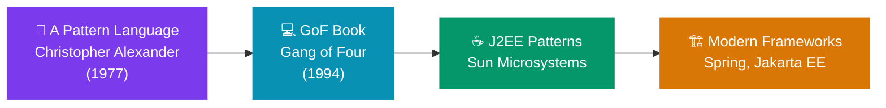
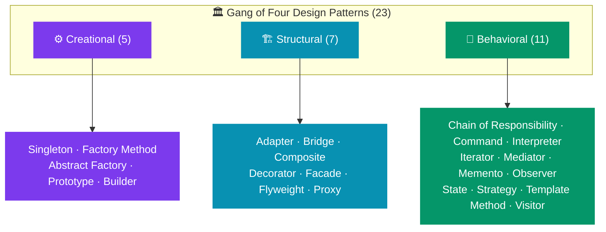
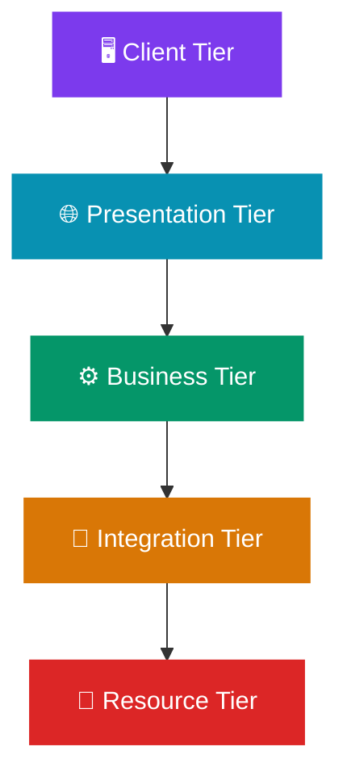

# Design Patterns in Java

**Design Patterns in Java** | What they are and why they exist. How they are grouped. Which ones matter most for Java SDE II interviews.

- [What is a Design Pattern?](#1-what-is-a-design-pattern)
  - [1.1 Pattern vs Principle vs Idiom vs Architecture 🔥](#11-pattern-vs-principle-vs-idiom-vs-architecture)
- [History of Design Patterns](#2-history-of-design-patterns)
- [GoF Design Patterns — Classification](#3-gof-design-patterns--classification)
- [Creational Patterns](#4-creational-patterns)
- [Structural Patterns](#5-structural-patterns)
- [Behavioral Patterns](#6-behavioral-patterns)
- [J2EE / JEE Design Patterns](#7-j2ee--jee-design-patterns)
  - [7.1 Service Locator vs Dependency Injection ⚡](#71-service-locator-vs-dependency-injection)
  - [7.2 Beyond GoF and J2EE — Modern Backend Patterns ⚡](#72-beyond-gof-and-j2ee--modern-backend-patterns)
- [Most Regularly Used Patterns](#8-most-regularly-used-patterns)
  - [8.1 GoF Patterns — Interview Priority 🔥🔥](#81-gof-patterns--interview-priority)
  - [8.2 Commonly Confused Pairs ⚡](#82-commonly-confused-pairs)
  - [8.3 What Modern Java Changed 🔥](#83-what-modern-java-changed)
  - [8.4 J2EE Patterns — Interview Priority ⚡](#84-j2ee-patterns--interview-priority)
- [FAQ](#9-faq)

> 🔥🔥 Must-know — very frequently tested &nbsp;·&nbsp; 🔥 High priority &nbsp;·&nbsp; ⚡ Medium priority &nbsp;·&nbsp; 💤 Low priority

---

## 1. What is a Design Pattern? ⚡

Design patterns are **best-practice solutions to recurring problems** in software design.

- They are not tied to one language.
- They are not copy-paste code.
- They are proven templates. You adapt them to your situation.

Every design pattern is a **3-part rule:**

| Part | Meaning |
|---|---|
| **Context** | The situation / environment where the problem appears |
| **Problem** | The recurring design or performance issue |
| **Solution** | The proven structure that solves it |

> 🧠 **Pattern vs Anti-Pattern:**  
> - ✅ A **pattern** is a named, recurring solution that is proven to work in its context.  
> - ❌️ An **anti-pattern** is more than "a bad idea". It is a solution that:  
>   - is **commonly used**,  
>   - **looks helpful at first**,  
>   - but produces **more bad consequences than good**,  
>   - *and* has a documented **refactored solution** (Brown et al., *AntiPatterns*, 1998).  
>
> Three points matter: "seems right, is widespread, has a known fix". Because of these three points, God Object and Anemic Domain Model get their own names. See [Anti-Patterns in Java](./14_Anti_Patterns_in_Java.md).

### 1.1 Pattern vs Principle vs Idiom vs Architecture 🔥

The most common warm-up trick question is *"Is SOLID a design pattern?"* / *"Is DRY a pattern?"*. The answer is no. The reason is **scope**:

| Term | Scope | Examples |
|---|---|---|
| **Principle** | A guideline for *any* design. It gives no fixed structure | SOLID, DRY, KISS, YAGNI |
| **Pattern** | A named recurring solution at **class/object** level | The GoF 23 — Strategy, Observer, Builder |
| **Idiom** | A **language-level** convention. It does not carry over to other languages | "Simple Factory", static factory method, double-brace init, try-with-resources |
| **Architecture** | Structure at **system/component** level | MVC, layered, hexagonal, microservices, event-driven |

> 💡 SOLID is a *set of principles*, not a pattern. Most patterns are just SOLID applied.  
> - Strategy is OCP + DIP made concrete.  
> - Decorator is OCP without an explosion of subclasses.

---

## 2. History of Design Patterns 💤

The **Gang of Four** (Erich Gamma, Richard Helm, Ralph Johnson, John Vlissides) published *"Design Patterns: Elements of Reusable Object-Oriented Software"* (1994). They listed recurring design problems and reduced them to **23 fundamental patterns**. The book is still the standard reference today.

---

## 3. GoF Design Patterns — Classification 💤

The 23 GoF patterns are split into three categories:

---

## 4. Creational Patterns 💤

> Answer the question: **"How should I create objects?"**

They hide the object-creation step. So the system does not depend on how objects are created, composed, and represented.

| Pattern | One-liner |
|---|---|
| [Singleton](./03_Singleton_Design_Pattern_in_Java.md) | One instance per JVM |
| [Factory Method](./04_2_Factory_Method_Design_Pattern.md) | Hides object creation. The client doesn't know the concrete class |
| [Abstract Factory](./04_3_Abstract_Factory_Design_Pattern.md) | Factory of factories. Creates families of related objects |
| [Prototype](./12_Prototype_Design_Pattern_in_Java.md) | Clone existing objects instead of creating from scratch |
| [Builder](./06_Builder_Design_Pattern_in_Java.md) | Assemble complex objects step-by-step with optional components |

> ⚠️ 🔥 **"Simple Factory" is an idiom, not a GoF pattern.** GoF defines only two factory patterns:  
> - **Factory Method** — a subclass decides the concrete type through an overridable method.  
> - **Abstract Factory** — creates families of related objects.  
>
> The plain "Factory" / "Simple Factory" is a single class with a `static create()` switch. It is a common idiom, but it is *not* one of the 23 GoF patterns.  
> The Singleton row counts as one of the 5 Creational patterns. The others are Factory Method, Abstract Factory, Prototype, and Builder.  
> Depth: [Simple Factory](./04_1_Simple_Factory_Pattern_in_Java.md) · [Factory vs Factory Method vs Abstract Factory](./04_Factory_vs_Factory_Method_vs_Abstract_Factory_Design_Pattern.md).

---

## 5. Structural Patterns 💤

> Answer the question: **"How should I compose objects and classes into larger structures?"**

They use inheritance and composition. The goal is flexible, efficient class hierarchies.

| Pattern | One-liner |
|---|---|
| [Adapter](./08_Adapter_Design_Pattern_in_Java.md) | Bridge between incompatible interfaces |
| Bridge | Decouple abstraction from implementation |
| Composite | Tree structure. Leaf and branch are treated the same way |
| [Decorator](./07_Decorator_Design_Pattern_in_Java.md) | Add behavior without subclassing. Wrap the same interface |
| Facade | Simple interface over a complex subsystem |
| [Flyweight](./09_Flyweight_Design_Pattern.md) | Share objects to reduce memory when many instances are similar |
| [Proxy](./13_Proxy_Design_Pattern_in_Java.md) | Control access to an object |

---

## 6. Behavioral Patterns 💤

> Answer the question: **"How should objects interact and distribute responsibility?"**

They define how objects talk to each other. This makes complex behavior easier to manage.

| Pattern | One-liner |
|---|---|
| [Chain of Responsibility](./19_Chain_of_Responsibility_Design_Pattern_in_Java.md) | Pass request along a chain until one handler processes it |
| Command | Encapsulate a request as an object |
| Interpreter | Grammar for a language |
| Iterator | Traverse a collection without exposing its structure |
| Mediator | Put complex communication between objects in one central place |
| Memento | Capture/restore an object's state |
| [Observer](./11_Observer_Design_Pattern_in_Java.md) | One-to-many: notify all dependents when state changes |
| [State](./18_State_Design_Pattern_in_Java.md) | Object behavior changes based on internal state |
| [Strategy](./10_Strategy_Design_Pattern_in_Java.md) | Swap algorithms at runtime via composition |
| [Template Method](./05_Template_Method_Design_Pattern.md) | Fixed algorithm skeleton, variable steps in subclasses |
| Visitor | Add operations to objects without modifying them |

---

## 7. J2EE / JEE Design Patterns 💤

GoF patterns solve OOP-level problems. **J2EE patterns** solve problems in layered enterprise applications (Servlet/Spring/Jakarta EE).

A typical JEE application has **5 tiers:**

| Tier | Technology Examples | J2EE Patterns |
|---|---|---|
| **Client** | Browser, mobile app | — |
| **Presentation** | Servlet, JSP, Spring MVC | Front Controller, Composite View, Intercepting Filter |
| **Business** | EJB, Spring Services | Business Delegate, Service Locator, Session Facade, **Transfer Object (DTO)**, Transfer Object Assembler |
| **Integration** | JDBC, JMS, Feign | Data Access Object (DAO), Service Activator, Domain Store, Web Service Broker |
| **Resource** | MySQL, Kafka, S3 | — |

> ⚠️ **DTO is a Business-tier pattern, not Integration.** The source is *Core J2EE Patterns* (Alur/Crupi/Malks).  
> - The Integration tier owns **DAO**, Service Activator, Domain Store and Web Service Broker.  
> - **Transfer Object** sits in the Business tier. It exists to carry business state *across* the tier boundary.  
>
> DAO = Integration, DTO = Business. People often mix them up because the two usually appear in the same commit.

### 7.1 Service Locator vs Dependency Injection ⚡

Both solve one problem: "how does a component get its collaborator without calling `new` itself?". The difference is **who does the asking**:

- **Service Locator** — the component *pulls*: `OrderService svc = ServiceLocator.get(OrderService.class)`. The dependency is hidden inside the method body. So it never shows in the constructor signature. Unit tests must stub a global registry.
- **Dependency Injection** — the container *pushes* the collaborator into the constructor. Dependencies become explicit and visible at compile time. A test just calls `new OrderService(mockRepo)`, with no container at all.

Fowler's article *Inversion of Control Containers and the Dependency Injection Pattern* (2004) compared the two. He did not pick a winner. He said the key point is to separate configuration from use. The Java world later chose DI, mainly because it makes every dependency visible.

> 🧠 *"Spring beans are singletons — is that the Singleton pattern?"* No.  
> - GoF Singleton enforces one instance **per JVM via a private constructor**. Strictly, it is one per class loader.  
> - Spring's `singleton` scope means one instance **per `ApplicationContext`**. The class has a normal public constructor. You can call it yourself in a test.  
>
> Two containers in one JVM ⇒ two instances.

### 7.2 Beyond GoF and J2EE — Modern Backend Patterns ⚡

The GoF 23 and the J2EE catalogue are both pre-2005. Most patterns that a Java backend actually uses today are outside both lists:

| Family | Pattern | Depth file |
|---|---|---|
| Persistence | Repository, Unit of Work | [17_Repository_and_Unit_of_Work_Pattern.md](./17_Repository_and_Unit_of_Work_Pattern.md) |
| Read/write separation | CQRS, Event Sourcing | [15_CQRS_and_Event_Sourcing.md](./15_CQRS_and_Event_Sourcing.md) |
| Concurrency | Producer-Consumer, Thread Pool, Future/Promise, Immutable Object | [16_Concurrent_Design_Patterns_in_Java.md](./16_Concurrent_Design_Patterns_in_Java.md) |
| Failure modes | God Object, Anemic Domain Model, Golden Hammer | [14_Anti_Patterns_in_Java.md](./14_Anti_Patterns_in_Java.md) |

Note that **Repository has replaced DAO**. `extends JpaRepository<Loan, Long>` *is* the DAO. You no longer write one by hand. That is the honest answer to *"do you still write DAOs?"*.

---

## 8. Most Regularly Used Patterns ⚡

### 8.1 GoF Patterns — Interview Priority 🔥🔥

> ⚠️ Most candidates make mistakes in the Java-example column. Every entry below is one of two things:  
> - a **real** instance of the pattern, or  
> - **clearly marked** as a common but wrong answer.  
>
> Quoting a wrong example is worse than saying "I'd have to check".

| Pattern | Category | Solves | Java / Spring Example |
|---|---|---|---|
| [Singleton](./03_Singleton_Design_Pattern_in_Java.md) | Creational | One instance per JVM | `Runtime.getRuntime()`; `ApplicationContext` beans (Spring singleton *scope* = one per container, not a GoF JVM-wide singleton) |
| [Factory Method](./04_2_Factory_Method_Design_Pattern.md) | Creational | Decouple creation from usage | `Iterable.iterator()` — each concrete collection overrides it to decide the concrete `Iterator`. (`DriverManager.getConnection()` is a Simple Factory idiom. `BeanFactory.getBean()` is a container **lookup**. Neither is GoF Factory Method) |
| [Abstract Factory](./04_3_Abstract_Factory_Design_Pattern.md) | Creational | Create families of related objects | `DocumentBuilderFactory`, `TransformerFactory`; `java.sql.Connection` (creates a driver-consistent family: `Statement`, `PreparedStatement`, `CallableStatement`) |
| [Builder](./06_Builder_Design_Pattern_in_Java.md) | Creational | Complex object step-by-step | `HttpRequest.newBuilder()`, `Locale.Builder`, `Stream.builder()`. (`StringBuilder` is a fluent *accumulator*, not a GoF Builder. It has no separate product type and no final `build()` that freezes the result) |
| [Template Method](./05_Template_Method_Design_Pattern.md) | Behavioral | Fixed flow, variable steps | `AbstractList`, `HttpServlet` (`JdbcTemplate` is more callback/Strategy via `RowMapper` than pure Template Method) |
| [Strategy](./10_Strategy_Design_Pattern_in_Java.md) | Behavioral | Swap algorithms at runtime | `Comparator`, `RejectedExecutionHandler`, Spring Security `SessionAuthenticationStrategy` |
| [Observer](./11_Observer_Design_Pattern_in_Java.md) | Behavioral | One-to-many event notification | Spring `@EventListener`; Kafka consumers (pub/sub, distributed variant) |
| [Decorator](./07_Decorator_Design_Pattern_in_Java.md) | Structural | Add behavior without subclassing | `BufferedReader`, `Collections.synchronizedList()`, `HttpServletRequestWrapper` |
| [Adapter](./08_Adapter_Design_Pattern_in_Java.md) | Structural | Bridge incompatible interfaces | `InputStreamReader` (bytes → chars), `Arrays.asList()` (array → `List`), `Collections.enumeration()` (`Collection` → `Enumeration`), `Enumeration.asIterator()` (Java 9, `Enumeration` → `Iterator`) |
| [Flyweight](./09_Flyweight_Design_Pattern.md) | Structural | Share objects to reduce memory | String pool, `Integer.valueOf()` cache |
| [Proxy](./13_Proxy_Design_Pattern_in_Java.md) | Structural | Control access | Spring AOP, Hibernate lazy loading |

### 8.2 Commonly Confused Pairs ⚡

Interviewers often ask you to tell apart patterns that look alike:
- *Strategy vs Template Method vs State*
- *Decorator vs Proxy vs Adapter*
- *Factory Method vs Abstract Factory*
- and nine more.

The full 14-row comparison table is in the master guide: **[01 → Pattern Confusions (Easy to Mix Up)](./01_LLD_Interview_Patterns_Guide.md#pattern-confusions--easy-to-mix-up)**. This is the most-asked question type. Do not learn a shorter version of it.

### 8.3 What Modern Java Changed 🔥

*"Which GoF patterns has modern Java made obsolete or trivial?"* is a real SDE-II question. It separates people who read the book in 1998 from people who write Java today.

| Pattern | What Java 8+ did to it |
|---|---|
| **Strategy** | Collapses to a lambda or method reference. `Comparator.comparing(Loan::getAmount)` *is* a strategy. No interface hierarchy, no concrete strategy classes |
| **Command** | A `Runnable` / `Callable<T>` lambda handed to an `ExecutorService`. The command object no longer needs a class |
| **Template Method** | Varying steps can be `Function`/`Consumer` constructor parameters instead of abstract methods. This uses composition instead of forced inheritance |
| **Singleton** | The recommended form is a single-element `enum` (Bloch, *Effective Java*, Item 3). It is serialization-safe and reflection-safe with no extra code. No `volatile` double-checked locking |
| **Builder** | `record` removes most of the reason for Builder on small immutable value types. Builder is still used where there are many optional fields or validation |
| **Iterator** | Built into `for-each` and the Stream API. You implement `Iterable`. You rarely write an `Iterator` |
| **Prototype** | Mostly replaced by `record`/immutable `withX()` copies. `Cloneable` is considered broken |

The honest way to say it in an interview: *the patterns did not disappear — the boilerplate did.* You still describe the intent ("I'm swapping the algorithm at runtime"). You just no longer write four classes to do it.

### 8.4 J2EE Patterns — Interview Priority ⚡

| Pattern | Tier | Solves |
|---|---|---|
| **Front Controller** | Presentation | Single entry point. `DispatcherServlet` in Spring MVC |
| **DAO (Data Access Object)** | Integration | Separates persistence logic from business logic (Spring Data's `JpaRepository` interface *is* the DAO now) |
| **DTO (Transfer Object)** | Business | Carries data between layers without exposing domain objects |
| **Service Locator** | Business | Central registry for service lookups (use DI instead in modern Spring — §7) |
| **Business Delegate** | Business | Decouples presentation from business service calls |

---

## 9. FAQ 💤

**Q1. Is MVC a design pattern?**
It is a **pattern — just not a GoF one.** MVC is an *architectural pattern* (Buschmann et al., *POSA*).
- Its scope is component-level. The GoF 23 are class/object-level. So MVC is not in that catalogue.
- If you say flatly "MVC is not a pattern", the interviewer can ask *"then why does the GoF book discuss it?"*.
- The GoF book does discuss it, in the introduction. MVC is the main example it uses to explain three patterns that MVC combines:
  - **Observer** (model notifies its views)
  - **Composite** (nested/embedded views)
  - **Strategy** (the controller *is* a pluggable strategy of the view)
- **Front Controller** is not part of classic Smalltalk MVC. Web MVC frameworks add it on top (§7, Presentation tier).

**Q2. What is the difference between Architecture and Design Patterns?**
Architecture defines the major components and how they communicate (e.g., MVC, microservices, layered). Design patterns solve specific implementation problems inside those components.

**Q3. GoF or J2EE — which matters more for SDE II interviews?**
GoF matters more. Interviewers at Tier-1 companies test GoF patterns deeply in LLD rounds (Singleton, Strategy, Observer, Factory, Builder, Decorator, Proxy). You are expected to know J2EE patterns (DAO, DTO, Front Controller), but they are rarely tested with code.

**Q4. Do I need to know all 23 GoF patterns?**
No. Focus on the 8–10 that appear in real-world Java/Spring code. See the [LLD Interview Master Guide](./01_LLD_Interview_Patterns_Guide.md) for the prioritized list.

**Q5. What is the best design pattern?**
No single best pattern. The right pattern depends on the problem. Learn SOLID principles well first. Then the right pattern becomes obvious. See the [LLD Interview Master Guide](./01_LLD_Interview_Patterns_Guide.md).

**Q6. Give me a case where applying a pattern made the code worse.**
This question checks your maturity. "I can't think of one" is the wrong answer.

**Pattern-itis** is itself an anti-pattern (Golden Hammer). It means using a pattern before the variation it handles actually exists. Examples:
- A Strategy interface with exactly one implementation. It adds two files and an indirection, and gains nothing.
- An Abstract Factory over a single product family. It is extra code wrapped around a single `new`.
- A Builder on a 3-field immutable type. It is boilerplate that a `record` does better.

The simple rule: **introduce the pattern on the second variation, not the first.** The first one is a guess about the future. The second one is evidence. See [Anti-Patterns in Java](./14_Anti_Patterns_in_Java.md).

**Q7. Is SOLID a design pattern?**
No. SOLID is a set of **principles** (see §1).
- Principles guide *any* design. They give no fixed structure.
- Patterns are named solutions with a specific class/object structure.

Most GoF patterns are just SOLID made concrete:
- Strategy is OCP + DIP.
- Decorator is OCP without an explosion of subclasses.
- Adapter lets your code depend on its own interface (DIP) at a boundary you do not control. The adapter translates each call to the foreign interface.

---

> **🎯 Interview footer — Design Patterns Overview**  
> **Seen in:** the classification is a map you can use to find your way around the JDK:  
> - Creational in `HttpRequest.newBuilder()` / `Iterable.iterator()` / `Integer.valueOf()`.  
> - Structural in `BufferedReader` / `InputStreamReader` / Spring AOP proxies / Hibernate lazy loading.  
> - Behavioral in `Comparator` / `HttpServlet` / Spring `@EventListener`.  
> - The J2EE tier shows up as `DispatcherServlet` (Front Controller), DAO/DTO layering, and DI replacing Service Locator (§7).  
> **This invites:**  
> - *"Is MVC a design pattern?"* → yes, an *architectural* one, not a GoF one. It combines Observer + Composite + Strategy (§9 Q1).  
> - *"Is SOLID a pattern?"* → no, a set of principles. Pattern vs principle vs idiom vs architecture is a scope question (§1, §9 Q7).  
> - *"Do you need all 23?"* → no. Only the 8–10 that appear in real Java/Spring code (§9 Q4, §8).  
> - *"Strategy vs Template Method vs State?"* and *"Decorator vs Proxy vs Adapter?"* → the 14-row comparison table in [01 § Pattern Confusions](./01_LLD_Interview_Patterns_Guide.md#pattern-confusions--easy-to-mix-up).  
> - *"Which patterns did Java 8 kill?"* → none. But the boilerplate shrank into lambdas, `enum` singletons and `record`s (§8).  
> - *"Where did a pattern make the code worse?"* → pattern-itis. Introduce on the second variation, not the first (§9 Q6).  
> - *"GoF or J2EE for SDE II?"* → GoF is tested with code. J2EE is expected knowledge (§9 Q3).
