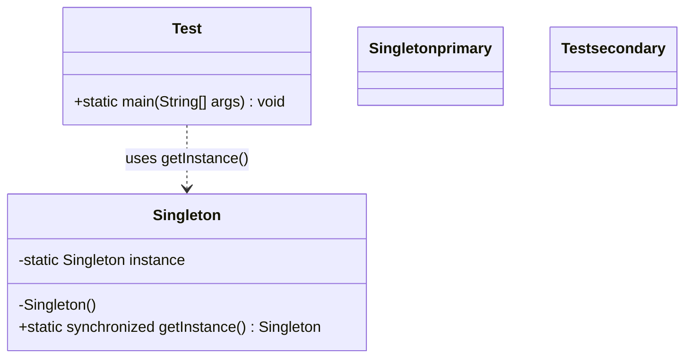
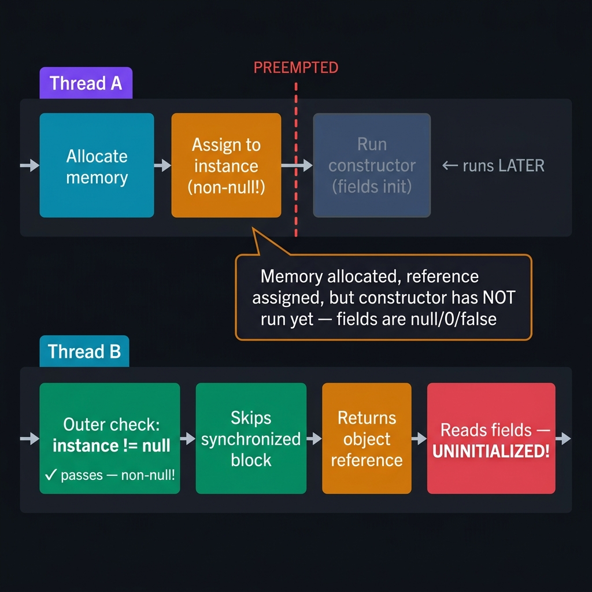
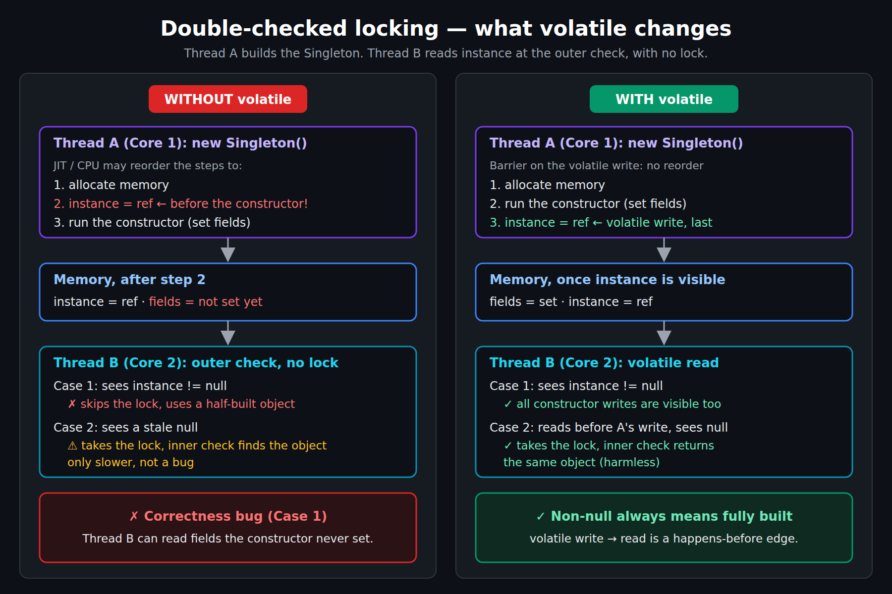
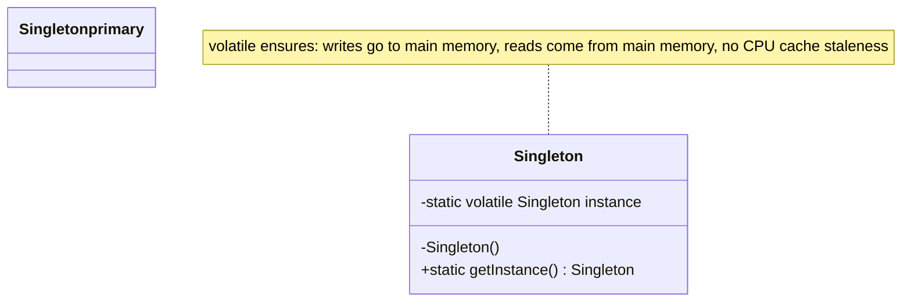
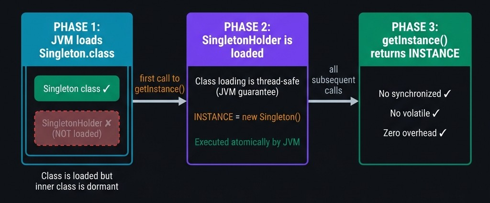
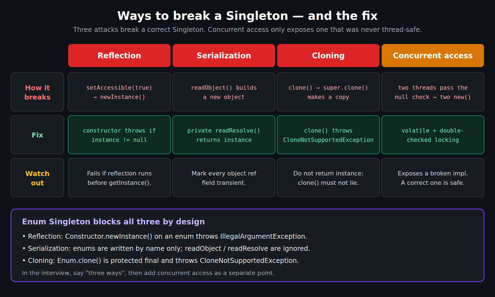
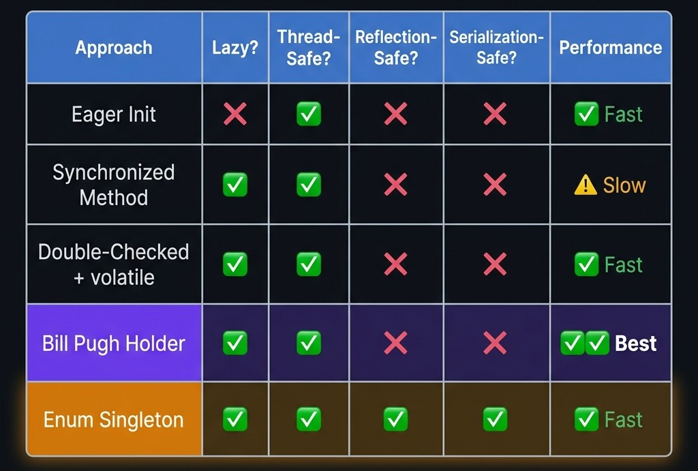

# Singleton Design Pattern in Java

**Singleton Design Pattern** | The Singleton pattern is one of the simplest design patterns in Java. One class creates its own object. It also makes sure that only one object is ever created.

- To be exact, the rule is **one instance per classloader**.
- People often shorten this to "one per JVM".
- The [Classloader Caveat](#classloader-caveat) shows when this short version is wrong.

> 🔥🔥 Very high priority — near-guaranteed at Tier-1 &nbsp;·&nbsp; 🔥 High priority — very frequent &nbsp;·&nbsp; ⚡ Medium priority — commonly asked &nbsp;·&nbsp; 💤 Low priority — good to know, rarely asked

- [1. Interview Q&A 🔥🔥](#1-interview-qa)
  - [Q1. Spring's default bean scope is singleton — is that the same as the Singleton design pattern? 🔥](#q1-spring-singleton-scope-vs-gof-singleton)
  - [Q2. Is a Spring `@Service` singleton bean thread-safe? 🔥🔥](#q2-is-a-spring-service-singleton-bean-thread-safe)
  - [Q3. What happens if you inject a prototype-scoped bean into a singleton bean? 🔥🔥](#q3-prototype-scoped-bean-into-a-singleton)
  - [Q4. Your service runs as 5 pods in Kubernetes. What does your Singleton actually guarantee now? 🔥🔥](#q4-singleton-across-kubernetes-replicas)
  - [Q5. Two classloaders load the same Singleton class — what happens? 🔥](#q5-two-classloaders-load-the-same-singleton-class)
  - [Q6. Bill Pugh holder or Enum singleton — which do you pick, and why? 🔥](#q6-bill-pugh-holder-or-enum-singleton)
- [2. Introduction 🔥](#2-introduction)
  - [Classloader Caveat 🔥](#classloader-caveat)
- [3. Eager Initialization and Lazy Initialization of Singleton Class 🔥](#3-eager-initialization-and-lazy-initialization-of-singleton-class)
- [4. Double-Checked Locking in Singleton Class 🔥🔥](#4-double-checked-locking-in-singleton-class)
  - [Potential Issue in Multithreaded Environment 🔥🔥](#potential-issue-in-multithreaded-environment)
- [5. Java Memory Model and Volatile 🔥🔥](#5-java-memory-model-and-volatile)
- [6. Better Singleton Approaches 🔥🔥](#6-better-singleton-approaches)
  - [Bill Pugh Singleton — Initialization-on-Demand Holder 🔥🔥](#bill-pugh-singleton--initialization-on-demand-holder)
  - [Enum Singleton — Joshua Bloch's Recommendation 🔥🔥](#enum-singleton--joshua-blochs-recommendation)
  - [Singleton That Needs Constructor Arguments 🔥🔥](#singleton-that-needs-constructor-arguments)
- [7. Different Ways to Break Singleton Design Pattern 🔥🔥](#7-different-ways-to-break-singleton-design-pattern)
  - [Breaking Singleton's Behavior Using Reflection 🔥🔥](#breaking-singletons-behavior-using-reflection)
  - [Breaking Singleton's Behavior Using Serialization 🔥🔥](#breaking-singletons-behavior-using-serialization)
  - [Breaking Singleton's Behavior Using Cloning 🔥](#breaking-singletons-behavior-using-cloning)
  - [Breaking Singleton's Behavior Using ExecutorService ⚡](#breaking-singletons-behavior-using-executorservice)
- [8. Singleton Approaches — Comparison 🔥](#8-singleton-approaches--comparison)
  - [JDK Singletons — Name Two, Not Zero 🔥](#jdk-singletons--name-two-not-zero)
- [9. Interview Answer Flow 🔥](#9-interview-answer-flow)
  - [Step 1: One-Line Definition 🔥](#step-1-one-line-definition)
  - [Step 2: Walk Through the Evolution 🔥🔥](#step-2-walk-through-the-evolution)
  - [Step 3: DCL + volatile — Know the Deep Why 🔥🔥](#step-3-dcl-volatile-deep-why)
  - [Step 4: State the Best Approaches Clearly 🔥](#step-4-best-approaches)
  - [Step 5: Breaking Singleton — If Asked 🔥](#step-5-breaking-singleton)
  - [Step 6: Real-World Usage 🔥🔥](#step-6-real-world-usage)
  - [3 Mistakes to Avoid ⚡](#3-mistakes-to-avoid)
- [10. When NOT to Use Singleton 🔥](#10-when-not-to-use-singleton)
  - [Downsides — Why Singleton Is Often Called an Anti-Pattern 🔥](#downsides--why-singleton-is-often-called-an-anti-pattern)
  - [Singleton vs Static Utility Class 🔥](#singleton-vs-static-utility-class)
- [11. Can You Actually Reproduce These Bugs? 💤](#11-can-you-actually-reproduce-these-bugs)
- [12. Under the Hood — `<clinit>` and Class Initialization ⚡](#12-under-the-hood-clinit-and-class-initialization)

---

<a id="1-interview-qa"></a>
## 1. Interview Q&A 🔥

> 🔥 **This section is more important than the theory below it. Read it from top to bottom.**  
> - Q1 explains the mechanism (Spring's bean registry). **Q2** and **Q3** both build on it.  
> - So the order shows what depends on what. It is not a ranking.  
> - Short on time? The two asked *most often* are **Q2** and **Q4**.  
> - **Q2** (is a singleton bean thread-safe?) comes up in almost every Spring interview.  
> - **Q4** is the 5 pods question.  
> - Both come up far more often than the instruction-reordering material in §4–§5.

<a id="q1-spring-singleton-scope-vs-gof-singleton"></a>

**Q1. Spring's default bean scope is singleton — is that the same as the Singleton design pattern? 🔥**

<details>
<summary>View Answer</summary>

No. Both have the same *goal*: one instance. But two things are different:

- Spring enforces it with a completely different mechanism.
- The scope is narrower: **per container, not per classloader**.

Do not say "they have nothing to do with each other". A strict interviewer will say the intent is the same. And they would be right.

<a id="how-spring-actually-does-it"></a>
### How Spring Actually Does It 🗺️ 🔥

Spring uses a simple idea: **a HashMap as a registry**.

Inside `DefaultSingletonBeanRegistry` (the core Spring class), there's this:

```java
// Simplified — actual Spring source
private final Map<String, Object> singletonObjects = new ConcurrentHashMap<>(256);
```

This map is the one place that holds every singleton bean. Key = bean name, Value = bean instance.

<a id="step-by-step-flow"></a>
### Step-by-Step Flow 🔄 🔥

**At startup** (when `ApplicationContext` initializes):

1. Spring scans your classpath, finds `@Component`, `@Service`, etc.
2. For each class, it creates a `BeanDefinition`. This is metadata about the bean (scope, class, dependencies, init method, etc.). No object is created yet.
3. Spring then **eagerly** creates all singleton-scoped beans, one by one:
   - Uses **reflection** to call the constructor
   - Injects dependencies (`@Autowired`)
   - Calls `@PostConstruct` if present
   - **Stores the fully initialized object in `singletonObjects` map**

**Every later request** (`@Autowired` in another class, or `context.getBean(...)`):

```java
// Simplified getSingleton() logic
public Object getSingleton(String beanName) {
    Object bean = singletonObjects.get(beanName);  // just a map lookup
    return bean;
}
```

It is only a map lookup. There is no `new` and no reflection. Spring just returns the cached instance.

<a id="key-difference-vs-gof-singleton"></a>
### Key Difference vs GoF Singleton ⚖️ 🔥🔥

| | GoF Singleton | Spring Singleton |
|---|---|---|
| Enforced by | Private constructor + static field | Container-managed HashMap |
| Scope | One instance per **classloader** | One instance per `ApplicationContext` |
| Thread safety mechanism | `volatile` + double-checked locking | `ConcurrentHashMap` + Spring's internal locking |
| You control it? | No — fixed inside the class | Yes — just change `@Scope("prototype")` |

> If you create **two** `ApplicationContext`s (common in tests), you get **two** instances of the same `@Component`. A GoF Singleton would never allow that.

<a id="one-important-nuance"></a>
### One Important Nuance 🔒 ⚡

Spring does use something like double-checked locking inside, when it creates the bean the first time. This stops two threads from creating the same bean at the same time during startup:

```java
// Rough sketch of Spring's getSingleton() internals (Spring Framework 6.2+)
this.singletonLock.lock();
try {
    Object singletonObject = this.singletonObjects.get(beanName);
    if (singletonObject == null) {
        // create, initialize, store
        this.singletonObjects.put(beanName, bean);
    }
} finally {
    this.singletonLock.unlock();
}
```

> 📌 **Version note (it impresses an interviewer if you know it).**  
> - Up to Spring 6.1, this was exactly `synchronized (this.singletonObjects)`.  
> - **Spring Framework 6.2** (Nov 2024, Spring Boot 3.4) changed `DefaultSingletonBeanRegistry`. It now uses a separate `final Lock singletonLock = new ReentrantLock()` with **lenient** singleton locking.  
> - Reason 1: to allow background bean initialization.  
> - Reason 2: to stop deadlocks. The old code held the map's monitor while it called user code that Spring does not control, during bean creation.  
> - The `ConcurrentHashMap` field itself did not change. Only the lock changed.

But once the bean is stored, it is just a `ConcurrentHashMap.get()`. There is zero locking overhead.

**One-line interview answer:**
> Spring keeps a `ConcurrentHashMap` of bean name → instance. At startup, it creates each singleton bean once, using reflection, and stores it in the map. On every later request, it returns the same cached instance.

---

</details>
<br/>

<a id="q2-is-a-spring-service-singleton-bean-thread-safe"></a>

**Q2. Is a Spring `@Service` singleton bean thread-safe? 🔥🔥**

<details>
<summary>View Answer</summary>

**No.** This is the most common follow-up to Q1. The trap is that the word "singleton" is used for two different ideas.

The container guarantees **one instance**. It does not guarantee **safe concurrent state**. Every request thread shares the same bean object. So **any mutable instance field is a data race**:

```java
@Service
public class RiskScoringService {

    private BigDecimal lastScore;                 // ❌️ shared across ALL request threads
    private final SimpleDateFormat fmt =
        new SimpleDateFormat("yyyy-MM-dd");       // ❌️ SimpleDateFormat is not thread-safe

    public BigDecimal score(Application app) {
        this.lastScore = compute(app);            // thread A's write clobbers thread B's
        return this.lastScore;                    // ...and B may read A's value
    }
}
```

✅ **The fix is to keep no state, not to add locking.** Keep per-request data in **method locals**. Locals live on the calling thread's own stack, so nothing is shared:

```java
@Service
public class RiskScoringService {

    private final ScoreCardRepository repo;       // ✅ immutable collaborator — fine

    public RiskScoringService(ScoreCardRepository repo) {
        this.repo = repo;                         // ✅ constructor injection, set once
    }

    public BigDecimal score(Application app) {
        BigDecimal result = compute(app);         // ✅ local — one per invocation
        return result;
    }
}
```

**The rules that follow from this:**

- ✅ **`final` collaborator fields are fine.** Injected dependencies are set once, in the constructor, and never changed. This is why constructor injection is preferred.
- ❌️ **Never keep per-request state in a field.** Use locals, or pass the data as a parameter.
  - If the data really must live across several calls, use a **request-scoped bean** / `ThreadLocal`.
  - Clear the `ThreadLocal` in a `finally`. If you forget, the old value stays on the pool thread. The next request that uses that thread then sees wrong data.
- ⚠️ **Be careful with JDK types that are not thread-safe, when you keep them as fields.** `SimpleDateFormat` is the classic production bug. Use `DateTimeFormatter` (immutable, thread-safe) instead. A shared `Matcher` is also not thread-safe. `Random` *is* thread-safe, but it is slow when many threads share it, so prefer `ThreadLocalRandom`.
- 🔒 If you really need shared mutable state, make it explicit: `AtomicLong`, `ConcurrentHashMap`, or a lock. Do not use a plain field.

> 🎯 **One-liner:** *"Spring guarantees one instance, not thread safety. That is exactly why we write stateless services. A mutable instance field on a singleton bean is shared by every request thread."*

---

</details>
<br/>

<a id="q3-prototype-scoped-bean-into-a-singleton"></a>

**Q3. What happens if you inject a prototype-scoped bean into a singleton bean? 🔥🔥**

<details>
<summary>View Answer</summary>

**The prototype scope stops working, with no error.** This question follows directly from Q1. The answer comes straight from the map-lookup mechanism.

Dependency injection happens **once**, when Spring creates the singleton. So Spring resolves the prototype once, at that moment. The singleton then holds that one reference forever:

```java
@Component
@Scope("prototype")
public class LoanCalculation { }

@Service
public class LoanService {

    @Autowired
    private LoanCalculation calc;   // ❌️ resolved ONCE at startup — same object forever
}
```

You asked for a new object for each use. You got a singleton in practice. Nothing throws an error. The code just does not do what you wrote.

**The obvious fix, and why you should reject it:**

0. ⚠️ **`applicationContext.getBean(...)`** — inject the `ApplicationContext` and look up the bean yourself. It *works*. Every `getBean()` on a prototype definition returns a new instance. The reason: the container never caches prototypes in the singleton map.

```java
@Service
public class LoanService {

    private final ApplicationContext ctx;

    public LoanService(ApplicationContext ctx) {
        this.ctx = ctx;
    }

    public void run() {
        LoanCalculation calc = ctx.getBean(LoanCalculation.class);   // ⚠️ fresh, but service locator
    }
}
```

But this is the **service locator** pattern, not dependency injection. It has three problems:

- Your business class now imports Spring.
- The dependency is hidden. You cannot see it in the constructor signature.
- A unit test must stub a whole `ApplicationContext`, instead of just passing a `LoanCalculation`.

`ObjectProvider` does the same lookup. But the type is fixed in the declaration, and your logic does not depend on the framework. In an interview, name `getBean()` to show you know the mechanism. Then say you would use `ObjectProvider` instead.

**Three standard fixes:**

1. ✅ **`ObjectProvider<T>`** (Spring 4.3+) — ask the container for a new one at call time. The intent is clearest, and there is no hidden proxy:

```java
@Service
public class LoanService {

    private final ObjectProvider<LoanCalculation> calcProvider;

    public LoanService(ObjectProvider<LoanCalculation> calcProvider) {
        this.calcProvider = calcProvider;
    }

    public void run() {
        LoanCalculation calc = calcProvider.getObject();   // ✅ fresh instance each call
    }
}
```

2. ✅ **`@Lookup` method injection** — Spring creates a subclass of your bean with CGLIB. The subclass overrides the method to do a container lookup:

```java
@Service
public abstract class LoanService {

    @Lookup
    protected abstract LoanCalculation newCalculation();   // ✅ fresh instance each call

    public void run() {
        LoanCalculation calc = newCalculation();
    }
}
```

3. ✅ **A scoped proxy** — Spring injects a proxy. The proxy finds the real target on every method call:

```java
@Component
@Scope(value = "prototype", proxyMode = ScopedProxyMode.TARGET_CLASS)
public class LoanCalculation { }
```

> ⚠️ **Note what the scoped proxy really does.** It gets a new target **per method invocation**, not per injection point. So `calc.setX(); calc.getX();` goes to *two different instances*. For a stateful prototype, this is usually not what you want. `ObjectProvider` is the safer default exactly because your code shows the lifetime clearly.

> 🎯 **One-liner:** *"Injection happens once, when the singleton is created. So a prototype injected into a singleton becomes a singleton. Fix it with `ObjectProvider.getObject()`, `@Lookup`, or a scoped proxy. I'd default to `ObjectProvider` because the lifetime stays visible. `context.getBean()` does the same lookup. But it pulls Spring into the business class and hides the dependency from the constructor, so I'd avoid it."*

---

</details>
<br/>

<a id="q4-singleton-across-kubernetes-replicas"></a>

**Q4. Your service runs as 5 pods in Kubernetes. What does your Singleton actually guarantee now? 🔥🔥**

<details>
<summary>View Answer</summary>

**Nothing useful.** This question asks what "one instance" means *above* the JVM boundary. **Q5** next asks the same thing *below* it. For a backend engineer, this one is much more likely to be asked. You now have **5 instances**, one per pod. The pattern's guarantee is now worthless, and nothing warns you.

> 📐 **Keep the scope levels exact. Q5 adds one more level, so do not mix them up.**  
> - A Singleton is scoped to a **classloader**.  
> - A plain Spring Boot app has exactly one application classloader. So *there*, one-per-classloader and one-per-JVM mean the same thing.  
> - This is why "per JVM" is a safe short form **here**. It is wrong in Q5's world (WARs, OSGi, hot redeploy).  
> - One JVM = one pod. So the levels are **classloader ⊆ JVM/pod ⊆ cluster**. The guarantee stops at the first level.  
> - Say *"it's per classloader, which in our deployment means per pod"*. This one sentence answers both follow-ups before they are asked.

The real problem: "one instance" was never the requirement. The requirement was **"this happens once"**. The Singleton only ever enforced that inside one process.

**What really breaks, roughly from most common to least common:**

- ⏰ **Scheduled jobs run 5×.** A `@Scheduled` method on a singleton bean runs on every pod. The nightly reconciliation job runs five times, at the same time.
- 🔢 **In-memory counters and rate limiters are wrong by a factor of N.** Say a singleton holds an `AtomicLong` for "requests this minute". It now allows 5× the planned limit, because each pod counts only its own share.
- 🗃️ **In-memory caches go out of sync.** Pod 1 evicts on a write. Pods 2–5 keep serving the stale value. This is the classic *"it works, then it doesn't, then it works again"* bug. The result depends on which pod the load balancer picked.
- 🔒 **`synchronized` and `ReentrantLock` protect nothing.** A JVM monitor lives in one JVM. The other four JVMs cannot see it. Code that looks correctly locked has no mutual exclusion at all across the cluster.

**How you really fix each one:**

| Need | Fix |
|---|---|
| Run a job exactly once cluster-wide | **ShedLock** or a DB-backed lock row; or **leader election** (a Kubernetes `Lease`, Spring Cloud Kubernetes) so one pod owns the schedule |
| Shared counter / rate limit | **Move the state out of the JVM** — Redis `INCR` with TTL, or a token bucket in Redis. The counter must live outside the JVM |
| Shared cache | Distributed cache (Redis) instead of a per-pod map. Or accept per-pod caches with a short TTL, and design for stale data |
| Mutual exclusion | **Distributed lock** (Redis/Redlock, ZooKeeper, or a DB row lock). Know that it is a *lease* with a timeout, not a real mutex |
| "Process each item once" | Don't lock at all — **partition it**. A Kafka consumer group gives each partition to exactly one pod. So you get ordering per key and one owner per partition from the design itself. A rebalance can still replay a few messages, so keep the handler idempotent |

> 💡 **The partitioning answer is the strongest one.**  
> - A distributed lock is the obvious first idea.  
> - The senior answer notices that the requirement is often *"process each key once"*, not *"only one pod runs"*.  
> - A consumer group gives you that for free, with no lock.  
> - Distributed locks are a risk to correctness (clock skew, GC pauses, the lease expiring in the middle of work).  
> - Avoid one when the way you split the work (the topology) can give you the guarantee instead.

> ⚠️ **Where the Singleton is still valid here:** as a **per-JVM cache of an expensive local resource**. Examples: a connection pool, an HTTP client, a credentials provider. Five pods, each with one connection pool, is correct and planned. The pattern itself is fine. The mistake is to claim that it enforces a *global* invariant.

> 🎯 **One-liner:** *"A Singleton is scoped to its classloader, and a Spring Boot app has one. So it's one per JVM, and one JVM per pod. With 5 pods I have 5 of them. Any scheduled job runs 5×. In-memory counters are off by 5×. And `synchronized` gives me no mutual exclusion across pods. Say the requirement is really 'once per cluster'. Then I'd use leader election or ShedLock for jobs, and Redis for shared counters. But usually the better choice is to partition. For example, a Kafka consumer group gives me single processing per key without any lock. The Singleton stays valid only for per-JVM resources like a connection pool."*

---

</details>
<br/>

<a id="q5-two-classloaders-load-the-same-singleton-class"></a>

**Q5. Two classloaders load the same Singleton class — what happens? 🔥**

<details>
<summary>View Answer</summary>

**You get two instances, and `instanceof` starts giving wrong answers.**

At runtime, a class is identified by the pair **`(defining classloader, fully-qualified name)`**.

- Say two different classloaders load the same `com.example.Singleton`.
- To the JVM, these are **two separate classes**.
- Each one has its **own copy of the static `instance` field**.
- Both classes respect the private constructor. There are simply two classes enforcing it.

Symptoms you would really see:

- 🔀 Two live instances. So any invariant that assumed "one" (a counter, a cache, a lock) is wrong, with no error.
- 💥 `ClassCastException` when you cast an object from one class to the other. The message is very confusing: *"cannot cast Singleton to Singleton"*. Same name, different classes.
- 🧠 **A memory leak on redeploy.** A static field in the old classloader keeps the whole classloader graph reachable. So the old app's classes never unload. This is the classic `Metaspace`/`PermGen` OOM after N hot redeploys.

Where this problem shows up: app servers (one classloader per WAR), OSGi bundles, hot redeploy, and plugin architectures. See the [Classloader Caveat](#classloader-caveat) in §2 for the full list.

<details>
<summary><strong>🤔 Doubt: Show me two classloaders that really create two Singletons — what does the code look like? 💤</strong></summary>

⚠️ **First, the part most explanations skip: creating two classloaders is *not* enough.**

- The default `loadClass` **asks the parent first** (parent delegation).
- Say two `URLClassLoader`s both have the app classloader as parent. Both ask the app loader. Both get the *same* `Class` object back. You get **one** Singleton.
- To reproduce the bug, the class must be **defined twice**.
- There are two ways. Break parent delegation (child-first, which is what Tomcat does). Or keep the class completely off the parent's classpath.

**1️⃣ A normal eager Singleton — nothing unusual about it:**

```java
package com.example;

public class Singleton {

    private static final Singleton INSTANCE = new Singleton();

    private Singleton() {
    }

    public static Singleton getInstance() {
        return INSTANCE;
    }
}
```

**2️⃣ A child-first classloader that defines `com.example.*` itself instead of delegating:**

```java
public class ChildFirstLoader extends ClassLoader {

    static {
        registerAsParallelCapable();
    }

    private final Path classpath;

    ChildFirstLoader(Path classpath) {
        // Parent = platform loader, NOT the app loader — so com.example.*
        // is invisible to the parent and cannot be delegated away.
        super(ClassLoader.getPlatformClassLoader());
        this.classpath = classpath;
    }

    @Override
    protected Class<?> loadClass(String name, boolean resolve)
            throws ClassNotFoundException {

        if (!name.startsWith("com.example.")) {
            return super.loadClass(name, resolve);   // JDK types: delegate as normal
        }

        synchronized (getClassLoadingLock(name)) {
            Class<?> c = findLoadedClass(name);
            if (c == null) {
                byte[] bytes = readClassBytes(name);
                c = defineClass(name, bytes, 0, bytes.length);   // ← defines its OWN copy
            }
            if (resolve) {
                resolveClass(c);
            }
            return c;
        }
    }

    private byte[] readClassBytes(String name) throws ClassNotFoundException {
        Path file = classpath.resolve(name.replace('.', '/') + ".class");
        try {
            return Files.readAllBytes(file);
        } catch (IOException e) {
            throw new ClassNotFoundException(name, e);
        }
    }
}
```

**3️⃣ The demo. Note that you must call `getInstance()` through reflection.** The compiler can only see the app loader's `Singleton` type:

```java
public class Demo {

    public static void main(String[] args) throws Exception {
        Path cp = Path.of("target/classes");

        ClassLoader l1 = new ChildFirstLoader(cp);
        ClassLoader l2 = new ChildFirstLoader(cp);

        Class<?> c1 = l1.loadClass("com.example.Singleton");
        Class<?> c2 = l2.loadClass("com.example.Singleton");

        Object s1 = c1.getMethod("getInstance").invoke(null);
        Object s2 = c2.getMethod("getInstance").invoke(null);

        System.out.println(c1.getName().equals(c2.getName()));  // same fully-qualified name
        System.out.println(c1 == c2);                           // same Class object?
        System.out.println(s1 == s2);                           // same instance?
        System.out.println(c1.getClassLoader());
        System.out.println(c2.getClassLoader());

        Singleton oops = (Singleton) s1;                        // 💥
    }
}
```

📤 **Output:**

```
true
false
false
com.example.ChildFirstLoader@1b6d3586
com.example.ChildFirstLoader@4554617c
Exception in thread "main" java.lang.ClassCastException:
    class com.example.Singleton cannot be cast to class com.example.Singleton
    (com.example.Singleton is in unnamed module of loader com.example.ChildFirstLoader @1b6d3586;
     com.example.Singleton is in unnamed module of loader 'app')
```

🧠 **In Simple Words:** same name, same bytecode, same source file. And still `s1 != s2`.

- `c1` and `c2` are **two different `Class` objects**.
- So `INSTANCE` is two different static fields, holding two different objects.
- The private constructor was never broken. It ran once *per class*, and there are two classes.

> 💡 **Read the exception message carefully.** It names the loader of each side (`ChildFirstLoader @1b6d3586` vs `'app'`). That last part in brackets tells you the cause. It is why *"cannot cast Singleton to Singleton"* is not a JVM bug. Before Java 11, the message did not show the loader, and this error was really confusing.

🏢 **Where this happens in real systems:**

- `ChildFirstLoader` above is a simplified `org.apache.catalina.loader.WebappClassLoader`.
- Tomcat gives one to every WAR.
- It is **child-first on purpose** for `WEB-INF/classes` and `WEB-INF/lib`. This lets an app ship its own version of a library.
- Deploy the same JAR that contains a Singleton in two WARs. You get exactly the run above: two instances, one per web app.

🔍 **How you would confirm it in production:** `jcmd <pid> VM.classloaders show-classes=true` lists the classes of each loader, so the same class name shows up under two loaders. `jmap -clstats <pid>` shows how many classes each loader holds. If the loaded-class count keeps rising across redeploys, that is the memory-leak symptom.

---

</details>
<br/>

> 🎯 **One-liner:** *"Class identity is (classloader, name). So each classloader gets its own static field and its own instance. Singleton guarantees one per classloader, not one per JVM. And the leftover static in an old classloader is a classic redeploy memory leak."*

---

</details>
<br/>

<a id="q6-bill-pugh-holder-or-enum-singleton"></a>

**Q6. Bill Pugh holder or Enum singleton — which do you pick, and why? 🔥**

<details>
<summary>View Answer</summary>

**Use Bill Pugh by default. Use Enum when attacks (reflection, serialization) matter.**

| Deciding factor | Pick |
|---|---|
| Needs to **extend a class** | **Bill Pugh** — an enum already extends `java.lang.Enum`, so it can't extend anything else |
| Must survive **reflection / serialization** attacks | **Enum** — the JVM forbids reflective instantiation, and serialization is by-name-only (§6) |
| Really **stateless**, or holds immutable config | **Enum** — less code, and it's *Effective Java* Item 3 |
| Truly **lazy** (must not construct on unrelated static access) | **Bill Pugh** — enum is only class-init lazy, same as eager (§8) |
| Needs **constructor arguments** at creation time | ⚠️ **Neither — use DCL.** Both construct inside `<clinit>` (`static {}` is `<clinit>`), which has no parameter channel; `getInstance(config)` on a holder compiles and *silently ignores* the argument ([§6](#singleton-that-needs-constructor-arguments)) |
| Construction can **fail transiently** (network, remote config) | ⚠️ **Neither — use DCL.** A throwing `<clinit>` marks the class Erroneous forever; DCL leaves `instance` null and retries ([§8](#8-singleton-approaches--comparison)) |

> ⚠️ **The two rows to really remember are the last two.**  
> - These are where the automatic "Bill Pugh, always" answer fails.  
> - The interviewer usually gets there by asking *"now it needs the DB URL passed in."*  
> - Bill Pugh is no better than enum here. On those two points it has **exactly the same** limit, because both run inside a static initializer.

> 🔬 **Why can't they? The reason is one fact about the JVM.** Both build the instance inside `<clinit>`, the class initializer. The JVM calls it. It takes no parameters. Your code cannot call it. It is explained with the real bytecode in [§12 — Under the Hood: `<clinit>` and Class Initialization](#12-under-the-hood-clinit-and-class-initialization).

**The honest answer for most production code:** *"Neither — I'd make it a Spring bean."*

- Both idioms still decide the object's lifetime inside the class itself.
- Both are still hard to replace with a fake in tests.
- The GoF forms matter when no container is available. Examples: a library, a static utility path, or infrastructure code that runs before the context exists.

> 🎯 **One-liner:** *"Enum if I want reflection and serialization safety for free. Bill Pugh if I need to extend a class or want true laziness. But neither takes constructor arguments, and neither recovers from a failed construction. For either of those, it has to be DCL. And in an application that uses Spring, I'd use none of them. I'd let the container own the single instance."*

---

</details>
<br/>

---

<a id="2-introduction"></a>
## 2. Introduction ⚡

This class gives a way to reach its only object. You can use that object directly. You do not need to create (instantiate) an object of the class.

A Singleton class is a class that can have only one instance at any time. To be exact, it is **one instance per classloader** (see the [Classloader Caveat](#classloader-caveat)).



🛠️ **Simple Singleton class:**

```java
public class Singleton {
    private static Singleton instance;

    private Singleton() {
    }

    public synchronized static Singleton getInstance() {
        if (instance == null) {
            instance = new Singleton();
        }
        return instance;
    }

}
```

🧪 **Test class:**

```java
public class Test {
    public static void main(String[] args) {
        Singleton singleton1 = Singleton.getInstance();
        Singleton singleton2 = Singleton.getInstance();

        // == compares references — true means the SAME object
        System.out.println(singleton1 == singleton2);
        System.out.println(System.identityHashCode(singleton1));
        System.out.println(System.identityHashCode(singleton2));
    }
}
```

📤 **Output:**

```
true
114935352
114935352
```

🧠 **In Simple Words:** `singleton1 == singleton2` is `true`. This proves both references point to the same object in memory.

> ⚠️ **Why `==`, not `hashCode()`?** `Object.hashCode()` is **not guaranteed unique**. Two different objects are allowed to have the same hashcode. So equal hashcodes do *not* prove identity. Reference equality (`==`) is the only sure proof that two variables point to the same instance. `System.identityHashCode()` is shown here only as extra support, not as proof.

A complete class may look like this:

💻 **Complete Singleton class:**

```java
public class Singleton {
    private static volatile Singleton instance;

    private Singleton() {
        if (instance != null) {
            throw new IllegalStateException("Singleton instance already exists. "+
                 "Use getInstance() method");
        }
    }

    public static Singleton getInstance() {
        if (instance == null) {
            synchronized (Singleton.class) {
                // double check
                if (instance == null) {
                    instance = new Singleton();
                }
            }
        }
        return instance;
    }
}
```

Let us see why we use each of these:

- the `volatile` keyword
- `synchronization` with block scope
- `double checking`
- a `constructor` that throws an `exception`

---

<a id="classloader-caveat"></a>
### Classloader Caveat 🔥

People often say *"one instance per JVM"*. This is a simplified version. A Java class's identity is **`(classloader, fully-qualified name)`**. Suppose *two different classloaders* load the *same* class. The JVM sees them as **two distinct classes**. Each one has its **own copy of the static `instance` field**. So the correct statement is **one instance per classloader**, not per JVM.

This matters in real systems that use multiple/child classloaders:

- 🏢 **Application servers (Tomcat, JBoss, WebSphere).** Each deployed web app (WAR) gets its own classloader. So a Singleton in a shared library can exist **once per deployed app**, not once for the whole server.
- 🔌 **OSGi / modular frameworks.** Each bundle has its own classloader on purpose. So a Singleton can be created once per bundle.
- 👪 **Parent-child / web classloader hierarchies.** Different levels may each load the same class, based on the delegation order. This gives duplicate instances.
- ♻️ **Hot redeploy / class reloading.** A redeploy creates a **fresh classloader** for the new code. The old Singleton (and its static state) may stay in the old classloader until it is garbage-collected. So for a short time you can have two.

> 🎯 **Interview one-liner:** *"Singleton guarantees one instance per classloader, not per JVM. In a plain `java -jar` app that's the same thing. But in app servers, OSGi, or after a hot redeploy, multiple classloaders can each hold their own instance."*

---

<a id="3-eager-initialization-and-lazy-initialization-of-singleton-class"></a>
## 3. Eager Initialization and Lazy Initialization of Singleton Class ⚡

Both implementations create a Singleton in Java. But they behave differently, and each has its own points to check.

| Feature | Eager Initialization 🅰️ | Lazy Initialization 🅱️ |
|---------|------------------------|------------------------|
| **When created** | At class *initialization* time | On first request |
| **Thread-safe** | ✅ Yes (by default) | ❌️ No (without synchronization) |
| **Resource usage** | ⚠️ May waste resources | ✅ Saves resources |
| **Complexity** | ✅ Simple | ⚠️ Needs extra handling |

🏗️ **Eager Initialization:**

```java
public class Singleton {
    // Make it private and final then Initialize the object
    private static final Singleton instance = new Singleton();

    // Make constructor private
    private Singleton() {
    }

    // return instance
    public static Singleton getInstance() {
        return instance ;
    }
}
```

📝 **Note:** This is called "Eager Initialization" because it creates the Singleton instance at class **initialization** time. It is not at class *loading* time. The JVM delays initialization until the class's first active use. This makes it thread-safe. But it may waste resources if the Singleton object is never used.

🕰️ **Lazy Initialization:**

```java
public class Singleton {
    private static Singleton instance;

    private Singleton() {
    }

    public static Singleton getInstance() {
        if (instance == null) {
            instance = new Singleton();
        }
        return instance;
    }
}
```

📝 **Note:** This is called "Lazy Initialization" because it creates the Singleton instance only on the first request. This saves resources, because the object is not created until it is needed. But in its current form it is **not thread-safe**. Multiple threads may call the `getInstance()` method at the same time. Then it could create multiple instances.

🔒 **To make it thread-safe, add `synchronized` to `getInstance()`.** That is the same *Simple Singleton class* shown in [§2](#2-introduction). It is correct. But §4 explains why it is still the wrong answer for any hot path (code that runs very often).

---

<a id="4-double-checked-locking-in-singleton-class"></a>
## 4. Double-Checked Locking in Singleton Class 🔥🔥

The implementation above uses synchronization. It is thread-safe, and it solves the issue of multiple instances. But it is not very efficient:

- We pay the cost of synchronization every time we call the `getInstance()` method.
- But synchronization is only needed the first time, when the Singleton instance is created.

An example:

- The first two threads, t1 and t2, try to call the `getInstance()` method.
- Only one thread can check whether the instance is `null` and create a new instance.
- Meanwhile, the whole method is locked, and thread t2 has to wait.
- Now thread t1 has already created the instance. Threads t3 and t4 come at the same time to get the instance.
- The instance already exists. But because the method is `synchronized`, they have to access it one by one.
- So every call pays the cost of locking and unlocking.

So making the whole method synchronized hurts performance. In a multi-threaded environment, do not synchronize the whole method. Synchronize only the part of the code that was creating the problem.

🔑 **Key Point:** This leads to the double-checked locking pattern. It locks only a critical section of code.

It is called double-checked locking because there are two checks for `instance == null`. One runs without a lock. The other runs with a lock (inside the `synchronized` block).

⚙️ **Double-checked locking code:**

```java
if (instance == null) {
    synchronized (Singleton.class){
        // double checked
        if (instance == null) {
            instance = new Singleton();
        }
    }
}
return instance;
```

The goal here is to reduce the cost of synchronization and improve performance. To do this, it locks only the critical section: the code that creates an instance of the Singleton class.

💡 **Tip:** Now the code enters the synchronized block only while the instance is still `null` (thread t1, and t2 if it arrives at the same moment). Later calls (thread t3, t4) do not synchronize. So performance improves in this implementation.

<a id="potential-issue-in-multithreaded-environment"></a>
### Potential Issue in Multithreaded Environment 🔥🔥

**1. Issue due to instruction reordering (JIT/CPU optimization)**

In a multi-core system, double-checked locking WITHOUT `volatile` can still break because of **instruction reordering**. The JVM/CPU is allowed to reorder instructions for performance. And `instance = new Singleton()` is not a single atomic operation.

🔬 **What `instance = new Singleton()` actually involves:**

```
Step 1: Allocate memory for the Singleton object
Step 2: Run the constructor (initialize fields)
Step 3: Assign the memory address to `instance`
```

Without `volatile`, the JIT compiler or CPU can legally reorder this to:

```
Step 1: Allocate memory
Step 2: Assign memory address to `instance`  ← assigned BEFORE constructor runs!
Step 3: Run the constructor
```

🚨 **Problem Scenario:**

- 1️⃣ Thread A enters `getInstance()`, outer check passes (`instance == null`).
- 2️⃣ Thread A acquires the lock, inner check passes, starts `new Singleton()`.
- 3️⃣ Because of reordering, memory is **allocated** and **`instance` is assigned** (non-null). But the **constructor has not run yet**.
- ⚠️ Thread A is preempted (paused by the scheduler) at this point.
- 🔍 Thread B calls `getInstance()`. At the outer check, `instance == null` is **false** (instance is non-null because of reordering) → it **skips the synchronized block entirely**.
- 💥 Thread B returns the reference and calls methods on it → it **reads uninitialized fields** (from Thread B's view, the constructor never ran).

This is the real correctness bug. Thread B gets a **partially constructed object**. The reason: the outer check is not inside a synchronized block, and it has no memory ordering guarantee.

> 💡 **Note:** Thread B cannot enter the synchronized block while Thread A holds the lock. That part is correctly prevented. The bug happens at the **outer check**, which has no lock. Because of reordering, it reads a reference that is non-null but not yet initialized.

> 🔬 **"Has anyone actually seen this happen?"** Interviewers often ask this next, and it has a real answer. Short version:  
> - **Not on x86.** Its TSO hardware model (Total Store Order) does not allow store-store reordering.  
> - **Yes on ARM.**  
> - The only reliable way to show it is **jcstress**, not a hand-written loop.  
>
> Important: none of this is a reason to leave out `volatile`. Full details in [§11 — Can You Actually Reproduce These Bugs?](#11-can-you-actually-reproduce-these-bugs)



**2. Issue due to CPU cache staleness (outer check only)**

In a multicore system, each core has its own local CPU cache. The outer check `if (instance == null)` runs **without a lock**. So it reads from the CPU's local cache, not necessarily from main memory.

🧠 **In Simple Words:** Thread1 creates the instance on Core1. The write may stay in Core1's cache for a while. Thread2 runs on Core2. It may read a **stale `null`** (an old value) at the outer check, because Core2's cache is not refreshed yet.

🚨 **What actually happens (performance concern, not correctness bug):**

- 1️⃣ Thread1 (on Core1) calls `getInstance()`. It acquires the lock, creates the instance, and exits the lock.
- 💾 Lock **release** flushes the write to **main memory** (JMM guarantee).
- 2️⃣ Thread2 (on Core2) calls `getInstance()`.
- ⚠️ Thread2 reads a stale `null` at the **outer check** (Core2's cache not yet synced).
- 🔒 Thread2 tries to acquire the lock → lock **acquisition** reads from **main memory** → now Thread2 sees `instance != null`.
- ✅ Thread2's inner check prevents creating a second instance. Thread2 exits normally.

> ⚠️ **This is a performance concern, not a correctness bug.** The `synchronized` block's lock acquire/release already guarantees main memory visibility. So Thread2 will never create a second instance. But Thread2 entered the synchronized block without need. This caused unwanted lock contention.

`volatile` reduces this wasted entry into the synchronized block. A volatile read always sees the latest volatile write before it. So once Thread1's write is done, Thread2's outer check sees `instance != null` and skips the lock. If Thread2 reads before that write, it still sees `null` and takes the lock. That is harmless.

---

<a id="5-java-memory-model-and-volatile"></a>
## 5. Java Memory Model and Volatile 🔥🔥

The Java Memory Model (JMM) defines how threads interact through memory. It gives guarantees about the visibility and ordering of memory operations. The `volatile` keyword ensures that:

- 👁️ **Visibility:** When one thread writes a volatile variable, other threads that read that volatile variable will see the write.
- 🔗 **Ordering:** Operations before writing to a volatile variable in the code will happen before subsequent reads of that volatile variable.



A common simple model says the **Java `volatile` keyword** marks a Java variable as "being stored in main memory". It is only a model. Real CPU caches stay coherent, and `volatile` really works with memory barriers (see the Doubt below). The model says:

- Every read of a volatile variable comes from the computer's main memory, not from the CPU cache.
- Every write to a volatile variable goes to main memory, not just to the CPU cache.



✅ **Thread-safe Singleton with volatile and double-checked locking:**

```java
public class Singleton {
    private static volatile Singleton instance;

    private Singleton() {
    }

    public static Singleton getInstance() {
        if (instance == null) {
            synchronized (Singleton.class) {
                if(instance == null) {
                    instance = new Singleton();
                }
            }
        }
        return instance;
    }
}
```

> ⚠️ **Java 5+ / JSR-133 caveat.** `volatile`-based DCL is only guaranteed correct since **Java 5**. **JSR-133** redefined the JMM. The memory model before Java 5 did **not** give `volatile` the happens-before / no-reordering guarantees that make this work. So under the old model, **DCL was broken even with `volatile`**. A `volatile` write did not stop the JIT/CPU from moving the constructor's field writes after the reference publication. Any DCL code you write today assumes Java 5+, and every Java version in use today is Java 5 or later. But it is a classic interview trick question: *why* did the fix only become valid in Java 5?

> ⚡ **The local-variable improvement (JCiP / *Effective Java*).** The version above reads the `volatile` field **twice** on the fast path: once at the outer check, and once at `return`. A volatile read is cheap but not free (it prevents caching the value in a register). Copy it into a local variable, and you read it once:
>
> ```java
> public static Singleton getInstance() {
>     Singleton local = instance;          // single volatile read
>     if (local == null) {
>         synchronized (LOCK) {
>             local = instance;
>             if (local == null) {
>                 instance = local = new Singleton();
>             }
>         }
>     }
>     return local;                        // returns the local, not a 2nd volatile read
> }
> ```
>
> It makes the fast path ~25% faster in the classic benchmarks. Do not start with it. But suppose you write DCL and then get asked *"can you make this faster?"*. Then this is the expected answer.

🔑 **How volatile fixes the problem:**

- 1️⃣ Thread1 (on Core1) calls `getInstance()`.
- 2️⃣ Thread1 sees `instance` is `null` and enters the synchronized block.
- 3️⃣ Thread1 creates a new Singleton instance and assigns it to the `instance`.
- ⚡ The `volatile` keyword ensures other threads see the write to `instance` immediately.
- 4️⃣ Thread2 (on Core2) calls `getInstance()`.
- ✅ Thread2 sees the updated `instance` value from Thread1, because of the volatile guarantee.
- 🎯 Thread2 returns the already created Singleton instance. It does not create a new one.

<details>
<summary><strong>🤔 Doubt: How does volatile prevent the reordering? What is the mechanism? 🔥</strong></summary>

`volatile` inserts **memory barriers (fences)** around the access. These barriers enforce the JMM's **ordering** guarantee.

On a volatile **write** to `instance`, the JVM emits a barrier. The barrier says: *everything before this write in program order must complete and become visible before the write itself becomes visible.* In program order, the constructor (Step 2, initializing fields) comes before the assignment (Step 3). So the barrier **forbids the JIT/CPU from moving Step 3 ahead of Step 2**.

This creates a **happens-before** edge. When any other thread sees `instance` as non-null, the constructor is guaranteed to have fully run. Its field writes are also visible. No thread can ever see a partially-constructed object.

The **visibility** half handles the cache side. Every read of `instance` comes from main memory (not a stale CPU-cache `null`). Every write goes to main memory.

> 🎯 **One-liner:** *"`volatile` creates a happens-before edge. The write to the reference publishes everything the constructor did. The memory barrier stops the reference assignment from being reordered ahead of the constructor. So a non-null reference always means a fully-built object."*

---

</details>
<br/>

---

<a id="6-better-singleton-approaches"></a>
## 6. Better Singleton Approaches 🔥

The `volatile` + double-checked locking approach works correctly. But there are two simpler and cleaner options. Teams prefer them in production.

<a id="bill-pugh-singleton--initialization-on-demand-holder"></a>
### Bill Pugh Singleton — Initialization-on-Demand Holder 🔥🔥

This is the **most recommended production approach** for lazy Singleton in Java. It uses a **static inner class** as a holder. The JVM guarantees that class initialization is thread-safe. So you need no `synchronized` and no `volatile`.

```java
public class Singleton {
    private Singleton() {
    }

    private static class SingletonHolder {
        private static final Singleton INSTANCE = new Singleton();
    }

    public static Singleton getInstance() {
        return SingletonHolder.INSTANCE;
    }
}
```



🔑 **Why it works:**

- `SingletonHolder` is **not initialized** when `Singleton` is initialized. The JVM delays `<clinit>` until the class is first *actively used*. Here, that first use is the `SingletonHolder.INSTANCE` read inside `getInstance()` → **lazy initialization**. (Loading may happen earlier. Only *initialization* is delayed.)
- 🔒 **The real thread-safety mechanism is JLS §12.4.2 — the class initialization lock (`LC`).** Every class has one.
  - The first thread to trigger initialization acquires `LC` and runs `<clinit>`.
  - Any other thread that arrives at the same time **blocks on `LC`** until initialization completes.
  - Completion of `<clinit>` **happens-before** any later read of that class's static fields, by any thread.
  - So `INSTANCE` is safely published. *Your* code has no `volatile` and no `synchronized`. The JVM does the synchronization for you, exactly once.
- ⚠️ Note what this is *not*. It is not "a single thread does class loading". Many threads can trigger initialization of the same class at the same time. The JVM **serializes** them on `LC`: one thread runs `<clinit>`, and the others wait. It does not stop them from arriving.
- After `SingletonHolder` is initialized, `getInstance()` has **zero synchronization overhead**. Once the JVM knows the class is initialized, it removes the initialization check. So the call is a plain static field read.

✅ No `volatile`. No `synchronized`. Lazy. Thread-safe. Best performance.

> 🔬 **What `<clinit>` really is:** the class initializer the JVM runs, and what the compiler puts in it. It also explains how this one mechanism gives this idiom both its laziness *and* its two limitations. See [§12 — Under the Hood: `<clinit>` and Class Initialization](#12-under-the-hood-clinit-and-class-initialization).

> **TL;DR:** The idiom is named after Bill Pugh. He led **JSR-133**, the JMM revision that first made `volatile`-based DCL valid. He also made this holder idiom popular as the safe alternative to DCL.

> 🚨 **The one real weakness — a throwing constructor breaks the class *permanently*.** This is the strongest argument against "Bill Pugh, always". Almost nobody mentions it.
>
> Say `<clinit>` throws. For example, your constructor reads a missing env var, a config file, or a socket. Then **JLS §12.4.2** marks the class **Erroneous**.
>
> - The first thread gets `ExceptionInInitializerError`, which wraps the cause.
> - **Every later access — from any thread, forever — throws `NoClassDefFoundError: Could not initialize class ...`.** On older JDKs it had no cause attached. Since JDK 18 (and JDK 17.0.7+), its cause is an `ExceptionInInitializerError`. That cause names the original exception type, message and thread, and keeps its stack trace.
> - The JVM never retries initialization. From the second failure onward, you do not get the original exception again. On JDKs before 18 (and before 17.0.7), you get no hint of it at all.
>
> ```
> Thread-1: ExceptionInInitializerError  ← caused by: NullPointerException (the real reason)
> Thread-2: NoClassDefFoundError: Could not initialize class Singleton$SingletonHolder
> Thread-3: NoClassDefFoundError: Could not initialize class Singleton$SingletonHolder   ← forever
> ```
>
> In production this looks like *"the app started fine, then every request failed with a useless error"*. The app printed the one log line that explains it at startup, and nobody saw it.
>
> **This affects Bill Pugh, Enum, and Eager Init equally.** All three build the object inside `<clinit>`. **DCL and the synchronized method are the only forms that recover.** If the constructor throws, `instance` stays `null`, and the next `getInstance()` call simply tries again. So if construction can fail *transiently* (for a short time only — network, remote config), DCL is not the outdated choice. It is the correct one.
>
> 🎯 *"Holder and enum both initialize inside `<clinit>`. So a failed construction marks the class Erroneous. Every later access gets `NoClassDefFoundError`, and the real cause is hard to find (before JDK 18 and 17.0.7 it is not there at all). If initialization can fail transiently, I'd use DCL — it retries on the next call."*

<details>
<summary><strong>🤔 Doubt: Is it <em>always</em> <code>ExceptionInInitializerError</code> for the first thread, whatever the constructor throws? 🔥</strong></summary>

**No. There is exactly one exception to the rule, and JLS §12.4.2 states it clearly.**

The rule in one line: *`<clinit>` completes abruptly with `E`. If `E` is **not** an `Error`, wrap it in `ExceptionInInitializerError`. Otherwise, rethrow `E` untouched.*

| What the constructor throws | What **thread 1** actually sees |
|---|---|
| Any `Exception` — checked or unchecked (`NullPointerException`, `IllegalArgumentException`, `IllegalStateException`, …). A checked one like `IOException` gets here only by a sneaky throw, because javac rejects it in a static initializer | **`ExceptionInInitializerError`**, with your exception as `getCause()` |
| Any `Error` or subclass (`StackOverflowError`, `OutOfMemoryError`, `AssertionError`) | **That `Error` itself, propagated as-is** — no wrapping |

🤔 **Why the two cases differ.** The **JVM** calls `<clinit>`, not your code.

- `<clinit>` has no `throws` clause, so it has no place to declare a checked exception.
- So the JVM must wrap the exception in an `Error`. That is the only way to get it out past that boundary.
- An `Error` is *already* unchecked and already close to fatal. There is nothing to convert, so it passes straight through.

⚠️ **What does NOT change:** the class is marked **Erroneous** in both cases. And **every later access — from any thread, forever — gets `NoClassDefFoundError`.** That part always happens. The exception to the rule changes only the *first* exception. It never changes the permanent broken state.

In practice you will almost always see the wrapper. The realistic singleton failure is a constructor that reads a missing env var, a config file, or a socket. That throws an `Exception`, not an `Error`.

> 🎯 **One-liner:** *"Thread 1 gets `ExceptionInInitializerError`, which wraps the cause. The one exception: if the constructor threw an `Error`, it passes through as-is, because there's nothing to convert. Either way the class is Erroneous and every later access is a `NoClassDefFoundError`."*

---

</details>
<br/>

---

<a id="enum-singleton--joshua-blochs-recommendation"></a>
### Enum Singleton — Joshua Bloch's Recommendation 🔥🔥

From *Effective Java* (Item 3): "A single-element enum type is often the best way to implement a singleton."

```java
public enum Singleton {
    INSTANCE;

    public void doSomething() {
        // business logic
    }
}

// Usage
Singleton.INSTANCE.doSomething();
```

🔑 **Why it works:**

- The JVM guarantees **exactly one instance** of each enum constant. This is built into the language spec.
- **Reflection-safe:** `Constructor.newInstance()` on an enum throws `IllegalArgumentException`. You cannot create an enum instance through reflection.
- **Serialization-safe:**
  - Java serializes enum constants **by name only** (just `name()`, no field values).
  - Deserialization finds them with `Enum.valueOf(Class, String)`. So you always get the existing constant back.
  - Most important: `writeObject`, `readObject`, `readObjectNoData`, `writeReplace` and `readResolve` are all **ignored** for enum types. And `serialVersionUID` is fixed at `0L`.
  - You cannot turn this off, even if you want to. That is why this is stronger than a hand-written `readResolve()`.
- **Cloning-safe:** `Enum` declares `protected final Object clone()` and throws `CloneNotSupportedException`. The key word is `final`: no subclass can turn cloning back on.

⚠️ **Limitation:** Enum Singleton cannot extend a class (it can implement interfaces). If your Singleton needs to extend a parent class, use Bill Pugh instead.

💻 **Real-world example — Application Config Holder:**

```java
public enum AppConfig {
    INSTANCE;

    private final String dbUrl;
    private final String dbUser;
    private final String dbPassword;
    private final int maxPoolSize;

    AppConfig() {
        // Load from environment / properties at class init time
        this.dbUrl      = System.getenv("DB_URL");
        this.dbUser     = System.getenv("DB_USER");
        this.dbPassword = System.getenv("DB_PASSWORD");
        this.maxPoolSize = Integer.parseInt(
            System.getenv().getOrDefault("DB_POOL_SIZE", "10")
        );
    }

    public String getDbUrl() {
        return dbUrl;
    }

    // ... getDbUser(), getDbPassword(), getMaxPoolSize() follow the same shape
}

// Usage anywhere in the codebase
String url = AppConfig.INSTANCE.getDbUrl();
```

> ⚠️ **Note the trap in this example.** Say `DB_POOL_SIZE` is not a number. Then `Integer.parseInt` throws `NumberFormatException`. (A missing `DB_URL` does not throw here. The field just becomes `null`, and the failure comes later.) The exception is thrown **inside the enum constructor**, which means inside `<clinit>`. As the callout above explains, `AppConfig` is then permanently unusable. Every later `AppConfig.INSTANCE` access throws `NoClassDefFoundError`. Validate the input and fail with a clear message. Or don't do I/O in an enum constructor at all.

💻 **Real-world example — Audit Logger (with interface):**

```java
public interface Logger {
    void log(String message);
}

public enum AuditLogger implements Logger {
    INSTANCE;

    @Override
    public void log(String message) {
        System.out.printf("[AUDIT] %s — %s%n",
            java.time.Instant.now(), message);
    }
}

// Usage
AuditLogger.INSTANCE.log("User login: alice@example.com");
```

🔑 **Why enum fields are safe here:** The enum constructor runs exactly once, during class initialization. The JVM makes every other thread wait until class initialization finishes (JLS §12.4.2). So no race condition is possible.

---

<a id="singleton-that-needs-constructor-arguments"></a>
### Singleton That Needs Constructor Arguments 🔥🔥

*"Fine — now it needs the DB URL passed in at creation. Which approach?"* This follow-up question breaks the automatic "Bill Pugh, always" answer. The reason: **the holder idiom cannot do it either**.

❌️ **Neither Bill Pugh nor Enum can take a runtime argument:**

```java
public class Singleton {
    private static class SingletonHolder {
        // Runs inside the holder's <clinit>. There is no parameter
        // channel into a static initializer — `config` cannot reach here.
        private static final Singleton INSTANCE = new Singleton();
    }

    public static Singleton getInstance(Config config) {
        return SingletonHolder.INSTANCE;   // ❌️ `config` is silently ignored
    }
}
```

The holder's static initializer can only see **static** state: system properties, env vars, other statics. The same is true for an enum constructor. If you pass an argument to `getInstance()`, the code compiles and the argument does nothing. That is worse than a compile error.

> 🔬 **Why there is no way to pass a parameter:** §12 has the `javap` disassembly. It shows that `<clinit>` has no signature. §12 also answers the objection "but enum constructors *do* take arguments". See [§12 — Under the Hood: `<clinit>` and Class Initialization](#12-under-the-hood-clinit-and-class-initialization).

✅ **DCL is the correct answer here.** The argument reaches the constructor, because construction happens inside a normal method:

```java
public class ConnectionPool {
    private static final Object LOCK = new Object();
    private static volatile ConnectionPool instance;

    private final String url;

    private ConnectionPool(Config config) {
        this.url = config.url();
    }

    public static ConnectionPool getInstance(Config config) {
        ConnectionPool local = instance;
        if (local == null) {
            synchronized (LOCK) {
                local = instance;
                if (local == null) {
                    instance = local = new ConnectionPool(config);
                }
            }
        }
        return local;
    }

    public String getUrl() {
        return url;
    }
}
```

> ⚠️ **State the flaw before the interviewer does.** The **first** caller's `config` wins. The code silently throws away every later caller's argument. That is a truly bad API, because the signature promises the argument matters.

```java
ConnectionPool a = ConnectionPool.getInstance(new Config("jdbc:postgresql://primary/db"));
ConnectionPool b = ConnectionPool.getInstance(new Config("jdbc:postgresql://replica/db"));

System.out.println(a == b);        // true  — same instance, as designed
System.out.println(b.getUrl());    // jdbc:postgresql://primary/db  ⚠️ NOT the replica URL
```

The caller asked for a replica pool and got a primary pool. There was no exception and no log line. Here are two honest ways to fix it:

**1️⃣ Explicit two-phase init** — it fails loudly instead of silently. `LogManager`-style bootstrap code does this: one `init` at startup, then only reads everywhere after that.

```java
public class ConnectionPool {
    private static volatile ConnectionPool instance;

    private final String url;

    private ConnectionPool(Config config) {
        this.url = config.url();
    }

    /** Called exactly once, from application bootstrap. */
    public static synchronized void init(Config config) {
        if (instance != null) {
            throw new IllegalStateException("ConnectionPool already initialized");
        }
        instance = new ConnectionPool(config);
    }

    /** No argument — so it cannot promise something it will not honour. */
    public static ConnectionPool getInstance() {
        ConnectionPool local = instance;
        if (local == null) {
            throw new IllegalStateException("ConnectionPool.init(Config) not called");
        }
        return local;
    }
}
```

The signature now tells the truth:

- `init` is the only place that accepts a `Config`.
- A second call **fails loudly** instead of being ignored.
- `volatile` is still required. `init` and `getInstance` may run on different threads. Without `volatile`, a reader can see a non-null reference to a partially constructed object.

**2️⃣ Don't write it by hand.** An object that needs runtime configuration should live in a container:

```java
@Configuration
public class PoolConfig {

    @Bean
    public ConnectionPool connectionPool(Config config) {
        return new ConnectionPool(config);   // plain constructor, no static state at all
    }
}

@Service
public class LoanService {
    private final ConnectionPool pool;

    public LoanService(ConnectionPool pool) {   // injected, and mockable in tests
        this.pool = pool;
    }
}
```

Spring gives you one instance per context, constructor arguments, ordered startup, *and* injectability. And `ConnectionPool` becomes an ordinary class again. It has no `static` field, no lock, and no double-checked read.

> 🎯 **One-liner:** *"Holder and enum both construct inside `<clinit>`, so there's no way to pass an argument in. A `getInstance(config)` on a holder silently ignores it. Only a lazy form that builds inside a normal method takes constructor args: DCL, or a plain synchronized method, and even then only the first caller's args apply. If it needs runtime config, I'd make it a Spring bean."*

---

<a id="7-different-ways-to-break-singleton-design-pattern"></a>
## 7. Different Ways to Break Singleton Design Pattern 🔥

**What are the different ways we can break a singleton design pattern in Java?** The standard answer is **three**: reflection, serialization and cloning.

- These three break a *correctly implemented* Singleton. They are attacks on a correct design.
- Concurrent access is a fourth item worth covering. But it belongs in a different group.
- Concurrent access does not break a correct Singleton. It only **exposes an incorrect one**.

| # | Method 🔧 | Prevention 🛡️ |
|---|----------|--------------|
| **1** | Reflection | Throw exception in constructor |
| **2** | Serialization | Implement `readResolve()` method and return instance |
| **3** | Cloning | Throw `CloneNotSupportedException` in `clone()` |
| — | *ExecutorService (concurrent access) — exposes a broken impl, doesn't break a correct one* | Use `volatile` + double-checked locking |

> 💡 **Say "three" in the interview.** *"Three ways break a correct Singleton: reflection, serialization and cloning. A fourth, concurrent access, does not break a correct one. It only exposes an implementation that was never thread-safe."* If you just say "four", the interviewer will likely correct you. That is a bad way to start a follow-up.



---

<a id="breaking-singletons-behavior-using-reflection"></a>
### Breaking Singleton's Behavior Using Reflection 🔥🔥

🚨 **Breaking with Reflection:**

```java
public class Test {
    public static void main(String[] args)
       throws ClassNotFoundException, NoSuchMethodException,
       SecurityException, InstantiationException, IllegalAccessException,
       IllegalArgumentException, InvocationTargetException {

        Singleton originalSingleton = Singleton.getInstance();

        // Breaking singleton using Reflection
        Class<?> singletonClass = Class.forName("Singleton");
        // or
        // Class<?> singletonClass = Singleton.class;
        @SuppressWarnings("unchecked")
        Constructor<Singleton> constructor =
          (Constructor<Singleton>) singletonClass.getDeclaredConstructor();

        constructor.setAccessible(true);

        Singleton reflectionSingleton = constructor.newInstance();

        // == is false → reflection produced a SECOND, distinct object
        System.out.println(originalSingleton == reflectionSingleton); // false
    }
}
```

> 📝 **Two notes on this code:**
> 1. `Class.forName("Singleton")` works only if `Singleton` is in the **default package**. Real code needs the fully-qualified name, e.g. `Class.forName("com.example.Singleton")`. Or just use `Singleton.class`.
> 2. The cast `(Constructor<Singleton>)` is **unchecked**. It compiles with a warning, because `getDeclaredConstructor()` returns the raw `Constructor<?>`. The `@SuppressWarnings("unchecked")` hides that warning.

To stop reflection from breaking the singleton, check in the constructor whether the instance already exists. If it already exists, throw an exception.

🛡️ **Prevention — throw exception in constructor:**

```java
public class Singleton {
    private static volatile Singleton instance;

    private Singleton() {
        if(instance != null) {
            throw new IllegalStateException("Singleton instance already exists. "+
                 "Use getInstance() method");
        }
    }

    public static Singleton getInstance() {
        if (instance == null) {
            synchronized (Singleton.class) {
                if(instance == null) {
                    instance = new Singleton();
                }
            }
        }
        return instance;
    }
}
```

> ⚠️ **This reduces the risk, but it does not fully block reflection.**
> - The guard blocks only the *second* object. It depends on `instance` already being non-null.
> - Suppose an attacker uses reflection **before** anyone calls `getInstance()`. Then `instance` is still `null`. The reflective call succeeds and creates the first object.
> - A later `getInstance()` call then creates a second object.
> - So the check **depends on the order** of calls.
>
> The only fully reflection-proof option is the **Enum Singleton**. The JVM does not allow reflective instantiation of enums at all.

---

<a id="breaking-singletons-behavior-using-serialization"></a>
### Breaking Singleton's Behavior Using Serialization 🔥🔥

The singleton class must implement the `Serializable` interface.

🚨 **Singleton implementing Serializable:**

```java
public class Singleton implements Serializable {
    private static final long serialVersionUID = 1L;

    // remaining code
}
```

🧪 **Breaking with Serialization/Deserialization:**

```java
public class Test {
    public static void main(String[] args) throws IOException, ClassNotFoundException {
        Singleton originalSingleton = Singleton.getInstance();

        // serialization process
        ObjectOutputStream objectOutputStream =
            new ObjectOutputStream(new FileOutputStream("Serialization.ser"));
        objectOutputStream.writeObject(originalSingleton);
        objectOutputStream.close();

        // de-serialization process
        ObjectInputStream objectInputStream =
            new ObjectInputStream(new FileInputStream("Serialization.ser"));
        Singleton serializationSingleton = (Singleton) objectInputStream.readObject();
        objectInputStream.close();

        // == is false → deserialization produced a SECOND, distinct object
        System.out.println(originalSingleton == serializationSingleton); // false
    }
}
```

To stop serialization and deserialization from breaking the singleton, implement the `readResolve()` method in your Singleton class.
- Java calls this method during deserialization.
- You use it to return the same singleton instance, instead of a new one.

🛡️ **Prevention — implement `readResolve()` method:**

```java
public final class Singleton implements Serializable {
    private static final long serialVersionUID = 1L;

    // method to prevent deserialization from breaking the singleton behaviour
    private Object readResolve() {
        return instance;
    }

    // remaining code
}
```

> 💡 **Why `private`, not `protected`.** *Effective Java* Item 89 says: on a **final** class, make `readResolve()` `private`.
> - A `protected` or package-private `readResolve()` is **inherited by subclasses**.
> - Suppose a subclass does not override it. Then it deserializes into the *superclass's* `instance` and fails with `ClassCastException`.
> - A Singleton should be `final` anyway. So `private` is fully correct and costs nothing.

📝 **Note:** With this code, Java calls `readResolve()` when it deserializes a Singleton. The method returns the existing singleton instance instead of a new one. So the object stays a singleton even after deserialization.

> ⚠️ **Edge case — `instance` may be `null` at `readResolve()` time.**
> - Returning the static `instance` works only if `getInstance()` was already called in the current JVM (i.e. the static field is set).
> - Deserialization may be the **first** thing that touches the class. For example, a fresh process reads the `.ser` file before any `getInstance()` call. Then `instance` is still `null`, and `readResolve()` returns `null`.
> - The safer form calls `getInstance()` instead (`return getInstance();`). This creates the instance lazily if it does not exist.
> - Also note: Java still reads any **non-transient** instance fields from the stream into a throwaway object. This happens before `readResolve()` replaces it. Mark those fields `transient`. This avoids wasted work and keeps deserialized state from getting in.

> 🚨 **The real reason for `transient` — the stolen-reference attack (*Effective Java* Item 89).** The point above makes this sound less serious than it is.
> - `readResolve()` runs **after** Java deserializes the object graph.
> - So a **non-transient object reference field** on the singleton is fully built and reachable *before* `readResolve()` throws away the extra instance.
> - An attacker builds a stream that contains a **reference-stealing class**. Its own `readResolve` captures that field.
> - The attacker now holds a live reference to the singleton's internal objects. `readResolve()` returning the standard instance does nothing to stop this.
>
> **So the rule has no exceptions: if you rely on `readResolve()`, declare *every* instance field of object reference type `transient`.** Even one non-transient object reference field on a singleton is enough for an attacker. It does not matter how correct its `readResolve()` is.
>
> 🎯 *"`readResolve` fixes the identity but not the internals. An attacker can steal a non-transient reference field off the stream before `readResolve` runs. So Item 89 says make every object reference field transient. Or use an enum. Enum serialization is by-name-only, so there is nothing on the stream to steal."*

---

<a id="breaking-singletons-behavior-using-cloning"></a>
### Breaking Singleton's Behavior Using Cloning 🔥

> 💡 **Note:** Reflection and serialization are outside attacks. Cloning is different: **you cause it yourself**.
> - A Singleton can be cloned only because *you chose* to implement `Cloneable`. A Singleton never should.
> - The simplest fix: **do not implement `Cloneable`**.
> - If a base class forces it on you, override `clone()` to throw `CloneNotSupportedException`.

The Singleton class must implement the `Cloneable` interface. The `clone()` method of the `Object` class is `protected`, so we have to override it in the Singleton class.

🚨 **Breaking with Cloning:**

```java
public class Singleton implements Cloneable {

    @Override
    protected Object clone() throws CloneNotSupportedException {
        return super.clone();
    }

    // other code
}
```

<details>
<summary><strong>🤔 Doubt: Do we need the clone() override? Isn't return super.clone() the default behavior? 💤</strong></summary>

Not exactly. You need the override, but for **visibility**, not for behavior.

`Object.clone()` is `protected`. Without the override, the Test class cannot call `originalSingleton.clone()`. The code will not even compile:

```java
// Without the override, this gives a compile error:
// "clone() has protected access in Object"
Singleton singletonClone = (Singleton) originalSingleton.clone(); // ❌️
```

The override raises the visibility to `public` (or at least package-accessible). That is what lets the Test class break the singleton. The `super.clone()` body is indeed the default behavior. That part adds nothing new.

> The body `return super.clone()` adds no new behavior. But you still need the override declaration itself, to make `clone()` visible to outside callers.

---

</details>
<br/>

🧪 **Test class:**

```java
public class Test {
    public static void main(String[] args) throws CloneNotSupportedException {
        Singleton originalSingleton = Singleton.getInstance();

        // cloning
        Singleton singletonClone = (Singleton) originalSingleton.clone();

        // == is false → clone() produced a SECOND, distinct object
        System.out.println(originalSingleton == singletonClone); // false
    }
}
```

To prevent this, override `clone()` so it always refuses, instead of calling `super.clone()`.

🛡️ **Prevention — throw from `clone()` (the correct main defence):**

```java
@Override
protected Object clone() throws CloneNotSupportedException {
    throw new CloneNotSupportedException("Singleton cannot be cloned");
}
```

> ⚠️ **Why throwing is better than `return instance;`.**
> - The documented *convention* of `Object.clone()` is that `x.clone() != x`. The result should be a *distinct* object.
> - The javadoc also says these "are not absolute requirements". So do not call it a hard contract. But every caller expects exactly that.
> - Returning the same instance makes `clone()` lie. A caller who rightly expects a copy gets the same object without any warning (aliasing). That bug is worse than the one you are preventing.
> - `return instance;` is an alternative you can *tolerate* (allowed, but not ideal) when some framework needs a `clone()` that does not throw. But throwing is the answer to give.

---

<a id="breaking-singletons-behavior-using-executorservice"></a>
### Breaking Singleton's Behavior Using ExecutorService ⚡

Without proper synchronization, many threads may call `getInstance()` at the same time. Each thread can pass the `null` check before any of them creates the instance. The result is multiple instances.

🚨 **Breaking with concurrent threads.** The target is the plain lazy-init class from [§3](#3-eager-initialization-and-lazy-initialization-of-singleton-class): unsynchronized `if (instance == null) { instance = new Singleton(); }`. The test code below is the part worth studying:

```java
public class Test {
    public static void main(String[] args) throws InterruptedException {
        ExecutorService executor = Executors.newFixedThreadPool(3);
        // Identity-based set: dedups by reference (==), not by hashCode/equals
        Set<Singleton> instances =
            Collections.synchronizedSet(
                Collections.newSetFromMap(new IdentityHashMap<>()));

        for (int i = 0; i < 10; i++) {
            executor.submit(() -> {
                Singleton s = Singleton.getInstance();
                instances.add(s);
            });
        }

        executor.shutdown();
        executor.awaitTermination(5, TimeUnit.SECONDS);

        System.out.println("Unique instances created: " + instances.size());
        // May print > 1 — Singleton property violated!
    }
}
```

📤 **Possible Output:**

```
Unique instances created: 3
```

🔑 **Why it breaks:** All 3 threads call `getInstance()` at the same time. Each one sees `instance == null` before any of them sets it. Then all three create a new object. The result is multiple distinct instances.

> ⚠️ **Be honest about the demo — it usually prints `1`.** The pool has 3 threads and the constructor does almost nothing. So thread 1 finishes before threads 2 and 3 even start to run, and the race almost never shows. To really see it, make all threads reach the null-check together. Use a start gate:
>
> ```java
> CountDownLatch gate = new CountDownLatch(1);
> // in each task:  gate.await();  Singleton s = Singleton.getInstance();
> // after submitting all 10:  gate.countDown();
> ```
>
> Say this: *"the race is real, but it is hard to reproduce without a latch. That is exactly why this bug reaches production."* This is a better answer than showing an output you have never seen.

🛡️ **Prevention — `volatile` + double-checked locking**, i.e. exactly the class in [§5](#5-java-memory-model-and-volatile). With that fix, the same `ExecutorService` test always prints `Unique instances created: 1`.

---

<a id="8-singleton-approaches--comparison"></a>
## 8. Singleton Approaches — Comparison ⚡

| Approach | Lazy? | Thread-Safe? | Reflection-Safe | Serialization-Safe | Performance |
|---|---|---|---|---|---|
| Eager Initialization | ⚠️* | ✅ | ❌️ | ❌️ | ✅ Fast |
| Synchronized Method | ✅ | ✅ | ❌️ | ❌️ | ⚠️ Slow (lock on every call) |
| Double-Checked + `volatile` | ✅ | ✅ | ❌️ | ❌️ | ✅ Fast (lock only on first call) |
| Bill Pugh Holder | ✅ | ✅ | ❌️ | ❌️ | ✅✅ Best (no lock ever) |
| Enum Singleton | ⚠️* | ✅ | ✅ | ✅ | ✅ Fast |

> *⚠️ = **lazy only at class-init time.**
> - Eager Init and Enum are lazy in **exactly the same way**. Both build the instance the moment their *own* class is initialized. The JVM already delays that until the first active use.
> - That is not true laziness. Touching *any* static member of the class creates the instance.
> - **Bill Pugh**, **DCL** and the **synchronized method** get a ✅. With the holder idiom, you can call an unrelated `Singleton.someStaticHelper()` and still never create the instance.
> - This works because the instance is not built when the *outer* class is initialized. It waits until the holder class is initialized.



> 🚨 **The column this table is missing — recovery from a failed construction.**
> - Eager Init, Bill Pugh and Enum all build the instance inside `<clinit>`.
> - So if the constructor throws, the JVM marks the class **Erroneous**. Every later access gets `NoClassDefFoundError` **forever**, and later calls get only a copy of the original error (type, message and stack trace), not the exception object itself (before JDK 18 and 17.0.7, the whole cause is lost) (see [§6](#6-better-singleton-approaches)).
> - **Only DCL and the synchronized method recover.** `instance` stays `null`, and the next call tries again.
>
> Add "can construction fail for a short time and then work?" to your decision rules. Do not look only at laziness and speed.

**When to use which:**

- **Bill Pugh Holder** → Default choice for most production code. Lazy, zero overhead, little extra code. **Construction must not be able to fail, and it must need no arguments.**
- **Enum Singleton** → When you need full protection against reflection and serialization attacks (e.g., security-sensitive singletons). It cannot extend a class. It cannot take constructor arguments.
- **Double-Checked + `volatile`** → The main option when the holder idiom does not work. Use it when you need to **extend a class**. Use it when you need **constructor arguments** ([§6](#singleton-that-needs-constructor-arguments)). Also use it when construction can **fail for a short time** and must be retried.
- **Eager Init** → When the object is lightweight, always needed, and cannot fail to build. It is the simplest code.
- **Synchronized Method** → Avoid. Useful only for very low-throughput cases or legacy code.

<a id="jdk-singletons--name-two-not-zero"></a>
### JDK Singletons — Name Two, Not Zero 🔥

*"Give me a Singleton from the JDK"* is a common screening-round question. If you have no answer, your whole pattern discussion sounds like theory only:

- 🥇 **`Runtime.getRuntime()`** — the standard example. Eager: `private static final Runtime currentRuntime = new Runtime();`, private constructor, static accessor.
- 📝 **`java.util.logging.LogManager.getLogManager()`** — the best example, because it also shows *why*. The whole purpose of the class is one logging configuration for the whole process.
- 🖥️ **`System.console()`** — a lazy singleton around a single OS-level resource (one cached `Console` per JVM).
- ⚠️ **`Desktop.getDesktop()` — name it only if you add the warning.**
  - It is *not* JVM-wide. It caches the instance in the current **`AppContext`**. So you get one per AppContext, not one per JVM.
  - This matches the Classloader Caveat well: same lesson, different boundary.
  - But if you call it a plain singleton and the interviewer knows AWT, you lose points.

> ⚠️ **The trap.** Many candidates answer **`java.lang.System`** without thinking. It is **not** a Singleton.
> - It is a *non-instantiable static utility class*: private constructor, only static members (`System.out`, `System.currentTimeMillis()`), and **no instance at all**.
> - There is nothing for `getInstance()` to return.
> - If you name it, you lose the interviewer's trust on an easy question.

---

<a id="9-interview-answer-flow"></a>
## 9. Interview Answer Flow 🔥

<a id="step-1-one-line-definition"></a>
### Step 1: One-Line Definition (5 sec) 🔥

> *"Singleton ensures one instance per classloader. In practice, that means one per JVM. It also gives one global access point to that instance."*

Don't explain too much here. Keep it short and clear. The interviewer will ask follow-up questions.

<a id="step-2-walk-through-the-evolution"></a>
### Step 2: Walk Through the Evolution 🔥🔥

Explain it as a **chain of problems and solutions**. Do not just show code.

```
Naive Lazy Init
      ↓ (not thread-safe)
synchronized method
      ↓ (performance hit — lock on every call)
Double-Checked Locking
      ↓ (instruction reordering bug without volatile)
DCL + volatile  ✅
      ↓ (but complex boilerplate)
Bill Pugh Holder  ✅✅  ← Best for production
      ↓ (still breakable by reflection/serialization)
Enum Singleton  ✅✅✅  ← Joshua Bloch's recommendation
```

> *"Naive lazy init isn't thread-safe. Adding `synchronized` on the method fixes it. But it hurts performance badly: every call pays the lock cost, even after the instance exists. Double-checked locking solves that. But without `volatile`, CPU instruction reordering can give another thread a partly built object. Adding `volatile` fixes the ordering guarantee. The cleanest approach is the Bill Pugh Holder. It is a static inner class. The JVM loads it lazily and initializes it in a thread-safe way, with zero synchronization overhead. And if you also need safety against reflection and serialization, Enum Singleton is the best choice, as Effective Java recommends."*

<a id="step-3-dcl-volatile-deep-why"></a>
### Step 3: DCL + volatile — Know the Deep Why (asked at Tier-1) 🔥🔥

> *"Why do you need `volatile` in DCL?"*

> *"`new Singleton()` is not atomic. In program order it has 3 steps: **allocate memory, run the constructor, assign the reference to `instance`**. Without `volatile`, the JIT or the CPU can reorder steps 2 and 3. Then a non-null reference is published before the constructor has run. So another thread does the outer check without a lock, sees non-null, and reads fields that are not initialized yet. `volatile` adds a memory barrier that forbids this reordering. It also creates a happens-before edge. So a non-null reference always means a fully built object."*

<a id="step-4-best-approaches"></a>
### Step 4: State the Best Approaches Clearly 🔥

> *"Bill Pugh by default. Enum when I want safety against reflection and serialization with no extra work. DCL when the holder can't be used. That is when I need to extend a class or pass constructor arguments. It is also when construction can fail and must be retryable. And in an application that uses Spring, I'd use none of them. I'd let the container own the single instance."*

The full decision table is in [§1 Q6](#1-interview-qa). The trade-off around recovery is in [§8](#8-singleton-approaches--comparison).

<a id="step-5-breaking-singleton"></a>
### Step 5: Breaking Singleton — If Asked (Bonus / Senior Signal) 🔥

> *"Three things break a correct Singleton:*
> - *Reflection — it bypasses the private constructor.*
> - *Serialization — deserialization creates a new instance.*
> - *Cloning.*
>
> *The fixes: throw from the constructor if `instance` is already set, implement a `private readResolve()`, and throw `CloneNotSupportedException` from `clone()`. Enum Singleton avoids all three automatically. Note that the reflection guard only reduces the risk. It depends on order, so it is not a full fix."*

<a id="step-6-real-world-usage"></a>
### Step 6: Real-World Usage 🔥🔥

> *"In production, Singletons appear in Spring beans, database connection pool managers, configuration holders, and logger instances. For Spring beans, the default scope is singleton, and Spring manages the lifecycle."*

```java
private static HttpClient client;   // ❌️ DCL without volatile
```

<a id="3-mistakes-to-avoid"></a>
### 3 Mistakes to Avoid ⚡

1. **Starting with Eager Init and stopping there.** This shows you don't know concurrency.
2. **Showing DCL without explaining `volatile`.** The interviewer will ask why, and you'll get stuck.
3. **Not mentioning Enum Singleton.** Every Tier-1 interviewer knows it's the Effective Java recommendation.

> **TL;DR talking order:** Definition → Evolution (Naive → DCL → Bill Pugh → Enum) → Why `volatile` matters → When to use which → Breaking + fixes → Real-world Spring usage.

---

<a id="10-when-not-to-use-singleton"></a>
## 10. When NOT to Use Singleton 🔥

Everything above answers *"how do I build one correctly?"* This section answers a different question: **should you build one at all?** This question is what really separates a mid-level answer from a senior one. Give the criticism yourself, before the interviewer asks for it. That shows judgement, not just memory of the pattern.

<a id="downsides--why-singleton-is-often-called-an-anti-pattern"></a>
### Downsides — Why Singleton Is Often Called an Anti-Pattern 🔥

Singleton is the **most overused** GoF pattern. Many engineers treat it as a code smell. Before you use it, know what costs you accept:

- 🌐 **Global mutable state.** A Singleton that holds mutable state is in effect a global variable.
  - Any code anywhere can change it.
  - So behavior is not local, and it is hard to understand.
  - This is exactly the problem OOP encapsulation tries to avoid.
- 🙈 **Hidden dependencies.** A call to `Singleton.getInstance()` deep inside a method hides the dependency from the class's public API (constructor/parameters). You can't tell what a class needs just by reading its signature. The coupling is invisible.
- 🧪 **Hard to unit-test / mock.** The code fetches the dependency statically (it is not injected). So you can't put a mock or stub in its place in a test. State also **leaks between tests**, because the same instance stays alive across test methods. This causes flaky tests that depend on test order.
- 🧩 **Breaks dependency injection.** Singletons work against DI containers.
  - Normally the framework wires the collaborators.
  - Here, the class goes out and gets them itself.
  - This reverses inversion of control. You lose the testability and configurability that DI gives you.
- ⏳ **Lifecycle & initialization-ordering issues.** Static, eagerly loaded singletons are initialized in an order you don't fully control (classloading order). When singletons depend on each other, init can deadlock or throw an NPE. There is also no clean hook to shut down or reset them.

> 💡 **Better default:** prefer a **single instance managed by a DI container** (e.g. a Spring `@Component`, which is singleton-scoped by default). You get one instance, *and* it stays injectable and mockable. You get the benefits of Singleton without the costs of global state and hard testing.

🧪 **So how *do* you test code that calls `getInstance()`?** Naming the problem is only half an answer. Interviewers want the fix. From most preferred to least:

1. ✅ **Make the Singleton implement an interface, and depend on the interface.** The class under test takes `PaymentGateway` in its constructor, not `PaymentGatewayImpl.getInstance()`. Production wires in the single instance. The test wires in a fake. This is the real fix, because it removes the static call completely.
2. ✅ **Let a DI container own the single instance.** Register it as a Spring bean and inject it. "Exactly one" stays a *lifecycle* guarantee, and the container owns it. In a slice test, you can easily replace the field with `@MockitoBean`. (Older Spring Boot used `@MockBean`. It was deprecated in 3.4 and removed in 4.0.)
3. ⚠️ **A legacy static you can't change:** expose a package-private `resetForTesting()` and call it from `@BeforeEach`. Or use Mockito's `mockStatic(Singleton.class)` inside a try-with-resources scope. Both work. Both are **smells**, so say that clearly in the interview. Note that `mockStatic` works only on the current thread. So it fails silently for anything the code under test does on a pool thread.

> 🎯 **One-liner:** *"Mostly you can't test it cleanly. That's the honest argument against the pattern. I'd make it implement an interface and let the DI container hold the single instance. So I get one instance without giving up injection."*

<a id="singleton-vs-static-utility-class"></a>
### Singleton vs Static Utility Class 🔥

A common follow-up: *"If you just need one of something, why not a class of `static` methods instead of a Singleton?"*

| | **Static utility class** | **Singleton** |
|---|---|---|
| Holds state? | Should be **stateless** (pure helpers) | Can hold instance state |
| Implements interfaces? | ❌️ No (static methods can't) | ✅ Yes |
| Polymorphism / can be passed as object? | ❌️ No | ✅ Yes (it's an object) |
| Lazy initialization? | N/A | ✅ Yes |
| Mockable / injectable? | ❌️ Hard | ⚠️ Possible (esp. via DI) |

**Prefer a static utility class** when the behavior is **pure and stateless**, e.g. `Math`, `Collections`, `StringUtils`. For a group of pure functions, the extra Singleton code gives no benefit.

**Prefer a Singleton (ideally managed by DI)** when you need to:
- hold state,
- implement an interface,
- swap implementations,
- or pass the instance around polymorphically (e.g. a configurable logger, a connection-pool manager).

---

<a id="11-can-you-actually-reproduce-these-bugs"></a>
## 11. Can You Actually Reproduce These Bugs? 💤

§4 and §5 say that DCL without `volatile` can publish a **partially constructed object**. A fair interviewer (and a fair engineer) asks the obvious follow-up: *"Have you ever actually seen that happen?"* The honest answer is not a simple yes or no. Getting the details right is a much stronger signal than a made-up story from production.

> ⚠️ **Read the whole section before you decide anything.** The short version is *"you can't reproduce it on x86"*. That is true. But it does **not** allow you to leave out `volatile`. The last doubt block explains why.

<details>
<summary><strong>🤔 Doubt: Can I reproduce the instruction-reordering bug on my own laptop? 💤</strong></summary>

**On an x86-64 machine — realistically no. On ARM — yes.**

The reason is the **hardware** memory model. It is a separate contract from the JMM:

| Architecture | Model | Store→Store reordering | Unsafe publication observable? |
|---|---|---|---|
| **x86 / x86-64** (Intel, AMD) | **TSO** — Total Store Order | ❌️ **Forbidden by hardware** | Effectively no |
| **AArch64 / ARM** (Apple Silicon, AWS Graviton, Android) | Weakly ordered | ✅ Permitted | **Yes** |

On x86, the only reordering the CPU allows is **store→load**. So *the processor* cannot move the constructor's field writes after the reference is published. The exact interleaving that §4 describes never comes from the hardware.

⚠️ **But note carefully what that does *not* say.** The JMM still allows the **JIT** to move the publishing store above the constructor's writes. The JMM is the contract, not the CPU. HotSpot's C2 does not often do this for simple constructors. There is also no reliable way to force it. But "the compiler is allowed to and usually doesn't" is not a guarantee.

🚨 **Why your own hand-written tests mislead you:**
- You write a two-thread loop.
- You run it ten million times on your x86 laptop and see nothing.
- You decide the bug is only a myth.

That is a **false negative** caused by your hardware. It is not evidence about your code. This is the most common way engineers convince themselves they don't need `volatile`.

---

</details>
<br/>

<details>
<summary><strong>🤔 Doubt: Then what CAN I reproduce on x86 — and what does it actually prove? 💤</strong></summary>

**The visibility half — §4's *second* issue, not its first.** This one is very easy to reproduce on x86. It is worth keeping ready, as long as you label it correctly.

```java
public class Hoist {
    static boolean stop = false;            // NON-volatile

    public static void main(String[] args) throws Exception {
        Thread reader = new Thread(() -> {
            long i = 0;
            while (!stop) {
                i++;
            }
            System.out.println("  reader exited normally, spins=" + i);
        });
        reader.start();
        Thread.sleep(1000);
        stop = true;
        System.out.println("  writer set stop=true");
        reader.join(3000);
        System.out.println("  reader STILL RUNNING after 3s? " + reader.isAlive());
        System.exit(0);
    }
}
```

📤 **Output — non-volatile, then the same class with `static volatile boolean stop`:**

```
=== non-volatile ===
  writer set stop=true
  reader STILL RUNNING after 3s? true          ← never sees the write. Hangs forever.

=== volatile ===
  writer set stop=true
  reader exited normally, spins=2714173808
  reader STILL RUNNING after 3s? false
```

🧠 **In Simple Words:** C2 hoisted the `stop` read into a register (moved it out of the loop). It compiled `while (!stop)` into `while (true)`. The write did happen. The reader's compiled code simply stopped checking.

> ⚠️ **Be exact about what this shows.** It proves **memory visibility** (§4's issue #2). It does **not** show instruction reordering. Do not present it as a reproduction of the partial-construction bug. An interviewer will catch that mix-up, and it turns a good answer into a wrong one.

---

</details>
<br/>

<details>
<summary><strong>🤔 Doubt: How would you reproduce the reordering bug properly? 💤</strong></summary>

**With [jcstress](https://github.com/openjdk/jcstress) — the OpenJDK Java Concurrency Stress harness.** It is the only trustworthy way. What it does:
- It runs billions of iterations with carefully tuned thread interleavings.
- It brings the JIT into the right states.
- It reports how *often* each outcome happened, not a single pass/fail.

```java
@JCStressTest
@Outcome(id = "-1", expect = ACCEPTABLE,             desc = "not published yet")
@Outcome(id = "42", expect = ACCEPTABLE,             desc = "fully constructed")
@Outcome(id = "0",  expect = ACCEPTABLE_INTERESTING, desc = "PARTIAL — the bug")
@State
public class UnsafeSingletonPublication {

    private Holder instance;              // deliberately NOT volatile

    static class Holder {
        int value;                        // deliberately NOT final

        Holder() {
            this.value = 42;
        }
    }

    @Actor
    public void writer() {
        instance = new Holder();
    }

    @Actor
    public void reader(I_Result r) {
        Holder h = instance;
        r.r1 = (h == null) ? -1 : h.value;
    }
}
```

🔑 **Reading the outcomes:**

- `-1` — the reader got there first and saw `null`. Fine.
- `42` — the reader saw a fully constructed object. Fine.
- **`0`** — the reader saw the **reference** but `value` was still at its default. **That is the partially constructed object.** On x86 this outcome does not appear; on AArch64 it does.

> 💡 Note the two choices made on purpose in the test:
> - `instance` is **not `volatile`**. That's the bug under test.
> - `value` is **not `final`**. See the next doubt: with `final`, the test cannot fail at all.

---

</details>
<br/>

<details>
<summary><strong>🤔 Doubt: Does making the fields `final` change the answer? ⚡</strong></summary>

**Yes — by a lot. And it is the reason the jcstress test above needs a non-final field.**

**JSR-133 final-field freeze semantics** (JLS §17.5) give this guarantee: a thread that sees a reference to a **properly constructed** object sees its `final` fields **fully initialized**. This holds even when the reference was published through a data race. The compiler adds a freeze at the end of the constructor. So the reference cannot be published before the final-field writes.

So a Singleton whose state is all `final` is mostly safe from the classic partial-construction bug. This is why some engineers argue that final-field DCL is safe without `volatile`.

🚫 **Do not rely on that argument in an interview, or in code.** Three reasons:

1. **It requires no `this`-escape during construction.** Suppose you publish `this` from inside the constructor. For example, you register a listener, start a thread, or add yourself to a static registry. Then the guarantee is gone.
2. **One commit can make it false.** Someday someone adds a single non-final field. The protection then disappears silently. There is no compiler warning and no test failure on x86.
3. **`volatile` costs almost nothing here.** On x86 a volatile *read* is a plain `mov`. Only the write has a fence, and that write happens once in the object's lifetime. You would remove a one-time cost. In return, your correctness depends on three preconditions.

> 🎯 **The right use of this knowledge:** knowing *why* the final-field argument exists is a senior signal. Relying on it in code is not.

---

</details>
<br/>

> 🎯 **One-liner — the answer to *"have you seen it happen?"*:** *"Not on x86. The JMM allows the bug. But x86 hardware won't produce it, because TSO forbids store-store reordering. You can see it on ARM. The proper way to show it is jcstress, not a hand-written loop — that just gives you a false negative. What I have seen on x86 is the visibility half. C2 hoisted a non-volatile flag out of a loop, so the reader spins forever. And it doesn't change what I write. The JIT is still allowed to reorder, and this code may run on Graviton."*

---

<a id="12-under-the-hood-clinit-and-class-initialization"></a>
## 12. Under the Hood — `<clinit>` and Class Initialization ⚡

One JVM mechanism explains three separate claims made elsewhere in this file:
- why **Bill Pugh is lazy** ([§6](#bill-pugh-singleton--initialization-on-demand-holder)),
- why **neither Bill Pugh nor Enum can take a constructor argument** ([§1 Q6](#q6-bill-pugh-holder-or-enum-singleton), [§6](#singleton-that-needs-constructor-arguments)),
- why a **throwing constructor breaks the class permanently** ([§6](#bill-pugh-singleton--initialization-on-demand-holder), [§8](#8-singleton-approaches--comparison)).

All three come from the same fact: construction happens inside `<clinit>`.

<details>
<summary><strong>🤔 Doubt: Why exactly can't Bill Pugh or Enum take a constructor argument — what actually blocks it? ⚡</strong></summary>

**Because construction moves into `<clinit>`. The JVM invokes `<clinit>`. It takes no parameters, and you cannot call it.**

> 📌 **First, the notation.** `<clinit>` is the JVM's internal name for the **class initializer**. In source code you write it as a **`static { }` block**. The angle brackets make sure no Java identifier can have the same name. `<init>`, the instance constructor, uses the same convention. `javap` prints it as `static {};`.
>
> ⚠️ **But it is not only your `static { }` block.** The compiler also puts **every static field initializer** (except compile-time constants) into `<clinit>`, in source order. It merges them with any `static { }` blocks you wrote. So these two give the *same* bytecode:
>
> ```java
> private static final H INSTANCE = new H();   // field initializer
>
> // ...compiles identically to:
>
> private static final H INSTANCE;
> static {
>     INSTANCE = new H();                      // explicit static block
> }
> ```
>
> That is the main point below. The holder class has **no `static { }` block you can see**. Still, it has a `<clinit>`, because the field initializer *became* one.

In the holder idiom, the instance is created in a **field initializer**, not in a method you call:

```java
public class H {

    private H() {
    }

    private static class Holder {
        private static final H INSTANCE = new H();
    }

    public static H getInstance(String config) {
        return Holder.INSTANCE;
    }
}
```

🔬 **What the compiler does with that** — `javap -p -c 'H$Holder.class'`, trimmed:

```
class H$Holder {
  private static final H INSTANCE;

  private H$Holder();               ← a real constructor: has a signature, callable
    Code:
       0: aload_0
       1: invokespecial #1          // Method java/lang/Object."<init>":()V
       4: return

  static {};                        ← this IS <clinit> — no name, no parameters, not callable
    Code:
       0: new           #7          // class H
       3: dup
       4: invokespecial #9          // Method H."<init>":()V   ← ()V = no-arg ctor
       7: putstatic     #10         // Field INSTANCE:LH;
      10: return
}
```

Compare the two entries. `private H$Holder()` is an ordinary constructor. `static {}` is the **class initializer**:
- it has no name you can reference,
- it has no parameter list,
- your code has no `invoke` path to it.

The JVM runs it exactly once, on first active use of the class. Other threads wait until it finishes (JLS §12.4.2). **There is no way to pass it anything.**

So in `getInstance(String config)`:

- `config` is a local in **`getInstance`'s** stack frame.
- `new H()` runs in a frame that the **JVM** created. That frame has no reference to the `getInstance` frame.
- `<clinit>` can reach only state that is reachable **statically**: system properties, env vars, other classes' statics.

🚨 **And nothing warns you.** Java fully allows a parameter that you declare and never use. `getInstance(config)` **compiles without errors, runs without errors, and silently ignores the argument**. A compile error would have been better. That silence is the real defect, not the missing feature.

⚠️ **The enum detail — "but enum constructors take arguments!"** They do, and this confuses people. But those arguments are **written in the source at the constant declaration**. They are evaluated during class init:

```java
public enum AppConfig {

    INSTANCE(System.getenv("DB_URL"));   // legal — but read from a static source

    private final String url;

    AppConfig(String url) {
        this.url = url;
    }
}
```

That is still `<clinit>` reading statically-reachable state. It is **not a caller passing you a value**. It is the same limit in a different idiom. That is exactly why the table says *neither*.

✅ **DCL gets past this limit.** A plain `synchronized` getInstance does too, but it locks on every call. In DCL, construction happens inside a normal static method with a normal stack frame. So the argument is simply in scope. See [§6 → Singleton That Needs Constructor Arguments](#singleton-that-needs-constructor-arguments) for:
- the worked example,
- the "first caller's config wins" flaw. You must mention it before the interviewer finds it.

> 💡 **Why interviewers ask this at all.** It tests whether you only memorized the answer. *"Which singleton is best?"* has a practiced answer. *"Now it needs the DB URL passed in"* checks something deeper. Do you know **why** Bill Pugh is lazy (construction is delayed into `<clinit>`)? And can you work out what that mechanism costs you? Both flagged rows come from the same single cause.

> 🎯 **One-liner:** *"The holder builds the instance in a field initializer. The compiler puts that into `<clinit>`. That is an initializer the JVM invokes, and it has no parameter list. So there's no way to pass anything in. An enum is the same. Its constructor args are written in the source and evaluated at class-init. A caller does not pass them. `getInstance(config)` on a holder compiles and silently drops the argument. That is worse than not compiling. DCL constructs inside a real method, so it can take the argument. A plain synchronized method can too."*

---

</details>
<br/>

---

