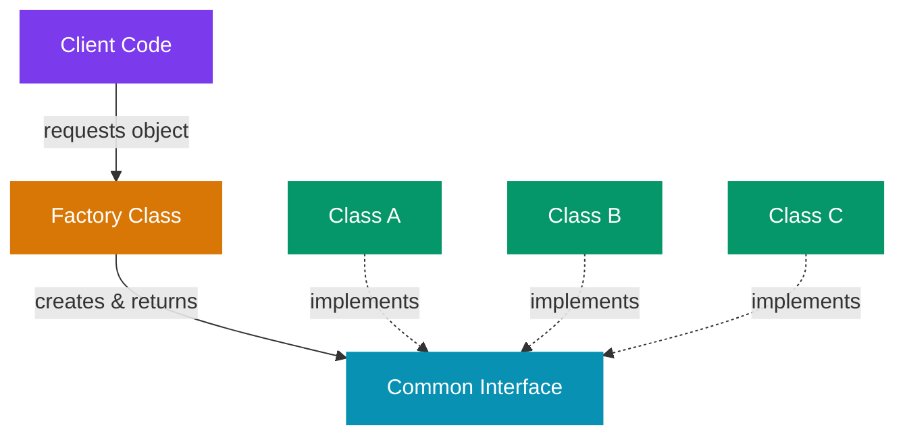

# Simple Factory Pattern in Java

**Simple Factory Pattern in Java** *(people also call it the "Factory Pattern", loosely)*. This note covers:

- what it is and why we need it
- how it solves object creation problems
- real examples in JDBC, Hibernate, and Spring

> **Factory Pattern Series** — Read the parts in this order:  
> **Part 1 → Simple Factory (this file)** · [Part 2 → Factory Method](./04_2_Factory_Method_Design_Pattern.md) · [Part 3 → Abstract Factory](./04_3_Abstract_Factory_Design_Pattern.md) · [All Three Compared →](./04_Factory_vs_Factory_Method_vs_Abstract_Factory_Design_Pattern.md)

- [1. Problems – Need of Simple Factory Pattern ⚡](#1-problems--need-of-simple-factory-pattern)
- [2. Solution using Simple Factory Pattern 🔥](#2-solution-using-simple-factory-pattern)
- [3. How to implement Simple Factory Pattern 🔥🔥](#3-how-to-implement-simple-factory-pattern)
  - [3.1 Why return type of factory method should be common type 🔥](#31-why-return-type-of-factory-method-should-be-common-type)
- [4. Examples 🔥](#4-examples)
  - [4.1 Payment Gateway (Fintech / Production) 🔥](#41-payment-gateway-fintech--production)
  - [4.2 Notification Service (Common in Microservices) ⚡](#42-notification-service-common-in-microservices)
  - [4.3 Document Parser (Data Processing Pipelines) 💤](#43-document-parser-data-processing-pipelines)
  - [4.4 Framework-Level (JDBC + Spring) 🔥](#44-framework-level-jdbc--spring)
  - [4.5 In Your Production Stack (Use These in Interviews) 🔥](#45-in-your-production-stack-use-these-in-interviews)
  - [4.6 In the JDK 🔥](#46-in-the-jdk)
  - [4.7 When to Reach for It in Your Own Code ⚡](#47-when-to-reach-for-it-in-your-own-code)
- [5. Limitations — Simple Factory violates the Open/Closed Principle 🔥🔥](#5-limitations--simple-factory-violates-the-openclosed-principle)
  - [5.1 Map / Registry-based Factory (removes the switch) 🔥🔥](#51-map--registry-based-factory-removes-the-switch)
  - [5.2 Spring variant — let the container build the registry 🔥🔥](#52-spring-variant--let-the-container-build-the-registry)
  - [5.3 New instance vs cached instance 🔥](#53-new-instance-vs-cached-instance)
- [6. FAQ 🔥](#6-faq)
- [7. Does Industry Really Call It "Factory Pattern"? 🔥](#7-does-industry-really-call-it-factory-pattern)

> 🔥🔥 Must-know — very frequently tested &nbsp;·&nbsp; 🔥 High priority &nbsp;·&nbsp; ⚡ Medium priority &nbsp;·&nbsp; 💤 Low priority

---

Four different terms contain the word "Factory":

1. **Static Factory Method** — Any method that creates and returns an object is a factory method. These methods are usually static. So we call them static factory methods.
2. **Factory Pattern (or Simple Factory Pattern)**
3. [Factory Method Design Pattern](./04_2_Factory_Method_Design_Pattern.md)
4. [Abstract Factory Design Pattern](./04_3_Abstract_Factory_Design_Pattern.md)

🔑 **People often mix up terms 1 and 2.**

- A static factory method replaces `new`.
- A Simple Factory decides *what* to `new`.

The full answer is in **[Q11](#6-faq)**. It has the comparison table, *Effective Java* Item 1, the naming words, and the two downsides. Q11 is the only place that explains this difference. Nothing above repeats it.

📝 **Note:** This tutorial covers the **Simple Factory Pattern**.

- Of the four terms above, only **Factory Method Design Pattern** and **Abstract Factory Design Pattern** are official GoF design patterns.
- "Static Factory Method" is a common Java coding style (a Java idiom).
- "Simple Factory Pattern" is a basic programming idea. It is not an official GoF pattern.

The Factory Pattern is one of the most used [creational design patterns in Java](./02_Design_Patterns_in_Java.md). To understand it easily, imagine two different programmers. One writes the client application. The other writes the business logic. Keeping these two roles in mind makes the pattern clear.

Sometimes an application or framework does not know which class to create until runtime.

- It may know that it has to create objects (instantiate classes).
- But it may only know about abstract classes or interfaces. It cannot instantiate those.

So the application class may want its subclasses to say which objects to create.

🔑 **Key Point:** The main advantage of the factory pattern: it hides the object creation process of the classes behind an abstraction.

The factory pattern handles object creation problems with a separate method that creates the objects. This method:

- can take parameters that say which class to create an object for
- returns the created object

---

<a id="1-problems--need-of-simple-factory-pattern"></a>
## 1. Problems – Need of Simple Factory Pattern 💤

**Problem 1:** We create objects of different classes in different ways. But we don't want to show those ways to the end-user.

Client application developers should not need to know how to create objects of each class. That would be too much work for them.

🧠 **In Simple Words:**
We want our own bike. But we do not build the bike ourselves. That takes a lot of time and effort, and it is very complex.

- Instead, we go to a bike factory that is good at making bikes.
- We order a model number.
- The factory builds a bike of that model, or delivers one it already built.
- We don't need to know how to make engines and tyres, or how to assemble and test the bike.

We just order the bike. So the bike company gives us an abstraction over the bike creation process.

Code works the same way. We have many classes. Based on the data we pass, we need an object of only one of them. But we don't want to know how the object is created. For example:

- how to create that object
- what dependencies it needs
- what other dependencies those dependencies need

We just want to ask a factory and get the object for our data. The factory should handle the object creation, the dependencies, and everything else. This factory is the Factory Pattern.

**Problem 2:** Sometimes we cannot know until runtime which class's object we need. We could create objects of all the classes and use only one. But that is bad practice. It wastes memory and CPU time.

**Problem 3:** The object creation process may be very complex. Then it is better not to show that process directly to the client application developer. It is better to hide it behind an abstraction.

---

<a id="2-solution-using-simple-factory-pattern"></a>
## 2. Solution using Simple Factory Pattern ⚡

The Factory Pattern solves the above problems.

- It creates an object of only one of several related classes. The data we pass decides which one.
- It hides the object creation process behind an abstraction.
- It does not create objects of the other subclasses or classes.
- If needed, it also creates the dependent objects and sets them on the object.

Usually, all the returned classes have a common parent class and common methods. But each one does the task in a different way. Each one is optimized for a different kind of data.

🏗️ **Intent:**

- 🔒 Creates objects without showing the instantiation logic to the client (it gives an abstraction over the object creation process).
- 🔗 Refers to the newly created object through a **common interface**.



---

<a id="3-how-to-implement-simple-factory-pattern"></a>
## 3. How to implement Simple Factory Pattern ⚡

**To use the factory pattern, we need several classes. The factory takes some data. Based on that data, it creates and returns an object of one class.**

Next question: "How do we make several classes related?"

- **Make them extend a common class, or implement a common interface.**
- **For our purpose, the interface option is much better than a class.**

Then we can store the object that the factory returns in a variable of the common interface type. A common superclass type also works.

In Java, we don't always use the `new` keyword to create objects. Several ways can produce an object:

- the `new` keyword
- calling a static factory method on the class
- reflection, with `Constructor.newInstance()`. (`Class.newInstance()` is **deprecated since Java 9**. If the constructor throws a checked exception, it passes that exception on without declaring it.)
- deserialization (rebuilding an object from a byte stream)
- `clone()` / `Unsafe.allocateInstance()`

Inside, a Java method uses one of these ways to create objects. So it is better to hide the object creation process behind an abstraction.

> ⚠️ **Don't mix up a static factory method with a singleton.** A static factory method *can* return a fresh instance on every call (e.g. `new`). It **can** also return a cached/shared instance. These are two independent design choices. Returning a shared instance is singleton/caching behaviour. The words "factory method" do not mean that. See the [new instance vs cached instance](#53-new-instance-vs-cached-instance) note below.

**Without using the interface:**

```java
class A {}
class B {}
class C {}
```

**In user class, to create the object for A, B, and C class:**

```java
A a = new A();
B b = new B();
C c = new C();
```

**With using the interface:**

```java
interface X {}
class A implements X {}
class B implements X {}
class C implements X {}
```

**In user class, to create the object for A, B, and C class:**

```java
// good approach
X x1 = new A();
X x2 = new B();
X x3 = new C();
```

**Every factory pattern class has one factory method. The method takes some data. Based on that data, it returns an object of one of several related classes. Its return type is the common superclass/interface.**

> 📝 **Note:** In Java, any method that creates and returns objects is called a factory method. (This Java factory method is not the same as the Factory Method Design Pattern.)

**Simple Factory Pattern implementation:**

```java
// implementation of factory pattern
public class MyFactory {
  // static factory method having interface return type
  public static X createObject(String type) {
    if(type.equalsIgnoreCase("a"))
      return new A();
    else if(type.equalsIgnoreCase("b"))
      return new B();
    else if(type.equalsIgnoreCase("c"))
      return new C();
    else
      // ✅ fail fast on an unknown key — never fall through to a default impl, never return null
      throw new IllegalArgumentException("Unsupported type: " + type);
  }
}
```

**In user class (Client/user application):**

```java
// to create object of A class
X x1 = MyFactory.createObject("A");

// to create object of B class
X x2 = MyFactory.createObject("B");

// to create object of C class
X x3 = MyFactory.createObject("C");
```

🔑 **Key Points:**

- 🔹 If the method's return type is an **interface**, the method returns an object of one class that implements that interface.
- 🔸 If the method's return type is an **abstract class**, the method returns an object of one subclass of that abstract class.
- 🔹 If the method's return type is a **concrete class**, the method can return an object of that class or of one of its subclasses.

<a id="31-why-return-type-of-factory-method-should-be-common-type"></a>
### 3.1 Why return type of factory method should be common type 🔥

Why should the factory method return a common interface or common class? Let us use the JDBC connection example.

- `Connection` is an interface in the JDBC API.
- The people who build JDBC drivers for the Oracle database implement this interface. They write the logic that connects the Java application to the Oracle database.
- The people who build JDBC drivers for MySQL databases also implement this interface. They write the logic that connects to MySQL databases.

Today we have many databases. For one database, different vendor companies give many JDBC drivers.

Assume each driver returned its own class type. Then:

- Our application code would work with only one JDBC driver. This is tight coupling.
- To use a different JDBC driver, we would have to change our application code.
- ORM frameworks (like Hibernate) would not be possible. With them, we can change databases without changing the Java code.

The return type should not change with the JDBC driver or the database software. Each JDBC driver may use a different implementation class name. But the method's return type should be a common interface. This gives loose coupling. So **we can work** with any JDBC driver **without changing our application code**.

| Approach | Coupling 🔗 | Flexibility 🔄 | Maintainability 🛠️ |
|----------|------------|---------------|-------------------|
| **Own class type return** | ❌️ Tight coupling | ❌️ Driver-specific | ❌️ Code changes needed |
| **Common interface return** | ✅ Loose coupling | ✅ Any driver works | ✅ No code changes |

---

<a id="4-examples"></a>
## 4. Examples ⚡

<a id="41-payment-gateway-fintech--production"></a>
### 4.1 Payment Gateway (Fintech / Production) 🔥

In a fintech application, a payment can go through UPI, NEFT, IMPS, or card. Each channel has a different implementation. The caller should not care which one it calls.

```java
public interface PaymentProcessor {
    void process(PaymentRequest request);
}

public class UpiPaymentProcessor implements PaymentProcessor {
    public void process(PaymentRequest request) { /* UPI logic */ }
}

public class NeftPaymentProcessor implements PaymentProcessor {
    public void process(PaymentRequest request) { /* NEFT logic */ }
}

public class CardPaymentProcessor implements PaymentProcessor {
    public void process(PaymentRequest request) { /* Card logic */ }
}

public class PaymentProcessorFactory {
    public static PaymentProcessor getProcessor(String channel) {
        // ⚠️ channel.toUpperCase() throws NPE if channel is null — guard it (e.g. Objects.requireNonNull) before switching
        switch (channel.toUpperCase()) {
            case "UPI":  return new UpiPaymentProcessor();
            case "NEFT": return new NeftPaymentProcessor();
            case "CARD": return new CardPaymentProcessor();
            default: throw new IllegalArgumentException("Unsupported channel: " + channel);
        }
    }
}
```

**Usage:**

```java
PaymentProcessor processor = PaymentProcessorFactory.getProcessor("UPI");
processor.process(request);
```

The disbursement service does not need to know which processor runs. It just calls `process()`. To add a new channel (e.g. RTGS), you need only a new class + one case in the factory. The caller does not change.

<a id="42-notification-service-common-in-microservices"></a>
### 4.2 Notification Service (Common in Microservices) ⚡

Applications send notifications via Email, SMS, or Push. The factory decides which sender to use based on user preference or config.

```java
public interface NotificationSender {
    void send(String userId, String message);
}

public class EmailSender implements NotificationSender {
    public void send(String userId, String message) { /* SMTP logic */ }
}

public class SmsSender implements NotificationSender {
    public void send(String userId, String message) { /* SMS API logic */ }
}

public class PushSender implements NotificationSender {
    public void send(String userId, String message) { /* FCM/APNs logic */ }
}

public class NotificationFactory {
    public static NotificationSender getSender(String channel) {
        switch (channel.toUpperCase()) {   // ⚠️ NPE if channel is null — guard the key first
            case "EMAIL": return new EmailSender();
            case "SMS":   return new SmsSender();
            case "PUSH":  return new PushSender();
            default: throw new IllegalArgumentException("Unknown channel: " + channel);
        }
    }
}
```

**Usage:**

```java
String preferredChannel = userPreferenceService.getChannel(userId); // "SMS"
NotificationSender sender = NotificationFactory.getSender(preferredChannel);
sender.send(userId, "Your loan application is approved.");
```

The notification orchestrator (the code that coordinates sending) is fully decoupled from the delivery logic. You can add or swap channels without changing the orchestrator.

<a id="43-document-parser-data-processing-pipelines"></a>
### 4.3 Document Parser (Data Processing Pipelines) 💤

A document ingestion service receives files in PDF, Excel, or CSV format. A factory picks the right parser.

> 📝 **Naming note:** the parsed row type is named `ParsedRow`, **not** `Record`. Since Java 16 (preview in 14–15), `java.lang.Record` is the base class of all records. A custom type called `Record` would shadow it and confuse readers. Do not use `Record` as a domain class name.

This example needs no other code. It compiles as it is:

```java
import java.io.ByteArrayInputStream;
import java.io.InputStream;
import java.util.List;

class ParsedRow {
    final String content;
    ParsedRow(String content) { this.content = content; }
}

interface DocumentParser {
    List<ParsedRow> parse(InputStream input);
}

class PdfParser implements DocumentParser {
    public List<ParsedRow> parse(InputStream input) {
        return List.of(new ParsedRow("parsed-pdf"));
    }
}

class ExcelParser implements DocumentParser {
    public List<ParsedRow> parse(InputStream input) {
        return List.of(new ParsedRow("parsed-xlsx"));
    }
}

class CsvParser implements DocumentParser {
    public List<ParsedRow> parse(InputStream input) {
        return List.of(new ParsedRow("parsed-csv"));
    }
}

class DocumentParserFactory {
    public static DocumentParser getParser(String fileType) {
        switch (fileType.toLowerCase()) {   // ⚠️ NPE if fileType is null — guard the key first
            case "pdf":  return new PdfParser();
            case "xlsx": return new ExcelParser();
            case "csv":  return new CsvParser();
            default: throw new IllegalArgumentException("Unsupported file type: " + fileType);
        }
    }
}

public class DocumentParserDemo {
    public static void main(String[] args) {
        InputStream upload = new ByteArrayInputStream("a,b,c".getBytes());
        DocumentParser parser = DocumentParserFactory.getParser("csv");
        List<ParsedRow> rows = parser.parse(upload);
        System.out.println(rows.get(0).content); // parsed-csv
    }
}
```

<a id="44-framework-level-jdbc--spring"></a>
### 4.4 Framework-Level (JDBC + Spring) 🔥

All three cases work the same way:

- The caller passes a key (URL / bean name / nothing).
- It gets back an object through a common type.
- It never knows the concrete class.

> 📝 **Note:** More real-world examples of the factory pattern — in your production stack and across the JDK — are listed below.

<a id="45-in-your-production-stack-use-these-in-interviews"></a>
### 4.5 In Your Production Stack (Use These in Interviews) 🔥

| Where | Factory Method | What it returns |
|---|---|---|
| **Spring IoC** | `ctx.getBean("paymentService")` | The right `PaymentService` impl based on bean id |
| **JDBC** | `DriverManager.getConnection(url, user, pwd)` | A driver-specific class (e.g. MySQL's `ConnectionImpl`, Oracle's `T4CConnection`) — caller gets `Connection` |
| **Hibernate** | `sessionFactory.openSession()` | A `Session` that takes a pooled JDBC connection only when it needs one, hidden internals |
| **Kafka** | `ProducerFactory.createProducer()` | A configured `KafkaProducer` instance |
| **Jackson** | `ObjectMapper.readerFor(Class)` | A typed `ObjectReader` for the given class |
| **SLF4J** | `LoggerFactory.getLogger(Class)` | The right logger impl (Logback, Log4j) at runtime |

<a id="46-in-the-jdk"></a>
### 4.6 In the JDK 🔥

- `java.util.Calendar#getInstance()` — returns locale-specific Calendar subclass
- `java.text.NumberFormat#getInstance()` — returns locale-specific number formatter
- `java.nio.charset.Charset#forName("UTF-8")` — returns the right Charset impl
- `java.sql.DriverManager#getConnection(url)` — returns the right JDBC driver connection
- `java.util.EnumSet#of()` — returns `RegularEnumSet` or `JumboEnumSet` based on enum size

<a id="47-when-to-reach-for-it-in-your-own-code"></a>
### 4.7 When to Reach for It in Your Own Code ⚡

- Multiple implementations of the same interface that must be selected at runtime
- Object creation needs setup logic the caller shouldn't know about (dependencies, config, pooling)
- You want to keep the creation logic in one place, so the caller only works with an interface

---

<a id="5-limitations--simple-factory-violates-the-openclosed-principle"></a>
## 5. Limitations — Simple Factory violates the Open/Closed Principle 🔥

The Simple Factory is really useful. But in interviews, be honest about its biggest weakness: **it violates the Open/Closed Principle (OCP)**. OCP means "open for extension, closed for modification".

Look at any of the factories above. Each time you add a new type, you must **edit the factory**. Examples of new types: an RTGS payment, a WhatsApp notification, a new file format.

- You add another `case` to the `switch`/`if-else`.
- So each extension *modifies* the factory class. It does not only extend it.
- As the number of types grows, you edit that one method all the time.
- It becomes a bottleneck, and it causes many merge conflicts.

```java
switch (channel.toUpperCase()) {
    case "UPI":  return new UpiPaymentProcessor();
    case "NEFT": return new NeftPaymentProcessor();
    case "CARD": return new CardPaymentProcessor();
    // ❌️ add RTGS? → edit THIS method again. The switch grows forever.
    default: throw new IllegalArgumentException("Unsupported channel: " + channel);
}
```

The GoF **Factory Method** pattern solves exactly this problem. It moves the choice of concrete class down into subclasses. Each new type is a new subclass. That is *extension*, not *modification*. So the creator stays closed for modification. See **[Part 2 → Factory Method](./04_2_Factory_Method_Design_Pattern.md)**.

⚠️ **But be honest about the limit of that fix. Factory Method *moves* the decision. It does not delete it.**

- Someone still has to choose which *creator subclass* to instantiate.
- The `if/else` does not go away. It moves to the code that picks `UpiCreator` vs `NeftCreator`.
- That code is often a Simple Factory, DI config, or `main()`.
- Factory Method really helps when the **caller is already polymorphic**. For example, a framework gives you a subclass.
- It gives you nothing when you still must map a runtime string to a class. In that case, the registry below is the real fix.

🛡️ **And the honest defense of Simple Factory:** keeping the violation in one place is itself a win.

- Without a factory, the same `if/else` is copied at *every* call site.
- With a factory, there is exactly **one** place to edit. It is well-tested and easy to review.
- "It violates OCP, but it keeps the violation in a single method" is a senior answer you can defend.
- That is why most real code uses a Simple Factory (see §7) and works fine.

In everyday code, the lighter and more common fix is the **registry/Map-based factory** below. It removes the `switch` completely. So adding a type no longer edits the selection logic.

<a id="51-map--registry-based-factory-removes-the-switch"></a>
### 5.1 Map / Registry-based Factory (removes the switch) 🔥🔥

Do not grow a `switch`. Instead, store each type's constructor under a key in a `Map<String, Supplier<T>>`.

- Selection becomes a single map lookup.
- Adding a type is one `put`. It is even better if each type registers itself.
- The lookup code never changes.

```java
import java.util.Map;
import java.util.Locale;
import java.util.Objects;
import java.util.function.Supplier;

public class PaymentProcessorFactory {

    private static final Map<String, Supplier<PaymentProcessor>> REGISTRY = Map.of(
        "UPI",  UpiPaymentProcessor::new,
        "NEFT", NeftPaymentProcessor::new,
        "CARD", CardPaymentProcessor::new
    );

    public static PaymentProcessor getProcessor(String channel) {
        Objects.requireNonNull(channel, "channel must not be null"); // guard before key lookup
        Supplier<PaymentProcessor> supplier = REGISTRY.get(channel.toUpperCase(Locale.ROOT));
        if (supplier == null) {
            throw new IllegalArgumentException("Unsupported channel: " + channel);
        }
        return supplier.get();
    }
}
```

The `switch` is gone. You can go further with a mutable registry: `new ConcurrentHashMap<>()` + a `register(key, supplier)` method. Then new types can register themselves at startup. You never touch the factory class again. This comes much closer to following OCP.

```java
import java.util.Map;
import java.util.Locale;
import java.util.Objects;
import java.util.concurrent.ConcurrentHashMap;
import java.util.function.Supplier;

public class PaymentProcessorFactory {

    // mutable, thread-safe registry — no hard-coded types
    private static final Map<String, Supplier<PaymentProcessor>> REGISTRY = new ConcurrentHashMap<>();

    // each processor type registers itself here — the factory never lists them
    public static void register(String channel, Supplier<PaymentProcessor> supplier) {
        Objects.requireNonNull(channel, "channel must not be null");
        Objects.requireNonNull(supplier, "supplier must not be null");
        REGISTRY.put(channel.toUpperCase(Locale.ROOT), supplier);
    }

    public static PaymentProcessor getProcessor(String channel) {
        Objects.requireNonNull(channel, "channel must not be null"); // guard before key lookup
        Supplier<PaymentProcessor> supplier = REGISTRY.get(channel.toUpperCase(Locale.ROOT));
        if (supplier == null) {
            throw new IllegalArgumentException("Unsupported channel: " + channel);
        }
        return supplier.get();
    }
}
```

Each implementation registers itself at startup. For example, it can do this in a `static` initialiser block. Then the type adds itself to the registry as soon as its class is loaded:

```java
public class UpiPaymentProcessor implements PaymentProcessor {

    // self-registration — runs when the class is first loaded
    static {
        PaymentProcessorFactory.register("UPI", UpiPaymentProcessor::new);
    }

    public void process(PaymentRequest request) { /* UPI logic */ }
}
```

Now adding **RTGS** = write an `RtgsPaymentProcessor` with its own `static` block. **You never edit `PaymentProcessorFactory`.** There is no `switch` and no `Map.of(...)` list to grow.

- There is one limit. A class's `static` block runs only after the class is *loaded*.
- So each processor must be loaded at startup, or its registration never runs.
- You can load them with classpath scanning or an explicit bootstrap list, for example.
- The Spring variant below avoids this problem completely. The container finds and registers every bean for you.

<a id="52-spring-variant--let-the-container-build-the-registry"></a>
### 5.2 Spring variant — let the container build the registry 🔥🔥

```java
@Component("UPI")
class UpiPaymentProcessor implements PaymentProcessor {
    public void process(PaymentRequest request) { /* UPI logic */ }
}

@Component("NEFT")
class NeftPaymentProcessor implements PaymentProcessor {
    public void process(PaymentRequest request) { /* NEFT logic */ }
}

@Service
class PaymentProcessorFactory {

    // Spring populates this: key = bean name ("UPI", "NEFT", ...), value = the bean
    private final Map<String, PaymentProcessor> processors;

    PaymentProcessorFactory(Map<String, PaymentProcessor> processors) {
        this.processors = processors;
    }

    public PaymentProcessor getProcessor(String channel) {
        Objects.requireNonNull(channel, "channel must not be null");
        // normalise the key — bean names are "UPI"/"NEFT", a caller passing "upi" must still resolve
        PaymentProcessor processor = processors.get(channel.toUpperCase(Locale.ROOT));
        if (processor == null) {
            throw new IllegalArgumentException("Unsupported channel: " + channel);
        }
        return processor;
    }
}
```

Now adding **RTGS** = add one `@Component("RTGS")` class. **Nothing in the factory changes.** Spring finds the new bean and adds it to the injected map. This is the standard, OCP-friendly factory in Spring applications.

> 💡 A cleaner key strategy: let `PaymentProcessor` expose `String channel()`. Inject `List<PaymentProcessor>`. Then build the map yourself, keyed by `channel()`. This separates the routing key from the Spring bean name.

🧪 **The practical argument (stronger than pure OCP): you can't mock a `public static` factory.**

- A `static` method has no seam (no place where a test can swap in a fake).
- Mockito can't stub it without `MockedStatic` (in Mockito 4 and older, this also needs the `mockito-inline` artifact).
- So every unit test of the *caller* also brings in the real `UpiPaymentProcessor`, its HTTP client, and its config. You may not even notice.
- The instance-method-on-a-bean form above is easy to stub: `when(factory.getProcessor("UPI")).thenReturn(mockProcessor)`. Or you just construct it with a map of test doubles.
- This, not OCP, is usually the real reason teams make the change.

<a id="53-new-instance-vs-cached-instance"></a>
### 5.3 New instance vs cached instance 🔥

A factory method controls **whether you get a fresh object or a shared/cached one**. The caller can't tell the difference. This is part of what makes the abstraction strong. All the factories above return a `new` instance per call. But the JDK has well-known factories that do the opposite:

- `Boolean.valueOf(true)` — returns the cached `Boolean.TRUE` constant, never a new object. So use it instead of `new Boolean(true)`, which is now deprecated.
- `Integer.valueOf(int)` — returns cached instances for the range −128..127 **by default** (the Integer cache). Outside that range, it returns a fresh instance. ⚠️ You can change the **upper** bound with `-XX:AutoBoxCacheMax=<n>`. The **lower** bound is fixed at −128 and cannot change. This is the usual follow-up to the Integer-cache question.
- `Calendar.getInstance()` — builds and returns a **new** `Calendar` on each call (a subclass for the locale/timezone). So it is a factory *without* caching.

The lesson: "factory method" says nothing about instance lifecycle. Caching is a *separate* decision, and the factory is free to make it. That is exactly why a static factory method is **not** the same thing as a singleton.

---

<a id="6-faq"></a>
## 6. FAQ ⚡

> 🔥🔥 Very High — asked in almost every Tier-1 loop &nbsp;·&nbsp; 🔥 High — very frequent in Tier-1 interviews &nbsp;·&nbsp; ⚡ Medium — commonly asked &nbsp;·&nbsp; 💤 Low — good to know, rarely asked.

**Q1) What is the use of factory patterns? 💤**

<!-- -->
<details>
<summary>Answer</summary>

**Answer:**

The factory pattern gives an abstraction over the object creation process.

---

</details>

**Q2) What is the factory pattern explained with an example? ⚡**

<!-- -->
<details>
<summary>Answer</summary>

**Answer:**

The factory pattern handles the problems of object creation. It defines a separate method that creates the objects.

- This method can take parameters. The parameters say which class to create the object for.
- The method returns the created object.

---

</details>

**Q3) What are the types of factory patterns? 🔥**

<!-- -->
<details>
<summary>Answer</summary>

**Answer:**

There are **four** terms that contain the word "Factory". Only two of them are official GoF design patterns:

- 🔧 Static Factory Method — a **Java idiom, not a pattern at all**. It is any creation method on the product's own class that replaces a constructor (`Integer.valueOf`, `List.of`)
- 🏗️ Factory Pattern (or Simple Factory Pattern) — programming idiom, not an official GoF pattern
- ⚙️ Factory Method Design Pattern — ✅ official GoF pattern
- 🏭 Abstract Factory Design Pattern — ✅ official GoF pattern

---

</details>

**Q4) What problem does factory pattern solve? ⚡**

<!-- -->
<details>
<summary>Answer</summary>

**Answer:**

Factory Pattern solves the problems of object creation. It gives an abstraction over the object creation process. Based on the data we supply, it creates one of several related/possible classes.

---

</details>

**Q5) How do you implement a factory pattern? ⚡**

<!-- -->
<details>
<summary>Answer</summary>

**Answer:**

To implement factory pattern:

1. Create an interface.
2. Develop classes by implementing that interface.
3. Create a Factory class.
4. In the Factory class, write a factory method. Based on the data it accepts, it returns an object of one of the related classes. Declare the interface as its return type.

⚠️ **`static` is not part of the definition. It is just common.**

- The key part of the definition is: "one method decides which concrete class to instantiate."
- Textbook examples make it `static`.
- In a Spring app, it is normally an **instance method on a bean**. Then it can be injected, hold its own dependencies, and be mocked in tests.
- Sometimes the selection key comes from a DB row or config. Then the factory *cannot* be static, because it needs injected dependencies (collaborators).

---

</details>

**Q6) What is the difference between factory and builder patterns? 🔥**

<!-- -->
<details>
<summary>Answer</summary>

**Answer:**

The key difference is *which* vs *how*:

- 🏭 **Factory** decides **which class** to instantiate. It is one call. It makes a polymorphic choice among several implementations of a common interface. `getProcessor("UPI")` → a `PaymentProcessor`.
- 🧱 **Builder** decides **how to construct one class**. It uses many chained calls and many optional parameters, and ends in `build()`. It exists to remove the telescoping-constructor problem (many constructors with more and more parameters). It does not choose a type.

So a factory hides *what* you got. A builder hides *how much configuration* went into it. They work well together. A factory can return a builder, and a builder can call a factory for its parts.

---

</details>

**Q7) Is dependency injection a factory pattern? ⚡**

<!-- -->
<details>
<summary>Answer</summary>

**Answer:**

No. But they are related. The interviewer's next question is usually *"then what is Spring's `BeanFactory`?"*

- 🔽 **Factory = pull.** The client asks for an object **by key** (`getProcessor("UPI")`). So the client still knows the key and still starts the lookup.
- 🔼 **DI = push.** The container supplies the dependency. The client declares a constructor parameter and knows **nothing** about the selection.

DI containers are **built on** factories. `BeanFactory` *is* the factory. DI sits on top of it and decides which object gets which dependency. A simple rule:

- Use DI when the choice is **fixed at startup**.
- Use a factory when the choice **depends on runtime data**. For example: a channel from the request, or a client's auth type read from the DB.

---

</details>

**Q8) Which SOLID principle does a Simple Factory violate, and how do you fix it? 🔥🔥**

<!-- -->
<details>
<summary>Answer</summary>

**Answer:**

A classic `switch`/`if-else` Simple Factory violates the **Open/Closed Principle (OCP)**: "open for extension, closed for modification." Every new type forces you to **edit the factory** (add another `case`). So each extension *modifies* the class. It does not only extend it.

⚠️ **Common trap. Be exact here.**

- An enum **with an `if/else`/`switch` chain** does *not* fix OCP. The chain is still there, so adding a constant still edits the factory.
- That form only gives you type-safety and readability.
- But an enum with **constant-specific method bodies** *does* fix it. See fix 3.

The three real fixes:

1. 🧬 **GoF Factory Method** — move the choice of concrete class down into subclasses. Each new type is a new subclass (*extension*, not *modification*). So the creator stays closed for modification. One limit: someone still picks *which creator subclass*. So the decision moves. It does not disappear.
2. 🗺️ **Registry / Map-based factory** — replace the `switch` with a `Map<String, Supplier<T>>`. Adding a type is one `put`, and the lookup code never changes. In Spring, inject `Map<String, PaymentProcessor>` keyed by bean name. Then adding an `@Component("RTGS")` changes nothing in the factory.
3. 🔢 **Enum with constant-specific method bodies** — each constant has its own `create()`. So you never edit the selection logic:

```java
public enum Channel {
    UPI {
        public PaymentProcessor create() {
            return new UpiPaymentProcessor();
        }
    },
    NEFT {
        public PaymentProcessor create() {
            return new NeftPaymentProcessor();
        }
    };

    public abstract PaymentProcessor create();
}

// selection logic — never changes when a channel is added
PaymentProcessor p = Channel.valueOf(key.toUpperCase(Locale.ROOT)).create();
```

Adding RTGS = adding one constant. There is no `if/else` to touch. If you don't mention this, an interviewer who knows enums will ask about it.

4. 🔐 **Sealed interface + pattern-matching `switch` (Java 21)** — the modern answer. It gives you a **compile-time exhaustiveness check** at every `switch` over the type (the compiler checks that every type is covered). Seal the product hierarchy. Then switch over it with **no `default` branch**:

```java
public sealed interface PaymentProcessor
        permits UpiPaymentProcessor, NeftPaymentProcessor, CardPaymentProcessor { }

// no `default` — so adding a permitted subtype makes THIS switch fail to compile
static BigDecimal feeFor(PaymentProcessor p) {
    return switch (p) {
        case UpiPaymentProcessor u  -> BigDecimal.ZERO;
        case NeftPaymentProcessor n -> new BigDecimal("2.50");
        case CardPaymentProcessor c -> new BigDecimal("18.00");
    };
}
```

⚠️ **Be exact about what this gives you and what it does not.**

- It does *not* make the factory open for extension. It does the **opposite**, on purpose.
- `sealed` closes the type set. So when you add a type, the compiler can find **every** place that needs an update.
- Use it when the set of types is truly limited and fixed by rules or law. Examples: payment rails, KYC document types, loan states. Here the danger is a branch that is *missed without any warning*.
- When the set should grow freely, use fix 2 or 3 instead.
- Also note: the exhaustiveness guarantee is lost as soon as you write `default:`. The whole point is to leave it out.

---

</details>

**Q9) Should the factory's selector key be a `String` or an `enum`? 🔥**

<!-- -->
<details>
<summary>Answer</summary>

**Answer:**

Prefer an **enum** over magic strings. Raw strings like `"model1"` or `"UPI"` are error-prone and hard to refactor. A typo compiles fine and only fails at runtime. An enum gives **compile-time type-safety**, clear intent, and easy extension:

```java
public enum BikeType { MODEL1, MODEL2, MODEL3 }

// factory keyed by the enum — no magic strings, so a bad key is a compile error
public static Bike getBike(BikeType type) {
    switch (type) {
        case MODEL1: return new Model1Bike();
        case MODEL2: return new Model2Bike();
        case MODEL3: return new Model3Bike();
        default: throw new IllegalArgumentException("Unsupported bike type: " + type);
    }
}
```

⚠️ Note: this `switch` is still the OCP violation from Q8. The enum key fixed *type-safety*, not extensibility. To fix both, move the creation onto each constant (constant-specific method bodies, Q8 fix 3).

⚠️ **And do not claim "the compiler checks exhaustiveness" here. It does not.**

- A classic `switch` **statement** over an enum has never required every constant to be covered.
- Adding `MODEL4` compiles fine, and at runtime it goes into `default`.
- The compiler enforces exhaustiveness only for **switch expressions** (Java 14+) and **pattern switches** (Java 21).
- Even there, a `default` branch satisfies the check. So a switch with a `default` can never tell you a constant is missing.
- Compile-time exhaustiveness needs a switch **expression** (or pattern switch) with no `default`. Over this enum, a switch expression that lists every constant is enough. Adding `MODEL4` then fails to compile. A **sealed** hierarchy (Q8 fix 4) gives the same check over types.

| Approach | Type Safety 🛡️ | Readability 📖 | Maintainability 🔧 |
|----------|---------------|--------------|-------------------|
| **String parameters** | ❌️ Error-prone | ⚠️ Magic strings | ❌️ Hard to refactor |
| **Enum constants** | ✅ Compile-time safe | ✅ Clear intent | ✅ Easy to extend |

💡 **Bonus depth (very useful in interviews):**

- Each enum constant (`MODEL1`, ...) is a **compiler-generated `public static final` singleton instance**. It is created once, when the enum class is loaded.
- The enum constructor is **implicitly `private`**. You can never write `new BikeType()` yourself.
- So the compiler instantiates each constant exactly once.
- This guarantee (one singleton per constant) is what makes enums type-safe. It also makes them safe to compare with `==`.

---

</details>

**Q10) What is Spring's `FactoryBean<T>`, and when would you write one? 🔥**

<!-- -->
<details>
<summary>Answer</summary>

**Answer:**

`FactoryBean<T>` is Spring's own extension point for one case: **a bean that is too complex to build in a constructor, for example a third-party class that a simple constructor cannot build**. You register the *factory*. The container gives callers the *product*.

```java
@Component("paymentClient")
class PaymentClientFactoryBean implements FactoryBean<PaymentClient> {

    private final PaymentProperties props;

    PaymentClientFactoryBean(PaymentProperties props) {
        this.props = props;
    }

    @Override
    public PaymentClient getObject() {
        return PaymentClient.builder()      // third-party builder, needs runtime config
                .endpoint(props.getEndpoint())
                .timeout(props.getTimeout())
                .build();
    }

    @Override
    public Class<?> getObjectType() {
        return PaymentClient.class;
    }

    @Override
    public boolean isSingleton() {
        return true;
    }
}
```

Any class that does `@Autowired` on `PaymentClient` gets the **product**, not the factory.

🎯 **The classic trick question:** what does `ctx.getBean("paymentClient")` return, and what does `ctx.getBean("&paymentClient")` return?

- The plain name returns the **product** (`PaymentClient`).
- The `&` prefix returns the **`FactoryBean` itself**.
- That `&` is the whole point of the question.

⚠️ **When *not* to write one:** now that Java config exists, a plain `@Bean` method does the same job with less boilerplate. `FactoryBean` is mainly useful in **library/framework code** that must expose the factory as a bean. Spring and its ecosystem have many of them: `LocalContainerEntityManagerFactoryBean`, Spring Batch's `SqlPagingQueryProviderFactoryBean`, and MyBatis-Spring's `SqlSessionFactoryBean`.

---

</details>

**Q11) Is a static factory method the same as the Simple Factory pattern? 🔥**

<!-- -->
<details>
<summary>Answer</summary>

**Answer:**

No. Most candidates mix these two up.

| | Static factory method | Simple Factory |
|---|---|---|
| **Lives on** | The product's **own class** | A **separate** factory class |
| **Job** | Replaces a constructor | **Chooses** among several implementations |
| **Parameter** | Construction data | A **selector key** (channel, file type, …) |
| **Example** | `Integer.valueOf(42)`, `List.of(a, b)` | `PaymentProcessorFactory.getProcessor("UPI")` |

*Effective Java* **Item 1** ("consider static factories instead of constructors") is about the **first** column only. Its advantages:

- They have **names** (`BigInteger.probablePrime` vs another `int, int, Random` constructor).
- They **need not create a new object** each call (caching — `Boolean.valueOf`).
- They can **return a subtype** (`EnumSet.of` → `RegularEnumSet` or `JumboEnumSet`).
- The returned class can **vary by argument**.

📛 **The method names interviewers expect to hear:** `of` · `valueOf` · `from` · `getInstance` · `newInstance` · `create` · `getType` / `newType`.

⚠️ **Two real downsides** (the follow-up):

- A class with only **private constructors can't be subclassed**.
- Static factories are **hard to find in Javadoc**. Javadoc lists them with ordinary methods, not in the constructor summary. So you must name them carefully, or people will not find them.

---

</details>

**Q12) `DriverManager.getConnection()` returns the right driver's `Connection` — how does it find the driver? ⚡**

<!-- -->
<details>
<summary>Answer</summary>

**Answer:**

It uses the **Java SPI (Service Provider Interface)** and `java.util.ServiceLoader`. This is the JDK's own production-grade registry factory. In other words, it is §5's registry idea, built into the platform.

1. A JDBC driver jar contains the file **`META-INF/services/java.sql.Driver`**. Its single line is the driver's implementation class name.
2. On first use, `DriverManager` runs `ServiceLoader.load(Driver.class)`. This scans every such file on the classpath. It instantiates each declared `Driver` and registers it.
3. `getConnection(url, ...)` then calls `connect(url, info)` on each registered driver. A driver returns `null` for a URL it does not handle. `DriverManager` returns the first non-null `Connection`.

💡 **The main point:** this is why `Class.forName("com.mysql.jdbc.Driver")` has been **unnecessary since JDBC 4.0 (Java 6)**. Putting the jar on the classpath is enough. If someone still writes that line, they are copying a habit without a reason.

🔑 Note the design:

- Adding a driver adds a jar, and **you never edit `DriverManager`**.
- This is extension that follows OCP, through classpath discovery.
- It is the same idea as the self-registration variant in §5.
- The difference: the registration list comes from a resource file, not a `static` block.
- This avoids the "the class must be loaded first" problem.

---

</details>

**Q13) Why is a `public static` factory harder to test than an injected one? 🔥**

<!-- -->
<details>
<summary>Answer</summary>

**Answer:**

Because a `static` method gives you **no seam** (no place to swap in a fake).

- 🧪 Mockito can't stub a static call without `MockedStatic`. In Mockito 4 and older, this also needs the extra `mockito-inline` dependency. Since Mockito 5 it is built in. You must wrap each use in a try-with-resources block. You must also close it, or it leaks into other tests.
- 🕸️ Without stubbing, a unit test of the **caller** silently constructs the real `UpiPaymentProcessor`. That pulls in its HTTP client, credentials, and config. The "unit" test is now an integration test.
- 🧵 `MockedStatic` registers the mock **per thread**. So if the code under test calls the static method on another thread (an executor, a `CompletableFuture`), that call runs the real method, not the mock.

The instance-method-on-a-bean form has none of these problems. Inject a mock factory, or construct the real factory with a `Map` of test doubles. This is usually the **practical** reason teams move away from `public static` factories. OCP is the textbook argument. Testability is the argument that usually convinces reviewers in a code review.

---

</details>

**Q14) Isn't this just the Strategy pattern? 🔥**

<!-- -->
<details>
<summary>Answer</summary>

**Answer:**

They are similar. A good answer names both:

- 🏭 **Factory** answers *"which object do I **create**?"* — a **creational** pattern.
- 🎯 **Strategy** answers *"which algorithm do I **run**?"* — a **behavioural** pattern. It assumes the object already exists and is injected.

💡 **The question to ask yourself:**

- Are the implementations interchangeable *algorithms over the same data*? Then you are describing Strategy.
- Are they *different products* that the caller can't construct itself? Then you are describing a Factory.
- Most channel/handler routing really is both.

---

</details>

---

<a id="7-does-industry-really-call-it-factory-pattern"></a>
## 7. Does Industry Really Call It "Factory Pattern"? 💤

**Not exactly. Here is how it really works:**

| Situation | What they say | What they mean |
|---|---|---|
| Code review / daily conversation | *"Let's use a factory here"* | Simple Factory — a static method that creates objects |
| Interview question | *"Explain factory pattern"* | Usually Simple Factory, but expects you to know all three |
| GoF / academic context | *"Factory Method Pattern"* | The strict GoF pattern with abstract creator + subclasses |
| Spring/Hibernate docs | *"BeanFactory", "SessionFactory"* | Simple Factory concept |

Application code rarely implements **Factory Method (GoF)** directly. It appears more in **frameworks**. There, the framework defines the abstract creator, and your code is the subclass. You use it without knowing it has a name.

> **Short answer:** Industry says "factory pattern" casually and means Simple Factory. People use the exact GoF name "Factory Method Pattern" mostly in design pattern discussions. They rarely use it in daily engineering conversations.

➡️ **What to *say* when an interviewer uses the loose name:** see **[04 §6.1 Naming Reality Check](./04_Factory_vs_Factory_Method_vs_Abstract_Factory_Design_Pattern.md#61-naming-reality-check--what-interviewers-actually-say)**. It has a table for each phrasing and the clarifying question to start with. The section above is about how the *industry* uses the word. §6.1 is about how the *interviewer* uses it. This file does not repeat it on purpose.

---

> 🎯 **Interview footer — Simple Factory**  
> **Seen in — Simple Factory (selects among implementations):** `Calendar.getInstance()`, `NumberFormat.getInstance()`, `Charset.forName()`, `DriverManager.getConnection()`, `EnumSet.of()`; in Spring, `BeanFactory` itself and `FactoryBean<T>`, plus Hibernate's `SessionFactory` and JPA's `Persistence.createEntityManagerFactory()`.  
> **Seen in — static factory methods (*Effective Java* Item 1, one type, no selection):** `List.of()`, `Set.of()`, `Boolean.valueOf()`, `Optional.of()`, `Executors.newFixedThreadPool()`. Keep the two lists apart. Mixing them up is exactly the mistake Q11 is there to fix. Neither list is GoF Factory Method.  
> **This invites:** *"Your factory's `switch` grows with every new type — how do you avoid editing it?"* (§5 — registry / `Map<String, Supplier>`, Spring's `Map<String, Bean>` injection, or enum constant-specific bodies) · *"Simple Factory, Factory Method, or Abstract Factory — which is this, and why does the distinction matter?"* (§7 and the comparison file) · *"Where does validation of the input type belong — factory or caller?"* (fail fast with a typed exception, and never return `null`) · *"How would you unit-test the caller of that factory?"* (Q13 — a `static` factory has no seam).
