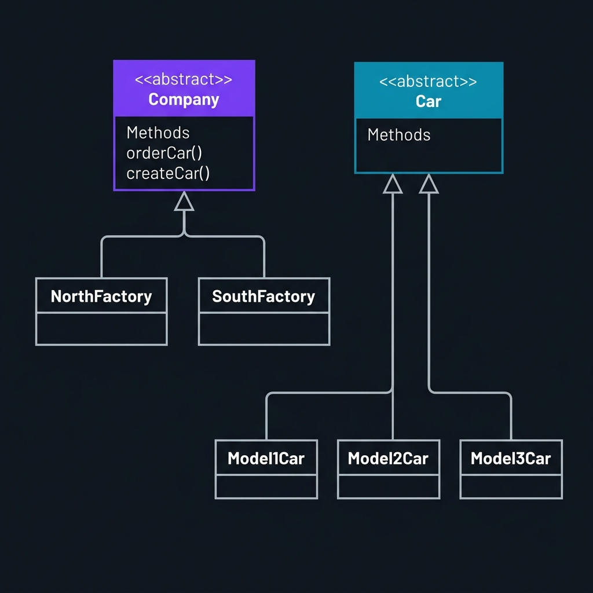
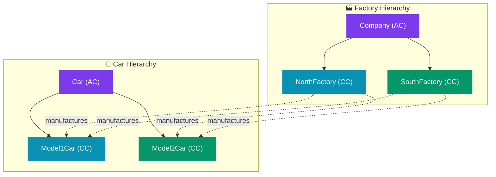

# Factory Method Design Pattern

🎯 **Standard GoF intent:** *"Define an interface for creating an object, but let subclasses decide which class to instantiate. Factory Method lets a class defer instantiation to subclasses."*

- It is also known as the **Virtual Constructor** pattern.
- The base class calls a "constructor-like" method.
- The subclass gives the concrete implementation of that method.
- So the subclass chooses the concrete product type at runtime.

🏗️ It is a **creational** pattern. The key idea:

- A `Creator` class declares an abstract factory method. It returns a `Product`.
- Each `ConcreteCreator` subclass overrides it to create a **different** `ConcreteProduct`.
- The rest of the creator's code works only with the `Product` interface.
- So the creator never needs to know which concrete class it received.

> **Factory Pattern Series:** [Part 1 → Simple Factory](./04_1_Simple_Factory_Pattern_in_Java.md) · **Part 2 → Factory Method (this file)** · [Part 3 → Abstract Factory](./04_3_Abstract_Factory_Design_Pattern.md) · [All Three Compared →](./04_Factory_vs_Factory_Method_vs_Abstract_Factory_Design_Pattern.md)

- [1. Need of Factory Method Design Pattern ⚡](#1-need-of-factory-method-design-pattern)
- [2. Participants 🔥](#2-participants)
- [3. Factory Method vs Template Method 🔥🔥](#3-factory-method-vs-template-method)
  - [3.1 Quiz: Method Resolution ⚡](#31-quiz-method-resolution)
- [4. Factory Method Design Pattern Example 🔥](#4-factory-method-design-pattern-example)
  - [4.1 Problem: No Unified Standards 💤](#41-problem-no-unified-standards)
  - [4.2 Solution using Factory Method Design Pattern 🔥](#42-solution-using-factory-method-design-pattern)
  - [4.3 Testing the Solution 💤](#43-testing-the-solution)
- [5. Real-World Production Use Cases 🔥](#5-real-world-production-use-cases)
  - [5.1 In Frameworks You Use Every Day 🔥](#51-in-frameworks-you-use-every-day)
  - [5.2 In Application Code — Template Method with an embedded Factory Method step ⚡](#52-in-application-code-template-method-with-an-embedded-factory-method-step)
  - [5.3 Where Factory Method Appears vs Simple Factory vs Template Method 🔥](#53-where-factory-method-appears-vs-simple-factory-vs-template-method)
- [6. Pros, Cons & When NOT to Use 🔥](#6-pros-cons--when-not-to-use)
  - [6.1 Pros ✅ 🔥](#61-pros)
  - [6.2 Cons ❌️ 🔥🔥](#62-cons)
  - [6.3 When NOT to Use 🚫 🔥🔥](#63-when-not-to-use)
- [🎯 Interview footer](#interview-footer)

> 🔥🔥 Must-know — very frequently tested &nbsp;·&nbsp; 🔥 High priority &nbsp;·&nbsp; ⚡ Medium priority &nbsp;·&nbsp; 💤 Low priority

---

<a id="1-need-of-factory-method-design-pattern"></a>
## 1. Need of Factory Method Design Pattern 💤

👪 Classes in the same inheritance hierarchy are called "same family" classes. They share either a common superclass or a common interface.

> 📝 **Note — "Java factory method" ≠ "Factory Method pattern".**  
> - In Java, people loosely call *any* method that creates and returns an object a "factory method" (e.g. `Integer.valueOf()`, `List.of()`).  
> - Such helper methods appear in many **creational** patterns: Singleton, Simple Factory, Factory Method, Abstract Factory, Builder.  
> - Strategy is not in this list. It is a **behavioral** pattern, not creational. It is about swapping algorithms, not creating objects.  
> - The GoF **Factory Method pattern** has a narrower meaning. It is an *abstract* creation method on a base class, and **subclasses override it to choose the concrete product**.

📖 Let us look at a story. It shows why we need the Factory Method design pattern and how it solves the problem.

🚗 Assume there is a company that makes cars.

- It has two models: `Model1Car` and `Model2Car`.
- It has set up two manufacturing plants (factories) in two different places.
- The `NorthFactory` makes cars for customers in the north of the country.
- The `SouthFactory` makes cars for customers in the south of the country.
- Both factories make both car models.

🌳 **Class hierarchy:**

```
Car (AC)
  |=> Model1Car (CC)
  |=> Model2Car (CC)

Company (AC)
  |=> NorthFactory (CC)
  |=> SouthFactory (CC)
```

ℹ️ Here, AC means Abstract class, and CC means Concrete class.





😟 The company had not given any standards (rules and guidelines) for making the cars. So each factory made its own standards and started making the car models.

- The `NorthFactory` cared most about quality. It followed many standards to make the cars.
- The `SouthFactory` cared most about production cost. To reduce cost, it followed fewer standards than the `NorthFactory`.

📉 Both factories belong to the same company. But their quality standards were different:

- North customers got good quality. South customers got lower quality.
- After some time, south customers demanded cars made only by the `NorthFactory`. Otherwise, they would not buy from that company.
- Because of this, the company grew in the north of the country but made a loss in the south.
- The company got a bad name in the market. This hurt the growth of the company.

🔑 **Key Point:** The key to a successful business is: "Wherever you buy the product, you should get the same quality."

- To solve the problem, the company gave one set of rules and guidelines (standards) to both factories.
- Now both factories must follow those standards to make the car.
- If the company starts a new factory in the future, that factory must also follow those standards.
- In the end, every customer gets the same product. This improved the brand image of the company.

---

<a id="2-participants"></a>
## 2. Participants 💤

| Participant | Role |
|---|---|
| **Product** | The interface/abstract type of the objects the factory method creates (e.g. `CompanyCar`). |
| **ConcreteProduct** | A specific implementation of `Product` (e.g. `Model1Car`, `Model2Car`). |
| **Creator** | Declares the abstract **factory method** that returns a `Product`. It may also have code that uses the product. It is often abstract (e.g. `CompanyFactory`). |
| **ConcreteCreator** | Overrides the factory method to return a particular `ConcreteProduct` (e.g. `NorthFactory`, `SouthFactory`). |

> 🧭 **Mental model:** the Creator says *"I need a Product, but I won't decide which one. My subclass will."* Passing the `new` call down to a subclass **is** the pattern.

🧬 **Two kinds of Creator (GoF names both, so know the terms):**

- **Abstract Creator** — the factory method is `abstract`. There is no default, so every subclass *must* give a product. The car example below uses this kind.
- **Concrete Creator** — you can create an instance of the Creator, and the factory method has a **working default implementation**. Subclasses override it only when they want a different product. Use it when one product is the sensible default and other products are the exception.

🎛️ **Parameterized factory method** — a factory method that takes a key and can return *several* products: `Product create(Type id)`.

- GoF gives this variant its own name.
- `createCar(String model)` in §4 is exactly this.
- The subclass still decides *how* to map the key to a class. But one method now covers a whole range of products, not just one.
- Because of this, a Simple Factory `switch` can sit *inside* a Factory Method. You can still tell the two patterns apart.

---

<a id="3-factory-method-vs-template-method"></a>
## 3. Factory Method vs Template Method 🔥

🔀 People often mix up these two GoF patterns. One reason: a single worked example (like the car example below) often uses **both at once**. They are different patterns, and they answer different questions:

- **Factory Method** answers *"which object do I create?"* → a subclass overrides a creation method to choose the **concrete product**.
- **Template Method** answers *"in what order do the steps run?"* → a base class fixes the **algorithm skeleton** (usually in a `final` method). Subclasses fill in single steps (hooks). But subclasses **cannot** reorder, add, or skip steps.

> ⚖️ **What "cannot skip" means exactly — a common follow-up that people get wrong.**  
> - A subclass may override a **hook** to a no-op. This removes that step's *effect*. (`DigitalGoodsProcessor.reserveStock()` in §5.2 does exactly this.)  
> - But it can never change the step's **position in the sequence**. The call still happens, at the same point. No step can be inserted, removed, or reordered.  
> - *Abstract step* = the subclass **must** implement it.  
> - *Hook* = an optional step with a default (often empty). The subclass **may** turn it into a no-op.  
>
> "Cannot skip" means you cannot skip the *call*. It does not mean you cannot make the call do nothing.

| Aspect | Factory Method 🏭 | Template Method 📝 |
|---|---|---|
| **Category** | Creational | Behavioral |
| **Subclass overrides** | A *creation* method that returns a product | One or more *step* methods (hooks) of a fixed algorithm |
| **What the subclass controls** | *Which* concrete object gets instantiated | *How* an individual step behaves |
| **What the subclass CANNOT do** | Change how the base code uses the product | Reorder, add, or skip steps — the skeleton is fixed (often `final`) |
| **The fixed part** | The base code that depends only on the `Product` interface | The template method itself = the locked step sequence |
| **Returns** | A newly created object | Usually drives a process; may or may not return a product |

🛠️ **Interview-process example (Template Method):** A company fixes the hiring sequence: written test → round-1 → round-2 → HR round.

- Every candidate follows the *same order*. No one may skip or reorder rounds.
- What differs per candidate is *how* each round goes. That is the hook.
- The fixed order is the template method. The behavior inside each round is the step you can override.

> 🗒️ **Side note — the everyday meaning of "template" (NOT the GoF pattern):**  
> - In everyday speech, people say "template" for things like a resume template. You download it and edit it freely: delete sections, add others, reorder them as you like.  
> - That free-editing meaning is **not** the GoF Template Method pattern. It is the opposite: there is no fixed skeleton.  
> - Don't use the resume example to explain Template Method in an interview. It shows the interviewer that you have the wrong idea described above.

<a id="31-quiz-method-resolution"></a>
### 3.1 Quiz: Method Resolution ⚡

🧩 First, solve the quiz below. After that, we discuss the Factory Method pattern more and look at the problem code. We will use this idea to solve our problem.

```java
class Test {
   public void m1() {
     m2();
   }
   public void m2() {
      System.out.println("Test-m2");
   }
}

class Demo extends Test {
   public void m2() {
      System.out.println("Demo-m2");
   }
}
```

👤 **User class:**

```java
Demo d = new Demo();
d.m1();
```

❓ **Q) What will be the output?**

- a) Test-m2
- b) Demo-m2
- c) Compile time error
- d) Exception

✅ **Answer:** (b) Demo-m2

🧠 **In Simple Words:**

- The user class calls the `m1()` method on a `Demo` class object.
- Inside, `m1()` calls the `m2()` method.
- The call is on a `Demo` class object. So Java first checks if the `Demo` class has an `m2()` method.
- It does. So the `m2()` method from the `Demo` class runs.
- If the `Demo` class did not have an `m2()` method, Java would look for it in the superclass.

---

<a id="4-factory-method-design-pattern-example"></a>
## 4. Factory Method Design Pattern Example ⚡

> 🧩 **Read this first — this example combines two patterns.**  
> - The `CompanyFactory.orderCar()` method below fixes the manufacturing *step order* (paint → assemble → oiling → createCar → roadTest). It is declared `final`. That part is **Template Method**.  
> - The `createCar()` step it calls is the **Factory Method**. It is abstract on the creator. `NorthFactory` / `SouthFactory` override it to choose which `CompanyCar` to create.  
> - GoF uses exactly this pairing in its own `Application`/`Document` example: Template Method runs the flow, and Factory Method gives the product. So it is a correct example.  
> - In an interview, just be exact about which part is which.
>
> ⚠️ **An honest warning about *this* example:**  
> - In the code below, `NorthFactory.createCar()` and `SouthFactory.createCar()` are byte-for-byte identical. Both run the same `if / else-if` chain over the same `Model1/2/3Car`.  
> - When the concrete creators return the *same* products, the code really uses only the Template Method part.  
> - A *pure* Factory Method demo would have each subclass return a **different** concrete product (e.g. `NorthFactory` → `PremiumModel1Car`, `SouthFactory` → `BudgetModel1Car`).  
> - The example keeps them identical for one reason: in this business example, every factory must give the same brand output.  
> - Treat the version with different products as the standard Factory Method.

🔧 In this example, we will use Simple Factory (inside `createCar`) many times. Read this first: [Simple Factory Design Pattern](./04_1_Simple_Factory_Pattern_in_Java.md).

🔗 First, see the problem code at GitHub: [**FactoryMethodDP-Problem**](https://github.com/Know-Program/Design-Pattern/tree/main/DP3.0-FactoryMethodDP-Problem)

<a id="41-problem-no-unified-standards"></a>
### 4.1 Problem: No Unified Standards 💤

📁 **Problem code:**

- `com.kp.comp` holds `CompanyCar` (AC) with `Model1Car` / `Model2Car` / `Model3Car`.
- `com.kp.factory` holds `NorthFactory` and `SouthFactory`. They are two *unrelated* classes with no common superclass.

⚠️ **Problem:** In the problem code, the North and South factories follow their own standards to create the car. But the company should give the standards, and both factories must follow them.

<a id="42-solution-using-factory-method-design-pattern"></a>
### 4.2 Solution using Factory Method Design Pattern 🔥

🛠️ To solve the problem above, write a superclass for all factory classes. This superclass defines the standards. Only one new class is needed: the abstract `CompanyFactory`. Both factories now extend it. (There is also an optional `CompanyCarFactoryLocator`. See below.)

1️⃣ **The Product hierarchy** (`CompanyCar.java` + `Model1Car.java`) — same as in the problem code:

```java
// CompanyCar.java (AC=> Abstract Class)
package com.kp.comp;
public abstract class CompanyCar {
   private long engineId;
   private String engineCC;
   public abstract void drive();
}

// Model1Car.java — Model2Car and Model3Car follow the same shape
package com.kp.comp;
public class Model1Car extends CompanyCar {
   private String accelerationLevel;
   @Override
   public void drive() {
      System.out.println("Driving Model-1 Car from Company-X.");
   }
}
```

2️⃣ **The Factory Method Superclass** (`CompanyFactory.java`):

⭐ Now comes the most important part of our application. It implements the Factory Method design pattern by giving some standards (rules and guidelines). Add one new abstract class in the `com.kp.factory` package.

```java
// CompanyFactory.java
package com.kp.factory;

// class having Factory Method design pattern
// (Given by Company)
import com.kp.comp.CompanyCar;

public abstract class CompanyFactory {

   /*Processes used in Car manufacturing*/
   // North & South factory must implement them
   public abstract void paint();
   public abstract void assemble();
   public abstract void roadTest();
   public abstract void oiling();
   public abstract CompanyCar createCar(String model);

   // template method — final so subclasses cannot override the manufacturing order
   public final CompanyCar orderCar(String type) {
      // rules and guidelines (standard)
      paint();                        // 1st paint
      assemble();                     // 2nd assemble
      oiling();                       // 3rd oiling
      CompanyCar car = createCar(type); // 4th create Car
      roadTest();                     // 5th road test
      return car;
   }
}
```

💡 **Advantage:**

- Every factory (north and south) makes the Company-X car.
- But the superclass holds the factory method logic. It controls the standards and the process.
- So every factory makes the car in the same way.

3️⃣ **The ConcreteCreators** (`NorthFactory.java`, `SouthFactory.java`):

🏭 Now, write the `NorthFactory` and `SouthFactory` classes. Both extend the `CompanyFactory` abstract class. The `NorthFactory` and `SouthFactory` classes also use the Simple Factory Pattern. It hides how each car-model object is created.

```java
// NorthFactory.java
package com.kp.factory;
import com.kp.comp.CompanyCar;
import com.kp.comp.Model1Car;
import com.kp.comp.Model2Car;
import com.kp.comp.Model3Car;

public class NorthFactory extends CompanyFactory {

   /*Some processes used in Car manufacturing*/
   public void paint() {
      System.out.println("NorthFactory: Painting Company-X car");
   }
   // assemble(), oiling(), roadTest() follow the same one-line shape

   /* Implementing Simple Factory Pattern to provide
    * abstraction on the Car creation process.
    **/
   // Java factory method
   public CompanyCar createCar(String model) {
      CompanyCar car = null;
      // create one of the several model car based on requirement
      if(model.equalsIgnoreCase("model1")) {
         car = new Model1Car();
      } else if(model.equalsIgnoreCase("model2")) {
         car = new Model2Car();
      } else if(model.equalsIgnoreCase("model3")) {
         car = new Model3Car();
      } else {
         throw new
           IllegalArgumentException("Invalid Car-Model Type");
      }

      // return car
      return car;
   }
}
```

📄 `SouthFactory` is the *same class again*. Only the `"SouthFactory: …"` log prefixes differ. Its `createCar` is byte-for-byte identical.

- This is the honest warning above, shown in real code.
- Because of this, the example really uses only the Template Method half.

📍 **Optional — `CompanyCarFactoryLocator`** (`com.kp.factory`). It has a static `buildCarFactory(String location)` method:

- It returns `new NorthFactory()` / `new SouthFactory()`.
- For any other location, it throws `IllegalArgumentException`.
- So the client never names a concrete factory.

```java
// CompanyCarFactoryLocator.java
package com.kp.factory;

/* Simple Factory — decides WHICH factory the customer talks to.
 * Optional helper: it is NOT part of the Factory Method pattern.
 **/
public class CompanyCarFactoryLocator {

   // utility class — never instantiated
   private CompanyCarFactoryLocator() {
      throw new AssertionError("No instances");
   }

   // Java factory method (static), returns the abstract Creator type
   public static CompanyFactory buildCarFactory(String location) {
      CompanyFactory factory = null;
      // pick the factory based on the customer's location
      if(location.equalsIgnoreCase("north")) {
         factory = new NorthFactory();
      } else if(location.equalsIgnoreCase("south")) {
         factory = new SouthFactory();
      } else {
         // ✅ fail fast on an unknown location — never return null
         throw new
           IllegalArgumentException("Invalid Factory Location");
      }

      // return factory
      return factory;
   }
}
```

⚖️ Note the return type: `CompanyFactory`, the **abstract Creator**.

- The client holds the superclass reference and calls `orderCar(...)` on it. It never knows which plant built the car.
- This is a plain [Simple Factory](./04_1_Simple_Factory_Pattern_in_Java.md) that sits *above* the Factory Method. It is optional, not part of the pattern.
- It also shows §6.1's "who picks the subclass?" warning in real code. The `if`/`else-if` did not disappear. It **moved** out of the creator and into this locator.

> 🔑 **Key Point:** The `NorthFactory` and `SouthFactory` do not define the order in which methods run. The superclass already defines it, and that order is the rule. Neither factory can change, skip or add any step in that order.

4️⃣ **The standard Factory Method version** — what the code looks like when the products really differ:

```java
// Same fixed orderCar() skeleton — but each creator now returns its OWN product type
public class NorthFactory extends CompanyFactory {
   @Override
   public PremiumModel1Car createCar(String model) {   // covariant return — narrowed
      // the same if/else over model as before is elided; the point is that
      // every branch here builds a PREMIUM car, where South builds a BUDGET one
      return new PremiumModel1Car(model);              // quality-first standards
   }
   // paint(), assemble(), oiling(), roadTest() as above
}

public class SouthFactory extends CompanyFactory {
   @Override
   public BudgetModel1Car createCar(String model) {    // a DIFFERENT ConcreteProduct
      return new BudgetModel1Car(model);               // cost-first standards
   }
}
```

> 🧪 **The two-second test to tell the patterns apart.**  
> - Delete `orderCar()`, and `createCar()` is *still* a Factory Method. The subclass still decides the concrete product.  
> - Delete `createCar()`, and no Factory Method is left. `orderCar()` is then a bare Template Method over four hooks.  
>
> **The `final` pipeline never makes it Factory Method. The overridden creation method does.**

<a id="43-testing-the-solution"></a>
### 4.3 Testing the Solution 💤

👨‍💻 Now, let us develop the client/user class.

**NorthCustomer.java:**

```java
// NorthCustomer.java
package com.kp.test;
import com.kp.comp.CompanyCar;
import com.kp.factory.CompanyCarFactoryLocator;
import com.kp.factory.CompanyFactory;
public class NorthCustomer {
   public static void main(String[] args) {
      CompanyFactory factory =
         CompanyCarFactoryLocator.buildCarFactory("north");
      CompanyCar car = factory.orderCar("model1");
      car.drive();
   }
}
```

📤 **Output:**

```
NorthFactory: Painting Company-X car
NorthFactory: Assembling Company-X car
NorthFactory: Oiling of Company-X car
NorthFactory: Road Testing of Company-X car
Driving Model-1 Car from Company-X.
```

🧠 **Explanation:**

- We pass the factory location to the `buildCarFactory()` method. So it creates and returns a `NorthFactory` object.
- On this object, we call the `orderCar()` method and pass the model name.
- The `orderCar()` method is defined in the superclass (`CompanyFactory.java`). It calls several methods that the sub-classes implement.
- We call `orderCar()` on a sub-class object (`NorthFactory`). So the `paint()`, `assemble()`, `oiling()`, `createCar(type)`, and `roadTest()` methods run from the `NorthFactory` class.

📄 **SouthCustomer.java** is the same three lines, but it passes `"south"` to `buildCarFactory(...)`.

- Its output differs only in the log prefix (`SouthFactory: …`).
- The last line is still `Driving Model-1 Car from Company-X.`

**That unchanged last line is the main point of the example:** same standards, same product, wherever you buy.

🔗 See the solution code on GitHub: [**FactoryMethodDP-Solution**](https://github.com/Know-Program/Design-Pattern/tree/main/DP3.1-FactoryMethodDP-Solution)

---

<a id="5-real-world-production-use-cases"></a>
## 5. Real-World Production Use Cases ⚡

> 🧠 **How to read this section (read this first).**  
> - In a clean **Factory Method**, each `ConcreteCreator` returns a **different concrete product type**.  
> - The framework examples below (`RepositoryFactorySupport`, `Collection.iterator()`) are clean textbook cases. Quote these in an interview.  
> - `AbstractBeanFactory` has the structure of the pattern, but it is a weak example.  
> - `FactoryBean<T>` / `@Bean` are *close to* the pattern, but they are not examples of it.  
> - The application "pipeline" examples after that are **mainly Template Method** (a `final` skeleton that fixes the step order). Most of them have **one Factory Method step inside**.  
> - They are here because they show the two patterns used together. This is how the patterns usually appear in real code.  
> - Each one is labelled clearly, so you don't quote it as the wrong pattern.

<a id="51-in-frameworks-you-use-every-day"></a>
### 5.1 In Frameworks You Use Every Day (clean Factory Method) 🔥

🌱 **Spring Framework — `AbstractBeanFactory.createBean()`**

By structure this **is** Factory Method. But it is a **weak example** to quote:

- There is exactly one class that overrides the method (`AbstractAutowireCapableBeanFactory`, which is itself abstract).
- The product type is plain `Object`.
- So it shows neither "different products" nor "several creators".

Know it, but quote `RepositoryFactorySupport` or `Collection.iterator()` first (see the interview tip in §5.3). `AbstractBeanFactory` (the abstract *Creator*) declares the abstract creation method:

```java
// Spring's actual signature (simplified)
protected abstract Object createBean(String beanName,
                                     RootBeanDefinition mbd,
                                     Object[] args) throws BeanCreationException;
```

The subclass **`AbstractAutowireCapableBeanFactory`** (still an abstract class) plays the ConcreteCreator role. It overrides `createBean()` to really create the beans. It resolves the constructor, fills in the properties and runs the init callbacks. Higher-level code in `AbstractBeanFactory.doGetBean(...)` depends only on the abstract method. It never knows how the bean is really created. That is Factory Method: the base class leaves the *how-to-create* decision to a subclass.

> ⚠️ **Note:** the old `XmlBeanFactory` class was **deprecated in Spring 3.1 and removed in Spring Framework 6.0**. Don't quote it. The current hierarchy to name is `AbstractBeanFactory` → `AbstractAutowireCapableBeanFactory` → `DefaultListableBeanFactory`.

---

🌱 **Spring — `FactoryBean<T>` and `@Bean` methods** *(the Spring-specific factory question — expect it)*

An interviewer may ask *"how do you add your own object-creation logic to the Spring container?"*. The answer is `FactoryBean<T>`, not GoF Factory Method:

```java
public class PaymentClientFactoryBean implements FactoryBean<PaymentClient> {

    private String endpoint;

    @Override
    public PaymentClient getObject() {
        // arbitrary construction logic — proxies, SDK builders, conditional wiring
        return PaymentClient.builder().endpoint(endpoint).build();
    }

    @Override
    public Class<?> getObjectType() {
        return PaymentClient.class;
    }

    @Override
    public boolean isSingleton() {
        return true;
    }
}
```

Three things to get exactly right:

- 🎁 **The container unwraps it.** Register the bean under the name `paymentClient`. Then `getBean("paymentClient")` returns the **`PaymentClient`**, not the factory. Spring calls `getObject()` for you.
- 🔑 **`&` gives you the factory itself.** `getBean("&paymentClient")` returns the `PaymentClientFactoryBean` instance. Use the `&` prefix (`BeanFactory.FACTORY_BEAN_PREFIX`) when you need the factory, not its product.
- 🧵 **`getObjectType()` is more important than it looks.** Type-based autowiring and `getBeanNamesForType(...)` read it *before* Spring ever calls `getObject()`. You may return `null` when the type isn't known yet. But while it is `null`, injection by type cannot see the bean.

⚠️ **A `@Bean` method is *not* GoF Factory Method.**

- `@Bean public PaymentClient paymentClient() { ... }` is a Java factory method that the container calls.
- It has one method and one product. No subclass decides anything.
- It is closer to a **Simple Factory**, with the container as the caller.
- `FactoryBean<T>` is also an *interface you implement*. It is not a base class whose creation method you override. So it is really a Strategy for creating objects.

Saying "`@Bean` is the Factory Method pattern" is a common mistake, and interviewers catch it easily.

---

🌱 **Spring Data — `RepositoryFactorySupport`**

You declare `interface LoanRepository extends JpaRepository<Loan, Long>`. Spring Data then creates the repository through `RepositoryFactorySupport` (the abstract *Creator*). Its subclasses are the *ConcreteCreators*. Each one decides the product for its own storage type:

- `JpaRepositoryFactory` → creates a JPA-backed repository implementation
- `MongoRepositoryFactory` → creates a Mongo-backed implementation

- `RepositoryFactorySupport.getRepository(...)` builds the proxy and the wiring. It works against the abstract product.
- Each concrete factory's `getTargetRepository(...)` / `getRepositoryBaseClass(...)` decides **which** concrete repository implementation sits behind it.

Different concrete creators → really different products = a clean Factory Method.

---

☕ **JDK — `Collection.iterator()`**

A small, pure example. `Collection<E>` declares `Iterator<E> iterator()`.

- `ArrayList` returns an `Itr` over an array.
- `LinkedList` returns a `ListItr` over nodes.
- `HashMap`'s key set returns yet another one.

Each container (ConcreteCreator) returns a *different* `Iterator` product. The `for-each`/stream code uses only the `Iterator` interface. This is Factory Method in the standard library.

> ❌️ **Don't quote Hibernate "`SessionFactory` + Dialect" as one Factory Method.** Two different patterns are used here:  
> - `SessionFactory.openSession()` is a (Java) factory method that returns a `Session`.  
> - **But** `Dialect` (`MySQLDialect`, `PostgreSQLDialect`) is a **Strategy**. It is a pluggable SQL-generation algorithm, chosen by configuration. It is not a subclass overriding a creation method.  
>
> Mixing the two up is a common interview mistake.

---

<a id="52-in-application-code-template-method-with-an-embedded-factory-method-step"></a>
### 5.2 In Application Code — Template Method *with* an embedded Factory Method step ⚡

> ⚡ **Drilling priority.** This is the longest subsection in the file, but it teaches the *least* about Factory Method.  
> - Seven of the eight examples are Template Method with one creation step added on. Only #4 has none.  
> - `LoanProcessor` / `ReportGenerator` are covered fully in [05 Template Method](./05_Template_Method_Design_Pattern.md).  
> - If you have little time, read **#1** and **#4**. #1 is the cleanest mix of the two. #4 is the counter-example that shows the sign to look for. Skim the rest.  
> - The other six (#2, #3, #5–#8) also return really distinct products.

🏦 **1. Loan Processing Pipeline (Template Method) + product creation (Factory Method)**

Every loan type follows the same order, which compliance requires: eligibility → credit → documents → decision. But each loan type implements each step in its own way. One step *creates* the decision object for that loan type.

```java
public abstract class LoanProcessor {

    // TEMPLATE METHOD — fixed pipeline, final so subclasses cannot reorder/skip
    public final LoanDecision process(LoanApplication application) {
        validateEligibility(application);
        CreditScore score = fetchCreditScore(application);
        verifyDocuments(application);
        return makeDecision(application, score); // <-- Factory Method step
    }

    protected abstract void validateEligibility(LoanApplication application);
    protected abstract CreditScore fetchCreditScore(LoanApplication application);
    protected abstract void verifyDocuments(LoanApplication application);

    // FACTORY METHOD — each subclass returns a different LoanDecision product
    protected abstract LoanDecision makeDecision(LoanApplication application, CreditScore score);
}

public class PersonalLoanProcessor extends LoanProcessor {
    protected void validateEligibility(LoanApplication app) {
        // check min salary, employment type
    }
    protected CreditScore fetchCreditScore(LoanApplication app) {
        return new CreditScore(750); // stub — call CIBIL bureau in real code
    }
    protected void verifyDocuments(LoanApplication app) {
        // verify salary slips, ID proof
    }
    protected LoanDecision makeDecision(LoanApplication app, CreditScore score) {
        return new PersonalLoanDecision(app, score); // distinct product
    }
}

public class HomeLoanProcessor extends LoanProcessor {
    protected void validateEligibility(LoanApplication app) {
        // check property valuation, LTV ratio
    }
    protected CreditScore fetchCreditScore(LoanApplication app) {
        return new CreditScore(780); // stub
    }
    protected void verifyDocuments(LoanApplication app) {
        // verify property papers, title deed
    }
    protected LoanDecision makeDecision(LoanApplication app, CreditScore score) {
        return new HomeLoanDecision(app, score); // distinct product
    }
}
```

The compliance team requires that every loan *must* go through eligibility → credit → documents → decision, in that exact order (Template Method). The `makeDecision` step is the Factory Method. `PersonalLoanProcessor` and `HomeLoanProcessor` return **different** `LoanDecision` products.

<details>
<summary><strong>🤔 Doubt: Inside PersonalLoanProcessor or HomeLoanProcessor, is using Simple Factory optional?</strong></summary>

**Yes, completely optional.** The Template Method pattern only controls the outer pipeline structure. It does not say how you implement each step inside.

Inside `PersonalLoanProcessor.fetchCreditScore()`, you could:

```java
// Option 1 — direct instantiation (simplest)
protected CreditScore fetchCreditScore(LoanApplication app) {
    return new CibilBureauClient().fetch(app.getPan());
}

// Option 2 — Simple Factory inside (if multiple bureaus are possible)
protected CreditScore fetchCreditScore(LoanApplication app) {
    BureauClient client = BureauClientFactory.getClient("CIBIL");
    return client.fetch(app.getPan());
}

// Option 3 — Spring DI (most common in production)
@Autowired
private BureauClient bureauClient;

protected CreditScore fetchCreditScore(LoanApplication app) {
    return bureauClient.fetch(app.getPan());
}
```

All three are valid. The **Template Method** skeleton fixes the *sequence* of steps. What happens *inside* each step is free. You can hard-code a `new`, call a Simple Factory, or inject via Spring.

**The mental model:**

```
Template Method →  controls the ORDER of steps (the final skeleton)
Factory Method  →  the step that returns a Product, overridden per subclass
Simple Factory  →  an optional helper INSIDE a step to pick which object to create
```

---

</details>
<br/>

---

**More pipeline examples (same Template Method skeleton + Factory Method step shape):**

💸 **2. Disbursement Channel Processor (fintech domain — illustrative)** — *Template Method*

Every disbursement (NEFT, IMPS, or UPI) must follow an order that compliance requires: validate → check limits → initiate transfer → confirm → audit log. Skipping a step or changing the order breaks the regulations.

- The `final disburse(...)` skeleton enforces this order (Template Method).
- `buildResult(...)` is the Factory Method step. Each channel returns a **different** `DisbursementResult` subtype.

```java
public abstract class DisbursementProcessor {

    // fixed compliance pipeline — subclasses cannot reorder
    public final DisbursementResult disburse(DisbursementRequest request) {
        validate(request);
        checkLimits(request);
        TransferResponse response = initiateTransfer(request);
        confirm(response);
        auditLog(request, response);
        return buildResult(response);
    }

    protected abstract void validate(DisbursementRequest request);
    protected abstract void checkLimits(DisbursementRequest request);
    protected abstract TransferResponse initiateTransfer(DisbursementRequest request);
    protected abstract void confirm(TransferResponse response);
    protected abstract DisbursementResult buildResult(TransferResponse response);

    private void auditLog(DisbursementRequest request, TransferResponse response) {
        // common — always runs, not overridable
    }
}

// NeftDisbursementResult extends DisbursementResult — the ConcreteProduct
public class NeftDisbursementProcessor extends DisbursementProcessor {
    protected void validate(DisbursementRequest req) {
        // NEFT-specific rules: IFSC format, beneficiary registration age
    }
    protected void checkLimits(DisbursementRequest req) {
        // NEFT: per-transaction ceiling, batch-window cutoff
    }
    protected TransferResponse initiateTransfer(DisbursementRequest req) {
        return new TransferResponse(); // stub — NEFT API call in real code
    }
    protected void confirm(TransferResponse res) {
        // poll for the UTR until the batch settles
    }
    protected NeftDisbursementResult buildResult(TransferResponse res) {
        return new NeftDisbursementResult(res); // distinct NEFT product (carries UTR + batch id)
    }
}
```

> 🧬 Note the **covariant return type** on `buildResult`. The abstract declaration returns `DisbursementResult`. The override narrows it to `NeftDisbursementResult`. This is legal since Java 5. It is the code sign of a real Factory Method. The base code depends on the Product abstraction. Each ConcreteCreator returns its own ConcreteProduct.

- `ImpsDisbursementProcessor` returns an `ImpsDisbursementResult` (instant, carries an RRN).
- `UpiDisbursementProcessor` returns a `UpiDisbursementResult` (carries the resolved VPA and a UPI txn id).

Same five steps, different bodies, **different** result products.

> This is **Template Method** at the top level. Several processors (NEFT, IMPS, UPI) each implement the same required steps. But the superclass owns the *sequence*, and no one can change it. The step that returns the product (`buildResult`) is the **Factory Method** inside it.

---

🪪 **3. KYC Verification Pipeline** — *Template Method*

Compliance needs a fixed order in this example design. All KYC providers (CKYC bureau, Aadhaar OTP, PAN verification) must follow it: extract data → call bureau → validate response → store result → update applicant status.

- The `final verify(...)` skeleton fixes the order (Template Method).
- `updateStatus(...)` is the Factory Method step. It returns a `KycResult` **subtype** for each provider.

```java
public abstract class KycVerifier {

    // TEMPLATE METHOD — final, fixed compliance order
    public final KycResult verify(Applicant applicant) {
        KycRequest request = extractData(applicant);
        BureauResponse response = callBureau(request);
        validateResponse(response);
        storeResult(applicant, response);
        return updateStatus(applicant, response); // Factory Method step
    }

    protected abstract KycRequest extractData(Applicant applicant);
    protected abstract BureauResponse callBureau(KycRequest request);
    protected abstract void validateResponse(BureauResponse response);
    protected abstract KycResult updateStatus(Applicant applicant, BureauResponse response);

    private void storeResult(Applicant applicant, BureauResponse response) {
        // always stored — audit requirement, not overridable
    }
}
```

There are three concrete verifiers: `CkycVerifier` (CKYC bureau), `AadhaarVerifier` (UIDAI OTP flow) and `PanVerifier` (NSDL PAN). Each one overrides the four abstract steps with its own provider logic. Each one also narrows the return type to its own product:

- `CkycResult` — carries the CKYC number.
- `AadhaarResult` — carries the masked UID + OTP reference.
- `PanResult` — carries the name-match score.

What if all three returned the *same* `KycResult` class? Then `updateStatus` would be an ordinary hook, and the code would use only Template Method. The different product types are what make it a Factory Method.

---

📄 **4. Report Generation Pipeline** — *pure Template Method, **no** Factory Method step (deliberate counter-example)*

Loan statements, NOC letters, and sanction letters all need to: fetch data → apply template → render → store to S3 → notify. Same sequence, different formats.

⚠️ **Read this one as the contrast case.**

- Unlike #1–#3, none of its abstract steps creates a product.
- `fetchData`, `applyTemplate` and `render` are all plain hooks.
- The single product (`ReportResult`) is built **in the base class**, the same way for every subclass.

So there is no Factory Method here at all. Remember this simple sign: **if the base class does the `new`, it is not Factory Method.**

```java
public abstract class ReportGenerator {

    // TEMPLATE METHOD — final, fixed sequence
    public final ReportResult generate(ReportRequest request) {
        ReportData data = fetchData(request);
        Template template = applyTemplate(data);
        byte[] rendered = render(template);
        String url = storeToS3(rendered, request);
        notifyRequester(request, url);
        return new ReportResult(url);
    }

    protected abstract ReportData fetchData(ReportRequest request);
    protected abstract Template applyTemplate(ReportData data);
    protected abstract byte[] render(Template template);

    // common steps — shared, not overridable
    private String storeToS3(byte[] rendered, ReportRequest request) {
        return "s3://reports/" + request.getId(); // stub
    }
    private void notifyRequester(ReportRequest request, String url) {
        // push notification / email — common to all report types
    }
}
```

The concrete generators are `PdfReportGenerator` (iText/JasperReports) and `ExcelReportGenerator` (Apache POI). They override only `fetchData`, `applyTemplate`, and `render`.

To turn this into a real Factory Method:

- make `render` return a `RenderedDocument`;
- have each subclass narrow it to `PdfDocument` / `ExcelDocument`.

In other words, move the `new` out of the base class and into the subclass.

---

🛒 **5. Order Fulfillment Pipeline (E-commerce)** — *Template Method*

Every order (physical goods, a digital download, or a subscription) must run the same sequence: reserve stock → charge payment → allocate fulfillment → notify → emit event.

- The `final fulfill(...)` skeleton locks this order.
- `createFulfillment(...)` is the Factory-Method step. Each order type returns its own fulfillment product.

```java
public abstract class OrderFulfillmentProcessor {

    // TEMPLATE METHOD — fixed order, subclasses cannot reorder/skip
    public final FulfillmentResult fulfill(Order order) {
        reserveStock(order);
        chargePayment(order);
        Fulfillment fulfillment = createFulfillment(order); // <-- Factory Method step
        notifyCustomer(order, fulfillment);
        emitOrderEvent(order, fulfillment);
        return new FulfillmentResult(fulfillment);
    }

    protected abstract void reserveStock(Order order);
    protected abstract void chargePayment(Order order);

    // FACTORY METHOD — each order type returns a different Fulfillment product
    protected abstract Fulfillment createFulfillment(Order order);

    // common steps — shared, not overridable
    private void notifyCustomer(Order order, Fulfillment fulfillment) {
        // order-confirmation email/SMS — same for all order types
    }
    private void emitOrderEvent(Order order, Fulfillment fulfillment) {
        // publish OrderFulfilled to Kafka — common
    }
}

public class PhysicalGoodsProcessor extends OrderFulfillmentProcessor {
    protected void reserveStock(Order order) {
        // decrement warehouse inventory
    }
    protected void chargePayment(Order order) {
        // capture card authorization
    }
    protected Fulfillment createFulfillment(Order order) {
        return new ShipmentFulfillment(order); // physical shipment product
    }
}
```

- `DigitalGoodsProcessor` returns a `DownloadLinkFulfillment`. It has no real stock to reserve, so it overrides `reserveStock` as a no-op.
- `SubscriptionProcessor` returns a `SubscriptionFulfillment`.

Same five-step skeleton, different bodies, **different** fulfillment products.

---

📧 **6. Notification Dispatch Pipeline (Notification System)** — *Template Method*

A notification on any channel must: resolve recipient → check user preferences/opt-out → render template → send → record delivery receipt.

- The `final dispatch(...)` skeleton fixes the order. So no dispatcher can skip the opt-out check. This is a compliance requirement.
- `buildMessage(...)` is the Factory-Method step.
- The concrete dispatchers are `EmailDispatcher` (`EmailMessage` via SES/SendGrid), `SmsDispatcher` (`SmsMessage` via SNS/Twilio) and `PushDispatcher` (`PushMessage` via FCM/APNs).
- Each one overrides `buildMessage` and `send`, and returns its own `ChannelMessage` product.

🎯 **What this one adds over #1 and #5 — a guard clause *inside* the skeleton:**

```java
// TEMPLATE METHOD — final, opt-out check can never be skipped
public final DeliveryReceipt dispatch(NotificationRequest request) {
    Recipient recipient = resolveRecipient(request);
    if (isOptedOut(recipient, request.getCategory())) {
        return DeliveryReceipt.suppressed(recipient);   // early exit, still owned by the base class
    }
    ChannelMessage message = buildMessage(request, recipient); // <-- Factory Method step
    return recordDelivery(recipient, send(message));
}
```

A template method may branch and return early. That does **not** weaken the "subclasses cannot skip steps" rule, because the base class owns the branch. No dispatcher can opt *itself* out of the opt-out check.

---

🔄 **7. Data Import / ETL Pipeline (SaaS / Data Platform)** — *Template Method*

A bulk-import job for any source format must: open source → parse rows → map to a domain record → validate → persist → summarize.

- The `final importData(...)` skeleton fixes the order. Validation can never run before parsing.
- `mapToRecord(...)` is the Factory-Method step.
- `CsvImportJob` (Apache Commons CSV → `CsvRecord`), `ExcelImportJob` (Apache POI → `ExcelRecord`), and `JsonImportJob` (Jackson streaming → `JsonRecord`) each override `open`, `parse`, and `mapToRecord`. Each returns its own record product.

🎯 **What this one adds — the factory method invoked *inside a loop*, once per row:**

```java
// TEMPLATE METHOD — fixed ETL order
public final ImportSummary importData(ImportSource source) {
    List<RawRow> rows = parse(open(source));
    List<ImportRecord> records = new ArrayList<>();
    for (RawRow row : rows) {
        ImportRecord record = mapToRecord(row); // <-- Factory Method step, N invocations
        validate(record);
        records.add(record);
    }
    persist(records);
    return summarize(records);
}
```

Nothing in the pattern says a factory method runs *once* per template call. It is a **step**, and a step can be a loop body. Remember this in case an interviewer asks whether Factory Method is "one object per call".

---

🚀 **8. CI/CD Deployment Pipeline (DevOps)** — *Template Method*

Every deployment target (Kubernetes, a raw EC2 fleet, or a serverless function) runs the same gated sequence: checkout → build → test → package → deploy → health-check.

- The `final run(...)` skeleton enforces the gate order. You can never deploy before tests pass.
- `buildArtifact(...)` is the Factory-Method step. It returns an artifact product for that target.

```java
public abstract class DeploymentPipeline {

    // TEMPLATE METHOD — gate order is fixed; deploy never runs before tests
    public final DeploymentResult run(PipelineContext ctx) {
        checkout(ctx);
        compile(ctx);
        runTests(ctx);
        Artifact artifact = buildArtifact(ctx); // <-- Factory Method step
        deploy(artifact, ctx);
        return healthCheck(artifact, ctx);
    }

    // FACTORY METHOD — each target returns a different Artifact product
    protected abstract Artifact buildArtifact(PipelineContext ctx);
    protected abstract void deploy(Artifact artifact, PipelineContext ctx);

    // common gated steps — shared, not overridable
    private void checkout(PipelineContext ctx) {
        // git clone @ commit — same everywhere
    }
    private void compile(PipelineContext ctx) {
        // mvn package — common
    }
    private void runTests(PipelineContext ctx) {
        // fail the pipeline if red — common gate
    }
    private DeploymentResult healthCheck(Artifact artifact, PipelineContext ctx) {
        return new DeploymentResult(artifact); // readiness probe / smoke test
    }
}

public class KubernetesPipeline extends DeploymentPipeline {
    protected Artifact buildArtifact(PipelineContext ctx) {
        return new DockerImageArtifact(ctx.getImageTag()); // container image product
    }
    protected void deploy(Artifact artifact, PipelineContext ctx) {
        // kubectl apply / Helm upgrade
    }
}
```

- `Ec2Pipeline` returns a `JarArtifact` (deployed via CodeDeploy).
- `LambdaPipeline` returns a `ZipBundleArtifact` (published as a new function version).

Same skeleton, different artifact products.

---

<a id="53-where-factory-method-appears-vs-simple-factory-vs-template-method"></a>
### 5.3 Where Factory Method Appears vs Simple Factory vs Template Method 🔥

| Situation | Use |
|---|---|
| One creator, picks the product by a parameter/type | **Simple Factory** |
| Each subclass creates a **different** concrete product | **Factory Method** |
| Families of related products created together | **Abstract Factory** |
| A fixed step *sequence* with per-subclass step bodies | **Template Method** (often *with* a Factory Method step) |
| Vary an algorithm/behavior, not which object is created | **Strategy** (behavioral) |
| Plug custom instantiation into the Spring container | **`FactoryBean<T>`** (§5.1) — not GoF Factory Method |
| You are in a Spring app and the variants are just beans | **Dependency Injection** (§6.3) — inject `Map`/`List<Handler>` and dispatch |

> 💡 **Interview tip:** When asked for a clean, real-world Factory Method example, say:  
> - *"Spring Data's `RepositoryFactorySupport` — `JpaRepositoryFactory` and `MongoRepositoryFactory` each override it to create a **different** repository implementation. The base code works only against the `Repository` abstraction."*  
> - Or *"`Collection.iterator()` — `ArrayList` and `LinkedList` each return a different `Iterator` product."*  
>
> Don't call `AbstractBeanFactory`'s lifecycle *order* "Factory Method". The ordering is Template Method. The `createBean` override is the Factory Method. Getting this difference exactly right is what makes an answer strong.

---

<a id="6-pros-cons--when-not-to-use"></a>
## 6. Pros, Cons & When NOT to Use 🔥

<a id="61-pros"></a>
### 6.1 Pros ✅ 🔥

- 🔗 **Removes `new` coupling.** The creator code depends only on the `Product` interface. So adding a new `ConcreteProduct` doesn't change the existing creator logic.
- 🔓 **Open/Closed Principle — partially.** You add a new product by adding a new `ConcreteCreator` subclass. You never edit the *creator*.
  - ⚠️ Say "partially" in the interview. The honest follow-up question is *"then who picks the subclass?"*.
  - The decision **moves to another place**. It does not disappear.
  - The code that chooses `NorthFactory` vs `SouthFactory` still has an `if`/config/DI lookup somewhere. Often this is a Simple Factory above it, as `CompanyCarFactoryLocator` does in §4.2.
  - Factory Method really closes the creator only when the **caller is already polymorphic**. For example, a framework gives you the subclass.
  - See [04_1 §5](./04_1_Simple_Factory_Pattern_in_Java.md#5-limitations--simple-factory-violates-the-openclosed-principle) for the same point from the other side.
- 🎯 **Single Responsibility.** Object-creation logic moves out of business logic into one well-named place.
- 🤝 **Works well with Template Method.** A `final` skeleton can call the factory method as one of its steps (as in the car example).
- 🧪 **Testable seam** (a place where a test can swap in its own code).
  - In a test, you subclass the Creator and override only the factory method. It returns a fake/stub product.
  - This runs the base algorithm without touching the real dependency (no HTTP call, no DB).
  - This is the usual practical reason teams choose it.
  - ⚠️ Be ready for the opposite follow-up: *"isn't that harder to test than injecting the dependency?"* — yes, it is.
  - The seam is **inheritance-based**. So every test needs a throwaway subclass, and you cannot change the product per test-case at runtime.
  - An injected `Supplier<Product>` or a mock gives the same isolation with less extra code.

<a id="62-cons"></a>
### 6.2 Cons ❌️ 🔥🔥

- 💥 **Class explosion.** Each new product variant usually needs a matching creator subclass. That means more classes and more indirection.
- 🪢 **Connects parallel class hierarchies** *(GoF lists this as one of the pattern's consequences. GoF's stated disadvantage is close to it: you may have to subclass the Creator just to create one ConcreteProduct. It is a strong answer to "what does Factory Method cost you long-term?")*.
  - You no longer have one hierarchy. You have **two that must change together**: `Product`→`ConcreteProduct` and `Creator`→`ConcreteCreator`.
  - Add a product, and you add a creator. Delete a product, and a creator is left with nothing to create.
  - The standard version in §4.2 (item 4️⃣) is exactly this: `NorthFactory` ↔ `PremiumModel1Car`, `SouthFactory` ↔ `BudgetModel1Car`.
  - The §1 design and the main §4.2 code are only a loose case. There, each factory makes every model, so the two hierarchies are not paired one-to-one.
  - Abstract Factory has the same cost, one level up. Simple Factory and DI do not have it at all.
  - So the pattern is worth its cost only when the *creation decision itself* really changes by subtype.
- ⛓️ **Forces inheritance.** The "choose the product" decision is tied to a subclass hierarchy. If you only need to pick by a parameter, a **Simple Factory** (one method with a `switch`) is simpler.
- 🐘 **Too much for one product type.** If there is only ever one concrete product, the abstraction gives you nothing.

<a id="63-when-not-to-use"></a>
### 6.3 When NOT to Use 🚫 🔥🔥

- 1️⃣ You only have a **single** concrete product and a second one is not likely → just call the constructor.
- 🎛️ You can select the product from a **parameter/config** without subclassing → use **Simple Factory**.
- 👨‍👩‍👧‍👦 You need *families* of related products created together → use **Abstract Factory** instead.
- 🔄 You only need to vary an *algorithm/behavior* (not which object is created) → that is **Strategy** (behavioral), not Factory Method.
- 🌱 **You are in a Spring application → usually just use Dependency Injection.** This is the answer that shows senior thinking, and most candidates miss it.
  - The container is already a factory.
  - Annotate each implementation `@Component`. Inject `Map<String, Handler>` (keyed by bean name) or `List<Handler>` (ordered by `@Order`). Then dispatch on the key.
  - Adding a product = adding one `@Component`. No creator subclass, no parallel hierarchy, no `new`.
  - The object also comes fully wired with its own dependencies. A hand-written `createX()` cannot do that.
  - Use GoF Factory Method only when the creation decision must depend on an *inheritance* relationship, not on configuration. Examples: framework extension points, or `AbstractXxxSupport` base classes you ship for others to extend.

---

<a id="interview-footer"></a>

> 🎯 **Interview footer — Factory Method**  
> **Seen in:** Spring Data's `RepositoryFactorySupport` → `JpaRepositoryFactory` / `MongoRepositoryFactory` (the cleanest example — two creators, really different products); the JDK's `Collection.iterator()` → `ArrayList.Itr` / `LinkedList.ListItr` / `HashMap.KeyIterator`; `AbstractBeanFactory.createBean()` (structurally right but a weak example — one overrider, product typed `Object`); `URLStreamHandler.openConnection()`. Close to it but **not** Factory Method: `FactoryBean<T>`, `@Bean` methods, and every `Xxx.getInstance()` static factory.  
> **This invites:** *"What does Factory Method cost you long-term?"* → it **connects parallel class hierarchies**; add a product, add a creator (§6.2) · *"Factory Method or Template Method?"* → creational vs behavioral; *which* object vs *what order* — and a hook may no-op a step's effect, never its position (§3) · *"Would you actually write this in Spring?"* → usually no, inject `Map<String, Handler>` (§6.3) · *"How do you plug custom instantiation into the container?"* → `FactoryBean<T>`, and `&beanName` to get the factory itself (§5.1) · *"How does it help testing?"* → override the factory method in a test subclass to inject a fake — then defend it against plain constructor injection (§6.1) · *"Factory Method vs Abstract Factory vs Simple Factory?"* → §5.3 and the [three-way comparison](./04_Factory_vs_Factory_Method_vs_Abstract_Factory_Design_Pattern.md).

