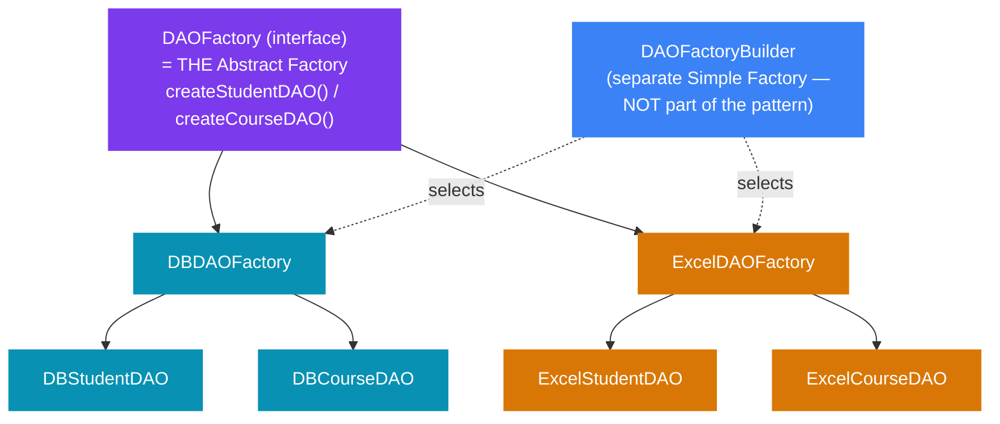
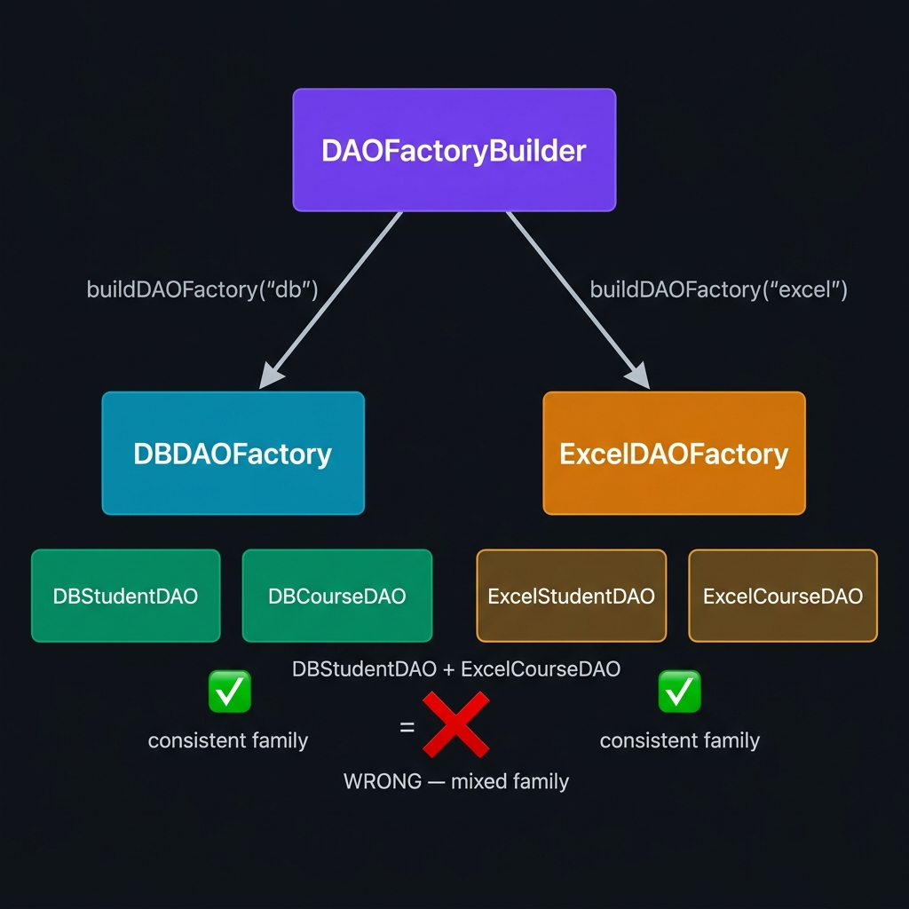
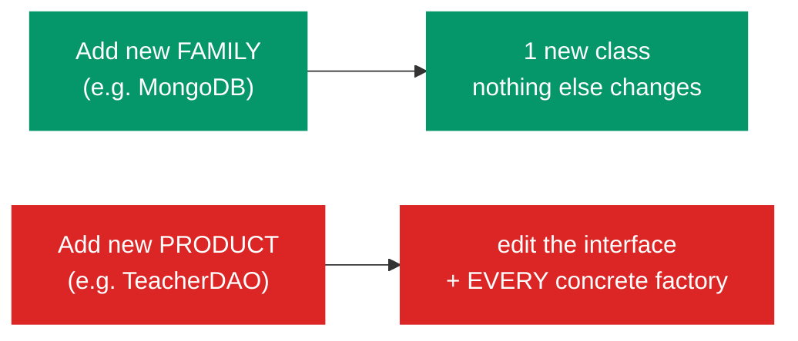

# Abstract Factory Design Pattern

**Abstract Factory Design Pattern** | It gives an interface to create *families* of related **or dependent** objects. The client does not name their concrete classes.

> **Factory Pattern Series:** [Part 1 → Simple Factory](./04_1_Simple_Factory_Pattern_in_Java.md) · [Part 2 → Factory Method](./04_2_Factory_Method_Design_Pattern.md) · **Part 3 → Abstract Factory (this file)** · [All Three Compared →](./04_Factory_vs_Factory_Method_vs_Abstract_Factory_Design_Pattern.md)

> 🔥🔥 Must-know — very frequently tested &nbsp;·&nbsp; 🔥 High priority &nbsp;·&nbsp; ⚡ Medium priority &nbsp;·&nbsp; 💤 Low priority

---

<a id="1-introduction"></a>
## 1. Introduction 💤

**The Abstract Factory gives an interface to create families of related *or dependent* objects. The client does not name their concrete classes.** Each concrete factory makes one consistent family. So the client can never mix products from different families by mistake.

People often drop the "**or dependent**" half of GoF's wording. But this half is the reason the real-world cases below fit the pattern. Take a payment gateway, its refund client and its webhook verifier. They are *dependent*, because they share one secret. They are not just related in style.

⚠️ **Clear up the myth first:** Many people call it a "super factory / factory of factories". But **GoF defines no such thing**. The pattern has *no* factory that returns other factories.

- The Abstract Factory **is the factory interface itself** (here, `DAOFactory`).
- It declares **one creation method per product** — e.g. `createStudentDAO()` and `createCourseDAO()`.
- The concrete factories (`DBDAOFactory`, `ExcelDAOFactory`) implement that interface. Each one makes one whole family.
- A helper that *picks* which concrete factory to return (our `DAOFactoryBuilder`) is a separate **Simple Factory**. We add it only for convenience. It is **not part of the Abstract Factory pattern at all.**

The **[Simple factory pattern](./04_1_Simple_Factory_Pattern_in_Java.md)** lets us **abstract the creation of a single object**. The **abstract factory pattern** lets us **abstract the creation of an entire family of related objects** as a unit.

🧠 **In Simple Words:**
A Simple Factory creates single objects. An Abstract Factory creates *families* of related objects. It keeps the whole group consistent.



---

<a id="2-need-of-abstract-factory-design-pattern"></a>
## 2. Need of Abstract Factory Design Pattern 💤

> 📝 **Note on the example below.** From here on, the walkthrough uses a **simplified teaching version**.  
> - It passes a string key — `createDAO(String type)`.  
> - The form in [§3](#3-what-is-and-isnt-the-abstract-factory) uses one method per product instead.  
> - The string form is easier to read from start to end, and it is fine for learning.  
> - But it is *not* the standard GoF form. It moves the family guarantee from compile time to runtime.  
>
> Keep the method-per-product version as your reference answer. Use this one only as the example walkthrough.

📖 Let us see why we need the abstract factory design pattern with an example. We have one interface and four classes. When a student joins, we must store their information in Excel or in a database.

| Component 🏷️ | Type 📋 | Purpose 🛠️ |
|--------------|---------|------------|
| `DAO.java` | Interface | Common contract for persistence |
| `ExcelStudentDAO.java` | Class | Insert student info to Excel |
| `ExcelCourseDAO.java` | Class | Insert course info to Excel |
| `DBStudentDAO.java` | Class | Insert student info to Database |
| `DBCourseDAO.java` | Class | Insert course info to Database |

🔀 Each storage type gets its own **Simple Factory** with a single `createDAO(String type)` method:

- `ExcelDAOFactory` returns `ExcelStudentDAO` or `ExcelCourseDAO`.
- `DBDAOFactory` returns `DBStudentDAO` or `DBCourseDAO`.

Each factory is correct on its own. But nothing stops the client from holding **both**:

**Problem code:**

```java
DAO stDAO = new ExcelDAOFactory().createDAO("student");
stDAO.insert(); // insert student info in excel sheet
DAO courseDAO = new DBDAOFactory().createDAO("course");
courseDAO.insert(); // insert course info to database table
```

⚠️ **Caution:** This is the wrong choice. **Both pieces of information (student and course) should go into the same storage — either Excel or the database.** Two independent Simple Factories cannot enforce that invariant (a rule that must always hold). Nothing in the type system links the two calls.

🔗 See problem code at GitHub: **[AbstractFactoryDP -- Problem](https://github.com/Know-Program/Design-Pattern/tree/main/DP4.0-AbstractFactoryDP-Problem).**

<a id="21-real-world-analogy"></a>
### 2.1 Real-World Analogy ⚡

🪑 **A matching furniture set:**

- A `ModernFactory` makes a `Chair` + `Sofa` + `Table`, all in the Modern style.
- A `VictorianFactory` makes the same three in the Victorian style.
- You would never pair a Modern chair with a Victorian sofa. The set must *match*.

The family is a set of **different product roles that must stay consistent with each other**. This is exactly like `StudentDAO` + `CourseDAO` from one storage backend. The "no mixing" rule is about **type consistency, not cost**. If an interviewer asks *why* you can't mix, state this difference.

The classic GUI-theme version says the same thing. A dark-theme `Button` + `Checkbox` + `Scrollbar` must all come from the dark-theme factory. If not, the UI looks broken.

🔑 **Key Point:** We must remove the mix-and-match option. A plain Simple Factory cannot enforce family consistency by itself. So we add a common `DAOFactory` abstraction — the Abstract Factory. Each of its concrete implementations makes one full, consistent family.



---

<a id="3-what-is-and-isnt-the-abstract-factory"></a>
## 3. What Is and Isn't the Abstract Factory 🔥

🗺️ Here we map the GoF roles onto this example. This clears up the most common confusion:

| GoF Role | In this example | Notes |
|---|---|---|
| **AbstractFactory** | `DAOFactory` **interface** | The pattern *is* this interface — one method per product. |
| **ConcreteFactory** | `DBDAOFactory`, `ExcelDAOFactory` | Each implements the whole family. |
| **AbstractProduct** | `StudentDAO`, `CourseDAO` | One abstract type **per product**. (From [§6](#6-solution-implementation) onward, the teaching form merges both into a single shared `DAO` type. This weak form loses the compile-time family guarantee.) |
| **ConcreteProduct** | `DBStudentDAO`, `ExcelCourseDAO`, … | The actual objects returned. |
| **Client** | `Client` | Talks only to `DAOFactory` + abstract products. |
| ~~"Super factory / factory of factories"~~ | `DAOFactoryBuilder` | **Not a GoF role.** It is a plain Simple Factory that *selects* a concrete factory. It is useful, but it is outside the pattern. |

🎯 **Interview soundbite:** "The Abstract Factory is the `DAOFactory` interface with one create-method per product. The concrete factories each build one family. The thing that chooses a factory is just a Simple Factory, not the pattern."

✍️ The standard, method-per-product form. Write this one when you are asked to *define* the pattern:

```java
// AbstractFactory: one method per product → family fixed at compile time
public interface DAOFactory {
   StudentDAO createStudentDAO();
   CourseDAO  createCourseDAO();
}

// ConcreteFactory: produces one consistent family
public class DBDAOFactory implements DAOFactory {
   @Override
   public StudentDAO createStudentDAO() {
      return new DBStudentDAO();
   }
   @Override
   public CourseDAO createCourseDAO() {
      return new DBCourseDAO();
   }
}
```

🔒 The interface names every product clearly. So a `DBDAOFactory` *cannot* forget to build a `CourseDAO`. It also cannot return an Excel product by mistake. The compiler guarantees the family.

<a id="31-relationship-to-factory-method-strategy-and-plain-di"></a>
### 3.1 Relationship to Factory Method, Strategy, and Plain DI 🔥🔥

These three are the standard follow-up questions. All three ask **where the pattern ends**. Two of them are *not* competing patterns.

🤝 **vs Factory Method — composition, not competition.** Abstract Factory is *built out of* Factory Methods.

- Each `createXxx()` on `DBDAOFactory` **is** a Factory Method. That is a creation method that a subclass can override to decide the concrete class.
- Abstract Factory groups several of them behind one interface, so they **change together** (co-vary). You pick the factory once, and every product changes with it.
- GoF says this directly: *"AbstractFactory classes are often implemented with factory methods… but they can also be implemented using Prototype"*. With Prototype, you register one prototype per product and clone it.

So the [series](./04_2_Factory_Method_Design_Pattern.md) treats them as a difference in *scope*. It does not mean the two patterns compete. One creation method = Factory Method. A set of them that changes together = Abstract Factory.

🎯 **Soundbite:** "Abstract Factory is not an alternative to Factory Method. It is a bundle of Factory Methods under one interface, so the family can't be mixed."

⚔️ **vs Strategy — one behaviour vs a set of products.**

- Strategy swaps **one** interchangeable algorithm.
- Abstract Factory swaps a **set** of products that must stay consistent with each other.
- The pattern is worth its cost only when the set has **≥ 2** products *and* mixing them is a **correctness bug**. If mixing only makes the code untidy, that is not enough.
- A `Map<String, PricingStrategy>` that returns one strategy is a Strategy registry. Calling it an Abstract Factory is the most common false claim here.

🧵 **vs plain DI / `Map<String, Service>` — do you need to get more than one thing?**

- If the client needs exactly one collaborator, inject it. Spring's `Map<String, T>` injection already gives you selection by key, with zero extra types.
- You need a *factory* only when the client must get **several** members from the **same chosen family**. It may also need to get them lazily.

| Question | Strategy / DI | Abstract Factory |
|---|---|---|
| How many products vary together? | 1 | ≥ 2 |
| Is mixing two implementations a bug? | No — just a different behaviour | **Yes — a correctness/consistency bug** |
| What does the client hold? | The product itself | A **factory** it pulls products from |

⚠️ Apply this test to [§9](#9-production-use-cases) honestly. The trio in [§9.2](#92-payment-provider-family-gateway--refund--webhook) (gateway + refund + verifier that share one secret) really needs the family guarantee. Swapping a provider with a single product does not. That is Strategy. If you call it Abstract Factory in an interview, expect the interviewer to challenge you.

---

<a id="4-the-headline-tradeoff-new-family-easy-new-product-hard"></a>
## 4. The Headline Tradeoff: New Family Easy, New Product Hard 🔥

This is the #1 follow-up question in interviews. So start with it:

- ✅ **Adding a new family is easy (open for extension).** Want a `MongoDAOFactory`? Write one new class that implements `DAOFactory`. No existing code changes. This is where the pattern works best.
- ❌️ **Adding a new product is painful (an OCP violation).** Want to add a `TeacherDAO`? You must add `createTeacherDAO()` to the `DAOFactory` interface. This breaks **every** concrete factory, and you must edit each one (`DBDAOFactory`, `ExcelDAOFactory`, …). The more families you have, the more places you must change.



💡 **Takeaway:** Use Abstract Factory when the set of *products* is stable but you expect new *families*. If new product *types* keep appearing, the pattern makes your work harder.

🩹 **"So how do you reduce the new-product pain?"** The interviewer will surely ask this next. There are three standard answers. Each one gives up the compile-time guarantee to get more flexibility:

| Mitigation | Shape | What you give up |
|---|---|---|
| **Keyed signature** | Collapse to one method: `DAO createDAO(String type)` — exactly the variant used from [§6](#6-solution-implementation) onward | The family guarantee moves from **compile time to runtime**; a bad key now fails on a request, not on a build |
| **`default` interface methods** | Add `createTeacherDAO()` as a `default` throwing `UnsupportedOperationException` | Existing factories no longer break. But the missing method stays silent until someone calls it |
| **Prototype-based factory** | GoF's own alternative. Register a prototype per product and `clone()` it. Adding a product is a *registration*, not an interface edit | No compile-time product set at all. Every product must be cloneable and correctly deep-copied |

⚠️ None of these is free. Each one turns a compiler error into a runtime error. Say this clearly in the interview. Suppose you say "use a `Map` and a string key" but do not name the cost. That is a weak answer.

<a id="41-when-not-to-use-abstract-factory-"></a>
### 4.1 When NOT to Use Abstract Factory 🚫 🔥

- 1️⃣ **Only one product family exists** and you do not really expect a second one → a **Simple Factory** or **Factory Method** is enough. The extra interface layer adds no value.
- 🔁 **Product *types* change more often than families.** Say you keep adding new products (`TeacherDAO`, `FeeDAO`, …). Then every addition edits the interface **and** every concrete factory (an OCP violation). Choose a different structure.
- 🧩 **The products don't need to stay consistent.** If a client can safely mix a DB object with an Excel object, you don't need the family guarantee. So don't pay its cost.
- 🪶 **Simplicity matters more than easy swapping.** Abstract Factory adds indirection (an extra layer between the client and the object). For a small, stable app, that extra layer is only a cost.

---

<a id="5-how-to-solve-problem-using-abstract-factory-design-pattern"></a>
## 5. How to Solve Problem using Abstract Factory Design Pattern ⚡

🛠️ To solve this problem, we add the `DAOFactory` abstraction (the Abstract Factory). The client gets **one** concrete factory. Then it gets its whole family of DAO objects from that factory. So every DAO comes from the same storage family. There are three steps:

1. **Pick the family once.** `DAOFactoryBuilder.buildDAOFactory("db")` returns a `DBDAOFactory`. (This helper is optional. The client could call `new DBDAOFactory()` directly.)
2. **Get the whole family from it.** `createDAO("student")` and `createDAO("course")` both come from that same factory instance. So both are DB DAOs.
3. **Use the products.** Call `insert()` on each. The client can no longer reach the mix-and-match option from [§2](#2-need-of-abstract-factory-design-pattern).

---

<a id="6-solution-implementation"></a>
## 6. Solution Implementation 💤

<a id="61-project-structure"></a>
### 6.1 Project Structure 💤

```
AbstractFactoryDP-Solution
 => src
   => com.kp.dao
      => DAO.java (I)
      => DBCourseDAO.java
      => DBStudentDAO.java
      => ExcelCourseDAO.java
      => ExcelStudentDAO.java
   => com.kp.factory
      => DAOFactory.java (I)
      => DBDAOFactory.java
      => ExcelDAOFactory.java
      => DAOFactoryBuilder.java
   => com.kp.test
      => Client.java
```

<a id="62-dao-interface"></a>
### 6.2 DAO Interface 💤

The `DAO` interface contains the method definition.

**`DAO.java`:**

```java
public interface DAO {
   void insert();
}
```

<a id="63-database-dao-implementations"></a>
### 6.3 Database DAO Implementations 💤

Both implement `DAO`. A `println()` takes the place of the real persistence logic.

**`DBCourseDAO.java` · `DBStudentDAO.java`:**

```java
public class DBCourseDAO implements DAO {
   @Override
   public void insert() {
      System.out.println("DBCourseDAO: Inserting Course Info to database table");
   }
}

public class DBStudentDAO implements DAO {
   @Override
   public void insert() {
      System.out.println("DBStudentDAO: Inserting Student Info to database table");
   }
}
```

<a id="64-excel-dao-implementations"></a>
### 6.4 Excel DAO Implementations 💤

The Excel pair has the same structure. It has the same contract, but a different destination.

**`ExcelCourseDAO.java` · `ExcelStudentDAO.java`:**

```java
public class ExcelCourseDAO implements DAO {
   @Override
   public void insert() {
      System.out.println("ExcelCourseDAO: Inserting Course Info to Excel Sheet");
   }
}

public class ExcelStudentDAO implements DAO {
   @Override
   public void insert() {
      System.out.println("ExcelStudentDAO: Inserting Student Info to Excel Sheet");
   }
}
```

<a id="65-factory-interface-and-implementations"></a>
### 6.5 Factory Interface and Implementations ⚡

In the `com.kp.factory` package, the `DAOFactory` interface contains a method definition to create a `DAO` object.

**`DAOFactory.java`:**

```java
public interface DAOFactory {
   DAO createDAO(String type);
}
```

Each concrete factory checks the key and returns **only its own family's** products. `DBDAOFactory` can never return an Excel DAO.

**`DBDAOFactory.java` · `ExcelDAOFactory.java`:**

```java
public class DBDAOFactory implements DAOFactory {
   @Override
   public DAO createDAO(String type) {
      if(type.equalsIgnoreCase("student")) {
         return new DBStudentDAO();
      } else if(type.equalsIgnoreCase("course")) {
         return new DBCourseDAO();
      } else {
         throw new IllegalArgumentException("Invalid type");
      }
   }
}

public class ExcelDAOFactory implements DAOFactory {
   @Override
   public DAO createDAO(String type) {
      if(type.equalsIgnoreCase("student")) {
         return new ExcelStudentDAO();
      } else if(type.equalsIgnoreCase("course")) {
         return new ExcelCourseDAO();
      } else {
         throw new IllegalArgumentException("Invalid type");
      }
   }
}
```

<a id="66-factory-selector-daofactorybuilder--a-simple-factory-not-the-abstract-factory"></a>
### 6.6 Factory Selector (DAOFactoryBuilder) — a Simple Factory, *not* the Abstract Factory ⚡

This is a helper that gives the client the right concrete factory. The client could also call `new DBDAOFactory()` directly. The builder only keeps the `"db"` vs `"excel"` choice in one place.

**`DAOFactoryBuilder.java`:**

```java
public class DAOFactoryBuilder {
   public static DAOFactory buildDAOFactory(String storetype) {
      if(storetype.equalsIgnoreCase("db")) {
         return new DBDAOFactory();
      } else if(storetype.equalsIgnoreCase("excel")) {
         return new ExcelDAOFactory();
      } else {
         throw new IllegalArgumentException("Invalid store type");
      }
   }
}
```

> ⚠️ **Reminder.** This walkthrough uses the string-keyed `createDAO(String type)`. It is the **simplified teaching version**. If you are asked to *define* Abstract Factory, write the **method-per-product** form from [§3](#3-what-is-and-isnt-the-abstract-factory) (`createStudentDAO()` / `createCourseDAO()`). That is the standard GoF form, and the compiler guarantees the family.

---

<a id="7-client-usage-and-output"></a>
## 7. Client Usage and Output 💤

🖥️ In the client/user class:

**`Client.java`:**

```java
public class Client {
   public static void main(String[] args) {
      // ONE factory chosen up front — both DAOs below come from it
      DAOFactory dbDAOFactory = DAOFactoryBuilder.buildDAOFactory("db");
      DAO studentDAO = dbDAOFactory.createDAO("student");
      DAO courseDAO = dbDAOFactory.createDAO("course");

      studentDAO.insert();
      courseDAO.insert();
   }
}
```

📤 **Output:**

```
DBStudentDAO: Inserting Student Info to database table
DBCourseDAO: Inserting Course Info to database table
```

✅ Now the client developer must use either the database or Excel. They can't use both at the same time.

See the solution code at GitHub: **[AbstractFactoryDP-Solution](https://github.com/Know-Program/Design-Pattern/tree/main/DP4.1-AbstractFactoryDP-Solution)**

---

<a id="8-key-takeaways"></a>
## 8. Key Takeaways ⚡

The Abstract Factory is the **`DAOFactory` interface**. Its concrete implementations (`DBDAOFactory`, `ExcelDAOFactory`) each build one complete family of DAOs. Any application should use DAOs that all belong to the same family. The interface enforces this. Once the client holds a `DBDAOFactory`, every DAO it makes is a DB DAO.

- ⚙️ **Abstract Factory = the factory *interface*** (`DAOFactory`) with one create-method per product.
- 🧩 **Concrete factories build whole families** — `DBDAOFactory` / `ExcelDAOFactory`. Each one guarantees a consistent set.
- 🔒 **Consistency enforced** — the client is locked to one family of objects, so mixing is impossible.
- 🔄 **Easy switching** — swap one concrete factory and the entire family of objects switches with it.
- 📦 **Client codes to abstractions** — it depends only on `DAOFactory` and the abstract product types. So you can swap the implementations.
- ⚖️ **Tradeoff** — new *family* = trivial (one new class); new *product* = painful (edit the interface + every concrete factory → OCP violation). See [§4](#4-the-headline-tradeoff-new-family-easy-new-product-hard).
- 🧪 **Testability is the strongest honest reason to use it.** Put in **one** fake factory, and you swap the **entire** family in a test. You get:
  - no production code changes
  - no mock wiring for each product
  - no chance of a half-stubbed family, where one product is real and another is fake

  This argument answers "why not just an `if`?" better than any other. With an `if`, you must stub a branch at every call site. A factory gives you one seam (one single place to swap in a test version).

<a id="81-real-abstract-factories-in-the-jdk-"></a>
### 8.1 Real Abstract Factories in the JDK 🏭 🔥

In an interview, a real-world example is better than the Excel/DB toy example. Start with the ones that really make a *family* of related products:

| API | Abstract Factory | Product family | Real family? |
|---|---|---|---|
| JDBC | `java.sql.Connection` (vendor-supplied) | `Statement`, `PreparedStatement`, `CallableStatement` — all from one vendor driver | ✅ Yes — three sibling products from one factory |
| AWT | `java.awt.Toolkit` | `Button`/`Window`/`Menu` peers for the platform L&F | ⚠️ **Historical** — GoF's own example. But the `createButton`/`createWindow` peer methods left the public API when `java.awt.peer` became internal in **JDK 9**. Mention it as history. Don't present it as code whose methods you can name |
| Swing | `javax.swing.LookAndFeel` / `UIDefaults` | family of UI delegates for one theme | ✅ Yes |
| `javax.xml.parsers.DocumentBuilderFactory` | the factory | `DocumentBuilder` only | ⚠️ Caveat — it makes **one** product type. So it is really a *Factory Method*, not a true Abstract Factory |
| `javax.xml.parsers.SAXParserFactory` | the factory | `SAXParser` only | ⚠️ Same caveat — a single product, not a family |
| `javax.xml.transform.TransformerFactory` | the factory | `Transformer`, `Templates` | ⚠️ Borderline — two products, so it only just passes the test |

⚠️ **Be exact about "family":** a family is the set of products that **one factory creates directly**. It is not every object you can reach through a chain of calls.

- `Connection` creates `Statement`.
- `Statement.executeQuery()` creates the `ResultSet`.
- So `ResultSet` is a *grandchild*, not a sibling product. Calling it part of the family is the most careless mistake you can make in this answer.

Apply the same test to every candidate below.

> 🧹 **Code-smell note:** the §6.5 code picks the product with a string check, `equalsIgnoreCase("student")`. This is *stringly-typed* code (it uses plain strings where a type should be). A typo fails only at runtime. In production, use an `enum` key (or the method-per-product GoF form). Then the compiler catches invalid choices.

<a id="82-factory-lifecycle-statelessness-and-thread-safety"></a>
### 8.2 Factory Lifecycle, Statelessness and Thread-Safety 🔥

GoF notes that the concrete factory is *"typically a singleton"*. In Spring, every `@Component` factory below is singleton-scoped by default. So **all request threads share one instance**. This leads directly to two follow-up questions:

- 🔒 **The factory must be stateless (or have immutable config).** Use constructor injection to put the config/clients it needs into `final` fields. Never change them per call. Say a factory keeps per-request state in a field. That is a data race, and it will show up under load.
- ♻️ **Decide: cache the products or create them fresh?** Both are valid. The answer depends on the product:
  - **Create fresh** when the product is cheap and may hold per-call state (a `PdfHeader`, a wrapper object).
  - **Memoize as a field** (build once and keep it) when the product is expensive and thread-safe. Examples: AWS SDK clients, `RestClient`, connection pools. These own an HTTP client and a connection pool. Most of them must be closed (AWS SDK clients and `HikariDataSource` are `AutoCloseable`). Building one per `create()` call is slow. It is also a **file-descriptor leak** unless you close it.
- 🧪 **If you memoize the product, it must be thread-safe too.** Threads can share a memoized product only if the product itself is safe to share. This is true of the AWS SDK v2 clients and `KafkaTemplate`. It is *not* true of `EntityManager` or a JDBC `Connection`.

🎯 **Soundbite:** "The factory is a singleton bean, so it has to be stateless. Should it cache its products? That depends on whether the product is expensive and thread-safe. I memoize SDK clients and close them on shutdown. I build cheap per-call wrappers fresh."

---

<a id="9-production-use-cases"></a>
## 9. Production Use Cases ⚡

The small Excel/DB example teaches the structure. The cases below show where the *family guarantee* is really useful in real backends. The simple rule from [§4](#4-the-headline-tradeoff-new-family-easy-new-product-hard) holds in every case:

- Use Abstract Factory when a **provider/vendor/environment** swaps a *whole family* of related objects at once.
- Never let the client pick single products from different providers by hand.

> 💡 **How Spring does it.** In a Spring app you often don't write the `DAOFactoryBuilder` selector by hand. Spring's `ObjectProvider`, `@Qualifier`, or a `Map<String, XxxFactory>` injection *is* the selector. The concrete factories become `@Component` beans. Spring wires the family for you. Each example below shows this Spring style.

<a id="91-multi-cloud-storage-provider-family"></a>
### 9.1 Multi-Cloud Storage Provider Family 💤

**Why:** Take a platform with many documents (loan KYC docs, invoices, media). It may run on AWS in prod but MinIO/LocalStack in dev. Or it may move to another cloud. Uploading, downloading, and generating pre-signed URLs must **all** come from the *same* provider. You can never upload to S3 and sign a URL with an Azure client.

```java
// One abstract product per operation in the family
public interface BlobUploader   { String upload(String key, byte[] data); }
public interface BlobDownloader { byte[] download(String key); }
public interface UrlSigner      { String presignedGetUrl(String key, Duration ttl); }

// AbstractFactory — one create-method per product (canonical GoF shape)
public interface CloudStorageFactory {
   BlobUploader   createUploader();
   BlobDownloader createDownloader();
   UrlSigner      createUrlSigner();
   String provider(); // "aws" | "azure"
}

// ConcreteFactory — the whole AWS family, wired by Spring. @ConditionalOnProperty
// makes the *bean itself* conditional, so the property really selects the family.
@Component
@ConditionalOnProperty(name = "storage.provider", havingValue = "aws")
public class AwsStorageFactory implements CloudStorageFactory {

   private final S3Client s3;
   private final S3Presigner presigner;

   public AwsStorageFactory(S3Client s3, S3Presigner presigner) {
      this.s3 = s3;
      this.presigner = presigner;
   }

   @Override
   public BlobUploader createUploader() {
      return new S3Uploader(s3);
   }

   @Override
   public BlobDownloader createDownloader() {
      return new S3Downloader(s3);
   }

   @Override
   public UrlSigner createUrlSigner() {
      return new S3UrlSigner(presigner);
   }

   @Override
   public String provider() {
      return "aws";
   }
}
```

```java
// The "selector" is just Spring — exactly one CloudStorageFactory bean exists,
// so the client never names a provider.
@Service
public class DocumentService {

   private final CloudStorageFactory storageFactory;

   public DocumentService(CloudStorageFactory storageFactory) {
      this.storageFactory = storageFactory;
   }

   public String store(String key, byte[] pdf) {
      // Every object below is guaranteed to be from the SAME provider
      storageFactory.createUploader().upload(key, pdf);
      return storageFactory.createUrlSigner().presignedGetUrl(key, Duration.ofMinutes(15));
   }
}
```

```yaml
# application.yml — flip the whole storage family with one property
storage:
  provider: aws   # aws | azure — resolved to the right factory bean at startup
```

<a id="92-payment-provider-family-gateway--refund--webhook"></a>
### 9.2 Payment Provider Family (Gateway + Refund + Webhook) ⚡

**Why:** Each payment provider gives a set of *three* related components:

- a charge client
- a refund client
- a webhook-signature verifier

Each one uses provider-specific secrets and signing. If you mix a Razorpay charge with a Stripe webhook verifier, every signature check fails. Valid webhooks get rejected. The family must change together as one unit.

```java
public interface PaymentGateway  { PaymentResult charge(PaymentRequest req); }
public interface RefundGateway   { RefundResult refund(String txnId, Money amount); }
public interface WebhookVerifier { boolean verify(String payload, String signature); }

public interface PaymentProviderFactory {
   PaymentGateway  createGateway();
   RefundGateway   createRefundGateway();
   WebhookVerifier createWebhookVerifier();
}

@Component("razorpay")
public class RazorpayFactory implements PaymentProviderFactory {

   private final RazorpayProps props;

   public RazorpayFactory(RazorpayProps props) {
      this.props = props;
   }

   @Override
   public PaymentGateway createGateway() {
      return new RazorpayGateway(props.keyId(), props.keySecret());
   }

   @Override
   public RefundGateway createRefundGateway() {
      return new RazorpayRefundGateway(props.keyId(), props.keySecret());
   }

   @Override
   public WebhookVerifier createWebhookVerifier() {
      return new RazorpayWebhookVerifier(props.webhookSecret());
   }
}
```

```java
// Runtime selection across many providers via injected Map<beanName, factory>
@Service
public class CheckoutService {

   private final Map<String, PaymentProviderFactory> factories; // Spring injects all beans by name

   public CheckoutService(Map<String, PaymentProviderFactory> factories) {
      this.factories = factories;
   }

   public PaymentResult pay(String provider, PaymentRequest req) {
      PaymentProviderFactory family = factories.get(provider); // "razorpay" | "stripe"
      if (family == null) {
         throw new IllegalArgumentException("Unknown provider: " + provider);
      }
      return family.createGateway().charge(req);
   }
}
```

⚠️ **What family consistency gives you:** the webhook controller gets `family.createWebhookVerifier()` for the *same* provider that charged the payment. So you cannot wrongly connect a Stripe verifier to a Razorpay charge.

<a id="93-notification-provider-family-sms--email--push"></a>
### 9.3 Notification Provider Family (SMS + Email + Push) 💤

**Why:** A notification system has three related channels.

- On AWS you'd use **SNS (SMS) + SES (email) + SNS mobile push**.
- On a Twilio-based stack it's **Twilio SMS + SendGrid email + FCM push**.

Credentials, retry behaviour, and delivery-receipt formats depend on the provider. So one factory should create all three channels as one family.

```java
public interface SmsSender   { void send(String phone, String body); }
public interface EmailSender { void send(String to, String subject, String html); }
public interface PushSender  { void send(String deviceToken, String title, String body); }

public interface NotificationFactory {
   SmsSender   createSmsSender();
   EmailSender createEmailSender();
   PushSender  createPushSender();
}

@Component("awsNotifications")
@ConditionalOnProperty(name = "notifications.provider", havingValue = "aws")
public class AwsNotificationFactory implements NotificationFactory {

   private final SnsClient sns;
   private final SesClient ses;

   public AwsNotificationFactory(SnsClient sns, SesClient ses) {
      this.sns = sns;
      this.ses = ses;
   }

   @Override
   public SmsSender createSmsSender() {
      return new SnsSmsSender(sns);
   }

   @Override
   public EmailSender createEmailSender() {
      return new SesEmailSender(ses);
   }

   @Override
   public PushSender createPushSender() {
      return new SnsPushSender(sns);
   }
}
```

```yaml
notifications:
  provider: aws   # aws | twilio — one switch swaps SMS + email + push together
```

💡 **The tradeoff in a real case:**

- Adding a *new provider family* (say, `TwilioNotificationFactory`) is one new class.
- Adding a *new channel* (e.g. `WhatsAppSender`) is harder. You must add `createWhatsAppSender()` to the interface, and you must edit **every** factory.

That's the [§4](#4-the-headline-tradeoff-new-family-easy-new-product-hard) OCP tradeoff in real code.

### 9.5 Report Export Family (PDF vs Excel) 💤

**Why:** A reporting module renders a header band, data rows, and a footer. In PDF these are drawn objects. In Excel they are styled cells with formulas. The same renderer family must create all three pieces. If not, the output is corrupt.

```java
public interface ReportHeader { void render(ReportContext ctx); }
public interface ReportBody   { void render(ReportContext ctx, List<Row> rows); }
public interface ReportFooter { void render(ReportContext ctx); }

public interface ReportRendererFactory {
   ReportHeader createHeader();
   ReportBody   createBody();
   ReportFooter createFooter();
   MediaType contentType();
}

@Component("pdf")
public class PdfReportFactory implements ReportRendererFactory {

   @Override
   public ReportHeader createHeader() {
      return new PdfHeader();
   }

   @Override
   public ReportBody createBody() {
      return new PdfBody();
   }

   @Override
   public ReportFooter createFooter() {
      return new PdfFooter();
   }

   @Override
   public MediaType contentType() {
      return MediaType.APPLICATION_PDF;
   }
}
```

```java
@RestController
@RequestMapping("/reports")
public class ReportController {

   private final Map<String, ReportRendererFactory> renderers;

   public ReportController(Map<String, ReportRendererFactory> renderers) {
      this.renderers = renderers;
   }

   @GetMapping("/monthly")
   public ResponseEntity<byte[]> monthly(@RequestParam(defaultValue = "pdf") String format) {
      ReportRendererFactory family = renderers.get(format); // "pdf" | "excel"
      if (family == null) {
         // `format` comes off a @RequestParam — an unknown key is a 400, not a 500.
         throw new ResponseStatusException(HttpStatus.BAD_REQUEST, "Unsupported format: " + format);
      }
      ReportContext ctx = new ReportContext();
      family.createHeader().render(ctx);
      family.createBody().render(ctx, loadRows());
      family.createFooter().render(ctx);
      return ResponseEntity.ok()
            .contentType(family.contentType())
            .body(ctx.toBytes());
   }
}
```

<a id="96-environment-infra-client-family-localstack-vs-aws"></a>
### 9.6 Environment Infra Client Family (LocalStack vs AWS) ⚡

**Why:** Integration tests must talk to **LocalStack** (fake S3/SQS/DynamoDB on one endpoint). Prod talks to **real AWS**. All three clients must point at the *same* environment. A test that reads from LocalStack SQS but writes to real S3 is a dangerous mistake. One factory per environment keeps the whole client family consistent.

```java
public interface InfraClientFactory {
   S3Client       s3();
   SqsClient      sqs();
   DynamoDbClient dynamo();
}

@Component
@Profile("!prod") // dev/test → LocalStack family
public class LocalStackInfraFactory implements InfraClientFactory {

   // Built ONCE in the constructor and reused — see §8.2. Each SDK client owns an
   // HTTP client + connection pool, so per-call construction leaks file descriptors.
   private final S3Client s3;
   private final SqsClient sqs;
   private final DynamoDbClient dynamo;

   public LocalStackInfraFactory(@Value("${aws.endpoint}") URI endpoint,
                                 @Value("${aws.region}") String region) {
      // LocalStack has no credential/metadata chain, and the SDK v2 builder throws
      // SdkClientException at build() if no region resolves; if no credentials resolve, the first call fails.
      AwsCredentialsProvider creds = StaticCredentialsProvider.create(
            AwsBasicCredentials.create("test", "test"));

      this.s3 = S3Client.builder()
            .endpointOverride(endpoint)
            .forcePathStyle(true) // LocalStack S3 needs path-style addressing
            .region(Region.of(region))
            .credentialsProvider(creds)
            .build();

      this.sqs = SqsClient.builder()
            .endpointOverride(endpoint)
            .region(Region.of(region))
            .credentialsProvider(creds)
            .build();

      this.dynamo = DynamoDbClient.builder()
            .endpointOverride(endpoint)
            .region(Region.of(region))
            .credentialsProvider(creds)
            .build();
   }

   @Override
   public S3Client s3() {
      return s3;
   }

   @Override
   public SqsClient sqs() {
      return sqs;
   }

   @Override
   public DynamoDbClient dynamo() {
      return dynamo;
   }

   @PreDestroy
   void close() {
      s3.close();
      sqs.close();
      dynamo.close();
   }
}

@Component
@Profile("prod") // prod → real AWS family (default endpoints, IAM role creds)
public class AwsInfraFactory implements InfraClientFactory {

   private final S3Client s3 = S3Client.create();
   private final SqsClient sqs = SqsClient.create();
   private final DynamoDbClient dynamo = DynamoDbClient.create();

   @Override
   public S3Client s3() {
      return s3;
   }

   @Override
   public SqsClient sqs() {
      return sqs;
   }

   @Override
   public DynamoDbClient dynamo() {
      return dynamo;
   }

   @PreDestroy
   void close() {
      s3.close();
      sqs.close();
      dynamo.close();
   }
}
```

```yaml
# application-dev.yml — the endpoint is config, never a hardcoded literal
aws:
  endpoint: http://localhost:4566
  region: us-east-1
```

🔑 Here Spring `@Profile` **is** the family selector. When you activate `prod`, it swaps the whole infra client family. The client code does not change at all.

🧪 **This is the testability point in a real example** (see [§8](#8-key-takeaways)):

- The test doesn't stub three clients one by one.
- It swaps *one factory bean*, and the whole environment changes together.
- So a half-swapped state (LocalStack SQS + real S3) is not just discouraged. You cannot even write it in code.

<a id="97-springs-own-abstract-factories-you-already-use"></a>
### 9.7 Spring's Own Abstract Factories You Already Use 🔥🔥

**Why:** You don't have to invent these. Several framework types you use every day *are* Abstract Factories. But the `*Factory` suffix does not prove it. Apply the **same** ≥2-direct-products test that [§8.1](#81-real-abstract-factories-in-the-jdk-) applies to the JDK. Most of the popular examples fail it.

| Framework API | Products it creates **directly** | Real family? |
|---|---|---|
| **JPA/Hibernate** — `EntityManagerFactory` | `createEntityManager()`, `getCriteriaBuilder()`, `getMetamodel()`, `getCache()`, `getPersistenceUnitUtil()` | ✅ **Yes** — a genuine multi-product family, all bound to one persistence unit |
| **Spring Data** — `RedisConnectionFactory` | `getConnection()`, `getClusterConnection()`, `getSentinelConnection()` | ✅ **Yes** — the strongest example here; all three come from one driver (Lettuce/Jedis) |
| **JMS / Spring AMQP** — `ConnectionFactory` | `createConnection()`, `createContext()` (JMS 2.0 only; Spring AMQP has just `createConnection()`) | ⚠️ Marginal — two products, and one is a convenience wrapper over the other |
| **Spring Kafka** — `ProducerFactory` / `ConsumerFactory` | `createProducer()` / `createConsumer()` — one product each | ❌️ Factory Method. **Note: Spring Kafka has no `ConnectionFactory`** — that name belongs to JMS and Spring AMQP/RabbitMQ |
| **JDBC** — `DataSource` | `getConnection()` only | ❌️ Single product — a Factory Method |
| **Spring** — `FactoryBean<T>` | `getObject()` → exactly one `T` | ❌️ Factory Method |
| **Spring** — `BeanFactory` | `getBean(name)` → `Object` by key | ❌️ **Service Locator / Simple Factory** — the furthest from the pattern of anything on this list |

⚠️ **Do not call `BeanFactory` or `DataSource` Abstract Factories.** Many blogs repeat this error. An interviewer who knows the pattern will use your own definition to prove you wrong. Start with `EntityManagerFactory` and `RedisConnectionFactory`. They pass the test.

```java
// You already consume an Abstract Factory every time you do this:
@PersistenceUnit
private EntityManagerFactory emf; // the Abstract Factory

public void run() {
   // Family members — each created DIRECTLY by the factory, all bound to the same persistence unit
   CriteriaBuilder cb = emf.getCriteriaBuilder();     // family member 1
   Metamodel metamodel = emf.getMetamodel();          // family member 2
   EntityManager em = emf.createEntityManager();      // family member 3
   try {
      // NOTE: em.createQuery(...) is a GRANDCHILD, not a family member —
      // the EntityManager creates it, not the factory.
      em.createQuery("select l from Loan l", Loan.class).getResultList();
   } finally {
      em.close(); // always close what the factory handed you
   }
}
```

🎯 **Short interview answer:** "I rarely write a raw `DAOFactory` by hand. In a Spring app the Abstract Factory is usually a set of `@Component` factory beans. `@Profile`, `@ConditionalOnProperty`, or a `Map<String, Factory>` injection selects one of them. The clearest examples in the framework itself are `EntityManagerFactory` and `RedisConnectionFactory`. People often call `DataSource` and `FactoryBean` Abstract Factories. But they each create one product, so they're really Factory Methods."

---

