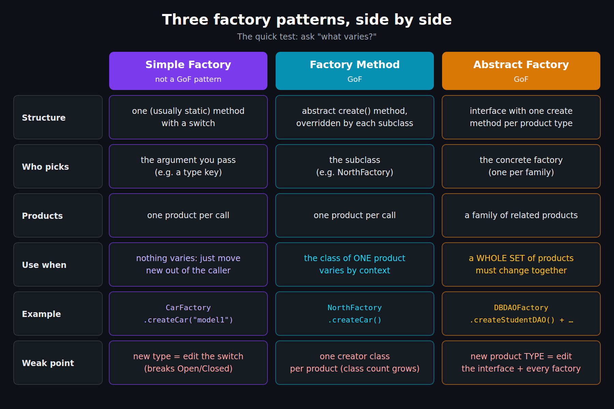
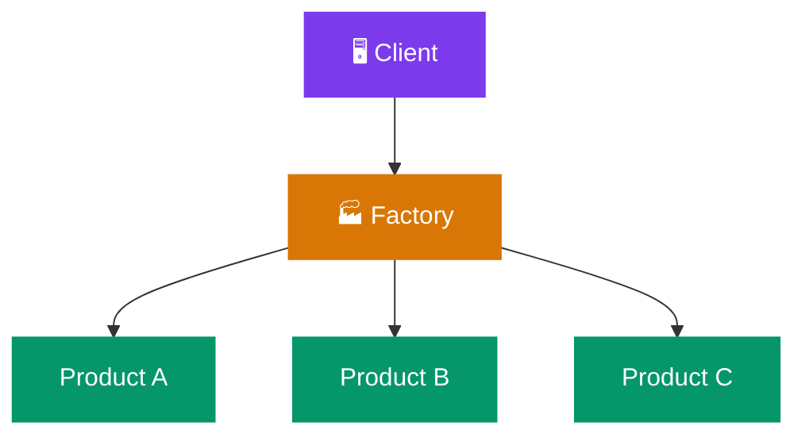
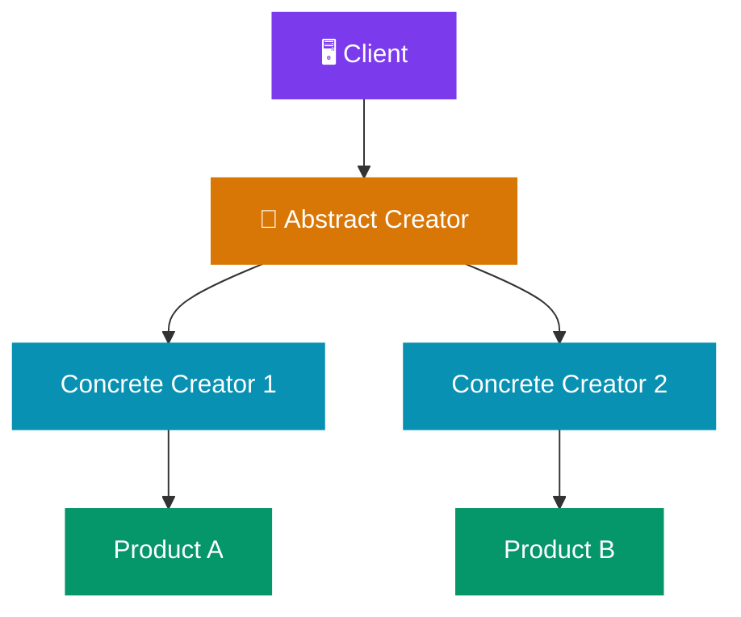
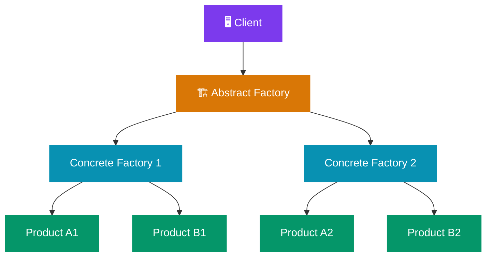
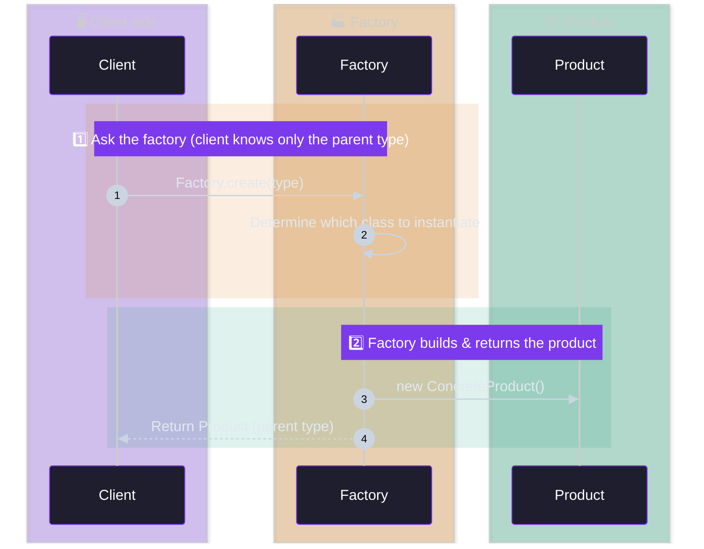
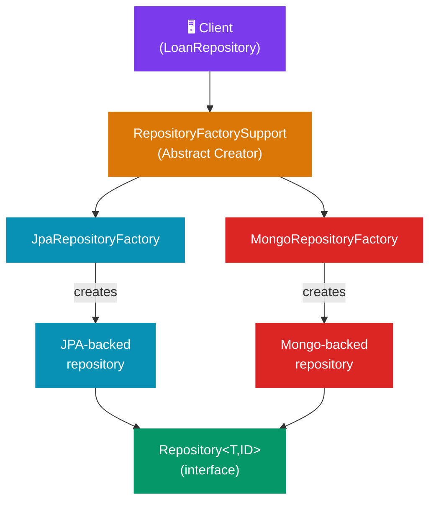
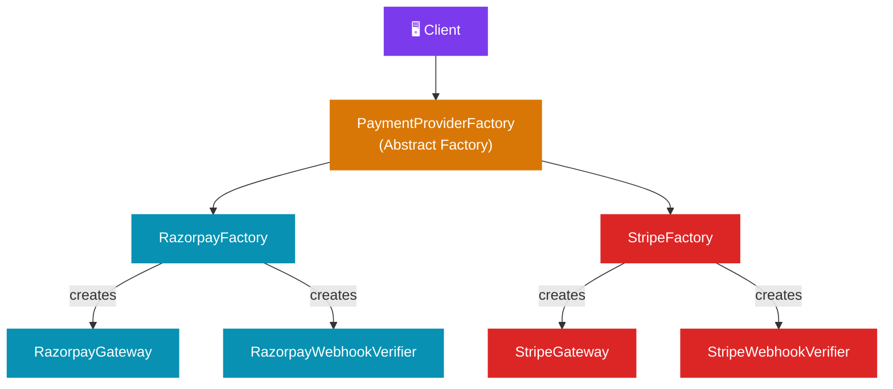
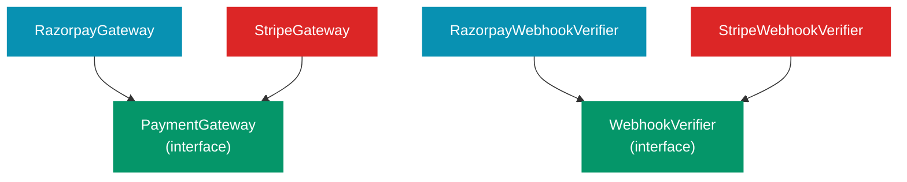

# Factory vs Factory Method vs Abstract Factory Design Pattern

**Factory vs Factory Method vs Abstract Factory Design Pattern** | A comparison of three creational design patterns. All three use the "factory" idea to create objects.

- [1. Overview 🔥](#1-overview)
  - [1.1 Structural Signatures at a Glance 🔥🔥](#11-structural-signatures-at-a-glance-)
- [2. Simple Factory Pattern 🔥](#2-simple-factory-pattern)
- [3. Factory Method Design Pattern 🔥](#3-factory-method-design-pattern)
- [4. Abstract Factory Design Pattern 🔥](#4-abstract-factory-design-pattern)
- [5. Comparison Table 🔥🔥](#5-comparison-table)
- [6. Interview Answer Flow 🔥🔥](#6-interview-answer-flow)
  - [6.1 Naming Reality Check — What Interviewers Actually Say 🔥🔥](#61-naming-reality-check--what-interviewers-actually-say)
  - [6.2 Step 1: One-Line Definitions 🔥🔥](#62-step-1-one-line-definitions-anchor-the-interviewer-fast)
  - [6.3 Step 2: Narrate with a Real-World Anchor 🔥](#63-step-2-narrate-with-a-real-world-anchor)
  - [6.4 Step 3: The Three Lines to Recall Under Pressure 🔥🔥](#64-step-3-the-three-lines-to-recall-under-pressure)
  - [6.5 Step 4: Handle the Follow-Up Questions 🔥🔥](#65-step-4-handle-the-follow-up-questions)
  - [6.6 Step 5: Real-World Production Use Cases 🔥](#66-step-5-real-world-production-use-cases)
  - [6.7 3 Mistakes to Avoid ⚡](#67-3-mistakes-to-avoid)

> 🔥🔥 Must-know — very frequently tested &nbsp;·&nbsp; 🔥 High priority &nbsp;·&nbsp; ⚡ Medium priority &nbsp;·&nbsp; 💤 Low priority

---

<a id="1-overview"></a>
## 1. Overview ⚡

Three design patterns have the word "factory" in their name:

- 🏭 [Simple Factory Pattern](./04_1_Simple_Factory_Pattern_in_Java.md)
- 🔧 [Factory Method Design Pattern](./04_2_Factory_Method_Design_Pattern.md)
- 🏗️ [Abstract Factory Design Pattern](./04_3_Abstract_Factory_Design_Pattern.md)

📚 Each one has its own file with full details. This file gives a short comparison of the three: factory pattern, factory method pattern and abstract factory pattern.



**1️⃣ [Simple Factory Pattern](./04_1_Simple_Factory_Pattern_in_Java.md)** — It hides how an object is created. Based on the data we pass, it creates an object of one of several related classes.

- The client usually calls it through a static method.
- It returns one of several objects.
- All these objects inherit/implement the same parent.



**2️⃣ [Factory Method Design Pattern](./04_2_Factory_Method_Design_Pattern.md)** — It defines an abstract "create" method on a superclass. It **lets each subclass decide which concrete class to instantiate**.

- The client code uses only the abstract creator and its abstract `create()` method.
- The subclass that overrides `create()` chooses the actual product type returned.



**3️⃣ [Abstract Factory Design Pattern](./04_3_Abstract_Factory_Design_Pattern.md)** — The client picks one concrete factory. That factory returns a whole **family of related objects**. The objects are guaranteed to work together.

⚠️ The popular *"factory of factories"* short description is **misleading**:

- GoF defines no factory that returns other factories.
- The Abstract Factory *is* the factory interface itself, with one create-method per product.

See [04_3 §3](./04_3_Abstract_Factory_Design_Pattern.md#3-what-is-and-isnt-the-abstract-factory).



<a id="11-structural-signatures-at-a-glance-"></a>
### 1.1 Structural Signatures at a Glance 🔥🔥

The fastest way to recall the difference is the **structure of the creator**. Memorise these three skeletons. They use the same examples as the full files on each pattern ([04_2](./04_2_Factory_Method_Design_Pattern.md) car factory · [04_3](./04_3_Abstract_Factory_Design_Pattern.md) DAO factory):

```java
// 1. SIMPLE FACTORY — one (usually static) method with a switch. (not GoF)
//    From 04_2: hand back one CompanyCar model chosen by a string key.
class CarFactory {
    static CompanyCar createCar(String model) {
        switch (model) {
            case "model1": return new Model1Car();
            case "model2": return new Model2Car();
            default:       throw new IllegalArgumentException(model);
        }
    }
}

// 2. FACTORY METHOD — abstract create() overridden by each subclass. (GoF)
//    From 04_2: the CompanyFactory hierarchy. THIS IS THE WHOLE PATTERN —
//    one abstract creation hook, each subclass returning a different product.
abstract class CompanyFactory {
    abstract CompanyCar createCar();          // <-- the factory method, the entire pattern
}
class NorthFactory extends CompanyFactory {
    CompanyCar createCar() { return new Model1Car(); }   // North → its own product
}
class SouthFactory extends CompanyFactory {
    CompanyCar createCar() { return new Model2Car(); }   // South → a different one
}

// 3. ABSTRACT FACTORY — interface with ONE method per product; one concrete
//    factory per family. (GoF) — From 04_3: the DAOFactory hierarchy.
interface DAOFactory {
    StudentDAO createStudentDAO();            // product 1
    CourseDAO  createCourseDAO();             // product 2
}
class DBDAOFactory implements DAOFactory {
    public StudentDAO createStudentDAO() {
        return new DBStudentDAO();
    }
    public CourseDAO  createCourseDAO() {
        return new DBCourseDAO();
    }
}
class ExcelDAOFactory implements DAOFactory {
    public StudentDAO createStudentDAO() {
        return new ExcelStudentDAO();
    }
    public CourseDAO  createCourseDAO() {
        return new ExcelCourseDAO();
    }
}
```

> ⚠️ **The `orderCar()` wrapper is NOT part of Factory Method.** [File 04_2](./04_2_Factory_Method_Design_Pattern.md) also gives `CompanyFactory` a `final orderCar(String)`. This method fixes the manufacturing order: `paint() → assemble() → oiling() → createCar() → roadTest()`. The steps around `createCar()` are standard factory process steps, not operations on the car.
>
> - That wrapper is a **Template Method**. It is a *separate, behavioral* pattern.
> - It is **combined** with Factory Method. It is not a part of it.
> - Delete `orderCar()`, and the skeleton above is still a complete Factory Method.
> - Delete `createCar()`, and it is not.
>
> Memorise the hook, not the wrapper. Mixing up the two is the most common way people describe this pattern wrongly (see [§6.5](#65-step-4-handle-the-follow-up-questions)).

> 📝 **Accuracy note:** the skeleton above is the **pure** form. Each subclass returns a **different** product. File 04_2's worked example does not do this, on purpose. The reason, and its cost, is explained once at [04_2 §4](./04_2_Factory_Method_Design_Pattern.md#4-factory-method-design-pattern-example) and not repeated here.

> 🔑 **How to tell them apart:** *one static method + switch* = Simple Factory · *one abstract create method, subclasses override to return different products* = Factory Method · *one method per product, one concrete factory per family* = Abstract Factory.

---

<a id="2-simple-factory-pattern"></a>
## 2. Simple Factory Pattern ⚡

🏭 In a [simple factory](./04_1_Simple_Factory_Pattern_in_Java.md), the class that wants an object calls the factory directly. We call this calling class the "client".

- The simple factory returns one of many different classes.
- All the classes it can return either inherit from the same parent class or implement the same interface.

🔑 **Steps in Simple Factory Pattern:**

1️⃣ **Call a method in the factory.** Usually this method is `static`. So we can call it directly, without creating an object of that class. The parameters we pass tell the factory which class to create.

2️⃣ **The factory creates the object.** Important point: all the objects it can create have the same parent class, or implement the same interface.

3️⃣ **The factory returns the object.** The client did not know what type it would get back. So the client expects a type that matches the parent class/interface.



📝 **Note:** The simple factory is not a "true" GoF design pattern. But it is widely used. It is the base idea that the other two patterns build on.

---

<a id="3-factory-method-design-pattern"></a>
## 3. Factory Method Design Pattern ⚡

🔧 The official definition of the [factory method design pattern](./04_2_Factory_Method_Design_Pattern.md) is roughly: **a class that defers the instantiation of an object to subclasses.** ("Defers" means it hands this job over to its subclasses.) The focus is not on how the client uses the factory. The focus is on *how* the object gets created.

👀 In this example:

- The client has no direct reference to the classes that create the object.
- Instead, it has a reference to the abstract "Creator".
- The creator is abstract, but that does not make this the abstract factory.
- It is a factory method because the children of "Creator" implement the "Create" method.

🔑 **Key Points:**

- 🧩 The creator is returning only **one object**
- 🔀 The object could be one of several types, but the types all inherit from the same parent class
- 📐 Subclasses decide which concrete class to instantiate

🌱 **Real-world example — Spring Data `RepositoryFactorySupport`** (see [04_2 §5.1](./04_2_Factory_Method_Design_Pattern.md#51-in-frameworks-you-use-every-day)): you declare `interface LoanRepository extends JpaRepository<…>`. The abstract creator `RepositoryFactorySupport` then defers the actual instantiation to a subclass:

- `JpaRepositoryFactory` builds a JPA-backed repository.
- `MongoRepositoryFactory` builds a Mongo-backed one.

Each concrete creator returns a **different** repository product. The client code works only with the `Repository` abstraction. This is the clean Factory Method example to give in an interview.



🧠 **In Simple Words:**
The factory method pattern says: "I know I need to create an object, but I'll let my subclasses decide exactly which one."

---

<a id="4-abstract-factory-design-pattern"></a>
## 4. Abstract Factory Design Pattern ⚡

🏗️ An [abstract factory](./04_3_Abstract_Factory_Design_Pattern.md) creates a **family of related products**. The factory method creates one product.

🔑 **Steps in Abstract Factory Design Pattern:**

1️⃣ **The client keeps a reference to an abstract factory class,** which all factories must implement. At runtime, this reference points to a concrete factory.

2️⃣ **The factory can produce multiple types.** This is where the "family of related products" comes in.

- The objects it creates still have a parent class or interface that the client knows about.
- The key point: there is more than one type of parent.

3️⃣ **The concrete factory creates the concrete objects.**

4️⃣ **The factory returns the concrete objects to the client.** Again, the client does not really know the type of the objects. It only knows that they are children of the parents.

🏦 **Real-world example — payment provider families** (see [04_3 §9.2](./04_3_Abstract_Factory_Design_Pattern.md#92-payment-provider-family-gateway--refund--webhook)): each provider gives a *family* of related objects, for example:

- a charge gateway, **and**
- a webhook-signature verifier.

Both share the provider's secret. Because of the family guarantee, the code always verifies the webhook with the **same** provider that charged. So you can never validate a Stripe signature against a Razorpay secret.

**① The factory side — one concrete factory per provider, each producing that provider's whole family:**



**② The product side — every product implements a shared interface. This is why the client does not depend on any one provider:**



> The **family guarantee** is the whole point of the pattern. It lives in ①. `RazorpayFactory` produces *both* Razorpay products. So you can never pair a Stripe gateway with a Razorpay verifier. Diagram ② shows why the client never has to know which factory it got.

💡 **Tip:** Think of an abstract factory as a **family builder**. One concrete factory (`RazorpayFactory`) produces a whole set of related objects that share one provider. The client never names their concrete classes.

⚠️ Avoid the *"factory of factories"* wording. It is a common wrong idea (see [04_3 §3](./04_3_Abstract_Factory_Design_Pattern.md#3-what-is-and-isnt-the-abstract-factory)). The pattern is a single factory interface with one method per product. It is **not** a factory that returns other factories.

⛔ **When NOT to use it:** Do not use Abstract Factory unless you really have **multiple product families** that must stay consistent. With a single product type, it only adds an extra layer for no reason. A Simple Factory or Factory Method is the right tool.

---

<a id="5-comparison-table"></a>
## 5. Comparison Table 🔥

| Feature ⚖️ | Factory (Simple) 🏭 | Factory Method 🔧 | Abstract Factory 🏗️ |
|------------|---------------------|-------------------|---------------------|
| **Purpose** | Create one of several related objects | Leave object creation to subclasses | Create families of related objects |
| **Number of products** | One product **per call**, chosen by the **argument** | One product per call, chosen by the **subclass** | Multiple **product hierarchies** — more than one type of parent |
| **Client knows about** | The factory class directly | An abstract creator | An abstract factory interface |
| **Creation logic** | Inside a single (usually static) method — or a Spring factory bean | In subclass override of a create method | In concrete factory classes |
| **Extensibility** | ⚠️ New type = edit the factory | ✅ New product = 1 new creator subclass · ⚠️ parallel hierarchies — one creator per product | ✅ New family = 1 new class · ⚠️ New **product type** = edit the interface + **every** concrete factory |
| **Main drawback** | 🔴 OCP violation on every new type — the `switch`/`if-else` grows forever (fix: registry / `Map<String, Bean>`, see [04_1 §5](./04_1_Simple_Factory_Pattern_in_Java.md#5-limitations--simple-factory-violates-the-openclosed-principle)) | 🟠 **Parallel class hierarchies** — GoF: *"clients might have to subclass the Creator class just to create a particular ConcreteProduct object"*; class count grows at the same rate | 🔴 Adding a product **type** breaks every factory (OCP violation, see [04_3 §4](./04_3_Abstract_Factory_Design_Pattern.md#4-the-headline-tradeoff-new-family-easy-new-product-hard)) |
| **Complexity** | 🟢 Low | 🟡 Medium | 🔴 High |
| **GoF Pattern?** | ❌️ Not an official GoF pattern | ✅ Yes | ✅ Yes |
| **Use when** (*what varies?*) | **Nothing varies** — you just want `new` out of the caller | The concrete class of **one** product varies per context | A **whole set** of products must vary **together** |

> 🧠 **Key Takeaway:** Factory = one method, one product. Factory Method = subclass decides which one product. Abstract Factory = multiple related products from one factory family.

> 🧭 **The decision rule — ask "what varies?"**
>
> - Nothing varies, you only want the `new` out of the caller → **Simple Factory**.
> - The concrete class of *one* product varies by context → **Factory Method**.
> - A *whole set* of products must switch together and never be mixed → **Abstract Factory**.
>
> If you cannot name what varies, you do not need a factory yet.

> 🧪 **The testability argument (why add one even with a single product today):** a factory is a **seam** (a single injection point you can stub in a unit test).
>
> - `new PaymentClient()` written inside a service cannot be tested without calling the real collaborator.
> - `paymentFactory.create(type)` can be mocked. So you can test the service's own logic in isolation.
>
> This is a valid reason to add a factory before a second product exists. But say it *as* the reason. Otherwise it looks like speculative generality (code built for needs that do not exist yet).

---

<a id="6-interview-answer-flow"></a>
## 6. Interview Answer Flow 🔥

<a id="61-naming-reality-check--what-interviewers-actually-say"></a>
### 6.1 Naming Reality Check — What Interviewers Actually Say 🔥🔥

⚠️ **Simple Factory is not a GoF pattern.** It is a coding idiom (a common coding habit): a static method that returns objects based on a condition. GoF only recognizes **Factory Method** and **Abstract Factory** as official patterns.

🤷 Why the confusion exists:

- Most tutorials teach Simple Factory first, as a first step.
- So interviewers who have not read GoF carefully use the terms as if they mean the same thing.

| What the interviewer says | What they likely mean | What to do |
|---|---|---|
| *"What is the Factory Pattern?"* | Simple Factory (static method, if/switch, returns object) | Answer Simple Factory, then bring up Factory Method yourself to show depth |
| *"What is the Factory Method Pattern?"* | The GoF pattern — abstract superclass, abstract `create()` method, subclasses decide | Answer the GoF version directly |
| *"Difference between Factory and Factory Method?"* | Senior-level question — they know the difference and are testing you | Give the full GoF explanation |

🗣️ **Start by asking which one they mean, before you answer.** Most candidates start explaining one of the three without asking. Asking is itself a sign of a senior engineer:

> *"When you say factory pattern, do you mean Simple Factory, or should I walk through all three — Simple Factory, Factory Method, and Abstract Factory?"*

🎯 **Then say this clear line:**

> *"Simple Factory isn't a GoF pattern. It's a helper idiom. Factory Method is the actual GoF pattern. The superclass declares an abstract creation method, and each subclass decides which class to instantiate."*

✨ That one line shows you have read the source, not just tutorials.

- **This subsection is the single source for the "is it really a pattern / what did they mean" question.**
- [04_1 §7](./04_1_Simple_Factory_Pattern_in_Java.md#7-does-industry-really-call-it-factory-pattern) covers a related but different question: how the *industry* uses the word (code review, Spring docs, academia).

---

<a id="62-step-1-one-line-definitions-anchor-the-interviewer-fast"></a>
### 6.2 Step 1: One-Line Definitions (anchor the interviewer fast) 🔥🔥

> *"All three are creational patterns dealing with object creation. Simple Factory hides creation behind a single (usually static) method. Factory Method lets subclasses decide what to create while following a common standard. Abstract Factory groups related objects into families so the client always gets a consistent set."*

---

<a id="63-step-2-narrate-with-a-real-world-anchor"></a>
### 6.3 Step 2: Narrate with a Real-World Anchor 🔥

🗣️ Do not jump straight to code. First connect it to something familiar. The smartphone world works well:

- Everyone understands it.
- It clearly separates *one device* from *a matching ecosystem*.

> 📱 *"Think of buying phones and gadgets. **Simple Factory** is a phone store. You ask for 'an iPhone 15,' and the store hands you that one model. You name it, you get it. **Factory Method** is asking any brand for 'your latest top phone (flagship)'. Apple decides that's the iPhone Pro. Samsung decides it's the Galaxy S. The request is the same, but each brand subclass picks which single phone to give you. **Abstract Factory** is committing to an ecosystem. Pick Apple, and you get a matching family: iPhone + AirPods + Apple Watch, all designed to work together. Pick Samsung, and you get Galaxy + Galaxy Buds + Galaxy Watch. Once you commit to Apple, everything stays Apple. An Apple Watch will not pair with a Samsung phone."*

Now explain to the interviewer *why* each one maps to its pattern. This shows you understand the roles, not just the analogy:

**🏭 Simple Factory — the phone store counter.**
You walk up and say the exact model: *"iPhone 15, please."*

- The **store is the factory**. **You (the client) pass the key** ("iPhone 15"). The store hands back one product.
- Important: *you* decided which model. The store just looked it up and returned it.
- That is how you spot it: a single method, driven by the argument you passed, returning one object.
- Change the string, and you get a different phone from the *same* store.
- There is no **creator** inheritance. The factory itself is never subclassed. (The products still share a parent. That is what lets the return type stay abstract.) It is just a lookup behind a method.

**🔧 Factory Method — "give me your latest top phone (flagship)."**
Here you *do not* name the model.

- You hold a reference to a **brand** (the abstract creator). You ask the general question *"what's your latest top phone (flagship)?"*
- The **brand's own subclass decides** the concrete answer. `AppleBrand` returns an iPhone Pro. `SamsungBrand` returns a Galaxy S.
- You, the client, only talk to the abstract `Brand` type. You get back an abstract `Phone`. You never write `new IPhonePro()`.
- The *subclass now decides which class to instantiate, not you*.
- Add a `GoogleBrand` tomorrow. It fits in and returns a Pixel, with zero change to your calling code.
- But it is still **one** product per request.

**🏗️ Abstract Factory — commit to an ecosystem.**
Now the unit is not a single device. It is a **coordinated set of related products**.

- You pick **one ecosystem factory** (`AppleEcosystem`). You get *several* products from it: `createPhone()`, `createEarbuds()`, `createWatch()`.
- Every one comes back Apple, guaranteed to work together.
- The whole point is **consistency across the family**. You committed to one factory at the start. So the structure makes it impossible to get a Samsung watch that tries to pair with your iPhone.
- Switch the single factory to `SamsungEcosystem`, and the *entire* family switches together. Phone, buds, and watch all become Galaxy in one line.

| Analogy piece | Pattern role | How to spot it |
|---|---|---|
| The store / brand / ecosystem | Factory / Creator | Where object creation is centralized |
| *You* passing `"iPhone 15"` | Client choosing via a **parameter** | → **Simple Factory** |
| The **brand subclass** choosing its latest top phone (flagship) | **Subclass** choosing the concrete product | → **Factory Method** |
| Committing to **Apple**, then getting phone + buds + watch | One factory → a **whole family** | → **Abstract Factory** |

> 🔑 **Why this example is safe:**
>
> - Simple Factory and Factory Method each give you **one** device. Only Abstract Factory gives you a **matching ecosystem**.
> - Factory Method is about *which phone* you get. It is **not** about the manufacturing steps.
> - If the example were about fixing the *order of steps* (assemble → flash OS → test), that would be **Template Method**. That is a different pattern, and it is the exact trap to avoid (see [§6.5](#65-step-4-handle-the-follow-up-questions)).

➡️ If the interviewer wants more depth, then map this to code examples.

---

<a id="64-step-3-the-three-lines-to-recall-under-pressure"></a>
### 6.4 Step 3: The Three Lines to Recall Under Pressure 🔥🔥

⏱️ The full comparison is in [Section 5](#5-comparison-table). Do not re-draw it under pressure. Just say these three lines. Each one pairs *who creates* with *how many products*:

> - **Simple Factory** → a **single method** (usually static, in Spring often a `@Service` bean) returns **one** product, chosen by the **argument**. *(not GoF)*  
> - **Factory Method** → a **subclass** decides which **one** product. *(GoF ✅)*  
> - **Abstract Factory** → a **concrete factory** returns a **family** of related products. *(GoF ✅)*

---

<a id="65-step-4-handle-the-follow-up-questions"></a>
### 6.5 Step 4: Handle the Follow-Up Questions 🔥🔥

❓ **"What's the difference between Factory Method and Template Method?"**
> *"They are in different categories, and their structure is different too. Template Method is **behavioral**. It needs a fixed algorithm skeleton, typically `final`. Subclasses fill in its primitive steps, and these steps do not need to return anything. Factory Method is **creational**. It needs only a single creation hook that returns a product. It says nothing about an algorithm. People confuse them because a Factory Method is often called as one of the steps inside a Template Method. But remove the algorithm, and the Factory Method is still complete. Remove the creation hook, and the Template Method is still complete."*

❓ **"How do Factory Method and Abstract Factory relate to each other?"** 🔥🔥
> *"They work together — they are not alternatives. An Abstract Factory declares the interface for a family. Each concrete factory implements it, and its create-methods are normally **Factory Methods**. So Abstract Factory is basically Factory Method applied once per product in a family. GoF's other stated option is to implement the concrete factory with a Prototype per product. You clone a registered instance instead of subclassing. That is why the two patterns share so many words. It is also why the difference between them is the **number of product hierarchies**, not the mechanism."*

❓ **"Why write any factory at all when you have Spring DI?"** 🔥🔥
> *"Most of the time you shouldn't. If the choice is fixed at startup, use `@Qualifier` or `@Profile` on a `@Component`. Then the container is the factory. You still need one when your code makes the choice **per request at runtime** from data. Examples: a channel, a lender code, a payment method. The usual Spring way is not a `switch`. Inject `Map<String, Handler>` (Spring keys it by bean name), or ask the `ApplicationContext` for the bean by name. Then adding a type means one new `@Component`, and you never edit the factory. Abstract Factory in a Spring app is usually a set of `@Component` factory beans selected by `@Profile`/`@Qualifier`. Also, the framework's own `EntityManagerFactory` / `ConnectionFactory` are standard examples of Abstract Factory, and you already use them."*

❓ **"Is a static factory method the same as the Simple Factory pattern?"** 🔥
> *"No. A **static factory method** (Effective Java, Item 1) lives on the **product's own class**. It replaces a constructor, for example `Integer.valueOf()`, `List.of()`. A **Simple Factory** is a **separate class**. It **dispatches on a key** (it uses a key to choose) to pick which of several sibling implementations to build. `Integer.valueOf(5)` is a static factory method but not a Simple Factory. There's no type to dispatch on."*
>
> 📚 The full details are in **[04_1 Q11](./04_1_Simple_Factory_Pattern_in_Java.md#6-faq)**, the single source for this difference:
>
> - the side-by-side table
> - Item 1's advantages
> - the `of`/`valueOf`/`from`/`getInstance` naming words
> - the two downsides
>
> Say the two sentences above. Open Q11 only if the interviewer asks for more depth.

❓ **"When would you actually use Abstract Factory over Simple Factory?"**
> *"When you need consistency across a family of objects. Suppose I let the client freely mix `DBStudentDAO` with `ExcelCourseDAO`. Then the data goes to two different storage systems. That's a bug. Abstract Factory forces the client to commit to one family: all DB or all Excel. The client commits at the point where it selects the factory."*

---

<a id="66-step-5-real-world-production-use-cases"></a>
### 6.6 Step 5: Real-World Production Use Cases 🔥

🚀 Connect each pattern to a scenario you could really ship. This is easier to remember (and to reason about) than a list of class names.

- But also keep **one JDK/framework example per pattern** ready.
- *"Where have you seen this in the JDK?"* is asked very often.
- The two kinds of answer serve different questions.

| Pattern | Production Use Case | JDK / framework example |
|---|---|---|
| 🏭 **Simple Factory** | **Notification dispatch.** `NotificationFactory.create(channel)` returns an `EmailNotification`, `SmsNotification`, or `PushNotification` based on a channel enum. One method, one product, decided at runtime. Same structure as `PaymentMethodFactory.create("UPI" / "CARD" / "NETBANKING")`. | `Calendar.getInstance()`, `NumberFormat.getInstance()`, `DriverManager.getConnection()`, `Executors.newFixedThreadPool()`, `List.of()`. ⚠️ These are **static factory methods** (see [§6.5](#65-step-4-handle-the-follow-up-questions)). Only the ones that *dispatch on a key* are Simple Factories. |
| 🔧 **Factory Method** | **Pluggable statement generation.** An abstract `StatementService` declares `createStatement()`. `MonthlyStatementService` returns a `MonthlyStatement`, and `AnnualStatementService` returns an `AnnualStatement`. Each subclass decides *which* product to build. (Classic logistics form: `RoadLogistics` → `Truck`, `SeaLogistics` → `Ship`.) | `Collection.iterator()` — `ArrayList` returns its own `Itr`, `HashMap`'s key-set returns a different one; the client only sees `Iterator`. In Spring, `RepositoryFactorySupport` → `JpaRepositoryFactory` / `MongoRepositoryFactory` (see [§3](#3-factory-method-design-pattern)). |
| 🏗️ **Abstract Factory** | **Multi-cloud provider family.** `CloudFactory` creates a whole *family*: `createBlobStore()`, `createQueue()`, `createCompute()`. `AwsFactory` gives `(S3, SQS, EC2)`; `GcpFactory` gives `(GCS, PubSub, GCE)`. Committing to one factory guarantees you never mix an S3 store with a GCP queue. Same idea as a `PaymentGatewayFactory`: `RazorpayFactory` builds a consistent `PaymentClient` + `RefundClient` + `WebhookVerifier` set that must not be mixed with Stripe's. | JDBC: a vendor `Connection` creates that vendor's `Statement` and `PreparedStatement`. Those statements then return the same vendor's `ResultSet`. JPA's `EntityManagerFactory` and the JMS `ConnectionFactory` have the same structure. (Kafka has no `ConnectionFactory`. Spring Kafka uses `ProducerFactory` / `ConsumerFactory`, and each makes one product.) ⚠️ `DocumentBuilderFactory` is the tutorial answer, but it produces **one** product. It is really a Factory Method (see [04_3 §8.1](./04_3_Abstract_Factory_Design_Pattern.md#8-key-takeaways)). |

---

<a id="67-3-mistakes-to-avoid"></a>
### 6.7 3 Mistakes to Avoid ⚡

1. 🏷️ **Calling all three just "factory pattern"** — Tier-1 interviewers will immediately ask you to tell them apart. Know the names.
2. 🔀 **Confusing Factory Method with Template Method** — they often appear together, so they look alike. But their intent and their structure are different. One is about standards for object creation. The other is about standards for running an algorithm.
3. 🎯 **Not having a concrete use case ready** — "I'd use it when I need to create objects" is too vague. Keep one production scenario per pattern ready: a **notification factory** (Simple Factory), a **pluggable statement generator** (Factory Method), and a **multi-cloud / payment-gateway family** (Abstract Factory).

---

> 📌 **TL;DR talking order:** One-line definitions for all three → real-world analogy → comparison table → Factory Method vs Template Method difference → production use cases (notification factory, statement generator, multi-cloud family).

---

> 🎯 **Interview footer — the three factories**  
> **Seen in:** Simple Factory (**dispatches on a key**) → `Calendar.getInstance()`, `NumberFormat.getInstance()`, `Charset.forName()`, `DriverManager.getConnection()`. ⚠️ **Not** Simple Factory — `Executors.newFixedThreadPool()`, `List.of()`, `Boolean.valueOf()` are plain **static factory methods** (no type to dispatch on). Keeping the two lists apart is the whole point of [§6.5](#65-step-4-handle-the-follow-up-questions) and [04_1 Q11](./04_1_Simple_Factory_Pattern_in_Java.md#6-faq). Factory Method → `Collection.iterator()`, and Spring Data's `RepositoryFactorySupport` → `JpaRepositoryFactory` / `MongoRepositoryFactory`. Abstract Factory → a vendor JDBC `Connection` creating that vendor's `Statement` / `PreparedStatement` (which return its `ResultSet`), plus `EntityManagerFactory` and the JMS `ConnectionFactory` (Kafka has none).  
> **This invites:** *"Your factory's `switch` grows with every new type — how do you avoid editing it?"* (the bean-registry form above, or `Map<String, Supplier>`) · *"Now add a new product type to your Abstract Factory — what breaks?"* (the interface + every concrete factory, [§5](#5-comparison-table)) · *"So Factory Method and Template Method are the same thing?"* ([§6.5](#65-step-4-handle-the-follow-up-questions) — different category *and* different structure) · *"Why a factory at all when you have Spring DI?"* ([§6.5](#65-step-4-handle-the-follow-up-questions) — only when the choice is per-request runtime data).
