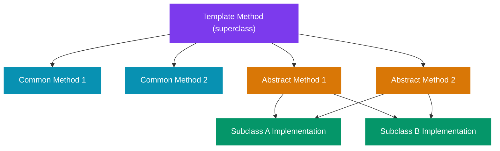
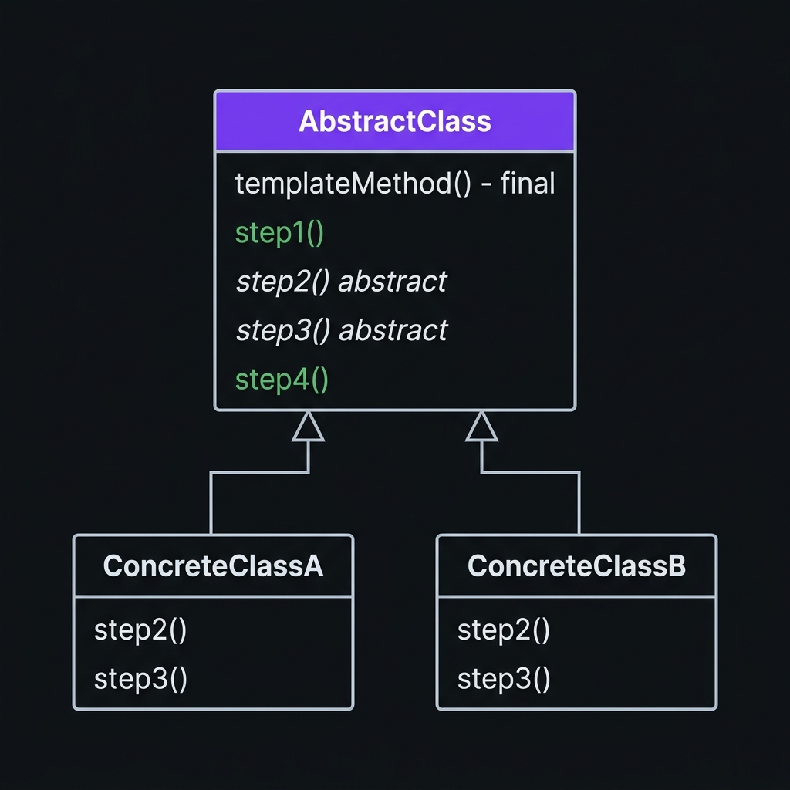
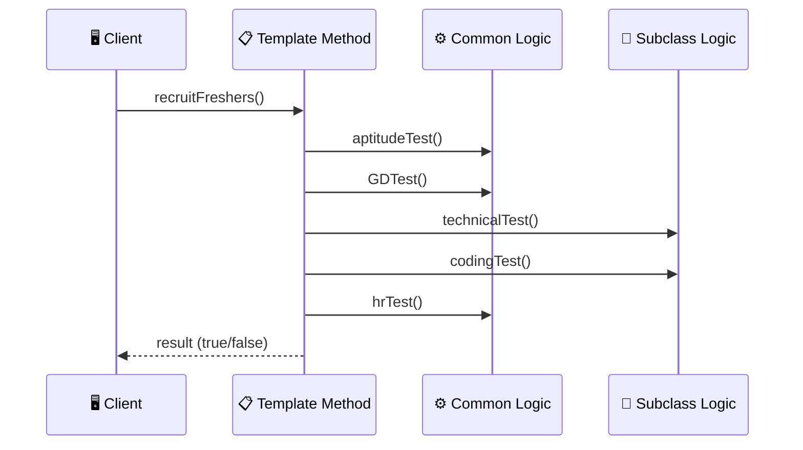

# Template Method Design Pattern

**Template Method Design Pattern** | The template design pattern defines the skeleton (the fixed outline) of an algorithm in the superclass. The algorithm completes a task or job. The superclass leaves some operations for subclasses to implement.

> 🔥🔥 Must-know — very frequently tested &nbsp;·&nbsp; 🔥 High priority &nbsp;·&nbsp; ⚡ Medium priority &nbsp;·&nbsp; 💤 Low priority

---

<a id="1-introduction"></a>
## 1. Introduction 💤

In short, the superclass defines the algorithm. But it does not implement every operation. The subclass defines the operations that are not common.

In the dictionary, a template is a format. You use it as a starting point for a particular use. This way, you do not have to create the format again each time. The template method design pattern is based on the same idea.

🧠 **In Simple Words:**
Assume we have a task. To complete it, we must call the `a()`, `b()`, `c()`, `d()` methods in the given order.

- Without a template, we must remember the method names and the order of the calls.
- Now suppose we define an `m1()` method. It calls those methods inside, in the given order.
- To complete the task, we just call the `m1()` method.
- We no longer need to remember the method names or their order.

**Example template method:**

```java
public void m1() {
   a();
   b();
   c();
   d();
}
```

---

<a id="2-how-template-method-works"></a>
## 2. How Template Method Works ⚡

Template method takes care of:

- 🔧 Either all operations to complete the task.
- ⚙️ Or takes care of the common operations only. It leaves the uncommon operations for the subclass to implement.

The template method is a superclass method. It calls a series of methods to complete the task.

- The superclass itself defines the methods for the common operations and logic.
- It gives the methods for specific operations to subclasses.
- Subclasses override them and define the logic they need.



---

<a id="3-requirement-problem-and-solution"></a>
## 3. Requirement, Problem, and Solution 💤

| Aspect 📋 | Description 📝 |
|-----------|----------------|
| **Requirement** | Assume we must call a series of functions in a particular order. A few functions are common. A few depend on the implementation. |
| **Problem** | A task needs many method calls in a fixed sequence. Remembering all the method names and their order is hard and error-prone. |
| **Solution** | Use the Template design pattern. One Java method contains all the method calls in sequence. So the programmer calls only one Java method to complete the task. |

---

<a id="4-intent-of-template-design-pattern"></a>
## 4. Intent of Template Design Pattern ⚡

- 🏗️ Define the skeleton of an algorithm in one operation. Leave some steps for subclasses to implement.
- 🔒 Template method lets subclasses redefine certain steps of an algorithm. But subclasses cannot change the algorithm's structure.

📚 **GoF operation taxonomy** (how the GoF book groups operations). A template method calls three kinds of steps:

- **Concrete operations** — fully implemented in the base class. All subclasses share them (the invariant common steps).
- **Primitive operations** — `abstract` methods that subclasses *must* implement (the mandatory variable steps).
- **Hook operations** — concrete methods with a default (often empty) body. Subclasses *may* override them (optional extension points).



---

<a id="5-difference-between-factory-method-pattern-vs-template-method-pattern"></a>
## 5. Difference between Factory Method Pattern vs Template Method Pattern ⚡

| Feature ⚖️ | Factory Method Pattern 🅰️ | Template Method Pattern 🅱️ |
|------------|--------------------------|---------------------------|
| **Category** | Creational — about *object creation* | Behavioral — about *algorithm structure* |
| **What the subclass controls** | *Which* concrete object to instantiate | The *implementation* of specific steps |
| **What the superclass owns** | Declares the abstract `create()` method | Owns the algorithm skeleton and step order (often `final`) |
| **What the subclass CANNOT do** | Decide anything beyond the product type | Add / remove / skip / reorder steps |

**In the factory method pattern**, the superclass declares an abstract `create()` method. The subclass decides *which concrete object* to instantiate. It is a **creational** pattern. The focus is on object creation.

**In the template method pattern**, the superclass defines the *skeleton of an algorithm*. This is the fixed sequence of steps. It leaves only specific steps to subclasses. It is a **behavioral** pattern.

⚠️ Note a common mistake. A subclass **cannot** "freely customize" the template. It can only override the chosen abstract/hook steps. The template method itself is usually declared `final`. This is exactly so that no one can change the order and structure (see §6). See more here: [Factory Method Design Pattern](./04_2_Factory_Method_Design_Pattern.md).

> ⚖️ **Get the `final` claim right, once, at the start.**  
> - `final` is *how you enforce* the skeleton in code you own. It is not part of the pattern's definition.  
> - The pattern's intent is to enforce the order. `final` is simply the strongest way Java offers to enforce it.  
> - Real frameworks often give up that guarantee. In return they get extensibility and testability. `HttpServlet.service()`, `AbstractApplicationContext.refresh()`, `AbstractList.iterator()` and `JdbcTemplate.query()` are **none of them `final`**.  
> - So the correct line is: *"Use `final` when you write the base class and the order is a real invariant. Use convention plus documentation when the base class is a framework extension point."*  
> - If you say "virtually always final" in an interview, the interviewer gets an easy counter-example.

---

<a id="6-template-method-design-pattern-example"></a>
## 6. Template Method Design Pattern Example ⚡

Take the example of an IT company that usually hires freshers. The hiring can be in 2 formats:

- A fresher can be placed in any technology.
- Or a fresher already trained in some technology like Java, Python, UI is placed in that technology.

A small company will prefer freshers already trained in Java, Python, UI. For both formats, aptitude tests, group discussions and HR rounds are common. But each has its own technical round and system test round.

The **important point here is there is a proper sequence of all these rounds**. The sequence is: An aptitude test => Group discussion => Technical test => Coding test => HR. The client application must call these methods in this sequence. If you change the sequence, the hiring process is affected.

To solve this problem, we can use the template method design pattern. We define one method (the template method) that contains the method calls in sequence. Now the client application calls only that method. This method holds the format or pattern of the calls. That is why it is called a template method.

🔑 **The algorithm for the recruitment process:**

1. Aptitude Test
2. Group Discussion Test
3. *Technical Test*
4. *Coding Test*
5. HR Test

> 📝 **Note:** Steps in *italics* are abstract — each subclass provides its own implementation.



**Abstract superclass:**

```java
// abstract superclass
public abstract class HireFresher {

   // steps are protected, NOT public — only the template method is the public entry point.
   // public steps would let a client bypass the template and call them out of order
   // (e.g. hrTest() before aptitudeTest()) — the exact failure this pattern prevents.
   protected boolean aptitudeTest() {...} // return true if passed
   protected boolean GDTest() {...}  // return true if passed
   protected abstract boolean technicalTest();
   protected abstract boolean codingTest();
   protected boolean hrTest() { ... } // return true if passed

   // template method — the only public method; declare it final so the child class
   // can't modify the order
   public final boolean recruitFreshers() {
      if(aptitudeTest()) {
        if(GDTest()) {
            if(technicalTest()) {
                if(codingTest()) {
                    if(hrTest()) {
                        return true;
                    }
                }
            }
        }
      }
      return false;
   }
}
```

**Subclass 1 — HireJavaFreshers:**

```java
public class HireJavaFreshers extends HireFresher {

   @Override
   protected boolean technicalTest() {
      // logic to conduct Java technical test
      return true;
   }

   @Override
   protected boolean codingTest() {
      // logic to conduct Java coding test
      return true;
   }
}
```

**Subclass 2 — HirePythonFreshers:**

```java
public class HirePythonFreshers extends HireFresher {

   @Override
   protected boolean technicalTest() {
      // logic to conduct Python technical test
      return true;
   }

   @Override
   protected boolean codingTest() {
      // logic to conduct Python coding test
      return true;
   }
}
```

---

<a id="7-template-method-design-pattern-code-example"></a>
## 7. Template Method Design Pattern Code Example 💤

**Template Method Design Pattern Problem |** First, let us see the problem when we code normally, without the Template method design pattern. After that, we will see how the Template method design pattern solves it.

**Project structure (Problem):**

```
TemplateMethodDP-Problem
  => com.kp.comp
    => HireFresher.java (AC)
    => HireJavaFresher.java
    => HirePythonFresher.java
    => HireUIFresher.java
  => com.kp.test
    => Collage1PlacementCell.java
```

See the problem-code at GitHub: **[TemplateMethodDP-Problem](https://github.com/Know-Program/Design-Pattern/tree/main/DP5.0-TemplateMethodDP-Problem)**

⚠️ **Problems with the above approach:** In the project, the client application developer (`com.kp.test` classes) faces these problems:

- 🚨 They must know the algorithm to conduct hiring. They have to call all those methods in the right order.
- 💥 They can change the order of the method calls by mistake. Or they may forget to call some method.
- ⚙️ They have to know how to create objects for component classes.

<a id="71-solution-using-template-method-design-pattern"></a>
### 7.1 Solution Using Template Method Design Pattern ⚡

Steps to implement Template Method Design Pattern: Define an abstract class with abstract methods and concrete methods.

- A concrete method holds the common logic.
- An abstract method's logic depends on the implementation class. The child class defines it.

**Project structure (Solution):**

```
TemplateMethodDP-Solution
  => com.kp.comp
    => HireFresher.java (AC)
    => HireJavaFresher.java
    => HirePythonFresher.java
    => HireUIFresher.java
  => com.kp.factory
    => HireFresherFactory.java
  => com.kp.test
    => Collage1PlacementCell.java
    => Collage2PlacementCell.java
```

1️⃣ **HireFresher.java** — Abstract class. It holds the logic of the common methods. It also declares the methods whose logic varies.

> 🔑 **Key Point:** We should define the template method as `final`. Then the child class cannot swap the order or modify the logic.

> ⚠️ **Visibility warning — we kept this snippet word for word from the linked GitHub repo on purpose. Its step methods are `public`.**  
> - That is *not* the correct visibility. `public` steps let a client call `conductHRTest()` directly and skip the template. The pattern exists to prevent exactly this failure.  
> - §6 and Q8 hold the correct rule: **steps `protected`, template method `public final`.**  
> - Once a base class declares a step `public`, every subclass must keep `public` too (an override cannot reduce visibility). So the wrong visibility stays in every subclass forever.  
> - Read §7 for the *structure*. Take the visibility from §6.

```java
package com.kp.comp;

public abstract class HireFresher {
   public boolean conductAptitudeTest() {
      System.out.println("HireFresher.conductAptitudeTest()");
      return true;
   }

   public boolean conductGDTest() {
      System.out.println("HireFresher.conductGDTest()");
      return true;
   }

   public abstract boolean conductTechnicalTest();

   public abstract boolean conductCodingTest();

   public boolean conductHRTest() {
      System.out.println("HireFresher.conductHRTest()");
      return true;
   }

   // template method - defining the skeleton of the algorithm
   public final boolean recruiteFresher() {
      if(conductAptitudeTest()) {
         if(conductGDTest()) {
            if(conductTechnicalTest()) {
               if(conductCodingTest()) {
                  if(conductHRTest()) {
                     return true;
                  }
               }
            }
         }
      }
      return false;
   }
}
```

2️⃣ **Subclasses** — `HireJavaFresher`, `HirePythonFresher`, and `HireUIFresher` are child classes of `HireFresher`. They implement the `conductTechnicalTest()` and `conductCodingTest()` methods.

> 📝 **Note:** In these classes, we can also override the existing methods (`conductAptitudeTest()`, `conductGDTest()`, and `conductHRTest()`). We do this if we do not like the existing logic.

**HireJavaFresher.java:**

```java
package com.kp.comp;

public class HireJavaFresher extends HireFresher {

   @Override
   public boolean conductTechnicalTest() {
      System.out.println("HireJavaFresher.conductTechnicalTest()");
      return true;
   }

   @Override
   public boolean conductCodingTest() {
      System.out.println("HireJavaFresher.conductCodingTest()");
      return true;
   }

}
```

**HirePythonFresher.java:**

```java
package com.kp.comp;

public class HirePythonFresher extends HireFresher {

   @Override
   public boolean conductTechnicalTest() {
      System.out.println("HirePythonFresher.conductTechnicalTest()");
      return false;
   }

   @Override
   public boolean conductCodingTest() {
      System.out.println("HirePythonFresher.conductCodingTest()");
      return false;
   }

}
```

**HireUIFresher.java:**

```java
package com.kp.comp;

public class HireUIFresher extends HireFresher {

   @Override
   public boolean conductTechnicalTest() {
      System.out.println("HireUIFresher.conductTechnicalTest()");
      return true;
   }

   @Override
   public boolean conductCodingTest() {
      System.out.println("HireUIFresher.conductCodingTest()");
      return true;
   }

}
```

3️⃣ **HireFresherFactory.java** — Implements [Simple Factory Pattern](./04_1_Simple_Factory_Pattern_in_Java.md). It defines a `getInstance()` factory. Based on the input value, it creates an object of one of the `HireFresher` type classes.

```java
package com.kp.factory;

import com.kp.comp.HireFresher;
import com.kp.comp.HireJavaFresher;
import com.kp.comp.HirePythonFresher;
import com.kp.comp.HireUIFresher;

public class HireFresherFactory {
   public static HireFresher getInstance(String fresherType) {
      if (fresherType.equalsIgnoreCase("java"))
         return new HireJavaFresher();
      else if (fresherType.equalsIgnoreCase("python"))
         return new HirePythonFresher();
      else if (fresherType.equalsIgnoreCase("ui"))
         return new HireUIFresher();
      else
         throw new
         IllegalArgumentException("As of now we are not recruiting "
         + fresherType + " freshers");
   }
}
```

4️⃣ **Client classes** — Show how to use the application.

**Collage1PlacementCell.java:**

```java
package com.kp.test;

import com.kp.comp.HireFresher;
import com.kp.factory.HireFresherFactory;

public class Collage1PlacementCell {

   public static void main(String[] args) {
      HireFresher javaFresher =
            HireFresherFactory.getInstance("java");
      boolean result = javaFresher.recruiteFresher();
      if (result)
         System.out.println("Java fresher is selected");
      else
         System.out.println("Java fresher is not selected");
   }

}
```

**Collage2PlacementCell.java:**

```java
package com.kp.test;

import com.kp.comp.HireFresher;
import com.kp.factory.HireFresherFactory;

public class Collage2PlacementCell {

   public static void main(String[] args) {
      HireFresher uiFresher =
           HireFresherFactory.getInstance("ui");
      boolean result = uiFresher.recruiteFresher();
      if (result)
         System.out.println("UI fresher is selected");
      else
         System.out.println("UI fresher is not selected");
   }

}
```

See the solution code at GitHub: **[TemplateMethodDP-Solution](https://github.com/Know-Program/Design-Pattern/tree/main/DP5.1-TemplateMethodDP-Solution)**.

> 💡 **Tip:** Look at the `HireFresherFactory`, `Collage1PlacementCell`, and `Collage2PlacementCell` classes. Do not hardcode values like `"java"`, `"python"`, `"ui"`, etc. Instead, you can **create an ENUM and use them**. See the [Factory design pattern example using Enum](https://github.com/Know-Program/Design-Pattern/tree/main/DP2.2-FactoryDP-Solution2-Enum) where [BikeType.java](https://github.com/Know-Program/Design-Pattern/blob/main/DP2.2-FactoryDP-Solution2-Enum/src/com/kp/factory/BikeType.java) is an ENUM.

---

<a id="8-application-areas-of-template-method-design-pattern"></a>
## 8. Application Areas of Template Method Design Pattern ⚡

**Use the Template Method design pattern:**

- 🏗️ To write the fixed (invariant) parts of an algorithm once. Subclasses then write the behavior that can change.
- 🔄 When you refactor and find common behavior across classes. Create an abstract base class that holds all the common code (in the template method). This avoids code duplication.

An application framework lets you inherit from a class, or a set of classes, to build a new application:

- You reuse most of the code in the existing classes.
- You override one or more methods to fit the application to your needs.

🔑 **A core idea in the application framework is the Template Method.** It is usually hidden inside the framework. It runs the application by calling the different methods in the base class. You have overridden some of these methods to create your application.

> 📝 **Note:** An important feature of the Template method: it is defined in the base class, and the subclass should not change it. Do you write the base class yourself, and must the order never change? Then declare it `final` (or `private`, if only the class itself calls it). That is the strongest guard Java gives you. **But `final` is a design choice, not part of the definition.** Every framework template method in §9 is non-`final`: `HttpServlet.service()`, `AbstractList.iterator()`, `AbstractApplicationContext.refresh()`, `JdbcTemplate.query()`. The reason: a framework base class must stay extensible and mockable. The template method calls other base-class methods (the ones you override) to do its job. The framework often runs it, instead of the client programmer calling it directly.

> ⚠️ **Watch out for a constructor trap here.** The framework may run the template method during initialization. That must **not** mean *called from the base-class constructor*. See [Q13](#12-interview-qa) for the reason: a step called from a superclass constructor sees the subclass's fields before they are initialized.

🎬 **Hollywood Principle — "Don't call us, we'll call you."** This is the main feature of Template Method. It is also why frameworks depend on it.

- Your code does not call the framework in a fixed order.
- Instead, the framework's template method calls *your* overridden steps at the right time.

This reversal of who calls whom is **Inversion of Control (IoC)**. The base class / framework controls the flow, not your subclass. Every framework Template Method in §9 follows the Hollywood Principle. Two examples: `HttpServlet.service()` dispatching to your `doGet()`, and `AbstractPlatformTransactionManager.getTransaction()` calling your `doBegin()`.

---

<a id="9-pre-defined-methods-acting-as-template-method-design-pattern"></a>
## 9. Pre-defined Methods acting as Template Method Design Pattern ⚡

| Class / Interface 🏷️ | Where it lives 📦 | Template Method Behavior 📋 |
|-----------------------|-------------------|----------------------------|
| **`java.io.InputStream`**, **`java.io.OutputStream`**, **`java.io.Reader`**, **`java.io.Writer`** | Java SE (JDK) | Many non-abstract methods are template methods. Example: `InputStream.read(byte[], int, int)` loops over the abstract `read()` |
| **`java.util.AbstractList`**, **`java.util.AbstractSet`**, **`java.util.AbstractMap`** | Java SE (JDK) | Many non-abstract methods are template methods. Example: the `AbstractList` iterator calls the abstract `get(int)` and `size()` |
| **`jakarta.servlet.http.HttpServlet`** (formerly `javax.servlet.http.HttpServlet`) | **Servlet API / Jakarta EE — *not* the JDK** | `service()` dispatches on the HTTP method to `doGet()`/`doPost()`/… — see the default-behaviour note below |
| **`org.springframework.context.support.AbstractApplicationContext`** | Spring Framework | `refresh()` is the container-startup template: `prepareRefresh()` → `obtainFreshBeanFactory()` → `prepareBeanFactory()` → **`postProcessBeanFactory()`** → `invokeBeanFactoryPostProcessors()` → `registerBeanPostProcessors()` → `initMessageSource()` → `initApplicationEventMulticaster()` → **`onRefresh()`** → `registerListeners()` → `finishBeanFactoryInitialization()` → `finishRefresh()`. `postProcessBeanFactory()` and `onRefresh()` are **empty hooks** — `ServletWebServerApplicationContext` overrides `onRefresh()` to start the embedded Tomcat. This is the best real hook-method example in Spring. |

⚠️ **A common wrong claim: "all `doXxx()` methods default to HTTP 405".** This is wrong for three of them (`doHead()`, `doOptions()`, `doTrace()`). In `HttpServlet`:

- `doGet()` / `doPost()` / `doPut()` / `doDelete()` **reject** the request by default. So does `doPatch()`, which Servlet 6.1 added. But the status depends on the protocol: **405 Method Not Allowed on HTTP/1.1**, and **400 Bad Request on HTTP/1.0** (or a blank protocol string).
- `doHead()` does **not** return 405. It delegates to `doGet()`, wrapped in a response that drops the body. So if you implement `doGet()`, you also get `HEAD` support with no extra code.
- `doOptions()` has a **real implementation**. It uses reflection on your class to find which `doXxx()` methods you overrode. Then it builds the `Allow` response header from them.
- `doTrace()` has a **real implementation**. It sends the request headers back in the response body.

> 📝 **JDK boundary — be exact here.** `javax`/`jakarta.servlet` is the **Servlet API (Jakarta EE)**. Your servlet container or starter provides it. It has never been part of Java SE. So call `HttpServlet.service()` the standard *Servlet-API* Template Method, not the standard *JDK* one. The JDK examples in this table are `java.io.*` and `java.util.Abstract*`.

---

<a id="10-when-not-to-use-template-method"></a>
## 10. When NOT to Use Template Method 🔥

| Situation | Why it's wrong | Use instead |
|---|---|---|
| The steps have no natural fixed order | Template forces a sequence that doesn't exist | **Strategy** — each algorithm is independent |
| You need to swap the *entire* algorithm at runtime | Template Method only varies steps, not the whole flow | **Strategy** — inject the whole algorithm |
| Subclasses need steps in a *different order* | The template is too rigid. The order is locked, and there is **no legal way** for a subclass to change it (a `final` method cannot be overridden at all) | Rethink the abstraction |
| The algorithm has only 1–2 steps | A full abstract class hierarchy for 2 methods is too much | Simple interface + lambda |
| The parent class would need 10+ abstract methods | Too many abstract methods = a fragile base class that is hard to subclass | Compose behavior via **Strategy** instead |

> 💡 **Simple rule:** Different clients need different *orderings* of steps → use **Strategy**. All clients follow the *same order* but differ in *step implementations* → use **Template Method**.

<a id="101-disadvantages"></a>
### 10.1 Disadvantages 🔥

- 🔗 **Single-inheritance limit** — a subclass can extend only one template base. So it can't combine two template hierarchies. For example, one class can't extend both a `LoanProcessor` template and a `ReportGenerator` template. Strategy/composition has no such limit.
- 🧱 **Fragile base class / LSP risk** — a change to a step in the base class silently changes every subclass. A subclass that breaks the base's assumptions can break the algorithm (Liskov substitution violations).
- 🚫 **Can't apply to `final` classes** — the pattern needs subclassing. So you can't use it on classes you can't extend.
- 🐞 **Harder debugging** — control flow jumps between the base class (template) and the subclass (overridden steps). So one file alone rarely shows the full flow. This is the downside of the Hollywood Principle.
- 🧪 **Harder to unit-test** — you cannot instantiate the abstract base. So to test the skeleton alone, you need a test-only concrete subclass (or `Mockito.mock(Base.class, CALLS_REAL_METHODS)`). Also, the template is `final`, so before Mockito 5 you cannot stub the flow itself. Injected strategies are very easy to mock by comparison. This is the strongest *practical* argument for "prefer composition" (see [Q14](#12-interview-qa)).
- 🪤 **Rigid signatures** — the base class's step signature must declare the **union of exceptions any future subclass step might throw**. §11.7's `validateRow()` hook works only because `ValidationException` is *unchecked*. Suppose a subclass needed to throw a checked exception. Then you would have to edit the base, and that breaks every other subclass. Strategy avoids this: each strategy interface declares only its own contract.
- 🚫 **Silently disables proxy-based AOP** — under Spring's CGLIB proxying, `@Transactional` / `@Cacheable` / `@Async` / `@Retryable` on a `final` template method are **never applied** (see [Q15](#12-interview-qa)).

---

<a id="11-production-use-cases"></a>
## 11. Production Use Cases ⚡

Use Template Method when a workflow has a **fixed sequence of steps but variable step implementations**.

- The base class owns the order. It also owns cross-cutting concerns like logging, transactions and metrics.
- Subclasses fill in only what differs.

Below are real-world scenarios from several domains.

> 📝 **Note:** In the snippets below, collaborators (`creditBureauClient`, `vaultClient`, `eventPublisher`, `templateEngine`, `auditRepository`, `reportRepository`, `warehouseRepository`, `stagingRepository`, etc.) are injected via constructor / `@Autowired`. Their declarations are left out to keep the code short.

### 11.2 Payment Gateway Integration (Fintech / E-commerce) ⚡

A charge always follows: validate → tokenize → authorize → capture → emit event. Only the **authorize/capture** calls differ per gateway (Razorpay, Stripe, PayU).

```java
public abstract class PaymentProcessor {

    public final PaymentResult charge(PaymentRequest request) {
        validate(request);
        String token = tokenize(request.getCard());      // common
        AuthResponse auth = authorize(token, request);    // abstract — gateway-specific
        CaptureResponse capture = capture(auth);          // abstract — gateway-specific
        publishPaymentEvent(request, capture);            // common
        return PaymentResult.from(capture);
    }

    protected void validate(PaymentRequest request) {
        Objects.requireNonNull(request.getAmount(), "amount required");
    }

    protected String tokenize(Card card) {
        return vaultClient.tokenize(card);
    }

    protected void publishPaymentEvent(PaymentRequest request, CaptureResponse capture) {
        eventPublisher.publish(new PaymentCapturedEvent(request.getOrderId(), capture.getId()));
    }

    protected abstract AuthResponse authorize(String token, PaymentRequest request);

    protected abstract CaptureResponse capture(AuthResponse auth);
}
```

<a id="113-report--document-generation-saas"></a>
### 11.3 Report / Document Generation (SaaS) ⚡

Fetch data → render → export. The export format (PDF, Excel, CSV) is the only step that changes. This snippet is plain Template Method. Q6 shows how to add a Factory Method step to it.

```java
public abstract class ReportGenerator {

    public final byte[] generate(ReportRequest request) {
        ReportData data = fetchData(request);          // common
        ReportModel model = transform(data);           // common
        return export(model);                          // abstract — format-specific
    }

    protected ReportData fetchData(ReportRequest request) {
        return reportRepository.query(request.getFilters());
    }

    protected ReportModel transform(ReportData data) {
        return ReportModel.aggregate(data);
    }

    protected abstract byte[] export(ReportModel model);
}

@Component
public class PdfReportGenerator extends ReportGenerator {
    @Override
    protected byte[] export(ReportModel model) {
        return pdfRenderer.render(model);
    }
}
```

<a id="114-notification-dispatch-cross-cutting"></a>
### 11.4 Notification Dispatch (Cross-cutting) 💤

Build → render template → send → record audit. Only the **send** transport differs (email, SMS, push, WhatsApp).

```java
public abstract class NotificationSender {

    public final void send(NotificationRequest request) {
        Recipient recipient = resolveRecipient(request);   // common
        String body = renderTemplate(request);             // common
        deliver(recipient, body);                          // abstract — channel-specific
        recordAudit(request, recipient);                   // common
    }

    protected String renderTemplate(NotificationRequest request) {
        return templateEngine.render(request.getTemplateId(), request.getParams());
    }

    protected void recordAudit(NotificationRequest request, Recipient recipient) {
        auditRepository.save(new NotificationAudit(request.getId(), recipient.getAddress()));
    }

    protected abstract void deliver(Recipient recipient, String body);
}

@Component
public class SmsNotificationSender extends NotificationSender {
    @Override
    protected void deliver(Recipient recipient, String body) {
        smsGateway.send(recipient.getPhone(), body);
    }
}
```

<a id="115-spring-batch--etl-job-data-pipelines"></a>
### 11.5 Spring Batch / ETL Job (Data pipelines) ⚡

Extract → transform → load is a fixed pipeline. Each integration source overrides extract/transform.

Spring Batch's `ItemReader → ItemProcessor → ItemWriter` chunk model is **Template Method in idea, Strategy in wiring**:

- The framework owns the fixed read-process-write chunk loop (the skeleton).
- But you plug in the variable steps as injected beans/interfaces. You do not subclass an abstract base.

```java
public abstract class EtlJob {

    public final JobResult run(JobContext context) {
        List<RawRecord> raw = extract(context);      // abstract — per source
        List<CleanRecord> clean = transform(raw);    // abstract — per source
        int loaded = load(clean);                    // common — same warehouse sink
        return new JobResult(loaded);
    }

    protected int load(List<CleanRecord> records) {
        return warehouseRepository.batchInsert(records);
    }

    protected abstract List<RawRecord> extract(JobContext context);

    protected abstract List<CleanRecord> transform(List<RawRecord> raw);
}
```

<a id="116-http-request-handling-web-frameworks"></a>
### 11.6 HTTP Request Handling (Web frameworks) 🔥

`HttpServlet.service()` is the standard **Servlet-API** Template Method (Jakarta EE, not the JDK — see §9). It checks the HTTP method and dispatches to `doGet()` / `doPost()` / `doPut()`, which you implement. Spring's `AbstractController` and Security's `AbstractAuthenticationProcessingFilter` follow the same structure.

```java
public class OrderServlet extends HttpServlet {
    // service() (template method, in the base class) routes here
    @Override
    protected void doGet(HttpServletRequest req, HttpServletResponse resp) throws IOException {
        resp.getWriter().write(orderService.find(req.getParameter("id")).toJson());
    }

    @Override
    protected void doPost(HttpServletRequest req, HttpServletResponse resp) throws IOException {
        orderService.create(OrderRequest.parse(req));
        resp.setStatus(HttpServletResponse.SC_CREATED);
    }
}
```

<a id="117-file-import-processor-bulk-onboarding"></a>
### 11.7 File Import Processor (Bulk onboarding) 💤

Open → parse → validate row → persist → close. The parse step changes by format (CSV, XLSX, fixed-width). Everything else is shared. Fintech uses this often for bulk customer/loan upload.

```java
public abstract class BulkImportProcessor {

    public final ImportSummary importFile(InputStream stream) {
        List<String[]> rows = parse(stream);        // abstract — format-specific
        List<ImportError> errors = new ArrayList<>();
        int saved = 0;
        for (String[] row : rows) {
            try {
                validateRow(row);                   // hook — default does nothing
                persist(row);                       // common
                saved++;
            } catch (ValidationException e) {
                errors.add(new ImportError(row, e.getMessage()));
            }
        }
        return new ImportSummary(saved, errors);
    }

    protected void validateRow(String[] row) {
        // hook — subclasses may add format-specific validation
    }

    protected void persist(String[] row) {
        stagingRepository.save(StagingRecord.of(row));
    }

    protected abstract List<String[]> parse(InputStream stream);
}
```

> ⚠️ **Notice the signature limit hidden in that `catch`.**
>
> - `validateRow()` has an empty body and declares no `throws`. Yet `importFile()` catches `ValidationException` around it.
> - This compiles only because `ValidationException` is **unchecked** (`jakarta.validation.ValidationException` extends `RuntimeException`).
> - Suppose a future subclass needed to throw a *checked* exception from its validation. Then the **base class** would have to widen the step's `throws` clause. Every other subclass and caller would have to handle that change.
>
> **The base class must declare the union of exceptions any future subclass step might throw.** This is a real cost of Template Method: its step signatures are rigid. Strategy avoids it, because each strategy interface owns its own contract.

> 💡 **Pattern recognition for interviews:** Suppose you describe a workflow as *"the steps are always X → Y → Z, but step Y is done differently depending on the type"*. Then it is Template Method. Suppose you describe it as *"the whole algorithm is swapped at runtime"*. Then it is Strategy.

---

---

<a id="12-interview-qa"></a>
## 12. Interview Q&A 🔥

**Q1. What is the Template Method pattern? 🔥**

<!-- -->
<details>
<summary>Answer</summary>

**Answer:**

It is a behavioral pattern. It defines the **skeleton of an algorithm** in a base class. It leaves some steps to subclasses.

- The base class controls the *order* of the steps.
- Subclasses control the *content* of the variable steps.

Key sign: the template method is usually declared `final`. This stops subclasses from changing the structure of the algorithm.

---

</details>

---

**Q2. Why is the template method often marked `final`? 🔥**

<!-- -->
<details>
<summary>Answer</summary>

**Answer:**

It stops subclasses from overriding the *sequence* of the algorithm. The main idea of the pattern is that the base class enforces the flow. If subclasses could override the template method itself, the order would no longer be guaranteed.

```java
abstract class HiringProcess {
    // final — subclasses cannot change the ORDER of steps
    public final void recruit() {
        aptitudeTest();
        groupDiscussion();
        technicalTest();   // abstract — subclass implements
        codingTest();      // abstract — subclass implements
        hrInterview();
    }
    protected abstract void technicalTest();
    protected abstract void codingTest();
    // concrete steps — fixed for all subclasses
    private void aptitudeTest() {
        System.out.println("Aptitude test");
    }
    private void groupDiscussion() {
        System.out.println("Group discussion");
    }
    private void hrInterview() {
        System.out.println("HR interview");
    }
}
```

---

</details>

---

**Q3. What is the difference between Template Method and Strategy? 🔥**

<!-- -->
<details>
<summary>Answer</summary>

**Answer:**

| | Template Method | Strategy |
|---|---|---|
| **Mechanism** | Inheritance — subclass extends abstract base | Composition — context holds interface reference |
| **What varies** | Steps within a fixed algorithm | The entire algorithm |
| **Runtime swap?** | ❌️ No — determined at compile time by subclass | ✅ Yes — inject different strategy at runtime |
| **Coupling** | Tighter — subclass coupled to parent | Looser — context depends only on interface |
| **OCP** | Adding new variant = new subclass | Adding new variant = new class, zero change to context |

> **Interview answer:** "Template Method uses inheritance to vary steps inside a fixed flow. Strategy uses composition to swap the whole algorithm. Prefer Strategy when you need to change behavior at runtime. Also prefer it when you want to avoid deep inheritance hierarchies."

---

</details>

---

**Q4. What is a "hook method"? 🔥**

<!-- -->
<details>
<summary>Answer</summary>

**Answer:**

A **hook** is a concrete method in the abstract class. It has a default implementation, which is often empty. Subclasses *may* override it, but they are not *required* to. So it gives subclasses an optional extension point.

```java
abstract class OrderProcessor {
    public final void processOrder() {
        validateOrder();
        applyDiscount();   // hook — default: do nothing
        chargePayment();
        sendConfirmation();
    }
    protected void applyDiscount() { }  // hook — override only if needed
    protected abstract void chargePayment();
    // ...
}
```

---

</details>

---

**Q5. Where does Spring / JDK use Template Method? 🔥**

<!-- -->
<details>
<summary>Answer</summary>

**Answer:**

| Class | Template Method | Variable Step |
|---|---|---|
| `JdbcTemplate` | `execute()`, `query()` | SQL + `RowMapper` / `StatementCallback` provided by caller |
| `AbstractList` | `iterator()`, `indexOf()`, `equals()` | `get(int)` — the one primitive `AbstractList` itself declares abstract |
| `HttpServlet` (Servlet API, not JDK) | `service()` dispatches to `doGet()`/`doPost()` | `doGet()`, `doPost()` implemented by developer |
| `AbstractPlatformTransactionManager` (`org.springframework.transaction.support`) | `getTransaction()` → `commit()` / `rollback()` flow | `doBegin()`, `doCommit()`, `doRollback()` |
| `AbstractApplicationContext` | `refresh()` — the container-startup sequence | `postProcessBeanFactory()` and `onRefresh()` are **empty hooks**; `ServletWebServerApplicationContext` overrides `onRefresh()` to boot embedded Tomcat |

> ⚠️ **A detail interviewers check — "Is `JdbcTemplate` really Template Method without a subclass?"** Yes. `JdbcTemplate` builds Template Method with a **callback interface** (`StatementCallback`, `RowMapper`), not with subclassing. The fixed skeleton (connection, exceptions, resource cleanup) lives in the template. You pass in the variable step as a callback object, not as an overriding subclass.

> 📝 **Exact note on `AbstractList`'s primitives.** `AbstractList` declares exactly **one** abstract method of its own: `public abstract E get(int index)`. `size()` is inherited as abstract from **`AbstractCollection`**, which `AbstractList` extends.
> - So "implement `get(int)` and `size()`" is the right *practical* answer.
> - But only `get(int)` belongs to `AbstractList`.
> - The same split applies to the other methods. `contains()` is a template method on `AbstractCollection` (it iterates). `indexOf()` and `equals()` belong to `AbstractList`.

---

</details>

---

**Q6. Can Template Method and Factory Method be combined? ⚡**

<!-- -->
<details>
<summary>Answer</summary>

**Answer:**

Yes, and this is common. At one of its steps, the template method needs a concrete component. It calls an abstract `createObject()` method (the Factory Method hook) to get it.

```java
abstract class ReportGenerator {
    public final void generateReport() {
        ReportData data = fetchData();
        ReportModel model = format(data, createFormatter());  // factory method call inside template step
        export(model);
    }

    // concrete operations — shared by all subclasses
    protected ReportData fetchData() {
        return ReportData.empty();
    }

    protected ReportModel format(ReportData data, ReportFormatter formatter) {
        return formatter.apply(data);
    }

    protected void export(ReportModel model) {
        System.out.println(model);
    }

    // FACTORY METHOD — the primitive operation, supplied by the subclass
    protected abstract ReportFormatter createFormatter();
}

class PdfReportGenerator extends ReportGenerator {
    @Override
    protected ReportFormatter createFormatter() {   // MUST be `protected` — see trap below
        return new PdfFormatter();
    }
}
```

⚠️ **Compile-time trap to know:** say you write the override without the `protected` modifier.
- It becomes **package-private**, which *narrows* the inherited access.
- `javac` rejects it with *"attempting to assign weaker access privileges; was protected."*
- An override may **widen** visibility (`protected` → `public`), but it can never narrow it.

The same rule is why §7's `public` steps stay `public` forever in every subclass.

---

</details>

---

**Q7. How does Template Method relate to the Hollywood Principle and Inversion of Control? 🔥**

<!-- -->
<details>
<summary>Answer</summary>

**Answer:**

The **Hollywood Principle — "Don't call us, we'll call you"** — is the core idea of Template Method.
- Your subclass does **not** drive the flow.
- The template method in the base class drives it.
- It *calls back* into the steps you overrode, at the moments it chooses.

This is exactly **Inversion of Control (IoC)**. Control of the algorithm's flow moves from your code up to the base class or framework. You provide the *what* (the variable steps). The framework owns the *when and in what order*.

This is why frameworks use Template Method so much:

- `HttpServlet.service()` decides when to call your `doGet()` / `doPost()`.
- `AbstractPlatformTransactionManager` drives the transaction flow. Its `getTransaction()` calls your `doBegin()`, and its `commit()` calls your `doCommit()`.
- Spring's `JdbcTemplate` owns the connection/exception/cleanup skeleton and calls back into your `RowMapper`.

> **Interview soundbite:** "Template Method is the Hollywood Principle in code: don't call us, we'll call you. The base class inverts control. It owns the algorithm's flow. It calls back into the steps the subclass supplies. That's IoC at the method level. This is why every framework Template Method works this way."

---

</details>

---

**Q8. Why must Template Method use an abstract class and not an interface in Java? And what visibility should the step methods have? 🔥**

<!-- -->
<details>
<summary>Answer</summary>

**Answer:**

Two reasons an interface cannot host this pattern:

1. **An interface method cannot be `final`.** `default` methods can always be overridden. So an interface can never lock the order of the algorithm. But enforcing the order is the main point of the pattern. A `final` template method is only possible in a class.
2. **Step visibility.** The steps should be `protected`, **not** `public`. Only the template method is the public entry point. Interface methods are implicitly `public`. So an interface would expose every step to clients. Clients could then skip the template and call steps out of order (e.g. `hrTest()` before `aptitudeTest()`). This is the exact failure this pattern prevents.

```java
public abstract class HireFresher {
   // steps: protected — invisible to clients, overridable by subclasses
   protected boolean aptitudeTest() {...}
   protected abstract boolean technicalTest();

   // template method: the ONLY public method, final so order can't change
   public final boolean recruitFreshers() { ... }
}
```

⚠️ **Common trap:** describing the pattern as "an interface with a final template method". That design doesn't compile in Java.

---

</details>

---

**Q9. GoF says the steps a template method calls fall into three kinds of operations. Name and define all three. 🔥**

<!-- -->
<details>
<summary>Answer</summary>

**Answer:**

| Operation kind | Defined where | Subclass obligation |
|---|---|---|
| **Concrete operations** | Fully implemented in the base class | None — the fixed common steps, shared by all subclasses (e.g. `aptitudeTest()`, `GDTest()`) |
| **Primitive operations** | `abstract` in the base class | **Must** implement — the mandatory variable steps (e.g. `technicalTest()`) |
| **Hook operations** | Concrete with a default (often empty) body | **May** override — optional extension points (e.g. `applyDiscount()`) |

⚠️ **Common trap:** naming "factory method" as the third kind. A factory method *can appear as one of the steps* (see Q6). But the third kind in the GoF list is **concrete operations**. These are the fixed steps that no subclass touches.

---

</details>

---

**Q10. "You never subclass `JdbcTemplate` — so is it really the Template Method pattern?" 🔥**

<!-- -->
<details>
<summary>Answer</summary>

**Answer:**

**Yes.** `JdbcTemplate` builds Template Method with a **callback interface** (`StatementCallback`, `RowMapper`), not with subclassing.
- The fixed skeleton lives in the template's `query()`/`execute()`. It covers the connection, exception translation and resource cleanup.
- You pass in the variable step as a **callback object** (usually a lambda), not as an overriding subclass.
- The `RowMapper` you pass **is** the "subclass override," in callback form.

⚠️ **Common trap:** answering with the JDBC **Driver** abstraction ("MySQL/PostgreSQL provide different implementation classes"). That is a completely different mechanism. The pattern's variable step is the callback the caller supplies, not the driver.

**Related recall check — `AbstractList`:** implement **`get(int)` and `size()`**. Then the base class gives you iteration, search and equality with no extra code. `iterator()`, `indexOf()` and `equals()` are the template methods built on top of them. Exact version: `AbstractList` declares only `get(int)` abstract. `size()` is inherited as abstract from **`AbstractCollection`**.

---

</details>

---

**Q11. When should you NOT use Template Method — and what are its disadvantages even when it fits? 🔥**

<!-- -->
<details>
<summary>Answer</summary>

**Answer:**

**Reject it when** (each → what to use instead):

- The steps have **no natural fixed order** → **Strategy** (each algorithm is independent)
- You need to **swap the entire algorithm at runtime** → **Strategy** (inject the whole algorithm)
- Subclasses need the steps in a **different order** → the template is too rigid. **Rethink the abstraction**
- The algorithm has only **1–2 steps** → an abstract hierarchy is too much. Use a **simple interface + lambda**
- The parent would need **10+ abstract methods** → fragile base class. **Compose via Strategy**

💡 **Simple rule:** different clients need a different ***order*** of steps → **Strategy**. Same order, different ***step implementations*** → **Template Method**.

**Disadvantages even when it fits:**

- 🔗 **Locked by single inheritance** — a subclass can extend only one template base. It can't be both a `LoanProcessor` and a `ReportGenerator` template. Strategy/composition has no such limit. *(This is the classic "prefer composition" argument. Say this one first.)*
- 🧱 **Fragile base class / LSP risk** — a change to a base step silently changes every subclass.
- 🚫 **Can't apply to `final` classes** — the pattern needs subclassing.
- 🐞 **Harder debugging** — control flow jumps back and forth between the base (template) and the subclass (steps). Reading one file rarely shows the full flow.

---

</details>

---

**Q12. Is Template Method actually used in your production system, or is it just a textbook pattern? 🔥**

<!-- -->
<details>
<summary>Answer</summary>

**Answer:**

**Yes — heavily, at two layers.** The interesting part is that the two layers make opposite choices.

**Layer 1 — the request-handling platform.** Every unit of business logic extends one abstract base class. Its template runs `initialize()` → `process()` → `finalise()`.

**Layer 2 — third-party integrations.** Every bank/bureau call goes through an abstract executor with a **`public final process()`**. It calls:
- REST: abstract `configurations()`, then `doServiceCall()`.
- SOAP: `configurations()` → SOAP message-factory setup → `processRequest()` → `processResponse()` → `prepareResponse()`.

In this integration layer, `final` is a deliberate choice. An integration must never be able to skip credential/endpoint setup before it sends a request.

**Two things I'd point out if I reviewed it today** (this changes a plain description into a design opinion):

- The platform-layer `execute()` is **not `final`**. So its order is only a convention. Only the integration layer enforces the order in the language.
- The `initialize()`/`finalise()` hooks are **almost never overridden** across those thousands of subclasses. A hook nobody uses is dead API. It still limits the base class's signature forever. Declare a hook only when a subclass really needs it, not on a guess.

> **Interview soundbite:** "Template Method is the core of the platform, not a textbook example. But only the integration layer actually makes the template `final`. Everywhere else the order is a convention. And nobody used the hooks we declared at the start. That's the real lesson of the pattern: the `final` is the guarantee, everything else is documentation."

---

</details>

---

**Q13. What happens if the base class calls an overridable step from its constructor? 🔥**

<!-- -->
<details>
<summary>Answer</summary>

**Answer:**

It breaks. Often it breaks *silently*: the step sees a `null` or a `0`. Sometimes it throws an NPE, as in the example below. This is the most common inheritance trap near Template Method. The pattern tempts you to "start the algorithm during initialization."

**Why:** Java's construction order is **superclass constructor → subclass field initializers → subclass constructor body**. Say the superclass constructor calls an overridden step. Then the *subclass's* version runs **before any of the subclass's fields exist**.

```java
abstract class ReportJob {

    ReportJob() {
        prepare();                 // ⚠️ overridable step, called from the base constructor
    }

    protected abstract void prepare();
}

class CsvReportJob extends ReportJob {

    private final List<String> headers = new ArrayList<>();  // runs AFTER super() returns

    @Override
    protected void prepare() {
        headers.add("id");         // 💥 NullPointerException — headers is still null
    }
}
```

`new CsvReportJob()` throws an NPE from inside `prepare()`. Note that `headers` is `final` and has an initializer. `final` does not protect you, because the initializer hasn't run yet.

**The fix — separate construction from execution.** Never drive the algorithm from the constructor. Make the template method the explicit entry point that the caller invokes:

```java
abstract class ReportJob {

    protected ReportJob() {
        // constructor does no work beyond assigning its own fields
    }

    // template method — the safe entry point, called after the object is fully built
    public final void run() {
        prepare();
        execute();
    }

    protected abstract void prepare();

    protected abstract void execute();
}

// caller: new CsvReportJob().run();
```

💡 **Rule to state in an interview:** *"A constructor must not call any overridable method — no `abstract`, no `protected`, no `public` non-`final`. The only methods safe to call from a constructor are `private`, `static`, or `final` ones."* (This is Effective Java Item 19.)

In Spring, the same idea appears like this: do initialization in `@PostConstruct` / `afterPropertiesSet()`, not in the constructor. In the constructor, the bean isn't fully wired yet either.

---

</details>

---

**Q14. How do you unit-test a Template Method base class? 🔥**

<!-- -->
<details>
<summary>Answer</summary>

**Answer:**

You can't instantiate it, so you need one of two ways. *Both are awkward*. That is the strongest practical reason to prefer Strategy.

**1. A test-only concrete subclass (the standard approach).** It also lets you assert the *order* of steps. That order is the invariant the pattern exists to protect:

```java
class LoanApplicationProcessorTest {

    static class TestProcessor extends LoanApplicationProcessor {
        final List<String> calls = new ArrayList<>();

        @Override
        protected RiskScore assessRisk(LoanApplication app, CreditReport report) {
            calls.add("assessRisk");
            return RiskScore.of(700, 0.4);
        }

        @Override
        protected LoanDecision underwrite(LoanApplication app, RiskScore risk) {
            calls.add("underwrite");
            return LoanDecision.approved(app.getRequestedAmount(), 0.12);
        }

        @Override
        protected CreditReport pullCreditReport(LoanApplication app) {
            return mock(CreditReport.class);   // no real bureau client in this test
        }
    }

    @Test
    void runsVariableStepsInOrder() {
        TestProcessor processor = new TestProcessor();

        processor.process(newApplication());

        assertEquals(List.of("assessRisk", "underwrite"), processor.calls);
    }
}
```

**2. `Mockito.CALLS_REAL_METHODS` on the abstract class** — you need no fixture class. But you lose compile-time safety, and the test breaks easily:

```java
LoanApplicationProcessor processor =
        mock(LoanApplicationProcessor.class, CALLS_REAL_METHODS);
```

⚠️ **The problem to name:** the template method is `final`, so with the old subclass mock-maker **you cannot stub or verify the flow itself**.
- Mockito's old subclass mock-maker cannot intercept `final` methods. Mockito 5 made the inline mock-maker the default, and it can.
- So on Mockito 4 or older, `verify(processor).process(...)` won't work.
- You also can't stop the pipeline early in a test.

You must run the whole skeleton every time. So the base class's concrete steps (bureau pull, disbursement) must be mockable on their own, through injected collaborators. If not, the test becomes an integration test by mistake.

> **Interview answer:** "You subclass it in the test. That's fine, but notice the cost. On older Mockito, I can't mock the flow, because the template is `final`. I can't test a step alone, because it's `protected` on an abstract class. With Strategy, each step is an injected bean that I mock in one line. That testability gap is why I choose composition when the steps are non-trivial. The reason is not a strict rule against inheritance."

---

</details>

---

**Q15. Your template method is `final` and you put `@Transactional` on it. What happens? 🔥**

<!-- -->
<details>
<summary>Answer</summary>

**Answer:**

**Nothing happens — the annotation is silently ignored, and you ship a pipeline with no rollback.**

Spring's `@Transactional` is implemented with a **proxy**.
- Spring Boot uses **CGLIB** by default (`spring.aop.proxy-target-class=true`). Plain Spring also uses CGLIB when the bean implements no interface.
- CGLIB builds the proxy by *subclassing* the target class. It overrides the methods to insert the advice.
- A `final` method **cannot be overridden**, so there is no place to put the advice.

There is no exception and no startup failure. In Spring 5.3–6.2 there is just a DEBUG log from `CglibAopProxy` (Spring 7 logs a WARN instead):

> *"Final method [public final … process(…)] cannot get proxied via CGLIB: Calls to this method will NOT be routed to the target instance and might lead to NPEs against uninitialized fields in the proxy instance."*

**Everything proxy-based is affected the same way:**

| Annotation | On a `final` method under CGLIB |
|---|---|
| `@Transactional` | ❌️ no transaction, no rollback |
| `@Cacheable` / `@CacheEvict` | ❌️ cache never consulted or invalidated |
| `@Async` | ❌️ runs synchronously on the caller's thread |
| `@Retryable` | ❌️ no retry on failure |
| `@PreAuthorize` / `@Secured` | ❌️ **authorization check skipped** — the dangerous one |

⚠️ **Two related CGLIB limits to know:**
- A `final` **class** cannot be proxied at all. Startup *does* fail in that case.
- `private` methods are never advised either.

The same cause explains the classic **self-invocation** problem. An internal `this.step()` call skips the proxy completely. So an `@Transactional` step called from inside the template method gets no transaction, even when nothing is `final`.

**How to keep both the `final` guarantee and the transaction** (best option first):

1. **Annotate the caller** — put `@Transactional` on the service method that calls the template. The proxy sits one level up. The final template runs inside the transaction.
2. **`TransactionTemplate` inside the final method** — programmatic, no proxy. It is safe from both the `final` problem and the self-invocation problem. Note that `TransactionTemplate` itself *is* a Template Method.
3. **Drop `final`** — this works. But you lose the order guarantee, which is the main point of the pattern. Use it only as a last resort.

> **Interview soundbite:** "A `final` template method and proxy-based AOP conflict with each other by design. The pattern wants the method closed to overriding. The proxy needs to override it. So I either move the annotation to the caller, or I use `TransactionTemplate` inside. The dangerous part is that it fails silently. The code compiles and the app starts. You only find out when a half-written pipeline doesn't roll back."

---

</details>

---

**Q16. Write a Template Method without inheritance — the callback / lambda form. ⚡**

<!-- -->
<details>
<summary>Answer</summary>

**Answer:**

This is the modern Java form of the pattern. It is exactly how `JdbcTemplate`, `TransactionTemplate` and `RestTemplate` are built (see Q10). **The skeleton is `final` and lives in the class. The variable step comes in as a lambda, not as a subclass override.**

```java
public class TxRunner {

    private final PlatformTransactionManager txManager;

    public TxRunner(PlatformTransactionManager txManager) {
        this.txManager = txManager;
    }

    // TEMPLATE METHOD — begin → body → commit/rollback is fixed and cannot be changed
    public final <T> T inTransaction(Supplier<T> body) {
        TransactionStatus status =
                txManager.getTransaction(new DefaultTransactionDefinition());
        try {
            T result = body.get();          // the primitive operation, supplied by the caller
            txManager.commit(status);
            return result;
        } catch (RuntimeException | Error e) {
            txManager.rollback(status);
            throw e;
        }
    }
}
```

```java
Long loanId = txRunner.inTransaction(() -> loanRepository.save(loan).getId());
```

**Why this is still Template Method, not Strategy:**
- The *invariant* being protected is the begin/commit/rollback order.
- It lives in `TxRunner`, where no caller can reorder it.
- The lambda supplies one step, not the algorithm.
- Strategy would mean swapping out the *whole* way of handling transactions.

**What you gain over the abstract-base-class form:**

- ✅ No inheritance — the caller's class is free to extend something else. This removes the single-inheritance limit.
- ✅ Very easy to test — pass a lambda that throws, then assert `rollback` was called. You need no test-only subclass.
- ✅ Composable — one `TxRunner` bean serves every caller. You don't need one subclass per variation.

**What you lose:**

- ❌️ No compile-time rule. `abstract` forces every subclass to implement the step. But a `Supplier` parameter can receive an empty lambda, and nobody notices.
- ❌️ Doesn't scale past ~2 variable steps. Three callback parameters are harder to read than three overridden methods. That is exactly the limit in §10: **1–2 varying steps → interface + lambda; many varying steps with a shared skeleton → abstract base class.**

---

</details>

---

> **🎯 Interview footer — Template Method**  
> **Seen in:** `JdbcTemplate` / `RestTemplate` / `KafkaTemplate` / `TransactionTemplate` (the name *is* the pattern); `AbstractList` / `AbstractMap`; `HttpServlet.service()` dispatching to `doGet`/`doPost`; JUnit's `@BeforeEach` → test → `@AfterEach` lifecycle; `AbstractApplicationContext.refresh()`.  
> **This invites:** *"Why is the template method `final`?"* → so a subclass can't reorder or skip steps. But see Q15, because `final` also silently disables `@Transactional`. *"Hook vs abstract method?"* → abstract = must implement, hook = optional no-op default (Q4). *"Template Method vs Strategy?"* → inheritance and compile-time variation vs composition and runtime swapping (Q3). *"How do you test the base class?"* → test-only subclass or `CALLS_REAL_METHODS`, and before Mockito 5 the `final` template can't be stubbed (Q14). *"Can the base constructor call a step?"* → no — the subclass's fields aren't initialized yet (Q13).
