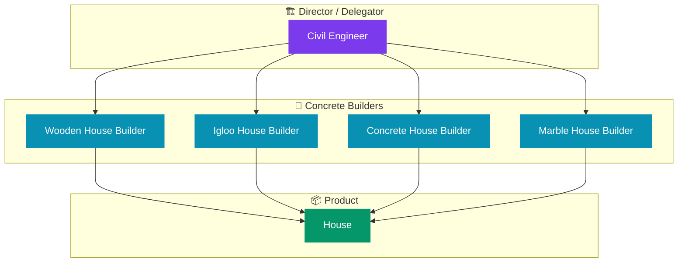
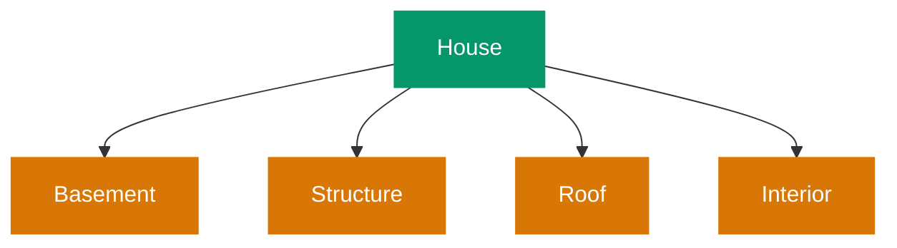
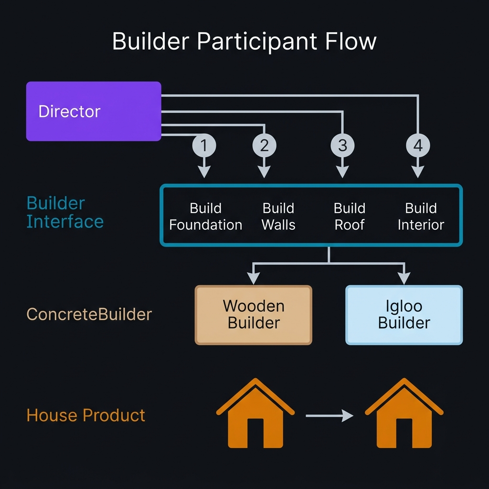

# Builder Design Pattern in Java

**Builder Design Pattern in Java** | A creational design pattern. It builds a complex object step by step, from many independent parts. The same construction process can then create different representations.

- [GoF Builder vs Modern Builder — They Solve Different Problems 🔥🔥](#gof-builder-vs-modern-builder--they-solve-different-problems)
- [Interview Strategy: Which Builder to Tell? 🔥🔥](#interview-strategy-which-builder-to-tell)
  - [1. Start with GoF Builder (shows fundamentals) 🔥🔥](#1-start-with-gof-builder-shows-fundamentals)
  - [2. Then pivot to Bloch's Fluent Builder (shows practical knowledge) 🔥🔥](#2-then-pivot-to-blochs-fluent-builder-shows-practical-knowledge)
  - [3. Mention Lombok (shows real-world awareness) 🔥](#3-mention-lombok-shows-real-world-awareness)
  - [Why This Order Works ⚡](#why-this-order-works)
  - [Key Talking Points 🔥🔥](#key-talking-points)
  - [Common Follow-up Questions to Prepare 🔥🔥](#common-follow-up-questions-to-prepare)
- [1. Introduction ⚡](#1-introduction)
- [2. Participants of Builder Design Pattern ⚡](#2-participants-of-builder-design-pattern)
- [3. When to Use Builder Design Pattern 🔥](#3-when-to-use-builder-design-pattern)
- [4. Same Process, Different Product ⚡](#4-same-process-different-product)
- [5. Builder Design Pattern in Java Example ⚡](#5-builder-design-pattern-in-java-example)
  - [5.1 Create Product and Required Classes 💤](#51-create-product-and-required-classes)
  - [5.2 Develop the Builder Interface ⚡](#52-develop-the-builder-interface)
  - [5.3 Develop the Director/Delegator Class ⚡](#53-develop-the-directordelegator-class)
  - [5.4 Create a Factory (Factory Pattern) 💤](#54-create-a-factory-factory-pattern)
  - [5.5 Develop Client Application 💤](#55-develop-client-application)
- [6. Builder in the JDK & Frameworks 💤](#6-builder-in-the-jdk--frameworks)
- [7. When NOT to Use Builder 🔥](#7-when-not-to-use-builder)
- [8. Modern Java Builder — Interview Style 🔥🔥](#8-modern-java-builder--interview-style)
  - [8.1 Why Inner-Static Builder? 🔥🔥](#81-why-inner-static-builder)
  - [8.2 PaymentRequest — Fintech Example 🔥🔥](#82-paymentrequest--fintech-example)
  - [8.3 Client Usage 🔥](#83-client-usage)
  - [8.4 Key Interview Points to Mention 🔥🔥](#84-key-interview-points-to-mention)
  - [8.5 Generic Builder with Inheritance (Effective Java Item 2) 🔥](#85-generic-builder-with-inheritance-effective-java-item-2)
  - [8.6 Step Builder — Compile-Time Mandatory Fields ⚡](#86-step-builder--compile-time-mandatory-fields)
  - [8.7 Builder vs Factory — Interview Comparison 🔥🔥](#87-builder-vs-factory--interview-comparison)
  - [8.8 Builder vs Prototype — and vs `record` ⚡](#88-builder-vs-prototype--and-vs-record)
- [9. Real-World Production Use Cases 🔥](#9-real-world-production-use-cases)
  - [9.1 Lombok `@Builder` — Zero Boilerplate 🔥🔥](#91-lombok-builder--zero-boilerplate)
    - [9.1.1 🚨 The biggest `@Builder` trap: it silently bypasses your validating constructor 🔥🔥](#911--the-biggest-builder-trap-it-silently-bypasses-your-validating-constructor)
    - [9.1.2 ⚠️ `@Builder` ≠ Immutability by default 🔥](#912--builder--immutability-by-default)
    - [9.1.3 💬 Interview story 🔥](#913--interview-story)
    - [9.1.4 📚 `@Singular` — the Lombok answer to §8's defensive-copying callout 🔥](#914--singular--the-lombok-answer-to-8s-defensive-copying-callout)
    - [9.1.5 ⚠️ `@Builder.Default` — know which construction paths apply the default 🔥🔥](#915--builderdefault--know-which-construction-paths-apply-the-default)
    - [9.1.6 `toBuilder = true` — creating modified copies ⚡](#916-tobuilder--true--creating-modified-copies)
    - [9.1.7 🧬 Inheritance? Use `@SuperBuilder`, not `@Builder` 🔥](#917--inheritance-use-superbuilder-not-builder)
    - [9.1.8 🔌 "Make your request DTOs immutable" has a catch: Jackson can't deserialize them 🔥🔥](#918--make-your-request-dtos-immutable-has-a-catch-jackson-cant-deserialize-them)
    - [9.1.9 🧾 Summary — what to remember 🔥🔥](#919--summary--what-to-remember)
  - [9.2 Spring `UriComponentsBuilder` — Building REST URLs ⚡](#92-spring-uricomponentsbuilder--building-rest-urls)
  - [9.3 `ResponseEntity` — HTTP Response Building 🔥](#93-responseentity--http-response-building)
  - [9.4 `HttpEntity` / `RequestEntity` — REST Template Calls 💤](#94-httpentity--requestentity--rest-template-calls)
  - [9.5 OkHttp `Request.Builder` — Outbound HTTP Client ⚡](#95-okhttp-requestbuilder--outbound-http-client)
  - [9.6 Pattern Summary — When to Use Which 🔥](#96-pattern-summary--when-to-use-which)

> 🔥🔥 Must-know — very frequently tested &nbsp;·&nbsp; 🔥 High priority &nbsp;·&nbsp; ⚡ Medium priority &nbsp;·&nbsp; 💤 Low priority

> 🧭 **Reading order for interview prep:** GoF-vs-Modern (below) → **§8** → **§9** → skim §5. §5 is the full GoF walkthrough. Read it once to learn the concept. But interviewers will mostly ask about §8 and §9.

---

<a id="gof-builder-vs-modern-builder--they-solve-different-problems"></a>
## GoF Builder vs Modern Builder — They Solve Different Problems 🔥

> 💡 **Say this clearly in interviews.** It shows you know both layers, not just one.

The industry uses the name "Builder" for two different patterns. They share only one idea: **step-by-step assembly**.

| Dimension | GoF Builder (§5) | Modern Builder (§8, §9) |
|---|---|---|
| **Core problem** | Multiple representations of the same product | Telescoping constructors, mutability |
| **Director** | Required — enforces construction sequence | Not present |
| **ConcreteBuilders** | Multiple — each produces a different variant | One inner static class |
| **Product types** | One Product type (`House`), built from different *parts*. GoF also allows unrelated product types (see note below) | One type, different configuration |
| **Focus** | Keep the construction process independent | Readability, immutability, optional params |
| **Java prevalence** | 🦕 Rare in production | ⚡ Everywhere — Lombok, Spring, OkHttp |

**GoF Builder** asks: *"Same process, different product?"*
- `CivilEngineer.buildHouse()` → delegates to `WoodenHouseBuilder` or `IglooHouseBuilder`
- The Director does not know which concrete builder it holds, and it does not need to

> 🎓 **The "many product types" detail — a senior-level follow-up.**
> - In the original GoF version, `getResult()` is **not** declared on the abstract Builder interface. This is on purpose.
> - The reason: the products can be so unrelated that they share no common supertype.
> - So the *client* asks the ConcreteBuilder for its result. Each builder can return a different type.
> - §5 uses the more common variant. There, `getHouse()` **is** on the interface.
> - So every builder returns the same `House` type. Only the *parts* it plugs in are different.
>
> Both are Builder. Know which one you are describing.

**Modern Builder** asks: *"Too many constructor params? Need immutability?"*
- `new PaymentRequest.Builder("PAY-001","CUST-42",50000L,"INR").description("EMI").build()`
- One product type, configured differently at each call site

> ⚠️ **Why the confusion exists:** GoF named the pattern after the construction *process*. Later, the industry took the same name for the fluent-configuration style. That style solves a completely different problem. Both are called "Builder", and interviewers may mean either one. So ask which one they mean.

---

<a id="interview-strategy-which-builder-to-tell"></a>
## Interview Strategy: Which Builder to Tell? ⚡

**Tell Both, in This Order:**

<a id="1-start-with-gof-builder-shows-fundamentals"></a>
### 1. Start with GoF Builder (shows fundamentals) 🔥🔥

Show that you know the classic GoF definition:

> *"Builder is a creational pattern. It separates the construction of a complex object from its representation. So the same construction process can create different representations. It has four parts: a Director, an abstract Builder interface, ConcreteBuilders, and a Product."*

Give the classic example: building a document in different representations (HTML builder, PDF builder, plain text builder). The construction steps are the same. The outputs are different.

<a id="2-then-pivot-to-blochs-fluent-builder-shows-practical-knowledge"></a>
### 2. Then pivot to Bloch's Fluent Builder (shows practical knowledge) 🔥🔥

> *"In modern Java, we more commonly use the fluent Builder. Joshua Bloch made it popular in Effective Java. It drops the Director. It solves the telescoping constructor problem. That problem appears when a class has many optional parameters."*

Show the chained `.method().build()` example.

<a id="3-mention-lombok-shows-real-world-awareness"></a>
### 3. Mention Lombok (shows real-world awareness) 🔥

> *"In production Spring Boot projects, we usually use Lombok's `@Builder` annotation. It generates this boilerplate for us."*

---

<a id="why-this-order-works"></a>
### Why This Order Works ⚡

| Layer | What it signals to the interviewer |
|---|---|
| GoF classic | You know the theory and CS fundamentals |
| Bloch fluent | You know modern Java style |
| Lombok | You know real-world practice |

<a id="key-talking-points"></a>
### Key Talking Points 🔥🔥

- **Problem it solves:** telescoping constructors, too many null arguments, immutability
- **When NOT to use:** simple objects with ≤3–4 fields (too much code for the benefit)
- **Comparison with Factory:** Factory creates in one step; Builder creates step-by-step
- **Thread safety:** usually only one thread uses each Builder instance. The built Product is immutable

<a id="common-follow-up-questions-to-prepare"></a>
### Common Follow-up Questions to Prepare 🔥🔥

1. Difference between Builder and Factory?
2. Can Builder be used with inheritance? (Yes — the recursive-generic `Builder<T extends Builder<T>>` with `self()`; see §8 "Generic Builder with Inheritance", or Lombok `@SuperBuilder`)
3. How does Lombok's `@Builder` work internally? (An annotation processor generates an inner static class)
4. Builder vs Prototype pattern? (Prototype copies an instance that is already configured. Builder builds the object from parameters — see §8 "Builder vs Prototype")

> 💡 **Summary:** Start with GoF (theory). Then show Bloch's fluent style (practice). Knowing both is better than knowing only one.

---

<a id="1-introduction"></a>
## 1. Introduction 💤

**The Builder design pattern is a creational design pattern used to build complex objects.**

- It builds a complex object step by step, from many independent objects.
- To do this, it defines a process.
- You can use that process to build many complex objects of the same category.
- So one construction process can create different objects of the same category.

GOF defines the Builder Design pattern like this: "**Separate the construction of a complex object from its representation so that the same construction process can create different representations**".

🧠 **In Simple Words:**
- Say we define a process to build a house. It combines separate tasks like roof, structure, basement, interior, etc.
- We can use the same process to build different types of houses: wooden houses, ICE houses (Igloo), Concrete houses, etc.
- In the same way, say we define a process to build a meal from many separate objects.
- We can use that process to build a veg meal, a non-veg meal, a kid's meal, etc.

**① One Director, many Concrete Builders — all producing the same Product type:**



**② Inside the Product — the parts every builder must assemble, in the same order:**



> `House` (green) is the same node in both diagrams. Diagram ① shows *who builds*. Diagram ② shows *what gets built*.
> - The Director fixes the construction **process** (basement → structure → roof → interior).
> - Each Concrete Builder decides the material for each step.

---

<a id="2-participants-of-builder-design-pattern"></a>
## 2. Participants of Builder Design Pattern 💤

The builder design pattern has 4 participants:

| Participant 🏷️ | Role 📋 | Example 🛠️ |
|----------------|---------|------------|
| **Product** | The complex object to be constructed | `House` |
| **Builder** | Interface/abstract class with methods to build each part. It also has a method to get the product | `IHouseBuilder` with `getHouse()` |
| **ConcreteBuilder** | Implements/extends the Builder. It has the logic to create the simple, independent objects that the product needs | `WoodenHouseBuilder`, `IglooHouseBuilder`, `ConcreteHouseBuilder` |
| **Director/Delegator** | Builds the Product. It uses a concrete builder and defines the process to create the product | `CivilEngineer` |

> 📝 **Note:** Each builder is independent of the others. This improves modularity. It also makes it easy to write new builders. Each builder builds the final product step by step, so we have more control over the final product.



---

<a id="3-when-to-use-builder-design-pattern"></a>
## 3. When to Use Builder Design Pattern ⚡

Use the Builder design pattern when:

**GoF criteria:**
- 🔀 The algorithm that creates a complex object is independent of the parts that make it up.
- 🏗️ The system needs to allow different representations for the objects being built.

**Modern / practical criteria (mention these in interviews):**
- 📦 The object has **4+ constructor parameters**, especially optional ones. Builder avoids the telescoping constructor problem (`new Loan("L1","Alice",500000,60,8.5,null,null,"")`)
- 🔒 The product must be **immutable** after creation: private constructor + no setters + all fields `final`
- ✅ You need **validation before the object exists**. `build()` is the one place where invariants are checked
- 🔢 **Construction order matters**. The Director enforces a required sequence (e.g. basement before roof)
- 🔁 You need **multiple representations** of the same complex object, built by the same process (GoF intent)

---

<a id="4-same-process-different-product"></a>
## 4. Same Process, Different Product 💤

This is the core of the GoF intent:
- Keep the construction *process* the same.
- Swap the ConcreteBuilder to get a different *representation*.
- For a different type of Product, we create a new Concrete Builder. We give it to the **same** Director.
- The Director's step sequence never changes. Only the parts that each step plugs in change.

> 📝 **This is the difference between Builder and Factory.** A Factory picks a *type* in one step. Here, the **same multi-step process** gives a wooden, igloo, or concrete `House`. The Product type is the same, but every step uses different parts. The result depends only on which builder the Director holds right now. (§6 covers the ready-made JDK and framework builders.)

---

<a id="5-builder-design-pattern-in-java-example"></a>
## 5. Builder Design Pattern in Java Example 💤

Let us see an example: we create a House with the Builder Design Pattern.

- A house is just a collection of separate items: the basement, roof, structure, interior, etc.
- Building a house needs several sub-processes: creating the basement, the roof, the interior and the structure.
- To create a perfect house, these sub-processes must run in a fixed order.

⚙️ **Construction Order:** Basement => Structure => Roof => Interior

Think about how we get our own house in real life:

- First, we go to an architect to get the house plan.
- When the plan is ready, we give it to the engineer.
- The engineer asks a suitable builder to create the house.
- The builder can be of many types: Concrete housebuilder, Wooden housebuilder, Marble housebuilder, Igloo housebuilder, etc.

❌️ **Problem:** To build the house, we need help from different experts. One person may not be good at all the processes. In code terms, we split house creation into many sub-object creations. Then we put them together.

✅ **Solution:** Use the builder design pattern. It makes a complex object creation process simpler. It is also easy to maintain and extend. The same creation process creates objects of different implementation classes.

To create a `House` object we need the following sub-objects:

- 🧱 **Basement object:** `ConcreteBasement`, `WoodenBasement`, `IceBasement`, etc.
- 🏠 **Roof object:** `ConcreteRoof`, `WoodenRoof`, `IceRoof`, etc.
- 🏗️ **Structure object:** `ConcreteStructure`, `IceStructure`, `WoodenStructure`, etc.
- 🎨 **Interior object:** `WoodenInterior`, `GlassInterior`, `MixedInterior`, `IceCarvingInterior`, etc.

> 📝 **Note:** We start every interface name with the character `I`. This example has many classes and interfaces, and they can be confusing. This naming rule makes the interfaces easy to spot.

This example uses these packages:

| Package 📦 | Purpose 📋 |
|------------|-----------|
| `com.kp.product` | Product classes and interfaces |
| `com.kp.builder` | Builder interface and concrete builders |
| `com.kp.factory` | Factory for building houses |
| `com.kp.director` | Director/Delegator class |
| `com.kp.test` | Client/test classes |

> 💡 **Tip:** To keep it easy to follow, we show only the important part of the code here. The complete example code is on GitHub: [**BuilderDP**](https://github.com/Know-Program/Design-Pattern/tree/main/DP6-BuilderDP).

<a id="51-create-product-and-required-classes"></a>
### 5.1 Create Product and Required Classes 💤

1️⃣ **Create product and required classes.** Write an interface for each sub-process and create its implementation class. Then create a `House` class that uses them.

The classes and interfaces in [`com.kp.product`](https://github.com/Know-Program/Design-Pattern/tree/main/DP6-BuilderDP/src/com/kp/product) package, grouped by hierarchy:

```
com.kp.product
│
├── «interface» IBasement
│       ├── WoodenBasement
│       ├── ConcreteBasement
│       ├── IceBasement
│       └── IronBasement
│
├── «interface» IStructure
│       ├── ConcreteStructure
│       ├── IronStructure
│       ├── IceStructure
│       └── WoodenStructure
│
├── «interface» IRoof
│       ├── IceRoof
│       ├── ConcreteRoof
│       └── WoodenRoof
│
├── «interface» IInterior
│       ├── WoodenInterior
│       ├── GlassInterior
│       ├── MixedInterior
│       └── IceCarvingInterior
│
└── House  ← Product (aggregates one of each above)
```

`House` holds references of the four interface types (`IBasement`, `IStructure`, `IRoof`, `IInterior`). Each ConcreteBuilder decides which implementation to plug in (e.g. `WoodenHouseBuilder` → `WoodenBasement + WoodenStructure + WoodenRoof + WoodenInterior`).

**Product interfaces** — each one declares a `getType()` contract, so no interface is empty:

```java
// IBasement.java
package com.kp.product;
public interface IBasement {
    String getType();
}

// IStructure.java
package com.kp.product;
public interface IStructure {
    String getType();
}

// IRoof.java
package com.kp.product;
public interface IRoof {
    String getType();
}

// IInterior.java
package com.kp.product;
public interface IInterior {
    String getType();
}
```

**Sample implementation (WoodenBasement.java):**

```java
package com.kp.product;
public class WoodenBasement implements IBasement {
    @Override
    public String getType() {
        return "Wooden Basement";
    }
}
// ConcreteBasement → "Concrete Basement", IceBasement → "Ice Basement", IronBasement → "Iron Basement"
```

**House.java (Product — Complex object):**

> ⚠️ In the **GoF classic pattern**, the Product has public setters, so each builder step can change it. This is on purpose for the 4-participant structure. For an **immutable** product, use the Modern Inner-Static Builder (§8).

```java
package com.kp.product;

public class House {

  private IBasement basement;
  private IStructure structure;
  private IRoof roof;
  private IInterior interior;

  public void setBasement(IBasement basement) {
      this.basement = basement;
  }
  public void setStructure(IStructure structure) {
      this.structure = structure;
  }
  public void setRoof(IRoof roof) {
      this.roof = roof;
  }
  public void setInterior(IInterior interior) {
      this.interior = interior;
  }

  @Override
  public String toString() {
    return "House [basement=" + basement.getType()
           + ", structure=" + structure.getType()
           + ", roof=" + roof.getType()
           + ", interior=" + interior.getType() + "]";
  }
}
```

<a id="52-develop-the-builder-interface"></a>
### 5.2 Develop the Builder Interface ⚡

2️⃣ **Develop a Builder interface.** It builds the `House`. It also has a method to get the product object (i.e. `getHouse()`).

**Builder package structure:**

```
com.kp.builder
│
└── «interface» IHouseBuilder
        ├── constructBasement()
        ├── constructStructure()
        ├── constructRoof()
        ├── constructInterior()
        ├── getHouse() → House
        │
        ├── WoodenHouseBuilder    → Wood   basement + structure + roof + interior
        ├── IglooHouseBuilder     → Ice    basement + structure + roof + interior
        ├── ConcreteHouseBuilder  → Concrete basement + structure + roof + interior
        └── MarbleHouseBuilder    → Concrete basement + Iron structure + Concrete roof + Mixed interior
```

`IHouseBuilder` is the Builder interface. The four classes are ConcreteBuilders. Each one implements the same contract, but plugs in different product objects.

**IHouseBuilder.java (Builder interface):**

```java
package com.kp.builder;
import com.kp.product.House;
public interface IHouseBuilder {
   void constructBasement();
   void constructStructure();
   void constructRoof();
   void constructInterior();
   House getHouse();
}
```

- You can have many kinds of Builders: marble housebuilders, igloo housebuilders, bamboo house builders, etc.
- For each builder, write one implementation. It has the logic to build the house.
- The Builder creates the `House` object and sets the basement, interior, roof and structure.
- Then it returns that house through `getHouse()`.

Usually, a wooden house has a wooden basement, wooden structure, wooden roof, and wooden interior. We implement the `WoodenHouseBuilder` class as shown below.

**WoodenHouseBuilder.java (ConcreteBuilder):**

```java
package com.kp.builder;
import com.kp.product.House;
import com.kp.product.WoodenBasement;
import com.kp.product.WoodenInterior;
import com.kp.product.WoodenRoof;
import com.kp.product.WoodenStructure;
public class WoodenHouseBuilder implements IHouseBuilder {
   // Builder owns the product — not passed in from outside
   private final House house = new House();

   @Override
   public void constructBasement() {
       house.setBasement(new WoodenBasement());
   }

   @Override
   public void constructStructure() {
       house.setStructure(new WoodenStructure());
   }

   @Override
   public void constructRoof() {
       house.setRoof(new WoodenRoof());
   }

   @Override
   public void constructInterior() {
       house.setInterior(new WoodenInterior());
   }

   @Override
   public House getHouse() {
       return house;
   }
}
```

<a id="53-develop-the-directordelegator-class"></a>
### 5.3 Develop the Director/Delegator Class ⚡

3️⃣ **Develop a delegate/Director class.** It uses one of the Builders to create the house. (In `com.kp.director` package)

**CivilEngineer.java (Director):**

```java
package com.kp.director;
import com.kp.builder.IHouseBuilder;
import com.kp.product.House;
public class CivilEngineer {
   private IHouseBuilder builder;

   public CivilEngineer(IHouseBuilder builder) {
      this.builder = builder;
   }

   public House buildHouse() {
      builder.constructBasement();   // 1st
      builder.constructStructure();  // 2nd
      builder.constructRoof();       // 3rd
      builder.constructInterior();   // 4th
      return builder.getHouse();
   }
}
```

<a id="54-create-a-factory-factory-pattern"></a>
### 5.4 Create a Factory (Factory Pattern) 💤

4️⃣ **Create a Factory to build the houses** using Factory Pattern. (In `com.kp.factory` package)

**HouseFactory.java:**

```java
package com.kp.factory;
import com.kp.builder.ConcreteHouseBuilder;
import com.kp.builder.IHouseBuilder;
import com.kp.builder.IglooHouseBuilder;
import com.kp.builder.MarbleHouseBuilder;
import com.kp.builder.WoodenHouseBuilder;
import com.kp.director.CivilEngineer;
import com.kp.product.House;

// Factory Pattern Implementation
public class HouseFactory {
   // named create(), not getInstance() — getInstance connotes a singleton
   // to many readers; this returns a NEW House every call
   public static House create(String type) {
      IHouseBuilder builder;

      // each ConcreteBuilder creates its own House internally
      if (type.equalsIgnoreCase("wood")) {
         builder = new WoodenHouseBuilder();
      } else if (type.equalsIgnoreCase("ice")) {
         builder = new IglooHouseBuilder();
      } else if (type.equalsIgnoreCase("concrete")) {
         builder = new ConcreteHouseBuilder();
      } else if (type.equalsIgnoreCase("marble")) {
         builder = new MarbleHouseBuilder();
      } else {
         throw new IllegalArgumentException("Invalid House type: " + type);
      }

      return new CivilEngineer(builder).buildHouse();
   }
}
```

<a id="55-develop-client-application"></a>
### 5.5 Develop Client Application 💤

5️⃣ **Develop a client application.** It uses the Builder and the Engineer together to build the house. (In `com.kp.test` package)

**Customer1.java:**

```java
package com.kp.test;
import com.kp.factory.HouseFactory;
import com.kp.product.House;
// Customer-1 wants Marble house
public class Customer1 {
   public static void main(String[] args) {
      House house = HouseFactory.create("Marble");
      System.out.println(house);
   }
}
```

📤 **Output for Customer-1:**

```
House [basement=Concrete Basement, structure=Iron Structure, roof=Concrete Roof, interior=Mixed Interior]
```

**Customer2.java:**

```java
package com.kp.test;
import com.kp.factory.HouseFactory;
import com.kp.product.House;
// Customer-2 wants wooden house
public class Customer2 {
   public static void main(String[] args) {
      House house = HouseFactory.create("wood");
      System.out.println(house);
   }
}
```

📤 **Output for Customer-2:**

```
House [basement=Wooden Basement, structure=Wooden Structure, roof=Wooden Roof, interior=Wooden Interior]
```

---

<a id="6-builder-in-the-jdk--frameworks"></a>
## 6. Builder in the JDK & Frameworks 💤

🔑 **Builder Pattern Implementations that already exist in Java:**

| JDK API | Why it counts as a Builder |
|---|---|
| `java.net.http.HttpRequest.newBuilder()` / `HttpClient.newBuilder()` (Java 11+) | 🥇 **The best modern example.** It has many optional fields (timeout, headers, HTTP version, redirect policy). The product is private. `build()` returns an immutable object |
| `java.util.Locale.Builder` | A validating builder. You call `setLanguage()`/`setRegion()`/`setVariant()`, then `build()`. It throws `IllformedLocaleException` at the set step |
| `java.util.Calendar.Builder` (Java 8+) | Optional date/time/zone/locale fields → `build()` returns the `Calendar` product |
| `java.time.format.DateTimeFormatterBuilder` | Builds a format spec from many optional parts → `toFormatter()` is the build step |
| `java.util.stream.Stream.Builder` | `accept()`/`add()` collect elements. `build()` makes the `Stream` (and closes the builder) |
| `java.lang.ProcessBuilder` | Optional command/env/redirects/dir. `start()` is the build step. It returns the `Process` product |

> ⚠️ **Be careful with the StackOverflow "patterns in the JDK" list.** Many people disagree with it on this pattern. If you repeat it word for word, the interviewer can show that you are wrong:
>
> - `StringBuilder` / `StringBuffer` are the **simpler variant**. They collect data in a mutable object, and `toString()` is the final step. You can argue they are Builders. But there is no separate Product class, and they do not solve the optional-parameter problem. Mention them only *with* that warning, never as your main example.
> - `java.nio.ByteBuffer#put()` and `java.lang.Appendable` are **mutable accumulators / sinks** (objects that just collect data), not Builders. They have no separate Product and no `build()`. They do not separate construction from representation. The whole contract of `Appendable` is "append a char". If you give either one as an example, one follow-up question can prove your answer wrong.

💡 **Hibernate Example:**

```java
// The bootstrap chain that is literally named after the pattern
StandardServiceRegistry registry = new StandardServiceRegistryBuilder()
        .configure("hibernate.cfg.xml")          // optional config source
        .applySetting("hibernate.show_sql", "true")
        .build();

Metadata metadata = new MetadataSources(registry)
        .addAnnotatedClass(LoanApplication.class)
        .getMetadataBuilder()
        .build();

SessionFactory factory = metadata.getSessionFactoryBuilder()
        .build();                                 // the final Product
```

This is three builders in a chain. Each one collects optional settings before its own `build()`.
- The XML/annotations supply the single pieces: Dialect, id Generator, Connection Provider, second-level cache.
- `SessionFactoryBuilder.build()` makes the `SessionFactory`. This is the main Product.

> 📝 The old form `new Configuration().configure(...).buildSessionFactory()` still exists and still works. But the current API is the `StandardServiceRegistryBuilder` → `MetadataBuilder` → `SessionFactoryBuilder` chain. In a Spring Boot app you use neither of them. Boot configures the `EntityManagerFactory` for you. So mention this as *"how Hibernate starts up internally"*, not as code you write.

---

<a id="7-when-not-to-use-builder"></a>
## 7. When NOT to Use Builder ⚡

| Situation | Why it's wrong | Use instead |
|---|---|---|
| Object has ≤ 3 required fields, no optional ones | A constructor is cleaner and just as easy to read. With **no optional fields, there are no telescoping constructors to avoid** | A single all-args constructor, or a static factory method |
| All fields are mandatory | Builder helps with optional params. If every field is required, a constructor is simpler | Constructor with all required params |
| Simple value object (immutable, few fields) | A Java 16+ `record` is 1 line. A Builder is 50 lines of boilerplate | `record Person(String name, int age) {}` |
| Object construction is very simple and in one sequence | Step-by-step assembly gives nothing when there is only one step | Direct instantiation |
| Performance-critical hot path | Builder creates an extra `Builder` object before the final product. In practice the JIT usually **scalar-replaces** a Builder that never leaves its method (escape analysis). So the cost is often zero. But do not *rely* on that in a measured hot path | Direct construction |

> 💡 **Simple rule:** Say you write `new Person("Alice", 30, null, null, null, null)` with 4+ nulls. That is when a Builder is worth its cost. Below that point, a constructor with a clear name is simpler.

---

<a id="8-modern-java-builder--interview-style"></a>
## 8. Modern Java Builder — Interview Style 🔥🔥

> 🎯 **This is what interviewers really expect.** The GoF 4-participant structure (§5) explains the *concept*. In a live coding round, write this inner-static class pattern. It is short, immutable, and fluent.

<a id="81-why-inner-static-builder"></a>
### 8.1 Why Inner-Static Builder? 🔥🔥

| Problem it solves | Without Builder | With Builder |
|---|---|---|
| Too many constructor params | `new PaymentRequest("PAY-001","CUST-42",50000L,"INR",null,"","AUTOMATIC",null)` — hard to read, easy to mix up arg order | `new PaymentRequest.Builder("PAY-001","CUST-42",50000L,"INR").description("EMI").build()` |
| Optional fields with defaults | Telescoping constructors (too many combinations) | Optional methods. Call only what you need |
| Immutability | Object needs setters → mutable | Private constructor, no setters, all fields `final` |
| Validation before creation | Scattered across setters | All in one place: `build()` |

> 📚 **Bloch presents Builder as the fix for *two* anti-patterns, not just one.** In *Effective Java* (Item 2), the Builder solves both:
>
> | Anti-pattern | What it looks like | Why it hurts |  
> |---|---|---|  
> | **Telescoping constructor** | `new Pizza(12)`, `new Pizza(12, true)`, `new Pizza(12, true, "thin")` … one ctor for each optional-field combination | Call sites are hard to read. It is easy to swap args of the same type. The number of ctors grows very fast |  
> | **JavaBeans** | `Pizza p = new Pizza(); p.setSize(12); p.setCheese(true);` (no-arg ctor + setters) | The object is in an **inconsistent, half-built state** between calls. It **cannot be immutable** (setters must stay public). It is **not thread-safe**: another thread can see a partially-initialized object |
>
> Builder is better than both:
> - The half-built state lives on the temporary `Builder`, not on the product.
> - The product is published (made visible to other code) only once, when `build()` returns. At that point it is complete and immutable.

<a id="82-paymentrequest--fintech-example"></a>
### 8.2 PaymentRequest — Fintech Example 🔥🔥

> 💬 **Interview story:** *"A `PaymentRequest` is sent to the payment gateway asynchronously. After it is built and sent, no thread should change it. A change could cause a double charge or break the audit trail. An immutable Builder is the clear choice. Required fields are enforced at construction. Optional fields get defaults. `build()` does the validation check."*

```java
public class PaymentRequest {

    // Required — final guarantees immutability
    private final String paymentId;
    private final String customerId;
    private final long   amount;       // in paise (smallest currency unit)
    private final String currency;

    // Optional — with sensible defaults
    private final String description;
    private final String captureMethod;        // "AUTOMATIC" or "MANUAL"
    private final String statementDescriptor;
    private final String metadata;

    // Private constructor — only Builder can instantiate
    private PaymentRequest(Builder builder) {
        this.paymentId           = builder.paymentId;
        this.customerId          = builder.customerId;
        this.amount              = builder.amount;
        this.currency            = builder.currency;
        this.description         = builder.description;
        this.captureMethod       = builder.captureMethod;
        this.statementDescriptor = builder.statementDescriptor;
        this.metadata            = builder.metadata;
    }

    // Getters only — no setters
    public String getPaymentId() {
        return paymentId;
    }
    public String getCustomerId() {
        return customerId;
    }
    public long   getAmount() {
        return amount;
    }
    public String getCurrency() {
        return currency;
    }
    public String getDescription() {
        return description;
    }
    public String getCaptureMethod() {
        return captureMethod;
    }
    public String getStatementDescriptor() {
        return statementDescriptor;
    }
    public String getMetadata() {
        return metadata;
    }

    @Override
    public String toString() {
        // amount is stored in paise — convert to major units for a human-readable display
        return "PaymentRequest{id='" + paymentId + "', customer='" + customerId
               + "', amount=" + amount + " paise (" + (amount / 100.0) + " " + currency + ")"
               + ", capture='" + captureMethod + "'}";
    }

    // ─── Inner Static Builder ───────────────────────────────────────────────

    public static class Builder {
        // Required
        private final String paymentId;
        private final String customerId;
        private final long   amount;
        private final String currency;

        // Optional — defaults
        private String description         = "";
        private String captureMethod       = "AUTOMATIC";
        private String statementDescriptor = "";
        private String metadata            = null;

        public Builder(String paymentId, String customerId, long amount, String currency) {
            this.paymentId  = paymentId;
            this.customerId = customerId;
            this.amount     = amount;
            this.currency   = currency;
        }

        public Builder description(String d) {
            this.description = d;         return this;
        }
        public Builder captureMethod(String m) {
            this.captureMethod = m;       return this;
        }
        public Builder statementDescriptor(String s) {
            this.statementDescriptor = s; return this;
        }
        public Builder metadata(String m) {
            this.metadata = m;            return this;
        }

        public PaymentRequest build() {
            // required fields — the Builder's contract
            if (paymentId == null || paymentId.isBlank())
                                  throw new IllegalStateException("Payment ID is required");
            if (customerId == null || customerId.isBlank())
                                  throw new IllegalStateException("Customer ID is required");
            if (amount <= 0)      throw new IllegalStateException("Amount must be positive");
            if (currency == null || currency.isBlank())
                                  throw new IllegalStateException("Currency is required");
            return new PaymentRequest(this);
        }
    }
}
```

<a id="83-client-usage"></a>
### 8.3 Client Usage 🔥

```java
// Full payment — card payment with statement descriptor
PaymentRequest cardPayment = new PaymentRequest.Builder("PAY-2024-001", "CUST-42", 50_000L, "INR")
        .description("Loan EMI - October 2024")
        .captureMethod("AUTOMATIC")
        .statementDescriptor("LOAN EMI OCT")
        .build();

// Minimal payment — uses defaults for optional fields
PaymentRequest quickPay = new PaymentRequest.Builder("PAY-2024-002", "CUST-99", 200_000L, "INR")
        .description("Loan disbursement")
        .build();

System.out.println(cardPayment);
// PaymentRequest{id='PAY-2024-001', customer='CUST-42', amount=50000 paise (500.0 INR), capture='AUTOMATIC'}
```

<a id="84-key-interview-points-to-mention"></a>
### 8.4 Key Interview Points to Mention 🔥🔥

- **Required fields go in the Builder constructor.** The caller can never skip them.
- **Optional fields become fluent methods.** The caller sets only what they need. The rest use defaults.
- **`build()` is the validation check.** The object is created only if the state is valid.
- **No setters on the product.** After `build()` returns, the object stays immutable for its whole life.
- **Same pattern as Lombok `@Builder`.** Lombok generates exactly this structure for you (§9).

> ⚖️ **Where to put each validation (fail-fast), and which exception to throw.** The example above checks everything in `build()` to keep it short. A cleaner split is:  
> - **Required, single-field null/blank checks → the Builder *constructor*.** It fails fast, right where the mistake happens. This gives a better stack trace. It rejects a `null` paymentId the moment it is passed, not several steps later at `build()`. Bloch does this in his `NyPizza.Builder` constructor: `this.size = Objects.requireNonNull(size);`. Here it is `this.paymentId = Objects.requireNonNull(paymentId, "paymentId");`. An interviewer expects this for a per-parameter check.  
> - **Cross-field / invariant checks → `build()`.** Some rules need *several* fields together. For example: "MANUAL capture is only allowed when amount ≥ ₹10,000", or "metadata required when captureMethod == MANUAL". You can check these only after all fields are set. So they belong in `build()`.  
>
> Which exception type to use:
> - **`NullPointerException`** (via `Objects.requireNonNull`) or **`IllegalArgumentException`** for a per-parameter check. The caller gave you a bad *argument*.
> - **`IllegalStateException`** for a `build()`-time invariant. The *builder* is in a state that can't produce a valid product.
>
> The example above uses `IllegalStateException` for both. This simpler version is acceptable. But be ready to explain why.

> 🔒 **Defensive copying: "all fields `final`" is needed, but it is not enough.** `final` fixes the *reference*, not the object it points to. Think of any `List`, `Map`, `Set`, array, `Date`, or other mutable field. The class that holds it is truly immutable only if you **copy the value when it comes in, and lock it when it goes out**:
>
> ```java  
> private final List<String> tags;   // mutable type — must be guarded
>
> private Order(Builder b) {  
>     // copy in: caller can't mutate our internal list after build()  
>     this.tags = List.copyOf(b.tags);        // or new ArrayList<>(b.tags)  
> }
>
> public List<String> getTags() {  
>     return Collections.unmodifiableList(tags);  // copy out: caller can't mutate via getter  
> }  
> ```
>
> If you skip this, a caller can change your "immutable" object, and no error appears. The caller only needs to keep a reference to the original list, or change the list returned by the getter.

> 🧵 **Thread-safety: two separate claims. Do not mix them up.**  
> 1. **You can safely publish the built product without synchronization.** Every field is `final`. So the JMM applies a *freeze action* at the end of the constructor. This step fixes the values of the `final` fields. Any thread that gets a reference to a fully-constructed `PaymentRequest` will see the correct, fully-initialized values of all `final` fields. The JMM guarantees this. You need no `volatile` and no lock. (The JavaBeans pattern above loses exactly this guarantee.) ⚠️ **The guarantee holds only if `this` does not escape during construction.** Say the constructor publishes `this`: it registers it with a listener, starts a thread, or stores it in a static map. Then another thread can reach the object *before* the freeze. That thread can then see default values, and the JMM allows this. The code above is safe because the constructor only copies fields.  
> 2. **The `Builder` itself is *not* thread-safe.** It is a mutable, temporary work area for one thread. Never share one `Builder` instance between threads during a build. Fluent calls from different threads mix together and race on its fields. Build on one thread. Then pass the finished immutable product to other threads.

<a id="85-generic-builder-with-inheritance-effective-java-item-2"></a>
### 8.5 Generic Builder with Inheritance (Effective Java Item 2) 🔥

> ❓ *"Can the Builder pattern work across an inheritance hierarchy?"* This is the follow-up question from the strategy section.
>
> - The simple approach fails. A subclass inherits a fluent setter from the parent. That setter returns the **parent** `Builder` type. So chaining `parentMethod().childMethod()` won't compile.
> - The fix is Bloch's **simulated self-type**. It uses a recursively bounded generic `Builder<T extends Builder<T>>` plus an `abstract T self()`.

```java
import java.util.EnumSet;
import java.util.Set;

// ─── Abstract product ───────────────────────────────────────────────
public abstract class Notification {

    public enum Tag { URGENT, MARKETING, TRANSACTIONAL }

    private final Set<Tag> tags;   // mutable field → defensive-copied below

    // Recursive generic: T is the concrete builder subtype
    abstract static class Builder<T extends Builder<T>> {
        private EnumSet<Tag> tags = EnumSet.noneOf(Tag.class);

        public T addTag(Tag tag) {
            tags.add(tag);
            return self();          // returns the *concrete* builder type, so chaining keeps it
        }

        // Covariant return: each subclass narrows this to its own product
        abstract Notification build();

        // Subclasses return `this` — recovers the concrete type lost to generics
        protected abstract T self();
    }

    Notification(Builder<?> builder) {
        this.tags = EnumSet.copyOf(builder.tags);   // defensive copy in
    }

    public Set<Tag> getTags() {
        return EnumSet.copyOf(tags);                 // defensive copy out
    }
}
```

```java
// ─── Concrete product + its builder ─────────────────────────────────
public class EmailNotification extends Notification {

    private final String subject;

    public static class Builder extends Notification.Builder<Builder> {
        private final String subject;          // required, child-specific field

        public Builder(String subject) {
            this.subject = subject;
        }

        @Override
        public EmailNotification build() {      // covariant return: EmailNotification, not Notification
            return new EmailNotification(this);
        }

        @Override
        protected Builder self() {              // the self-type trick in action
            return this;
        }
    }

    private EmailNotification(Builder builder) {
        super(builder);
        this.subject = builder.subject;
    }

    public String getSubject() {
        return subject;
    }
}
```

```java
// Chaining works across the hierarchy AND returns the precise type — no cast needed:
EmailNotification email = new EmailNotification.Builder("Loan approved")
        .addTag(Notification.Tag.TRANSACTIONAL)   // inherited parent method → returns Builder
        .addTag(Notification.Tag.URGENT)
        .build();                                  // returns EmailNotification (covariant)
```

> 💡 **Why `self()` exists:** generics can't refer to "my own runtime subtype". So the parent's `addTag()` can't `return this` as type `T`. Each leaf builder implements `self()` to give that concrete `this`. This lets inherited fluent methods keep the subtype through the whole chain.

<a id="86-step-builder--compile-time-mandatory-fields"></a>
### 8.6 Step Builder — Compile-Time Mandatory Fields ⚡

The plain Builder enforces required fields at **runtime** (the `build()` checks throw `IllegalStateException`). A **Step Builder** moves that check to **compile time**:
- Each required field is a separate single-method interface. It returns the *next* step.
- So you cannot reach `build()` until every mandatory field is set.
- The caller must go through the steps in order. The IDE suggests exactly one allowed next call.

```java
public class Loan {

    private final String loanId;     // required
    private final long   amount;     // required
    private final int    tenure;     // optional

    private Loan(BuilderImpl b) {
        this.loanId = b.loanId;
        this.amount = b.amount;
        this.tenure = b.tenure;
    }

    // One interface per required step — each returns the NEXT step
    public interface IdStep {
        AmountStep loanId(String id);
    }

    public interface AmountStep {
        BuildStep amount(long paise);
    }

    // Optional fields + build() live on the final step only
    public interface BuildStep {
        BuildStep tenure(int months);

        Loan build();
    }

    public static IdStep builder() {
        return new BuilderImpl();
    }

    // One private class implements every step interface
    private static class BuilderImpl implements IdStep, AmountStep, BuildStep {
        private String loanId;
        private long   amount;
        private int    tenure = 12;

        @Override
        public AmountStep loanId(String id) {
            this.loanId = id;
            return this;
        }

        @Override
        public BuildStep amount(long paise) {
            this.amount = paise;
            return this;
        }

        @Override
        public BuildStep tenure(int months) {
            this.tenure = months;
            return this;
        }

        @Override
        public Loan build() {
            return new Loan(this);
        }
    }
}
```

```java
// Compiles — required steps satisfied in order, then build() becomes visible:
Loan loan = Loan.builder()
        .loanId("L-001")     // IdStep → AmountStep
        .amount(500_000L)    // AmountStep → BuildStep
        .tenure(60)          // BuildStep (optional)
        .build();

// Loan.builder().build();              // ✗ won't compile — build() not on IdStep
// Loan.builder().amount(500_000L);     // ✗ won't compile — IdStep has no amount()
```

> ⚖️ **Trade-off:** with a Step Builder, you **cannot even call** the build step while the object is incomplete. You cannot forget a required field, because the compiler stops you. The cost is more code: one interface for each required field, plus one class that implements all of them. Use it only for objects where a missing mandatory field is really dangerous (payment instructions, security tokens). For everyday DTOs, the standard Builder with `build()`-time checks is the practical default.

---

<a id="87-builder-vs-factory--interview-comparison"></a>
### 8.7 Builder vs Factory — Interview Comparison 🔥🔥

> ❓ *"When would you use Builder over Factory?"* This is a very common Tier-1 follow-up.

| Dimension | Factory | Builder |
|---|---|---|
| **Purpose** | Decides **which type** of object to create | Decides **how** to assemble a complex object step by step |
| **Output** | Returns one of several subtypes (polymorphism) | Returns one type, built with varying configuration |
| **Object complexity** | Simple objects, created in one shot | Complex objects with many parts or optional fields |
| **Optional fields** | Not a concern. The object is created at once | The main benefit. Set only what you need |
| **Construction order** | Not relevant | Can enforce mandatory step sequence |
| **Immutability** | Not guaranteed | Easy to get: no setters on the product. Not automatic — see §9.1.2 |
| **Client knowledge** | Client doesn't know the concrete type | Client configures the object explicitly |
| **Java example** | `HouseFactory.create("wood")` | `new LoanApplication.Builder("L1", "Alice", 500000).tenure(60).build()` |

**When to choose Builder over Factory:**
- Object has **4+ fields**, especially with optional ones
- You need the product to be **immutable**
- You need **validation before creation** (e.g. loan amount > 0)
- The object is always the **same type** — just differently configured

**When to choose Factory over Builder:**
- You need to return **different subtypes** based on input
- Object creation is **simple and one-shot**
- The client should be **decoupled from the concrete class** entirely

> 💡 **They work well together.** The `HouseFactory` in §5 uses Factory to choose the builder. Then it uses Builder to assemble the house. Real production code often uses both.

---

<a id="88-builder-vs-prototype--and-vs-record"></a>
### 8.8 Builder vs Prototype — and vs `record` ⚡

> ❓ *"Builder vs Prototype pattern?"* This is follow-up #4 from the strategy section.

| | Builder | Prototype |
|---|---|---|
| **Starting point** | Nothing. You give every value as a parameter | An **existing, already-configured instance** |
| **Mechanism** | Accumulate fields → `build()` | `clone()` / copy constructor → tweak the copy |
| **Use when** | There is no instance to copy from. Each object is configured from scratch | Construction is expensive (DB/network lookup, heavy parsing). Or the config is already built and you only need to change a field or two |

They do not compete with each other. Lombok's `toBuilder = true` (§9) is really a **Builder in Prototype style**. `original.toBuilder().channel("SMS").build()` copies an existing instance and changes one field. That is copy-then-modify. In other words, it is the Prototype intent built with a Builder API.

> 💡 **And don't forget `record`.** For a small immutable value object, use a Java 16+ `record` with a **compact constructor** for validation. It fully replaces a 50-line Builder:
>
> ```java
> public record Money(long paise, String currency) {
>     public Money {                                   // compact constructor
>         if (paise < 0) throw new IllegalArgumentException("paise must be >= 0");
>         Objects.requireNonNull(currency, "currency");
>     }
> }
> ```
>
> Records give you `final` fields, no setters, and `equals`/`hashCode`/`toString` for free. Use a Builder only when there are many optional fields. Then the canonical constructor (the record's main all-fields constructor) becomes hard to read. This happens at ~4+ optional fields, especially with params of the same type. Lombok's `@Builder` also works **on a record**, if you want both.

---

<a id="9-real-world-production-use-cases"></a>
## 9. Real-World Production Use Cases 🔥

<a id="91-lombok-builder--zero-boilerplate"></a>
### 9.1 Lombok `@Builder` — Zero Boilerplate 🔥🔥

> This is the most common form of Builder in production Java.  
> Lombok generates the whole inner-static Builder at compile time.

```java
import lombok.Builder;
import lombok.Getter;

@Getter
@Builder
public class NotificationRequest {
    private final String userId;
    private final String channel;      // EMAIL, SMS, PUSH
    private final String templateId;
    private final String subject;
    @Builder.Default
    private final int retryCount = 3;
    @Builder.Default
    private final boolean urgent = false;
}
```

```java
// Usage — identical fluent style as hand-written Builder
NotificationRequest req = NotificationRequest.builder()
        .userId("user-123")
        .channel("EMAIL")
        .templateId("LOAN_APPROVED")
        .subject("Your loan has been approved!")
        .urgent(true)
        .build();
```

<a id="911--the-biggest-builder-trap-it-silently-bypasses-your-validating-constructor"></a>
#### 9.1.1 🚨 The biggest `@Builder` trap: it silently bypasses your validating constructor 🔥🔥

All of §8 shows that `build()` is the single place where validation happens. Class-level `@Builder` removes that check.

The docs say `@Builder` **on a class** works like this:

- It is the same as adding `@AllArgsConstructor(access = AccessLevel.PACKAGE)`.
- The builder then calls *that* generated constructor.
- Lombok generates it only when you wrote **no explicit constructor** *and* did not ask Lombok for one.

The docs say it clearly: *"This only works if you haven't written any explicit constructors yourself **or allowed lombok to create one such as with `@NoArgsConstructor`**."*

So `build()` always calls the **all-args** constructor. Whether your validation runs depends on which constructor that is:

| Your class has | What `build()` calls | Validation runs? |
|---|---|---|
| A hand-written ctor taking **exactly all fields** | that ctor | ✅ yes |
| `@AllArgsConstructor` **as well** (often next to `@NoArgsConstructor`) | Lombok's generated all-args ctor | ❌️ **no — silently skipped** |
| A hand-written ctor of any **other** shape (subset of fields, a `Builder` param) | nothing that exists | 🚫 doesn't compile |

```java
// ✅ Put @Builder ON the constructor (or on a static factory method), and drop
//    @AllArgsConstructor so there is only one all-args path — now build() routes through it
@Getter
public class NotificationRequest {
    private final String userId;
    private final String channel;
    private final String templateId;
    private final String subject;

    @Builder
    private NotificationRequest(String userId, String channel, String templateId, String subject) {
        if (userId == null || userId.isBlank()) {
            throw new IllegalArgumentException("userId is required");
        }
        if (!Set.of("EMAIL", "SMS", "PUSH").contains(channel)) {
            throw new IllegalArgumentException("unsupported channel: " + channel);
        }
        this.userId = userId;
        this.channel = channel;
        this.templateId = templateId;
        this.subject = subject;
    }
}
```

You only move one annotation. But it shows the difference between "we use Lombok `@Builder`" and "I know what Lombok `@Builder` actually generates."

<a id="912--builder--immutability-by-default"></a>
#### 9.1.2 ⚠️ `@Builder` ≠ Immutability by default 🔥

Lombok's `@Builder` gives you readable construction. Immutability is a separate choice that you make on purpose. In production you will see `@Builder` used in two very different ways:

| Usage | Fields | Setters | Immutable? |  
|---|---|---|---|  
| JPA entity (`@Entity`) | Not `final` | ✅ Present (`@Setter`) | ❌️ No — JPA requires mutable state |  
| DTO / Value Object | `final` | ❌️ Absent (`@Getter` only) | ✅ Yes |

<a id="913--interview-story"></a>
#### 9.1.4 📚 `@Singular` — the Lombok answer to §8's defensive-copying callout 🔥

A plain `@Builder` on a `List`/`Set`/`Map` field **stores the caller's reference as it is**. This is exactly the bug that the §8 "copy in, lock out" callout warns about. `@Singular` fixes it and also improves the API:

```java
@Getter
@Builder
public class NotificationRequest {
    private final String userId;
    @Singular
    private final List<String> tags;    // field stays plural; methods are generated singular
}

NotificationRequest req = NotificationRequest.builder()
        .userId("user-123")
        .tag("URGENT")                  // add one
        .tags(List.of("EMI", "RETRY"))  // add many
        .build();                       // tags is now an IMMUTABLE copy
```

- It generates `tag(...)` / `tags(...)` / `clearTags()`.
- The important part: `build()` stores an **immutable copy**. So later changes to the caller's list cannot reach inside the object.
- Lombok finds the singular name by itself for common English plurals.
- If Lombok cannot find the singular name (for example `data`), compilation fails. Then you write it yourself: `@Singular("datum")`.

<a id="915--builderdefault--know-which-construction-paths-apply-the-default"></a>
#### 9.1.5 ⚠️ `@Builder.Default` — know which construction paths apply the default 🔥🔥

`@Builder.Default` **removes the field initializer**. The docs say this clearly: *"The initializer on a `@Builder.Default` field is removed and stored in a static method, in order to guarantee that this initializer won't be executed at all if a value is specified in the build."*

How it works:

- The builder keeps `isDeleted$value` plus a boolean `isDeleted$set`.
- `build()` calls the generated `$default$isDeleted()` **only when `$set` is false**.

Since **1.18.2**, Lombok's own generated `@NoArgsConstructor` also applies those defaults. So on current Lombok (**1.18.48**) the everyday paths are safe. This includes JPA, because Hibernate creates the entity through that generated no-arg constructor. This combination is very common in production JPA code:

```java
@Entity @Getter @Setter @NoArgsConstructor @AllArgsConstructor @Builder
public class ConsentOption {
    @Builder.Default
    @Column(name = "is_deleted", nullable = false)
    private Boolean isDeleted = false;    // NOT NULL column + a Lombok-managed default
}
```

| Construction path | `isDeleted` ends up | Why |
|---|---|---|
| `builder().build()` — field not set | `false` ✅ | `$set` is false → `$default$isDeleted()` runs |
| `new ConsentOption()` — Lombok's `@NoArgsConstructor` | `false` ✅ | applies defaults since 1.18.2 |
| Hibernate instantiating the entity (before it sets the loaded column values) | `false` ✅ | goes through that same no-arg constructor |
| `builder().isDeleted(null).build()` | `null` ❌️ | setting it — even to `null` — flips `$set`, so the default never runs |
| `new ConsentOption(id, …, null)` — generated `@AllArgsConstructor` | `null` ❌️ | an all-args ctor assigns straight from its parameter; no default is consulted |
| A **hand-written** no-arg constructor | `null` ❌️ | Lombok doesn't touch your code, and the field's initializer is gone |

A `null` here causes a constraint violation at flush time. It is not a silent wrong value.

So, *"does `@Builder.Default` still work with `@NoArgsConstructor`?"* The answer is **yes on any Lombok since 1.18.2**.

Then explain the last three rows yourself:

- No version fixes them, because they aren't bugs.
- If you pass a value explicitly, the default is not used. This is the intended behavior.
- If a constructor you wrote yourself runs, the default is not used either.

<a id="916-tobuilder--true--creating-modified-copies"></a>
#### 9.1.6 `toBuilder = true` — creating modified copies ⚡

```java
@Getter
@Builder(toBuilder = true)
public class NotificationRequest { /* same fields */ }

NotificationRequest original = NotificationRequest.builder()
        .userId("user-123")
        .channel("EMAIL")
        .templateId("LOAN_APPROVED")
        .subject("Your loan has been approved!")
        .build();

// Retry with updated channel — original is untouched
NotificationRequest retry = original.toBuilder()
        .channel("SMS")
        .build();
```

`original` is unchanged. `retry` is a new object with all fields copied, except `channel`. This is useful for retry flows, audit trails, and test setup (build one base object, then make variants from it).

<a id="917--inheritance-use-superbuilder-not-builder"></a>
#### 9.1.7 🧬 Inheritance? Use `@SuperBuilder`, not `@Builder` 🔥

Plain `@Builder` only knows about the annotated class's own fields. So it **breaks across a parent/child hierarchy**: a subclass builder can't set inherited fields.

Lombok's `@SuperBuilder` fixes this. Put it on *both* parent and child. It generates the recursive-generic `self()`-style builder shown in §8 for you. So the child builder has methods for the parent fields too.

<a id="918--make-your-request-dtos-immutable-has-a-catch-jackson-cant-deserialize-them"></a>
#### 9.1.8 🔌 "Make your request DTOs immutable" has a catch: Jackson can't deserialize them 🔥🔥

There is no no-arg constructor and there are no setters. So a `@RequestBody ImmutableDto dto` fails at bind time. This is *the* follow-up question after you suggest immutability. There are three answers:

1. **Deserialize through the Builder.** Tell Jackson to use it:
   ```java
   @JsonDeserialize(builder = PaymentRequest.Builder.class)
   public class PaymentRequest { /* ... */

       @JsonPOJOBuilder(withPrefix = "")     // ← Bloch-style setters are description(...), not withDescription(...)
       public static class Builder { /* ... */ }
   }
   ```
   People often miss the `withPrefix = ""` part. Jackson expects a `with` prefix by default. Without it, no field binds. Plain Jackson throws `UnrecognizedPropertyException`. Spring Boot turns off `FAIL_ON_UNKNOWN_PROPERTIES`, so there every field is silently skipped. With Lombok, `@Builder @Jacksonized` generates both annotations for you.
2. **Annotate the constructor.** Put `@JsonCreator` + `@JsonProperty` on each param. Or use `@ConstructorProperties`, which Jackson also reads. `-parameters` (with the parameter-names module) is a different option: it lets Jackson read param names without `@JsonProperty`.
3. **Use a `record`.** Jackson 2.12+ deserializes records natively via the canonical (standard, all-components) constructor, with no annotations at all. For a flat request DTO, this is by far the easiest option.

<a id="919--summary--what-to-remember"></a>
#### 9.1.9 🧾 Summary — what to remember 🔥🔥

| § | Remember this | The trap it prevents |
|---|---|---|
| 9.1.1 | Put `@Builder` on the **constructor**, not the class — and drop `@AllArgsConstructor` | With `@AllArgsConstructor` present, `build()` calls *that* ctor and your validation is silently skipped |
| 9.1.2 | `@Builder` gives readable construction, **not** immutability — that needs `final` fields and no setters | Calling mutable JPA entities "immutable DTOs" |
| 9.1.4 | `@Singular` generates `tag()` / `tags()` / `clearTags()` and `build()` stores an **immutable copy** | Plain `@Builder` on a `List` takes the caller's reference straight through |
| 9.1.5 | The default applies on an unset `build()` and on Lombok's generated `@NoArgsConstructor` (since **1.18.2**) | Explicit `null`, the all-args ctor, or a hand-written no-arg ctor → `null` in a `NOT NULL` column |
| 9.1.6 | `toBuilder = true` is copy-then-modify — Prototype intent behind a Builder API | — |
| 9.1.7 | Use `@SuperBuilder` across an inheritance hierarchy | Plain `@Builder` ignores inherited fields |
| 9.1.8 | Immutable `@RequestBody`: `@JsonDeserialize(builder = …)` + `@JsonPOJOBuilder(withPrefix = "")`, or `@JsonCreator`, or a `record` | Jackson can't bind — no no-arg ctor, no setters |

---

<a id="92-spring-uricomponentsbuilder--building-rest-urls"></a>
### 9.2 Spring `UriComponentsBuilder` — Building REST URLs ⚡

> Spring uses Builder internally for safe, encoded URL construction.

```java
// Without Builder — error-prone string concatenation
String url = "https://api.example.com/loans/" + loanId + "?status=" + status;

// With UriComponentsBuilder — structured assembly, and encoding you must ask for
// (fromUriString replaces fromHttpUrl, which is deprecated in Spring 6.2+)
String url = UriComponentsBuilder.fromUriString("https://api.example.com")
        .path("/loans/{loanId}")
        .queryParam("status", status)
        .queryParam("page", 0)
        .queryParam("size", 20)
        .encode()               // ← template encoded first, then URI variables encoded strictly on expand
        .buildAndExpand(loanId)
        .toUriString();
// → https://api.example.com/loans/LOAN-001?status=APPROVED&page=0&size=20
```

> ⚠️ **`toUriString()` does NOT encode for you. You must ask for encoding.**  
> - Without `.encode()`, `UriComponents.toUriString()` returns the string **as-is**. (But `UriComponentsBuilder.toUriString()`, called straight on the builder, does encode.)  
> - So a `status` or `loanId` with a space, `&`, `+`, or a non-ASCII character produces a broken URL.  
> - This is a real type of production bug, not a theoretical one.  
> - Any value that comes from user input or an upstream API needs `.encode()`. (Or think carefully about how `UriComponentsBuilder…build(false)` behaves.)  
> - Note the **order**. `.encode()` before `.buildAndExpand()` encodes the template, *and* then strictly encodes the expanded variables.  
> - If you call `.encode()` on the result later, it encodes again anything that is already escaped (double encoding).

---

<a id="93-responseentity--http-response-building"></a>
### 9.3 `ResponseEntity` — HTTP Response Building 🔥

> Every Spring REST controller uses this Builder pattern daily.

```java
// Simple — static shortcut method (fine for basic cases)
return ResponseEntity.ok(loanApplication);

// Builder — when you need headers + status + body together
return ResponseEntity.status(HttpStatus.CREATED)
        .header("X-Loan-Id", loanId)
        .header("Location", "/loans/" + loanId)
        .contentType(MediaType.APPLICATION_JSON)
        .body(loanApplication);
```

---

<a id="94-httpentity--requestentity--rest-template-calls"></a>
### 9.4 `HttpEntity` / `RequestEntity` — REST Template Calls 💤

```java
HttpHeaders headers = new HttpHeaders();
headers.setContentType(MediaType.APPLICATION_JSON);
headers.setBearerAuth(authToken);

RequestEntity<LoanApplication> request = RequestEntity
        .post(URI.create("https://credit-bureau.internal/check"))
        .headers(headers)
        .body(loanApplication);

ResponseEntity<CreditScore> response = restTemplate.exchange(request, CreditScore.class);
```

---

<a id="95-okhttp-requestbuilder--outbound-http-client"></a>
### 9.5 OkHttp `Request.Builder` — Outbound HTTP Client ⚡

```java
OkHttpClient client = new OkHttpClient.Builder()
        .connectTimeout(10, TimeUnit.SECONDS)
        .readTimeout(30, TimeUnit.SECONDS)
        .addInterceptor(new LoggingInterceptor())
        .build();

Request request = new Request.Builder()
        .url("https://api.partner.com/disburse")
        .post(RequestBody.create(json, MediaType.get("application/json")))
        .addHeader("Authorization", "Bearer " + token)
        .build();
```

---

<a id="96-pattern-summary--when-to-use-which"></a>
### 9.6 Pattern Summary — When to Use Which 🔥

| Scenario | Recommended approach |
|---|---|
| New POJO / DTO with optional fields | Lombok `@Builder` |
| Building a URL dynamically | `UriComponentsBuilder` |
| REST controller response with custom headers | `ResponseEntity` builder |
| Outbound HTTP call with config | `OkHttpClient.Builder` / `RestClient` |
| Complex domain object requiring validation | Hand-written inner-static Builder |
| GoF textbook / learning | 4-participant Director pattern (§5) |

---

> **🎯 Interview footer — Builder**  
> **Seen in:** `HttpRequest.newBuilder()` / `HttpClient.newBuilder()` (Java 11+), `Stream.builder()`, `Locale.Builder`, `Calendar.Builder`, `DateTimeFormatterBuilder`, `ProcessBuilder`; in Spring — `UriComponentsBuilder`, `ResponseEntity`, `RequestEntity`; Lombok's `@Builder` in day-to-day code.  
> **This invites:** *"Why not just setters?"* → then the object is mutable and can exist half-built. *"Does `@Builder` run your validating constructor?"* → not when it's on the class; put it on the constructor. *"Your DTO is immutable — how does Jackson deserialize it?"* → `@JsonDeserialize(builder=…)` + `@JsonPOJOBuilder(withPrefix="")`, or a `record`. *"Is the Builder thread-safe?"* → no, and it doesn't need to be. The *product* is thread-safe, because all fields are `final` and `this` never escapes.

