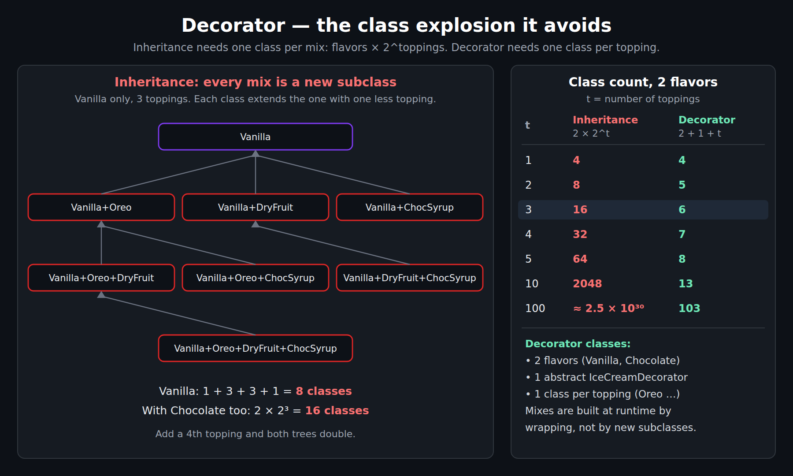
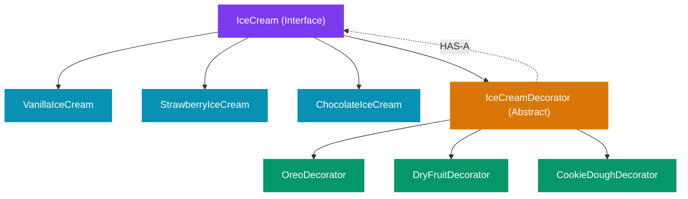
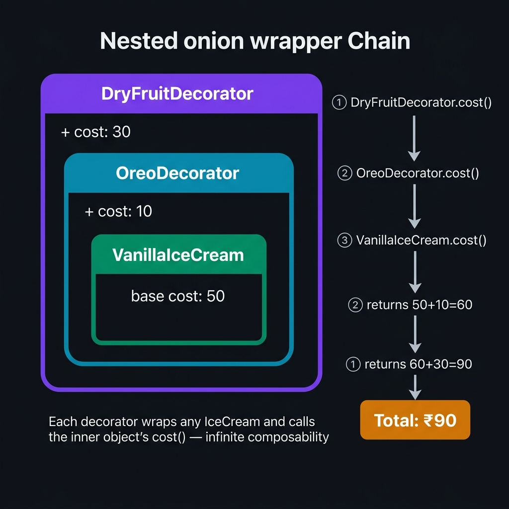

# Decorator Design Pattern in Java

**Decorator Design Pattern in Java** | A structural pattern. It adds new features or responsibilities to an existing object at runtime. Other objects are not affected.

- [Need of Decorator Design Pattern ⚡](#1-need-of-decorator-design-pattern)
- [Components of Decorator or Wrapper Design Pattern 🔥](#2-components-of-decorator-or-wrapper-design-pattern)
- [Example of Wrapper or Decorator Design Pattern in Java 🔥🔥](#3-example-of-wrapper-or-decorator-design-pattern-in-java)
- [Use Cases of Decorator Design Pattern in Java 🔥🔥](#4-use-cases-of-decorator-design-pattern-in-java)
- [When NOT to Use Decorator 🔥](#5--when-not-to-use-decorator)
- [Interview Q&A 🔥🔥](#6--interview-qa)
- [Production Use Cases 🔥](#7-production-use-cases)
  - [7.1 Pluggable Payment Surcharges and Discounts (Fintech) 🔥](#71-pluggable-payment-surcharges-and-discounts-fintech)
  - [7.2 Caching the Request Body for Audit Logging (Fintech / Microservices) 🔥🔥](#72-caching-the-request-body-for-audit-logging-fintech--microservices)
  - [7.3 Enriching REST Responses with HATEOAS Links (SaaS / Microservices) ⚡](#73-enriching-rest-responses-with-hateoas-links-saas--microservices)
  - [7.4 Composable Notification Channels (Notification Systems) ⚡](#74-composable-notification-channels-notification-systems)
  - [7.5 Resilient Service Clients — Retry + Circuit Breaker + Metrics (Microservices) 🔥🔥](#75-resilient-service-clients--retry--circuit-breaker--metrics-microservices)
  - [7.6 Price Modifiers in an E-commerce Cart (E-commerce) 💤](#76-price-modifiers-in-an-e-commerce-cart-e-commerce)
  - [7.7 Compressed and Encrypted Streams for File Export (DevOps / Data Pipelines) 🔥](#77-compressed-and-encrypted-streams-for-file-export-devops--data-pipelines)
  - [7.8 Per-Tenant Feature Toggles on a Service (SaaS) 🔥](#78-per-tenant-feature-toggles-on-a-service-saas)

> 🔥🔥 Must-know — very frequently tested &nbsp;·&nbsp; 🔥 High priority &nbsp;·&nbsp; ⚡ Medium priority &nbsp;·&nbsp; 💤 Low priority

---

<a id="1-need-of-decorator-design-pattern"></a>
## 1. Need of Decorator Design Pattern 💤

**Problem:** Some people always use inheritance to add new features or responsibilities to an existing object. This is bad practice. We end up with a huge number of classes.

Let us see this problem with an example. Assume we have a normal `IceCream` interface. A Pizza example would also work.

**Component interface:**

```java
// IceCream.java
public interface IceCream {
   public void prepare();
}
```

We can add many flavors to the normal Ice Cream. Some top flavors are: Vanilla, Chocolate, Strawberry, Mint Chocolate Chip, Moose Tracks, Neapolitan, Chocolate Chip Cookie Dough, Buttered Pecan, Cookies & Cream, and so on.

With inheritance, we add these features to the normal Ice Cream as shown below.

**Concrete implementation via inheritance:**

```java
//  VanillaIceCream.java
public class VanillaIceCream implements IceCream {
   @Override
   public void prepare() {
      System.out.println("Preparing Vanilla IceCream");
   }
}
```

We add the other flavors in the same way. With inheritance, the code looks like this:

- 🍫 `public class ChocolateIceCream implements IceCream { }`
- 🍓 `public class StrawberryIceCream implements IceCream { }`
- 🌿 `public class MintChocolateChipIceCream implements IceCream { }`
- 🍪 `public class CookiesCreamIceCream implements IceCream { }`
- And so on.

We can add one or more toppings to one flavor. Some top toppings for IceCream are: Oreo, Cookie Dough, Chocolate Syrup, Dry Fruit, Jellies, Hot Fudge, Sprinkles, Caramel, Peanut Butter Cups, Whipped Cream, Hard Chocolate Coating, Melted Marshmallows, Cereal, Nuts, and so on. More than 100 toppings are available.

With inheritance, we add these toppings to `VanillaIceCream` like this:

**Topping via inheritance:**

```java
//  OreoVanillaIceCream.java
public class OreoVanillaIceCream extends VanillaIceCream {
   @Override
   public void prepare() {
      super.prepare();
      addOreo();
   }
   public void addOreo() {
      System.out.println("Adding Oreo");
   }
}
```

We add the other toppings with inheritance in the same way:

- 🍪 `public class CookieDoughVanillaIceCream extends VanillaIceCream { }`
- 🥜 `public class DryFruitVanillaIceCream extends VanillaIceCream { }`
- 🍬 `public class JelliesVanillaIceCream extends VanillaIceCream { }`
- And so on.

Some people like more than one topping on the IceCream.

**Multiple toppings via deep inheritance:**

```java
// VanillaIceCream + Oreo + Dry Fruit
public class DryFruitOreoVanillaIceCream
             extends OreoVanillaIceCream { }

// VanillaIceCream + Oreo + Dry Fruit + Chocolate Syrup
public class ChocolateSyrupDryFruitOreoVanillaIceCream
             extends DryFruitOreoVanillaIceCream { }
```

⚠️ **Problem:** The class count is **combinatorial** (it grows with every mix of options): `flavors × 2^toppings`.
- With just 2 flavors and 3 toppings, that is already `2 × 2³ = 16` classes.
- Every new topping *doubles* it.

So inheritance is not always the best way to add new features or responsibilities to an existing object.



💡 **Solution:** To avoid this huge number of classes, use the Decorator (or Wrapper) design pattern. It builds the solution with **composition (HAS-A)** and a bit of **inheritance (IS-A)**.

**Composition vs Inheritance:**

```java
class A {
   // ...
}

// Example of Inheritance (IS-A) relation
class B extends A {
   // ...
}

// Example of Composition (HAS-A) relation
class B {
   A a = new A(); // HAS-A
   // ...
}
```

---

<a id="2-components-of-decorator-or-wrapper-design-pattern"></a>
## 2. Components of Decorator or Wrapper Design Pattern ⚡

The Decorator (or Wrapper) Design Pattern has these components:

| Component 🏷️ | Role 📋 | Description 📖 |
|--------------|---------|----------------|
| **Component** | Interface | The basic interface that defines the object type (like `IceCream(I)`) |
| **Concrete Component** | Implementation | Implements the component. These are the basic flavor (root) objects. Example: `VanillaIceCream`, `ChocolateIceCream`, `StrawberryIceCream`, `MintChocolateChipIceCream`, `CookiesCreamIceCream` |
| **Abstract Decorator** | Abstract Class | An abstract class. It implements `Component(I)` and also holds a `Component(I)` field. It is the base class for all decorator/wrapper classes that add extra features. Example: `IceCreamDecorator(AC)` |
| **Concrete Decorator** | Decorator Class | Extends the Abstract Decorator. It adds extra features on top of the Concrete Component. Example: `OreoDecorator`, `CookieDoughDecorator`, `DryFruitDecorator` |



🧠 **In Simple Words:**

- 🏗️ **Component** defines what the object can do (interface).
- ⚙️ **Concrete Component** is the actual base object (flavors).
- 🔧 **Abstract Decorator** wraps any component via HAS-A and IS-A.
- 🎨 **Concrete Decorator** adds specific new behavior (toppings).

---

<a id="3-example-of-wrapper-or-decorator-design-pattern-in-java"></a>
## 3. Example of Wrapper or Decorator Design Pattern in Java 🔥

Let us solve the problem from the IceCream example above. The application has this structure:

**Project structure:**

```
DecoratorDP
|=> src
   |=> com.kp.comps
       => IceCream.java(I)
       => VanillaIceCream.java
       => StrawberryIceCream.java
       => ChocolateIceCream.java
   |=> com.kp.decorator
       => IceCreamDecorator.java(AC)
       => OreoDecorator.java
       => DryFruitDecorator.java
       => CookieDoughDecorator.java
   |=> com.kp.test
       => Shop.java
```

Here:

- 📑 **Component:** `IceCream.java` (Interface)
- ⚙️ **Concrete Component:** `VanillaIceCream.java`, `StrawberryIceCream.java`, `ChocolateIceCream.java` (Concrete classes)
- 🏗️ **Abstract Decorator:** `IceCreamDecorator.java` (Abstract Decorator class)
- 🎨 **Concrete Decorator:** `OreoDecorator.java`, `DryFruitDecorator.java`, `CookieDoughDecorator.java` (Concrete Decorator classes)

With only these classes, we can build many combinations. Inheritance alone could not do this. You can see it in the test class (`Shop.java`). Let us build the components.

1️⃣ **Define the Component interface and Concrete Component:**

```java
// IceCream.java (Main Component interface)
package com.kp.comps;
public interface IceCream {
   public void prepare();
}
```

```java
// VanillaIceCream.java (Concrete Component)
package com.kp.comps;
public class VanillaIceCream implements IceCream {
   @Override
   public void prepare() {
      System.out.println("Preparing Vanilla Ice Cream");
   }
}
```

📝 **Note:** Based on `VanillaIceCream.java`, develop `StrawberryIceCream.java` and `ChocolateIceCream.java`.



2️⃣ **Create the Abstract Decorator:**

The most important part of our example is `IceCreamDecorator.java`. Create it in the `com.kp.decorator` package:

```java
// IceCreamDecorator.java (Abstract Decorator)
package com.kp.decorator;
import com.kp.comps.IceCream;
public abstract class IceCreamDecorator implements IceCream {
   // property which will be used to
   // link one decorator with another decorator
   private IceCream icecream; // composition (HAS-A)

   // constructor
   public IceCreamDecorator(IceCream icecream) {
      this.icecream = icecream;
   }

   @Override
   public void prepare() {
      icecream.prepare();
   }
}
```

3️⃣ **Build the Concrete Decorators:**

Create `OreoDecorator.java`, `DryFruitDecorator.java`, and `CookieDoughDecorator.java`. Each one extends `IceCreamDecorator.java`. The code for `OreoDecorator.java` is below. The other classes use the same logic.

`OreoDecorator.java` adds Oreo topping to any type of IceCream. `DryFruitDecorator.java` adds dry fruit to any type of IceCream, and so on.

```java
// OreoDecorator.java (Concrete Decorator)
package com.kp.decorator;
import com.kp.comps.IceCream;
// To add Oreo topping on any type of IceCream
public class OreoDecorator extends IceCreamDecorator {
   public OreoDecorator(IceCream icecream) {
      super(icecream);
   }

   @Override
   public void prepare() {
      super.prepare();
      addOreo();
   }

   public void addOreo() {
      System.out.println("Adding Oreo");
   }
}
```

4️⃣ **Develop the client/test class:**

Now let us write the client/user class (`Shop.java`). Create it in the `com.kp.test` package:

```java
//  Shop.java
package com.kp.test;

import com.kp.comps.ChocolateIceCream;
import com.kp.comps.IceCream;
import com.kp.comps.VanillaIceCream;
import com.kp.decorator.CookieDoughDecorator;
import com.kp.decorator.DryFruitDecorator;
import com.kp.decorator.OreoDecorator;

public class Shop {
   public static void main(String[] args) {
      // Customer-1 wants VanillaIceCream without topping
      System.out.println("Customer-1");
      IceCream iceCream1 = new VanillaIceCream();
      iceCream1.prepare();
      System.out.println();

      // Customer-2 wants VanillaIceCream + Oreo topping
      System.out.println("Customer-2");
      IceCream iceCream2 = new OreoDecorator(new VanillaIceCream());
      iceCream2.prepare();
      System.out.println();

      // Customer-3 wants VanillaIceCream + Oreo + Dry Fruit topping
      System.out.println("Customer-3");
      IceCream iceCream3 = new OreoDecorator(
                    new DryFruitDecorator(new VanillaIceCream()));
      iceCream3.prepare();
      System.out.println();

      // Customer-4 wants
      // ChocolateIceCream + Cookie Dough + Dry Fruit + Oreo topping
      System.out.println("Customer-4");
      IceCream iceCream4 = new OreoDecorator(new DryFruitDecorator(
            new CookieDoughDecorator(new ChocolateIceCream())));
      iceCream4.prepare();
      System.out.println();

      // Customer-5 wants Cookie Dough two times as
      // ChocolateIceCream + Cookie Dough + Cookie Dough + Dry Fruit
      System.out.println("Customer-5");
      IceCream iceCream5 = new DryFruitDecorator(
            new CookieDoughDecorator(new CookieDoughDecorator(
            new ChocolateIceCream())));
      iceCream5.prepare();
      System.out.println();
   }
}
```

📤 **Output:**

```
Customer-1
Preparing Vanilla Ice Cream

Customer-2
Preparing Vanilla Ice Cream
Adding Oreo

Customer-3
Preparing Vanilla Ice Cream
Adding DryFruit
Adding Oreo

Customer-4
Preparing Chocolate Ice Cream
Adding CookieDough
Adding DryFruit
Adding Oreo

Customer-5
Preparing Chocolate Ice Cream
Adding CookieDough
Adding CookieDough
Adding DryFruit
```

🔗 See code at GitHub: [**Decorator Design Pattern-Example**](https://github.com/Know-Program/Design-Pattern/tree/main/DP7-DecoratorDP).

---

<a id="4-use-cases-of-decorator-design-pattern-in-java"></a>
## 4. Use Cases of Decorator Design Pattern in Java ⚡

Here are some uses of the Wrapper (or Decorator) Design Pattern in Java:

| Use Case 🛠️ | Code Example 💻 |
|-------------|-----------------|
| **Buffered reading** | `BufferedReader br = new BufferedReader(new InputStreamReader(System.in));` — ⚠️ only `BufferedReader` is the Decorator here. `InputStreamReader` converts bytes→chars. So it **changes the interface** (`InputStream` → `Reader`). It is a textbook **Adapter**, in Oracle's own JDK |
| **Data input stream** | `DataInputStream dis = new DataInputStream(new FileInputStream("file.txt"));` |
| **Buffered byte stream** | `BufferedInputStream bis = new BufferedInputStream(new FileInputStream("file.txt"));` |
| **Object input stream** | `ObjectInputStream ois = new ObjectInputStream(new FileInputStream("file.txt"));` |

❌️ **Not a Decorator — `Scanner`.**
- `new Scanner(System.in)` wraps a source. But it implements neither `InputStream` nor `Readable`.
- It gives a completely different API (`nextInt()`, `nextLine()`, `hasNext()`).
- A class that changes the interface is an **Adapter/Facade**, not a Decorator.
- It is the most common wrong answer to "name a Decorator in `java.io`". See [Q7](#6--interview-qa).

The whole Java Input/Output stream library is built on the Wrapper (or Decorator) design pattern:

| Component Type 🏷️ | Examples 📦 |
|-------------------|------------|
| **Component (abstract class)** | `InputStream`, `OutputStream`, `Reader`, `Writer` — these are abstract **classes**, not interfaces |
| **Concrete Component** | `FileInputStream`, `FileOutputStream`, `FileReader`, `FileWriter` |
| **Abstract Decorator (byte streams)** | `FilterInputStream`, `FilterOutputStream` |
| **Concrete Decorator (byte streams)** | `BufferedInputStream`, `BufferedOutputStream`, `DataInputStream`, `DataOutputStream` |
| **Abstract Decorator (char streams)** | `FilterReader`, `FilterWriter` — they *do* exist (since JDK 1.1), e.g. `PushbackReader extends FilterReader` |
| **Char-stream decorators** | `BufferedReader`, `BufferedWriter` — ⚠️ these **bypass** `Filter*`. They extend `Reader` / `Writer` directly. Compare `BufferedInputStream extends FilterInputStream`. So the char hierarchy does have the abstract-decorator layer. It just uses it **less consistently**. |

🔑 **Key Points:**

- 🏗️ Decorator is the standard example of the **Open/Closed Principle**. You extend an object's behaviour without changing a single existing class.
  - It *also* helps SRP (Single Responsibility Principle): each responsibility goes into its own wrapper.
  - But OCP is the answer an interviewer is looking for.
- 🔗 In structure, the decorator design pattern is almost the same as the **Chain of Responsibility pattern**. See [19_Chain_of_Responsibility_Design_Pattern_in_Java.md](./19_Chain_of_Responsibility_Design_Pattern_in_Java.md).

📦 **Other JDK decorators — the `Collections` wrappers:**

```java
List<String> sync     = Collections.synchronizedList(new ArrayList<>()); // adds locking
List<String> readOnly = Collections.unmodifiableList(new ArrayList<>()); // restricts writes
```

- `synchronizedList` / `synchronizedMap` are clean Decorators. They keep the same `List` / `Map` interface. They **add** thread-safety (locking) around each call.
- `unmodifiableList` / `unmodifiableMap` are a good discussion point.
  - They keep the interface, but they **restrict** behavior. Mutators (methods that change the collection) throw `UnsupportedOperationException`.
  - They do not *add* a new feature.
  - So they are closer to a **protection wrapper** (like a [Proxy](./13_Proxy_Design_Pattern_in_Java.md)) than a textbook Decorator. A Decorator normally adds behavior.
  - Mention this in an interview. It shows you understand the difference in *intent*, not just the structure.

> 💡 **Tip:** Use the Decorator pattern to add behavior to single objects at runtime. Other objects of the same class are not affected. Prefer composition over deep inheritance hierarchies.

---

<a id="5--when-not-to-use-decorator"></a>
## 5. ⚠️ When NOT to Use Decorator ⚡

| Situation | Why it's wrong | Use instead |
|---|---|---|
| Only 1–2 concrete variants ever exist | A wrapper class hierarchy is too much for 2 types | Simple subclass or constructor param |
| Core interface changes frequently (methods added) | Every decorator must be updated when the interface grows | Reconsider the interface design |
| Decoration order matters unpredictably | When the order causes bugs, stacked decorators are hard to debug | Explicit pipeline / chain of responsibility |
| The added behaviour needs access to private state | Decorator can only call public interface methods | Subclass or redesign |
| Callers rely on the **concrete type** (`instanceof`, `equals`, annotation scanning) | Wrapping hides the real type. The decorated object is a different class ([Q8](#6--interview-qa)) | Keep the object bare, or expose an explicit `unwrap()` like JDBC's `Wrapper` |
| You're already using Spring AOP | Spring AOP can add cross-cutting behaviour (logging, security, etc.) without changing callers | `@Aspect` + `@Around` — no manual decorator needed |

---

<a id="6--interview-qa"></a>
## 6. ❓ Interview Q&A 🔥

**12 questions** — 🔥🔥 ×1 · 🔥 ×6 · ⚡ ×4 · 💤 ×1

**Q1. What problem does Decorator solve that inheritance can't? 🔥**

Inheritance causes **class explosion** (too many classes) when you have several independent optional features. With 2 base types and 3 toppings, inheritance produces 2³ × 2 = 16 subclasses. One more topping doubles the count again.

Decorator solves this with **composition**. Each feature is a wrapper. You can stack wrappers in any combination at runtime. You need no new subclasses.

```
new DryFruitDecorator(new OreoDecorator(new VanillaIceCream()))
// vs creating VanillaOreoWithDryFruitIceCream subclass
```

---

**Q2. What is the structural difference between Decorator and Proxy? 🔥**

In structure they look the same. Both wrap the same interface. The difference is **intent** (the purpose):

| | Decorator | Proxy |
|---|---|---|
| **Intent** | Add / enhance behaviour | Control access |
| **Who creates the real object?** | Caller creates it and passes it in | Proxy often creates/owns it |
| **Stacking** | Designed to stack multiple decorators | Usually one proxy layer |
| **Client awareness** | Client stacks decorators on purpose | Client may not know a proxy exists |

> **Interview answer:** "Decorator = enhancer. Proxy = gatekeeper (it controls access). Similar in structure, opposite in purpose."

Depth file: [13_Proxy_Design_Pattern_in_Java.md](./13_Proxy_Design_Pattern_in_Java.md).

---

**Q3. What is the difference between Decorator and inheritance? ⚡**

| | Decorator (Composition) | Inheritance |
|---|---|---|
| When bound | Runtime — stack at any time | Compile time — fixed in class hierarchy |
| Combinations | Unlimited — any permutation of wrappers | Exponential class explosion |
| Coupling | Loose — depends only on interface | Tight — subclass coupled to parent internals |
| Modifying base | Zero change to existing classes | May require changes to parent |

---

**Q4. How does Java I/O use Decorator? 🔥**

`java.io` is the standard Decorator example in the JDK:

```java
// FileInputStream — core component
// BufferedInputStream — adds buffering (Decorator)
// DataInputStream — adds typed reads (Decorator)
InputStream in = new DataInputStream(
                     new BufferedInputStream(
                         new FileInputStream("data.bin")));
```

- `InputStream` is the component. It is an **abstract class** (not an interface).
- `FilterInputStream` is the abstract decorator.
- Concrete decorators (`BufferedInputStream`, `DataInputStream`) each wrap any `InputStream`.

⚠️ **The trap in this question:** not every wrapping class in `java.io` is a Decorator.
- In `new BufferedReader(new InputStreamReader(System.in))`, only `BufferedReader` decorates.
- `InputStreamReader` converts `InputStream` → `Reader`. That makes it an **Adapter**.
- `Scanner` wraps a source but gives a totally different API. So it is an Adapter/Facade too.

---

**Q5. Can you stack decorators? What order do they execute? 🔥**

Yes. Each decorator calls `super.prepare()` (the wrapped object) *first*. Then it adds its own behavior. So:
- the **call** chain runs outermost → innermost;
- the actual **work** runs innermost → outermost, on the way back.

```java
IceCream ic = new DryFruitDecorator(new OreoDecorator(new VanillaIceCream()));
ic.prepare();
// calls in:  DryFruitDecorator.prepare() → OreoDecorator.prepare() → VanillaIceCream.prepare()
// work out:  "Preparing Vanilla Ice Cream" → "Adding Oreo" → "Adding DryFruit"
```

> 💡 Suppose a decorator did its own work *before* delegating (`addOreo()` then `super.prepare()`). Then the output order would flip. Where you put the call decides the order, not only the wrapping order.

Order matters when decorators have side effects. For example, a logging decorator placed before an auth decorator logs *before* the auth check.

---

**Q6. What is the difference between Decorator and Wrapper? 💤**

They are the same pattern.
- "Wrapper" is the informal name.
- "Decorator" is the formal GoF name.
- Java I/O documentation uses "Filter" for the same idea.

All three terms mean: wrap an object to extend its behavior with composition.

---

**Q7. What is the difference between Decorator and Adapter? ⚡**

Both wrap another object, so they look alike. The difference is what happens to the **interface**:

| | Decorator | Adapter |
|---|---|---|
| **Interface** | **Keeps the same** interface | **Changes** the interface |
| **Intent** | Add / enhance behaviour | Make two incompatible types work together |
| **Stacking** | Designed to stack | Usually a single adaptation layer |
| **Client sees** | Same type, richer behaviour | A *different* (expected) type |

> **Interview answer:** "Adapter changes the interface so incompatible types can work together. Decorator keeps the interface the same and adds behaviour. Same wrapping structure, opposite goal. One translates, the other enhances."

🧪 **The test to say in the interview:** *"can you assign the wrapper back to the component type?"*

```java
InputStream in = new BufferedInputStream(new FileInputStream("f")); // ✅ Decorator
Reader      r  = new InputStreamReader(System.in);                  // ❌️ Adapter — was InputStream, now Reader
Scanner     s  = new Scanner(System.in);                            // ❌️ Adapter/Facade — neither InputStream nor Reader
```

People often get `Scanner` wrong. It lives in `java.util` and wraps a source. It *feels* like the rest of `java.io`. But it gives you `nextInt()` / `nextLine()` instead of `read()`. Interface changed ⇒ Adapter. Depth file: [08_Adapter_Design_Pattern_in_Java.md](./08_Adapter_Design_Pattern_in_Java.md).

---

**Q8. What does decoration break? (identity, `equals`, `instanceof`) 🔥🔥**

People rarely mention this cost until it causes a bug in production: **a decorated object is not the object you wrapped.**

```java
IceCream base      = new VanillaIceCream();
IceCream decorated = new OreoDecorator(base);

boolean same = base == decorated;                    // false — different references
boolean isVanilla = decorated instanceof VanillaIceCream; // false — it's an OreoDecorator
decorated.getClass();                     // OreoDecorator.class, not VanillaIceCream.class
decorated.equals(base);                   // false unless the decorator forwards equals()
```

Four concrete ways it fails:

| Broken thing | Why | Symptom |
|---|---|---|
| `instanceof ConcreteComponent` | The wrapper is a sibling type, not a subtype | Downstream `if (x instanceof Foo)` branches stop running, with no error |
| `equals` / `hashCode` | Not part of the component interface, so a decorator inherits `Object`'s identity versions | The decorated object won't be found in a `HashSet`/`HashMap` keyed by the original |
| `equals` **symmetry** | Say the decorator *does* forward `equals` to the delegate. Then `decorated.equals(base)` is `true` but `base.equals(decorated)` is `false`. This breaks the `equals` contract | `HashSet` / `List.contains` give different results based on argument order |
| Reflection & annotations | `getClass().getAnnotations()` reads the *wrapper's* metadata | Framework scanning that keys off annotations misses the real target |

🔑 **The fix that both the JDK and Spring chose: an explicit unwrap method.**

- **JDBC:** `java.sql.Wrapper`. Every `Connection` / `Statement` / `DataSource` has `isWrapperFor(Class<?>)` and `<T> T unwrap(Class<T>)`. The reason: pool implementations (HikariCP) give you a decorated `Connection`. But vendor-specific code still needs the raw driver object.
- **Spring:** `AopProxyUtils.ultimateTargetClass(bean)` and `AopUtils.isAopProxy(bean)` let you find the real class behind a stack of proxies.

> **Interview answer:** "Decorator gives you runtime composition. The cost is **type transparency** (callers can no longer see the real type). Downstream code that checks the *concrete type*, not the *interface*, breaks. That means `instanceof`, `equals`, `getClass()` and annotation scanning. That's why JDBC ships `Wrapper.unwrap()` and Spring ships `ultimateTargetClass()`. If your callers have to cast to the wrapper, the decoration is no longer hidden from them."

---

**Q9. How do you decorate a Spring bean without breaking the container? 🔥**

When you wrap a bean, the context now has **two beans of the same type**: the core one and the decorator. So an `@Autowired ReportService` fails with `NoUniqueBeanDefinitionException`. The one exception: Spring's last fallback is the field or parameter name. If that name matches one bean name, it still works. There are three ways to fix it:

**1. `@Primary` on the decorator + `@Qualifier` on the delegate** (the usual answer):

```java
@Configuration
public class ReportConfig {

   @Bean
   @Qualifier("core")
   public ReportService coreReportService() {
      return new CoreReportService();
   }

   @Bean
   @Primary
   public ReportService reportService(@Qualifier("core") ReportService core,
                                      RateLimiter limiter) {
      return new RateLimitedReportService(core, limiter);
   }
}
```

**2. A `BeanPostProcessor`**. It wraps *every* bean of a matching type automatically. Spring's own AOP auto-proxying works exactly this way:

```java
@Component
public class RateLimitingPostProcessor implements BeanPostProcessor {

   private final RateLimiter rateLimiter;

   public RateLimitingPostProcessor(RateLimiter rateLimiter) {
      this.rateLimiter = rateLimiter;
   }

   @Override
   public Object postProcessAfterInitialization(Object bean, String beanName) {
      if (bean instanceof ReportService svc) {
         return new RateLimitedReportService(svc, rateLimiter);
      }
      return bean;
   }
}
```

It is cheap, and callers do not notice it. But it returns a *different object* than the one Spring created. So:
- anything that depends on the concrete type (see Q8) breaks;
- `@Autowired` by concrete class stops resolving.

**3. Let AOP do it**, with `@Aspect` + `@Around`. Same effect, and you do not change bean definitions. But you get a CGLIB/JDK proxy with all the proxy limits (see Q10 / Q12).

⚠️ **Trap:** decorating a bean does **not** intercept self-invocation (a method calling another method on `this`). If `CoreReportService.generate()` calls `this.export()` internally, the wrapper never sees `export()`. This is the same reason `@Transactional` and `@Cacheable` do nothing on self-calls.

---

**Q10. How would you decorate a 40-method interface without writing 40 delegating methods? 🔥**

Boilerplate (repeated forwarding code) is the real cost of this pattern:
- Every concrete decorator must forward *every* method, even ones it does not change.
- Adding one method to the interface breaks every decorator.

| Approach | How | When to use |
|---|---|---|
| **Abstract decorator base** | One abstract class implements the interface, holds the delegate, and forwards **all** methods. Concrete decorators override only the 1–2 they change | Default. This is the `IceCreamDecorator` / `FilterInputStream` technique. The abstract layer exists *for* this reason |
| **Servlet-style library wrappers** | `HttpServletRequestWrapper` ships with the forwarding already written. You `extends` it and override one method | Whenever the library provides one |
| **Lombok `@Delegate`** | `@Delegate private final Service delegate;` generates the forwarders at compile time | Fast, but it hides the methods. Reviewers can't see what's forwarded |
| **JDK dynamic proxy** | `Proxy.newProxyInstance(cl, ifaces, handler)` with an `InvocationHandler` that adds behaviour then `method.invoke(delegate, args)` | Wide interfaces, or when the added behaviour is the same for all methods (logging, timing, retry). Costs compile-time safety + reflection |

```java
// Dynamic-proxy decorator — one handler covers every method on the interface
@SuppressWarnings("unchecked")
static <T> T timed(T delegate, Class<T> iface, Timer timer) {
   return (T) Proxy.newProxyInstance(
         iface.getClassLoader(),
         new Class<?>[] { iface },
         (proxy, method, args) -> {
            long start = System.nanoTime();
            try {
               return method.invoke(delegate, args);
            } catch (InvocationTargetException e) {
               throw e.getCause();   // rethrow the real exception, not the reflection wrapper
            } finally {
               timer.record(System.nanoTime() - start, TimeUnit.NANOSECONDS);
            }
         });
}
```

> **Simple rule:**
> - Use a hand-written decorator when the added behaviour is **method-specific**.
> - Use a dynamic proxy when it is **cross-cutting and uniform** (the same for all methods).
>
> The second one is exactly how Spring AOP is built.

---

**Q11. Decorator vs Composite — both wrap the same interface, so what separates them? ⚡**

| | Decorator | Composite |
|---|---|---|
| **Children** | Exactly **one** wrapped component | A **collection** of children |
| **Intent** | Enhance one object's behaviour | Treat a tree of objects as a single object |
| **Recursion** | A linear stack | A tree |
| **How to spot it** | Delegates, then adds | Iterates children and aggregates |

The key difference is **one-child enhancement vs many-children aggregation**.

Suppose you need a **null-object base** (an empty object that does nothing) only so the outermost wrapper has something to wrap. That is a strong sign you are actually *aggregating siblings* (combining several equal parts), not decorating one real object. Aggregating siblings is Composite's job (see §7.4).

---

**Q12. `@Cacheable` adds caching around a method — is that the Decorator pattern? ⚡**

**In behaviour yes, in structure it's a Proxy.** Spring doesn't generate a decorator class you can see. Instead, the container creates one of these:
- a **JDK dynamic proxy**, if the bean implements an interface (the plain Spring default);
- a **CGLIB subclass**, if it doesn't. Spring Boot 2.0+ uses CGLIB for every bean by default (`spring.aop.proxy-target-class=true`).

The caching/transaction logic lives in an interceptor chain inside that proxy.

State these three results. They are the usual follow-up questions:

- 🚫 **Self-invocation doesn't work.** `this.cachedMethod()` skips the proxy completely. `this` is the raw target, not the wrapper. For the same reason, `@Transactional` does nothing on an internal call, with no error.
- 🚫 **`private` and `final` methods aren't intercepted.** CGLIB works by subclassing and overriding. It can't override either one.
- 🔎 **`getClass()` returns the proxy class.** You get `ReportService$$SpringCGLIB$$0`, not `ReportService`. This is the Q8 problem. It is why `AopProxyUtils.ultimateTargetClass()` exists.

> **Interview answer:** "It's decorator-like behaviour, delivered by a proxy. In structure, Proxy and Decorator use the same wrapping. The container just generates the wrapper for you at runtime. You don't write an `XxxDecorator`. Knowing it's a proxy explains the self-invocation trap."

---

<a id="7-production-use-cases"></a>
## 7. Production Use Cases ⚡

You find the Decorator pattern in almost every production backend. It usually adds **stackable, composable behavior** to a request, payment, notification, or stream. It does this without changing the core object. Below are real-world cases from fintech, e-commerce, SaaS, notification systems, microservices, and DevOps.

<a id="71-pluggable-payment-surcharges-and-discounts-fintech"></a>
### 7.1 Pluggable Payment Surcharges and Discounts (Fintech) 🔥

A payment amount rarely stays the same from start to end. It gets convenience fees, GST, promo discounts, and loyalty cashback. Each one is an **independent, optional** change. You can stack them in any order.

- With inheritance, the number of classes grows very fast: `GstPlusConvenienceFeePayment`, `GstPlusDiscountPayment`, etc.
- With Decorator, each change stays in its own class.

```java
// Component
public interface PaymentCharge {
   BigDecimal amount();
   String description();
}

// Concrete Component — the base order amount
public class BasePayment implements PaymentCharge {
   private final BigDecimal base;

   public BasePayment(BigDecimal base) {
      this.base = base;
   }

   @Override
   public BigDecimal amount() {
      return base;
   }

   @Override
   public String description() {
      return "Base amount";
   }
}

// Abstract Decorator
public abstract class PaymentChargeDecorator implements PaymentCharge {
   protected final PaymentCharge wrapped; // HAS-A

   protected PaymentChargeDecorator(PaymentCharge wrapped) {
      this.wrapped = wrapped;
   }
}

// Concrete Decorator — GST
public class GstCharge extends PaymentChargeDecorator {
   private static final BigDecimal GST_RATE = new BigDecimal("0.18");

   public GstCharge(PaymentCharge wrapped) {
      super(wrapped);
   }

   @Override
   public BigDecimal amount() {
      return wrapped.amount()
            .add(wrapped.amount().multiply(GST_RATE));
   }

   @Override
   public String description() {
      return wrapped.description() + " + 18% GST";
   }
}

// Concrete Decorator — promo discount
public class PromoDiscount extends PaymentChargeDecorator {
   private final BigDecimal discount;

   public PromoDiscount(PaymentCharge wrapped, BigDecimal discount) {
      super(wrapped);
      this.discount = discount;
   }

   @Override
   public BigDecimal amount() {
      return wrapped.amount().subtract(discount).max(BigDecimal.ZERO);
   }

   @Override
   public String description() {
      return wrapped.description() + " - flat discount";
   }
}
```

```java
// Compose at runtime based on the checkout context
PaymentCharge charge =
      new GstCharge(
         new PromoDiscount(
            new BasePayment(new BigDecimal("1000")),
            new BigDecimal("100")));

charge.amount();       // (1000 - 100) + 18% = 1062.00
charge.description();  // "Base amount - flat discount + 18% GST"
```

⚠️ **Order matters here:** do you apply the discount *before* GST or *after*? The Decorator chain makes the order explicit and easy to audit. This is exactly what a finance/compliance reviewer wants to see.

<a id="72-caching-the-request-body-for-audit-logging-fintech--microservices"></a>
### 7.2 Caching the Request Body for Audit Logging (Fintech / Microservices) 🔥🔥

By the spec, you can read a servlet `InputStream` only **once**. But you may want two things:

- log the raw request payload for an audit trail, **and**
- still let Spring deserialize it.

So you wrap the request in a Decorator. It buffers (stores in memory) the body and gives out a fresh stream on every read. The Servlet API even gives you the forwarding base class: `HttpServletRequestWrapper`.

```java
public class ResettableStreamHttpServletRequest extends HttpServletRequestWrapper {

   private final HttpServletRequest request;
   private byte[] rawData;                      // the buffered body
   private final ResettableServletInputStream servletStream;

   public ResettableStreamHttpServletRequest(HttpServletRequest request) {
      super(request);
      this.request = request;
      this.servletStream = new ResettableServletInputStream();
   }

   @Override
   public ServletInputStream getInputStream() throws IOException {
      if (rawData == null) {                    // read the source exactly once
         rawData = IOUtils.toByteArray(request.getReader(), StandardCharsets.UTF_8);
      }
      servletStream.stream = new ByteArrayInputStream(rawData);  // fresh stream each call
      return servletStream;
   }

   @Override
   public BufferedReader getReader() throws IOException {
      return new BufferedReader(new InputStreamReader(getInputStream()));
   }

   /** Lets a filter rewrite the payload before the chain sees it. */
   public void resetInputStream(byte[] newRawData) {
      this.rawData = newRawData;
      this.servletStream.stream = new ByteArrayInputStream(newRawData);
   }

   private static class ResettableServletInputStream extends ServletInputStream {
      private InputStream stream;

      @Override
      public int read() throws IOException {
         return stream.read();
      }

      @Override
      public boolean isFinished() {
         return false;
      }

      @Override
      public boolean isReady() {
         return true;
      }

      @Override
      public void setReadListener(ReadListener listener) {
         // blocking reads only — no async listener support needed
      }
   }
}
```

The gateway filter wraps the request once, at the start of the chain. Then every downstream filter can read the body freely:

```java
@Override
public void doFilter(ServletRequest req, ServletResponse res, FilterChain chain)
      throws IOException, ServletException {

   ResettableStreamHttpServletRequest wrapped =
         new ResettableStreamHttpServletRequest((HttpServletRequest) req);

   chain.doFilter(wrapped, res);   // audit logging, session, callback filters all re-read the body
}
```

💡 **Why this is a Decorator, not a Proxy:** it keeps the `HttpServletRequest` interface the same. It *adds* a capability (re-readability). It does not control access.

⚠️ **Do not confuse this with Spring's `ContentCachingRequestWrapper`.** People describe this class wrongly more than any other wrapper in Spring. It does **not** make the body re-readable. It caches bytes **as the downstream code reads them**. After that, it gives you the cache through `getContentAsByteArray()`. So:

- If the downstream chain never reads the body, `getContentAsByteArray()` returns an **empty array**.
- You cannot read the payload *before* `doFilter`. You can read it only after. This is why the logging call has to be in the `finally` block.
- For real re-readable access, you must buffer the body first. Then return a fresh `ByteArrayInputStream`, exactly as above.

On the response side, `ContentCachingResponseWrapper` *does* cache. It needs `copyBodyToResponse()` in the `finally` block. Without it, the cached body never reaches the client. This is a common production bug.

⚠️ **The decorator cost shows up here too:** some downstream filters want `resetInputStream(...)`. They have to **cast** back to `ResettableStreamHttpServletRequest`. When a caller casts to the wrapper type, the decoration is no longer transparent. See [Q8](#6--interview-qa).

<a id="73-enriching-rest-responses-with-hateoas-links-saas--microservices"></a>
### 7.3 Enriching REST Responses with HATEOAS Links (SaaS / Microservices) ⚡

A plain `LoanDto` is only data. A service that cares about API maturity adds navigation links to it (`self`, `repaymentSchedule`, `cancel`). It does this without adding extra fields to the domain object.

⚠️ **Decorator-style enrichment, not textbook Decorator.** Note that `LoanResourceDecorator` does **not** implement `LoanDto`'s type. It wraps the DTO and exposes a *new* type (`RepresentationModel`).

- A true GoF Decorator shares the wrapped object's interface. So it can take the place of that object.
- This code uses the wrapping *idea* (adding behavior without touching the domain object). But it is not the strict pattern.
- In an interview, call it "decorator-style enrichment" to stay exact.

```java
public class LoanResourceDecorator extends RepresentationModel<LoanResourceDecorator> {

   private final LoanDto loan;

   public LoanResourceDecorator(LoanDto loan) {
      this.loan = loan;
      add(linkTo(methodOn(LoanController.class).getLoan(loan.id())).withSelfRel());
      add(linkTo(methodOn(LoanController.class).schedule(loan.id())).withRel("repaymentSchedule"));
      if (loan.cancellable()) {
         add(linkTo(methodOn(LoanController.class).cancel(loan.id())).withRel("cancel"));
      }
   }

   public LoanDto getLoan() {
      return loan;
   }
}
```

✅ The domain `LoanDto` stays a pure record. All the link-enrichment code is in the decorator layer.

<a id="74-composable-notification-channels-notification-systems"></a>
### 7.4 Composable Notification Channels (Notification Systems) ⚡

One alert may need to go out to email, SMS, Slack, and push. The exact mix depends on the user's preference and the severity. Each channel is a Decorator that wraps the next one. So the code builds the set of channels at runtime.

```java
public interface Notifier {
   void send(String userId, String message);
}

// Concrete Component — no-op base so decorators can always wrap something
public class NoOpNotifier implements Notifier {
   @Override
   public void send(String userId, String message) {
      // base case: nothing
   }
}

public abstract class NotifierDecorator implements Notifier {
   protected final Notifier wrapped;

   protected NotifierDecorator(Notifier wrapped) {
      this.wrapped = wrapped;
   }
}

public class EmailNotifier extends NotifierDecorator {
   private final EmailClient emailClient;

   public EmailNotifier(Notifier wrapped, EmailClient emailClient) {
      super(wrapped);
      this.emailClient = emailClient;
   }

   @Override
   public void send(String userId, String message) {
      wrapped.send(userId, message);          // delegate down the chain
      emailClient.email(userId, message);     // add this channel
   }
}

public class SmsNotifier extends NotifierDecorator {
   private final SmsClient smsClient;

   public SmsNotifier(Notifier wrapped, SmsClient smsClient) {
      super(wrapped);
      this.smsClient = smsClient;
   }

   @Override
   public void send(String userId, String message) {
      wrapped.send(userId, message);
      smsClient.sms(userId, message);
   }
}
```

```java
// Build the channel set from the user's preferences
Notifier notifier = new NoOpNotifier();
if (prefs.email()) notifier = new EmailNotifier(notifier, emailClient);
if (prefs.sms())   notifier = new SmsNotifier(notifier, smsClient);
notifier.send("user-42", "Your loan EMI is due tomorrow");
```

🔗 The structure is close to **Chain of Responsibility**. But here every decorator *acts* (it always adds its channel). It does not decide whether to pass the request on.

⚠️ **Warning: this is closer to Composite than to Decorator.**

- Each "decorator" adds an *independent side-channel*. It does not improve a shared behaviour.
- It needs a `NoOpNotifier` base only so the outermost wrapper has something to wrap.
- A null-object base is the sign that you are **aggregating siblings**, not decorating a subject (see [Q11](#6--interview-qa)).

In an interview, call it "decorator-shaped fan-out". A plain `List<Notifier>` that you loop over would be the simpler, more honest implementation.

<a id="75-resilient-service-clients--retry--circuit-breaker--metrics-microservices"></a>
### 7.5 Resilient Service Clients — Retry + Circuit Breaker + Metrics (Microservices) 🔥🔥

Wrap a downstream call with timing metrics first, then a circuit breaker, with **retry on the outside**. Each one is an independent cross-cutting concern. Resilience4j builds its decorators in exactly this way. The stacking order changes how failures behave.

```java
@Service
public class CreditBureauClient {

   private final CreditBureauApi api;
   private final Retry retry;
   private final CircuitBreaker circuitBreaker;
   private final Timer timer;

   public CreditBureauClient(CreditBureauApi api, Retry retry,
                             CircuitBreaker circuitBreaker, Timer timer) {
      this.api = api;
      this.retry = retry;
      this.circuitBreaker = circuitBreaker;
      this.timer = timer;
   }

   public CreditScore fetchScore(String pan) {
      // Each call wraps the previous — a Decorator stack.
      // Resilience4j's recommended order: Retry is the OUTERMOST wrapper.
      Supplier<CreditScore> supplier =
            () -> api.score(pan);

      // innermost: time each actual API attempt
      supplier = Timer.decorateSupplier(timer, supplier);
      // middle: each attempt passes through the breaker
      supplier = CircuitBreaker.decorateSupplier(circuitBreaker, supplier);
      // outermost: retry wraps the breaker
      supplier = Retry.decorateSupplier(retry, supplier);

      return supplier.get();
   }
}
```

```yaml
resilience4j:
  retry:
    instances:
      creditBureau:
        max-attempts: 3
        wait-duration: 200ms
  circuitbreaker:
    instances:
      creditBureau:
        sliding-window-size: 20
        failure-rate-threshold: 50
```

💡 **Wrapping order is a real decision (Resilience4j's recommended order: `Retry` outermost, wrapping `CircuitBreaker`).**

- With `Retry` on the outside, **each individual attempt passes through the breaker**. The breaker records each one as its own outcome in the sliding window.
- If you put `Retry` *inside* the breaker, the breaker sees only **one aggregate outcome per top-level call**. The single attempts do not each count toward the window. And the breaker can't reject an attempt in the middle of the sequence.

⚠️ **Exact point — "the breaker short-circuits the remaining retries" is true only if you configure it.**

- Once the breaker is OPEN, it throws `CallNotPermittedException`. This is a `RuntimeException`.
- A default `RetryConfig` (empty `retryExceptions`) retries on **all** throwables.
- So Retry keeps using up its remaining attempts. It waits `wait-duration` between each one. These attempts just fail fast *at the breaker* and do not reach the dependency.
- The downstream is protected in both cases. But the retries do not stop.

To really stop them:

```yaml
resilience4j:
  retry:
    instances:
      creditBureau:
        max-attempts: 3
        wait-duration: 200ms
        ignore-exceptions:
          - io.github.resilience4j.circuitbreaker.CallNotPermittedException
```

📝 **API note:**

- The static helper `Timer.decorateSupplier(timer, supplier)` shown here comes from **resilience4j-micrometer** (`io.github.resilience4j.micrometer.Timer`).
- That `Timer` class exists only from **Resilience4j 2.2.0 onwards**. The module itself is older.
- Micrometer-core's own `io.micrometer.core.instrument.Timer` has no static `decorateSupplier`. With it, you use the instance method `timer.wrap(supplier)`. This method is stable across versions.

Pick the one that matches the `Timer` type you really imported.

<a id="76-price-modifiers-in-an-e-commerce-cart-e-commerce"></a>
### 7.6 Price Modifiers in an E-commerce Cart (E-commerce) 💤

Gift wrapping, express shipping, and bulk discounts each change the line-item price. With Decorators, the merchandising team can add new modifiers without recompiling the pricing core.

```java
public interface LineItem {
   BigDecimal price();
}

public class Product implements LineItem {
   private final BigDecimal listPrice;

   public Product(BigDecimal listPrice) {
      this.listPrice = listPrice;
   }

   @Override
   public BigDecimal price() {
      return listPrice;
   }
}

public class GiftWrap implements LineItem {
   private final LineItem item;

   public GiftWrap(LineItem item) {
      this.item = item;
   }

   @Override
   public BigDecimal price() {
      return item.price().add(new BigDecimal("49"));
   }
}

public class ExpressShipping implements LineItem {
   private final LineItem item;

   public ExpressShipping(LineItem item) {
      this.item = item;
   }

   @Override
   public BigDecimal price() {
      return item.price().add(new BigDecimal("99"));
   }
}
```

```java
LineItem item = new ExpressShipping(new GiftWrap(new Product(new BigDecimal("499"))));
item.price(); // 499 + 49 + 99 = 647
```

<a id="77-compressed-and-encrypted-streams-for-file-export-devops--data-pipelines"></a>
### 7.7 Compressed and Encrypted Streams for File Export (DevOps / Data Pipelines) 🔥

You export a nightly loan-disbursement report to S3. You want it gzipped and encrypted. The JDK's own stream classes are Decorators, so you stack them directly.

```java
public void exportReport(Path source, OutputStream s3Out, SecretKey key)
      throws Exception {

   Cipher cipher = Cipher.getInstance("AES/CBC/PKCS5Padding");
   cipher.init(Cipher.ENCRYPT_MODE, key, new IvParameterSpec(new byte[16]));

   // Decorator stack (write side): raw -> gzip -> encrypt -> buffer -> S3
   // i.e. COMPRESS first, THEN encrypt the compressed bytes.
   try (OutputStream out =
            new GZIPOutputStream(
               new CipherOutputStream(
                  new BufferedOutputStream(s3Out), cipher));
        InputStream in = Files.newInputStream(source)) {

      in.transferTo(out);
   }
}
```

📝 **Note:** the whole `java.io` / `javax.crypto` stream model is the standard JDK Decorator. `GZIPOutputStream`, `CipherOutputStream`, and `BufferedOutputStream` each wrap any `OutputStream`.

⚠️ **Order matters — compress *then* encrypt.**

- Encrypted output is high-entropy (it looks random). So it **doesn't compress**.
- Gzipping *after* encryption would save nothing.
- You must gzip first, then encrypt the compressed bytes. This is why `GZIPOutputStream` is the outermost write wrapper here.

⚠️ **Security problem:** the all-zero static IV (`new IvParameterSpec(new byte[16])`) is unsafe. Under CBC, reusing a fixed IV across files leaks information. Generate a fresh random IV for each export. Put it at the start of the output so the reader can get it back.

<a id="78-per-tenant-feature-toggles-on-a-service-saas"></a>
### 7.8 Per-Tenant Feature Toggles on a Service (SaaS) 🔥

Take a multi-tenant SaaS with a core `ReportService`. It gets rate-limiting for free-tier tenants. It gets detailed export only for enterprise tenants. Decorators add this tier-specific behavior without making a separate copy of the base service.

```java
public interface ReportService {
   Report generate(String tenantId, ReportRequest request);
}

public class RateLimitedReportService implements ReportService {
   private final ReportService delegate;
   private final RateLimiter rateLimiter;

   public RateLimitedReportService(ReportService delegate, RateLimiter rateLimiter) {
      this.delegate = delegate;
      this.rateLimiter = rateLimiter;
   }

   @Override
   public Report generate(String tenantId, ReportRequest request) {
      if (!rateLimiter.tryAcquire(tenantId)) {
         throw new TooManyRequestsException(tenantId);
      }
      return delegate.generate(tenantId, request);
   }
}
```

```java
@Configuration
public class ReportConfig {

   @Bean
   @Qualifier("core")
   public ReportService coreReportService() {
      return new CoreReportService();
   }

   @Bean
   @Primary                                   // ⬅️ without this the context has TWO ReportService beans
   public ReportService reportService(@Qualifier("core") ReportService core,
                                      RateLimiter limiter) {
      // Wrap the core bean with the rate-limiting decorator
      return new RateLimitedReportService(core, limiter);
   }
}
```

⚠️ **The mistake reviewers often catch:** the decorator *and* the delegate are both `ReportService` beans.

- You need `@Primary` on the wrapper.
- You need `@Qualifier` to tell which bean is the delegate.
- Without them, a downstream `@Autowired ReportService` fails at startup with `NoUniqueBeanDefinitionException`. It works only if its field or parameter name matches a bean name.

Decorating a Spring bean always has a cost. You must always tell the container which bean to pick.

💡 After you fix this, Spring gives the *decorated* bean to every injection point. The downstream classes do not know they got a wrapped instance. This is the loose coupling the pattern promises. Two problems remain:

- `@Autowired CoreReportService` (by concrete type) still skips the wrapper.
- Self-invocation inside `CoreReportService` never reaches the wrapper either.

See [Q9](#6--interview-qa) for the `BeanPostProcessor` alternative.

---

---

> **🎯 Interview footer — Decorator**  
> **Seen in:** the `java.io` stack — `new BufferedInputStream(new FileInputStream(...))` (note: in `new BufferedReader(new InputStreamReader(...))` only `BufferedReader` decorates; `InputStreamReader` is an **Adapter**); `Collections.synchronizedList()` / `unmodifiableList()`; Servlet `HttpServletRequestWrapper`; Spring's `TaskDecorator` SPI; JDBC's `Wrapper.unwrap()` as the standard way to get the real object back when decoration hides the real type; Spring AOP/CGLIB proxies as the framework-supplied equivalent.  
> **This invites:** *"Decorator vs inheritance?"* → runtime, per-object, stackable vs compile-time class explosion. *"Decorator vs Proxy?"* → both wrap the same interface; Decorator *adds* capability, Proxy *controls access* (so `unmodifiableList` is closer to a Proxy). *"Decorator vs Adapter?"* → keeps the interface vs changes it (`Scanner` is the trap). *"Decorator vs Composite?"* → one child enhanced vs many children aggregated (Q11). *"Does decoration order matter?"* → yes, and that is the pattern's main debugging cost (§5). *"What does wrapping break?"* → `instanceof`, `equals`, `getClass()`. This question shows who has only read about the pattern and who has used it (Q8).
