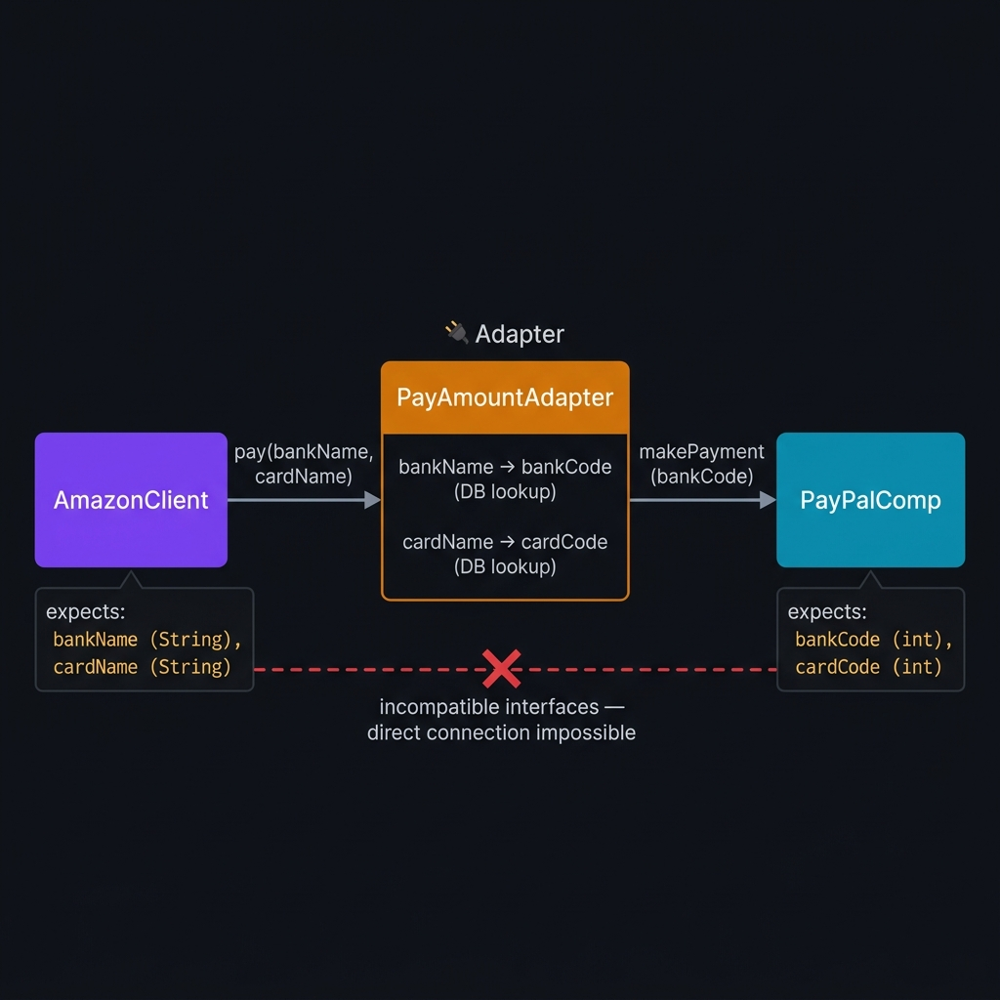
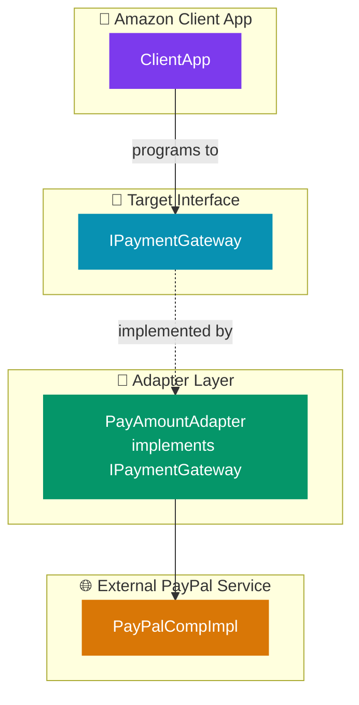
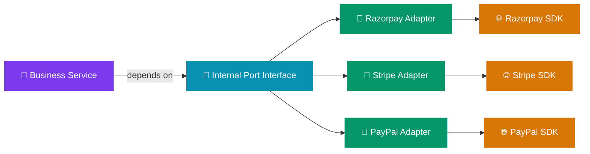

# Adapter Design Pattern in Java

**Adapter Design Pattern in Java** | The Adapter design pattern is one of the structural design patterns. We use it so that two unrelated interfaces can work together. The object that joins these unrelated interfaces is called an Adapter.

> 🔥🔥 Must-know — very frequently tested &nbsp;·&nbsp; 🔥 High priority &nbsp;·&nbsp; ⚡ Medium priority &nbsp;·&nbsp; 💤 Low priority

---

<a id="1-need-of-adapter-design-pattern"></a>
## 1. Need of Adapter Design Pattern 💤

Some projects or services sit outside all our projects, and many projects can use them. We call them external services or external projects. Examples: PayPal, GooglePay, Weather Report Components, BSE/NSE Share components, ICC score component, etc.

- Many merchant websites use PayPal and GooglePay for payments.
- Many websites use Weather Report components to show weather data.
- Many sports websites use ICC score components, like HotStar, Crickbuzz, Dream11, and others.

We also call these distributed services, external services or external projects. The reason: many local and remote applications use them. Today you reach them through a **REST/gRPC API or a vendor SDK**. (Older platforms exposed them as SOAP web services or EJB components.) The transport has changed, but the mismatch problem has not. Every vendor still models the same domain in a different way from you.

Assume GooglePay has the following method for payment:

```java
doPayment(String upiId, String bankCode, long accno, float amount) {
}
```

This method needs `bankCode`. But the client always enters "bank name" in the merchant websites. So merchant websites need an adapter to convert "bank name" to `bankCode`.

🧠 **In Simple Words:**
Homes get electricity from the wall socket at different voltages: ≈230V across Europe/UK/India/Australia, and 120V in the US. Our electronics, like a mobile phone, need ~5V DC for charging. To make them work together, we need an Adapter or Charger. It also converts AC to DC.


❌️ **Problems when the local service class holds the logic to talk to the external service directly:**

- 🔁 We cannot reuse the logic across many local service classes.
- 💥 If the external service component details change, we must change many local service classes.
- ⚙️ The local service must convert inputs into the form the external component needs, and convert its outputs too.

To solve these problems, we can use the Adapter design pattern. The Adapter converts inputs or outputs into the form the source or destination needs. It also does the needed communication.

📝 **Note:** When our local projects talk to external projects, they may not be compatible. To solve this, we build one Adapter class (Adapter design pattern). It has no relation to the [Adapter classes of Java](https://www.javatpoint.com/java-adapter-classes) — `MouseAdapter`, `KeyAdapter`, `WindowAdapter`.

⚠️ **Naming trap (classic interview question):** *"Java ships `MouseAdapter` — is that the Adapter pattern?"* **No.**

- `MouseAdapter` is an abstract class with **empty implementations of every `MouseListener` method**. So you can override only the one callback you need.
- It adapts nothing. There is no adaptee, no target interface to bridge, and no translation.
- It is a **convenience base class / Null Object** idiom. The same is true for `KeyAdapter` and `WindowAdapter`.
- The name is an old historical accident from Java 1.1. It does not refer to the pattern.

🔑 **Key Point:** The Adapter DP/Class lets two unrelated interfaces/components talk to each other. The Adapter design pattern acts as a bridge/mediator. It holds the logic to convert inputs and outputs while we talk to an external component.

**The Adapter class contains the following logic:**

1. 1️⃣ Convert the inputs from the client project into the form the external project needs.
2. 2️⃣ Get the external component reference, either directly or through a ServiceLocator.
3. 3️⃣ Call business methods on the external component reference and get the results.
4. 4️⃣ Convert the results from the external component into the form the local project needs (if needed). For example: Weather Report Components return results in Fahrenheit, but the local project shows values in Celsius. So we must convert them. Different countries may use different units.

In a real system, the external component sits behind a REST/gRPC SDK or a generated SOAP stub. To keep it simple, we will use plain Java code to stand in for it.

---

<a id="2-adapter-design-pattern-example"></a>
## 2. Adapter Design Pattern Example ⚡

To keep it easy to follow, we will use plain Java code to show the adapter design pattern. In a real system, the external component would be a REST/gRPC SDK client or a SOAP stub.

We build the external service component as an ordinary Java class. This class has no state. So we make that external component a singleton Java class.

💡 **Tip:** The external component may be a real remote client (a vendor SDK client bean, a generated SOAP port, a Spring `RestClient`/`WebClient`). Then you do not write the singleton yourself at all. The DI container gives you one shared, reusable client instance.

📝 **Note:** Always give the external (or distributed) component one interface and one implementation class. Then we can pass the interface to client projects or local projects. They use it to receive and hold external component references.

We have the PayPal component as an external service. It takes the bank code and the payment gateway card code to make an online payment.

- But the customer/client gives the bank name and a payment gateway name (like VISA, MASTER, etc.) to an E-Commerce website like Amazon.
- In this case, we can write an adapter class. It takes the `bankName` and the payment gateway name. It maps them to the bank code and the payment gateway or card code.

Let us build the PayPal component as an external service, using the Singleton design pattern.





1️⃣ **External Service Interface** (`PayPalComp.java`):

```java
package com.paypal.external;

public interface PayPalComp {
   public String approveAmount(long cardNo, int cardCode,
                               int bankCode, double amt);
}
```

2️⃣ **External Service Implementation** (`PayPalCompImpl.java`):

```java
package com.paypal.external;

public class PayPalCompImpl implements PayPalComp {

   private PayPalCompImpl() {
   }

   // static-holder idiom: thread-safe, lazy, no locking
   private static class Holder {
      private static final PayPalComp INSTANCE = new PayPalCompImpl();
   }

   // static factory method
   public static PayPalComp getInstance() {
      return Holder.INSTANCE;
   }

   @Override
   public String approveAmount(long cardNo, int cardCode,
                               int bankCode, double amt) {
      // database interactions and communication operations required
      return cardNo + " has been approved to pay "
            + amt + " from " + bankCode;
   }
}
```

The external class holds the logic for online payment. It expects a card code (or payment gateway code) and a bank code. But clients do not give bank codes and card codes. For online payment, they give bank names and a card name (or payment gateway name).

So the interface the client expects is different from the actual implementation. The client programs to its own **target interface** (`IPaymentGateway`). The adapter *implements that target* and delegates to the external `PayPalComp`. On the way, it converts names to codes.

3️⃣ **Target Interface** (`IPaymentGateway.java`) — what the client wants:

```java
package com.amazon.service;

public interface IPaymentGateway {
   public String payShoppingAmount(long cardNo, String cardName,
                                    String bankName, double amt);
}
```

4️⃣ **Adapter Class** (`PayAmountAdapter.java`) — implements the target, holds the adaptee (object adapter):

⚠️ The no-arg constructor below hardcodes `PayPalCompImpl.getInstance()`. This ties the adapter to the adaptee's *concrete* class, and you cannot mock it. We keep it here only so the demo runs with `new PayAmountAdapter()`. [§6 Q2](#6--interview-qa) shows the **constructor-injected** form. Use that one in real code (and in an interview).

```java
package com.amazon.adapter;

import com.amazon.service.IPaymentGateway;
import com.paypal.external.PayPalComp;
import com.paypal.external.PayPalCompImpl;

public class PayAmountAdapter implements IPaymentGateway {

   private final PayPalComp payPalComp;   // composition — holds the adaptee

   public PayAmountAdapter() {
      this.payPalComp = PayPalCompImpl.getInstance();
   }

   @Override
   public String payShoppingAmount(long cardNo, String cardName,
                              String bankName, double amt) {
      int cardCode;
      int bankCode;

      // get card codes from database
      if (cardName.equalsIgnoreCase("Visa"))
         cardCode = 111;
      else if (cardName.equalsIgnoreCase("Master"))
         cardCode = 222;
      else
         throw new IllegalArgumentException("Invalid card name");

      // get bank code from database
      if (bankName.equalsIgnoreCase("Bank of America"))
         bankCode = 1001;
      else if (bankName.equalsIgnoreCase("JPMorgan"))
         bankCode = 1002;
      else
         throw new IllegalArgumentException("Invalid bank name");

      // delegate to the PayPal component (adaptee)
      return payPalComp.approveAmount(cardNo, cardCode, bankCode, amt);
   }
}
```

| Component 🏷️ | Role 📋 | Package 📦 |
|--------------|---------|------------|
| **`PayPalComp`** | External service interface (adaptee interface) | `com.paypal.external` |
| **`PayPalCompImpl`** | Singleton external service implementation (adaptee) | `com.paypal.external` |
| **`IPaymentGateway`** | Target interface the client programs to | `com.amazon.service` |
| **`PayAmountAdapter`** | Adapter implementing the target, converting names to codes | `com.amazon.adapter` |
| **`ClientApp`** | Client application | `com.amazon.test` |

5️⃣ **Client Application** (`ClientApp.java`) — depends only on the target interface:

```java
package com.amazon.test;

import com.amazon.adapter.PayAmountAdapter;
import com.amazon.service.IPaymentGateway;

public class ClientApp {
   public static void main(String[] args) {
      IPaymentGateway shopping = new PayAmountAdapter();
      String cfrmMsg = shopping.payShoppingAmount(55443322,
                       "VISA", "Bank of America", 3000);
      System.out.println(cfrmMsg);
      System.out.println();

      cfrmMsg = shopping.payShoppingAmount(123456789,
                             "Master", "JPMorgan", 5000);
      System.out.println(cfrmMsg);
   }
}
```

📤 **Output:**

```
55443322 has been approved to pay 3000.0 from 1001

123456789 has been approved to pay 5000.0 from 1002
```

🔗 See Adapter Design Pattern example code at GitHub: [**AdapterDP**](https://github.com/Know-Program/Design-Pattern/tree/main/DP8-AdapterDP)

---

<a id="3-predefined-jdk-methods-representing-adapter-design-pattern"></a>
## 3. Predefined JDK Methods Representing Adapter Design Pattern 💤

- 📚 `java.util.Arrays#asList()` — array → fixed-size `List` **view** (live, no copy)
- 📚 `java.util.Collections#enumeration(Collection)` — `Collection` → `Enumeration` **view** (lazy, backed by the collection's iterator)
- 📚 `java.util.Collections#list(Enumeration)` — ⚠️ **not a view.** Its javadoc says *"Returns an **array list** containing the elements returned by the specified enumeration"*. It reads the whole enumeration at once and **copies** it. Many "GoF in the JDK" lists include it. But the correct answer is *"`enumeration()` is the adapter view; `list()` is a drain-and-copy convenience."* This is the same view-vs-copy detail as `Arrays.asList()` in [§6 Q5](#6--interview-qa). A strong interviewer checks exactly this: is each method a view or a copy?
- 🔄 `java.io.InputStreamReader(InputStream)` (returns a Reader)
- 🔄 `java.io.OutputStreamWriter(OutputStream)` (returns a Writer)
- ⚡ `java.util.Arrays#stream()` / `Spliterators` (array → `Stream` — the stream adapter you can justify in an interview). Note: `Collection#stream()` itself is a *factory* method, not an adapter.

**No longer in the JDK, but still the textbook Adapter:**

- 🏷️ `jakarta.xml.bind.annotation.adapters.XmlAdapter#marshal()` / `#unmarshal()` — adapts a wire-level XML representation to/from a Java type.
  - ⚠️ JAXB was deprecated in Java 9 and **removed from the JDK in Java 11** (JEP 320).
  - So it now comes as an **external dependency** (`jakarta.xml.bind:jakarta.xml.bind-api`). Jakarta EE 9 renamed the package `javax.xml.bind` → `jakarta.xml.bind`.
  - If you call it a "JDK adapter" in 2026, your knowledge looks old. If you point it out as *"the one that got removed from the JDK"*, your knowledge looks current.

🛠️ **Example:**

```java
BufferedReader reader =
    new BufferedReader(new InputStreamReader(System.in));
```

Here `System.in` is a byte stream and `BufferedReader` is a character stream. So `InputStreamReader` works as an adapter. It converts the byte stream to a character stream.

---

<a id="4-related-topics"></a>
## 4. Related Topics 💤

**Closest neighbours (the ones Adapter gets confused with):**

- [Decorator Design Pattern in Java](./07_Decorator_Design_Pattern_in_Java.md) — same wrapping structure, keeps the interface (Q7)
- [Proxy Design Pattern in Java](./13_Proxy_Design_Pattern_in_Java.md) — same wrapping structure, same interface, controls access (Q4)
- [Strategy Design Pattern in Java](./10_Strategy_Design_Pattern_in_Java.md) — the `Map<String, Port>` vendor-selection idiom in §7.1 is Strategy used on top of Adapter
- [Repository and Unit of Work](./17_Repository_and_Unit_of_Work_Pattern.md) — a repository is an adapter over the persistence port; same anti-corruption idea
- [Anti-Patterns in Java](./14_Anti_Patterns_in_Java.md) — the service-locator smell (a sign of bad design) named in the Real-World Note

**Entry points:**

- [LLD Interview Patterns Guide](./01_LLD_Interview_Patterns_Guide.md)
- [Design Patterns in Java](./02_Design_Patterns_in_Java.md)
- [Design Pattern Interview Questions](../1_interview_questions/15_Design_Pattern_Interview_Questions.md)

**Rest of the folder:**

- [Singleton](./03_Singleton_Design_Pattern_in_Java.md) · [Simple Factory](./04_1_Simple_Factory_Pattern_in_Java.md) · [Factory Method](./04_2_Factory_Method_Design_Pattern.md) · [Abstract Factory](./04_3_Abstract_Factory_Design_Pattern.md) · [Factory comparison](./04_Factory_vs_Factory_Method_vs_Abstract_Factory_Design_Pattern.md)
- [Template Method](./05_Template_Method_Design_Pattern.md) · [Builder](./06_Builder_Design_Pattern_in_Java.md) · [Flyweight](./09_Flyweight_Design_Pattern.md) · [Observer](./11_Observer_Design_Pattern_in_Java.md) · [Prototype](./12_Prototype_Design_Pattern_in_Java.md)
- [CQRS and Event Sourcing](./15_CQRS_and_Event_Sourcing.md) · [Concurrent Design Patterns](./16_Concurrent_Design_Patterns_in_Java.md) · [State](./18_State_Design_Pattern_in_Java.md) · [Chain of Responsibility](./19_Chain_of_Responsibility_Design_Pattern_in_Java.md)

---

<a id="5--when-not-to-use-adapter"></a>
## 5. ⚠️ When NOT to Use Adapter ⚡

| Situation | Why it's wrong | Use instead |
|---|---|---|
| You control both interfaces | Just change one to match — no adapter needed | Refactor directly |
| The mismatch is only method naming | Don't introduce a full class for a rename | Rename the method |
| Many incompatibilities between two systems | Too many adaptations = leaky abstraction (hidden details leak out) | **Facade** — wrap the whole subsystem |
| Performance is critical and adaptation has overhead | Every call pays the translation cost | Profile and consider redesigning the interface contract |
| The external API changes often | Adapter breaks every time the adaptee changes | Consider an anti-corruption layer with versioning |

---

<a id="6--interview-qa"></a>
## 6. ❓ Interview Q&A 🔥

**Q1. What problem does the Adapter pattern solve? 🔥**

It lets two incompatible interfaces work together **without changing either one**. A client expects one interface. A third-party class provides a different one. The adapter sits between them and translates the calls.

Real-world example: a power plug adapter. Your laptop (client) expects one socket shape. The wall outlet (adaptee) provides another. The adapter connects the two.

---

**Q2. Class Adapter vs Object Adapter — what's the difference? Which does Java prefer? 🔥**

| | Class Adapter | Object Adapter |
|---|---|---|
| **Mechanism** | `extends` the adaptee **and** `implements` the target | Holds a reference to the adaptee (composition) |
| **Flexibility** | Adapts only that one adaptee class (bound at compile time) | Can adapt the adaptee class *and its subclasses* |
| **Coupling** | Tightly coupled to the adaptee's concrete class | Decoupled — depends only on the adaptee type it holds |
| **Overriding adaptee behaviour** | ✅ Can `@Override` a protected/public adaptee method | ❌️ Cannot — it can only call the adaptee's public API |
| **Java support** | ✅ Possible **only when the Target is an interface** (`class Adapter extends Adaptee implements Target`) | ✅ Always works — the standard Java approach |

⚠️ **Common myth:** "A class adapter is impossible in Java because of single inheritance." That is **wrong**.

- A class adapter is fully valid whenever the **Target is an interface**. You write `extends Adaptee implements Target`.
- Single inheritance blocks it only when **both** the Target and the Adaptee are **concrete classes** (you can't extend two classes).

In practice, we **prefer the object adapter**:

- Composition lets it adapt subclasses of the adaptee.
- It avoids coupling to the adaptee's concrete class.
- The class adapter is an option only when the Target is an interface.

The object adapter class implements the target interface and holds the adaptee as a field. This is exactly the form of `PayAmountAdapter implements IPaymentGateway` in [§2](#2-adapter-design-pattern-example). It holds the `PayPalComp` adaptee and delegates to it.

```java
// object adapter — implements the target, holds the adaptee (constructor-injected)
public class PayAmountAdapter implements IPaymentGateway {
    private final PayPalComp payPal;  // composition — holds adaptee

    public PayAmountAdapter(PayPalComp payPal) {
        this.payPal = payPal;
    }

    @Override
    public String payShoppingAmount(long cardNo, String cardName,
                                    String bankName, double amt) {
        int bankCode = lookupBankCode(bankName);    // translate name → code
        int cardCode = lookupCardCode(cardName);    // translate name → code
        return payPal.approveAmount(cardNo, cardCode, bankCode, amt); // delegate to adaptee
    }
}
```

And here is the class adapter that the myth says is impossible. It compiles fine, because `Shape` is an interface:

```java
// class adapter — extends the adaptee, implements the target. No field, no delegation.
public class LegacyShapeAdapter extends LegacyShape implements Shape {

    @Override
    public double area() {                 // Shape's method name…
        return computeSurface();           // …inherited straight from LegacyShape
    }

    @Override
    protected double computeSurface() {    // ← the class adapter's one real advantage:
        return Math.max(0, super.computeSurface());   // it can OVERRIDE adaptee behaviour
    }
}
```

An object adapter can never do that last part. It sees only the adaptee's public API. So it can wrap the result, but it cannot change what the adaptee does inside. That is the *only* reason to choose a class adapter. This need is rare, so composition is still the default choice.

---

**Q3. What is the difference between Adapter and Facade? 🔥**

| | Adapter | Facade |
|---|---|---|
| **Purpose** | Make one interface compatible with another | Simplify a complex subsystem |
| **Why you wrote it** | **Compatibility** — you had no choice; the interfaces don't match | **Convenience** — you could have called the subsystem directly |
| **Pre-existing interfaces** | Both interfaces pre-exist — adapter bridges them | Facade creates a new, simpler interface |
| **Structural change** | No change to existing code | Hides complexity behind a new entry point |

⚠️ **Don't use "one adaptee vs many" as the discriminator** (the test that tells them apart).

- Most candidates give this answer, and it fails on the first follow-up question.
- A Facade can validly sit in front of a single class. An adapter can validly hold two collaborators.
- **Intent is the test that holds up.**
- The SOAP adapter in [§7.5](#7-production-use-cases) touches exactly one adaptee. It is still an Adapter, because its goal is compatibility, not simplification.

> **Interview answer:** "Adapter = translator between two existing interfaces, written because you *had* to. Facade = simplifier that creates a new, easier entry point over a subsystem you *could* have called directly."

---

**Q4. What is the difference between Adapter and Proxy? ⚡**

Both wrap another object. But they relate to the wrapped object's interface in **opposite** ways:
- **Adapter** bridges *different* interfaces. The adapter implements the *target*. The adaptee has a *different* interface.
- **Proxy** exposes the *same* interface as the object it wraps. It adds control, caching, lazy loading, or logging. It does not change the interface at all.

> **Interview answer:** "Same structure, opposite contract. If the wrapper's interface differs from the wrapped object's, it's an Adapter. If it's identical, it's a Proxy (or a Decorator, depending on whether it *controls* or *adds*)."

---

**Q5. How does Spring / JDK use Adapter? ⚡**

| Adapter | Adapts |
|---|---|
| `InputStreamReader` | `InputStream` → `Reader` (byte stream → char stream) |
| `Arrays.asList()` | Array → `List` interface |
| Spring `HandlerAdapter` | Any handler (annotated `@Controller`, `HttpRequestHandler`, functional endpoint) → unified `handle()` call for `DispatcherServlet` |
| Spring `HttpMessageConverter` | A wire format (JSON/XML/form) ⇄ a Java type — **the Adapter you touch on every single request** |
| Spring `HibernateJpaVendorAdapter` (`JpaVendorAdapter`) | A JPA provider's vendor-specific bootstrap (dialect, `EntityManagerFactory` options) → Spring's uniform port |
| Spring AOP `MethodBeforeAdviceAdapter`, `AfterReturningAdviceAdapter`, `ThrowsAdviceAdapter` | Each `Advice` type → one uniform `MethodInterceptor` the proxy can invoke — textbook Adapter, and a strong point to raise when AOP comes up |

⚠️ **Not an adapter:** People often wrongly list `JpaRepositoryFactoryBean` here. It is a `FactoryBean` that builds a **JDK dynamic proxy** over `SimpleJpaRepository`. That is **Factory + Proxy**, not Adapter. Don't use it as an example.

⚠️ **`Arrays.asList()` detail:** it returns a **fixed-size `List` view backed by the original array**. It does *not* copy.

- A `set` on the list changes the array. A change to the array also shows in the list.
- But **`add()` / `remove()` throw `UnsupportedOperationException`**, because the backing array can't grow.
- If you need a mutable, resizable list, wrap it: `new ArrayList<>(Arrays.asList(...))`.

💡 **An adapter doesn't have to be a class.** When the translation is a single pure function, a lambda or method reference *is* the adapter:

```java
// port = a functional interface; the "adapter" is one lambda, no class needed
Function<ExperianReport, CreditReport> experianAdapter =
        raw -> new CreditReport(raw.riskScore(), "EXPERIAN", raw.tradelines());
```

- Write a class when the adapter needs state (an SDK client, config, a timeout policy) or more than one method.
- Use a lambda / `vendor::call` when it is a single mapping.

Knowing *when not to write a class* is an easy point to score in a design round.

---

**Q6. Can Adapter be used to adapt multiple adaptees? 💤**

Yes, technically. But once one wrapper sits in front of several adaptees, it is no longer an Adapter. It becomes one of these:

- a **Facade** — if it only gives a simpler, unified entry point over them
- a **Mediator** — if it also coordinates the interaction *between* them

If a single adapter bridges 5 different services, you should rethink the design. Each adapter should bridge one interface pair.

⚠️ Do **not** answer "Abstract Factory" here. Abstract Factory is about creating *families of related products*. It has nothing to do with adapting multiple adaptees. An interviewer who knows GoF will correct you on it.

---

**Q7. Adapter vs Decorator — what's the difference? 🔥**

Both wrap an object, but their *intent* is opposite:

| | Adapter | Decorator |
|---|---|---|
| **Interface** | **Changes** the interface — adaptee's interface → target's interface | **Keeps** the same interface |
| **Intent** | Make two incompatible interfaces work together | Add behavior/responsibilities dynamically |
| **Result** | Same behavior, different interface | Same interface, enhanced behavior |

> **Interview answer:** "Decorator keeps the interface and adds behavior; Adapter changes the interface and adds no new behavior."

---

**Q8. Adapter vs Bridge — what's the difference? ⚡**

They have a similar structure. They differ in *when* and *why* you use them:

| | Adapter | Bridge |
|---|---|---|
| **When** | Applied **after the fact** — added later to fit two existing, incompatible interfaces | Designed **up-front** — built into the architecture before coding |
| **Intent** | Make existing code work together | Let an abstraction and its implementation vary **independently** |
| **Direction** | Reactive (fix a mismatch) | Proactive (avoid a class explosion across two dimensions) |

> **Interview answer:** "Adapter is added later to fit two existing interfaces that weren't meant to work together. Bridge is a planned, up-front split of abstraction from implementation, so each can change on its own."

---

**Q9. What is a Two-way Adapter? 💤**

A **two-way adapter** implements **both** interfaces: the target *and* the adaptee. So clients on either side can use the same object as **either** type. It is useful when each of two subsystems expects the other's interface. Then one bridge object works in both directions.

```java
// usable as EITHER type — old code sees LegacyShapeApi, new code sees Shape
public class TwoWayShapeAdapter implements Shape, LegacyShapeApi {

    private final double width;
    private final double height;

    public TwoWayShapeAdapter(double width, double height) {
        this.width = width;
        this.height = height;
    }

    @Override
    public double area() {              // Shape — the new world
        return computeSurface();
    }

    @Override
    public double computeSurface() {    // LegacyShapeApi — the old world
        return width * height;
    }
}
```

The cost is tighter coupling. The adapter now depends on **both** interfaces and must meet the contract of both. So a change on either side breaks it. It is rare in practice. You mostly see it during a migration, when old and new code must run side by side for a release or two.

---

<a id="7-production-use-cases"></a>
## 7. Production Use Cases ⚡

You see the Adapter pattern almost every time a system talks to the *outside world*. Examples: third-party SDKs, legacy services, and many vendors that can replace each other. The core idea is always the same: **your code depends on one clean internal interface, and an adapter translates each foreign interface into it.** This is also the base of an *anti-corruption layer* in DDD (a layer that stops outside models from leaking into your domain).

🔑 **Mental model:** one internal `Port` interface (what your code wants) + N `Adapter` implementations (one per vendor/SDK). To change vendors, you change the bean. You do not touch business logic.



<a id="71-payment-gateway-adapter-fintech--e-commerce"></a>
### 7.1 Payment Gateway Adapter (Fintech / E-commerce) 🔥🔥

Every gateway (Razorpay, Stripe, PayPal) has its own SDK. Each SDK has a *different* method signature and response structure. Your `OrderService` should never know which one is active. It should call one internal port.

📝 **Note:** the SDK calls below are **simplified for illustration**. What matters is where the translation happens. The exact vendor API does not matter here (it changes from release to release).

```java
// ── Internal port: what OUR domain wants ──
public interface PaymentGateway {
    PaymentResult charge(PaymentRequest request);
}

public record PaymentRequest(String orderId, BigDecimal amount,
                             String currency, String customerToken) {
}

public record PaymentResult(boolean success, String txnId, String status) {
}

// ── Adapter 1: translates OUR request → Razorpay SDK shape ──
@Component("razorpay")
public class RazorpayAdapter implements PaymentGateway {

    private final RazorpayClient razorpay;   // third-party SDK

    public RazorpayAdapter(RazorpayClient razorpay) {
        this.razorpay = razorpay;
    }

    @Override
    public PaymentResult charge(PaymentRequest request) {
        // 1️⃣ translate inputs: rupees → paise, our fields → SDK JSON
        JSONObject options = new JSONObject();
        options.put("amount", request.amount().movePointRight(2).longValueExact());
        options.put("currency", request.currency());
        options.put("receipt", request.orderId());

        try {
            // 2️⃣ call the adaptee
            Payment payment = razorpay.payments.createJsonPayment(options);

            // 3️⃣ translate the foreign response → OUR result
            return new PaymentResult(
                "captured".equals(payment.get("status")),
                payment.get("id"),
                payment.get("status"));
        } catch (RazorpayException e) {
            throw new PaymentGatewayException("Razorpay charge failed", e);
        }
    }
}

// ── Adapter 2: same internal port, totally different SDK ──
@Component("stripe")
public class StripeAdapter implements PaymentGateway {

    @Override
    public PaymentResult charge(PaymentRequest request) {
        PaymentIntentCreateParams params = PaymentIntentCreateParams.builder()
            .setAmount(request.amount().movePointRight(2).longValueExact())
            .setCurrency(request.currency().toLowerCase())
            .setCustomer(request.customerToken())
            .build();
        try {
            PaymentIntent intent = PaymentIntent.create(params);
            return new PaymentResult("succeeded".equals(intent.getStatus()),
                                     intent.getId(), intent.getStatus());
        } catch (StripeException e) {
            throw new PaymentGatewayException("Stripe charge failed", e);
        }
    }
}
```

Choosing the active gateway at runtime, based on config (this works well with the Factory pattern):

```java
@Service
public class OrderService {

    private final Map<String, PaymentGateway> gateways;   // Spring injects all beans by name
    private final String activeGateway;

    public OrderService(Map<String, PaymentGateway> gateways,
                        @Value("${payment.active-gateway}") String activeGateway) {
        this.gateways = gateways;
        this.activeGateway = activeGateway;
    }

    public PaymentResult pay(PaymentRequest request) {
        PaymentGateway gateway = gateways.get(activeGateway);
        if (gateway == null) {
            throw new IllegalStateException("Unknown gateway: " + activeGateway);
        }
        return gateway.charge(request);
    }
}
```

```yaml
# application.yml — flip the provider without redeploying business logic
payment:
  active-gateway: razorpay   # change to 'stripe' to switch vendors
```

💡 **Tip:** This is the most common Adapter example in interviews. The benefit is *isolation*. When Razorpay changes its SDK, only `RazorpayAdapter` recompiles. `OrderService` does not change.

<a id="72-credit-bureau-adapter-fintech--loan-origination"></a>
### 7.3 Notification Channel Adapter (Notification System) 🔥

A notification service must send over SMS (Twilio), Email (Amazon SES), and Push (Firebase FCM). Each vendor SDK is different. The dispatcher only knows `NotificationChannel`.

```java
public interface NotificationChannel {
    void send(NotificationMessage message);
    String channelType();
}

public record NotificationMessage(String recipient, String subject, String body) {
}

@Component
public class TwilioSmsAdapter implements NotificationChannel {

    private final TwilioRestClient twilio;
    private final String senderNumber;

    public TwilioSmsAdapter(TwilioRestClient twilio,
                            @Value("${sms.sender-number}") String senderNumber) {
        this.twilio = twilio;
        this.senderNumber = senderNumber;
    }

    @Override
    public void send(NotificationMessage message) {
        Message.creator(new PhoneNumber(message.recipient()),
                        new PhoneNumber(senderNumber),
                        message.body())          // SMS ignores subject
               .create(twilio);                  // ← pass the held adaptee, don't use create()
    }

    @Override
    public String channelType() {
        return "SMS";
    }
}

@Component
public class SesEmailAdapter implements NotificationChannel {

    private final SesClient ses;   // AWS SDK v2

    public SesEmailAdapter(SesClient ses) {
        this.ses = ses;
    }

    @Override
    public void send(NotificationMessage message) {
        SendEmailRequest request = SendEmailRequest.builder()
            .destination(d -> d.toAddresses(message.recipient()))
            .message(m -> m
                .subject(s -> s.data(message.subject()))
                .body(b -> b.text(t -> t.data(message.body()))))
            .source("no-reply@example.com")
            .build();
        ses.sendEmail(request);
    }

    @Override
    public String channelType() {
        return "EMAIL";
    }
}
```

```java
@Service
public class NotificationDispatcher {

    private final Map<String, NotificationChannel> channels;

    public NotificationDispatcher(List<NotificationChannel> channelBeans) {
        this.channels = channelBeans.stream()
            .collect(Collectors.toMap(NotificationChannel::channelType, c -> c));
    }

    public void dispatch(String channelType, NotificationMessage message) {
        NotificationChannel channel = channels.get(channelType);
        if (channel == null) {
            throw new IllegalArgumentException("Unknown channel: " + channelType);
        }
        channel.send(message);                     // uniform call, any vendor
    }
}
```

⚠️ **Two small things an interviewer will point out.**

- (a) Don't name this method `notify(...)`. It compiles, because it only *overloads* `Object.notify()`. Java bans only *overriding* a `final` method. But the name pulls the interviewer into a confusing talk about monitors. `dispatch(...)` does not have that problem.
- (b) Guard the map lookup. An unknown channel key should raise a clear error, not a bare `NullPointerException`. This is exactly like the `OrderService` guard in §7.1. A reviewer notices right away when two lookups next to each other are handled differently.

⚠️ **`.create(twilio)` vs `.create()` — the point of the whole file.** Twilio's no-arg `Creator#create()` gets the client from the **static global** `Twilio.getRestClient()`. This silently makes the injected field unused. It also makes the class depend on `Twilio.init(...)` having run somewhere at startup. The main property of an object adapter is that it **holds** its adaptee. So the adapter must really *use* the thing it holds. If not, it is only a facade over a global object. And you can't unit-test it with a mock client.

<a id="74-cloud-storage-adapter-devops--saas"></a>
### 7.4 Cloud Storage Adapter (DevOps / SaaS) ⚡

A multi-cloud SaaS must store files on AWS S3, GCS, or Azure Blob. Each deployment (for example, one per region) picks one cloud. The app uses one `BlobStore` port. Each cloud SDK gets an adapter.

```java
public interface BlobStore {
    String upload(String key, byte[] content, String contentType);
    byte[] download(String key);
}

@Component
@ConditionalOnProperty(name = "storage.provider", havingValue = "s3")
public class S3BlobStoreAdapter implements BlobStore {

    private final S3Client s3;
    private final String bucket;

    public S3BlobStoreAdapter(S3Client s3, @Value("${storage.bucket}") String bucket) {
        this.s3 = s3;
        this.bucket = bucket;
    }

    @Override
    public String upload(String key, byte[] content, String contentType) {
        s3.putObject(PutObjectRequest.builder()
                .bucket(bucket).key(key).contentType(contentType).build(),
            RequestBody.fromBytes(content));
        return "s3://" + bucket + "/" + key;
    }

    @Override
    public byte[] download(String key) {
        return s3.getObjectAsBytes(GetObjectRequest.builder()
                .bucket(bucket).key(key).build())
            .asByteArray();
    }
}
```

```yaml
# application.yml — @ConditionalOnProperty wires exactly one adapter bean
storage:
  provider: s3        # s3 | gcs | azure
  bucket: tenant-uploads
```

💡 **Tip:** When you combine Adapter with Spring's `@ConditionalOnProperty`, Spring creates only the active cloud SDK adapter. You get clean separation and zero unused beans.

<a id="75-legacy-soap-to-rest-adapter-microservices-migration"></a>
### 7.5 Legacy SOAP-to-REST Adapter (Microservices Migration) 🔥

Take a strangler-fig migration (you replace a legacy system piece by piece). New microservices use REST/JSON. But a legacy core-banking system only exposes SOAP. An adapter wraps the SOAP stub behind a modern internal interface. So new code never imports SOAP types.

```java
// Modern internal interface used by new services
public interface AccountLookup {
    AccountDetails findByNumber(String accountNumber);
}

public record AccountDetails(String accountNumber, String holderName,
                             BigDecimal balance, String status) {
}

@Component
public class LegacyCoreBankingAdapter implements AccountLookup {

    private final CoreBankingSoapPort soapPort;   // generated WSDL stub (adaptee)

    public LegacyCoreBankingAdapter(CoreBankingSoapPort soapPort) {
        this.soapPort = soapPort;
    }

    @Override
    public AccountDetails findByNumber(String accountNumber) {
        // 1️⃣ build the clunky SOAP request object
        GetAccountRequest soapReq = new GetAccountRequest();
        soapReq.setAcctNo(accountNumber);

        // 2️⃣ call legacy SOAP service
        GetAccountResponse soapResp = soapPort.getAccount(soapReq);

        // 3️⃣ translate SOAP types → clean domain record
        return new AccountDetails(
            soapResp.getAcctNo(),
            soapResp.getCustName().trim(),
            soapResp.getBalAmt(),
            "A".equals(soapResp.getStatusFlag()) ? "ACTIVE" : "INACTIVE");
    }
}
```

🔑 **Key Point:** This is a textbook **anti-corruption layer**. The ugly legacy names (`acctNo`, `statusFlag = "A"`) stay inside one adapter. They never leak into the new bounded context (the part of the domain the new services own).

<a id="76-logging-facade-as-adapter-devops--cross-cutting"></a>
### 7.6 Logging Facade as Adapter (DevOps / Cross-cutting) 🔥

SLF4J is the most widely used Adapter in the Java ecosystem. Your code logs against the SLF4J API. A binding adapter sends the calls to whichever backend is on the classpath (Logback, Log4j2, java.util.logging).

```java
// Your code depends ONLY on the SLF4J abstraction
private static final Logger log = LoggerFactory.getLogger(OrderService.class);

log.info("Order {} charged via {}", orderId, gatewayName);
// slf4j → log4j-slf4j2-impl adapter → Log4j2 backend, with zero code change
```

```xml
<!-- Swap the backend by swapping ONE adapter dependency -->
<dependency>
    <groupId>org.apache.logging.log4j</groupId>
    <artifactId>log4j-slf4j2-impl</artifactId>  <!-- the adapter binding -->
</dependency>
```

💡 **Tip:** Mention this in interviews. Saying "SLF4J is Adapter at framework scale" shows right away that you understand the pattern beyond a small textbook example. Micrometer uses the same idea: it adapts one metrics API onto Prometheus / CloudWatch / Datadog backends.

<a id="77-spring-handleradapter-framework-internals"></a>
### 7.7 Spring `HandlerAdapter` (Framework Internals) ⚡

Spring MVC's `DispatcherServlet` doesn't know *how* to call your `@Controller`, an `HttpRequestHandler`, or a plain `Servlet`. Each one has a different API. `HandlerAdapter` implementations adapt each one to a single `handle()` call.

```java
// Spring's own interface (simplified)
public interface HandlerAdapter {
    boolean supports(Object handler);
    ModelAndView handle(HttpServletRequest req, HttpServletResponse res,
                        Object handler) throws Exception;
}
```

The `DispatcherServlet` works like this:

1. It loops over its registered adapters.
2. It finds the one whose `supports(handler)` returns true.
3. It delegates the call to that adapter.

So the dispatcher stays decoupled from every concrete handler type. This is why you can mix annotated controllers and functional endpoints in the same app.

📝 **Note:** You don't *write* `HandlerAdapter` yourself. But if you name it in an interview, you show that you see the pattern inside a framework you use every day.

---

<a id="8-resilience--testing-inside-the-adapter"></a>
## 8. Resilience & Testing Inside the Adapter 🔥

§7 shows seven third-party integrations in a row. So the follow-up question is **guaranteed**: *"what happens when the vendor is slow, or down, or returns a duplicate?"* If you know only the structure of Adapter, you have no answer at this point.

<a id="81-the-adapter-is-where-the-failure-policy-lives"></a>
### 8.1 The adapter is where the failure policy lives 🔥🔥

The main goal of the port is simple: the domain never learns how the vendor fails. So **every vendor-specific failure concern belongs inside the adapter**. It does not belong in the service that calls the port:

| Concern | Why it belongs in the adapter |
|---|---|
| ⏱️ **Timeouts** | Each vendor has a different real latency. A bureau pull may take 8 s. A Redis-backed KYC cache may take 200 ms. One global timeout is wrong for both. |
| 🔁 **Retry** | Only the adapter knows *which* vendor error codes are transient (temporary). `HTTP 503` → retry. `HTTP 400 invalid PAN` → never retry. |
| ⚡ **Circuit breaker** | It trips per vendor. If bureau A is down, calls to bureau B must not stop. So the breaker belongs to one adapter, not to the port. |
| 🔑 **Idempotency key** | The vendor's dedup method (`Idempotency-Key` header, client reference number) is vendor-specific. The domain shouldn't know it exists. |
| 🔄 **Fallback / degradation** | The adapter decides whether a failure becomes an exception, an empty `Optional`, or a cached stale value. |
| 🚨 **Exception translation** | `RazorpayException` / `StripeException` / `SOAPFaultException` → **one** domain exception. If a vendor exception type gets out of the adapter, the abstraction has leaked. |

```java
@Component("razorpay")
public class RazorpayAdapter implements PaymentGateway {

    private final RazorpayClient razorpay;

    @Retry(name = "razorpay")                    // only retries what WE marked transient
    @CircuitBreaker(name = "razorpay", fallbackMethod = "chargeUnavailable")
    @Override
    public PaymentResult charge(PaymentRequest request) {
        try {
            JSONObject options = toVendorShape(request);
            options.put("order_id", razorpayOrderIdFor(request));   // vendor's dedup: an order is paid only once
            return toDomain(razorpay.payments.createJsonPayment(options));
        } catch (RazorpayException e) {
            // translate: the vendor's exception type NEVER escapes this class
            throw new PaymentGatewayException("Razorpay charge failed", e);
        }
    }

    private PaymentResult chargeUnavailable(PaymentRequest request, Throwable t) {
        return new PaymentResult(false, null, "GATEWAY_UNAVAILABLE");
    }
}
```

🔑 **Key Point:** the adapter *is* the boundary. So it is also the only right place for the boundary's failure rules. If `OrderService` has a `catch (RazorpayException e)`, you wrote the adapter and then broke its purpose.

⚠️ **Retry only what's safe.** A `@Retry` that retries every failure on a non-idempotent `charge()` can charge a customer twice. You have two options:

- The vendor supports an idempotency key. Then you can retry freely.
- If not, the retry needs your own dedup on a client reference.

This choice is a very common follow-up question.

⚠️ **Watch the aspect order.** Resilience4j's default order is `Retry ( CircuitBreaker ( ... ) )`, so `@Retry` is the outer aspect. The `CircuitBreaker` fallback runs *inside* the retry. It turns the failure into a normal return value, so `@Retry` never sees an exception to retry. If you want both, put the fallback on the outer `@Retry`, or change the aspect order in config.

<a id="82-testing--the-port-is-the-mocking-seam"></a>
### 8.2 Testing — the port *is* the mocking seam 🔥

A big reason to write the adapter: it gives you a clear point to mock (a seam). There are two different tests. Candidates often mix them up:

**1. Unit-test the domain — mock the port, never the SDK.**

```java
@ExtendWith(MockitoExtension.class)
class OrderServiceTest {

    @Mock PaymentGateway gateway;                 // OUR port — trivial to stub

    @Test
    void marksOrderFailedWhenGatewayDeclines() {
        when(gateway.charge(any()))
            .thenReturn(new PaymentResult(false, null, "declined"));

        OrderService service = new OrderService(Map.of("razorpay", gateway), "razorpay");

        assertFalse(service.pay(sampleRequest()).success());
    }
}
```

The domain test never imports a vendor type. That is the benefit. If you mock `RazorpayClient` to test `OrderService`, the adapter isn't doing its job.

**2. Contract-test the adapter itself — stub the *wire*, not the SDK.**

The adapter's whole job is translation. So its test must run real serialization. Mocking the SDK here tests nothing.

```java
@Test
void translatesCapturedResponseIntoSuccessResult() {
    // WireMock stubs the vendor's HTTP endpoint with a REAL captured payload
    stubFor(post(urlEqualTo("/v1/payments"))
        .willReturn(okJson("""
            {"id":"pay_ABC123","status":"captured","amount":10000}
            """)));

    PaymentResult result = razorpayAdapter.charge(
        new PaymentRequest("ORD-1", new BigDecimal("100.00"), "INR", "cust_1"));

    assertTrue(result.success());
    assertEquals("pay_ABC123", result.txnId());
}
```

| Test type | Tool | What it proves |
|---|---|---|
| Domain unit test | Mockito on the **port** | Business logic is vendor-agnostic |
| Adapter contract test | **WireMock** / MockWebServer with captured payloads | Translation + status mapping is correct |
| Failure-path test | WireMock `withFixedDelay` / `serverError()` | Timeout, retry, breaker and exception translation really run |
| Integration smoke | **Testcontainers** or the vendor's sandbox | The wiring and credentials work end-to-end |

💡 **Tip:** keep a folder of **real captured vendor responses** as test fixtures. Include the bad ones too: no-hit, partial data, and the vendor's HTTP 200 response that carries an error in the body. These fixtures catch a silent contract change at build time, not in production.

---

---

> **🎯 Interview footer — Adapter**  
> **Seen in:** `InputStreamReader` / `OutputStreamWriter`, `Arrays.asList()` and `Collections.enumeration()` (views — but `Collections.list()` is a copy); Spring `HandlerAdapter`, `HttpMessageConverter`, `HibernateJpaVendorAdapter`, and the AOP `AdvisorAdapter` family; SLF4J bindings as Adapter at framework scale; JAXB's `XmlAdapter` — removed from the JDK in Java 11 (JEP 320), now `jakarta.xml.bind`.  
> **This invites:** *"Adapter vs Facade?"* → Adapter gives compatibility you had no choice about; Facade gives convenience you chose. Don't say "one adaptee vs many" (§6 Q3). *"Class vs object adapter?"* → composition by default. The class adapter's *only* advantage is that it can `@Override` adaptee behaviour. It needs the Target to be an interface (§6 Q2). *"Where do the timeout, retry and circuit breaker live?"* → inside the adapter, because only it knows which vendor errors are transient (§8.1). *"Is `MouseAdapter` the Adapter pattern?"* → no, it's a convenience base class / Null Object (§1). *"How do you test this?"* → mock the **port** to unit-test the domain, WireMock the **wire** to contract-test the adapter (§8.2).
