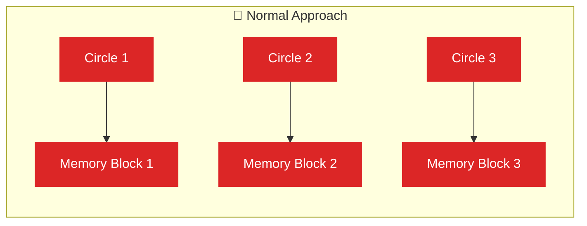
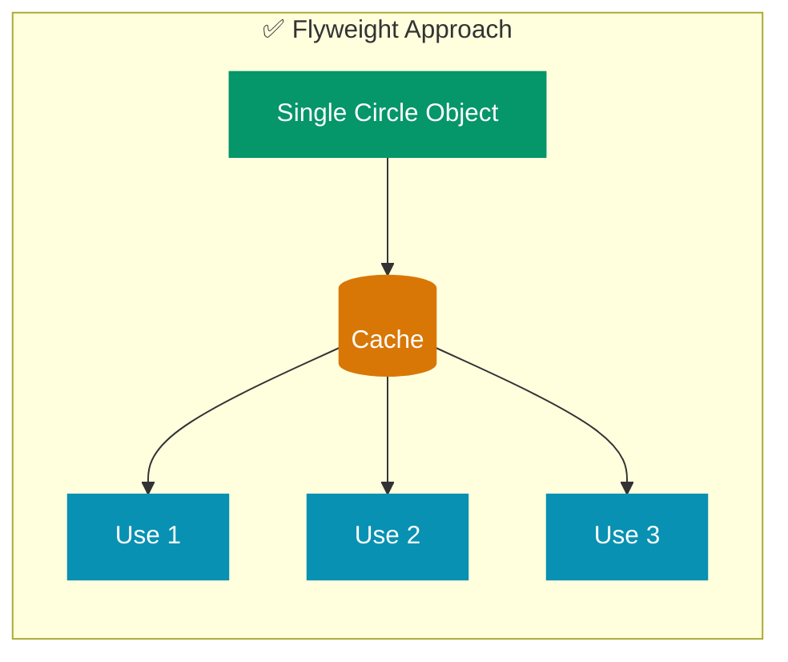
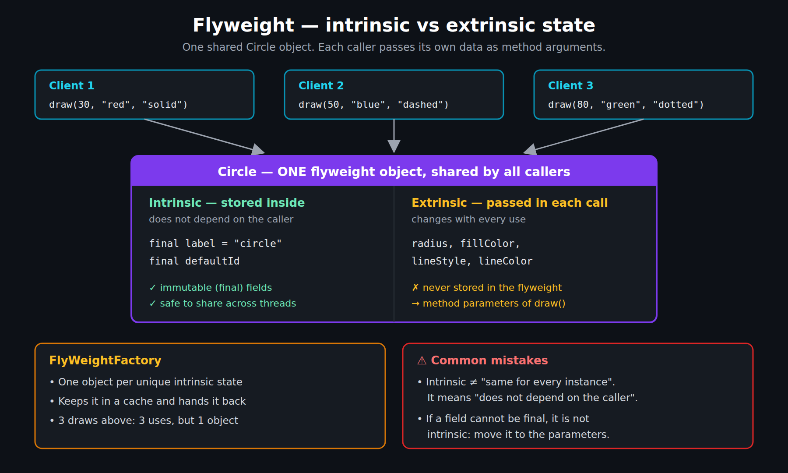
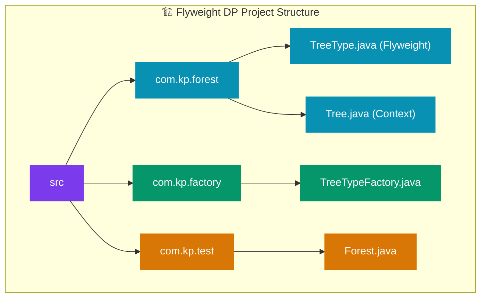
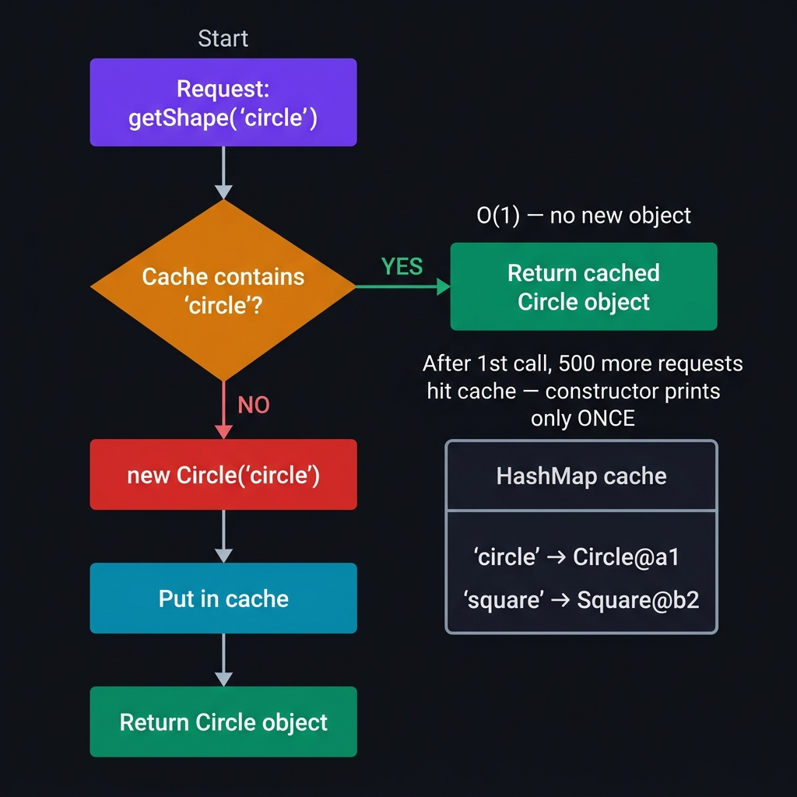

# Flyweight Design Pattern

**Flyweight Design Pattern** | A structural design pattern that saves memory. It shares objects instead of creating copies. This helps an app handle a large number of small (fine-grained) objects.

> 🔥🔥 Must-know — very frequently tested &nbsp;·&nbsp; 🔥 High priority &nbsp;·&nbsp; ⚡ Medium priority &nbsp;·&nbsp; 💤 Low priority

---

<a id="1-introduction"></a>
## 1. Introduction 💤

Flyweight means removing or reducing the weight. This pattern helps you use JVM memory (RAM) well when you create a huge number of objects. The goal: keep more objects while using less memory.

🔑 **GOF Definition:**
> **"Use sharing to support large numbers of fine-grained objects efficiently."**

The flyweight design pattern is a structural design pattern. Facade, [Adapter pattern](./08_Adapter_Design_Pattern_in_Java.md), and [Decorator pattern](./07_Decorator_Design_Pattern_in_Java.md) are structural patterns too.

- We use Flyweight when we need to create a lot of objects of one class.
- Every object uses memory. This matters a lot on low-memory devices, such as mobile devices or embedded systems.
- Flyweight reduces the load on memory by sharing objects.

🧠 **In Simple Words:**
Do not create a large number of similar objects. Create one object and reuse it to save memory. This pattern is most useful when memory is a key concern.

💡 **Real-World Example:**
A text editor shows a 100,000-character document. It does not create a separate object for each character.

- The glyph data for the letter `'A'` (font, shape, size) is **intrinsic**. It is stored once.
- The position of each `'A'` on the page is **extrinsic**. It is passed in on each render.
- One shared glyph object serves thousands of characters on the screen. This is the main memory saving that Flyweight gives.

The textbook **forest-of-trees** example uses the same idea. There are millions of trees, but only a few shared `TreeType` definitions (see §5).

📱 **Mobile Context:**
Mobiles are small devices with limited resources. A smartphone has very little memory, so we must use it carefully. Suppose we create one object for every operation. These objects will fill the phone's memory. Soon the phone runs out of memory.

Let us see an example. The phone has an app like the Paint app. A user can draw as many shapes as they want: circles, triangles, squares, and so on.

**Normal Application:**

- 🔴 3 Circles: 3 objects for Circle class
- 🟦 3 Squares: 3 objects for Square class

**Flyweight Design Pattern Application:**

- 🔴 3 Circles: 1 shared object kept in a cache. It is reused 3 times. Each time, we pass the radius as an argument to the `draw(-)` method.
- 🟦 3 Squares: 1 shared object kept in a cache. It is reused 3 times. Each time, we pass the side length as an argument to the `draw(-)` method.

> 📝 Circle and Square get one object each **only because** each has a single intrinsic value here (the `"circle"` / `"square"` label). The general rule is **one flyweight per unique combination of intrinsic values**. For example, if circles came in three fixed textures, you would cache three Circle flyweights, not one (see §5).

**① Without Flyweight — one object per shape, so one memory block per shape:**



**② With Flyweight — one cached object, reused per draw call with extrinsic args:**



> Both diagrams draw the **same three circles**. The number of *uses* does not change. Only the number of created objects drops from 3 to 1.

---

<a id="2-when-flyweight-design-pattern-should-be-used"></a>
## 2. When Flyweight Design Pattern Should be Used 💤

We should use the flyweight design pattern in the following situations:

- 🏗️ **The application needs to create a huge number of objects.**
- 🧠 **Creating the object uses a lot of memory. It can also take a lot of time.**
- ⚙️ **You can split the object's properties into intrinsic and extrinsic properties.** The client program should supply the extrinsic properties of the object.

---

<a id="3-intrinsic-vs-extrinsic-properties"></a>
## 3. Intrinsic vs Extrinsic Properties ⚡

Let us understand intrinsic and extrinsic properties.

- 🔒 **Intrinsic properties:** The **context-independent, immutable** data. It is stored *inside* the flyweight as member variables. Every client that asks for that same value shares it. This is the intrinsic (sharable) data.
- 🌐 **Extrinsic properties:** The **context-dependent** data. The user/client app passes it to the object as a Java method argument. It changes with each use and is **never stored** in the flyweight. This is the extrinsic (non-sharable) data.

⚠️ **Common mistake:** intrinsic does **not** mean "the same for every instance of the class". It means "does not depend on the calling context". So instances that have the same value can share one object. The two `TreeType` flyweights in §5 hold *different* intrinsic state, and both are fully valid flyweights.

**Circle class example:**

| Property 🏷️ | Value 📋 | Type 🔍 |
|-------------|---------|---------|
| **label** | `"circle"` (same for all) | Intrinsic |
| **defaultId** | Same for all objects | Intrinsic |
| **radius** | `30/50/80` (varies per object) | Extrinsic |
| **fillColor** | Varies per object | Extrinsic |
| **lineStyle** | Varies per object | Extrinsic |
| **lineColor** | Varies per object | Extrinsic |

- `label` is intrinsic. All objects of the Circle class can have the same label `"circle"`.
- `defaultId` is intrinsic too. It is the same for all objects.
- `radius` is extrinsic. The end-user changes the radius of each circle drawing.
- `fillColor`, `lineStyle` and `lineColor` are extrinsic too.

📝 **Note:** In flyweight, we first find the intrinsic (sharable) and extrinsic (non-sharable) properties of the class. Then, when we design the class:

- Declare intrinsic properties as **`final` (immutable) member variables**.
- Pass extrinsic data as Java method parameters.

🔒 **The must-have part is immutability, not `non-static`.**

- Every caller and every thread shares the instance. So one mutable field lets one client break the data of every other client.
- `non-static` is only a side requirement. A `static` field would be shared by *all* flyweights of the class. It would not belong to one flyweight.
- If a field can't be `final`, it isn't intrinsic. Move it out to the extrinsic parameters.

**Class design with intrinsic and extrinsic separation:**



```java
public class Circle {
    private final String label = "circle"; // intrinsic data

    public Circle() {
    }

    // method taking extrinsic data/property
    public void draw(double radius,
                     String fillColor, String lineStyle,
                     String lineColor) {
    }
}
```

After we split the properties into intrinsic and extrinsic, we need a `FlyWeightFactory` class. It does two things:

- It creates one object for each unique intrinsic state.
- It keeps these objects in a cache for reuse. So each unique intrinsic state has one object, and the app reuses it many times.

🔑 **Key Point:** **The Spring IoC container is flyweight-*like* while working with singleton scope beans.**

- It creates a single object per bean definition.
- It keeps that object in the container's internal cache.
- Every thread reuses it and passes per-request data in as method arguments.
- Stateless logic = intrinsic. Request data = extrinsic.

🔑 **Key Point:** **The Servlet container is flyweight-*like* too.** A Servlet is a single-instance, multi-threaded component. So the container creates it once and caches it. It then serves every request from that one instance.

⚠️ **Don't claim too much about these in an interview.**

- Both give *one instance per definition*, not *one instance per unique intrinsic state*.
- They do not merge a large number of fine-grained objects into a few.
- Strictly, they are closer to a **Singleton registry** than to GoF Flyweight (see §4).

Say "flyweight-like: shared stateless instance, per-call state passed as arguments". That answer stays correct when the interviewer asks a follow-up question. The answer "it is the Flyweight pattern" does not.

---

<a id="4-singleton-java-class-vs-flyweight-design-pattern"></a>
## 4. Singleton Java Class vs Flyweight Design Pattern 💤

You may ask: what is the difference between a Singleton Java class and the Flyweight design pattern? Both say to create only one object and reuse it. So how are they different?

| Feature ⚖️ | Singleton 🅰️ | Flyweight 🅱️ |
|------------|-------------|-------------|
| **Object count** | Only one object in any situation | Normal classes, can create multiple objects with different intrinsic states |
| **Cache mechanism** | Private static `INSTANCE` variable acts as cache | Objects stored in an external cache (e.g., `HashMap`) |
| **Scope** | Single class, single instance | One instance **per unique intrinsic state** — can be many per class |
| **Use case** | Class without state, read-only state, or sharable state | Many similar objects that share one instance per unique intrinsic state, from a cache |

- 🔹 **Singleton Java class** allows only one object in any situation. It does not put its object in any external cache. The private static `INSTANCE` property itself acts as the cache. Within the same JVM, this instance variable is the cache.
- 🔸 **In the Flyweight design pattern**, the classes are normal classes. If needed, we can create many objects of a class with different intrinsic states. But we usually create one object per unique intrinsic state and keep it in the internal cache for reuse.

💡 **Tip:**

- Need a class with no state, read-only state, or sharable state? Use a Singleton Java class.
- Need a huge number of similar objects, and want to reuse one shared object per unique intrinsic state from a cache? Use the Flyweight design pattern.

⚠️ **Caution:** The Spring IoC container and the Servlet container share instances for us. Without them, programmers would have to make many (or all) servlet classes and spring bean classes into singleton Java classes by hand. That would be very complex.

---

<a id="5-flyweight-design-pattern-example"></a>
## 5. Flyweight Design Pattern Example 💤

We want to draw a **forest with millions of trees**.

- Each tree has a unique position `(x, y)`.
- But its visual definition repeats across thousands of trees. The visual definition is the species name, color, and texture bitmap.

This is the standard Flyweight example. The repeating visual definition is **intrinsic** (shared). The position is **extrinsic** (per object).

❌️ **Problem:** Suppose we draw 1,000,000 trees as 1,000,000 full `Tree` objects. Each one stores its own copy of the name/color/texture bitmap. This may cause memory issues, and the system may hang.

The bitmap is the heavy field. It is the same for every tree of the same species. Copying it a million times only wastes memory.

✅ **Solution:**

- Move the repeating visual definition into a shared **`TreeType` flyweight**.
- A **`TreeTypeFactory`** caches it. The cache key is the *composite intrinsic state* `(name, color, texture)`.
- Only the per-tree position stays extrinsic. A small `Tree` context object holds it, plus a reference to the shared flyweight.

> 🧩 **Why the composite key matters:** the cache key is the intrinsic state, not the class/type name. This is what makes it a true Flyweight. You get **one flyweight per *unique combination* of intrinsic values**. So there are many flyweights, not one per class. Two `"Oak-Green-Rough"` requests return the *same* reference. An `"Oak-Red-Rough"` request gets a *different* one.

The four classes match the **GoF participant roles**:

- `TreeType` is the **Flyweight/ConcreteFlyweight**. It holds the intrinsic state.
- `TreeTypeFactory` is the **FlyweightFactory**. It gives out shared instances.
- `Tree` is the **context / UnsharedConcreteFlyweight**. It holds the extrinsic state + a flyweight reference.
- `Forest` is the **Client**.



1️⃣ **TreeType.java (Flyweight / ConcreteFlyweight — holds intrinsic state):**

```java
package com.kp.forest;

public class TreeType {
   private final String name;     // intrinsic — shared
   private final String color;    // intrinsic — shared
   private final String texture;  // intrinsic — shared (heavy bitmap)

   public TreeType(String name, String color, String texture) {
      this.name = name;
      this.color = color;
      this.texture = texture;
   }

   // extrinsic (x, y) passed in per call — never stored here
   public void draw(int x, int y) {
      System.out.println("Drawing " + name + " tree [" + color
                + ", " + texture + "] at (" + x + ", " + y + ")");
   }
}
```

2️⃣ **Tree.java (Context — holds extrinsic state + a shared flyweight reference):**

```java
package com.kp.forest;

public class Tree {
   private final int x;             // extrinsic — unique per tree
   private final int y;             // extrinsic — unique per tree
   private final TreeType type;     // shared flyweight reference

   public Tree(int x, int y, TreeType type) {
      this.x = x;
      this.y = y;
      this.type = type;
   }

   public void draw() {
      type.draw(x, y); // delegate to the shared flyweight, passing extrinsic state
   }
}
```

Client programs use the flyweight factory to get the shared flyweight.

- The factory keeps a map (cache) of objects. The client application must not access this map directly.
- When the client asks for a flyweight, the factory returns it from the `HashMap`.
- If it is not found, the factory creates a new object, puts it in the Map, and returns it.
- **The key must be built from all intrinsic properties.** Then there is one flyweight per unique intrinsic state.

3️⃣ **TreeTypeFactory.java (Flyweight Factory):**



```java
package com.kp.factory;

import java.util.HashMap;
import java.util.Map;

import com.kp.forest.TreeType;

public class TreeTypeFactory {
   // cache of flyweights, keyed by composite intrinsic state
   private static Map<String, TreeType> cacheMap = new HashMap<>();

   public static TreeType getTreeType(String name, String color, String texture) {
      String key = name + "-" + color + "-" + texture; // composite intrinsic key
      if (!cacheMap.containsKey(key)) {
         TreeType type = new TreeType(name, color, texture);
         cacheMap.put(key, type); // store new flyweight to cache
         System.out.println("Created new TreeType flyweight: " + key);
      }

      return cacheMap.get(key); // return shared flyweight from cache
   }
}
```

⚠️ **String-concat keys collide.** `name + "-" + color + "-" + texture` turns `("Oak-Green", "Rough", "X")` and `("Oak", "Green-Rough", "X")` into the **same** key. Two different intrinsic states then share one flyweight, with no error. Use a value-typed key instead:

```java
// generated equals/hashCode over all three components — no delimiter, no collision
public record TreeTypeKey(String name, String color, String texture) { }

private static final Map<TreeTypeKey, TreeType> CACHE = new ConcurrentHashMap<>();

public static TreeType getTreeType(String name, String color, String texture) {
   return CACHE.computeIfAbsent(new TreeTypeKey(name, color, texture),
         k -> new TreeType(k.name(), k.color(), k.texture()));
}
```

📝 Any key class you write yourself **must** override both `equals` and `hashCode`. Without them, a `HashMap`/`ConcurrentHashMap` key uses identity comparison. Then:

- every lookup misses,
- every call creates a fresh flyweight,
- the cache grows without limit.

Without any error, the pattern becomes a memory leak instead of a memory saving. A `record` (or `List.of(name, color, texture)`) gives you both methods for free.

4️⃣ **Forest.java (Client Program):**

```java
package com.kp.test;

import java.util.ArrayList;
import java.util.List;

import com.kp.forest.Tree;
import com.kp.forest.TreeType;
import com.kp.factory.TreeTypeFactory;

public class Forest {
   public static void main(String[] args) {
      List<Tree> forest = new ArrayList<>();

      // 1,000,000 Tree contexts, but only 2 TreeType flyweights created
      for (int i = 0; i < 1_000_000; i++) {
         TreeType type = (i % 2 == 0)
               ? TreeTypeFactory.getTreeType("Oak", "Green", "Rough")
               : TreeTypeFactory.getTreeType("Pine", "DarkGreen", "Smooth");
         forest.add(new Tree(i % 800, i % 600, type));
      }

      forest.get(0).draw();
      forest.get(1).draw();

      // Same intrinsic state ⇒ same shared flyweight reference
      System.out.println(
            TreeTypeFactory.getTreeType("Oak", "Green", "Rough")
            == TreeTypeFactory.getTreeType("Oak", "Green", "Rough")); // true
   }
}
```

**cacheMap (Map Collection):** one entry per *unique intrinsic state*. So there are many flyweights, not one per class.

| Keys (name-color-texture) 🔑 | Values (TreeType object) 📦 |
|-------------------|--------------------------|
| **Oak-Green-Rough** | TreeType flyweight reference |
| **Pine-DarkGreen-Smooth** | TreeType flyweight reference |

📝 **Note:** Many threads can safely use the shared *object* at the same time. It holds only sharable/immutable intrinsic data. The extrinsic data comes in as method arguments on each call and is never stored.

> ⚠️ **But the factory cache above is not thread-safe.**
>
> - `cacheMap` is a plain `HashMap`.
> - `containsKey(...)` → `put(...)` is a non-atomic check-then-act. If many threads ask for a key for the first time together, it can create duplicate objects or corrupt the map.
>
> In production, use `ConcurrentHashMap` with `computeIfAbsent`, as the §9 examples do. It makes the check-then-create atomic per key.
>
> Note that `getTreeType` and `cacheMap` are `static` here. So the mapping function must work from a static context: `k -> new TreeType(...)` or a `static` method reference, **not** `this::create`.

---

<a id="6-pre-defined-methods-behaving-like-flyweight-design-pattern"></a>
## 6. Pre-defined Methods Behaving Like Flyweight Design Pattern ⚡

- 🏷️ `java.lang.Integer#valueOf(int)` (also on `Boolean`, `Byte`, `Character`, `Short` and `Long`)

> 📝 `Float` and `Double` do **not** cache via `valueOf()`. `BigDecimal.valueOf(long)` **does**. For values `0..10`, it returns a shared instance from its `ZERO_THROUGH_TEN` array. But `BigDecimal.valueOf(double)` does not.

**Example:**

```java
Integer i1 = Integer.valueOf(10);
Integer i2 = Integer.valueOf(10);
Integer i3 = Integer.valueOf(10);
```

💡 **Tip:** Here Java creates only one `Integer` wrapper object with value `10`. It reuses that object each time.

⚠️ **Range limit:** the `Integer` cache only covers **−128 to 127**. Above that, `valueOf` returns new objects. So `Integer.valueOf(1000) != Integer.valueOf(1000)`. The flyweight benefit applies only inside the cached range.

**Cache ranges per wrapper type. Interviewers ask for the exact numbers:**

| Wrapper | Cached range | Tunable? |
|---|---|---|
| `Integer` | `−128 .. 127` | ✅ **upper** bound only, see below |
| `Short`, `Long` | `−128 .. 127` | ❌️ fixed |
| `Character` | `0 .. 127` — **no negative half**, because `char` is unsigned | ❌️ fixed |
| `Byte` | its **entire** range (`−128 .. 127` *is* every `byte`) — so `Byte.valueOf` **always** returns a shared instance | ❌️ n/a |
| `Boolean` | exactly two instances (`Boolean.TRUE` / `Boolean.FALSE`) | ❌️ n/a |

⚙️ **Configurable upper bound (`Integer` only):** you can raise the high end of the `Integer` cache with `-XX:AutoBoxCacheMax=<n>` or `-Djava.lang.Integer.IntegerCache.high=<n>` (e.g. to cache `-128..1000`). The lower bound (−128) is fixed. You cannot tune the cache of any other wrapper.

<a id="61-the-127-vs-128-autoboxing-puzzler"></a>
### 6.1 The `127` vs `128` autoboxing puzzler 🔥

Interviewers usually ask this topic in this form. And it *is* Flyweight. `Integer.valueOf()` is a flyweight factory over `IntegerCache`, and autoboxing calls it for you.

```java
Integer a = 127, b = 127;
System.out.println(a == b);      // true  — autoboxing routes through
                                 // Integer.valueOf(127) → same cached flyweight

Integer c = 128, d = 128;
System.out.println(c == d);      // false — 128 is outside the cache,
                                 // so two distinct objects on the heap

System.out.println(c.equals(d)); // true  — which is why you compare with .equals()
```

⚠️ **The follow-up trap: mixing `Integer` and `int` unboxes.** If either side of `==` is a primitive `int`, Java **unboxes** the boxed side. The comparison becomes a number comparison, so the cache does not matter:

```java
Integer c = 128;
int e = 128;
System.out.println(c == e);      // true — c is unboxed to int, 128 == 128
```

📝 So `Integer == Integer` is a *reference* comparison (it depends on the cache). `Integer == int` is always a *value* comparison. Never rely on either. Use `.equals()` or `intValue()`.

🚫 **`new Integer(5)` skips the cache completely.** It forces a new object every time. This is exactly why the wrapper constructors are **deprecated since Java 9** and marked **for removal since Java 16**. Always use `valueOf(...)`, or just let autoboxing do it.

---

<a id="7-when-not-to-use-flyweight"></a>
## 7. ⚠️ When NOT to Use Flyweight ⚡

| Situation | Why it's wrong | Use instead |
|---|---|---|
| Objects don't share enough intrinsic state | The cache adds complexity with no memory benefit | Plain object creation |
| Total object count is small (< a few hundred) | Optimizing too early. The extra cost is not worth it | Plain objects |
| Extrinsic state is expensive to compute and pass repeatedly | Passing large extrinsic state on every call may cancel out the savings | Reconsider design |
| Objects are mutable | Shared intrinsic state + mutation = race conditions | Immutable objects only |
| The factory/cache lookup has contention in multi-threaded code | Cache becomes a bottleneck | Scope flyweights per-thread or use lock-free structures |
| The cache key is **user-derived / unbounded** | The "cache" never evicts, so it grows forever. It is a memory leak, not a memory saving | Bounded cache (Caffeine `maximumSize`) or don't cache at all |

<a id="71-an-unbounded-flyweight-cache-is-a-memory-leak"></a>
### 7.1 An unbounded flyweight cache is a memory leak ⚡

Every factory we wrote by hand in this file (§5, §9.1, §9.3, §9.4, §9.5) is a `static`/singleton `Map` that **never evicts**.

- That is fine when the set of keys is *closed and tiny*. Examples: ~20 ISO currency codes, 2 loan products, ~30 notification templates.
- It causes a production incident as soon as the key is **open-ended**. Examples: a key built per user, per order, or per request.
- Then every distinct value keeps a flyweight in old-gen forever. In the end, you get an `OutOfMemoryError`.

The simple rule: **flyweight caches are for closed sets. Open sets need a bounded cache.**

```java
// Closed set (~20 currencies) — an unbounded ConcurrentHashMap is correct
private static final Map<String, Currency> POOL = new ConcurrentHashMap<>();

// Open set — must be bounded and evicting; this is a cache, not a flyweight pool
private final Cache<String, RenderedDocument> docs = Caffeine.newBuilder()
        .maximumSize(10_000)
        .expireAfterWrite(Duration.ofMinutes(30))
        .build();
```

⚠️ **The `static` map has a second problem inside a container:**

- The class holds the `static` field.
- The class's `ClassLoader` holds the class.
- In an app server (or on hot redeploy), this keeps the *entire* old application classloader alive. Every class it loaded stays alive too.

This is the classic **classloader leak**. Use a Spring-managed singleton bean instead of a `static` map. Then the container decides when the bean's life ends.

📝 Textbooks usually suggest `WeakHashMap`, but it is rarely the right tool here:

- It holds keys weakly. So an entry is removed only when the *key* is unreachable.
- That does not help when the key is an interned `String` literal.
- It is not thread-safe.

Caffeine's `maximumSize` / `weakValues()` is the practical answer.

<a id="72-measure-before-you-reach-for-it"></a>
### 7.2 Measure before you reach for it ⚡

The honest senior answer to "would you use Flyweight here?" is usually **"not until I've measured."**

- Flyweight saves memory. But it adds an extra level of indirection (one more reference to follow), a cache, and a strict immutability rule. Each of these takes effort to maintain.
- Take a heap histogram (`jcmd <pid> GC.class_histogram`, or a heap dump in Eclipse MAT / VisualVM).
- Confirm that a *duplicated* object type is the biggest part of the retained size. Only then change the design for it.

"Object count is my bottleneck, here's the histogram" is a much stronger interview answer than "Flyweight saves memory."

---

<a id="8-interview-qa"></a>
## 8. ❓ Interview Q&A ⚡

**Q1. What problem does Flyweight solve? 🔥**

It solves high memory use when you need **a large number of similar objects**. Flyweight shares a **single object** for all instances that have the same intrinsic state. It does not create a new object each time.

Example: a text editor shows the letter `'A'` 10,000 times.

- Without Flyweight: 10,000 glyph objects. Each one carries its own copy of the font, shape and size.
- With Flyweight: **one shared glyph object** for `'A'` (font/shape/size = intrinsic). It is drawn 10,000 times. The position `(x, y)` is passed in on each call (extrinsic).

This is the same example as §1.

---

**Q2. What is intrinsic vs extrinsic state? 🔥**

| | Intrinsic State | Extrinsic State |
|---|---|---|
| **Definition** | State that is the same for all uses. Stored in the flyweight | State that changes with each use. Passed as a method parameter |
| **Stored?** | ✅ Inside the flyweight object | ❌️ Not stored — passed by the caller |
| **Example (Circle)** | `label = "circle"` | `radius`, `color`, `x`, `y` |
| **Example (Character)** | Character value `'A'`, font, size | Position on screen `(x, y)` |

```java
class Circle {
    private final String label = "circle";  // intrinsic — stored, shared

    public void draw(int radius, String color, int x, int y) {
        // extrinsic — passed per call, not stored
    }
}
```

---

**Q3. How does Java use Flyweight internally? 🔥**

| Java Feature | Flyweight Behaviour |
|---|---|
| **String Pool** | String literals are interned. `"hello" == "hello"` is `true` because they share one object from the pool |
| **`Integer.valueOf()`** | Caches `Integer` objects for values `-128` to `127`. Repeated calls return the same object |
| **`Boolean.TRUE` / `Boolean.FALSE`** | Only two instances exist. `Boolean.valueOf(true)` always returns the same object |
| **`Character` cache** | `Character.valueOf()` caches `0` to `127`. No negative half, because `char` is unsigned (§6) |

> ⚠️ **String `==` trap:** only *literals* are pooled.
>
> - `new String("hello")` forces a **new, non-pooled** object on the heap. So `new String("hello") == "hello"` is `false`.
> - Call `.intern()` to get the pooled reference back: `new String("hello").intern() == "hello"` is `true`.
> - This is why you compare strings with `.equals()`, never `==`.

> 📍 **"Where does the string pool actually live?"** Interviewers always ask this follow-up.
>
> - Up to **Java 6**, the pool was in **PermGen**. PermGen had a fixed size. So heavy `intern()` use failed with `OutOfMemoryError: PermGen space`.
> - From **Java 7**, the pool moved into the **heap**. (Java 8 replaced PermGen itself with Metaspace.)
> - So interned strings are now normal heap objects. They are **GC-eligible** (the GC can collect them) once nothing references them. Their limit is the heap size, not a small fixed region.
> - The pool is a native hash table. `-XX:StringTableSize` sets its bucket count. The default was `60013` in Java 7u40–10. Since Java 11 it is `65536`, and the table can grow on its own. If it is too small, each intern call must search through long buckets.
> - `intern()` is a native call and is *not* free. So calling it in a hot loop to "save memory" usually costs more than it saves.

---

**Q4. What is the difference between Flyweight and Singleton? ⚡**

| | Flyweight | Singleton |
|---|---|---|
| **Number of instances** | One *per unique intrinsic state* — can be many | Exactly one per JVM |
| **Purpose** | Memory optimization for many similar objects | Single shared access point |
| **Factory** | Flyweight factory manages a cache of instances | No factory — one fixed instance |

> **Interview answer:** "Singleton makes sure there is exactly one instance in total. Flyweight has one instance *per unique intrinsic state*. It's a pool of shared objects, not a single object."

---

**Q5. What is the difference between Flyweight and Object Pool? ⚡**

| | Flyweight | Object Pool |
|---|---|---|
| **Object state** | Immutable (intrinsic state fixed) | Mutable. The object is borrowed, used, and returned |
| **Concurrency** | Safe to share concurrently (immutable) | Must track checkout/checkin |
| **Use case** | Read-only shared objects | Expensive-to-create reusable objects (DB connections, threads) |

---

**Q6. When would you NOT use Flyweight? ⚡**

When the objects are mutable. Shared mutable state will cause a data race at some point. Flyweight only works safely with **immutable intrinsic state**. If your shared objects need to change, you have two options:

- use an Object Pool, or
- redesign, and move the mutable state out into extrinsic parameters.

---

<a id="9-production-use-cases"></a>
## 9. Production Use Cases 💤

In real backends, Flyweight rarely looks like a textbook `ShapeFactory`. You see it when a service has:

- **a small set of immutable reference objects** (currencies, status codes, templates, tenant configs), and
- these objects are **shared across millions of mutable, per-request objects** (orders, payments, loans, notifications).

The intrinsic state (the shared part) lives once in a cache. The extrinsic state (amount, recipient, applicant) is passed in on each call. Below are real-world examples from fintech, e-commerce, SaaS, notifications, microservices, and DevOps.

> 💡 **Mental model:** Do you write `new SomethingThatIsAlwaysTheSame(...)` inside a hot loop or on every request? Then that "something" can be a Flyweight. Intern it once (keep one shared copy) and share the reference.

<a id="91-shared-currency-instances-in-a-payment-ledger"></a>
### 9.1 Shared Currency Instances in a Payment Ledger 🔥

In a fintech ledger, every `Payment`, `Refund`, and `LedgerEntry` has a currency. There are only ~20 supported currencies but millions of transactions. So a new `Currency` object per row wastes memory. The currency (code, symbol, minor-unit scale) is **intrinsic and immutable**. The amount is **extrinsic**.

```java
package com.los.payments.money;

import java.math.BigDecimal;
import java.math.RoundingMode;
import java.util.Map;
import java.util.concurrent.ConcurrentHashMap;

/**
 * Flyweight: one immutable Currency instance per ISO code, shared across
 * all Payment/Ledger objects. Intrinsic = code/symbol/scale (shared).
 */
public final class Currency {

    private static final Map<String, Currency> POOL = new ConcurrentHashMap<>();

    private final String isoCode;   // intrinsic
    private final String symbol;    // intrinsic
    private final int minorUnits;   // intrinsic (e.g. 2 for USD/INR)

    private Currency(String isoCode, String symbol, int minorUnits) {
        this.isoCode = isoCode;
        this.symbol = symbol;
        this.minorUnits = minorUnits;
    }

    /** Flyweight factory — returns the shared instance, creating it once. */
    public static Currency of(String isoCode) {
        return POOL.computeIfAbsent(isoCode, Currency::resolve);
    }

    private static Currency resolve(String code) {
        return switch (code) {
            case "INR" -> new Currency("INR", "₹", 2);
            case "USD" -> new Currency("USD", "$", 2);
            case "JPY" -> new Currency("JPY", "¥", 0);
            default    -> throw new IllegalArgumentException("Unsupported currency: " + code);
        };
    }

    public String getIsoCode() {
        return isoCode;
    }

    public long toMinorUnits(BigDecimal amount) {     // extrinsic amount passed in
        return amount.movePointRight(minorUnits)
                     .setScale(0, RoundingMode.HALF_EVEN)
                     .longValueExact();
    }
}
```

```java
// Millions of Payment objects share ~3 Currency flyweights
Payment p1 = new Payment("ORD-1001", Currency.of("INR"), new BigDecimal("4999.00"));
Payment p2 = new Payment("ORD-1002", Currency.of("INR"), new BigDecimal("12000.00"));

assert Currency.of("INR") == Currency.of("INR"); // ✅ same shared reference
```

> 💰 **Money is never `double`.** Binary floating-point can't store decimal amounts exactly (`0.1 + 0.2 != 0.3`). So in a fintech ledger, always store money as `BigDecimal` or as a `long` count of minor units (paise/cents). Never use `double`. This is why the extrinsic amount above is passed as `BigDecimal`.

> ⚠️ The pooled object **must** be immutable. Suppose `Currency` had a mutable `exchangeRate` field. Then two unrelated payments that share the instance would corrupt each other. Keep fast-changing data like rates extrinsic, or in a separate lookup.

<a id="92-shared-product-catalog-metadata-in-e-commerce-orders"></a>
### 9.2 Shared Product Catalog Metadata in E-commerce Orders 🔥

An order with 50 line items should not hold 50 deep copies of `Brand`, `Category`, or `TaxClass`. These are intrinsic and change rarely. Every `OrderLine` shares them by reference. A Spring-managed cache works as the flyweight factory.

```java
package com.shop.catalog;

import org.springframework.cache.annotation.Cacheable;
import org.springframework.stereotype.Service;

@Service
public class CatalogMetadataService {

    private final BrandRepository brandRepository;

    public CatalogMetadataService(BrandRepository brandRepository) {
        this.brandRepository = brandRepository;
    }

    /**
     * @Cacheable makes Spring the flyweight factory: the first call loads and
     * caches the immutable Brand; every OrderLine shares that single instance.
     */
    @Cacheable(value = "brands", key = "#brandId")
    public Brand getBrand(Long brandId) {
        return brandRepository.findById(brandId)
                .orElseThrow(() -> new IllegalArgumentException("Unknown brand: " + brandId));
    }
}
```

```yaml
spring:
  cache:
    type: caffeine
    cache-names: brands,categories,tax-classes
    caffeine:
      spec: maximumSize=5000,expireAfterWrite=6h
```

> 💡 In Spring backends, `@Cacheable` is the most common "hidden Flyweight". The cache holds one shared immutable lookup instance. All requests reuse it. The order quantity/price (extrinsic) stays on the `OrderLine`.

<a id="93-notification-template-flyweights"></a>
### 9.3 Notification Template Flyweights ⚡

A notification service may send 1M SMS/emails an hour, but it has only ~30 templates. The compiled template (body, locale, channel) is intrinsic and shared. The recipient and merge variables are extrinsic. The caller passes them in on each send.

```java
package com.notify.template;

import java.util.Map;
import java.util.concurrent.ConcurrentHashMap;

public final class NotificationTemplate {

    private static final Map<String, NotificationTemplate> CACHE = new ConcurrentHashMap<>();

    private final String templateId;   // intrinsic
    private final String compiledBody;  // intrinsic — pre-parsed once
    private final Channel channel;      // intrinsic

    private NotificationTemplate(String id, String body, Channel channel) {
        this.templateId = id;
        this.compiledBody = body;
        this.channel = channel;
    }

    public static NotificationTemplate forId(String id) {
        return CACHE.computeIfAbsent(id, NotificationTemplate::load);
    }

    private static NotificationTemplate load(String id) {
        // load + compile template once (expensive parse); the channel is part
        // of the stored definition, so it varies per template id
        TemplateDefinition def = TemplateLoader.load(id);
        return new NotificationTemplate(id, TemplateEngine.compile(def.body()), def.channel());
    }

    /** Extrinsic state (recipient + vars) supplied per call — nothing stored. */
    public SendRequest render(String recipient, Map<String, String> vars) {
        return new SendRequest(channel, recipient, TemplateEngine.merge(compiledBody, vars));
    }
}
```

```java
NotificationTemplate otp = NotificationTemplate.forId("LOAN_OTP_V2");
SendRequest r1 = otp.render("+1-555-0100", Map.of("otp", "482913"));   // call 1
SendRequest r2 = otp.render("+1-555-0142", Map.of("otp", "771204"));   // call 2 — same flyweight
```

> 📝 Note what the flyweight does **not** keep. The recipient and the merge vars exist only during the call. They leave the method inside the returned `SendRequest`. Suppose you store the last recipient on the template "for logging". Then the shared instance becomes mutable, and two concurrent sends can mix up each other's data.

<a id="94-shared-immutable-tenant-config-in-multi-tenant-saas"></a>
### 9.4 Shared Immutable Tenant Config in Multi-Tenant SaaS ⚡

In a multi-tenant SaaS, each request looks up a `TenantConfig` (feature flags, limits, branding). Loading it again on every request puts heavy load on the DB. So each tenant gets one immutable config object. All concurrent requests of that tenant share it by reference.

```java
package com.saas.tenant;

import org.springframework.stereotype.Component;
import java.util.Map;
import java.util.concurrent.ConcurrentHashMap;

@Component
public class TenantConfigRegistry {

    private final Map<String, TenantConfig> registry = new ConcurrentHashMap<>();
    private final TenantConfigLoader loader;

    public TenantConfigRegistry(TenantConfigLoader loader) {
        this.loader = loader;
    }

    /** Flyweight factory keyed by tenantId; immutable config shared per tenant. */
    public TenantConfig get(String tenantId) {
        return registry.computeIfAbsent(tenantId, loader::load);
    }

    /** On config change, evict so the next get() rebuilds a new immutable instance. */
    public void evict(String tenantId) {
        registry.remove(tenantId);
    }
}
```

> ⚠️ Flyweights + live config = a cache-invalidation problem. The shared instance is immutable, so you don't mutate it. Instead, you **evict and replace** the reference (copy-on-write). This keeps readers lock-free.

### 9.6 Status Codes and Enums as Flyweights in Microservices 🔥🔥

Across microservices, code uses status/reason codes (`PaymentStatus`, `KycStatus`, country codes) everywhere. Java `enum` is the standard built-in Flyweight. It has exactly one immutable instance per constant, shared JVM-wide. Use enums instead of loading status strings into new objects each time.

```java
package com.los.payments.status;

/** Each enum constant is a single shared immutable flyweight instance. */
public enum PaymentStatus {

    INITIATED("PG-01", false),
    AUTHORIZED("PG-02", false),
    CAPTURED("PG-03", true),
    FAILED("PG-09", true);

    private final String gatewayCode;  // intrinsic, shared
    private final boolean terminal;    // intrinsic, shared

    PaymentStatus(String gatewayCode, boolean terminal) {
        this.gatewayCode = gatewayCode;
        this.terminal = terminal;
    }

    public boolean isTerminal() {
        return terminal;
    }
}
```

```java
// All payments referencing CAPTURED share the exact same enum instance
boolean done = payment.getStatus() == PaymentStatus.CAPTURED; // ✅ identity-safe
```

> 💡 When you pick an enum, you pick Flyweight without naming it. Use it for any closed set of immutable, shared reference values. It is far safer than a hand-written `ConcurrentHashMap` cache.

<a id="97-shared-log-levels-and-markers-in-devops-tooling"></a>
### 9.7 Shared Log Levels and Markers in DevOps Tooling ⚡

Logging frameworks (Log4j2, SLF4J) use Flyweight a lot. They intern and share `Level.INFO`, `Marker`, and `Logger` instances. The reason: a service logs millions of lines, but it has a fixed set of levels/markers. Reusing markers avoids a new allocation per log call in the hot path.

```java
package com.los.observability;

import java.math.BigDecimal;

import org.slf4j.Logger;
import org.slf4j.LoggerFactory;
import org.slf4j.Marker;
import org.slf4j.MarkerFactory;

public class AuditLogger {

    private static final Logger log = LoggerFactory.getLogger(AuditLogger.class);

    // MarkerFactory interns markers — one shared flyweight instance per name
    private static final Marker AUDIT = MarkerFactory.getMarker("AUDIT");

    public void recordDisbursal(String loanId, BigDecimal amount) {
        // AUDIT marker (intrinsic, shared) + per-event data (extrinsic)
        log.info(AUDIT, "Loan {} disbursed amount {}", loanId, amount);
    }
}
```

> 💡 `MarkerFactory.getMarker("AUDIT")` returns the **same** instance on every call. It is a textbook flyweight factory built into SLF4J. Don't create markers with `new` in each log statement.

---

---

> **🎯 Interview footer — Flyweight**  
> **Seen in:** the autobox caches — `Integer`/`Short`/`Long` at −128…127, `Character.valueOf()` at 0…127 (`char` is unsigned), `Byte` over its whole range, `Boolean.TRUE`/`FALSE` (§6); the `127 == 127` / `128 != 128` puzzler (§6.1); the String literal pool and `String.intern()` (heap since Java 7, §8 Q3); every Java `enum` (one shared immutable instance per constant, §9.6); `SLF4J MarkerFactory.getMarker(...)` and Log4j2 `Level`; Spring's singleton-scope beans and the `@Cacheable`/Caffeine in-heap reference-data caches that act as the flyweight factory (§9.2, §9.4). A Redis cache does not share instances: each hit deserializes a new copy.  
> **This invites:** *"Flyweight vs Singleton?"* → one instance *per unique intrinsic state* (can be many) vs exactly one per JVM (§4, §8 Q4). *"Flyweight vs Object Pool?"* → immutable and shared concurrently vs mutable and checked-out/returned — HikariCP and thread pools are Pools, not Flyweights (§8 Q5). *"Is the shared object thread-safe?"* → only because extrinsic state is passed per call and intrinsic state is immutable; the *factory cache* still needs `ConcurrentHashMap.computeIfAbsent` (§5 warning). *"Why is `new String("x") == "x"` false?"* → only literals are pooled (§8 Q3). *"When would you not use it?"* → too few objects, or mutable state (§7). *"Isn't that cache a memory leak?"* → only if the key set is open-ended. A closed set (currencies, loan products, templates) is safe in an unbounded cache. Anything open-ended, like a per-user or per-request key, needs a bounded/evicting cache. A `static` map in a container can also cause a classloader leak (§7.1). *"Would you actually reach for this?"* → not before a heap histogram shows that duplicated objects are the biggest part of the retained size (§7.2).
