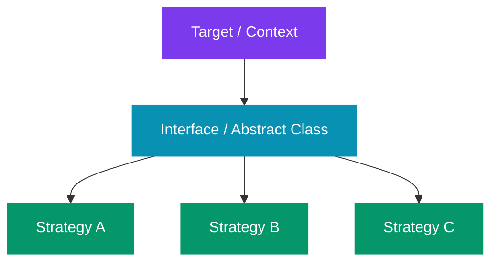
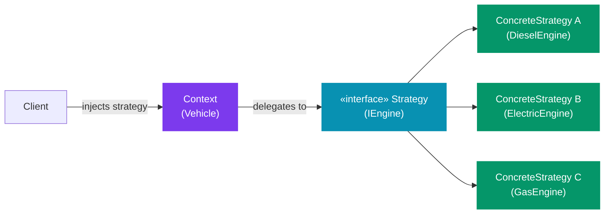
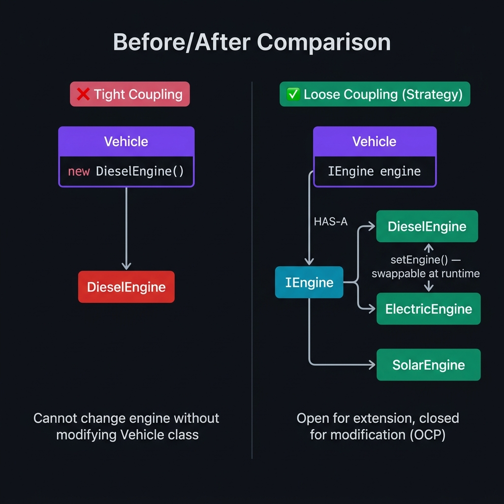
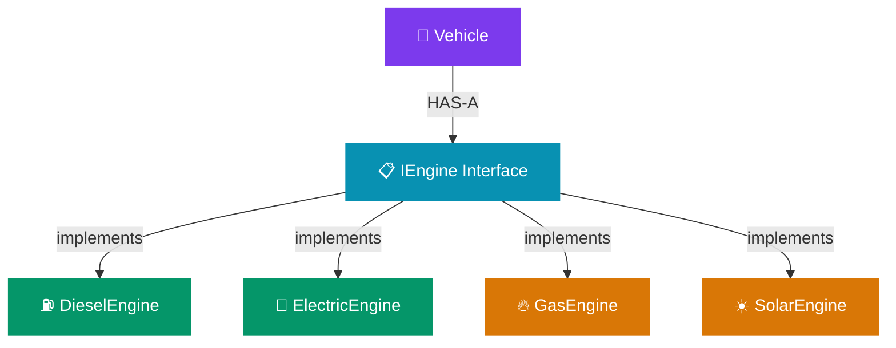
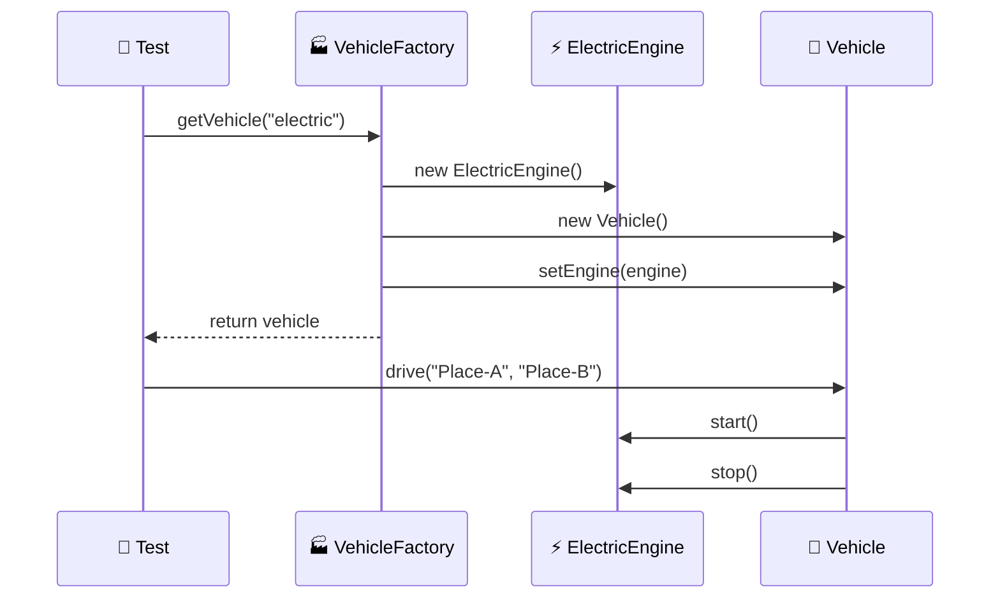

# Strategy Design Pattern in Java

**Strategy Design Pattern in Java** | Use the Strategy design pattern to build apps that are flexible, easy to extend and easy to maintain. The app becomes a set of loosely coupled parts that you can swap.

> 🔥🔥 Must-know — very frequently tested &nbsp;·&nbsp; 🔥 High priority &nbsp;·&nbsp; ⚡ Medium priority &nbsp;·&nbsp; 💤 Low priority

---

<a id="1-introduction"></a>
## 1. Introduction ⚡

**Strategy** lets you define a family of algorithms. You put each one behind a common interface. Then you can swap them at runtime. The class that uses them does not change.

- The class that uses the algorithm = **Context** (target class)
- The interchangeable algorithm = **Strategy** (dependent class)



| Context (Target) 🎯 | Strategies (Dependents) 🔗 |
|---|---|
| `Vehicle` | `DieselEngine` / `ElectricEngine` / `GasEngine` |
| `PriceEngine` | `ExternalPricingStrategy` / `SystemComputedPricingStrategy` |
| `Collections.sort()` | any `Comparator<T>` you hand it |
| `AuthService` | `JwtStrategy` / `OAuthStrategy` / `ApiKeyStrategy` |

> ⚠️ **Not every "swap the implementation" is Strategy.** Say you choose HikariCP vs Tomcat CP behind the `DataSource` interface. That is a one-time wiring decision:  
> - No algorithm family changes *per call*.  
> - No caller picks between them per request.  
>
> That is plain DI/polymorphism. Strategy needs an **algorithm family selected per invocation**. If the app makes the choice once at startup and never changes it, don't call it the pattern.

---

<a id="2-gof-structure--context--strategy--concretestrategy"></a>
## 2. GoF Structure — Context / Strategy / ConcreteStrategy 🔥

> 💡 **Start with this in interviews.** It shows you know the formal pattern, not just the idea.

The Strategy pattern has 3 participants:

| Participant | Role | Vehicle Example |
|---|---|---|
| **Context** | Holds a reference to a `Strategy`; delegates the algorithm call to it | `Vehicle` |
| **Strategy** | Interface declaring the algorithm contract | `IEngine` |
| **ConcreteStrategy** | Implements the algorithm — one class per variant | `DieselEngine`, `ElectricEngine` |



**How it works at runtime:**
1. The client creates a `ConcreteStrategy` object and injects it into the `Context`.
2. `Context` calls the strategy method (e.g. `engine.start()`). It does not know which concrete implementation it holds, and it does not need to know.
3. To swap algorithms, inject a different `ConcreteStrategy`. The `Context` code never changes.

> 💬 **One-line interview definition:** *"Strategy defines a family of algorithms, encapsulates each one, and makes them interchangeable. So the algorithm can change independently of the clients that use it."*

---

<a id="3-strategy-design-pattern-rules"></a>
## 3. Strategy Design Pattern Rules 💤

You build the target and dependent classes of the strategy design pattern by following a few rules/principles.

🔑 **These are the 3 Principles of Strategy Design Pattern:**

> ⚠️ **Don't start an interview answer with these three.** They are the *supporting tools*. Half of the GoF patterns are built on these same SOLID/DI principles. If you answer "what is Strategy?" with them, your answer sounds like plain dependency injection with more code. The pattern itself is narrower: **a family of interchangeable algorithms that solve the same problem, selected per invocation at runtime** (§2, §13). Say that first. These three principles are how you *build* it, not what it *is*.

---

<a id="4-prefer-composition-over-inheritance"></a>
## 4. Prefer Composition over Inheritance ⚡

```java
class A { }

class B extends A { }   // inheritance — IS-A

class C {
   A a = new A();       // composition — HAS-A
}
```

- In [problems/limitations with inheritance in Java](../java_tutorial/219_Problems_with_Inheritance_in_Java.md), we covered several problems with inheritance in Java and their solutions.
- In the [decorator/wrapper design pattern](./07_Decorator_Design_Pattern_in_Java.md), we saw why it is not a good idea to always use inheritance to add features to an existing object.

In the book Effective Java, author Joshua Bloch writes that programmers should **"_Design and document for inheritance or else prohibit it_"**.

> 📝 **Note:** Do not conclude from the points above that inheritance is bad and we should not use it.

🧠 **When to use inheritance vs composition?**

- 🔹 If class B truly **IS-A** class A, use **inheritance**. Test: B can replace A everywhere and still keep all of A's rules (Liskov). "B uses all of A's methods" is not enough on its own.
- 🔸 If class B wants to use only **partial** properties and partial methods of class A, use **composition** (HAS-A relation).

---

<a id="5-always-code-to-interfacesabstract-class"></a>
## 5. Always Code to Interfaces/Abstract Class ⚡

❌️ **Problem (Tight Coupling):**

```java
// dependent classes
public class DieselEngine { }
public class ElectricEngine { }

// target class
public class Vehicle {
   private DieselEngine engine = new DieselEngine();
   // remaining logic
}
```

Look at the target class, `Vehicle`. To change the dependent from the diesel engine to the electric engine, we must edit the source code of the target class. That is tight coupling.

✅ **Solution (Loose Coupling):**

- Make all possible dependent classes implement a common interface.
- In the target class, keep a reference variable of that interface type as a HAS-A property.
- Now we can assign any dependent class object from outside the target class.

```java
// dependent classes
public interface IEngine {
    void start();
    void stop();
}
public class DieselEngine implements IEngine { /* start()/stop() implemented */ }
public class ElectricEngine implements IEngine { /* start()/stop() implemented */ }

// target class
public class Vehicle {
   // HAS-A property of type interface
   private IEngine engine;
   public void setEngine(IEngine engine) {
      this.engine = engine;
   }
   // business logic
}
```

**Client application — inject, and change the dependent at runtime:**

```java
// create target class object
Vehicle vehicle = new Vehicle();
// assign or inject dependent class object to target class object
vehicle.setEngine(new DieselEngine());     // Vehicle is created with a diesel engine
// to change dependent — no edit to Vehicle's source
vehicle.setEngine(new ElectricEngine());   // now an electric engine
```

Here we change one dependent object to another without editing the source code of the target. This means **target and dependent classes have loose coupling.** (§7 has the full runnable version: packages, constructors, factory, test class and output. §6 shows how to add a *new* engine type.)





---

<a id="6-code-must-be-open-for-extension-and-closed-for-modification"></a>
## 6. Code Must Be Open for Extension and Closed for Modification 🔥

**Closed for modification** means: **once a class is written, tested, and working, you should not have to edit its source code to add new behavior.**

- You add a new behavior by writing a *new* implementation.
- You do not reopen and change the existing, proven class.
- In our Strategy setup, `Vehicle` (the Context) is closed. When a new engine type arrives, we never touch `Vehicle`'s source.
- So the existing, tested code stays untouched, and we don't risk breaking it.

```java
// New behavior added WITHOUT editing Vehicle or any existing IEngine impl
public class GasEngine implements IEngine      { /* start()/stop() implemented */ }
public class SolarEngine implements IEngine    { /* start()/stop() implemented */ }
public class HydrogenEngine implements IEngine { /* ... */ }
```

> ⚠️ **Common mistake — don't mix up `final` with "closed for modification".**  
> Some explanations say you get "closed for modification" by marking classes/methods `final`. That is **wrong**.  
> - `final` prevents *subclassing/overriding*. That is a different concern.  
> - OCP is about not editing existing source to extend behavior. A class can fully follow OCP and still allow subclasses.  
> - In fact, marking everything `final` works *against* the "open for **extension**" half of OCP.  
>
> The right tool for OCP here is **programming to the `IEngine` interface and adding new implementations** (principle #2), not `final`.

`final` is still a useful tool for its *own* purpose: to guarantee immutability or to stop unexpected overrides. That is why `String` and the wrapper classes are `final`. Just don't present it as the way OCP works.

> 📝 **Practical note:** Even when you want `final` for other reasons, proxy-based frameworks often do not allow it. Spring AOP / lookup-method injection and Hibernate lazy proxies (`EntityManager.getReference()`, `FetchType.LAZY` on a to-one association) generate a **runtime subclass** of your class. That is impossible if the class is `final`. Two exact points to have ready:  
> 🔹 This is **CGLIB-specific**. A JDK dynamic proxy implements the *interface*. It does not subclass the target, so a `final` class is not a problem for it. But Spring Boot 2.0+ defaults to CGLIB (`proxyTargetClass=true`). So in practice the limit does apply.  
> 🔹 The worse case is a **`final` method**. CGLIB cannot override it, so the advice **never runs**. There is no error. The startup log depends on the version. Spring 6.1/6.2 (Boot 3.2 to 3.5) logs a WARN only when the final method implements an interface method. Otherwise it logs only at DEBUG. Spring 7 logs a WARN for any `public final` method. Either way, it is easy to miss. The call also runs on the proxy object itself, whose injected fields are `null`, so you may get an NPE. `@Transactional` on a `final` method is a real production bug. It looks like "the rollback just doesn't work".

---

<a id="7-strategy-design-pattern-example"></a>
## 7. Strategy Design Pattern Example 🔥

**Project Structure:**

```
StrategyDP
  => src
    => com.kp.comp
       => IEngine.java (I)
       => ElectricEngine.java
       => DieselEngine.java
       => Vehicle.java
    => com.kp.factory
       => VehicleFactory.java
    => com.kp.test
       => Test.java
```

The `com.kp.comp` package contains the dependent and target classes. `IEngine` is an interface. `ElectricEngine` and `DieselEngine` are the dependent classes that implement the `IEngine` interface.

1️⃣ **IEngine.java (interface):**

```java
package com.kp.comp;

public interface IEngine {
    void start();
    void stop();
}
```

2️⃣ **ElectricEngine.java (dependent class):**

```java
package com.kp.comp;

public class ElectricEngine implements IEngine {

   public ElectricEngine() {
      System.out.println("ElectricEngine:: 0-param constructor");
   }

   @Override
   public void start() {
      System.out.println("ElectricEngine is started");
   }

   @Override
   public void stop() {
      System.out.println("ElectricEngine is stopped");
   }
}
```

We write `DieselEngine` in the same way. (Note: the classes are *not* marked `final`. "Closed for modification" comes from never editing `Vehicle` to add a new engine. It does not come from `final`. See §6.)

3️⃣ **Vehicle.java (target class):**

```java
package com.kp.comp;

public class Vehicle {
   private IEngine engine; // HAS-A property

   public Vehicle() {
      System.out.println("Vehicle:: 0-param constructor");
   }

   public void setEngine(IEngine engine) {
      System.out.println("Vehicle.setEngine()");
      this.engine = engine;
   }

   public void drive(String srcPlace, String destPlace) {
      System.out.println("Vehicle.drive()");
      engine.start();
      System.out.println("Vehicle: Driving started at " + srcPlace);
      System.out.println("Vehicle: Driving is going on");
      engine.stop();
      System.out.println("Vehicle: Driving ended at " + destPlace);
   }
}
```

It is better to use a factory to create vehicle objects. The factory hides how a vehicle object is created. The `VehicleFactory` uses the [Simple Factory pattern](./04_1_Simple_Factory_Pattern_in_Java.md).

4️⃣ **VehicleFactory.java:**

```java
package com.kp.factory;

import com.kp.comp.DieselEngine;
import com.kp.comp.ElectricEngine;
import com.kp.comp.IEngine;
import com.kp.comp.Vehicle;

// Implementation of Factory Design Pattern
public class VehicleFactory {

   /*  static factory to create and return Vehicle object
    *  by creating passed engine type
    */
   public static Vehicle getVehicle(String engType) {
      IEngine engg = null;
      // Yoda form: literal first, so a null engType gives the
      // IllegalArgumentException below instead of an NPE
      if("diesel".equalsIgnoreCase(engType)) {
         engg = new DieselEngine();
      } else if("electric".equalsIgnoreCase(engType)) {
         engg = new ElectricEngine();
      } else {
         throw new IllegalArgumentException("Invalid Engine type");
      }

      // create target class object
      Vehicle vehicle = new Vehicle();
      // assign dependent class object to target class object
      vehicle.setEngine(engg);
      // return target class object
      return vehicle;
   }
}
```

> ⚠️ **Be honest about that `if/else`.** Removing `if/else` chains is the usual reason people give for Strategy. But here one sits in the factory. Say it before the interviewer does: *"The branch hasn't disappeared. It has **moved out of the Context into the factory**. That is the gain: `Vehicle` is now closed for modification, and only one separate place knows the concrete types. With just two engines, a plain `if` in the caller would have been fine. The factory becomes worth it once the list grows or the selection key comes from config."* §11 explains how to avoid over-engineering.

Now, let us write the user or test class.

5️⃣ **Test.java:**

```java
package com.kp.test;

import com.kp.comp.Vehicle;
import com.kp.factory.VehicleFactory;

public class Test {
   public static void main(String[] args) {
      // use factory
      Vehicle vehicle = VehicleFactory.getVehicle("electric");
      vehicle.drive("Place-A", "Place-B");
   }
}
```

📤 **Output:**

```
ElectricEngine:: 0-param constructor
Vehicle:: 0-param constructor
Vehicle.setEngine()
Vehicle.drive()
ElectricEngine is started
Vehicle: Driving started at Place-A
Vehicle: Driving is going on
ElectricEngine is stopped
Vehicle: Driving ended at Place-B
```



🔗 See Strategy Design Pattern example code at GitHub: [**StrategyDP**](https://github.com/Know-Program/Design-Pattern/tree/main/DP10-StrategyDP)

---

<a id="8-pre-defined-examples-implementing-strategy-design-pattern"></a>
## 8. Pre-defined Examples Implementing Strategy Design Pattern ⚡

Many predefined classes use the strategy design pattern.

- ⚖️ **`java.util.Comparator#compare()`** — `Collections.sort()`, `List.sort()` and other methods call it.
  - `compare(T o1, T o2)` compares **two objects** of the same type.
  - Each `Comparator` holds one comparison algorithm (by name, by age, by date…).
  - The sort method is the **Context**. It never hard-codes the order. It hands every element comparison to the `Comparator` you pass.
  - So if you swap the `Comparator`, the sort result changes, and `sort()` stays the same.
- 🌐 **`jakarta.servlet.http.HttpServlet` — `service()` and all `doXxx()` methods** — They take `HttpServletRequest` and `HttpServletResponse`, and the implementing class must process them. It must not keep them in instance variables.
  - The `service()` method needs request and response objects, and these are specific to the server.
  - The parameters are `HttpServletRequest` and `HttpServletResponse`. So we can pass any server-specific request and response object.
- 🔀 **`jakarta.servlet.Filter#doFilter()`** — The `doFilter()` method has three parameters: request, response, and filter chaining. The implementation class name and the objects depend on the servlet container you run on.

> ⚠️ **Interview warning:** `Comparator#compare()` is the clear Strategy example with no doubt about it. Start with it.  
> `HttpServlet` and `Filter` come from the usual "JDK design patterns" list, but they are closer to other patterns:  
> - `HttpServlet.service()` owns the request-handling skeleton and calls your `doGet()`/`doPost()` overrides. That is really **Template Method** (see §12). [`05_Template_Method_Design_Pattern.md`](./05_Template_Method_Design_Pattern.md) puts it in that group.
> - `Filter`'s chain is closer to [**Chain of Responsibility**](./19_Chain_of_Responsibility_Design_Pattern_in_Java.md).
>
> Only use the servlet examples if you also say that they behave like Template Method.

---

<a id="9-modern-java--strategy-with-lambdas"></a>
## 9. Modern Java — Strategy with Lambdas 🔥

> 🎯 **In Java 8+, a single-method Strategy interface is a functional interface. Lambdas replace the concrete classes.**

You can use any `@FunctionalInterface` as a Strategy. The same is true for any interface with exactly one abstract method. You implement it inline with a lambda. You do not need a separate `ConcreteStrategy` class.

<a id="91-payment-sorting-example"></a>
### 9.1 Payment Sorting Example 🔥

```java
@FunctionalInterface
public interface SortStrategy {
    List<Payment> sort(List<Payment> payments);
}
```

```java
// Old way — separate ConcreteStrategy class per algorithm
public class SortByAmountAsc implements SortStrategy {
    @Override
    public List<Payment> sort(List<Payment> payments) {
        return payments.stream()
                .sorted(Comparator.comparing(Payment::getAmount))
                .collect(Collectors.toList());
    }
}

// Modern way — lambda IS the ConcreteStrategy
SortStrategy byAmountAsc  = payments -> payments.stream()
        .sorted(Comparator.comparing(Payment::getAmount))
        .collect(Collectors.toList());

SortStrategy byDateDesc   = payments -> payments.stream()
        .sorted(Comparator.comparing(Payment::getCreatedAt).reversed())
        .collect(Collectors.toList());

SortStrategy byStatusThenAmount = payments -> payments.stream()
        .sorted(Comparator.comparing(Payment::getStatus)
                          .thenComparing(Payment::getAmount))
        .collect(Collectors.toList());
```

```java
// Context — unchanged, works with any strategy
public class PaymentListService {
    private SortStrategy sortStrategy;

    public void setSortStrategy(SortStrategy strategy) {
        this.sortStrategy = strategy;
    }

    public List<Payment> getSortedPayments(List<Payment> payments) {
        return sortStrategy.sort(payments);
    }
}

// Client — swap strategy at runtime
PaymentListService service = new PaymentListService();

service.setSortStrategy(byAmountAsc);
List<Payment> result = service.getSortedPayments(payments);

// Switch to date sort — Context code untouched
service.setSortStrategy(byDateDesc);
result = service.getSortedPayments(payments);
```

> 💡 **`Comparator` itself is Strategy.** `Comparator<T>` is a functional interface. Each time you pass a lambda to `Collections.sort()` or `List.sort()`, you use the Strategy pattern. The `Collections.sort()` method is the Context.

<a id="92-enum-based-strategy-each-constant-overrides-an-abstract-method"></a>
### 9.2 Enum-based Strategy (each constant overrides an abstract method) 🔥

Sometimes the set of strategies is **fixed and known at compile time**. Then an `enum` with an abstract method is the most compact form. Each constant *is* a `ConcreteStrategy`. *Effective Java* (Item 34) calls this construct **"constant-specific method implementations"**.

> ⚠️ **Use Bloch's terms correctly. Interviewers who have read the book ask exactly about this.**  
> - Item 34 keeps the name **"the strategy enum pattern"** for the *nested* variant only.
> - In that variant, the constant does **not** override the method itself. It delegates to a private nested enum that holds the behaviour (his `PayrollDay` → `PayType` example).
> - The goal of the nested form is **reuse**. A new constant picks an existing behaviour. It does not copy-paste a body.
>
> So the code below is constant-specific method implementations. The strategy enum is the refactoring you use when two constants would otherwise share the same body.

```java
public enum DiscountStrategy {
    FLAT {
        @Override
        public BigDecimal apply(BigDecimal price) {
            return price.subtract(BigDecimal.valueOf(100));
        }
    },
    PERCENT {
        @Override
        public BigDecimal apply(BigDecimal price) {
            return price.multiply(BigDecimal.valueOf(0.90));
        }
    },
    NONE {
        @Override
        public BigDecimal apply(BigDecimal price) {
            return price;
        }
    };

    public abstract BigDecimal apply(BigDecimal price);
}
```

```java
// Usage — the enum constant is the strategy
BigDecimal finalPrice = DiscountStrategy.PERCENT.apply(price);
```

✅ **Pros:** type-safe, zero boilerplate classes, and serialization/`valueOf` for free. You can also `switch` on the enum in other places. A **switch *expression* over an enum is checked for exhaustiveness at compile time** (Java 14+). So adding a constant breaks the build until you handle it.  
❌️ **Cons:** the strategies are fixed at compile time. You can't add a new one without editing the enum. So you lose the OCP/runtime-pluggability that the interface-based form gives you.

> ⚠️ **Two claims to state exactly. People often get both of them wrong:**  
> 🔹 **"Enums are thread-safe."** Not on their own.  
> - The JVM **safely publishes** enum constants (the class initializer gives you the happens-before edge).
> - Being a singleton says nothing about thread-safety.
> - They are safe here only because these constants are **stateless**.
> - If you add a mutable instance field to a constant, you get the shared-mutable-state danger. §10's 🔒 note warns about the same danger for Spring singletons. The same rule applies, and enums do not remove it.
>
> 🔹 **"`switch` warns on missing cases."**  
> - `javac` has **no** `incomplete-switch` lint category. So a switch *statement* over an enum that leaves out constants compiles with no message.
> - The warning you remember comes from an **IDE inspection** (IntelliJ/Eclipse).
> - The real compile-time guarantee is the switch **expression** (Java 14+). It is an **error**, not a warning, if it isn't exhaustive.
> - Also, the form shown above has no `switch` at all. So exhaustiveness does not apply to *this* form at all.

<a id="93-sealed-interface--exhaustive-switch-java-1721"></a>
### 9.3 `sealed` interface + exhaustive `switch` (Java 17/21) ⚡

A third form sits between the interface form and the enum form. Use it when the set of variants is **closed**, but each algorithm is too big to fit inside an enum constant. Then seal the interface:

```java
public sealed interface DiscountRule permits Flat, Percent, None { }

public record Flat(BigDecimal off)      implements DiscountRule { }
public record Percent(BigDecimal pct)   implements DiscountRule { }
public record None()                    implements DiscountRule { }
```

```java
// Exhaustive switch expression — no `default` branch needed.
// Add a 4th permitted type and THIS LINE STOPS COMPILING.
static BigDecimal apply(DiscountRule rule, BigDecimal price) {
    return switch (rule) {
        case Flat f    -> price.subtract(f.off());
        case Percent p -> price.multiply(p.pct());
        case None n    -> price;
    };
}
```

| Form | Runtime pluggability | Compile-time exhaustiveness | Algorithms live in |
|---|---|---|---|
| Interface + `@Component`s | ✅ add a jar, add a bean | ❌️ none — unknown key is a runtime failure | separate classes |
| `enum` + constant-specific methods | ❌️ closed | ✅ only if you `switch` on it | inside the enum |
| `sealed` interface + `switch` | ❌️ closed | ✅ always, enforced at the switch | separate classes |

> 💡 **The senior answer:** *"Open set that plugins extend → interface + Spring discovery. Closed set where I want the compiler to catch a missing case → sealed interface with an exhaustive switch. If the set is closed and I still use Strategy's runtime pluggability, a missing case becomes a production error instead of a compile error."*

> 🕳️ **Unknown key — throw, or fall back?** With the open (interface) form, the compiler can't help you. So decide clearly what happens when the key is not found.  
> - §10 **throws** on an unknown mode. This is right when a wrong route means money moves incorrectly.
> - The other option is a **Null Object / default strategy**: `strategies.getOrDefault(key, noOpStrategy)`. Use it when the algorithm is an optional extra (no discount, no enrichment, no-op audit sink).
>
> Returning `null` with no error is the one option that is always wrong.

---

<a id="10-real-world-production-use-cases"></a>
## 10. Real-World Production Use Cases 🔥🔥

> 🔒 **Read this first — statelessness is the key point.**  
> - Every form below registers strategies as **Spring singletons**. So all request threads share the *same* `ConcreteStrategy` instance.
> - Each strategy **must be stateless**. Per-request data goes in method parameters and locals, never in mutable instance fields.
> - The classic GoF `context.setStrategy(...)` mutation is **also a danger on a shared singleton Context**. When one thread swaps the strategy, every other thread sees it at once.
> - Use `setStrategy` only on a per-request/short-lived Context. On a singleton, **select the strategy per call**, as all the examples below do.
>
> A senior interviewer checks this first. It is also why production Strategy code looks like a lookup, not a setter.

<a id="101-the-canonical-spring-shape--selection-from-an-injected-list"></a>
### 10.1 The canonical Spring shape — selection from an injected `List` 🔥🔥

A payment-rail router is the standard example. Each rail (UPI, NEFT, IMPS) has a different request format, retry policy, and SLA. But the caller only wants "move this money". Each rail becomes a `ConcreteStrategy`. The router (Context) never changes when you add a rail.

```java
public interface PaymentStrategy {
    PaymentResult process(PaymentRequest request);
    boolean supports(String paymentMode);
}
```

```java
public class UpiPaymentStrategy implements PaymentStrategy {
    @Override
    public PaymentResult process(PaymentRequest request) {
        // UPI-specific: VPA validation, NPCI call, instant confirmation
        return npciClient.initiateUpiTransfer(request);
    }

    @Override
    public boolean supports(String paymentMode) {
        return "UPI".equalsIgnoreCase(paymentMode);
    }
}

public class NeftPaymentStrategy implements PaymentStrategy {
    @Override
    public PaymentResult process(PaymentRequest request) {
        // NEFT-specific: batch window check, RBI routing
        return neftClient.submitNeftTransfer(request);
    }

    @Override
    public boolean supports(String paymentMode) {
        return "NEFT".equalsIgnoreCase(paymentMode);
    }
}
```

```java
// Context — selects strategy at runtime based on payment mode
@Service
public class PaymentRouter {

    private final List<PaymentStrategy> strategies;   // Spring injects all implementations

    public PaymentRouter(List<PaymentStrategy> strategies) {
        this.strategies = strategies;
    }

    public PaymentResult disburse(PaymentRequest request) {
        PaymentStrategy strategy = strategies.stream()
                .filter(s -> s.supports(request.getPaymentMode()))
                .findFirst()
                .orElseThrow(() -> new IllegalArgumentException(
                        "Unsupported payment mode: " + request.getPaymentMode()));
        return strategy.process(request);
    }
}
```

**Adding a new payment rail (IMPS) = zero changes to `PaymentRouter`:**
```java
@Component
public class ImpsPaymentStrategy implements PaymentStrategy {
    @Override
    public PaymentResult process(PaymentRequest request) { ... }

    @Override
    public boolean supports(String paymentMode) {
        return "IMPS".equalsIgnoreCase(paymentMode);
    }
}
```

> Spring's `List<PaymentStrategy>` injection automatically includes `ImpsPaymentStrategy`. This is OCP in practice.

#### Collection-injection failure modes — the three follow-ups this invites

The `List<T>` approach looks like it has no cost. But it has three hidden problems. An interviewer can ask about all three in one follow-up.

**1. Order is not "scan order" — it's `@Order`.** Spring sorts an injected `List<T>` by `@Order` / the `Ordered` interface.
- Without an annotation, you depend on classpath scan order. That order is unspecified. It can differ between your laptop and CI.
- `.filter(...).findFirst()` above is deterministic only **because no two strategies match the same mode**.
- If two can match (a specific rail plus a catch-all fallback), `findFirst()` silently depends on the order.
- So add the annotation, and give explicit values. The default for a bean without the annotation is `LOWEST_PRECEDENCE`, so it goes to the end.

```java
@Component
@Order(10)                      // explicit — never rely on scan order
public class UpiPaymentStrategy implements PaymentStrategy { /* ... */ }

@Component
@Order(Ordered.LOWEST_PRECEDENCE)   // the catch-all must be last
public class FallbackPaymentStrategy implements PaymentStrategy { /* ... */ }
```

Inject a `List`, not a `Set`. A `Set` loses the order.

**2. `Map` auto-population only works with a `String` key.** Spring fills `Map<String, T>` as *bean name → bean*. Spring does **not** inject a map with an enum key:

```java
// ✅ Spring populates this — bean name is the key
private final Map<String, PaymentStrategy> byName;

// ❌️ NOT auto-populated — the resolver only handles String keys.
//    Field injection: startup fails (no bean of this Map type).
//    Single-constructor injection: you silently get an EMPTY map.
private final Map<PaymentMode, PaymentStrategy> byMode;
```

If you want a typed enum key, build the map yourself from the injected `List`. This is also the best place to fail fast on duplicates. Replace `supports(String)` on the interface with a `mode()` accessor:

```java
public interface PaymentStrategy {
    PaymentMode mode();                               // instead of supports(String)
    PaymentResult process(PaymentRequest request);
}

@Service
public class PaymentRouter {

    private final Map<PaymentMode, PaymentStrategy> byMode;

    public PaymentRouter(List<PaymentStrategy> strategies) {
        this.byMode = strategies.stream()
                .collect(Collectors.toUnmodifiableMap(
                        PaymentStrategy::mode,        // each strategy declares its enum
                        Function.identity()));        // throws on a duplicate mode — at startup
    }
}
```

**3. An empty collection is a startup failure or a silent empty list.** Suppose you inject `List<T>` and *no* bean of type `T` exists. With field or setter injection, startup fails with `NoSuchBeanDefinitionException`. But `PaymentRouter` above has **one** constructor. For that case Spring injects an **empty** list instead. So a missing strategy package gives a router that rejects every mode at request time. If zero strategies is really valid (an optional plugin set), make it explicit with `ObjectProvider<T>` or `@Autowired(required = false)`:

```java
public PaymentRouter(ObjectProvider<PaymentStrategy> provider) {
    this.strategies = provider.orderedStream().toList();   // empty is fine
}
```

#### `Map<String, Strategy>` injection — drop the `supports()` scan

Spring can natively inject a **`Map<String, PaymentStrategy>` keyed by bean name**. With it, you can delete `supports()` from every implementation. It also makes the routing key explicit at the injection point.

```java
public interface PaymentStrategy {
    PaymentResult process(PaymentRequest request);
    // no supports() needed — the bean name IS the key
}

// Bean names become the map keys: "UPI", "NEFT", "IMPS"
@Component("UPI")
public class UpiPaymentStrategy implements PaymentStrategy { /* ... */ }

@Component("NEFT")
public class NeftPaymentStrategy implements PaymentStrategy { /* ... */ }
```

```java
@Service
public class PaymentRouter {

    // Spring injects every PaymentStrategy bean, keyed by its bean name
    private final Map<String, PaymentStrategy> strategies;

    public PaymentRouter(Map<String, PaymentStrategy> strategies) {
        this.strategies = strategies;
    }

    public PaymentResult route(PaymentRequest request) {
        PaymentStrategy strategy = strategies.get(request.getPaymentMode());
        if (strategy == null) {
            throw new IllegalArgumentException(
                    "Unsupported payment mode: " + request.getPaymentMode());
        }
        return strategy.process(request);
    }
}
```

| Approach | `supports()` boilerplate | Where the routing key lives | Selection power |
|---|---|---|---|
| `List<PaymentStrategy>` + filter | required on every strategy | inside each strategy | rich — multi-attribute predicates, fallbacks, ordering via `@Order` |
| `Map<String, PaymentStrategy>` | none | at the injection point, visible in one place | 1:1 key → strategy only |

> 💡 **Trade-off — don't base this choice on big-O.**  
> - With 3–8 strategies, the `O(n)` scan versus the `O(1)` lookup is a few nanoseconds. Compare that with a network call to the payment network.
> - If you start with complexity, the interviewer may ask *"did you profile that?"*. You will have no good answer.
> - The real reasons to prefer `Map` are **no `supports()` boilerplate** and **the routing key becomes explicit**. You can read the whole routing table at the injection point. You do not need to search through five classes.
> - The real reason to prefer `List` + `supports()` is **richer selection**: matching on several attributes, fallback rules, ordered first-match.
> - Choose by readability and selection power, not by the constant factor.
>
> The `Map` form has one real cost. It ties the key to a bean-name `String`. So a typo is a runtime miss, not a compile error. That is why the enum-keyed variant above is worth the four extra lines.

---

<a id="102-testability--the-argument-the-ocp-answer-usually-forgets"></a>
### 10.2 Testability — the argument the OCP answer usually forgets 🔥

*"How does this make the code more testable?"* is a standard follow-up. Testability is Strategy's strongest practical benefit.

- **Each `ConcreteStrategy` is a plain unit test.** You need no Spring context, no Context object, and no stubs for other strategies. Construct it, call the one method, assert. Compare this with an `if/else` Context. There, to test branch 4, you must first build all the dependencies and get past branches 1–3.
- **The Context tests against a stub.** `new PaymentRouter(List.of(stubStrategy))` — you test *routing*, not the algorithms. So the algorithms don't need to exist. A lambda is a good stub for a single-method strategy.
- **You can assert what did *not* run.** `verifyNoInteractions(neftClient)` when the mode is `UPI` proves the routing worked. You cannot write that assertion cleanly when all branches live in one method.
- **Adding a strategy adds a test file. It doesn't touch an existing one.** The regression risk of a new algorithm drops to near zero. This is the OCP claim, in a form the interviewer can actually check.

---

### 10.4 Other Production Patterns 💤

| Domain | Context | Strategies |
|---|---|---|
| Discount engine | `OrderService` | `FlatDiscountStrategy`, `PercentDiscountStrategy`, `BuyXGetYStrategy` |
| Logging | `Logger` | `ConsoleStrategy`, `FileStrategy`, `CloudWatchStrategy` |
| Auth | `AuthService` | `JwtStrategy`, `OAuthStrategy`, `ApiKeyStrategy` |
| Compression | `FileService` | `GzipStrategy`, `ZipStrategy`, `LZ4Strategy` |

---

<a id="11-when-not-to-use-strategy"></a>
## 11. When NOT to Use Strategy 🔥

| Situation | Why it's wrong | Use instead |
|---|---|---|
| Only one algorithm, never changes | Extra Strategy code, but no gain in flexibility | Direct implementation |
| Algorithms don't share the same interface | Can't define a common contract | Separate service classes |
| Simple 2-3 branch `if/else` that never grows | Over-engineering | Plain `if/else` or `switch` |
| Algorithm choice is static (always the same at compile time) | No runtime swap needed | Template Method or simple polymorphism |
| Variant set is **closed** and you want the compiler to catch a missing case | The interface form gives a miss at runtime, not a compile error | `sealed` interface + exhaustive `switch` (§9) |

> ⚠️ **The row that is *not* on this list: "algorithms need access to Context internals."** That is a data-flow question. It is not a reason to drop Strategy — see below. Also note: Template Method does **not** solve it either. A subclass cannot see the parent's `private` fields, only its `protected` ones. So inheritance gives you nothing that a `protected` accessor would not.

#### Getting data from the Context into the Strategy

GoF names exactly two options and states the cost of each clearly:

| Option | Signature | Cost |
|---|---|---|
| **Pass the Context itself** | `strategy.execute(this)` | Context must expose more of itself (getters, or an interface for the strategy to use) → tighter coupling in both directions |
| **Pass just the data** | `strategy.execute(amount, tenor)` | Context keeps its internals hidden, but the parameter list grows, and some strategies get data they ignore |

> 💡 **What to say:** *"If two strategies need three fields each, pass the fields. Once it's five or more fields, or they keep changing, introduce a request/context object. Make it read-only, so a strategy can't mutate shared state (§10's 🔒 note)."*

> 💡 **Simple rule:** Say you create a `StrategyFactory` just to get the right strategy. And say the strategy never changes at runtime. Then you have probably over-engineered it.

> ⚠️ **Classic GoF drawback:** *the client must know the different strategies to choose between them.* The client has to understand how the strategies differ to pick the right one. So some knowledge of the algorithm family moves back into the caller. (Ways to reduce it: hide the choice behind a Factory. Or move the choice into the Context with a `supports()` scan or a bean-name `Map` lookup, as in §10.)

---

<a id="12-strategy-vs-template-method--interview-comparison"></a>
## 12. Strategy vs Template Method — Interview Comparison 🔥🔥

> ❓ *"What's the difference between Strategy and Template Method?"* — a very common Tier-1 follow-up.

Both patterns make algorithms interchangeable. But they do it in different ways:

| Dimension | Strategy | Template Method |
|---|---|---|
| **Relationship** | Composition (HAS-A) | Inheritance (IS-A) |
| **How the algorithm varies** | Inject a different `ConcreteStrategy` object | Override specific steps in a subclass |
| **Runtime swap** | ✅ Yes — call `setStrategy()` at any time (but see §10: on a *singleton* Context, select per call instead) | ❌️ No — fixed when the class is defined |
| **Granularity** | Replaces the **entire** algorithm | Replaces **specific steps**; the skeleton is fixed |
| **Coupling** | Loose — Context doesn't know the concrete type | Tight — the subclass is tied to the parent's skeleton |
| **Java example** | `Comparator` passed to `Collections.sort()` | `HttpServlet.service()` — a fixed skeleton calls your `doGet()`/`doPost()` overrides |
| **When to use** | Algorithm family, needs runtime swap | Fixed workflow, vary only specific steps |

**Simple way to remember:**
- **Strategy** → *"swap the whole algorithm"* → composition
- **Template Method** → *"override a step inside the algorithm"* → inheritance

```java
// Strategy — swap the whole sort algorithm
list.sort(Comparator.comparing(Person::getName));   // swap to any Comparator at runtime

// Template Method — override one step inside a fixed flow
class CsvReport extends AbstractReport {
    @Override
    protected String formatRow(Row row) {
        return toCsv(row);   // only this step changes
    }
}
```

---

<a id="13-strategy-vs-state--interview-comparison"></a>
## 13. Strategy vs State — Interview Comparison 🔥

> ❓ *"Strategy and State look identical — how are they different?"* — a hard Tier-1 follow-up. The two patterns have **almost the same UML**: a Context that delegates to a swappable interface with many implementations. The difference is in *intent* and in *who drives the swap*. It is not in the structure.

> 📖 **Deeper companion note:** [`18_State_Design_Pattern_in_Java.md`](./18_State_Design_Pattern_in_Java.md). Its §9 covers the same comparison from the State side. It also covers state persistence/rehydration and concurrent transitions.

| Dimension | Strategy | State |
|---|---|---|
| **Intent** | Vary **HOW** one thing is done — pick an algorithm | Vary behavior based on the object's internal **MODE** |
| **What varies** | Interchangeable algorithms that do the *same* job | Behavior that changes as the object moves through a lifecycle |
| **Who chooses the implementation** | The **client** sets it (injects/passes the strategy) | The **states themselves** usually trigger the next transition |
| **Awareness between implementations** | Strategies **don't know each other** — they don't know other strategies exist | States often **know other states** (they decide the next state) |
| **Context's role** | Context only holds the strategy — "which strategy" is not important state for it | Context is **lifecycle-aware** — its current state *is* part of its identity |
| **Transitions** | No idea of transitions — you just swap | Has a state machine — defined transitions between states |
| **Example** | Sort algorithm, payment rail, compression codec | Order: `New → Paid → Shipped → Delivered`; TCP connection states |

**Way to remember:**
- **Strategy** → *"same goal, different algorithm — the client picks one."*
- **State** → *"different behavior because the object is in a different mode — the object transitions itself."*

Two more points to have ready:
- **The contract is of a different kind.**
  - Every strategy follows **one** interface. Any strategy can replace any other.
  - Different states can validly expose **different legal operations**. For example, `ship()` makes sense on a paid order and is an error on a new one.
  - This is why a state machine needs guards and Strategy does not.
- **They compose.** The two patterns are not alternatives. A state can *hold* a strategy.
  - Example: an `ApprovedState` delegates interest computation to an `InterestCalculationStrategy`.
  - Here State decides **what is allowed**. Strategy decides **how it's calculated**.
  - Say this yourself. It removes the false question "which one is right here?".

```java
// STRATEGY — client decides which algorithm; strategies don't transition
checkout.setPricingStrategy(new BlackFridayPricing());   // client's choice

// STATE — the state advances the object to the next state
class PaidState implements OrderState {
    @Override
    public void ship(OrderContext ctx) {
        // a state knows the NEXT state — a strategy never would
        ctx.setState(new ShippedState());
    }
}
```

> 💬 **One-liner:** *"The structure is the same. The meaning is different. Strategy is about choosing an algorithm (client-driven, stateless choice). State is about an object behaving differently as it transitions through a lifecycle (self-driven, the states know each other)."*

---

<a id="14-key-interview-points-to-mention"></a>
## 14. Key Interview Points to Mention 🔥

- **Strategy = composition, Template Method = inheritance.** This is the most important difference. Start with it when asked to compare.
- **Strategy vs State** — same UML, different intent. See §13.
  - Strategy varies *how* something is done. The client picks the algorithm. Strategies don't know each other.
  - State varies behavior by the object's *mode*. States transition themselves. The Context is lifecycle-aware.
- **Context holds a `Strategy` reference and delegates to it.** It never knows or cares which concrete implementation it holds. That is the main idea.
- **Spring's `List<StrategyInterface>` injection** is the cleanest production pattern.
  - Add a new `@Component` strategy, and the Context finds it automatically. Nothing else changes. This is OCP in action.
  - Add the warnings before you are asked: order comes from `@Order`, not scan order. `Map` auto-population needs a `String` key. With field injection, an empty collection fails startup. With a single constructor, it silently becomes an empty list (§10).
- **`@Qualifier` vs `@Primary`** — almost surely the next question once you say "three beans implement the interface".
  - `@Primary` is the producer-side default.
  - `@Qualifier` is the consumer-side override, and it wins.
  - Both resolve at startup, unlike `getBean(name)` (§10).
- **`Comparator` is Strategy.** Every time you pass a lambda to `List.sort()`, you use Strategy. Mention this when asked for real-world Java examples.
- **Adding a new strategy never touches the Context.** If you must change the Context to add a new algorithm, you are not using Strategy correctly.
- **Lambda = ConcreteStrategy in Java 8+.** A lambda can replace any `@FunctionalInterface` strategy. You don't need a separate class per algorithm.
- **Runtime swap is the key difference.** Strategy is most useful when the algorithm must change at runtime (based on user input, config, payment mode, etc.). If it never changes at runtime, a simpler approach works.
- **Closed set of variants? Consider `sealed` + exhaustive `switch` instead.** You get a compile error when a variant is not handled. Neither the interface form nor the enum form gives you this (§9).
- **`supports()` method idiom** — a common convention, not a GoF construct.
  - Each ConcreteStrategy declares what it handles (`supports(String mode)`). The Context then auto-selects from an injected list.
  - Prefer it over a bean-name `Map` only when the choice needs a real predicate. Otherwise it is boilerplate on every implementation.
- **Statelessness is required, not just nice to have.** Spring strategies are shared singletons. So mutable instance fields are data races. So is `context.setStrategy()` on a singleton Context (§10).
- **Testability is the argument people forget.**
  - Each strategy unit-tests with no Spring context and no Context object.
  - You can assert that the *unselected* strategies were never called.
  - Use it when asked "why is this better than `if/else`?" (§10).

---

<a id="15-interview-qa"></a>
## 15. Interview Q&A 🔥

**Q1. What is the Strategy pattern, and what makes it Strategy rather than plain dependency injection?**  
Strategy defines a **family of algorithms**. It puts each one behind a common interface and makes them interchangeable. So the algorithm varies independently of the client.

People often leave out the condition that separates it from ordinary DI:
- The options must be a *family that solves the same problem*.
- The choice must be **live**. It is made per call from runtime input, not once at wiring time.

Example: swapping HikariCP for Tomcat CP behind `DataSource` is DI, not Strategy. Nothing chooses per request. Picking a tax-computation implementation because *this* transaction is on a child account is Strategy.

**Q2. Give a real example from the JDK.**  
`Comparator`.
- `Collections.sort()` / `List.sort()` is the Context. It owns the mechanics of the sorting algorithm. It never hard-codes an ordering.
- It hands every comparison of two elements to the `Comparator` you give it. So passing a different one changes the result without touching `sort()`.
- Since Java 8, `Comparator` is a functional interface. So every `list.sort((a, b) -> ...)` is Strategy, with a lambda as the ConcreteStrategy.

I'd avoid starting with `HttpServlet` or `Filter`. The usual lists include them. But `service()` calling your `doGet()` is really Template Method. And `Filter` is closer to Chain of Responsibility.

**Q3. Three beans implement your strategy interface. How does Spring know which one to inject?**  
It depends on what you inject.
- **A collection** — `List<PaymentStrategy>` or `Map<String, PaymentStrategy>`. Spring gives you all of them, and *you* select at call time.
- **A single** `PaymentStrategy`. An unqualified injection point sees three candidates. Startup fails with `NoUniqueBeanDefinitionException`.

Three ways to fix the single case:
1. `@Primary` on one implementation. This is a producer-side default: "pick me when it's ambiguous".
2. `@Qualifier("name")` at the injection point. This is a consumer-side override, and it beats `@Primary`.
3. Name the field/parameter to match the bean name. This works but breaks easily: a rename silently changes which bean gets injected.

All of these resolve at startup. That is why they are safer than `applicationContext.getBean(name)`.

**Q4. `List<Strategy>` with a `supports()` scan, or `Map<String, Strategy>` keyed by bean name — which do you pick?**  
I don't pick on performance. With a few strategies, the difference is nanoseconds next to a network call. If you start with big-O, the interviewer may ask "did you profile that?". I pick on two things:
- **`Map` wins when the mapping is a plain 1:1 key → strategy.** You can read the whole routing table in one place, at the injection point. And no implementation carries `supports()` boilerplate.
- **`List` + `supports()` wins when the choice needs a real predicate.** For example: matching several attributes, or a first-match-with-fallback ordering.

The real cost of the `Map` form: the key is a bean-name `String`. So a typo is a runtime miss, not a compile error. If I care about that, I build a `Map<SomeEnum, Strategy>` myself from the injected `List` in the constructor. This also fails fast on duplicate keys.

**Q5. What are the gotchas with injecting a collection of strategies?**  
Three.
- **Order** comes from `@Order`/`Ordered`, not scan order. Scan order is unspecified. So say two strategies can both match, and you call `findFirst()` over the list. The result can differ across machines until you annotate. Also inject a `List`, not a `Set`, because a `Set` drops the order.
- **`Map` auto-population only handles a `String` key.** Spring fills it as bean-name → bean. So `Map<PaymentMode, Strategy>` with an enum key is not filled with your beans. Field injection fails at startup. A single constructor silently gets an empty map. Build that one yourself.
- **An empty collection depends on the injection style.** With field injection, `List<T>` with zero beans of type `T` throws `NoSuchBeanDefinitionException`. With a single constructor, Spring injects an empty list, and the failure moves to request time. If zero is valid, say so with `ObjectProvider<T>` (`orderedStream()`) or `required = false`.

**Q6. Your strategies are Spring beans. Any concurrency concern?**  
Yes, and this is the one that causes real bugs.
- They are **singletons**. One instance serves every request thread.
- So each ConcreteStrategy must be **stateless**. Per-request data goes in parameters and locals, never in mutable instance fields.

The less obvious trap is the standard GoF API itself. `context.setStrategy(...)` on a singleton Context is a data race. When one thread swaps the strategy, every other thread sees it at once, even in the middle of its request. That is exactly why production Strategy code does a per-call *lookup* and not a setter.

If a strategy really needs state, you have two options. Pass a read-only context object per call. Or scope the Context to the request, not the container.

**Q7. Strategy vs Template Method?**  
Composition versus inheritance.
- Strategy injects a whole algorithm object and can swap it at runtime.
- Template Method fixes a skeleton in a base class. A subclass overrides specific steps. This choice is fixed when the class is defined.

The granularity differs too. Strategy replaces the **entire** algorithm. Template Method replaces **steps inside** one. To remember: *"swap the whole algorithm"* vs *"override a step inside the algorithm."*

In practice, I choose Template Method when the sequence never changes and only a couple of steps vary. I accept the cost: I lose runtime pluggability, and I use up one of my inheritance slots.

**Q8. Strategy vs State — they have the same UML.**  
They do. The difference is intent and who drives the swap.
- In Strategy, the **client** picks. The strategies don't know each other. There are no transitions — just a choice.
- In State, the object's current mode *is* part of its identity. The **states themselves** usually decide the next state. So there is a real state machine with guards.

One more difference people miss. All strategies follow one interface and can freely replace each other. But different states can validly expose different *legal* operations. For example, `ship()` is valid on a paid order and an error on a new one.

And they compose. An `ApprovedState` can delegate to an `InterestCalculationStrategy`. State decides what's allowed; Strategy decides how it's computed.

**Q9. How would you write Strategy in modern Java?**  
There are three forms. I choose by whether the variant set is open or closed.
- **Open set** (plugins, per-partner behaviour, anything a new module might extend): an interface plus `@Component` implementations that Spring discovers. This is the only form with real runtime pluggability.
- **Closed set with small bodies**: an `enum` with constant-specific method implementations. It has zero boilerplate. Note: *Effective Java* uses the name "strategy enum" only for the nested variant. There, a constant delegates to a private nested enum, so behaviours can be reused.
- **Closed set with big bodies**: a `sealed interface` with record implementations and an exhaustive `switch` expression. If someone adds a variant and forgets a branch, the compiler breaks the build. Neither of the other two forms gives you this.

And for a single-method strategy, the lambda *is* the ConcreteStrategy. No class is needed.

**Q10. What if the strategy needs data that lives on the Context?**  
That is a data-flow decision. It is not a reason to drop the pattern. In particular, it is *not* a reason to switch to Template Method: a subclass can't see the parent's `private` fields either.

GoF gives two options:
- **Pass the Context itself** (`strategy.execute(this)`). This is convenient. But it forces the Context to expose more of itself, and it couples the two classes in both directions.
- **Pass just the data** (`strategy.execute(amount, tenor)`). This keeps the Context's internals hidden. The cost: a growing parameter list, and strategies that get data they ignore.

My default is the middle: a read-only **context/parameter object**.
- It stays one parameter.
- Adding a field doesn't change the signature of every implementation.
- Because it is immutable, no one can use it to secretly pass shared mutable state into a singleton.

**Q11. How does Strategy make the code more testable than an `if/else`?**  
- **Each ConcreteStrategy is a pure unit test.** Construct it, call one method, assert. No Spring context, no Context object, no other branch in the way.
- **Compare a single method with five branches.** To test branch five, you must first construct everything that branches one through four need.
- **The Context gets its own test against a stub.** `new PaymentRouter(List.of(stubStrategy))` tests *routing*. The real algorithms don't need to exist.
- **You can assert the negative.** When the mode is UPI, `verifyNoInteractions(neftClient)` proves the selection worked. This is hard to express when everything lives in one method.

The result: a new algorithm adds a test file instead of changing one. So an addition has ~zero risk of regression in existing code. That is the OCP claim in a form the interviewer can check.

**Q12. When would you *not* use Strategy?**  
- When there is one algorithm that never varies.
- When the candidates don't share a contract, so the interface would be false.
- When it is a two-branch `if` that isn't growing. Say you built a `StrategyFactory` just to fetch a strategy that never changes at runtime. That is a warning sign.
- When the set is closed and you would rather have compile-time exhaustiveness. Then `sealed` + `switch` is the better choice.

I'd also name the classic GoF drawback: **the client has to know how the strategies differ to choose**. So knowledge of the algorithm family moves into the caller. Ways to reduce it: hide the choice behind a factory. Or move the choice into the Context with a `supports()` scan or a keyed `Map`. Every production example in §10 does this.

---

> **🎯 Interview footer — Strategy**  
> **Seen in:** `java.util.Comparator` passed to `Collections.sort()`/`List.sort()` (the clean example — start with it); `ThreadPoolExecutor`'s `RejectedExecutionHandler`; Spring's `PlatformTransactionManager`, `PasswordEncoder`, `HttpMessageConverter`; Resilience4j's `IntervalFunction` backoff; every `List<T>` / `Map<String,T>` bean collection you've ever injected.  
> **This invites:** *"Three beans implement the interface — how does Spring pick?"* → `@Qualifier` vs `@Primary`, and why both beat `getBean(name)` (§10). *"`List` or `Map` injection?"* → answer on readability and selection power, never on O(n) vs O(1) (§10). *"Your strategies are singletons — any concurrency issue?"* → statelessness, and why `setStrategy()` is a data race on a shared Context (§10). *"How is this different from Template Method / State?"* → §12, §13 — and that State and Strategy **compose**. *"Isn't this just dependency injection?"* → the family-of-algorithms-selected-per-call condition (§3). *"When would you not use it?"* → §11, plus `sealed` + exhaustive `switch` for a closed set (§9).
