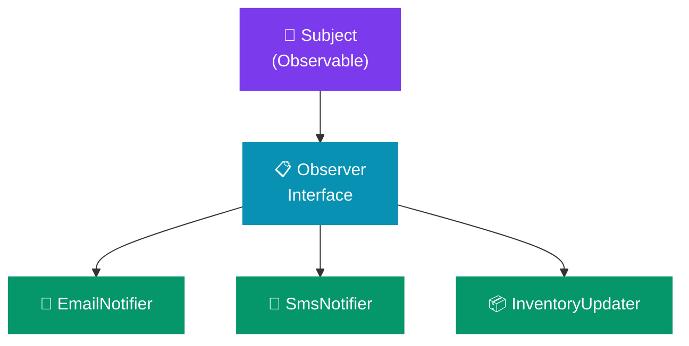
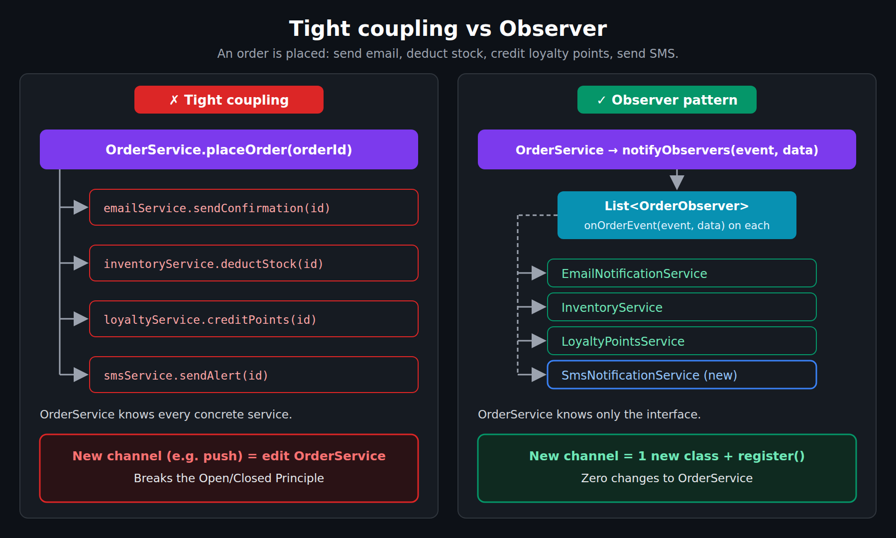
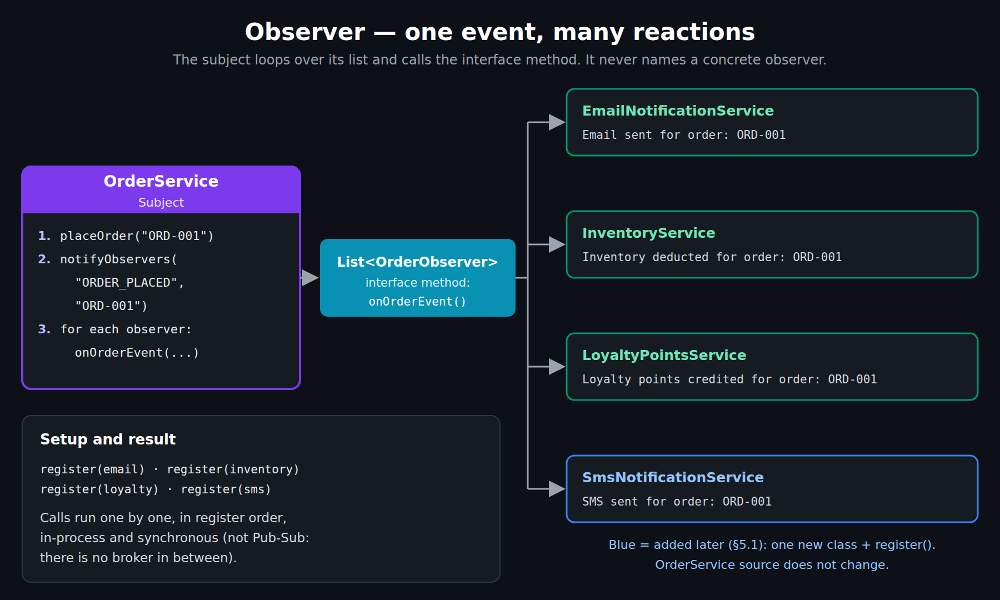
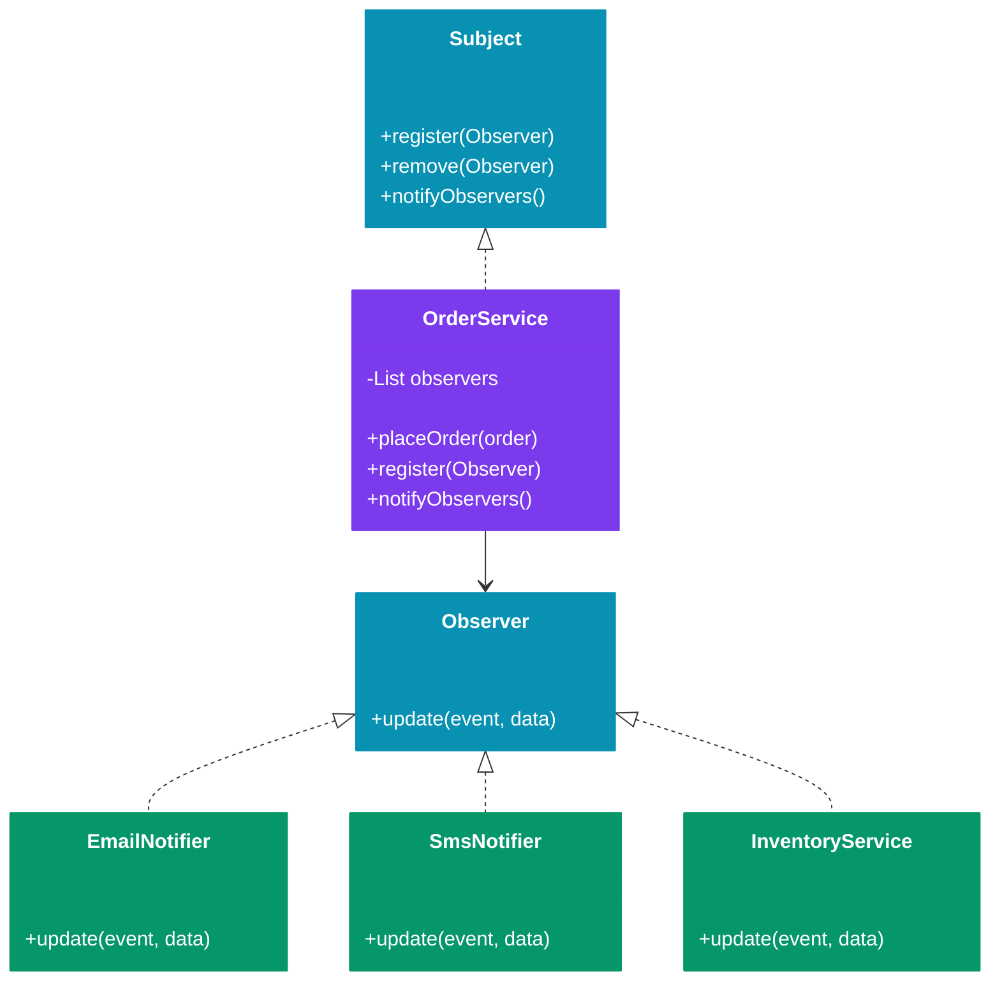
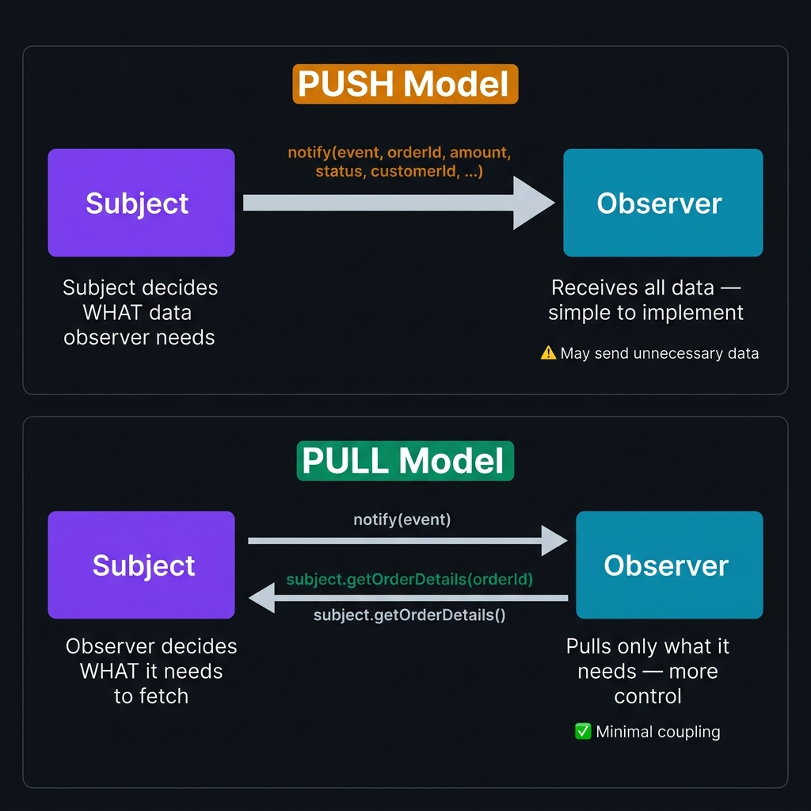
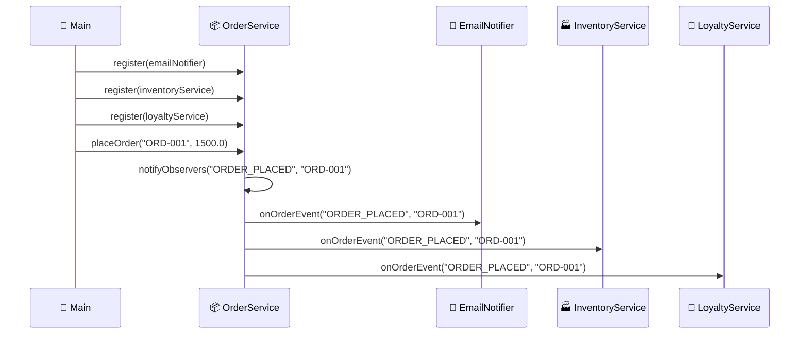
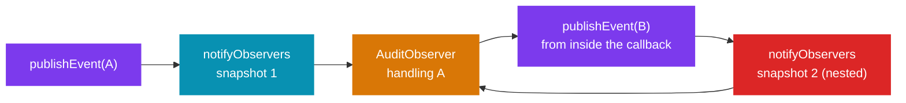
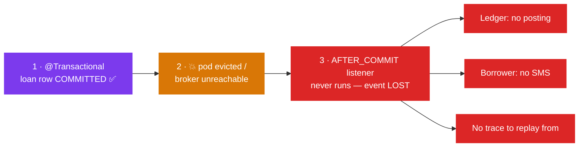
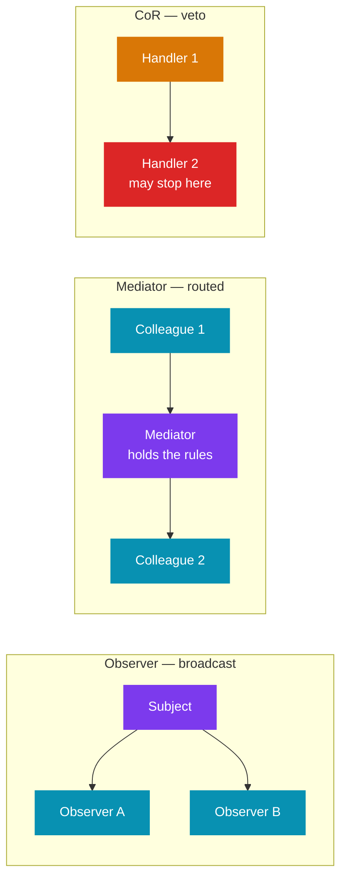

# Observer Design Pattern in Java

**Observer Design Pattern in Java** | A behavioral pattern. It defines a one-to-many dependency between objects. When one object changes state, all the objects that depend on it are notified and updated automatically.

> 📖 **Master guide:** [01_LLD_Interview_Patterns_Guide.md](./01_LLD_Interview_Patterns_Guide.md) covers the basic structure of Observer, together with the other 15 patterns. **This file goes deeper.** It answers the five follow-up questions that the master guide only names: *sync or async?* (§9) · *what if an observer throws?* (§14.2) · *the pod died after commit — where's the event?* (§10) · *how do you test it?* (§12) · *Observer or Mediator?* (§13).

> 🔥🔥 Must-know — very frequently tested &nbsp;·&nbsp; 🔥 High priority &nbsp;·&nbsp; ⚡ Medium priority &nbsp;·&nbsp; 💤 Low priority

**Related:** [18. State](./18_State_Design_Pattern_in_Java.md) (loan lifecycle + outbox) · [19. Chain of Responsibility](./19_Chain_of_Responsibility_Design_Pattern_in_Java.md) (broadcast vs veto) · [10. Strategy](./10_Strategy_Design_Pattern_in_Java.md) (the `List<T>` injection alternative) · [15. CQRS & Event Sourcing](./15_CQRS_and_Event_Sourcing.md) · [Kafka Q&A](https://github.com/vikas9dev/system-design/blob/main/iq/04_Kafka_Interview_Questions.md) · [Spring Microservices Q&A](../1_interview_questions/17_Spring_Microservices_Interview_Questions.md)

---

<a id="1-introduction"></a>
## 1. Introduction ⚡

The **Observer pattern** defines a **one-to-many dependency** between objects. People also call it, informally, the Event Listener pattern. When the **Subject** (the one) changes state, all registered **Observers** (the many) are automatically notified and updated.

> ⚠️ **Observer ≠ Pub-Sub (do not mix them up in an interview).**
>
> - In **Observer**, the subject notifies its observers **directly**. They hold references to each other. It runs **in-process**, and notification is usually **synchronous**.
> - **Pub-Sub** puts a **broker / event channel** (e.g. Kafka, a message bus) between the two sides. So the publisher and subscriber **do not know about** each other. They are usually also decoupled in time and process.
> - Observer is the small form, inside one JVM. Pub-Sub is the general, distributed form, with a broker in the middle.

🔑 **Key characteristics:**
- Subject maintains a list of observers and notifies all of them on state change.
- Promotes **loose coupling**. The Subject only knows the Observer *interface*, not the concrete types.
- You can add or remove observers at runtime, with zero changes to the Subject.
- This is a **behavioral** GoF design pattern.



The Subject (purple) notifies all Observers through a common interface (cyan). Each concrete observer (green) handles the event in its own way. The Subject never imports or references any concrete observer class. This is the core idea of loose coupling.

---

<a id="2-tier-1-interview-importance"></a>
## 2. Tier-1 Interview Importance 💤

> 🔥 **Observer is asked in almost every Tier-1 LLD round. It is the main pattern behind Notification System, Ride Sharing, and Inventory System (all in the LLD problem map).**

<a id="21-why-interviewers-love-this-pattern"></a>
### 2.1 Why interviewers love this pattern 🔥

When a customer places an order, many things need to happen at the same time:
- Send a confirmation email
- Deduct inventory
- Credit loyalty points
- Trigger an SMS

❌️ **Naive approach — tight coupling:**

```java
public class OrderService {
    public void placeOrder(String orderId) {
        emailService.sendConfirmation(orderId);    // direct dependency
        inventoryService.deductStock(orderId);     // direct dependency
        loyaltyService.creditPoints(orderId);      // direct dependency
        smsService.sendAlert(orderId);             // direct dependency
    }
}
```

To add a new notification channel (e.g. push notification), you must **modify `OrderService`**. This breaks the Open/Closed Principle.



✅ **Observer approach — loose coupling:**

`OrderService` just fires an event. Each subscriber handles its own logic. Adding SMS needs **zero changes** to `OrderService`. You just implement `OrderObserver` and register it.

> 💬 **What to say in an interview:**
>
> *"When an order is placed, many independent systems need to react: email, inventory, loyalty, SMS. If I call them directly from `OrderService`, I break the Open/Closed Principle. I also create coupling that breaks easily. With Observer, `OrderService` becomes the Subject. It only calls `notifyObservers()`. Each dependent service implements the `OrderObserver` interface and handles its own reaction. Adding a new channel means zero changes to `OrderService`. I just create a new observer and register it. Spring's `ApplicationEventPublisher` works in exactly this way internally."*

---

<a id="3-participants-of-observer-design-pattern"></a>
## 3. Participants of Observer Design Pattern ⚡



| Participant | Role | Example |
|---|---|---|
| **Subject (Observable)** | Keeps the observer list; gives register/remove/notify methods | `OrderService` |
| **Observer** | Interface with `update()` / `onEvent()` method | `OrderObserver` |
| **ConcreteSubject** | Implements Subject, holds actual state and triggers notifications | `OrderServiceImpl` |
| **ConcreteObserver** | Implements Observer, reacts to state change with its own logic | `EmailNotifier`, `SmsNotifier`, `InventoryService` |



---

<a id="4-push-vs-pull-model"></a>
## 4. Push vs Pull Model ⚡



| Model | How It Works | When to Use |
|---|---|---|
| **Push** | Subject pushes all relevant data to Observer via `update(event, data)` | Observer needs all the data upfront; simpler to implement |
| **Pull** | Subject only notifies (passes `this`); Observer pulls what it needs from Subject | Observers need different subsets of data; avoids passing unnecessary data |

**Pull in code** — the subject hands over *itself*, and each observer takes only what it wants:

```java
public interface StockObserver {
    void update(StockTicker source);          // 🔑 no payload — just "something changed"
}

public class PortfolioObserver implements StockObserver {

    @Override
    public void update(StockTicker source) {
        // reads back only the slice it cares about
        recalculate(source.getSymbol(), source.getPrice());
    }
}
```

⚠️ **The risk of the pull model, and the reason push usually wins.**

- The observer reads the subject **after** the notification returns.
- So the subject can change again between "the state changed" and "the observer looked".
- Observer 3 in the loop may then read a value that matches **no single event**. This is a torn read of the subject's history: the value does not belong to any one event.
- With four observers and a fast writer, two of them can compute different answers from "the same" notification. Neither observer has a bug.

Push does not have this gap. The event object is a value handed over at notification time. It is immutable after that.

🎯 **So the design rule is: make the event self-contained and immutable.**

- §9.3 reaches the same rule for a completely different reason. Context does not cross an async thread boundary, so put `userId` / `tenantId` / `traceId` *in the event*.
- Two independent arguments give one rule. This is worth mentioning in the interview.
- It is why Spring's `ApplicationEventPublisher` uses push. You publish a rich, final event object. No listener ever calls back into the publisher to ask what happened.

💡 **When pull is still the right choice:**

- The state is really large (a whole document, a grid model).
- Most observers need a small, *different* part of it.
- Copying all of it into every event would cost more than the risk of stale data.

GUI/model-view code is the typical place for pull. Backend event-driven code is almost always push.

---

<a id="5-observer-pattern-java-example"></a>
## 5. Observer Pattern Java Example 🔥

Full e-commerce context: placing an order notifies email, inventory, and loyalty services.

1️⃣ **Observer interface:**

```java
public interface OrderObserver {
    void onOrderEvent(String event, Object data);
}
```

2️⃣ **Subject interface:**

```java
public interface OrderSubject {
    void register(OrderObserver observer);
    void remove(OrderObserver observer);
    void notifyObservers(String event, Object data);
}
```

3️⃣ **ConcreteSubject — OrderService:**

```java
import java.util.List;
import java.util.concurrent.CopyOnWriteArrayList;

public class OrderService implements OrderSubject {

    // CopyOnWriteArrayList: iteration runs on an immutable snapshot, so an observer can
    // self-deregister during notification without a ConcurrentModificationException, and
    // concurrent register/notify is thread-safe. The cost is an O(n) array copy on every
    // register/remove — the right trade only because registration is rare. See §6.
    private final List<OrderObserver> observers = new CopyOnWriteArrayList<>();

    @Override
    public void register(OrderObserver observer) {
        observers.add(observer);
    }

    @Override
    public void remove(OrderObserver observer) {
        observers.remove(observer);
    }

    @Override
    public void notifyObservers(String event, Object data) {
        for (OrderObserver observer : observers) {
            observer.onOrderEvent(event, data);
        }
    }

    public void placeOrder(String orderId, double amount) {
        System.out.println("Order placed: " + orderId + " (amount: " + amount + ")");
        notifyObservers("ORDER_PLACED", orderId);
    }
}
```

4️⃣ **ConcreteObserver 1 — EmailNotificationService:**

```java
public class EmailNotificationService implements OrderObserver {

    @Override
    public void onOrderEvent(String event, Object data) {
        if ("ORDER_PLACED".equals(event)) {
            System.out.println("Email sent for order: " + data);
        }
    }
}
```

5️⃣ **ConcreteObserver 2 — InventoryService:**

```java
public class InventoryService implements OrderObserver {

    @Override
    public void onOrderEvent(String event, Object data) {
        if ("ORDER_PLACED".equals(event)) {
            System.out.println("Inventory deducted for order: " + data);
        }
    }
}
```

6️⃣ **ConcreteObserver 3 — LoyaltyPointsService:**

```java
public class LoyaltyPointsService implements OrderObserver {

    @Override
    public void onOrderEvent(String event, Object data) {
        if ("ORDER_PLACED".equals(event)) {
            System.out.println("Loyalty points credited for order: " + data);
        }
    }
}
```

7️⃣ **Client — Main:**

```java
public class Main {
    public static void main(String[] args) {
        OrderService orderService = new OrderService();

        orderService.register(new EmailNotificationService());
        orderService.register(new InventoryService());
        orderService.register(new LoyaltyPointsService());

        orderService.placeOrder("ORD-001", 1500.0);
    }
}
```

📤 **Output:**

```
Order placed: ORD-001 (amount: 1500.0)
Email sent for order: ORD-001
Inventory deducted for order: ORD-001
Loyalty points credited for order: ORD-001
```



<a id="51-adding-a-new-observer--zero-changes-to-orderservice"></a>
### 5.1 Adding a New Observer — Zero Changes to OrderService ⚡

This is the Open/Closed argument from §2, now in code. Adding SMS needs one new class and one registration call:

```java
public class SmsNotificationService implements OrderObserver {

    @Override
    public void onOrderEvent(String event, Object data) {
        if ("ORDER_PLACED".equals(event)) {
            System.out.println("SMS sent for order: " + data);
        }
    }
}

// Client — register it; OrderService source is untouched
orderService.register(new SmsNotificationService());
```

---

<a id="6-thread-safety-reentrancy--memory-leaks"></a>
## 6. Thread Safety, Reentrancy & Memory Leaks 🔥🔥

The textbook Observer is a `List<Observer>` and a `for` loop. Under concurrency, three problems appear:

- The list is a shared mutable collection. One thread iterates it while other threads change it.
- The callbacks run on the publisher's thread.
- The subject holds a strong reference to every observer forever.

Each of these is a separate production bug. Interviewers ask about them in exactly that order.

<a id="61-choosing-the-observer-collection"></a>
### 6.1 Choosing the observer collection 🔥

| Collection | register / remove cost | notify cost | Iteration semantics | Pick it when |
|---|---|---|---|---|
| **`CopyOnWriteArrayList`** ✅ default | ❌️ **O(n)** — every `add`/`remove` copies the whole backing array under a lock | ✅ Zero — iterates the existing array, no copy, no lock | ✅ **Exact snapshot.** The iterator is fixed to the array as it was when iteration began | Read-heavy: observers register once at startup and you notify thousands of times/sec |
| **`Collections.synchronizedList` + manual copy at notify** | ✅ O(1) amortized `add` | ❌️ Allocates a fresh `ArrayList` copy on **every** `notifyObservers()` | ✅ Exact snapshot (you made it) | Write-heavy: observers change all the time (per-request/per-session subscribers) and notifications are rare by comparison |
| **`ConcurrentHashMap.newKeySet()`** | ✅ O(1) both ways, no array copy | ✅ Zero-copy | ⚠️ **Weakly consistent** — an observer registered during iteration *may or may not* be seen; non-deterministic | Large observer sets that change often, where you need cheap add **and** cheap notify, and you don't need ordering |

📌 **Two results you should mention in the interview:**

- **COWAL's write cost is the price you pay on purpose, to get notify with no copy and no lock.** Registering *n* observers at startup costs O(n²) array copying in total.
  - For 10 listeners at boot, this does not matter.
  - For 50,000 per-session subscribers that change every second, it is a real problem.
  - In that case COWAL is the *wrong* answer, even though it is the answer most people give first.
- **`newKeySet()` is a `Set`.** If you register the same observer twice, nothing happens and no error is shown. Also, notification **order is undefined**. If your design needs "email fires before SMS", a set already fails that need (§14 — Observer guarantees no ordering anyway).

<a id="62-snapshot-semantics--be-precise-not-hand-wavy"></a>
### 6.2 Snapshot semantics — be precise, not hand-wavy ⚡

"CopyOnWriteArrayList makes self-deregistration safe" is true, but it does not say enough. The exact behaviour:

- Say an observer calls `subject.remove(this)` **from inside its own callback**.
  - It has *already* received the current event.
  - The current loop does **not see the removal**. The loop keeps walking the array it captured when iteration started.
  - The removal only takes effect from the **next** `notifyObservers()` onward.
- The same holds the other way. An observer **registered during** a notification is **missed by that notification** completely. It was added to a new array, and that is not the array being iterated.
- The snapshot iterator is **immutable**: `it.remove()` throws `UnsupportedOperationException`. Removal must go through `subject.remove(observer)`, never through the iterator.

💡 **The answer that scores:** *"`CopyOnWriteArrayList` doesn't make deregistration take effect immediately. It makes it take effect **atomically at the next notification**. Nothing is corrupted and nothing throws. The observer just gets one more event than you might expect. Suppose 'must not receive any further events after unsubscribe' is a hard requirement. Then the observer needs its own `volatile boolean active` flag, and it checks the flag on entry."*

<a id="63--correcting-the-naive-list-claim"></a>
### 6.3 ⚠️ Correcting the naive-list claim 🔥

People usually say: *"a plain `ArrayList` throws `ConcurrentModificationException` if an observer self-deregisters"*. This is only half right. The half it gets wrong is the dangerous half.

```java
// ❌️ Variant 1 — enhanced for-loop: usually throws CME (loud, findable)
for (OrderObserver observer : observers) {
    observer.onOrderEvent(event);     // if this calls observers.remove(this) →
}                                     // next() sees modCount != expectedModCount → CME
```

```java
// ❌️ Variant 2 — index-based loop: NO exception, silently SKIPS an observer
for (int i = 0; i < observers.size(); i++) {
    observers.get(i).onOrderEvent(event);
    // observer at i removes itself → everything shifts left by one →
    // the observer now AT index i is never notified. No CME. No log line. 🔇
}
```

⚠️ **The enhanced loop also misses the CME, in one specific case.** `ArrayList.Itr.hasNext()` is `cursor != size`. Say the **second-to-last** observer removes itself:

- After the list shrinks, `cursor` is already equal to `size`.
- So `hasNext()` returns `false`, and the loop exits *normally*.
- The **last observer is never notified**, with no warning. No exception is ever thrown.

🎯 So the honest statement is: a plain `ArrayList` fails **loudly sometimes and silently sometimes**. The silent case is the one that reaches production. It produces a bug report like *"the ledger observer randomly doesn't fire for about 1 in 40 orders."* That is why you take a snapshot. The reason is not only to avoid an exception.

<a id="64-reentrancy--notification-during-notification"></a>
### 6.4 Reentrancy — notification during notification 🔥

This point sets you apart, and almost nobody raises it without being asked. What happens when an observer, inside its callback, **publishes another event on the same subject**?



That loop causes three different failure modes:

1. **Unbounded recursion.** Observer A reacts to `OrderPlaced` by publishing `InventoryChanged`. Observer B reacts to `InventoryChanged` by publishing `OrderPlaced`. Each step is a **nested synchronous call on the same thread**. The stack grows until `StackOverflowError`. The stack trace is a long list of listener names that alternate: A, B, A, B, and so on. HotSpot prints only the top 1,024 frames by default (`-XX:MaxJavaStackTraceDepth`).
2. **Half-updated subject.** The nested notification runs *before* the outer one finishes. So observers 3–7 of the outer pass see state that the inner pass already changed. The event they received and the state they read no longer match.
3. **Reordered side effects.** The inner event's effects happen *before* the outer event's remaining observers run. The audit log says B happened before A, even though A caused B.

⚠️ **Spring will not protect you here.** `SimpleApplicationEventMulticaster` has **no cycle detection and no depth limit**. A `publishEvent()` call from inside an `@EventListener` recurses synchronously, exactly like the hand-written loop. (If an `@EventListener` method *returns* a non-null value, Spring re-publishes that return value as a follow-on event. This makes it very easy to build an event cycle by mistake.)

**Three fixes, from the simplest to the strictest:**

| Mitigation | How | Trade-off |
|---|---|---|
| **Depth guard** | `ThreadLocal<Integer>` incremented on entry; throw past a max depth (say 5) | Cheapest to add. Turns a `StackOverflowError` into an exception you can diagnose, but doesn't *fix* the cycle |
| **Deferred queue** ✅ | Events published from inside a callback go onto a per-thread queue. The queue is drained after the current pass completes | Turns depth-first recursion into breadth-first FIFO. Ordering changes, so document it |
| **Convention: listeners never publish** | Listeners return facts; a single orchestrator publishes | The cleanest design. The hardest to enforce without a lint rule or an architecture test |

```java
public class ReentrancySafeSubject {

    private final List<OrderObserver> observers = new CopyOnWriteArrayList<>();

    /** Is a notification already in progress on THIS thread? */
    private final ThreadLocal<Boolean> notifying = ThreadLocal.withInitial(() -> Boolean.FALSE);

    /** Events published from inside a callback — drained after the outer pass. */
    private final ThreadLocal<Deque<OrderEvent>> deferred =
            ThreadLocal.withInitial(ArrayDeque::new);

    public void publish(OrderEvent event) {
        if (Boolean.TRUE.equals(notifying.get())) {
            deferred.get().addLast(event);   // ⏸️ do NOT recurse — queue it
            return;
        }
        notifying.set(Boolean.TRUE);
        try {
            dispatch(event);
            Deque<OrderEvent> queue = deferred.get();
            while (!queue.isEmpty()) {
                dispatch(queue.pollFirst());  // 🔁 flat drain — depth stays at 1
            }
        } finally {
            // 🔑 On a pooled thread, always remove() — a leftover ThreadLocal
            //     leaks into the next unrelated request served by this thread.
            deferred.remove();
            notifying.remove();
        }
    }

    private void dispatch(OrderEvent event) {
        for (OrderObserver observer : observers) {
            observer.onOrderEvent(event);
        }
    }
}
```

💡 The `finally { remove(); }` is not optional. A `ThreadLocal` on a Tomcat or executor thread lives longer than the request. Say you leave a non-empty deferred queue there. Then the *next* request's first publish replays someone else's events. Interviewers who have debugged thread-pool leaks look for exactly this line.

<a id="65--never-invoke-observers-while-holding-the-subjects-lock"></a>
### 6.5 🔒 Never invoke observers while holding the subject's lock 🔥

```java
// ❌️ DEADLOCK WAITING TO HAPPEN
public synchronized void notifyObservers(OrderEvent event) {
    for (OrderObserver observer : observers) {
        observer.onOrderEvent(event);   // arbitrary user code, running under OUR monitor
    }
}
```

The callback is **code you don't control**. Here is how it goes wrong:

- An observer calls back into the subject (`subject.register(...)`, `subject.getState()`) from *another* thread.
- That thread holds a lock the callback needs.
- Now you have a classic lock-ordering deadlock. It will only show up under load.

✅ **The rule: take the snapshot under the lock, and call the observers outside it.** The critical section contains only your own code. It is an O(n) copy, not O(n) callbacks.

```java
public void notifyObservers(OrderEvent event) {
    List<OrderObserver> snapshot;
    synchronized (this) {
        snapshot = new ArrayList<>(observers);   // 🔒 short, deterministic, no foreign code
    }
    for (OrderObserver observer : snapshot) {    // 🔓 callbacks run lock-free
        observer.onOrderEvent(event);
    }
}
```

📌 **This is exactly what `java.util.Observable` does.** Its `notifyObservers` copies the observer array inside a `synchronized` block, then iterates outside it. Mention this in the interview. It is the one thing that deprecated class got right. It is also why the common claim "`Observable` is thread-unsafe" needs correcting in **both** directions (§7).

<a id="66-the-lapsed-listener-memory-leak"></a>
### 6.6 The lapsed-listener memory leak 🔥🔥

The subject holds a **strong reference** to every registered observer. If you register an observer and never remove it, the observer stays in memory as long as the subject lives. Its entire object graph stays too. The leak is worst with:

- **long-lived subjects** (singletons, caches, static event buses), and
- **short-lived observers** (per-request handlers, screens/dialogs, per-session subscribers).

```java
// LEAK: observer registered, screen closed, but never removed →
// the Subject still references it forever.
orderService.register(checkoutScreen);   // checkoutScreen now pinned by orderService
// ... user closes the checkout screen, drops all their own references ...
// checkoutScreen is STILL alive because orderService holds it.
```

In a heap dump, this shows up as thousands of "closed" screens/handlers. Their GC root path is `OrderService → observers → …`. The observers also keep *firing*, so you get useless work: a closed screen still processing events.

**Fix 1 — paired register/remove ✅ (this is the main answer).** Every registration must have an owner and a matching teardown: `try/finally`, `close()`, `@PreDestroy`, or the framework's lifecycle hook. If registration happens in a constructor and removal happens nowhere, the design is already wrong.

**Fix 2 — weak references (a deliberate trade-off, not a free upgrade).** Back the list with `WeakReference<Observer>`. Then the subject no longer keeps observers alive. Purge cleared references on each notify (or via a `ReferenceQueue`).

⚠️ **The trap this creates — the classic weak-listener trap.** Under a weak-ref scheme, a **lambda** registered as a listener has *no other strong reference anywhere*:

```java
// 💥 Under a weak-reference observer list, this listener can be collected
//    at the very next GC — and then silently stops firing. No error, no log.
orderService.register(event -> auditLog.record(event));
```

Here is what happens step by step:

This lambda reads `auditLog`, so it captures a value, and each call creates a new object. A non-capturing lambda is different: HotSpot caches it at its call site, so it stays alive. Do not depend on that detail.

The same trap applies to anonymous inner classes and method references with no field that keeps them. **If you use weak refs, the caller must hold a strong field to the listener.** That mostly removes the convenience you wanted from weak refs in the first place. Choose weak refs only when you really cannot control observer lifetimes (plugin/GUI models). Document the strong-reference requirement clearly.

**Fix 3 — return an unsubscribe handle ✅ (the answer an interviewer waits for after you've explained the leak).** Fix 1 asks callers to *remember* to deregister. Instead, build it into the API:

- Change §5's `void register(...)` so it **returns** a handle the caller can close.
- Scope the handle with try-with-resources.
- Now, if someone forgets to deregister, you can see it in the code. It is not a silent leak.

```java
/** 🔑 Narrows AutoCloseable so close() throws nothing — otherwise every
 *  try-with-resources block would have to catch a checked Exception. */
public interface Subscription extends AutoCloseable {
    @Override
    void close();
}

public Subscription register(OrderObserver observer) {
    observers.add(observer);
    return () -> observers.remove(observer);   // 🔑 the handle IS the deregistration
}
```

```java
try (Subscription subscription = orderService.register(checkoutScreen)) {
    // ... screen is live and receiving events ...
}   // ✅ deregistered on every exit path, including exceptions
```

This is not a rare idea. Every modern event API solves the problem this way:

- Reactor returns a `Disposable`.
- `Flow.Subscriber` gets a `Subscription` with `cancel()`.
- The browser's `AbortController` follows the same design.

If you name one of these, you show that you know the pattern, not just the trick.

> 💡 **"Why not just use Guava's `EventBus`?"** This is a common follow-up, and the honest answer is short. It manages the registration list for you (`register` / `unregister`). But it gives you **no ordering** and **no transaction phases**. It also **swallows subscriber exceptions** into a `SubscriberExceptionHandler` instead of propagating them. Google itself now discourages it in new code. On a Spring stack you already have a better bus (`ApplicationEventPublisher`), and it adds commit-phase semantics. Name Guava's bus to show you know it, but do not use it.

> 💡 **Why you rarely see this in Spring.** `@EventListener` beans are container-managed singletons. The `ApplicationContext` owns their lifetime. Registration comes from bean definitions, and everything dies with the context. The lapsed-listener leak is a **hand-rolled observer list / Swing / Android / JavaFX** problem, not a Spring one. State this limit clearly. It shows you know *when* the risk applies, instead of repeating it as a warning for every case.

---

<a id="7-java-built-in-observer-support"></a>
## 7. Java Built-in Observer Support 💤

Java has built-in Observer support in the `java.util` package. But it is **deprecated since Java 9**.

| Class / Interface | Status | Problem |
|---|---|---|
| `java.util.Observable` | ⚠️ Deprecated (Java 9+) | It's a **class**, not an interface, so your subclass can't extend another class. `setChanged()` is `protected` (forces subclassing) |
| `java.util.Observer` | ⚠️ Deprecated (Java 9+) | Tightly coupled to `Observable`; notification order unspecified; only `Object` payload (no generics) |
| `PropertyChangeListener` | ✅ Not deprecated | JDK alternative for bean property-change events. But read the ⚠️ below before you name it in a backend interview |
| `PropertyChangeSupport` | ✅ Not deprecated | Helper that manages the `PropertyChangeListener` list. It uses composition, not inheritance (the thing `Observable` got wrong) |

⚠️ **Why `java.util.Observable` is flawed:**
- `Observable` is a **concrete class** (not an interface). If your Subject must extend another class, it can't also extend `Observable`. Java doesn't support multiple inheritance.
- `setChanged()` is **`protected`**. You *must* subclass `Observable` to flag a state change. You can't hold it as a field (composition). This forces the inheritance relationship.
- **Notification order is unspecified.** The docs give no guarantee about the order in which observers are notified, so you can't rely on it.
- **No generics.** `update(Observable o, Object arg)` gives you a raw `Object` payload. Every observer must downcast it, so you lose compile-time type safety.
- **Deprecated since Java 9.** The JDK points you to `java.beans`, `java.util.concurrent`, or the `Flow` API instead.

⚠️ **Get the concurrency facts right. Most candidates repeat two myths here:**

| Common claim | Reality |
|---|---|
| "`notifyObservers` is `synchronized`" | ❌️ It is **not** a `synchronized` method. It takes the monitor only for an internal block: `synchronized (this) { if (!changed) return; arrLocal = obs.toArray(); clearChanged(); }`. Then it calls the callbacks **outside** the lock. This is deliberate and correct. You must never hold the subject's lock while user callbacks run. |
| "It has no thread-safety bug at all" | ❌️ There is a real defect. It is the JDK's **own stated deprecation reason**: *state changes are not in one-for-one correspondence with notifications.* `setChanged()` and `notifyObservers()` are separate calls. So two threads can both call `setChanged()` while one `notifyObservers()` clears the flag. The second notification is then **lost with no warning**. Also, callbacks fire on a snapshot taken outside the lock. So an observer can still be notified **after** a successful `deleteObserver()`. |
| "It notifies in registration order" | ❌️ The Javadoc says the order is unspecified. The actual implementation iterates the snapshot **backwards** (`for (int i = arrLocal.length - 1; i >= 0; i--)`), i.e. **reverse registration order**. People who tested it once and assumed FIFO get this wrong. |

💡 The class-vs-interface and no-generics complaints above are valid API criticisms. But they are **not** the reasons the JDK itself gives. The Javadoc gives three reasons:

- a limited event model,
- unspecified delivery order,
- the mismatch between state changes and notifications.

Say it that way, and a sharp interviewer has nothing to correct.

✅ **Recommendation:** Always write **custom Observer interfaces**, as shown in the example above. This gives you full control over the contract, thread-safety, and event types.

```java
// JDK alternative — PropertyChangeSupport is composed as a field, not inherited
public class StockTicker {

    private double price;
    private final PropertyChangeSupport support = new PropertyChangeSupport(this);

    public void addObserver(PropertyChangeListener listener) {
        support.addPropertyChangeListener(listener);
    }

    public void setPrice(double newPrice) {
        double oldPrice = this.price;
        this.price = newPrice;
        support.firePropertyChange("price", oldPrice, newPrice);
    }
}
```

> ⚠️ **Don't use `java.beans` on the server.** `PropertyChangeListener` isn't deprecated, but it lives in the **`java.desktop`** module. Two problems follow:
> - If you recommend it for Spring/backend code, you pull a desktop/AWT module into your module graph (`requires java.desktop`).
> - It is missing from `jlink`-trimmed or minimal runtimes.
>
> For a backend round, better JDK-native answers are **your own interface**, `java.util.concurrent` structures, or `java.util.concurrent.Flow`. That is exactly what the deprecation note points to.

💡 **Interview note:** everyone says *"`Observable` is deprecated"*, so that does not show depth. Depth means two things:

- You can state the JDK's actual reasons (limited event model, unspecified order, state changes not one-for-one with notifications).
- You can correct the "it's not thread-safe / it is fully synchronized" myths in either direction.

<a id="71-what-flow-actually-is--and-why-it-isnt-just-observer-with-new-names"></a>
### 7.1 What `Flow` actually is — and why it isn't just "Observer with new names" ⚡

The deprecation note sends you to `Flow`, so be ready to say what it contains. `java.util.concurrent.Flow` (Java 9) is the Reactive Streams spec, added into the JDK. It has four nested interfaces:

| Interface | Role in Observer terms |
|---|---|
| `Flow.Publisher<T>` | The **Subject** — `subscribe(Subscriber<? super T>)` |
| `Flow.Subscriber<T>` | The **Observer** — `onSubscribe` / `onNext` / `onError` / `onComplete` |
| `Flow.Subscription` | The **registration handle** — `request(long n)` and `cancel()` |
| `Flow.Processor<T,R>` | Both at once — a subscriber that republishes transformed items |

🔑 **The key design difference is `Subscription.request(n)`.**

- In classic Observer, the subject decides when to push. The observer has no say. A fast subject simply overloads a slow observer.
- In `Flow`, nothing is delivered until the subscriber has **asked for `n` items**. So delivery is **demand-driven**.
- This means the consumer expresses backpressure (the signal "slow down"). The producer does not configure it.

🎯 **Name this contrast, because it links §7 back to §9.4:** *"Thread-pool backpressure is a queue you have to size and tune. If you get it wrong, you get either an OOM or a `RejectedExecutionException` on the publisher's thread. Reactive backpressure turns this around. The consumer states its demand, and the producer cannot exceed it. So there's no queue size to guess."*

`Flow` also adds two things that plain Observer lacks:

- **Terminal signals** (`onComplete` / `onError`). An observer stream can *end*. Errors are part of the contract, instead of an exception escaping a callback.
- **Cancellation** as a first-class operation.

You rarely implement `Flow` by hand. Reactor and RxJava are the implementations you actually use. But if you can name the interfaces and `request(n)`, you show you understood the deprecation note, not just read it.

---

<a id="8-spring-framework-integration"></a>
## 8. Spring Framework Integration 🔥

Spring's event system is the **production-grade Observer pattern**. Tier-1 interviewers are impressed when you know the exact mapping from pattern → framework.

| Spring Feature | Observer Role | How It Works |
|---|---|---|
| `ApplicationEventPublisher` | **Subject** | Publishes events: `publisher.publishEvent(new OrderPlacedEvent(orderId))` |
| `@EventListener` | **ConcreteObserver** | Spring calls methods annotated with `@EventListener` automatically for the matching event type |
| `@Async @EventListener` | **Async Observer** | Non-blocking notification — observer runs in a separate thread |
| Any POJO event (optionally `ApplicationEvent`) | **Event (data carrier)** | Since Spring 4.2, any object can be an event. No need to extend `ApplicationEvent`. Type-safe matching by class type |

1️⃣ **Event class (data carrier):**

```java
public class OrderPlacedEvent {

    private final String orderId;

    public OrderPlacedEvent(String orderId) {
        this.orderId = orderId;
    }

    public String getOrderId() {
        return orderId;
    }
}
```

2️⃣ **Publisher — Subject (OrderService):**

```java
@Service
public class OrderService {

    private final ApplicationEventPublisher publisher;

    public OrderService(ApplicationEventPublisher publisher) {
        this.publisher = publisher;
    }

    public void placeOrder(String orderId) {
        // business logic — save to DB, validate, etc.
        System.out.println("Order placed: " + orderId);
        publisher.publishEvent(new OrderPlacedEvent(orderId));
    }
}
```

3️⃣ **Listener — ConcreteObserver (EmailNotificationListener):**

```java
@Component
public class EmailNotificationListener {

    private final EmailClient emailClient;

    public EmailNotificationListener(EmailClient emailClient) {
        this.emailClient = emailClient;
    }

    @EventListener
    public void handleOrderPlaced(OrderPlacedEvent event) {
        emailClient.send(event.getOrderId(), "Your order has been placed");
    }
}
```

4️⃣ **Async listener — non-blocking observer:**

```java
@Component
public class SmsNotificationListener {

    @Async
    @EventListener
    public void handleOrderPlaced(OrderPlacedEvent event) {
        // runs in a separate thread — does not block OrderService
        System.out.println("SMS sent for: " + event.getOrderId());
    }
}
```

> ⚠️ **`@Async` requires `@EnableAsync`.** Without it, the listener runs **synchronously** on the publisher's thread, and nothing warns you. This is the first of several traps. That is why async observers get their own section: **§9** covers executor choice, context propagation, backpressure, and the pre-commit race.

> 💡 **Listener ordering with `@Order`.** The GoF Observer contract makes no guarantee about the order in which observers fire (see §14). Spring gives a **stronger** guarantee than the contract here:
> - For **synchronous** listeners, `@Order(n)` (lower runs first) is **deterministic, not best-effort**. `AbstractApplicationEventMulticaster` sorts the listeners it finds with `AnnotationAwareOrderComparator` *before* the invocation loop.
> - `@Order` also correctly orders `@TransactionalEventListener`s within the same phase.
> - It does **not** keep `@Async` listeners in order. They are *submitted* in order but run concurrently, so ordering is lost. See §9.

> 🎯 **Why you should memorise this mapping:** name the exact match. Publisher = Subject, `@EventListener` = ConcreteObserver, the event object = the push payload. This shows you have used Observer in real code, not only read about it. It also leads into every important follow-up question: *sync or async? what if a listener throws? what if the transaction rolls back?* These are covered in §9, §10 and §14.

> 🔎 **How Spring finds your listeners.** `EventListenerMethodProcessor` (a `SmartInitializingSingleton`) scans every bean after singleton instantiation. It finds `@EventListener` methods. It wraps each one in an `ApplicationListenerMethodAdapter` and registers it with the multicaster. Two results you should know:
>
> 1. Matching is by **assignability**. So a listener on a base type receives all subtypes (see §11.5).
> 2. The self-invocation problem that breaks `@Transactional` does not break `@Async` or `@TransactionalEventListener`. But the reasons are **different, so don't mix them up**:
>    - The adapter gets the listener bean *from the context*, i.e. the proxy. So `@Async`'s AOP interceptor is in the call path.
>    - `@TransactionalEventListener` does not use a proxy at all. `TransactionalEventListenerFactory` builds a `TransactionalApplicationListenerMethodAdapter`. That adapter registers a `TransactionSynchronization` and delays the call to the commit phase. So AOP is never involved.

<a id="81-the-interface-form--applicationlistenert"></a>
### 8.1 The interface form — `ApplicationListener<T>` 🔥🔥

```java
@Component   // here LoanDisbursedEvent must extend ApplicationEvent (unlike the §11 POJO)
public class DisbursementCallbackListener implements ApplicationListener<LoanDisbursedEvent> {

    private final LedgerService ledgerService;

    public DisbursementCallbackListener(LedgerService ledgerService) {
        this.ledgerService = ledgerService;
    }

    @Override
    public void onApplicationEvent(LoanDisbursedEvent event) {
        ledgerService.post(event.getLoanId(), event.getAmount());
    }
}
```

| | `implements ApplicationListener<T>` | `@EventListener` |
|---|---|---|
| **Events per class** | **One**. The class *is* the listener, and its generic parameter is the type | Many. Every annotated method is its own listener |
| **How it's found** | The bean **is** an `ApplicationListener`, so the context registers it directly at refresh. No annotation scanning | `EventListenerMethodProcessor` scans beans after singleton instantiation and wraps each method in an adapter |
| **Event type** | Must `extends ApplicationEvent`. The bound is `ApplicationListener<E extends ApplicationEvent>`, even in Spring 6. For a POJO event, listen to `PayloadApplicationEvent<T>` | Any POJO, inferred from the parameter |
| **Ordering** | `implements Ordered` or `@Order` on the class | `@Order` on the method |
| **Conditional dispatch** | Hand-written `if` at the top of the method | `@EventListener(condition = "#event.channel == 'SMS'")` — SpEL, declarative |
| **Commit-phase / async** | Not built in. Add `@Async` to the method. For a commit phase, wrap the listener in `TransactionalApplicationListenerAdapter` (Spring 5.3+) or register a synchronization by hand | `@TransactionalEventListener`, `@Async` |

🔑 **When the interface form is still the right choice:** when you need to register a listener **programmatically**, not by component scanning. Two ways:

- `context.addApplicationListener(listener)`
- `new SpringApplicationBuilder().listeners(...)`, for events that fire *before* the context exists (`ApplicationStartingEvent`, `ApplicationEnvironmentPreparedEvent`).

Annotation scanning hasn't happened yet at that point. So `@EventListener` **cannot** see those events at all. This is the one case where the "old" API is not just legacy.

💡 **Two extensions you should name:**

- `SmartApplicationListener` adds `supportsEventType(Class)` and `supportsSourceType(Class)`. With these, one listener can accept several event types or filter by *who published*.
- `GenericApplicationListener` is the `ResolvableType`-aware version. Spring uses it to match generic events like `EntityChangedEvent<Loan>` without type erasure removing the type parameter.

✅ **Use `@EventListener` by default in new code.** Three reasons:

- One class can hold several listeners.
- SpEL conditions replace hand-written guards.
- The commit-phase and async variants are one annotation away. The interface form needs an adapter or extra wiring for them.

Use the interface when you need pre-context or programmatic registration.

---

<a id="9-async-observers--executors-context-propagation--backpressure"></a>
## 9. Async Observers — Executors, Context Propagation & Backpressure 🔥

Interviewers ask: *"how do you stop a slow observer from blocking the publisher?"* Everyone gives the same one-line answer: `@Async @EventListener`. It is correct. But it opens five follow-up questions. These questions separate a 3-YOE answer from an SDE II one.

<a id="91-async-does-nothing-without-enableasync"></a>
### 9.1 `@Async` does nothing without `@EnableAsync` 🔥

If async support is not switched on, Spring **silently ignores** the annotation. The listener runs **synchronously on the publisher's thread**. You get none of the isolation you designed for. Nothing warns you.

```java
@Configuration
@EnableAsync
public class AsyncConfig {

    @Bean("notificationExecutor")
    public Executor notificationExecutor() {
        ThreadPoolTaskExecutor executor = new ThreadPoolTaskExecutor();
        // 🔑 core == max deliberately. ThreadPoolExecutor only grows past core AFTER the
        // queue fills (§9.2), so a larger max with a deep queue is a latency pit, not a
        // burst valve. Fixed pool + bounded queue + an explicit rejection policy is the
        // configuration whose behaviour you can actually predict under load.
        executor.setCorePoolSize(8);
        executor.setMaxPoolSize(8);
        executor.setQueueCapacity(200);
        executor.setThreadNamePrefix("notif-evt-");
        executor.setRejectedExecutionHandler(new ThreadPoolExecutor.CallerRunsPolicy());
        executor.initialize();
        return executor;
    }
}
```

⚠️ **Second silent failure: self-invocation.** `@Async` is proxy-based, exactly like `@Transactional`. Suppose a method calls another `@Async` method **on the same bean**. That call skips the proxy and runs synchronously.

- Async listeners are usually safe. Spring calls them through the proxy (see §8).
- But the same trap applies as soon as you call an `@Async` helper from inside the same class.

<a id="92-which-executor-actually-runs-it"></a>
### 9.2 Which executor actually runs it 🔥

```yaml
spring:
  task:
    execution:
      pool:
        core-size: 8
        max-size: 16
        queue-capacity: 200
      thread-name-prefix: order-evt-
```

📌 **What this YAML does and does not do.** It configures the auto-configured `applicationTaskExecutor` bean. It **does not enable async**. If you remove `@EnableAsync`, this config has no effect.

⚠️ **The growth rule that many people misread.** `ThreadPoolTaskExecutor` wraps `ThreadPoolExecutor`. Its sizing algorithm is: *fill to `core-size` → then **queue** → and only when the queue is **full**, grow toward `max-size`.*

- With `core=8 / queue=200 / max=16`, **threads 9–16 never exist until 200 tasks are already waiting in the queue**.
- People set `max-size: 16` and expect "burst to 16 under load".
- What they really built is "8 threads and a 200-deep queue where tasks wait, then 16 threads."
- The default `queue-capacity` is `Integer.MAX_VALUE`. So with this default, the pool **can never grow to `max-size`**, unless you set the queue capacity.

⚠️ **Two ways that YAML becomes dead config:**

- `TaskExecutionAutoConfiguration`'s executor bean is `@ConditionalOnMissingBean(Executor.class)`. Suppose you define **any** custom `Executor` bean, like `notificationExecutor` above. Then Spring never creates the auto-configured one. So Spring silently ignores every `spring.task.execution.*` property. Boot 3.5+ can keep the auto-configured executor anyway with `spring.task.execution.mode=force`.
- Under `spring.threads.virtual.enabled=true` (Boot 3.2+), the auto-configuration gives you a virtual-thread `SimpleAsyncTaskExecutor` instead. Spring **ignores the pool settings entirely**. With no pool there is no queue. So there is no natural backpressure either. If you need a limit, set it with `spring.task.execution.simple.concurrency-limit`.

⚠️ **And the worst default of all:** `@Async` may find no unique `TaskExecutor` bean and none named `taskExecutor`. Then it falls back to `SimpleAsyncTaskExecutor`. This executor creates **a brand-new thread for every call, with no limit**. A traffic spike turns into an `OutOfMemoryError: unable to create native thread`.

✅ **Recommendation: one dedicated, named executor per listener group.** Refer to it by name.

```java
@Component
public class SmsNotificationListener {

    @Async("notificationExecutor")
    @EventListener
    public void handleOrderPlaced(OrderPlacedEvent event) {
        // isolated pool — a stuck SMS gateway cannot starve the invoice or audit listeners
    }
}
```

🎯 **The interview line:** *"Shared pools link unrelated failures together. Say notifications, invoicing, and bureau reporting all share `applicationTaskExecutor`. Then one slow downstream fills the pool and stops the other two as well. Separate named executors are bulkheads."* (A bulkhead is a wall that keeps a failure in one part from spreading to the others.)

<a id="93-context-loss-across-the-async-boundary"></a>
### 9.3 Context loss across the async boundary 🔥

Most candidates miss this point, and it sets you apart. `@Async` hands the task to a **different thread**. Everything stored in a `ThreadLocal` on the publisher's thread is gone:

| What is lost | Symptom |
|---|---|
| `SecurityContextHolder` | `getAuthentication()` returns `null` → method security throws `AuthenticationCredentialsNotFoundException`, or an audit row has a null actor |
| `RequestContextHolder` | `IllegalStateException: No thread-bound request found` |
| **MDC / traceId** | Async log lines have no correlation id. The trace breaks exactly where the important work happens |
| `TransactionSynchronizationManager` | No transaction, no `EntityManager` — see §9.6 |

**Fix 1 — security context:**

```java
@Bean("notificationExecutor")
public Executor notificationExecutor() {
    ThreadPoolTaskExecutor delegate = new ThreadPoolTaskExecutor();
    delegate.setCorePoolSize(8);
    delegate.setQueueCapacity(200);
    delegate.setThreadNamePrefix("notif-evt-");
    delegate.initialize();
    return new DelegatingSecurityContextAsyncTaskExecutor(delegate);
}
```

**Fix 2 — MDC via a `TaskDecorator`:**

```java
public class MdcTaskDecorator implements TaskDecorator {

    @Override
    public Runnable decorate(Runnable runnable) {
        // Captured on the PUBLISHER's thread, at submit time.
        Map<String, String> callerContext = MDC.getCopyOfContextMap();

        return () -> {
            Map<String, String> previous = MDC.getCopyOfContextMap();
            if (callerContext != null) {
                MDC.setContextMap(callerContext);
            } else {
                MDC.clear();
            }
            try {
                runnable.run();
            } finally {
                // 🔑 Pooled thread — restore, never leak this traceId into the next task.
                if (previous != null) {
                    MDC.setContextMap(previous);
                } else {
                    MDC.clear();
                }
            }
        };
    }
}
```

```java
executor.setTaskDecorator(new MdcTaskDecorator());
```

⚠️ **Do not copy `RequestContextHolder` attributes into an async task.** The HTTP request can finish, and its attributes can be recycled, before your listener reads them. You would be reading a torn/recycled object.

- **Copy what you need into the event itself** (userId, tenantId, traceId as plain fields).
- An event that carries all its own data is safe from every context-propagation problem in this table. That is the real design answer.
- **§4 reaches the same rule from the push-vs-pull direction.** So state it as a general principle, not as an async workaround.

<a id="94-backpressure--async-never-affects-the-publisher-is-false"></a>
### 9.4 Backpressure — "async never affects the publisher" is false 🔥

The publisher is fast and the observers are slow. The extra work builds up in the queue.

- **Unbounded queue** (`Integer.MAX_VALUE`, the default) → tasks collect on the heap, and each one holds its event object graph → old-gen grows steadily → **`OutOfMemoryError`**, hours after the incident started. You never see a rejection, because the queue has no limit to reject against.
- **Bounded queue** → once all `max-size` threads are busy and the 200-slot queue is full, the next task makes the `RejectedExecutionHandler` fire. With §9.1's `core=max=8` bean, that is task 209. The default is `AbortPolicy`. It throws **`RejectedExecutionException` on the publisher's thread**, inside `publishEvent()`, inside your `placeOrder()`. So the async observer *does* propagate failure back to the publisher. This goes against what everyone says about `@Async`.

| Handler | Behaviour on overflow | When it's right |
|---|---|---|
| **`AbortPolicy`** (default) | Throws `RejectedExecutionException` on the caller's thread | You must not silently lose events, and the caller can recover (persist to an outbox and retry). For events close to money, a loud failure is better than lost data |
| **`DiscardPolicy` / `DiscardOldestPolicy`** | Drops the newest / oldest task, silently | Only for signals that are truly OK to lose: cache-warm hints, best-effort metrics. **Never** for audit, ledger, or notification events |
| **Custom handler** | Persist the event to an outbox table or Kafka, increment a metric, alert | The production answer when you can accept neither losing nor blocking (§10) |

📈 **Monitor the queue, not just the errors.**

- Register the executor as a **bean**. Boot's Micrometer integration then adds metrics to it automatically. It exposes `executor.queued`, `executor.queue.remaining`, `executor.active`, and `executor.pool.size`.
- ⚠️ The dimension is `name=<bean name>`, i.e. `notificationExecutor`. It is **not** the `thread-name-prefix`. A dashboard built on the prefix silently matches nothing.
- Alert on **queue depth moving toward capacity**. When `RejectedExecutionException` appears in logs, you are already dropping work.
- Rising `executor.queued` with flat `executor.active` is the typical sign of a stuck downstream.

<a id="95-async-exception-handling--where-failures-go-to-die"></a>
### 9.5 Async exception handling — where failures go to die ⚡

⚠️ **`AsyncUncaughtExceptionHandler` applies only to `void`-returning `@Async` methods.**

- Suppose your `@Async` method returns a `Future` or `CompletableFuture`. Then the exception **completes the future exceptionally** and goes to the caller.
- If nobody calls `join()`/`get()`/`exceptionally()`, the exception is **silently lost forever**.
- This matters here for one reason. An `@EventListener` method *is allowed* to return a value. Spring re-publishes a non-null return value as a follow-on event.
- If such a listener returns a `CompletableFuture`, Spring does read it. On success it publishes the result as a new event. On failure it only logs the error. The error never reaches your `AsyncUncaughtExceptionHandler`.

⚠️ **The default handler only logs.** `SimpleAsyncUncaughtExceptionHandler` writes an ERROR line and stops. It adds no metric, no dead-letter, no alert. Register your own:

```java
// The same AsyncConfig from §9.1, now implementing AsyncConfigurer to own the handler
@Configuration
@EnableAsync
public class AsyncConfig implements AsyncConfigurer {

    @Override
    public Executor getAsyncExecutor() {
        return notificationExecutor();   // the bean defined in §9.1
    }

    @Override
    public AsyncUncaughtExceptionHandler getAsyncUncaughtExceptionHandler() {
        return (throwable, method, params) -> {
            // metric + dead-letter, not just a log line
            log.error("Async listener {} failed with args {}",
                    method.getName(), Arrays.toString(params), throwable);
            deadLetterService.record(method.getName(), params, throwable);
        };
    }
}
```

✅ **Keep async listeners `void`.** Then every failure goes through one handler you control. It also stops you from publishing a follow-on event from a return value by mistake.

<a id="96--the-async--transaction-trap--the-one-to-say-first"></a>
### 9.6 ⚠️ The async + transaction trap — the one to say first 🔥🔥

```java
// 💥 BROKEN — the listener starts on another thread BEFORE the transaction commits
@Transactional
public void disburse(String loanId, BigDecimal amount) {
    loanRepository.save(loan);                                   // not committed yet
    publisher.publishEvent(new LoanDisbursedEvent(loanId, amount));
}
```

```java
@Async
@EventListener   // ❌️ fires immediately, on another thread, pre-commit
public void notifyBorrower(LoanDisbursedEvent event) {
    LoanApplication loan = loanRepository.findById(event.getLoanId())
            .orElseThrow();   // 💥 may not exist yet — the writer's tx hasn't committed
    smsGateway.send(...);     // 💥 and it still sends if that tx later rolls back
}
```

✅ **The correct combination:**

```java
@Async
@TransactionalEventListener(phase = TransactionPhase.AFTER_COMMIT)
public void notifyBorrower(LoanDisbursedEvent event) {
    // guaranteed committed, and off the request thread
}
```

> ⚠️ **The follow-up to have ready:**  
> - `@Async` gives the listener a **fresh thread with no transaction bound**. So any DB write it does needs its own `@Transactional`.  
> - Without `@Async`, an `AFTER_COMMIT` listener runs on the *original* thread. There the transaction is already committed. So writes there need `Propagation.REQUIRES_NEW`, or they are silently discarded (§11.5).  
> - Also note: Spring drops `@TransactionalEventListener` entirely when no transaction is active (§11.1).

<a id="97-sync-or-async--the-decision-table"></a>
### 9.7 Sync or async — the decision table 🔥🔥

| Dimension | Keep it **synchronous** | Go **async** |
|---|---|---|
| **Latency budget** | The observer is fast and local (in-memory update, cache evict). A thread hand-off costs more than the work | The observer does slow I/O: SMS/email gateway, bureau pull, PDF generation, third-party webhook |
| **Failure isolation** | The publisher *should* fail if the observer fails (a mandatory compliance write) | Observer failure must never fail the business operation. But see §9.4: rejection still reaches the publisher |
| **Ordering** | You need a fixed order. You can order sync listeners with `@Order` | Order does not matter. Async listeners run concurrently, and `@Order` **does not keep them in order** |
| **Transactional coupling** | The observer must participate in the publisher's transaction and roll back with it | The observer must run only after durable commit → `@Async @TransactionalEventListener(AFTER_COMMIT)` |
| **Result needed** | The publisher needs the observer's outcome | Fire-and-forget. A separate process checks the outcome later |
| **Failure durability** | n/a | ⚠️ In-JVM async events are **lost on crash**. If the event must survive a pod restart, a thread pool is not the answer. Use an outbox table or Kafka (§10) |

> 💬 **What to say in an interview:**
>
> *"I'd make slow observers async, but I'd be specific about how. I use `@EnableAsync` plus a dedicated named executor per listener group. Then a stuck SMS gateway can't starve the invoicing listeners. I give it a bounded queue. And I pick the rejection policy on purpose. `AbortPolicy` throws `RejectedExecutionException` right back on the publisher's thread. So 'async never affects the caller' isn't actually true. The two things I'd watch most closely are context and commit ordering. First, `SecurityContextHolder` and MDC don't cross the thread boundary. So I put the traceId and actor into the event itself, instead of relying on a `TaskDecorator`. Second, I'd always pair `@Async` with `@TransactionalEventListener(AFTER_COMMIT)`. A plain `@Async @EventListener` published inside a transaction starts before commit. It can notify a borrower about a disbursement that then rolls back. And if the event has to survive a pod restart, a thread pool is the wrong tool. Use an outbox or Kafka."*

---

<a id="10-delivery-semantics-idempotency--the-transactional-outbox"></a>
## 10. Delivery Semantics, Idempotency & the Transactional Outbox 🔥🔥

Everything up to §9 answers *"how do I notify many observers?"*. This section answers the next question. A Tier-1 interviewer asks it **right after** you draw the fan-out diagram: *"the pod died right after the commit — did the ledger ever hear about it?"*

Many candidates think §11.1's `@TransactionalEventListener(AFTER_COMMIT)` and §11.4's `KafkaTemplate.send(...)` are the same idea in two forms. They are **not**:

- They give different guarantees.
- They fail in different ways.
- Only one of them survives a crash.

Say you build the disbursement fan-out but never name the **dual-write problem**. Then your system silently drops money events.

<a id="101-what-guarantee-does-each-transport-actually-give"></a>
### 10.1 What guarantee does each transport actually give? 🔥🔥

| Transport | Delivery guarantee | Durability | Ordering | Replay | How it fails |
|---|---|---|---|---|---|
| `ApplicationEventPublisher` + plain `@EventListener` | **At-most-once**, synchronous, on the caller's thread (transaction-unaware — see §11.1) | ❌️ None — heap only | Undefined (`@Order` sets it for sync listeners) | ❌️ Impossible | Listener throws → the exception propagates to `publishEvent()` and the other observers are skipped. **If the publish site was `@Transactional`, the business write rolls back too** (§14.2) |
| `@TransactionalEventListener(AFTER_COMMIT)` | **At-most-once**, after commit, still in-JVM | ❌️ None — the event never leaves the heap | Undefined (`@Order` sets it within a phase — §8) | ❌️ Impossible | 🔑 **Commit succeeds, then the JVM dies before the listener runs → the event is gone forever. No row and no log line records that it should have happened** |
| **Kafka** (`KafkaTemplate` → `@KafkaListener`) | **At-least-once** by default | ✅ Replicated log, `acks=all` + ISR | ✅ Per partition (per key), never per topic | ✅ Reset the consumer-group offset | Duplicates on consumer crash-before-commit, on rebalance, and on producer retry |

⚠️ **The point most candidates miss.** `AFTER_COMMIT` fixes *one* problem. It stops you from notifying a borrower about a disbursement that rolled back. It does **not** make the notification durable.

- Between "DB commit returns" and "listener body starts", the event exists only on the heap.
- A `kill -9`, an OOM, a node eviction, or a rolling deploy in that window loses the event with **zero trace**.
- So `AFTER_COMMIT` improves *correctness*, not *reliability*.

- ⚠️ **`@Async @EventListener` loses events most easily of all.** The event sits in a `TaskExecutor` queue, on the heap. On shutdown, that queue is thrown away.
  - If you leave the queue at its default (`Integer.MAX_VALUE`, in practice unbounded), the failure is a slow OOM.
  - If you bound it instead, a full queue throws `RejectedExecutionException` on the caller's thread (§9.4).
  - Either way, use it only for "best-effort, nice-to-have" observers. Never use it for money.

🔑 **Say this in the interview: "exactly-once end-to-end does not exist across a service boundary."**

- Kafka's EOS (`enable.idempotence` + `transactional.id` + `sendOffsetsToTransaction`) makes **consume → process → produce *within Kafka*** atomic.
- But your observer's side effect may go outside Kafka. Examples: an SMS gateway call, a card charge, a POST to a bureau API. From that moment, no broker transaction can cover it.
- What you really build is **at-least-once delivery + idempotent consumers**. Say that you build this.

More detail in [Kafka Interview Questions](https://github.com/vikas9dev/system-design/blob/main/iq/04_Kafka_Interview_Questions.md).

<a id="102-the-dual-write-problem"></a>
### 10.2 The dual-write problem 🔥🔥

`LoanService.disburse()` in §11.1 does two writes to two systems that share no transaction:

```java
@Transactional
public void disburse(String loanId, BigDecimal amount, String borrowerId) {
    loanRepository.updateStatus(loanId, LoanStatus.DISBURSED);   // (1) → PostgreSQL
    kafkaTemplate.send("loan.disbursed", loanId, event);         // (2) → Kafka broker
}
```

**No order of these two writes is safe**:

| Order | Failure | Consequence |
|---|---|---|
| Commit first, then publish | Process dies (or the broker is unreachable) after commit | The loan is `DISBURSED` in the DB, but **no observer ever hears about it**. No ledger posting, no SMS, no bureau report — and nothing records that anything is missing ❌️ |
| Publish first, then commit | The transaction rolls back after the send | Consumers act on a disbursement **that does not exist**. The ledger posts against a loan that is still `APPROVED` ❌️ |



**"So use a distributed transaction."** ❌️ Two-phase commit (XA) across PostgreSQL and Kafka is not a real option. A senior candidate knows *why*:

- **Kafka is not an XA resource.** It has its own transaction protocol with its own coordinator. It does not join a JTA transaction together with your `DataSource`.
- **2PC blocks.** Say the coordinator dies between prepare and commit. Then participants stay **in-doubt** and hold locks until a human resolves them. In a disbursement path, that means locked rows and waiting threads during an incident.
- **It hurts throughput and availability.** Every write pays two round trips. The transaction's availability becomes the *product* of both systems' availability. That is always worse than either system alone.
- **Managed cloud services mostly don't offer it.** RDS + MSK + XA is not a supported setup.

🔑 The industry answer is not "make two writes atomic." It is **"make it one write"**. That is exactly the transactional outbox.

<a id="103-transactional-outbox-the-fix"></a>
### 10.3 Transactional outbox (the fix) 🔥🔥

📎 The [State pattern file](./18_State_Design_Pattern_in_Java.md) already names this pattern twice:

- In **§7.2**: *"for remote side effects: transition first, commit, then publish an event / call the rail asynchronously with an idempotency key (outbox pattern)"*.
- In §8.3, where entry/exit actions may only *"write rows or push to an outbox"*.

This section shows how that rule works. The CQRS side is covered in [CQRS and Event Sourcing](./15_CQRS_and_Event_Sourcing.md).

🔑 **The idea in one line:** the event becomes a **row in your own database**. You write it in the *same transaction* as the business change.

- One transaction, one commit. The loan row and the event row can never disagree.
- A separate relay reads those rows and sends them to Kafka.

1️⃣ **The outbox table**

```sql
CREATE TABLE outbox_event (
    id             UUID         PRIMARY KEY,
    aggregate_type VARCHAR(64)  NOT NULL,   -- 'Loan'
    aggregate_id   VARCHAR(64)  NOT NULL,   -- loanId → becomes the Kafka partition key
    event_type     VARCHAR(64)  NOT NULL,   -- 'LoanDisbursed'
    payload        JSONB        NOT NULL,   -- the serialized domain event
    created_at     TIMESTAMPTZ  NOT NULL DEFAULT now(),
    processed_at   TIMESTAMPTZ              -- NULL until the relay has published it
);

-- 🔑 Partial index: the poller only ever asks for unprocessed rows, so the index
-- stays tiny (hundreds of rows) even after the table has held millions.
CREATE INDEX idx_outbox_unprocessed
    ON outbox_event (created_at)
    WHERE processed_at IS NULL;
```

2️⃣ **Write the outbox row inside the business transaction**

```java
@Service
public class LoanService {

    private final LoanRepository loanRepository;
    private final OutboxEventRepository outboxRepository;
    private final ObjectMapper objectMapper;

    // constructor injection omitted

    @Transactional   // 🔑 loan row + outbox row commit atomically — a single write
    public void disburse(String loanId, BigDecimal amount, String borrowerId) {
        loanRepository.markDisbursed(loanId, amount);

        LoanDisbursedEvent event = new LoanDisbursedEvent(loanId, amount, borrowerId);

        OutboxEvent row = new OutboxEvent();
        row.setId(UUID.randomUUID());            // 🔑 this IS the idempotency key (§10.4)
        row.setAggregateType("Loan");
        row.setAggregateId(loanId);
        row.setEventType("LoanDisbursed");
        row.setCreatedAt(Instant.now());
        try {
            // writeValueAsString throws the CHECKED JsonProcessingException — don't
            // let it silently widen disburse()'s signature.
            row.setPayload(objectMapper.writeValueAsString(event));
        } catch (JsonProcessingException e) {
            throw new IllegalStateException("Cannot serialize LoanDisbursedEvent " + loanId, e);
        }
        outboxRepository.save(row);              // same transaction — no dual write ✅
    }
}
```

> 💡 **Mapping the `JSONB` column.** A plain `String` field mapped to a Postgres `jsonb` column fails at insert (*"column is of type jsonb but expression is of type character varying"*).  
> - On Hibernate 6, annotate the field `@JdbcTypeCode(SqlTypes.JSON)`.  
> - Or declare the column as `text`, and lose the JSON operators.  
>
> Remember this. It is the first thing that breaks when people copy an outbox schema.

💡 **Notice what is gone:** the business path has no broker call at all.

- `disburse()` now touches exactly one resource. So the "which order do I write them in" question from §10.2 goes away.
- The service is also faster and more available. A Kafka outage no longer fails disbursements. It only delays the notification.

3️⃣ **Relay flavour A — scheduled poller with `SELECT ... FOR UPDATE SKIP LOCKED`**

```java
public interface OutboxEventRepository extends JpaRepository<OutboxEvent, UUID> {

    /**
     * 🔑 SKIP LOCKED: each relay instance grabs rows no other instance has locked,
     * instead of blocking behind them. Ten pods drain ten disjoint batches in
     * parallel — no double-publish, no lock convoy, no leader election needed.
     */
    @Query(value = """
           SELECT * FROM outbox_event
            WHERE processed_at IS NULL
            ORDER BY created_at
            LIMIT :batchSize
            FOR UPDATE SKIP LOCKED
           """, nativeQuery = true)
    List<OutboxEvent> lockUnprocessedBatch(@Param("batchSize") int batchSize);
}
```

```java
@Component
public class LoanOutboxRelay {

    private final OutboxEventRepository outboxRepository;
    private final KafkaTemplate<String, String> kafkaTemplate;

    // constructor injection omitted

    @Scheduled(fixedDelay = 500)
    @Transactional
    public void drain() {
        List<OutboxEvent> batch = outboxRepository.lockUnprocessedBatch(100);

        List<CompletableFuture<SendResult<String, String>>> sends = new ArrayList<>();

        for (OutboxEvent row : batch) {
            // key = aggregateId → all events for one loan land on one partition (§10.5)
            sends.add(kafkaTemplate.send("loan.disbursed", row.getAggregateId(), row.getPayload()));
            row.setProcessedAt(Instant.now());
        }

        // ⚠️ send() is asynchronous AND its failures are delivered to the future, not thrown.
        // Join every future so a broker rejection throws HERE and rolls back the
        // processed_at updates — leaving the rows to be retried on the next poll.
        sends.forEach(CompletableFuture::join);
    }
}
```

⚠️ **`flush()` is not enough here. Most blog-post versions of the outbox make this mistake.**

- `KafkaTemplate.flush()` blocks until in-flight records *complete*.
- But on a non-transactional producer, one record's failure goes **only to its callback/future**. `flush()` itself does not throw.
- So if you call only `flush()`, a broker rejection is swallowed, and `processed_at` still commits. The event is lost — exactly what the outbox was built to prevent.
- **Join the futures** (or register a `Callback` that fails the transaction).
- Another option is `kafkaTemplate.executeInTransaction(...)`. But Kafka transactions and your DB transaction are still two separate commits. It does not make both atomic together.

⚠️ **Without `SKIP LOCKED`**, you get one of two bad results:

- Plain `SELECT` (no lock) → every instance reads the same rows and **publishes each event N times**.
- Plain `FOR UPDATE` → instances 2..N block on instance 1's locks. The relay drops to single-threaded throughput, with a lock convoy (threads queued one behind another on the same locks).

`SKIP LOCKED` is the one clause that makes a multi-instance poller both correct and parallel. Name it clearly in the interview. Interviewers notice it.

⚠️ **This relay can reorder events within one aggregate. Know this weak point in your own design.**

- Two `loan.disbursed` events for the *same* `loanId` can fall into two different pods' `SKIP LOCKED` batches. Pod B may publish before pod A.
- Keying by `aggregateId` guarantees the same **partition**, not the same **order**. So §10.5's "per-aggregate ordering for free" holds for a single-writer producer. It does not hold for this multi-instance poller.
- If you really need per-aggregate order, pick one:
  - Claim by `aggregate_id`, so one pod owns all of an aggregate's backlog.
  - Run a single-writer relay.
  - Use CDC. Debezium reads the WAL, so it always keeps commit order.
- Most domains don't need it. §10.4's conditional transitions already make observers order-independent.

4️⃣ **Relay flavour B — CDC / log tailing (Debezium)**

Debezium does not poll. It reads the database's write-ahead log (Postgres logical replication / MySQL binlog) as it grows. It sends every committed `outbox_event` insert straight into Kafka.

| Relay | ✅ Wins | ⚠️ Costs | Pick it when |
|---|---|---|---|
| **`@Scheduled` poller** | Zero new infrastructure; ordinary Java you can debug and test; very easy to port | Polling latency (~the `fixedDelay`); constant read load on the primary; you own the batching/locking code | Moderate event volume, one or two services, you don't already run Kafka Connect |
| **CDC (Debezium)** | No polling lag (it streams the log as it grows); **no** polling queries on the DB (reading the log still uses some CPU, and the replication slot holds WAL); no relay code to maintain; captures every commit by construction | A whole new piece of infrastructure — Kafka Connect cluster, connector config, replication slots, schema/DDL changes, and one more thing to support on-call | High volume, many services already use it as the standard, or the polling lag is truly a product requirement |

🎯 **The honest interview answer:** *"I'd start with the poller. It's 30 lines and it's correct. I'd move to Debezium only when the polling load or the latency actually shows up in metrics. Not before, because Debezium needs a Kafka Connect cluster to operate."*

Do not choose CDC for a low-volume service when nobody asked for it. That is over-engineering. It is like using a distributed lock when a `WHERE status = 'APPROVED'` would do.

⚠️ **The outbox is at-least-once, not exactly-once.**

- The relay can publish to Kafka and then crash *before* the `processed_at` update commits. On the next poll, it publishes the same event again.
- This is not a flaw to fix. It is a deliberate choice. You cannot recover a lost event. You can recover a duplicate *if the consumer is idempotent*.
- This makes §10.4 **mandatory, not optional**.

<a id="104-idempotent-observers"></a>
### 10.4 Idempotent observers 🔥🔥

Every observer after an at-least-once transport must follow one rule: **applying the same event twice gives the same result as applying it once.** Here are four techniques, roughly in order of how often you'll use them.

1️⃣ **Dedup table with a unique constraint — insert first, catch the violation**

```sql
CREATE TABLE processed_event (
    event_id     UUID        NOT NULL,
    consumer     VARCHAR(64) NOT NULL,   -- 🔑 per consumer group: ledger and collections
    processed_at TIMESTAMPTZ NOT NULL DEFAULT now(),
    PRIMARY KEY (event_id, consumer)     -- the same event must be processed once *per observer*
);
```

```java
public interface ProcessedEventRepository extends JpaRepository<ProcessedEvent, ProcessedEventId> {

    /**
     * 🔑 Returns 1 if this consumer is seeing the event for the first time, 0 if it is a
     * duplicate. ON CONFLICT DO NOTHING means the DB resolves the race WITHOUT raising a
     * constraint violation — so the transaction is never poisoned. See the warning below.
     */
    @Modifying
    @Query(value = """
           INSERT INTO processed_event (event_id, consumer)
           VALUES (:eventId, :consumer)
           ON CONFLICT DO NOTHING
           """, nativeQuery = true)
    int claim(@Param("eventId") UUID eventId, @Param("consumer") String consumer);
}
```

```java
@Component
public class LedgerPostingObserver {

    private final ProcessedEventRepository processedEvents;
    private final LedgerService ledgerService;

    // constructor injection omitted

    @KafkaListener(topics = "loan.disbursed", groupId = "ledger-service")
    @Transactional   // 🔑 dedup row + ledger posting in ONE transaction
    public void onLoanDisbursed(LoanDisbursedEvent event) {
        int claimed = processedEvents.claim(event.getEventId(), "ledger-service");

        if (claimed == 0) {
            log.info("Duplicate event {} — ledger already posted, skipping",
                     event.getEventId());
            return;   // ✅ the duplicate is a clean no-op, and the transaction commits
        }
        ledgerService.postDisbursement(event.getLoanId(), event.getAmount());
    }
}
```

- 💡 **Insert-first, not check-then-insert.** `if (repo.existsById(id)) return;` is a check-then-act race. Two consumers in a rebalance window can both pass the check. Only the unique constraint really serializes them. Let the **database** decide who won — exactly as §7.3 of the [State pattern file](./18_State_Design_Pattern_in_Java.md) does for transitions.
- ⚠️ **Why `ON CONFLICT DO NOTHING` and not `try { save() } catch (DataIntegrityViolationException)`?** This trap is easy to miss. Know it well.
  - Under JPA, a constraint violation raised at `flush()` marks the transaction **rollback-only**. It also leaves the `EntityManager` in an undefined state.
  - So catching it and returning normally does *not* give you a clean skip. The commit then throws `UnexpectedRollbackException`.
  - In a `@KafkaListener`, that means the record is redelivered. It uses up the container's whole retry budget before it reaches the recoverer. (`DefaultErrorHandler` defaults to `FixedBackOff(0L, 9L)`, i.e. 10 attempts.) This happens on **every duplicate**.
  - Give the handler an unbounded back-off, and it never stops. You get a poison-pill loop made by your own de-duplication code.
  - The fix: let the database absorb the conflict (`ON CONFLICT DO NOTHING`, or `INSERT IGNORE` on MySQL). Then branch on the affected-row count. No exception is ever raised.
  - If you must use the try/catch form, run the probe in a **separate `REQUIRES_NEW` transaction**. Then the poisoned transaction is not the one you need to commit.
- ⚠️ **The dedup insert and the business write must share one transaction.** Say you commit them separately and crash in between. The event is marked processed, but the work is never done. You have swapped a duplicate for a **silent loss**, which is always worse.

2️⃣ **Natural idempotency — upsert**

This is the cheapest form. Make the write itself give the same result when repeated. No dedup table, no extra round trip.

```sql
INSERT INTO loan_disbursement (loan_id, amount, disbursed_at)
VALUES (:loanId, :amount, :disbursedAt)
ON CONFLICT (loan_id) DO NOTHING;
```

- ✅ Works when the observer's effect is "make this row exist / look like this".
- ❌️ Does **not** work for effects that add up (`balance = balance + :amount`). Those need technique 1 or 3.

3️⃣ **Conditional state transition — let the `WHERE` clause be the guard**

```sql
UPDATE loan
   SET status = 'DISBURSED'
 WHERE id = :loanId
   AND status = 'APPROVED';   -- 🔑 the guard IS the WHERE clause
```

```java
int updated = loanRepository.compareAndSetStatus(
        loanId, LoanStatus.APPROVED, LoanStatus.DISBURSED);

if (updated == 0) {
    // Either a duplicate delivery (already DISBURSED) or a genuine ordering violation.
    // Distinguish by reading the current status — see the State pattern file §8.2.
    log.info("No-op for loan {} — already transitioned", loanId);
    return;
}
ledgerService.postDisbursement(loanId, amount);   // ✅ only the winner reaches here
```

🔑 **`updated == 1` is the lock.** Check the affected-row count. Never assume the UPDATE did anything.

- This is `compareAndSet(expected, new)` written in SQL. It is the same pattern as [State §7.3](./18_State_Design_Pattern_in_Java.md).
- State §8.2 also covers the next question you'll get:
  - A **duplicate** (target state == current state) is a no-op.
  - An **ordering violation** (`approve` on a `DISBURSED` loan) is an error that should throw.

4️⃣ **Redis `SETNX` + TTL — cheap short-window dedup**

```java
Boolean firstSighting = redisTemplate.opsForValue()
        .setIfAbsent("evt:ledger:" + event.getEventId(), "1", Duration.ofHours(24));

if (Boolean.FALSE.equals(firstSighting)) {
    return;   // seen within the TTL window
}
```

⚠️ **Best-effort only — never a replacement for the DB constraint.**

- Redis can evict the key under memory pressure.
- A failover can lose recent writes (async replication).
- A crash *after* `SETNX` but *before* the business write drops the event for good.

Use it as a cheap **filter** in front of a high-volume consumer. It stops duplicates from overloading the database. The unique constraint stays underneath as the real guarantee.

⚠️ **Where duplicates really hurt — rank your observers by side effect.** Not all duplicates cost the same. Saying this makes your answer sound like production experience, not a checklist:

| Observer side effect | Duplicate costs you |
|---|---|
| Cache eviction (§11.6) | Nothing — evicting twice is a no-op ✅ |
| Read-model projection (upsert) | Nothing — idempotent by construction ✅ |
| Audit row insert (§11.5) | A confusing duplicate row; annoying, not dangerous ⚠️ |
| **Borrower SMS / email** | Embarrassing. Two "₹5,00,000 disbursed" texts reduce trust and create support tickets ⚠️ |
| **Card charge / payment-rail call** | Real money moved twice — a customer-facing financial incident 🚨 |
| **Ledger posting** | The books no longer balance. In regulated lending this is a **reportable financial incident**. Reconciliation finds it days later 🚨 |

🔑 The rule from that table: **put idempotency effort where the side effect cannot be undone.**

- Some remote calls cannot be wrapped in your transaction (payment rails, SMS gateways).
- For these, pass the outbox row's `event_id` as the provider's **idempotency key**. Every serious payments API supports one.
- This moves the dedup job to the only party that can really enforce it.

<a id="105-ordering-retries-and-the-dlq"></a>
### 10.5 Ordering, retries and the DLQ 🔥

§11.4 has this comment but does not explain it:

```java
// key by orderId so all events for one order land on the same partition (ordering)
kafkaTemplate.send("payment.captured", event.getOrderId(), event);
```

**Why it works:**

- Kafka's default partitioner hashes the record key (murmur2) modulo the partition count. Same key → same hash → **same partition**.
- A partition is an append-only log. Exactly one member of a consumer group reads it. So records with the same key arrive **in production order**.
- Key by the aggregate id (`loanId`, `orderId`), and you get per-aggregate ordering for free. That is the only ordering a domain really needs.
- With a **null key**, you get **no ordering at all**. The spread is not round-robin either. Since Kafka 2.4, the default is the **sticky partitioner**. It fills a batch on one partition before it moves on. This gives better batching, but still no ordering.

⚠️ **Cases that break the guarantee — expect these as follow-ups:**

| Case | What really happens | Fix |
|---|---|---|
| **Ordering is per partition, never per topic** | `loan.disbursed` events for loan A and loan B have no defined relative order | Only ever assert ordering *within* an aggregate. Never design an observer that depends on cross-aggregate order |
| **Retry / DLQ reorders** | A failed record retried on a `.retry` topic is reprocessed *after* records that came behind it | Accept it — `@RetryableTopic` explicitly does not preserve ordering. Use blocking retry when order matters more than throughput |
| **`max.in.flight.requests.per.connection > 1` without idempotence** | A retried batch can be written *after* a later batch → permanent reorder in the log | `enable.idempotence=true` (the **default since Kafka 3.0**) — the broker dedups by PID + sequence number and reorders correctly for up to 5 in-flight requests |
| **Consumer rebalance** | Records processed but not yet committed are redelivered to the new owner | Idempotent consumers (§10.4). This is *the* everyday source of duplicates, far more than any rare failure |
| **Adding partitions** | The hash → partition mapping changes; a key's history splits across two partitions | Over-provision partitions up front; treat repartitioning as a breaking change |

**Spring Kafka error handling — retry, then dead-letter:**

```java
@Bean
public DefaultErrorHandler errorHandler(KafkaTemplate<String, Object> template) {

    // Routes the failed record to "<originalTopic>-dlt", same partition, with the
    // exception attached as record headers. ⚠️ This resolver reproduces the DEFAULT
    // of MODERN Spring Kafka — on 3.2.x and earlier the default suffix was still ".DLT". Spell the
    // resolver out (as here) whenever the name matters, so an upgrade can't silently
    // move your dead letters to a different topic.
    DeadLetterPublishingRecoverer recoverer = new DeadLetterPublishingRecoverer(
            template,
            (record, ex) -> new TopicPartition(record.topic() + "-dlt", record.partition()));

    // Note: ExponentialBackOffWithMaxRetries lives in org.springframework.kafka.support —
    // it is a Spring Kafka class, NOT org.springframework.util.backoff where ExponentialBackOff is.
    DefaultErrorHandler handler = new DefaultErrorHandler(
            recoverer, new ExponentialBackOffWithMaxRetries(3));

    // 🔑 Deterministic failures must NOT be retried — an illegal transition will fail
    // identically 3 times, then waste 3x the latency. (DeserializationException is
    // ALREADY in the default not-retryable set; listed here only for emphasis.)
    handler.addNotRetryableExceptions(
            IllegalStateTransitionException.class);

    return handler;
}
```

| Retry style | Mechanism | ✅ Use when | ⚠️ Cost |
|---|---|---|---|
| **Blocking** | `DefaultErrorHandler` + `BackOff` — the consumer thread sleeps for the back-off, then the same record is re-delivered on the same thread | Order matters; failures are brief and transient (a 2-second downstream blip) | **Head-of-line blocking** — the whole partition stalls behind one bad record. Keep one back-off interval plus the processing time of one poll under `max.poll.interval.ms` (default **300 000 ms**), or the consumer is evicted and the partition rebalances |
| **Non-blocking** | `@RetryableTopic` — the record is forwarded to retry topics named by their delay (`<topic>-retry-1000`, `-retry-2000`, … by default) with increasing delays, then to `<topic>-dlt` | Throughput matters; observers are order-independent; downstream is slow to recover | **Reorders** the retried record relative to everything behind it; creates and operates N extra topics |

⚠️ **The DLT naming trap is about *versions*. The two names do not always differ. Explain it by version — interviewers like this answer.**

⚠️ **This is exactly the kind of default that breaks on a Boot upgrade.** The app keeps working. But the dead letters start going to a topic that no alert watches. If operations depend on the topic name, set the resolver explicitly.

💡 On the blocking side, `DefaultErrorHandler` (record listener) **sleeps the consumer thread** for one back-off. Then it seeks back, and the next `poll()` delivers the failed record again. So each retry goes through a new `poll()`. The eviction risk (the consumer leaves the group and its partitions are rebalanced) comes from **one** back-off plus the processing time of one poll. It does not come from the total of all retries. Only the batch-listener fallback retry pauses the consumer and keeps calling `poll()` during the back-off. A single 30-second wait is not the risk.

💡 **A DLQ is not a place to forget events.** Give it:

- an alert on non-zero depth,
- a redrive path back to the source topic,
- the failure reason in the headers.

Without these, events go there and are forgotten. That is the same loss that you built the outbox to prevent.

🔑 **The closing rule:** **design observers to be order-independent wherever you can. Where you can't, key by the aggregate id and make the transition conditional.**

- Take an observer that does `UPDATE ... WHERE status = 'APPROVED'`. It doesn't care if it ran before or after its sibling, or if it ran twice.
- It either wins once or does nothing.
- That is cheaper and more robust than any ordering guarantee you can get from the broker.

> 💬 **What to say in an interview:**
>
> *"Loan disbursement is the case I'd design for. First I'd make the fan-out wait for commit, with `@TransactionalEventListener(AFTER_COMMIT)`. That way we never notify a borrower about a write that rolled back. But I'd say right away that this is not enough. It's still an in-JVM event. If the pod dies between the commit and the listener, the event is gone with no trace. That's the dual-write problem. I wouldn't solve it with 2PC, because Kafka isn't an XA resource and in-doubt transactions block. Instead, the disbursement writes an `outbox_event` row in the same transaction as the loan row. So it's one commit, and they can't disagree. A `@Scheduled` relay then drains it with `SELECT ... FOR UPDATE SKIP LOCKED`. Every pod takes a separate batch, so two pods never publish the same row. That relay is at-least-once on purpose. It can crash after the send and before marking the row. So every consumer has to be idempotent. The ledger observer inserts into a `processed_event` table keyed on the event id, in the same transaction as the posting. The status change is a conditional UPDATE. A duplicate SMS is embarrassing. A duplicate ledger posting is a financial incident. So that's where the effort goes."*

🔑 **Takeaway:** Observer across a process boundary is **at-least-once, never exactly-once**.

- Make the event a row in your own database (outbox), so it can't be lost.
- Make every observer idempotent, so it can't be applied twice.

---

<a id="11-production-use-cases"></a>
## 11. Production Use Cases 🔥

The Observer pattern is very common in production backends. You almost never write your own observer list. Instead, you use one of these:

- Spring's event system
- `@TransactionalEventListener`
- Kafka pub-sub

Below are the patterns that real teams use in production. They cover fintech, e-commerce, SaaS, notifications, microservices, and DevOps.

**Where it appears, in one table.** Use it to spot the pattern in an LLD problem statement:

| Domain | Subject | Observers | Event |
|---|---|---|---|
| **E-commerce** | `OrderService` | Email, SMS, Inventory, Loyalty | `ORDER_PLACED` |
| **Ride Sharing** | `TripService` | DriverApp, PassengerApp, BillingService | `TRIP_STARTED` |
| **Fintech / lending** | `LoanApplicationService` | CreditBureau, UnderwritingService, NotificationService | `APPLICATION_SUBMITTED` |
| **Stock Market** | `StockTicker` | PriceAlertService, PortfolioService, NewsService | `PRICE_CHANGED` |
| **Parking Lot** | `ParkingSlotManager` | NotificationService, DisplayBoard | `SLOT_AVAILABLE` |

### 11.2 Order Placed Multi-Observer Reaction (E-commerce) ⚡

With a single `OrderPlacedEvent`, the inventory, loyalty, and invoicing teams each own their own listener. None of them needs to change `OrderService`. To add a new reaction (fraud check, warehouse routing), you add a new `@Component` listener. The publisher does not change at all.

```java
@Component
public class OrderEventObservers {

    @EventListener
    public void deductInventory(OrderPlacedEvent event) {
        // reserve / decrement stock for each line item
    }

    @EventListener
    public void creditLoyaltyPoints(OrderPlacedEvent event) {
        // accrue reward points for the customer
    }

    @Async
    @EventListener
    public void generateInvoice(OrderPlacedEvent event) {
        // PDF generation is slow — keep it off the checkout thread
    }
}
```

> ⚠️ **`generateInvoice` is not async yet.** `@Async` does nothing without `@EnableAsync` on a `@Configuration` class. Without it, the method runs **synchronously on the checkout thread**, and Spring gives you no warning.
>
> Give it its own bounded executor. Do not share `applicationTaskExecutor` with every other listener. §9 covers executor sizing, rejection policy, context propagation, and the pre-commit race.

<a id="113-multi-channel-notification-dispatch-notification-system"></a>
### 11.3 Multi-Channel Notification Dispatch (Notification System) ⚡

A notification service is the standard Observer example. There is one `NotificationRequested` event and many channel observers (email, SMS, push, WhatsApp). Each channel is registered on its own. You can turn a channel on or off by config, without redeploying the publisher.

```java
@Component
public class NotificationDispatcher {

    @Async
    @EventListener(condition = "#event.channel == 'EMAIL'")
    public void onEmail(NotificationRequested event) {
        // route to SES / SMTP provider
    }

    @Async
    @EventListener(condition = "#event.channel == 'SMS'")
    public void onSms(NotificationRequested event) {
        // route to SMS gateway
    }

    @Async
    @EventListener(condition = "#event.channel == 'PUSH'")
    public void onPush(NotificationRequested event) {
        // route to FCM / APNs
    }
}
```

> 💡 **SpEL condition** (`condition = "..."`) routes one event type to the right observer declaratively. The dispatcher never needs a long `if/else` chain.

<a id="114-cross-service-event-broadcast-via-kafka-microservices"></a>
### 11.4 Cross-Service Event Broadcast via Kafka (Microservices) 🔥

Across service boundaries, the Observer pattern becomes **Kafka pub-sub**:

- The publishing service sends a domain event to a topic.
- Any number of consumer services subscribe to it.
- This setup is fully decoupled, durable, and replayable.

The producer does not know or care who the observers are.

```java
@Service
public class PaymentPublisher {

    private final KafkaTemplate<String, PaymentCapturedEvent> kafkaTemplate;

    public PaymentPublisher(KafkaTemplate<String, PaymentCapturedEvent> kafkaTemplate) {
        this.kafkaTemplate = kafkaTemplate;
    }

    public void publishCapture(PaymentCapturedEvent event) {
        // key by orderId so all events for one order land on the same partition (ordering)
        kafkaTemplate.send("payment.captured", event.getOrderId(), event);
    }
}
```

```java
@Component
public class PaymentConsumers {

    @KafkaListener(topics = "payment.captured", groupId = "ledger-service")
    public void postToLedger(PaymentCapturedEvent event) {
        // ledger service reacts independently
    }

    @KafkaListener(topics = "payment.captured", groupId = "fulfilment-service")
    public void releaseShipment(PaymentCapturedEvent event) {
        // a *different* consumer group => its own copy of every event
    }
}
```

```yaml
spring:
  kafka:
    bootstrap-servers: localhost:9092
    producer:
      acks: all                       # durability for financial events
      key-serializer: org.apache.kafka.common.serialization.StringSerializer
      value-serializer: org.springframework.kafka.support.serializer.JsonSerializer
    consumer:
      enable-auto-commit: false       # commit after successful processing
      auto-offset-reset: earliest
```

> 🔑 **In-JVM events vs Kafka:** `ApplicationEventPublisher` = Observer **within one service** (same process, lost on crash). Kafka = Observer **across services** (durable, replayable, survives restarts). Interviewers like it when you state this difference clearly.
>
> ⚠️ **But "durable" starts at the broker, not at your service.** The `kafkaTemplate.send(...)` above is the same code that §10.2 shows as an anti-pattern.
>
> - Put it inside a `@Transactional` method, and you have a **dual write** (a write to two separate systems with no shared transaction).
> - The DB commit and the broker send are two separate commits.
> - A crash between them cannot be recovered, in either direction.
>
> Kafka's durability guarantee covers only records that the broker actually acknowledged. It says nothing about records your pod died before sending. §10.3's outbox exists to close this gap.

<a id="115-audit-trail--activity-log-saas"></a>
### 11.5 Audit Trail & Activity Log (SaaS) 🔥🔥

SaaS products with strict compliance rules must log every state change. Do not scatter audit calls across business code. Instead, publish domain events and let a single audit observer save them. The business services stay clean, and the audit logic lives in one place.

```java
@Component
public class AuditObserver {

    private final AuditRepository auditRepository;

    public AuditObserver(AuditRepository auditRepository) {
        this.auditRepository = auditRepository;
    }

    // REQUIRES_NEW is NOT optional here — see the warning below.
    @Transactional(propagation = Propagation.REQUIRES_NEW)
    @TransactionalEventListener(phase = TransactionPhase.AFTER_COMMIT)
    public void record(DomainEvent event) {
        auditRepository.save(new AuditEntry(
                event.getEntityType(),
                event.getEntityId(),
                event.getAction(),
                event.getActorId(),
                Instant.now()));
    }
}
```

> ⚠️ **The silent-data-loss bug — learn this one by heart.** At `AFTER_COMMIT`, the transaction is committed. But **synchronization is still active and the resources are still bound**.
>
> - A repository call inside the listener uses the default `@Transactional`, which is `REQUIRED`.
> - So it **joins the already-committed transaction**.
> - The insert is never committed. It is silently discarded, or it throws an error, depending on the JPA provider and version.
> - Your audit trail stays empty, and nothing warns you.
>
> **A write inside a *synchronous* `AFTER_COMMIT` listener must be `@Transactional(propagation = REQUIRES_NEW)`.**
>
> The `@Async` variant is the exception. It runs on a new thread with no transaction bound. So plain `REQUIRED` opens a new transaction, and that is enough (see §9.6).
>
> Note what follows from this. The new transaction is a *separate* commit. So the audit row is no longer atomic with the business write. If the audit write fails, you have the business change with no audit record. When the audit trail is a compliance requirement (not just a nice extra), write it through the outbox instead (§10).

> 💡 If you listen on a common `DomainEvent` base type, **one** observer catches `LoanApproved`, `OrderShipped`, `UserRoleChanged`, etc. Here is why: `ApplicationListenerMethodAdapter.supportsEventType` unwraps the `PayloadApplicationEvent` and tests `declaredEventType.isAssignableFrom(payloadType)`. So Spring picks up subtypes automatically.

<a id="116-cache-invalidation-on-entity-change-microservices"></a>
### 11.6 Cache Invalidation on Entity Change (Microservices) 🔥

When a writable service updates an entity, the read-side caches must be invalidated. An event observer keeps cache eviction out of the write path and out of every update method.

```java
@Component
public class CacheInvalidationObserver {

    private final CacheManager cacheManager;

    public CacheInvalidationObserver(CacheManager cacheManager) {
        this.cacheManager = cacheManager;
    }

    @TransactionalEventListener(phase = TransactionPhase.AFTER_COMMIT)
    public void evict(CustomerUpdatedEvent event) {
        Cache cache = cacheManager.getCache("customers");
        if (cache != null) {                       // getCache returns null for an unknown cache
            cache.evict(event.getCustomerId());
        }
    }
}
```

> ⚠️ **Evict after commit — but give the right reason.** The usual explanation ("if it rolls back, you cache invalid data") is **wrong**.
>
> - On rollback, an early eviction is harmless. A reload just fetches the old row, which is still correct.
> - Under `READ_COMMITTED`, no reader can see uncommitted state anyway.
>
> The real danger is on the **success** path:
>
> 1. You evict before commit. This opens a time window.
> 2. In that window, a concurrent reader misses the cache and reads the **pre-commit** value.
> 3. The reader puts that old value back into the cache.
> 4. Your transaction then commits. Now the cache holds a stale value **permanently**, until the next unrelated eviction or TTL.
>
> This causes a rare bug that you cannot reproduce: "why does this customer show the old address?" Evicting after commit closes the window.

<a id="117-lifecycle--readiness-hooks-devops--platform"></a>
### 11.7 Lifecycle & Readiness Hooks (DevOps / Platform) 💤

Spring publishes built-in lifecycle events (`ApplicationReadyEvent`, `ContextClosedEvent`). Here the framework itself is the Subject, and your hooks are the observers. Use them to:

- warm caches on startup
- register with service discovery
- finish in-flight work cleanly on shutdown (graceful drain)

```java
@Component
public class StartupObserver {

    @EventListener(ApplicationReadyEvent.class)
    public void onReady() {
        // warm caches, prefetch config, mark instance healthy in the load balancer
    }

    @EventListener(ContextClosedEvent.class)
    public void onShutdown() {
        // deregister from Eureka, flush metrics, stop accepting new work
    }
}
```

> 💡 **Why this is better than `@PostConstruct`:** `ApplicationReadyEvent` fires only after the **entire** context (including the web server) is up and ready to serve traffic. `@PostConstruct` runs in the middle of startup, before dependent beans/endpoints exist.

---

---

<a id="12-testing-an-observer-setup"></a>
## 12. Testing an Observer Setup ⚡

Observer is harder to test than the patterns around it. There is a specific reason: **the thing you want to assert never happens on the object you called.** You call `placeOrder(...)`. Then you look for a side effect somewhere else. That side effect may be:

- on another thread
- after a transaction commits
- in another process

So split the contract into two halves. You can test each half on its own. Never mix them in one test:

1. **The publisher published** — `OrderService` fired the right event with the right payload. You can prove this even when no listener exists.
2. **The observer reacted** — given the event, the listener produced its side effect. You can prove this even when no publisher exists.

🔑 A test that asserts both at once fails for reasons unrelated to the code you changed.

<a id="121-hand-rolled-observer--a-pure-unit-test-no-container"></a>
### 12.1 Hand-rolled observer — a pure unit test, no container ⚡

The `OrderService` from §5 has no Spring in it. So its test should have no Spring either. Register a Mockito mock as the observer. Then assert on the interaction.

```java
class OrderServiceObserverTest {

    private OrderService orderService;
    private OrderObserver observer;

    @BeforeEach
    void setUp() {
        orderService = new OrderService();
        observer = mock(OrderObserver.class);
        orderService.register(observer);
    }

    @Test
    void notifiesTheRegisteredObserverWhenAnOrderIsPlaced() {
        orderService.placeOrder("ORD-001", 1500.0);

        verify(observer).onOrderEvent(eq("ORDER_PLACED"), any());
        verifyNoMoreInteractions(observer);
    }
}
```

**Assert the payload, not just the call.** `verify(...any())` passes even if you push the wrong order id. Without `ArgumentCaptor`, the test checks only the wiring. With `ArgumentCaptor`, it checks the behaviour:

```java
    @Test
    void pushesTheEventNameAndTheOrderIdAsThePayload() {
        ArgumentCaptor<String> eventCaptor = ArgumentCaptor.forClass(String.class);
        ArgumentCaptor<Object> payloadCaptor = ArgumentCaptor.forClass(Object.class);

        orderService.placeOrder("ORD-001", 1500.0);

        verify(observer).onOrderEvent(eventCaptor.capture(), payloadCaptor.capture());

        assertThat(eventCaptor.getValue()).isEqualTo("ORDER_PLACED");
        assertThat(payloadCaptor.getValue()).isEqualTo("ORD-001");
    }
```

💡 `ArgumentCaptor` is most useful when the argument is **constructed inside the method under test**. The test has no reference to that object. So capturing it is the only way to inspect it. See [JUnit & Mockito Interview Questions](../1_interview_questions/16_JUnit_Mockito_Interview_Questions.md) for the `@Captor` form.

**`remove()` must really stop notification.** This test is the runnable half of the lapsed-listener contract from §6.6. Suppose deregistration fails with no error. Then you have a memory leak *and* a duplicate-notification bug:

```java
    @Test
    void removedObserverIsNoLongerNotified() {
        orderService.placeOrder("ORD-001", 1500.0);

        orderService.remove(observer);
        orderService.placeOrder("ORD-002", 2500.0);

        verify(observer, times(1)).onOrderEvent(anyString(), any());
        verify(observer, never()).onOrderEvent(anyString(), eq("ORD-002"));
    }
```

⚠️ **Lock the documented failure mode in a test.** §14.2 states that one throwing observer aborts the rest. This is not an accident for you to find in production. It is a policy. So write the test that *asserts* it. One day someone may add a `try/catch` inside `notifyObservers()`. On that day this test goes red, and the team must discuss the change.

```java
    @Test
    void oneThrowingObserverAbortsTheRemainingObservers() {
        OrderService service = new OrderService();
        OrderObserver failing = mock(OrderObserver.class);
        OrderObserver downstream = mock(OrderObserver.class);

        doThrow(new RuntimeException("SMS gateway down"))
                .when(failing).onOrderEvent(anyString(), any());

        service.register(failing);
        service.register(downstream);

        assertThatThrownBy(() -> service.placeOrder("ORD-001", 1500.0))
                .isInstanceOf(RuntimeException.class)
                .hasMessage("SMS gateway down");

        verifyNoInteractions(downstream);   // ⬅ the blast radius, made explicit
    }
```

✅ Later you may add per-observer isolation. For example, a try-catch in the loop, or a Spring `ErrorHandler` on the multicaster. Then **flip this test**. Use `verify(downstream).onOrderEvent(...)` and assert that no exception escaped. In both cases, the test is the specification of your isolation policy.

<a id="122-spring-publication-assertions--recordapplicationevents"></a>
### 12.2 Spring publication assertions — `@RecordApplicationEvents` 🔥

Most candidates test Spring events in this way:

- They write a throwaway `@Component` listener.
- The listener puts events into a `List`.
- The test asserts on that list.

Spring has had a built-in feature for this since **Framework 5.3.3**. Almost nobody uses it.

Annotate the test class with `@RecordApplicationEvents` and inject `ApplicationEvents`:

```java
@SpringBootTest
@RecordApplicationEvents
class OrderServiceEventPublicationTest {

    @Autowired
    private OrderService orderService;

    @Autowired
    private ApplicationEvents events;

    @Test
    void publishesExactlyOneOrderPlacedEventWithTheCorrectId() {
        orderService.placeOrder("ORD-001");

        assertThat(events.stream(OrderPlacedEvent.class))
                .singleElement()
                .extracting(OrderPlacedEvent::getOrderId)
                .isEqualTo("ORD-001");
    }

    @Test
    void publishesNothingWhenValidationFails() {
        assertThatThrownBy(() -> orderService.placeOrder(""))
                .isInstanceOf(IllegalArgumentException.class);

        assertThat(events.stream(OrderPlacedEvent.class)).isEmpty();
    }
}
```

🔑 **Why this is the right tool:** it tests the *publisher's* contract on its own. It says nothing about whether any listener ran. That is exactly what you want. Listeners are a separate part of the system. Their presence should not be able to break `OrderService`'s test.

⚠️ **Three common mistakes:**

| Mistake | Detail |
|---|---|
| `ApplicationEvents` records **everything** | Framework events published during the test (for example `ServletRequestHandledEvent` from a MockMvc call) go into the same recorder. Always use the typed `events.stream(MyEvent.class)`, never `events.stream().count()`. |
| Recording is **thread-bound** | The recorder does not capture events published from an `@Async` path or a `@KafkaListener` thread. For those, assert on the side effect with Awaitility (§12.5) instead. |
| It needs the **TestContext framework** | `@SpringBootTest` or any slice (`@WebMvcTest`, `@DataJpaTest`) is fine; a plain JUnit test with a hand-built context is not. |

Spring clears the recorder automatically between test methods. So you need no `@DirtiesContext` and no manual reset.

<a id="123-listener-side-testing--its-just-a-bean-method"></a>
### 12.3 Listener-side testing — it's just a bean method ⚡

The most useful idea here: **`@EventListener` is metadata Spring reads at startup. The annotated method is an ordinary public method.** You do not need a container to test what it does.

```java
class EmailNotificationListenerTest {

    @Test
    void sendsOneEmailPerOrderPlacedEvent() {
        EmailClient emailClient = mock(EmailClient.class);
        EmailNotificationListener listener = new EmailNotificationListener(emailClient);

        listener.handleOrderPlaced(new OrderPlacedEvent("ORD-001"));

        verify(emailClient).send(eq("ORD-001"), anyString());
    }
}
```

✅ It runs in milliseconds. There is no context caching and no `@SpringBootTest`. Most of your listener tests should look like this — the **majority**.

You need the container only when the thing under test *is the wiring*. For example:

- Spring discovers the listener at all.
- A SpEL `condition` routes correctly.

(Ordering is the exception. Assert the **configured** `@Order` values. Do not guess the sequence from the calls you observe — see §12.7.) In these cases, mock the collaborator as a bean:

```java
@SpringBootTest
class EmailNotificationListenerWiringTest {

    @Autowired
    private ApplicationEventPublisher publisher;

    @MockitoBean
    private EmailClient emailClient;

    @Test
    void theListenerIsDiscoveredAndReactsToAPublishedEvent() {
        publisher.publishEvent(new OrderPlacedEvent("ORD-001"));

        verify(emailClient).send(eq("ORD-001"), anyString());
    }
}
```

> 💡 **`@MockitoBean` replaces `@MockBean`.** Spring Framework 6.2 / Spring Boot 3.4 introduced the unified bean-override annotations: `@MockitoBean` and `@MockitoSpyBean`. The same release **deprecated `@MockBean` / `@SpyBean` for removal**. The behaviour is the same:
>
> - Spring replaces the bean definition in the context.
> - Spring caches the context under a key that includes the overridden beans. So different override sets across your suite mean several contexts.
>
> On Boot 3.3 and earlier, `@MockBean` is still correct. That is why [16_JUnit_Mockito_Interview_Questions.md](../1_interview_questions/16_JUnit_Mockito_Interview_Questions.md) uses it everywhere. The answer that scores: know *both*, and know which version made the change.

<a id="124--the-trap-that-costs-candidates-the-answer--transactionaleventlistener-in-a-transactional-test"></a>
### 12.4 ⚠️ The trap that costs candidates the answer — `@TransactionalEventListener` in a `@Transactional` test 🔥🔥

This is the most valuable point in the section. §11.1 uses `@TransactionalEventListener(AFTER_COMMIT)`. It makes sure a borrower is never notified about money that rolled back. Now write the obvious test for it:

```java
@SpringBootTest
@Transactional                       // ⬅ looks harmless. It is not.
class LoanDisbursementEventTest {

    @Autowired
    private LoanService loanService;

    @MockitoBean
    private SmsGateway smsGateway;

    @Test
    void notifiesTheBorrowerAfterDisbursement() {
        loanService.disburse("LOAN-001", new BigDecimal("500000"), "CUST-9");

        verify(smsGateway).send(eq("CUST-9"), anyString());   // ❌️ FAILS — never invoked
    }
}
```

❌️ **The listener never fires. And the production code is fully correct.**

**Why:**

- `@Transactional` on a test tells the TestContext framework to start a transaction. It also tells it to **roll it back** when the method ends. That is the default. It keeps your tests isolated.
- `@TransactionalEventListener(AFTER_COMMIT)` works by registering a `TransactionSynchronization`.
- When the transaction completes with `STATUS_ROLLED_BACK`, Spring **skips the `AFTER_COMMIT` callbacks on purpose**.
- No commit, no notification.

Candidates then "fix" it. They change the production annotation to a plain `@EventListener`. This silently destroys the guarantee that the annotation was there to give.

**The four fixes, and when to use each:**

| Fix | How | When to use it |
|---|---|---|
| **1. Let the test commit** | Add `@Commit` (or `@Rollback(false)`) to the test method | Integration tests where you handle cleanup yourself. For example, Testcontainers with a per-class database, or an `@AfterEach`/`@Sql` teardown |
| **2. Commit mid-test** | `TestTransaction.flagForCommit()` then `TestTransaction.end()` | ✅ Best for this specific assertion. It lets you prove *both halves*: nothing before commit, effect after commit |
| **3. `fallbackExecution = true`** | On the listener: `@TransactionalEventListener(phase = AFTER_COMMIT, fallbackExecution = true)` | ⚠️ Only fixes the **no-transaction** case, *not* the rolled-back one. See the warning below |
| **4. Drop `@Transactional` from the test** | Let the service's own `@Transactional` open and commit a real transaction; clean up in `@AfterEach` | The most honest test. It runs the exact production path. The cost is manual cleanup |

Here is Fix 2 in full. It is the version worth showing in an interview:

```java
@SpringBootTest
@Transactional
class LoanDisbursementCommitTest {

    @Autowired
    private LoanService loanService;

    @MockitoBean
    private SmsGateway smsGateway;

    @Test
    void notifiesTheBorrowerOnlyAfterTheTransactionCommits() {
        loanService.disburse("LOAN-001", new BigDecimal("500000"), "CUST-9");

        verifyNoInteractions(smsGateway);        // ✅ still inside the tx — nothing yet

        TestTransaction.flagForCommit();
        TestTransaction.end();                   // ⬅ commits; AFTER_COMMIT listeners run here

        verify(smsGateway).send(eq("CUST-9"), anyString());

        TestTransaction.start();                 // fresh tx, so @AfterEach cleanup still works
    }
}
```

⚠️ **`fallbackExecution = true` is not a test fix. Compare it with §11.1.**

- §11.1 says Spring **silently drops a `@TransactionalEventListener` when there is no active transaction** (`fallbackExecution = false` by default).
- `fallbackExecution = true` makes the listener run instead of being dropped.
- But the failing test above *has* an active transaction. It only rolls back. So the flag changes nothing.

Set the flag only when a real production path publishes outside a transaction. Examples: a scheduled job, a Kafka consumer, a non-transactional service method. Never set it just to make a red test go green.

🔑 **Both mistakes are the same bug in a different form:** the listener didn't run and *nothing told you*.

- In production, the cause is the missing transaction.
- In tests, the cause is the rollback.

In both cases, add a counter or a log line where the listener starts. Then you can answer "did it fire?" from a dashboard, not from a debugger.

💡 The listener may be **both** `@TransactionalEventListener` and `@Async`. Then fixing the commit only solves half the problem. You now also have a thread race — see §12.5.

<a id="125-async-listeners--where-flaky-tests-come-from"></a>
### 12.5 Async listeners — where flaky tests come from 🔥

```java
    @Test
    void badAsyncTest() {
        orderService.placeOrder("ORD-001");

        verify(smsGateway).send(anyString(), anyString());   // ❌️ races the executor thread
    }
```

`publishEvent` returns as soon as the task is queued. The `verify` runs on the test thread, usually microseconds later. At that point the executor thread hasn't started. On your laptop the test may pass nine times in ten. On a busy CI machine it fails.

**Option A — Awaitility (already on your classpath through `spring-boot-starter-test`):**

```java
    @Test
    void sendsTheSmsOnTheAsyncListenerThread() {
        orderService.placeOrder("ORD-001");

        await().atMost(2, TimeUnit.SECONDS)
                .untilAsserted(() -> verify(smsGateway).send(eq("ORD-001"), anyString()));
    }
```

`untilAsserted` polls. It returns the moment the assertion passes. So the 2 seconds is a **limit, not a cost**.

**Option B — make async deterministic in the test profile.** Replace the executor with a synchronous one. Then `@Async` runs inline on the calling thread:

```java
@TestConfiguration
public class SynchronousAsyncTestConfig {

    @Bean
    @Primary
    public TaskExecutor taskExecutor() {
        // @Async now executes on the caller's thread — no race, no polling
        return new SyncTaskExecutor();
    }
}
```

```java
@SpringBootTest
@Import(SynchronousAsyncTestConfig.class)
class OrderAsyncListenerTest {

    @Autowired
    private OrderService orderService;

    @MockitoBean
    private SmsGateway smsGateway;

    @Test
    void theSmsListenerRunsInlineUnderTheTestExecutor() {
        orderService.placeOrder("ORD-001");

        verify(smsGateway).send(eq("ORD-001"), anyString());   // ✅ deterministic
    }
}
```

⚠️ **This only works for *unqualified* `@Async`.** An unqualified `@Async` looks up a default executor: a unique or `@Primary` `TaskExecutor`, else a bean named `taskExecutor`. A qualified `@Async` skips this lookup.

- §9.2 recommends `@Async("notificationExecutor")`. That is an explicit bean name.
- `AsyncExecutionAspectSupport` finds that bean by lookup. The override above never touches it.
- So the test would keep running on the real pool. It would become flaky again, and nothing would show why.

If your listeners are qualified, override **that** bean name in the test configuration (`@Bean("notificationExecutor")`), not `taskExecutor`.

⚖️ **The trade-off — mention it in the interview:** `SyncTaskExecutor` proves the listener's *logic*. But it removes the *concurrency* on purpose. So it can never catch a thread-safety bug or a lost exception. Use it for most of your async-listener assertions. Keep **one** Awaitility test on the real threaded path.

❌️ **`Thread.sleep(500)` has the problems of both options and the benefits of neither.**

- It is slow on every run that passes.
- It is still flaky on a busy machine.
- A latency regression passes silently, until one day it becomes a permanent failure.

Awaitility exits early on success and fails fast on timeout.

Two more async points that show depth:

- ⚠️ `await()` proves the listener ran **at least** once, not exactly once. If duplicate notification matters, add `verify(smsGateway, times(1))...` after the `await`, once the state has settled.
- ⚠️ An exception thrown by an `@Async` listener **never reaches your test**. It goes to the `AsyncUncaughtExceptionHandler` (§9.5). To test failure handling, register a test handler that records into a `BlockingQueue`. Then assert on that queue. Otherwise your "handles gateway failure" test passes for the wrong reason.

<a id="126-kafka-observers--embeddedkafka--testcontainers-and-idempotency"></a>
### 12.6 Kafka observers — `@EmbeddedKafka` / Testcontainers, and idempotency ⚡

Across process boundaries, the observer is a consumer group. So the test needs a broker. You have two choices:

- `@EmbeddedKafka` starts an in-JVM broker. It is fast and needs zero Docker. It is ideal for the common producer/consumer assertions.
- A Testcontainers `KafkaContainer` runs the **actual** broker image. Use it once you depend on version-specific behaviour (KRaft mode, transactions/exactly-once, ACLs, compaction).

For producer-side assertions, `KafkaTestUtils` gives you the consumer properties and the blocking `getSingleRecord`. For consumer-side assertions, you publish and then wait on the side effect. See [JUnit & Mockito Interview Questions](../1_interview_questions/16_JUnit_Mockito_Interview_Questions.md) for the Testcontainers/`@DynamicPropertySource` wiring half.

```java
@SpringBootTest
@EmbeddedKafka(partitions = 1, topics = "payment.captured")
class PaymentObserverTest {

    @Autowired
    private EmbeddedKafkaBroker embeddedKafka;

    @Autowired
    private PaymentPublisher paymentPublisher;

    @Autowired
    private KafkaTemplate<String, PaymentCapturedEvent> kafkaTemplate;

    @MockitoBean
    private LedgerService ledgerService;

    @MockitoBean
    private ConsumerMetrics consumerMetrics;   // counts every record the listener receives

    @Test
    void publishesTheEventKeyedByOrderId() {
        // spring-kafka-test 3.x signature. 4.0 deprecates it for consumerProps(embeddedKafka, "assert-group", true).
        Map<String, Object> props =
                KafkaTestUtils.consumerProps("assert-group", "true", embeddedKafka);

        try (Consumer<String, String> consumer = new DefaultKafkaConsumerFactory<>(
                props, new StringDeserializer(), new StringDeserializer()).createConsumer()) {

            embeddedKafka.consumeFromAnEmbeddedTopic(consumer, "payment.captured");
            paymentPublisher.publishCapture(new PaymentCapturedEvent("PAY-001", "ORD-001"));

            ConsumerRecord<String, String> record =
                    KafkaTestUtils.getSingleRecord(consumer, "payment.captured");

            assertThat(record.key()).isEqualTo("ORD-001");   // partition/ordering guarantee
            assertThat(record.value()).contains("PAY-001");
        }
    }
}
```

**Idempotency — deliver the event twice on purpose.** Kafka gives you at-least-once by default. So a redelivery after a rebalance or a failed offset commit is normal operation, not an edge case. The test must prove *two deliveries, one side effect*:

```java
    @Test
    void postsToTheLedgerOnceEvenWhenTheEventIsDeliveredTwice() {
        PaymentCapturedEvent event = new PaymentCapturedEvent("PAY-001", "ORD-001");

        kafkaTemplate.send("payment.captured", event.getOrderId(), event);
        kafkaTemplate.send("payment.captured", event.getOrderId(), event);   // redelivery

        // 1. wait until the CONSUMER has demonstrably seen both records. `consumerMetrics` is
        //    the counter the listener increments on entry — you want that for the dashboard
        //    anyway (see §12.4), so the test reuses it rather than inventing a test-only hook.
        //    A CountDownLatch(2) counted down in a test-profile listener works equally well.
        await().atMost(10, TimeUnit.SECONDS)
                .untilAsserted(() -> verify(consumerMetrics, times(2)).recordReceived("PAY-001"));

        // 2. ...THEN assert the side effect happened exactly once
        verify(ledgerService, times(1)).post("PAY-001");
    }
```

⚠️ **The trap in the obvious version:** `await().untilAsserted(() -> verify(ledgerService, times(1)).post("PAY-001"))` **passes the moment the first delivery arrives**. It returns before the consumer even reads the second one. So it proves nothing about idempotency at all. Always wait on a signal that both messages arrived. Then assert the single effect outside the `await`.

<a id="127-what-to-assert--and-what-not-to"></a>
### 12.7 What to assert — and what not to 🔥

| ✅ Assert this | ❌️ Never assert this |
|---|---|
| **The observer reacted** — the side effect on its collaborator (email sent, ledger posted), not "a method was called on the bus" | **Invocation order between independent observers** — §14 says Observer guarantees none. A test that fixes it turns an accident into a contract |
| **The payload is correct** — `ArgumentCaptor` on the event or the listener's arguments | **Wall-clock timing** — "completed within 50 ms" fails on a busy CI runner. `await().atMost(...)` is a timeout, not a latency SLO |
| **The publisher published** — `@RecordApplicationEvents`, independently of any listener existing | **Which thread the async listener ran on** — an implementation detail of the executor. You can swap the executor per profile |
| **Idempotency** — the same event delivered twice produces exactly one side effect | **A total event count** — `ApplicationEvents` records framework events too. Always filter by your own type |
| **Isolation / how far a failure spreads** — whether a throwing observer aborts the rest, as your declared policy says | **The observer list itself via reflection** — assert `remove()` stops notification, not that a private `List` shrank |
| **Deregistration** — `remove()` really stops notification (the lapsed-listener contract, §6.6) | **That a listener bean "exists"** — a wiring assertion with no behaviour behind it always passes |
| **Transaction phase** — nothing before commit, the effect after commit (§12.4) | **`@Order` by observing timing** — assert the configured order values instead, as in [CoR — Testing a Chain](./19_Chain_of_Responsibility_Design_Pattern_in_Java.md) |

> 💬 **What to say when asked "how do you test event-driven code?":**
>
> *"I split it into publisher and listener. I never test both at once. For the publisher, I use `@RecordApplicationEvents` and assert the event and its payload. No listener is involved. I test the listener as a plain method with a mocked collaborator. There is no Spring context at all, because `@EventListener` is just metadata. Then I write one integration test per risky path. I use `TestTransaction.flagForCommit()` to prove an `AFTER_COMMIT` listener fires only after the commit. A `@Transactional` test rolls back. So without this, that listener never runs, and people wrongly 'fix' the production annotation. For anything async, I use Awaitility, not `Thread.sleep`. I deliberately don't assert the order between independent observers. The pattern doesn't guarantee it. A test that fixes that order gives a false picture of the design."*

---

<a id="13-observer-vs-mediator-vs-pub-sub-vs-chain-of-responsibility"></a>
## 13. Observer vs Mediator vs Pub-Sub vs Chain of Responsibility 🔥

§1 explains the difference between Observer and Pub-Sub. That is one of four comparisons interviewers really ask. The [master guide's Pattern Confusions table](./01_LLD_Interview_Patterns_Guide.md) lists **Observer vs Mediator** as a known confusion.

- All four patterns exist to stop A from calling B directly.
- They are not interchangeable.
- Interviewers use this overlap to filter candidates.

<a id="131-the-comparison-table"></a>
### 13.1 The comparison table 🔥🔥

| | **Observer** | **Mediator** | **Pub-Sub (broker)** | **Chain of Responsibility** |
|---|---|---|---|---|
| **Intent** | Tell many dependents when one object's state changes | Keep the *interaction rules* between many peers in one place, so peers never call each other | Decouple producers from consumers in **process and in time** | Pass a request along handlers until one serves it — or one vetoes (rejects) it |
| **Who knows whom** | The subject holds **direct references** to its observers. Observers know only the subject's interface | Colleagues know **only the mediator**. The mediator knows every colleague | **Neither side knows the other.** Both sides know only a topic name | Each handler knows only `next` (or the runner knows the ordered list). The sender knows neither |
| **Fan-out type** | **One-to-many broadcast** — every observer gets it | **Many-to-many, routed** — the hub decides who hears what | **One-to-many, through a broker** — every consumer *group* gets its own copy | **One at a time, in a line** — at most one handler serves |
| **Can a participant stop the flow?** | ❌️ Not by design. An exception stops the rest, but that is the failure case of §14.2, not a feature | ⚠️ Only the hub can, because it owns the routing. Colleagues cannot | ❌️ A subscriber cannot stop delivery to other subscribers | ✅ **Yes — that is the whole point.** Any handler can skip all the remaining handlers |
| **Coupling** | Loose on type, **tight on lifetime** — the subject keeps observers alive (lapsed listener, §6.6) | Colleagues are fully decoupled from *each other*. All are now coupled **to the hub** | Loosest — decoupled in type, process, time, and availability | Handlers are decoupled from each other, but coupled to the **order** |
| **Typical Java/Spring form** | `ApplicationEventPublisher` + `@EventListener`; `PropertyChangeSupport` | `DispatcherServlet`; an orchestrated Saga coordinator; `ExecutorService` between submitters and workers | Kafka `@KafkaListener` consumer groups; SNS→SQS; Redis pub/sub | Servlet `FilterChain`, Spring Security `SecurityFilterChain`, `HandlerInterceptor` |



**Pub-Sub is not a fourth structure.** It is the Observer structure with a **broker placed between the Subject and the observers**. The broker gives three things that in-JVM Observer cannot give:

- the two sides do not know each other
- durability
- time decoupling

🔑 **The clearest single difference from Observer is broadcast vs veto.**

- Observer tells everyone, and nobody can stop it.
- CoR tries handlers one at a time, and any handler can stop it.
- If the problem statement says *"reject"*, *"block"*, *"approve"*, or *"first one that can handle it"*, the interviewer wants Chain of Responsibility — not Observer.

🔑 **The second clearest difference is where the logic lives.** Observer puts the *reaction* logic in the observers. Mediator puts the *interaction* logic in the hub.

<a id="132-how-to-pick--the-question-to-ask-yourself"></a>
### 13.2 How to pick — the question to ask yourself 🔥

1. **"When X happens, do N unrelated things need to happen, with none of them able to prevent the others?"** → **Observer** in-process, **Pub-Sub** across processes. This is the fan-out question.
2. **"Must the reactors survive a restart, be replayable, or live in another service?"** → **Pub-Sub / Kafka**. If the answer is no, use in-JVM events. A broker adds a lot of operational cost, and you already have the decoupling.
3. **"Do the participants need to talk *back*, and to *each other*, under rules about who may talk to whom?"** → **Mediator**. Observer is one-way on purpose. Once observers start calling the subject back, you have an unmanaged mesh, not a pattern.
4. **"Can any participant rightly say *no* and stop the rest?"** → **Chain of Responsibility**. Observer simply has no way to express that veto — see [19_Chain_of_Responsibility](./19_Chain_of_Responsibility_Design_Pattern_in_Java.md).
5. **"Is there exactly one correct handler, and the job is to *find* it?"** → CoR in its dispatch form. Or, if you can compute the key up front, use a `Map<Key, Handler>` lookup. The lookup is O(1) and explains itself. A chain works by trial and error.
6. **"Is the fan-out a fixed set of independent reactions that always all run?"** → you may need no pattern at all.
   - Inject `List<OrderObserver>` and loop. Spring collects and orders every bean of that type for you (§14.1).
   - The [Strategy file](./10_Strategy_Design_Pattern_in_Java.md) covers this `List<T>`-injection approach in full.
   - Use the event bus only when the publisher and the reactors must not share a compile-time dependency.

<a id="133-observer-vs-mediator-expanded--the-pair-candidates-fumble"></a>
### 13.3 Observer vs Mediator, expanded — the pair candidates fumble 🔥🔥

Both patterns decouple. The question is *where the coordination logic ends up*. The two answers are opposites.

- **Observer spreads it out.**
  - `LoanService` fires `LoanDisbursedEvent` and does nothing more.
  - What happens next lives in four separate listener classes. Each class owns its own reaction.
  - Adding a fifth reaction means one new class and zero edits to existing code. This is the Open/Closed benefit from §2.
- **Mediator keeps it in one place.** A `DisbursementCoordinator` knows three rules:
  - the SMS goes out only *after* the ledger posting succeeds
  - bureau reporting is skipped for staff loans
  - collections scheduling waits for the first EMI date

  These are **rules about the interaction between participants**. They must live somewhere, and Observer has no place for them. That is exactly why teams end up hiding them in `@Order` and in chains where one listener publishes another event.

**The honest trade-off — name both costs.** A candidate who lists only benefits sounds like someone who has read about the pattern, not someone who has used it in production:

| | **Observer** | **Mediator** |
|---|---|---|
| **The sign that you picked wrong** | You have started adding `@Order` to force a sequence. Or one listener publishes an event that another listener waits for. You are building an orchestrator by hand out of broadcast parts | The mediator contains business rules instead of routing rules. Or it needs a mock of every colleague just to unit test |
| **How to reduce the cost** | Publish coarse-grained domain events. Keep listeners truly independent. Add per-event metrics so you can answer "what fired?" at runtime | Keep **routing** in the hub and **business rules** in the colleagues. Use one mediator per bounded interaction, not one per application |

⚠️ **Accept the debugging complaint when asked for a downside.** It is real, and interviewers know it.

- In a mature Observer-based service, the IDE cannot show you the answer to *"what happens when a loan is disbursed?"*.
- The answer depends on which beans exist at runtime.
- That is the price of loose coupling. Saying so is worth more than defending the pattern.

**Concrete contrast:**

| Scenario | Pattern | Why |
|---|---|---|
| **Order / loan disbursement fan-out** (§11.1) | ✅ **Observer** | Email, ledger, collections, bureau: independent, order does not matter, none cares that the others exist. Broadcast is exactly right. Adding a channel touches nothing. |
| **Airport control tower** | ✅ **Mediator** | Planes must *never* talk to each other directly. The tower holds the separation rules and gives instructions. If every message went to every plane, and each plane decided for itself, you would get a disaster. The tower exists to prevent exactly that. |
| **Chat room** | ✅ **Mediator** | Participants publish to the room, not to each other. The room owns membership, muting, and moderation. This is routing logic that no participant should hold. |
| **A UI form where widgets enable/disable each other** | ✅ **Mediator** (the GoF example, still the clearest) | Ticking "same as billing address" disables six fields. Picking a country refills the state dropdown and clears the postcode. If you wire this widget-to-widget, every new field must know about every existing one — an N×N mesh. A `FormMediator` reduces it to N×1. |

💡 **They work together.** A mediator often *uses* Observer inside it to learn that a colleague changed state. Then it applies its routing rules. Spring is both at once:

- `DispatcherServlet` is the mediator between handler mappings, controllers, and view resolvers.
- It lives inside an `ApplicationEventPublisher` world that is pure Observer.

<a id="134-choreography-vs-orchestration--the-same-pair-at-architecture-scale"></a>
### 13.4 Choreography vs orchestration — the same pair at architecture scale 🔥🔥

This is the most valuable part of the comparison. It takes an LLD answer straight into HLD. It is also where interviewers most often go next.

| | **Choreographed Saga** | **Orchestrated Saga** |
|---|---|---|
| **The pattern underneath** | **Observer / Pub-Sub** | **Mediator** |
| **How it runs** | Each service publishes a domain event and the next one reacts: `payment.captured` → shipping consumes it and publishes `shipment.created` → billing consumes that | A central orchestrator calls each service in turn. It tracks the flow's state and sends compensating commands on failure |
| **Where the business flow lives** | Nowhere and everywhere — you rebuild it by reading N services and their topic subscriptions | In one class, readable top to bottom like a program |
| **Coupling** | Loosest — add a consumer group without touching any existing service | Every participant is coupled to the orchestrator |
| **Compensation on failure** | Each service must know how to compensate itself. Partial failures are truly hard to reason about | The orchestrator owns compensation — much easier to get right and to audit |
| **Where it stops working** | Past ~3–4 steps, nobody can answer *"what happens after payment?"* without a whiteboard | The orchestrator becomes a god object and a single point of failure |

🎯 **The line to say:** *"Choreography is Observer at architecture scale, and orchestration is Mediator. It is the same trade-off, with a bigger impact. I'd choreograph a two-or-three-step flow, because it has the loosest coupling and each service stays independently deployable. Past that I'd orchestrate. Reading the whole business flow in one file, and having one place that owns compensation, is worth the central dependency."*

Full coverage of Saga, compensation, and the orchestration/choreography decision: [Spring Microservices Interview Questions](../1_interview_questions/17_Spring_Microservices_Interview_Questions.md).

> **🎯 Interview angle — one sentence per pair, ready to say in the interview**
>
> - **Observer vs Pub-Sub:** *"Same structure, different distance. Observer is in-process, with direct references, and synchronous by default. Pub-Sub puts a broker in the middle. The publisher and subscriber never know each other, and they are decoupled in time as well as in space."*
> - **Observer vs Mediator:** *"Observer broadcasts, and the reaction logic lives in the observers. Mediator routes, and the interaction logic lives in the hub. Observer's cost is that no single file tells you what happens on an event. Mediator's cost is that the hub grows into a god object."*
> - **Observer vs Chain of Responsibility:** *"Broadcast versus veto. In Observer everyone is told, and nobody can stop it. In CoR handlers are tried in order, and any one of them can skip the rest."*
> - **Mediator vs Chain of Responsibility:** *"Both put a middleman between sender and receiver. A mediator routes to whoever should hear it. A chain walks handlers in a fixed order until one serves or vetoes. Order does not matter much to a mediator, but a chain depends on it."*
> - **Pub-Sub vs Chain of Responsibility:** *"Pub-Sub is fan-out with no ordering and no veto. CoR is a single ordered path, and the ordering is the design."*
> - **Observer vs an injected `List<T>` loop:** *"Sometimes the fan-out is a fixed set of independent reactions. Then a `List<OrderObserver>` injected by Spring and a `for` loop give the same behaviour with less machinery. I'd use the event bus when the publisher and the reactors shouldn't share a compile-time dependency at all."*
>
> 💡 **The general answer if you're asked several in a row:** *"These are all 'stop A calling B directly' patterns. So I don't separate them by class diagram. I separate them by two questions: can a participant stop the flow, and where does the coordination logic live? Veto plus an ordered path is Chain of Responsibility. Broadcast with logic in the receivers is Observer. Broadcast with logic in the middle is Mediator. And if the two sides shouldn't know each other's process or uptime, put a broker between them, and it's Pub-Sub."*

---

<a id="14-when-not-to-use-observer"></a>
## 14. When NOT to Use Observer 🔥

| Situation | Why it's wrong | Use instead |
|---|---|---|
| You need guaranteed notification **order** | The GoF contract guarantees no order (Spring's `@Order` is an extension, not part of the pattern) | Ordered pipeline / **Chain of Responsibility** (§13) |
| An observer must be able to **veto / stop** the flow | Observer is a broadcast. Every observer runs, and none can cancel | **Chain of Responsibility** (§13) |
| You need a **result** back from the reaction | Classic `update()` returns `void`. ⚠️ Detail: a Spring `@EventListener` *may* return a value. But the value does not go back to the publisher. Spring **republishes a non-`null` return as a new event**. That is chaining, not a return value | Direct method call with a return type |
| There is always exactly **one** observer | Full Observer machinery for one listener is too much | Inject the dependency directly |
| **Atomicity** across all observers is required | If observer A succeeds and B fails, you have partial state. Also, `AFTER_COMMIT` observers run *after* the business transaction is already durable. So they cannot roll it back | Do the work in one transaction, or **Saga** with compensations |
| Performance-critical tight loops | `notifyObservers()` adds overhead per observer on every iteration | Batch processing / direct calls |
| Observers need to talk **back** to the subject, or to each other | Standard Observer is a one-way broadcast. Calls back to the subject, or between observers, become hidden cycles (§6) | **Mediator** (§13) |
| You just want **Open/Closed**, in Spring, in one process | An event bus is not the cheapest way to get it. See below | Constructor-inject `List<OrderObserver>` and loop |

<a id="141-the-honest-case-against-a-hand-rolled-observer-list"></a>
### 14.1 The honest case against a hand-rolled observer list 🔥🔥

The strongest answer to *"would you use Observer here?"* is often **"not the textbook version."**

The OCP benefit is: add a reaction without touching the publisher. In a Spring service, DI gives you this for free, with:

- no event bus
- no registration lifecycle
- no lapsed-listener leak (a memory leak from observers that are never removed)

```java
@Service
public class OrderService {

    private final List<OrderObserver> observers;   // Spring injects EVERY OrderObserver bean

    public OrderService(List<OrderObserver> observers) {
        this.observers = observers;               // add a @Component, it's in the list
    }

    public void placeOrder(String orderId, double amount) {
        observers.forEach(o -> o.onOrderEvent("ORDER_PLACED", orderId));
    }
}
```

✅ Prefer this when the reactions are **in-process, synchronous, and known at startup**. It is:

- type-safe
- very easy to unit test (pass a list of mocks)
- orderable with `@Order`
- easy to trace — "find usages" on the interface shows every reaction

✅ Use `ApplicationEventPublisher` when you really need what it adds:

- **runtime** registration
- `@TransactionalEventListener` commit-phase semantics
- `@Async` dispatch
- publishing from a layer that must not depend on the observer interface at all

❌️ Use **Kafka** only when the observers live in other services, or the notification must survive a crash and be replayable (§10).

> 🎯 If you say this without being asked, it shows seniority. Candidates who defend the pattern by habit sound like they have only read about it. Candidates who name the cheaper option, *and* the conditions that justify the expensive one, sound like they have maintained it.

<a id="142-the-exception-question--the-one-most-candidates-get-wrong"></a>
### 14.2 The exception question — the one most candidates get wrong 🔥🔥

> 💬 **Follow-up:** *"What if one observer throws?"*

The hand-rolled loop propagates the exception and skips every remaining observer.

**Spring does not fix this for you on the synchronous path.** Many people wrongly believe it does. Here is why it does not:

- `SimpleApplicationEventMulticaster.errorHandler` is `null` by default.
- When it is `null`, `invokeListener` calls `doInvokeListener` directly.
- The loop in `multicastEvent` has no try/catch.

So a throwing `@EventListener` propagates all the way back to `publishEvent()`. It **aborts the listeners that haven't run yet**. This is exactly the same failure as the simple loop. And if you published inside a transaction, it rolls the business write back too.

Three ways to isolate failures:

| Fix | How | Trade-off |
|---|---|---|
| **(a) Per-observer try/catch** | Wrap each `observer.update(...)` inside `notifyObservers()` | Explicit and clear. Only works for the hand-rolled version |
| **(b) Custom `ErrorHandler`** | Define a `SimpleApplicationEventMulticaster` bean named **exactly** `applicationEventMulticaster` and set an `ErrorHandler` that logs per listener | Applies globally. The bean name matters — if you get it wrong, Spring ignores the bean without any warning |
| **(c) `@Async` listeners** | Each listener runs on its own thread. So a failure can't abort the other listeners or the publisher | See the caveats below — "never propagates" is not quite true |

⚠️ **Limits of (c).** State these, and you will do better than most candidates:

- `AsyncUncaughtExceptionHandler` catches only **`void`-returning** `@Async` methods.
- A method returning a `Future`/`CompletableFuture` completes it exceptionally. The failure is **lost if nobody joins it**.
- The default `SimpleAsyncUncaughtExceptionHandler` only logs. Unless you register your own, failures just disappear into the log.
- A `RejectedExecutionException` at **submission** time (bounded queue full, pool saturated) is thrown on the **publisher's** thread. So async does not fully protect the caller.
- Without `@EnableAsync`, the method never runs async at all, and the exception propagates normally.

🔑 **The real lesson:** exception isolation and retry are *transport* concerns. Sometimes a reaction truly must not be lost when it fails. Then no in-JVM observer setup is enough. That is what §10's outbox and DLQ are for.

---

<a id="15-interview-qa"></a>
## 15. Interview Q&A 🔥

**Q1. What is the Observer pattern, and how is it different from Pub-Sub?** 🔥🔥

<!-- -->
<details>
<summary>Answer</summary>

Observer defines a **one-to-many dependency**. A Subject holds a list of Observers. It notifies all of them when its state changes, and it talks to them only through an interface.

The difference from Pub-Sub is that Observer has **no middleman**:

- In Observer, the subject holds **direct references** to its observers.
- The notification is **in-process** and usually **synchronous**. So the publisher's thread runs every observer's callback.
- Pub-Sub puts a **broker or event channel** (Kafka, a message bus, SNS) in between. The publisher and subscriber **do not know each other**.
- Pub-Sub also decouples them in **time** as well as space. The subscriber can be down when the event is published and still receive it later.

The practical line I'd draw: `ApplicationEventPublisher` is Observer *inside one JVM* (lost on crash). Kafka is Observer *across services* (durable, replayable). Pub-Sub is the distributed, more general form. Mixing up the two in an interview is a common sign of weak understanding.

---

</details>
<br/>

<hr>

**Q2. Walk me through implementing it — what collection do you use for the observer list, and why?** 🔥🔥

<!-- -->
<details>
<summary>Answer</summary>

`register` / `remove` / `notifyObservers`, with the list declared as **`CopyOnWriteArrayList<Observer>`**. The reason is the notification loop. Its iterator runs over an immutable **snapshot**. So:

- an observer can deregister *itself* from inside its own callback without a `ConcurrentModificationException`
- concurrent register/notify from different threads is safe, with no explicit locking

A plain `ArrayList` breaks. But I'd be exact about *how*, because the usual "it throws CME" answer is only half of it:

- An enhanced for-loop usually throws.
- An **index-based loop silently skips** an observer instead.
- Even the enhanced loop misses the CME when the *second-to-last* observer removes itself.

Failing silently is the dangerous half (§6.3). `Collections.synchronizedList` fixes concurrent access, but not that iteration problem. It does work if you copy the list at notify time. That is a valid alternative when registration happens very often.

```java
private final List<OrderObserver> observers = new CopyOnWriteArrayList<>();

public void notifyObservers(OrderEvent event) {
    for (OrderObserver observer : observers) {   // iterates a snapshot
        observer.onOrderEvent(event);
    }
}
```

The honest cost: **every `register()`/`remove()` copies the whole backing array — O(n)**.

- That is the right trade-off only because registration is rare and notification is frequent. This is how observers are normally used.
- If registration happened very often, I'd use `ConcurrentHashMap.newKeySet()` (weakly consistent iteration, no copy per add). I would give up deterministic ordering.
- One more result of snapshotting: an observer registered *during* a notification won't see that event (§6.2).

---

</details>
<br/>

<hr>

**Q3. One observer throws an exception. What happens to the rest?** 🔥🔥

<!-- -->
<details>
<summary>Answer</summary>

By default they **don't run**. The exception propagates out of the notify loop and aborts the remaining observers.

The trap is to assume Spring fixes this for you. It does **not**. `SimpleApplicationEventMulticaster` has **no `ErrorHandler` configured by default**. So a synchronous `@EventListener` that throws:

- propagates all the way back to the `publishEvent()` call site
- kills the listeners queued after it
- rolls back the business transaction, if the publisher is `@Transactional`

So a broken audit listener can fail order placement.

Three fixes, in order of preference.

**(a)** Wrap each invocation in try/catch inside your own `notifyObservers()`. Decide per observer whether the failure is fatal.

**(b)** Register a custom `ErrorHandler` on the multicaster. It must be a bean named **exactly** `applicationEventMulticaster`, because `AbstractApplicationContext` looks up that bean name:

```java
@Bean(name = AbstractApplicationContext.APPLICATION_EVENT_MULTICASTER_BEAN_NAME)
public ApplicationEventMulticaster applicationEventMulticaster(BeanFactory beanFactory) {
    SimpleApplicationEventMulticaster multicaster =
            new SimpleApplicationEventMulticaster(beanFactory);
    multicaster.setErrorHandler(TaskUtils.LOG_AND_SUPPRESS_ERROR_HANDLER);
    return multicaster;
}
```

**(c)** Make the listener `@Async`. It then runs on another thread. So a failure *inside* the listener goes to the `AsyncUncaughtExceptionHandler`. It cannot abort the other listeners or the publisher.

I'd add an honest warning, because "async never affects the caller" is not fully true:

- A `RejectedExecutionException` at **submission** time (bounded queue full, pool saturated) is still thrown on the publisher's thread (§9.4).
- The handler only covers `void`-returning methods (§9.5).

Isolation is a design decision you make explicitly. The framework does not give it to you for free.

---

</details>
<br/>

<hr>

**Q4. How does Spring implement the Observer pattern?** 🔥🔥

<!-- -->
<details>
<summary>Answer</summary>

The mapping is exact:

- `ApplicationEventPublisher` is the **Subject**.
- A method annotated `@EventListener` is the **ConcreteObserver**.
- The event object is the payload.

Registration is the interesting part — you never call `register()`. `EventListenerMethodProcessor` runs after singleton instantiation. It scans every bean for `@EventListener` methods. It wraps each one in an `ApplicationListenerMethodAdapter` and registers that with the `ApplicationEventMulticaster`. Publishing then finds the listeners for that event type, sorts them, and invokes them. By default, it does this synchronously, on the caller's thread.

Two details worth mentioning without being asked:

- Matching is by **assignability**, not exact type. A listener declared on a `DomainEvent` base type receives every subclass. That is how you write one audit observer for the whole system.
- Since **Spring 4.2**, any POJO can be an event — no `extends ApplicationEvent`. You also get `condition = "..."` SpEL filtering and generic-type matching via `ResolvableType`.

---

</details>
<br/>

<hr>

**Q5. `@EventListener` vs `@TransactionalEventListener` — when do you need which?** 🔥🔥

<!-- -->
<details>
<summary>Answer</summary>

A plain `@EventListener` is **transaction-unaware**. It fires on the publisher's thread as soon as `publishEvent()` is called. It only *happens* to run inside a transaction, because the publishing method was `@Transactional`. So:

- it sees uncommitted state
- any I/O it does makes your transaction longer
- if it throws, it rolls your write back

Use it for in-memory reactions with no external side effect.

`@TransactionalEventListener(phase = AFTER_COMMIT)` is what you want for "do this **only if the data was actually saved**". Examples: notifications, ledger posts, cache eviction, downstream publishes. It registers a `TransactionSynchronization` and delays the callback until after commit. So after a rollback, the borrower never gets the SMS.

The trap that catches everyone: `fallbackExecution` defaults to **false**.

- If there is **no active transaction** when the event is published, Spring **silently discards** the event — no listener, no warning.
- This shows up in tests and in non-transactional service paths.
- Fix: either publish from inside a `@Transactional` method, or set `fallbackExecution = true` on purpose.

One more point that makes people lose the answer: anything the listener *writes* at `AFTER_COMMIT` needs `Propagation.REQUIRES_NEW`. Otherwise it joins the already-committed transaction and is silently discarded (§11.5).

---

</details>
<br/>

<hr>

**Q6. Your `AFTER_COMMIT` listener publishes to Kafka. The DB commits, then the pod dies before the Kafka send. Where's the event?** 🔥🔥

<!-- -->
<details>
<summary>Answer</summary>

Gone. This is the **dual-write problem**. You wrote to two systems (the database and the broker) without one atomic commit. So any crash in the gap between the two writes leaves them permanently inconsistent. `AFTER_COMMIT` makes the gap smaller but cannot close it. No phase makes a DB commit and a network send atomic.

The fix is the **transactional outbox**:

- Inside the same transaction as the business write, insert a row into an `outbox` table. One commit, one system, so it is atomic.
- A separate relay reads unpublished rows, pushes them to Kafka, and marks them sent. The relay is either a poller using `SELECT ... FOR UPDATE SKIP LOCKED`, or CDC (change data capture) via Debezium reading the WAL.
- The relay may crash *after* sending and *before* marking. So delivery is **at-least-once**.
- That means the consumer must be **idempotent**. Dedupe on the event id, or make the operation naturally idempotent (`UPDATE ... WHERE status = 'APPROVED'`).

The interviewer is waiting for this sentence: "Outbox gives you at-least-once, so consumers must be idempotent". If you stop at "I'd use the outbox pattern", you give only half the answer. Full mechanism in §10.

---

</details>
<br/>

<hr>

**Q7. You annotate the listener `@Async` to keep it off the request thread. What breaks?** 🔥

<!-- -->
<details>
<summary>Answer</summary>

Four things. I'd name them before the interviewer does.

**(1)** `@Async` does nothing without **`@EnableAsync`**. The listener silently runs synchronously on the publisher's thread. Nobody notices until latency gets worse.

**(2)** **Thread-bound context does not propagate.** `SecurityContextHolder`, MDC, the traceId, and the JPA `EntityManager` all live on the original thread. So the async observer sees an empty security context, and its logs lose the correlation id. Fixes:

- a `TaskDecorator` that copies the context
- `DelegatingSecurityContextAsyncTaskExecutor`
- or better, put what you need *into the event*

**(3)** A **bounded queue that fills** throws `RejectedExecutionException` on the **publisher's thread**. That is the very thread you were trying to protect. Unbounded queues just move the failure to an OOM. So you need an explicit rejection policy.

**(4)** If you publish from inside a transaction, a plain `@Async @EventListener` starts **before commit** and races with it. The observer can read the row and find it missing. Combine `@Async` with `@TransactionalEventListener(AFTER_COMMIT)`, not with `@EventListener`.

Also, once it is async, the exception no longer propagates to the caller. So failures need their own retry/DLQ path.

---

</details>
<br/>

<hr>

**Q8. Can you guarantee the order in which observers fire?** 🔥

<!-- -->
<details>
<summary>Answer</summary>

It depends on the kind of listener:

- **Synchronous** Spring listeners: yes, `@Order(n)` is truly deterministic. `AbstractApplicationEventMulticaster` sorts the retrieved listeners with `AnnotationAwareOrderComparator` *before* the invocation loop. Lower values run first.
- **`@Async`** listeners: the order means nothing. They go to an executor and run concurrently.
- A hand-rolled `CopyOnWriteArrayList`: you get registration order. That order comes by chance from bean-creation order. It is not a contract.

But the real answer is that **depending on order is a design smell** (a sign of a design problem).

- The whole point of Observer is that observers are independent.
- If observer B only works after observer A ran, they aren't observers. That is a **pipeline**.
- I'd model it as an explicit ordered list, or as a **Chain of Responsibility**, where the sequence is visible and testable.

Across services, the guarantee is even weaker. Kafka orders **per partition only**. So events for one aggregate must share a partition — key by `orderId`/`loanId`. There is no global ordering at all.

---

</details>
<br/>

<hr>

**Q9. Why is `java.util.Observable` deprecated?** 🔥

<!-- -->
<details>
<summary>Answer</summary>

Since Java 9, the JDK gives three reasons of its own:

- The **event model is very limited** (a single untyped `Object` payload).
- The **order of notifications is unspecified**.
- **State changes do not match notifications one-for-one.** You can call `setChanged()` twice and get one notification. Or you can change state, forget `setChanged()`, and get none. So observers can't trust that they saw every change.

The javadoc points you to `java.beans` or `java.util.concurrent.Flow` instead.

Everyone repeats these API complaints:

- `Observable` is a **class not an interface**, so your subject can't extend anything else.
- `setChanged()` is `protected`, which forces inheritance over composition.
- No generics.

They are all real and worth mentioning. But they are **not** the reasons the JDK stated. Saying "the JDK deprecated it because it's a class" is slightly wrong.

The other correction I'd make: it is **not** the thread-safety bug people claim.

- `notifyObservers` is **not** a `synchronized` method.
- It takes the lock only to snapshot the observer array and check the `changed` flag.
- Then it invokes the callbacks **outside** the lock. That is the right design — you don't want to hold a monitor while any unknown user code runs.
- It also notifies in **reverse registration order**.

What sets you apart here is knowing that the deprecation is about *semantics*, not concurrency.

---

</details>
<br/>

<hr>

**Q10. Observer vs Mediator?** 🔥

<!-- -->
<details>
<summary>Answer</summary>

Both reduce coupling between objects. But they put the coordination logic in opposite places.

- **Observer** is a one-to-many **broadcast**. The subject announces "this happened". The reaction logic is **spread across the observers**. Each observer decides on its own what to do.
- **Mediator** is a **hub** that holds the *interaction* logic in one place. Colleagues talk only to the mediator. The mediator knows the rules, for example: "when the country dropdown changes, reload the state list and clear the postcode field."
- Mediator traffic is many-to-many and two-way. Observer is a one-way fan-out.

The distributed-systems view works well in interviews:

- Observer is **choreography**. Each service reacts to events. There is no coordinator. It is easy to extend, but hard to see the whole flow.
- Mediator is **orchestration**. A saga orchestrator owns the sequence. The flow is readable in one place, but the hub can grow into a god-object.

They work together — a mediator often uses events to talk to its colleagues. More detail in §13.3.

---

</details>
<br/>

<hr>

**Q11. How would you test that an observer actually fired?** ⚡

<!-- -->
<details>
<summary>Answer</summary>

For synchronous listeners, put `@RecordApplicationEvents` on the test class and inject `ApplicationEvents`. Then you can assert the event was published without mocking anything:

```java
@Test
void publishesLoanDisbursedEvent(@Autowired ApplicationEvents events) {
    loanService.disburse(loanId, amount, borrowerId);

    assertThat(events.stream(LoanDisbursedEvent.class))
            .singleElement()
            .extracting(LoanDisbursedEvent::getLoanId)
            .isEqualTo(loanId);
}
```

To test the observer's *effect*, I'd mock the collaborator with `@MockitoBean` and `verify(...)`.

For `@Async` listeners, never use `Thread.sleep`. Instead:

- use **Awaitility** (`await().atMost(2, SECONDS).untilAsserted(...)`), or
- inject a synchronous executor in the test profile, so the assertion is deterministic.

The trap worth naming: a `@Transactional` test **rolls back** by default. So a `@TransactionalEventListener(AFTER_COMMIT)` **never fires**, and your test proves nothing. Three options:

- drop `@Transactional` and clean up manually
- use `TestTransaction.flagForCommit()`
- test the listener directly as a plain unit

---

</details>
<br/>

<hr>

**Q12. When would you NOT use Observer?** 🔥

<!-- -->
<details>
<summary>Answer</summary>

I would not use it in these cases:

- There will only ever be **one** observer. The registration machinery and the indirection give nothing more than calling the method.
- You need a **return value**. `update()` is `void` and fire-and-forget by definition.
- Any observer must be able to **veto or short-circuit** the operation. That is **Chain of Responsibility**, not Observer.
- The observers must run in a **defined order**, each depending on the last. That is a pipeline.
- You need transactional all-or-nothing across every reaction. A partial failure leaves half the side effects applied. That is a Saga or an outbox problem.

The Spring-specific point I'd add: you often don't need an event bus at all to get Open/Closed. Constructor-injecting the observer list gives you the same extensibility, plus:

- compile-time wiring
- synchronous semantics that are easy to reason about
- a stack trace that really shows the caller

```java
@Service
public class OrderService {

    private final List<OrderObserver> observers;   // Spring injects every bean, @Order-sorted

    public OrderService(List<OrderObserver> observers) {
        this.observers = observers;
    }
}
```

Adding a reaction is still just adding a `@Component`. If a `List<T>` injection is enough, using the event bus is over-engineering. The indirection also makes the flow much harder to trace in production.

---

</details>
<br/>

---

> 🎯 **Interview footer — Observer**  
> **Seen in:** Spring's `ApplicationEventPublisher` / `@EventListener` / `@TransactionalEventListener`, `ApplicationReadyEvent` and the whole container lifecycle, `java.util.Observable` (deprecated) and `PropertyChangeListener`, `java.util.concurrent.Flow` (reactive streams), Kafka consumer groups as the cross-service form, JS `addEventListener`.
