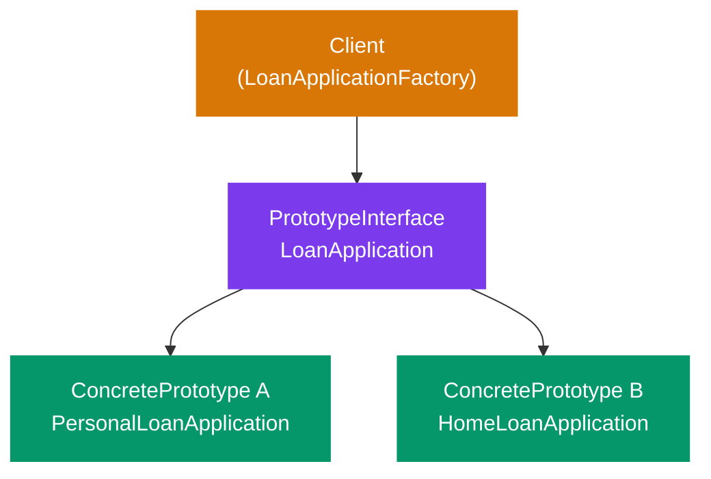
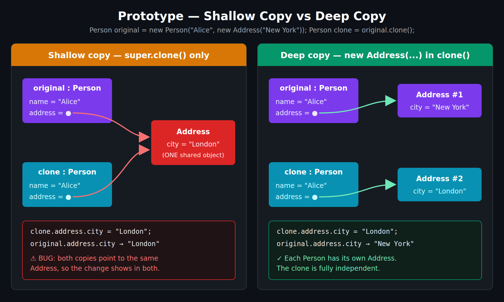

# Prototype Design Pattern in Java

**Prototype Design Pattern in Java** | A creational pattern. It creates new objects by copying (cloning) an existing object, instead of creating them from scratch. It is especially useful when object creation is expensive.

> 📖 **Master guide:** [LLD Interview Patterns Guide — §15 Prototype](./01_LLD_Interview_Patterns_Guide.md#15-prototype-pattern) — this file covers the same topic in more depth.

- [Introduction ⚡](#1-introduction)
- [When to Use Prototype Pattern ⚡](#2-when-to-use-prototype-pattern)
- [Participants 💤](#3-participants)
- [Shallow Copy vs Deep Copy 🔥](#4-shallow-copy-vs-deep-copy)
  - [Shallow Copy 🔥🔥](#41-shallow-copy)
  - [Deep Copy 🔥🔥](#42-deep-copy)
  - [Shallow Copy — the bug 🔥🔥](#43-shallow-copy--the-bug)
  - [Deep Copy — the fix 🔥🔥](#44-deep-copy--the-fix)
  - [Comparison Table 🔥🔥](#45-comparison-table)
  - [Deep Copy via Serialization 🔥](#46-deep-copy-via-serialization)
  - [Deep Copy via Jackson Round-Trip 🔥](#47-deep-copy-via-jackson-round-trip)
  - [⚠️ A Copy Is Not Atomic ⚡](#48--a-copy-is-not-atomic)
  - [Do `record`s Change Anything? ⚡](#49-do-records-change-anything)
- [Prototype Pattern Java Example ⚡](#5-prototype-pattern-java-example)
  - [Prototype Abstract Class ⚡](#51-prototype-abstract-class)
  - [ConcretePrototype — Personal Loan 💤](#52-concreteprototype--personal-loan)
  - [ConcretePrototype — Home Loan 💤](#53-concreteprototype--home-loan)
  - [Prototype Registry 🔥](#54-prototype-registry)
  - [Client 💤](#55-client)
- [Problems with Java's Cloneable Interface 🔥](#6-problems-with-javas-cloneable-interface)
  - [🔑 The rule: `clone()` must get its instance from `super.clone()`, never `new` 🔥](#61--the-rule-clone-must-get-its-instance-from-superclone-never-new)
  - [⚖️ Then why does GoF put `clone()` on an interface at all? — polymorphic copying 🔥](#62--then-why-does-gof-put-clone-on-an-interface-at-all--polymorphic-copying)
  - [✅ Preferred Alternative: Copy Constructor 🔥🔥](#63--preferred-alternative-copy-constructor)
- [Real-World Use Cases 💤](#7-real-world-use-cases)
- [Production Use Cases ⚡](#8-production-use-cases)
  - [Spring Prototype-Scoped Beans for Stateful Per-Request Processors 🔥🔥](#81-spring-prototype-scoped-beans-for-stateful-per-request-processors)
  - [Cloning Notification Templates Per Recipient ⚡](#82-cloning-notification-templates-per-recipient)
  - [Copy Constructor for Defensive DTO Snapshots at API Boundaries 🔥](#83-copy-constructor-for-defensive-dto-snapshots-at-api-boundaries)
  - [E-commerce: "Buy Again" / Reorder by Cloning a Past Order ⚡](#84-e-commerce-buy-again--reorder-by-cloning-a-past-order)
  - [SaaS Multi-Tenant Onboarding from a Default Settings Template 💤](#85-saas-multi-tenant-onboarding-from-a-default-settings-template)
  - [Microservices: Cloning a Request/Trace Context Before Mutation ⚡](#86-microservices-cloning-a-requesttrace-context-before-mutation)
  - [DevOps: Cloning a Base Pipeline / Job Config per Environment 💤](#87-devops-cloning-a-base-pipeline--job-config-per-environment)

> 🔥🔥 Must-know — very frequently tested &nbsp;·&nbsp; 🔥 High priority &nbsp;·&nbsp; ⚡ Medium priority &nbsp;·&nbsp; 💤 Low priority

---

<a id="1-introduction"></a>
## 1. Introduction 💤

Sometimes object creation is expensive. A single object may need:

- database calls
- network calls
- complex multi-step initialization
- loading large configuration trees

Paying this cost for every new instance is wasteful. The waste is bigger when most of the new object's state is the same as an existing object that is already set up.

**Prototype says:** *"Instead of new, clone."*

You do not build a fresh object from scratch. Instead, you take an existing, fully-configured object (the **prototype**) and copy it. Then you change the copy as needed for its specific use case. You do not pay the original construction cost again.



---

<a id="2-when-to-use-prototype-pattern"></a>
## 2. When to Use Prototype Pattern 💤

| Use it when | Example |
|---|---|
| Object creation is expensive (DB/network) | Loading config from DB, then cloning for each request |
| You need many similar objects with minor differences | Multiple loan applications sharing the same template |
| The class to instantiate is not known until runtime | Plugin-based systems, dynamic object creation |
| You want to avoid too many subclasses (subclass explosion) for creating variants | Instead of 10 subclasses, clone and change the copy |

---

<a id="3-participants"></a>
## 3. Participants 💤

| Participant | Role | Example |
|---|---|---|
| **Prototype** | Interface/abstract class declaring `clone()` | `LoanApplication` |
| **ConcretePrototype** | Implements `clone()`, returns a copy of itself | `PersonalLoanApplication`, `HomeLoanApplication` |
| **Client** | Calls `clone()` on the prototype | `LoanApplicationRegistry` / `LoanApplicationFactory` |

---

<a id="4-shallow-copy-vs-deep-copy"></a>
## 4. Shallow Copy vs Deep Copy 🔥



🔑 **This is the #1 interview topic for the Prototype pattern.** Interviewers almost always ask next: "what's the difference between shallow and deep copy?" Be ready to explain it and show the fix.

<a id="41-shallow-copy"></a>
### 4.1 Shallow Copy 🔥🔥

- Copies the object's **primitive fields by value**
- Copies **reference fields by reference** — both original and clone point to the **same nested object**
- Java's default `Object.clone()` performs a shallow copy
- ❌️ Problem: If you change a nested object in the clone, the original also changes

<a id="42-deep-copy"></a>
### 4.2 Deep Copy 🔥🔥

- Copies **all fields recursively**. It creates new instances of all referenced objects
- ✅ Safe: The clone is completely independent from the original
- You must write it by hand inside `clone()`, and copy each nested object yourself

<a id="43-shallow-copy--the-bug"></a>
### 4.3 Shallow Copy — the bug 🔥🔥

```java
// Shallow copy problem
// Note: Address does NOT implement Cloneable — it's deep-copied via its
// constructor (new Address(...)), not via Object.clone(). Adding Cloneable
// here would be a misleading no-op.
public class Address {
    public String city;

    public Address(String city) {
        this.city = city;
    }
}

public class Person implements Cloneable {
    public String name;
    public Address address;  // reference field

    public Person(String name, Address address) {
        this.name = name;
        this.address = address;
    }

    // Shallow clone — address is NOT deep-copied
    // Note: widened protected -> public, otherwise callers outside this
    // package can't invoke it at all (see §6).
    @Override
    public Person clone() throws CloneNotSupportedException {
        return (Person) super.clone();
    }
}

// Problem demonstration
public class Demo {
    public static void main(String[] args) throws CloneNotSupportedException {
        Person original = new Person("Alice", new Address("New York"));
        Person clone = original.clone();

        clone.address.city = "London";  // modifies original's address too!
        System.out.println(original.address.city);  // prints "London" — BUG!
    }
}
```

⚠️ Both `original.address` and `clone.address` point to the **same `Address` object**. Changing one changes both.

<a id="44-deep-copy--the-fix"></a>
### 4.4 Deep Copy — the fix 🔥🔥

```java
public class Person implements Cloneable {
    public String name;
    public Address address;

    public Person(String name, Address address) {
        this.name = name;
        this.address = address;
    }

    // Deep clone — address is explicitly deep-copied
    @Override
    public Person clone() throws CloneNotSupportedException {
        Person cloned = (Person) super.clone();
        cloned.address = new Address(this.address.city);  // deep copy
        return cloned;
    }
}
```

✅ Now `cloned.address` is a completely new `Address` object. Changing it does not affect the original.

> 💡 **"Why doesn't `clone()` return `Object`?"** It can. But since Java 5 you can use **covariant return types** (an override may return a subtype). This narrows the return to `Person` (as above), so callers do not need an ugly cast. The examples in this file return `Person` / `LoanApplication` for this reason.

> 💡 **The one valid `Cloneable` use: array `clone()`.** This means `arr.clone()` on the array instance. There is no `Array.clone()` static helper. Arrays implement `Cloneable` natively (JLS §10.8), and their `clone()` is `public` (JLS §10.7). So `int[] copy = arr.clone();` is **type-safe**: covariant return, no cast, no `CloneNotSupportedException`. This is the one place where using `clone()` is worth it. Everywhere else, prefer a copy constructor.
>
> ⚠️ **But array `clone()` is still shallow.** It only gives full independence for a 1-D array of *primitives*.
> - `Object[] copy = arr.clone()` shares every element with the original.
> - `int[][] copy = grid.clone()` shares every **row**.
> - For a real 2-D copy, you need `Arrays.stream(grid).map(int[]::clone).toArray(int[][]::new)`.
>
> When you say "arrays are the safe case", expect the interviewer to give this counter-example right away.

<a id="45-comparison-table"></a>
### 4.5 Comparison Table 🔥🔥

| Aspect | Shallow Copy | Deep Copy |
|---|---|---|
| Primitive fields | ✅ Copied by value | ✅ Copied by value |
| Reference fields | ❌️ Same reference | ✅ New independent copy |
| Java default `clone()` | ✅ Default behaviour | ❌️ Must override manually |
| Performance | Faster | Slower (more memory) |
| Independence | ❌️ Changes affect original | ✅ Fully independent |

<a id="46-deep-copy-via-serialization"></a>
### 4.6 Deep Copy via Serialization 🔥

A manual field-by-field deep copy gets hard for **large or deeply nested object graphs**. For cyclic graphs it is harder still: you must track the objects you already copied (for example, in an `IdentityHashMap`), or the copy recurses forever. A practical alternative: serialize the object to bytes, then deserialize it back. This round-trip rebuilds the entire graph as fresh instances.

```java
// Serialization-based deep copy — every field (and nested object) must be Serializable
@SuppressWarnings("unchecked")
public static <T extends Serializable> T deepCopy(T original) {
    try (ByteArrayOutputStream bos = new ByteArrayOutputStream();
         ObjectOutputStream oos = new ObjectOutputStream(bos)) {

        oos.writeObject(original);
        oos.flush();

        try (ObjectInputStream ois =
                 new ObjectInputStream(new ByteArrayInputStream(bos.toByteArray()))) {
            return (T) ois.readObject();   // fully independent deep copy
        }
    } catch (IOException | ClassNotFoundException e) {
        throw new IllegalStateException("Deep copy failed", e);
    }
}
```

In practice you rarely write this by hand. Use a library:

| ✅ Pros | ❌️ Cons |
|---|---|
| Handles **arbitrary object graphs** — no per-field code | **Slow** — serialization is far costlier than field copies |
| Survives **circular references** automatically | Every class in the graph must implement `Serializable` |
| One generic utility works for any type | Silently **drops `transient` fields** — they come back as type defaults |
| | Bypasses constructors — no validation/invariant checks run |

<a id="47-deep-copy-via-jackson-round-trip"></a>
### 4.7 Deep Copy via Jackson Round-Trip 🔥

| Jackson round-trip vs Java serialization | |
|---|---|
| ✅ No `Serializable` needed — works on any Jackson-mappable type | ❌️ `@JsonIgnore` fields silently vanish from the copy |
| ✅ `ObjectMapper` is already a configured bean | ❌️ Loses non-mappable types (`InputStream`, `Thread`, most JDK internals) |
| ✅ Readable, debuggable intermediate form | ❌️ Cycles blow the stack unless you add `@JsonIdentityInfo` |
| ✅ Handles `final` fields via the constructor Jackson calls | ❌️ Type erasure — generics need `TypeReference`, and polymorphic fields need `@JsonTypeInfo` or they deserialize to the base type |

⚠️ `convertValue` **runs the target's constructor**, unlike Java serialization. So validation/invariants really run. This is usually a good thing, but sometimes it is a surprise.

<a id="48--a-copy-is-not-atomic"></a>
### 4.8 ⚠️ A Copy Is Not Atomic ⚡

Every method on this page reads the source **field by field with no lock**:

- `clone()`
- copy constructor
- `SerializationUtils.clone()`
- a Jackson round-trip

Another thread may change the source in the middle of the copy. Then you get a copy of a state the object never really had. Half the fields come from before the change, half from after. This is a **torn copy**.

This bug shows up exactly where Prototype is most useful. That is a worker pool that copies a shared, long-lived template object. There are two fixes:

- **Make the source effectively immutable** after other threads can see it. This is the cleanest fix. If nobody changes a template, a copy of it can't be torn.
- **Copy under the same lock the writers use.** For example, do the copy inside a `synchronized` block or a `ReentrantReadWriteLock` read lock.

> 💡 Note: `new ConcurrentHashMap<>(other.map)` gives you a *weakly consistent* snapshot, not an atomic one. It shows some mix of the concurrent writes. That is fine for a cache. It is not fine for anything that must be internally consistent.

<a id="49-do-records-change-anything"></a>
### 4.9 Do `record`s Change Anything? ⚡

For a 2026 interview, have one short answer ready on Java 16+ records:

- Records are **shallowly immutable**. So for a record of primitives/`String`s, a copy is usually useless. Just share the instance.
- There is **no built-in "wither"** (a method that returns a copy with one field changed). To change one component, you write `new Order(old.id(), newAmount, old.lines())`. This is why `toBuilder()`-style idioms are still in use.
- ⚠️ **A record is not automatically deep-copy-safe.** `record Order(String id, List<Line> lines)` gives the *same* mutable list to every caller of `lines()`. The compact constructor must make a defensive copy of it:

```java
public record Order(String id, List<Line> lines) {
    public Order {
        lines = List.copyOf(lines);   // defensive copy — now genuinely immutable
    }
}
```

> 💡 **Short interview answer:** "For a small object, I deep-copy by hand or with a copy constructor. For a big nested graph, I'd use `SerializationUtils.clone()` or a Jackson `convertValue` round-trip. But I'd point out the costs. Serialization is slow, needs `Serializable` everywhere, and quietly skips `transient` fields. The Jackson route silently drops `@JsonIgnore` fields. And whichever I pick, the copy isn't atomic. If the source is mutable and shared, I copy under a lock."

---

<a id="5-prototype-pattern-java-example"></a>
## 5. Prototype Pattern Java Example 💤

An example fintech scenario: the app loads loan application templates once from the DB. Then it clones one per applicant.

<a id="51-prototype-abstract-class"></a>
### 5.1 Prototype Abstract Class ⚡

```java
// Prototype base — note: NO Cloneable, and clone() never calls super.clone().
// This declaration IS still an override of Object.clone() (a no-arg clone()
// always is) — it just widens access protected -> public, narrows the return
// type covariantly to LoanApplication, and drops the throws clause. All three
// are legal on an override. The *body* is ours: a manual deep copy via
// construction, so Object.clone()'s shallow native copy never runs.
public abstract class LoanApplication {
    protected String applicantName;
    protected double interestRate;
    protected int tenureMonths;
    protected List<String> requiredDocuments;

    public abstract LoanApplication clone();

    public void setApplicantName(String name) {
        this.applicantName = name;
    }

    @Override
    public String toString() {
        return "Loan[applicant=" + applicantName
                + ", rate=" + interestRate
                + ", tenure=" + tenureMonths
                + ", docs=" + requiredDocuments + "]";
    }
}
```

<a id="52-concreteprototype--personal-loan"></a>
### 5.2 ConcretePrototype — Personal Loan 💤

```java
// ConcretePrototype 1
public class PersonalLoanApplication extends LoanApplication {

    public PersonalLoanApplication() {
        this.interestRate = 14.5;
        this.tenureMonths = 36;
        this.requiredDocuments = new ArrayList<>(
            Arrays.asList("Aadhar", "PAN", "Salary Slip", "Bank Statement")
        );
    }

    @Override
    public PersonalLoanApplication clone() {          // covariant return — no cast for callers
        PersonalLoanApplication clone = new PersonalLoanApplication();
        clone.applicantName = this.applicantName;
        clone.interestRate = this.interestRate;
        clone.tenureMonths = this.tenureMonths;
        clone.requiredDocuments = new ArrayList<>(this.requiredDocuments); // deep copy list
        return clone;
    }
}
```

<a id="53-concreteprototype--home-loan"></a>
### 5.3 ConcretePrototype — Home Loan 💤

```java
// ConcretePrototype 2
public class HomeLoanApplication extends LoanApplication {

    public HomeLoanApplication() {
        this.interestRate = 8.5;
        this.tenureMonths = 240;
        this.requiredDocuments = new ArrayList<>(
            Arrays.asList("Aadhar", "PAN", "Property Docs", "ITR", "Bank Statement")
        );
    }

    @Override
    public HomeLoanApplication clone() {              // covariant return — no cast for callers
        HomeLoanApplication clone = new HomeLoanApplication();
        clone.applicantName = this.applicantName;
        clone.interestRate = this.interestRate;
        clone.tenureMonths = this.tenureMonths;
        clone.requiredDocuments = new ArrayList<>(this.requiredDocuments);
        return clone;
    }
}
```

<a id="54-prototype-registry"></a>
### 5.4 Prototype Registry 🔥

> 💡 **Interview bonus:** A **Prototype Registry** (also called a Prototype Manager) is a common follow-up question. It stores pre-loaded prototypes and returns clones on demand. So the client does not depend on concrete types at all.

```java
// Prototype Registry (bonus — often asked)
public class LoanApplicationRegistry {
    private static final Map<String, LoanApplication> registry = new HashMap<>();

    static {
        registry.put("PERSONAL", new PersonalLoanApplication());
        registry.put("HOME", new HomeLoanApplication());
    }

    public static LoanApplication getPrototype(String type) {
        LoanApplication prototype = registry.get(type.toUpperCase());
        if (prototype == null) {
            throw new IllegalArgumentException("Unknown loan type: " + type);
        }
        return prototype.clone();
    }
}
```

<a id="55-client"></a>
### 5.5 Client 💤

```java
// Client
public class Main {
    public static void main(String[] args) {
        LoanApplication app1 = LoanApplicationRegistry.getPrototype("PERSONAL");
        app1.setApplicantName("Alice");

        LoanApplication app2 = LoanApplicationRegistry.getPrototype("PERSONAL");
        app2.setApplicantName("Bob");

        System.out.println(app1);
        System.out.println(app2);
    }
}
```

📤 **Output:**

```
Loan[applicant=Alice, rate=14.5, tenure=36, docs=[Aadhar, PAN, Salary Slip, Bank Statement]]
Loan[applicant=Bob, rate=14.5, tenure=36, docs=[Aadhar, PAN, Salary Slip, Bank Statement]]
```

✅ Both `app1` and `app2` are fully independent clones. Changing the documents of one does not affect the other. This is because `clone()` deep-copied `requiredDocuments` as a new `ArrayList`.

---

<a id="6-problems-with-javas-cloneable-interface"></a>
## 6. Problems with Java's Cloneable Interface ⚡

Java's built-in `Cloneable` mechanism has several well-known design flaws. You need to know them for SDE II-level interviews.

| Problem | Detail |
|---|---|
| `Cloneable` is a marker interface | It has no methods. `Object.clone()` checks the marker at runtime through a native call |
| Default `clone()` is `protected` | You must override it and make it `public` in every concrete class |
| Shallow copy by default | All reference fields share the same reference. You must write the deep copy by hand |
| `CloneNotSupportedException` | A checked exception that you must catch or declare. This adds boilerplate to every `clone()` |
| No constructor invoked | `clone()` skips constructors completely. This can break invariants and validation logic |
| Incompatible with `final` fields | `clone()` can't reassign a `final` mutable reference field. You need to deep-copy it after `super.clone()`, but `final` does not allow reassignment. So `Cloneable` forces you to **drop `final`**, and you lose immutability. This is one of Bloch's strongest arguments for copy constructors. |
| Fragile across inheritance | The `clone()` contract is **viral** (it spreads to every subclass). Once a superclass clones through `super.clone()`, *every* subclass must override `clone()`. Each one must deep-copy its own mutable fields. A subclass that forgets gets a **shallow** copy of its new fields, with no warning. The code compiles, but it has a deep-copy bug. |

<a id="61--the-rule-clone-must-get-its-instance-from-superclone-never-new"></a>
### 6.1 🔑 The rule: `clone()` must get its instance from `super.clone()`, never `new` 🔥

Interviewers ask this follow-up after "just use a copy constructor". It catches people who learned that answer by heart but do not know what problem it solves.

The `clone()` contract expects `x.clone().getClass() == x.getClass()`. The Javadoc calls this the general intent, not an absolute rule. Only `super.clone()` follows this rule. The call chain ends in `Object.clone()`, a native method that creates the object from the **runtime** class. `new` fixes the class at compile time:

```java
class Foo implements Cloneable {
    @Override
    public Foo clone() {
        return new Foo();       // ❌️ breaks the contract for every subclass
    }
}

class Bar extends Foo { int extra; }

Bar bar = new Bar();
Object copy = bar.clone();      // returns a Foo, not a Bar — and silently drops `extra`
```

If `Bar` forgets to override `clone()`, it inherits the one from `Foo` and gets back a `Foo`. There is no compile error and no exception. The bug shows up later as a `ClassCastException`, in a different part of the code, far from the real cause.

> 💡 **A detail worth saying in the interview:** `LoanApplication.clone()` in §5 *does* use `new`. That is fine there. `clone()` is **abstract** on the base class, so the compiler forces every concrete subclass to write its own. The rule matters only when a subclass can inherit the `clone()` of a **concrete** class. Say "`new` is safe here because the method is abstract". That is a stronger answer than just repeating the rule.

<a id="62--then-why-does-gof-put-clone-on-an-interface-at-all--polymorphic-copying"></a>
### 6.2 ⚖️ Then why does GoF put `clone()` on an interface at all? — polymorphic copying 🔥

You say "always prefer a copy constructor". The obvious reply from the interviewer is: *"then why does the pattern exist?"* The honest answer is the one thing a copy constructor really cannot do. It cannot **copy an object of unknown runtime type**.

```java
void archive(LoanApplication app) {
    // ❌️ A copy constructor forces you to name a concrete type at compile time.
    //    LoanApplication is abstract, so this doesn't even compile — and picking
    //    PersonalLoanApplication(app) would SLICE a HomeLoanApplication.

    // ✅ Virtual dispatch: a HomeLoanApplication copies as a HomeLoanApplication.
    LoanApplication snapshot = app.clone();
    archiveRepository.save(snapshot);
}
```

A constructor is **not** virtual:

- `new PersonalLoanApplication(other)` always builds a `PersonalLoanApplication`, even when `other` is really a subclass. You lose the fields of the subclass.
- A `clone()` / `copy()` declared on the supertype dispatches to the runtime type. It copies the whole object.

*Effective Java* Item 13 does not say this directly. But it fits Bloch's advice: use copy constructors or copy factories instead of `Cloneable`. So the fix is not "never have a virtual copy method". The fix is "declare your own `copy()` on the interface and implement it with copy constructors". You keep polymorphic copying, and you do not inherit the broken contract of `Cloneable`.

<a id="63--preferred-alternative-copy-constructor"></a>
### 6.3 ✅ Preferred Alternative: Copy Constructor 🔥🔥

A **copy constructor** is cleaner. It avoids all the `Cloneable` problems, and it makes the intent clear.

```java
// Copy constructor — preferred over Cloneable
public PersonalLoanApplication(PersonalLoanApplication other) {
    this.applicantName = other.applicantName;
    this.interestRate = other.interestRate;
    this.tenureMonths = other.tenureMonths;
    this.requiredDocuments = new ArrayList<>(other.requiredDocuments);
}
```

Or a static factory `copyOf()` method:

```java
// Static factory copy — also clean and readable
public static PersonalLoanApplication copyOf(PersonalLoanApplication other) {
    PersonalLoanApplication copy = new PersonalLoanApplication();
    copy.applicantName = other.applicantName;
    copy.interestRate = other.interestRate;
    copy.tenureMonths = other.tenureMonths;
    copy.requiredDocuments = new ArrayList<>(other.requiredDocuments);
    return copy;
}
```

> 💡 **Interview tip:** The interviewer may ask "how would you implement Prototype in Java?". Mention both approaches. Give `Cloneable` first, to be complete. Then move to the copy constructor as the approach preferred in production. Mention that Joshua Bloch's *Effective Java* clearly advises against `Cloneable` (Item 13).

---

<a id="7-real-world-use-cases"></a>
## 7. Real-World Use Cases 💤

| Use Case | How Prototype Helps |
|---|---|
| `Object.clone()` in Java | Java's built-in cloning mechanism. It is the prototype support built into the language |
| Spring Bean scope `prototype` | Each `getBean()` call returns a new instance. It only *shares the name* of the pattern. Spring **instantiates** a fresh bean from the definition each time. It does **not** clone an existing instance |
| Document templates (Word, PDF) | Clone the base template, then fill in different data for each recipient |
| Game development | Clone enemy/unit prototype objects, with small changes for each instance |
| Fintech: batch shared-context fork | Deep-copy the shared state map of the orchestration for each branch. Then parallel loan branches can't corrupt each other |

> 💡 **Interview tip:** Interviewers often ask "shallow vs deep copy". Always start with the difference, then show the fix. Mention the copy constructor as the preferred alternative to `Cloneable`. You get extra points for:
>
> - the Prototype Registry.
> - **clearing up the `@Scope("prototype")` confusion before they ask.** Say early that it only shares the name. It *instantiates* a new bean; it does not clone.
>
> The most common way to lose points on this topic is to call it "the Spring version of the pattern".

---

<a id="8-production-use-cases"></a>
## 8. Production Use Cases ⚡

The `Real-World Use Cases` table above is the 30-second summary. This section goes deeper. It gives production-grade examples that you can copy. Each one shows where **"clone instead of new"** is really worth it. The areas are fintech, e-commerce, SaaS, notifications, microservices, and DevOps.

In modern Java, the *idea* of Prototype usually appears as **prototype-scoped beans, copy constructors, builder `toBuilder()` copies, and `BeanUtils.copyProperties` / MapStruct**. Raw `Cloneable` is rare.

<a id="81-spring-prototype-scoped-beans-for-stateful-per-request-processors"></a>
### 8.1 Spring Prototype-Scoped Beans for Stateful Per-Request Processors 🔥🔥

A `@Scope("prototype")` bean gives you a **fresh instance on every `getBean()`**. The Spring prototype *scope* only shares its name with the GoF pattern. It **instantiates** a new bean. It does not clone an existing one. But it has the same goal: never share mutable state.

Use it when a helper holds **mutable per-request state** that must never leak across threads. For example: a loan eligibility evaluator that collects rule results.

```java
// Fresh, stateful evaluator per loan application — never share across requests
@Component
@Scope(value = "prototype")
public class LoanEligibilityEvaluator {

    private final List<RuleResult> results = new ArrayList<>();   // mutable per-request state
    private BigDecimal score = BigDecimal.ZERO;

    public void apply(EligibilityRule rule, LoanApplication app) {
        RuleResult r = rule.evaluate(app);
        results.add(r);
        score = score.add(r.weight());
    }

    public EligibilityDecision decide() {
        return score.compareTo(new BigDecimal("70")) >= 0
                ? EligibilityDecision.APPROVE
                : EligibilityDecision.REFER;
    }
}
```

A singleton service can't just `@Autowired` a prototype bean. Spring would inject it **once**, and it would act like a singleton. Use `ObjectProvider` to get a fresh instance for each request:

```java
@Service
public class LoanService {

    private final ObjectProvider<LoanEligibilityEvaluator> evaluatorProvider;

    public LoanService(ObjectProvider<LoanEligibilityEvaluator> evaluatorProvider) {
        this.evaluatorProvider = evaluatorProvider;
    }

    public EligibilityDecision evaluate(LoanApplication app, List<EligibilityRule> rules) {
        LoanEligibilityEvaluator evaluator = evaluatorProvider.getObject(); // fresh instance each call (not a clone)
        rules.forEach(rule -> evaluator.apply(rule, app));
        return evaluator.decide();
    }
}
```

Sometimes the fresh instance needs **constructor arguments** decided at runtime. Use `ObjectProvider.getObject(args...)`, or call the application context directly. Only prototype beans can do this (a singleton can't take per-call constructor args):

```java
// Prototype bean built with runtime constructor args — resolved per call
AbstractTaxCalculator calc = applicationContext.getBean(
        InclusiveTaxCalculator.class, computationStrategy, partitionRuleBuilder);
```

> ⚠️ **Common mistake:** Spring does **not** manage the full lifecycle of a prototype bean. It never calls `@PreDestroy`. If the bean holds a resource (connection, file handle), you must clean it up yourself.

<a id="82-cloning-notification-templates-per-recipient"></a>
### 8.2 Cloning Notification Templates Per Recipient ⚡

A notification system loads a base template once (subject, body, locale, channel config). Then it **clones it for each recipient** and changes only the personalization fields. Take a campaign with 100k recipients. Cloning a template that is already loaded costs far less than loading and parsing it from the DB again for each recipient.

```java
public class NotificationTemplate {
    private final String channel;            // EMAIL / SMS / PUSH
    private final String subjectTemplate;
    private final String bodyTemplate;
    private Map<String, String> placeholders;

    // Copy constructor — deep-copies the mutable placeholder map
    public NotificationTemplate(NotificationTemplate other) {
        this.channel = other.channel;
        this.subjectTemplate = other.subjectTemplate;
        this.bodyTemplate = other.bodyTemplate;
        this.placeholders = new HashMap<>(other.placeholders);   // deep copy
    }

    public NotificationTemplate personalizeFor(Customer c) {
        NotificationTemplate copy = new NotificationTemplate(this);   // clone, don't mutate base
        copy.placeholders.put("name", c.firstName());
        copy.placeholders.put("amountDue", c.outstanding().toPlainString());
        return copy;
    }
    // getters omitted
}
```

✅ The shared base template stays immutable. Each recipient gets an independent copy. Without the clone, the threads in the worker pool would all change the same `placeholders` map at the same time (a race condition).

<a id="83-copy-constructor-for-defensive-dto-snapshots-at-api-boundaries"></a>
### 8.3 Copy Constructor for Defensive DTO Snapshots at API Boundaries 🔥

Do not return your internal **mutable** entity to a caller. If you do, the caller could change your source of truth (the data your service treats as the correct version). Instead, use a copy constructor. It takes a snapshot of the mutable source and puts it into an **immutable** DTO. The caller gets a copy that cannot change. Joshua Bloch's *Effective Java* prefers this over `Cloneable`.

```java
// Mutable internal entity — the service's source of truth
public class Payment {
    private String paymentId;
    private BigDecimal amount;
    private String status;
    private List<String> ledgerEntries;   // mutable
    // getters / setters omitted
}

public final class PaymentDTO {
    private final String paymentId;
    private final BigDecimal amount;
    private final String status;
    private final List<String> ledgerEntries;

    // Snapshot a mutable Payment into an immutable DTO — caller can't touch the source
    public PaymentDTO(Payment source) {
        this.paymentId = source.getPaymentId();
        this.amount = source.getAmount();
        this.status = source.getStatus();
        this.ledgerEntries = List.copyOf(source.getLedgerEntries());   // defensive immutable copy
    }
    // getters omitted
}
```

> 💡 **Interview angle:** This is Prototype in a hidden form. The copy constructor *is* the clone mechanism preferred in production. The goal is to protect a **mutable** source:
>
> - Take a snapshot of it into an immutable DTO.
> - Deep-copy collections with `List.copyOf` / `new ArrayList<>(...)`. Then nobody can change them through the returned object.
>
> (Copying an *already-immutable* object has no use. You can just share it.)

<a id="84-e-commerce-buy-again--reorder-by-cloning-a-past-order"></a>
### 8.4 E-commerce: "Buy Again" / Reorder by Cloning a Past Order ⚡

A "Buy it again" feature clones a previous `Order`. It copies the line items and shipping preferences. Then it resets the identity and timestamps, so the result is a brand-new draft order. Cloning is better than rebuilding the cart field by field from nothing.

```java
public class Order {
    private String orderId;
    private Long customerId;
    private List<OrderLine> lines;
    private Address shippingAddress;
    private OrderStatus status;
    private Instant createdAt;

    // Prototype-style factory: clone an old order into a fresh draft
    public Order cloneAsNewDraft() {
        Order draft = new Order();
        draft.orderId = UUID.randomUUID().toString();           // new identity
        draft.customerId = this.customerId;
        draft.lines = this.lines.stream()
                                 .map(OrderLine::new)            // deep copy each line via OrderLine's copy constructor
                                 .collect(Collectors.toList());
        draft.shippingAddress = new Address(this.shippingAddress); // deep copy
        draft.status = OrderStatus.DRAFT;                        // reset state
        draft.createdAt = Instant.now();
        return draft;
    }
}
```

> 📝 **Assumes copy constructors:** `OrderLine::new` and `new Address(...)` here need the copy constructors `OrderLine(OrderLine other)` and `Address(Address other)`. Each one deep-copies its own mutable fields. This is the same pattern shown in §6 and §8.2. Without them, you get shared references again, and the shallow-copy bug comes back.

⚠️ **Reset what must be unique:** when you clone persisted entities, always reset the primary key and audit fields (`id`, `createdAt`, version). Set them to null or generate new values. If you don't, JPA will try to *update* the original instead of *inserting* a copy.

<a id="85-saas-multi-tenant-onboarding-from-a-default-settings-template"></a>
### 8.5 SaaS Multi-Tenant Onboarding from a Default Settings Template 💤

When a new tenant signs up, you set up its configuration by **cloning an immutable "default tenant settings" prototype**. Then you override a few fields. This makes sure every tenant starts from the same validated base settings.

```java
@Component
public class TenantProvisioningService {

    // The pre-built, validated default template (loaded once at startup)
    private final TenantSettings defaultTemplate;

    public TenantProvisioningService(TenantSettingsLoader loader) {
        this.defaultTemplate = loader.loadDefaults();   // expensive — done once
    }

    public TenantSettings provision(String tenantName, String tier) {
        return defaultTemplate.toBuilder()              // clone via Lombok @Builder(toBuilder = true)
                .tenantId(UUID.randomUUID().toString())
                .tenantName(tenantName)
                .tier(tier)
                .createdAt(Instant.now())
                .build();
    }
}
```

```java
@Value
@Builder(toBuilder = true)   // toBuilder() clones the immutable object, letting you override fields
public class TenantSettings {
    String tenantId;
    String tenantName;
    String tier;
    int maxUsers;
    boolean ssoEnabled;
    Instant createdAt;
}
```

> 💡 Lombok's `@Builder(toBuilder = true)` is the cleanest standard way to "clone and change a few fields" in modern Java. The source is immutable, the copy is independent, and there is zero `Cloneable` boilerplate.

<a id="86-microservices-cloning-a-requesttrace-context-before-mutation"></a>
### 8.6 Microservices: Cloning a Request/Trace Context Before Mutation ⚡

In a microservice call chain, you often need to **fork the propagation context**. This context holds trace IDs, correlation ID, auth claims and baggage (extra key-value data that travels with the request). To fork it means to make a child copy of it for a downstream async branch. You must not change the caller's context. Cloning keeps the parent context unchanged.

```java
public class RequestContext {
    private final String correlationId;
    private final String tenantId;
    private final Map<String, String> baggage;

    // Root context — the entry point (e.g. built by an inbound filter)
    public RequestContext(String correlationId, String tenantId) {
        this.correlationId = correlationId;
        this.tenantId = tenantId;
        this.baggage = new ConcurrentHashMap<>();
    }

    public RequestContext(RequestContext other) {
        this.correlationId = other.correlationId;
        this.tenantId = other.tenantId;
        this.baggage = new ConcurrentHashMap<>(other.baggage);   // deep copy for thread safety
    }

    // Fork a child context for an async downstream call
    public RequestContext fork(String childSpanId) {
        RequestContext child = new RequestContext(this);
        String parentSpanId = child.baggage.get("spanId");
        if (parentSpanId != null) {                 // root context has no spanId yet
            child.baggage.put("parentSpanId", parentSpanId);
        }
        child.baggage.put("spanId", childSpanId);
        return child;
    }
    // getters omitted
}
```

> ⚠️ **You must keep the null check here.** `ConcurrentHashMap` does not allow null keys *or* null values. `HashMap` allows them. The first (root) context has no `"spanId"` entry. So `put("parentSpanId", get("spanId"))` without the check throws `NullPointerException` on the very first fork. Changing the map type changes how the code fails, with no warning. Have this ready as an answer to "why did you pick this map?".

<a id="87-devops-cloning-a-base-pipeline--job-config-per-environment"></a>
### 8.7 DevOps: Cloning a Base Pipeline / Job Config per Environment 💤

A CI/CD orchestrator holds a base deployment-job template. It **clones it for each environment** (dev / staging / prod). It overrides only the env-specific settings (replica count, resource limits, target cluster). So you do not need to maintain almost-duplicate job definitions by hand.

```java
public class DeploymentJobConfig {
    private String jobName;
    private String image;
    private int replicas;
    private String cpuLimit;
    private String targetCluster;
    private Map<String, String> envVars;

    public DeploymentJobConfig(DeploymentJobConfig other) {
        this.jobName = other.jobName;
        this.image = other.image;
        this.replicas = other.replicas;
        this.cpuLimit = other.cpuLimit;
        this.targetCluster = other.targetCluster;
        this.envVars = new LinkedHashMap<>(other.envVars);   // deep copy
    }

    public DeploymentJobConfig forEnvironment(String env, int replicas, String cluster) {
        DeploymentJobConfig copy = new DeploymentJobConfig(this);
        copy.jobName = this.jobName + "-" + env;
        copy.replicas = replicas;
        copy.targetCluster = cluster;
        copy.envVars.put("SPRING_PROFILES_ACTIVE", env);
        return copy;
    }
    // no-arg constructor, getters and setters omitted
}
```

The base template itself usually lives in external config. Spring binds it once at startup:

```yaml
# application.yml — base job template bound to DeploymentJobConfig
deployment:
  base-job:
    job-name: loan-service
    image: registry.internal/loan-service:latest
    replicas: 2
    cpu-limit: "500m"
    target-cluster: dev-cluster
    env-vars:
      JAVA_OPTS: "-Xms256m -Xmx512m"
```

> 💡 **What all 7 have in common:** load and validate the expensive base object **once**. Then give out **independent deep copies** for each variation. Prototype bugs usually hide in the deep copy of mutable collections. Always copy `List`/`Map`/`Set` fields. Never share the reference.

---

---

> **🎯 Interview footer — Prototype**  
> **Seen in:** `Object.clone()` + `Cloneable` (the JDK's own marker-interface version, and the design that *Effective Java* Item 13 warns against); `ArrayList.clone()` / `HashMap.clone()` (shallow); `Calendar.clone()`; Spring's `@Scope("prototype")` beans, which are "a fresh copy per lookup" rather than `clone()`.  
> **This invites:** *"Shallow or deep — and which did you need?"* → the bug is in the mutable `List`/`Map` fields. *"Why not just a copy constructor or a static factory?"* → they are the recommended replacement. The design of the `clone()` contract is broken: no constructor runs, `final` fields cause problems, and `CloneNotSupportedException` is checked for no reason. But note that a constructor can't copy polymorphically (§6). *"Prototype vs Builder `toBuilder()`?"* → same intent, but `toBuilder()` keeps immutability and type-safety; see [Builder Design Pattern](./06_Builder_Design_Pattern_in_Java.md).
