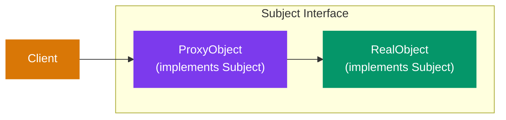
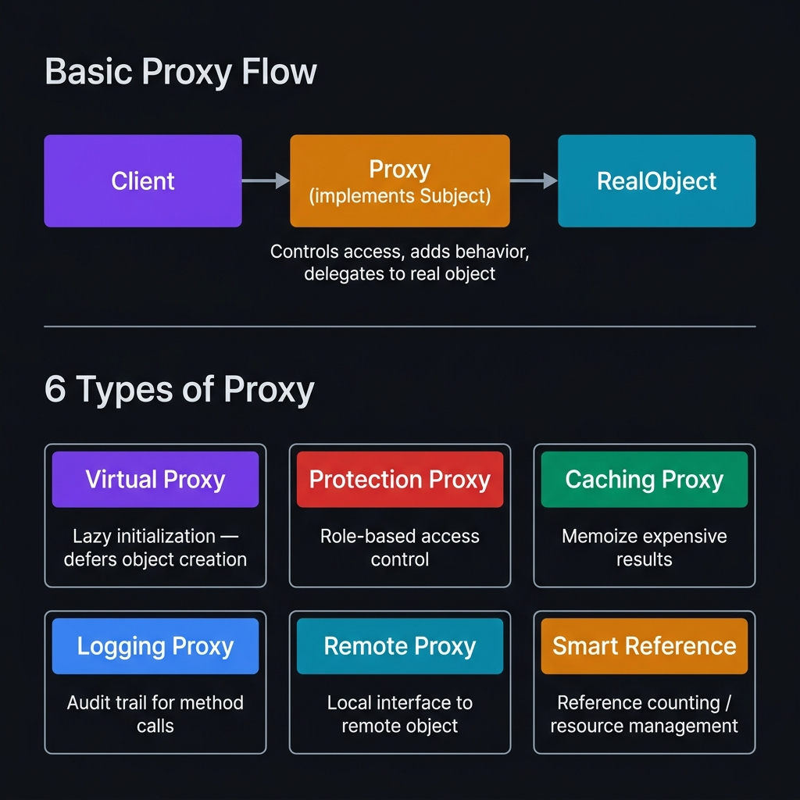
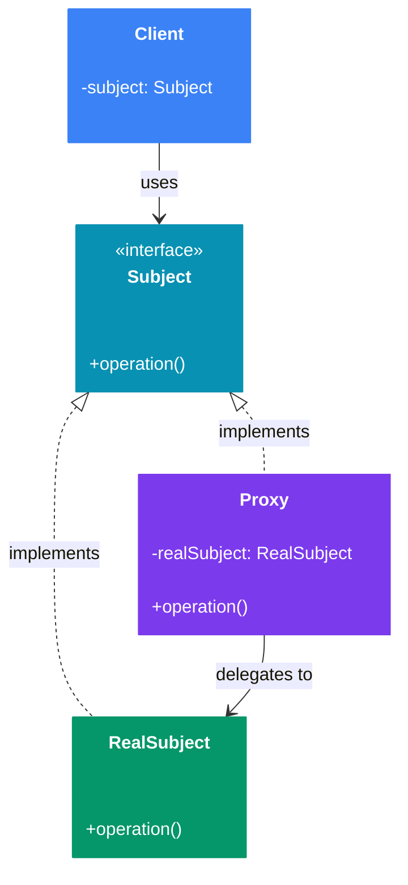
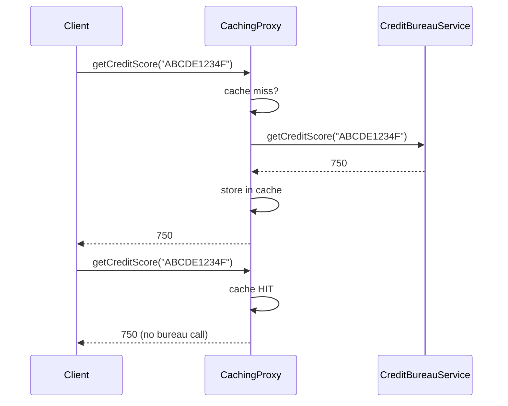
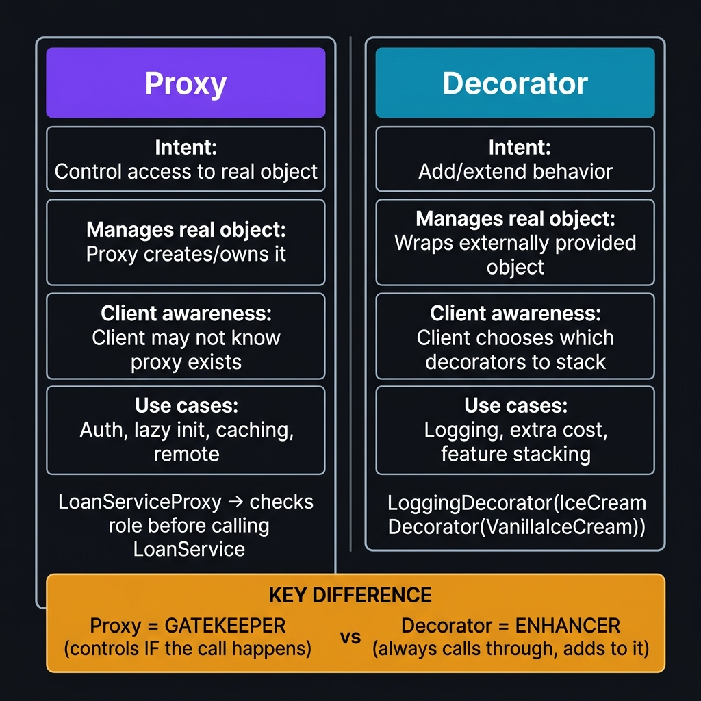
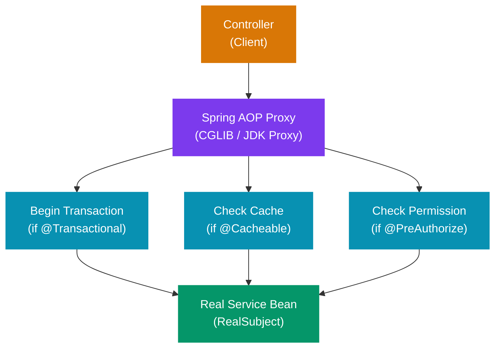

# Proxy Design Pattern in Java

**Proxy Design Pattern in Java** | A structural pattern. It gives you a substitute object that controls access to another object. The substitute can add security, lazy loading, caching, or logging. The real object does not change.

- [Introduction ⚡](#1-introduction)
- [Types of Proxy ⚡](#2-types-of-proxy)
- [Participants 💤](#3-participants)
- [Proxy Pattern Java Example 🔥](#4-proxy-pattern-java-example)
  - [Protection Proxy (Static) — Role-Based Access to Loan Disbursement ⚡](#41-protection-proxy-static--role-based-access-to-loan-disbursement)
  - [Caching Proxy (Static) — Credit Score Lookup ⚡](#42-caching-proxy-static--credit-score-lookup)
- [Proxy vs Decorator 🔥](#5-proxy-vs-decorator)
  - [Proxy vs Adapter 🔥](#51-proxy-vs-adapter)
- [Spring Framework & Java — Proxy in the Wild 🔥🔥](#6-spring-framework--java--proxy-in-the-wild)
  - [JDK Dynamic Proxy vs CGLIB — which one does Spring pick? 🔥🔥](#61-jdk-dynamic-proxy-vs-cglib--which-one-does-spring-pick)
  - [Proxy identity — `getClass()`, `instanceof`, and casting 🔥🔥](#62-proxy-identity--getclass-instanceof-and-casting)
  - [`@Configuration` classes are proxied too — `proxyBeanMethods` 🔥](#63-configuration-classes-are-proxied-too--proxybeanmethods)
- [Real-World Use Cases ⚡](#7-real-world-use-cases)
- [Production Use Cases 🔥](#8-production-use-cases)
  - [Declarative Transactions with @Transactional 🔥🔥](#81-declarative-transactions-with-transactional)
  - [Caching Proxy with @Cacheable 🔥](#82-caching-proxy-with-cacheable)
  - [Hibernate Lazy-Loading Proxy 🔥🔥](#83-hibernate-lazy-loading-proxy)
  - [Method-Level Security with @PreAuthorize ⚡](#84-method-level-security-with-preauthorize)
  - [Asynchronous Execution with @Async ⚡](#85-asynchronous-execution-with-async)
  - [Remote Proxy with Feign Clients ⚡](#86-remote-proxy-with-feign-clients)
  - [Resilience Proxy — Circuit Breaker & Rate Limiter ⚡](#87-resilience-proxy--circuit-breaker--rate-limiter)
  - [Custom Audit Proxy with a JDK Dynamic Proxy 🔥](#88-custom-audit-proxy-with-a-jdk-dynamic-proxy)
  - [Spring Data Repository Interfaces — the purest dynamic proxy in Spring 🔥](#89-spring-data-repository-interfaces--the-purest-dynamic-proxy-in-spring)
- [When NOT to Use Proxy 🔥](#9-when-not-to-use-proxy)

> 🔥🔥 Must-know — very frequently tested &nbsp;·&nbsp; 🔥 High priority &nbsp;·&nbsp; ⚡ Medium priority &nbsp;·&nbsp; 💤 Low priority

---

<a id="1-introduction"></a>
## 1. Introduction 💤

The Proxy pattern adds a middle object, the **Proxy**. It sits between the **Client** and the **RealObject**.

- Both the Proxy and the RealObject implement the same **Subject** interface.
- So the client does not know it is talking to a proxy.
- The proxy decides whether, when, and how to pass calls to the real object.

🔑 **One-line summary:** "Same interface as RealObject, but controls access."



The Proxy can:
- **Allow or deny** the call based on permissions (Protection Proxy)
- **Delay** the creation of the real object until first use (Virtual Proxy)
- **Cache** results from a previous call and return them without touching the real object (Caching Proxy)
- **Log** every call before/after it passes the call on, without the client seeing it (Logging/Audit Proxy)

---

<a id="2-types-of-proxy"></a>
## 2. Types of Proxy ⚡



| Type | What it Does | Real Example |
|---|---|---|
| **Virtual Proxy** | Delays costly object creation until it is really needed (lazy initialization) | Loading a large image/PDF only when displayed |
| **Protection Proxy** | Controls access based on roles/permissions | Only admins can call certain methods |
| **Caching Proxy** | Caches results and returns the cached copy on later calls | Cache DB query results, API responses |
| **Logging/Audit Proxy** | Logs every method call, without the client seeing it | Audit trail for financial transactions |
| **Remote Proxy** | Represents an object in a different JVM/network | Java RMI, REST client stubs |
| **Smart Reference Proxy** | Adds extra tracking work on each access. Examples: reference counting (free the object when the last reference goes away), lock-on-access (acquire a lock before passing the call on), or null-guard | Netty's `ReferenceCounted` / `ByteBuf.refCnt()` (real refcounting for off-heap buffers), `Collections.synchronizedList` (locks before each call) |

⚠️ **Don't say "Java reference counting."**

- The JVM uses **tracing GC** (it finds live objects by following references from roots), not reference counting.
- `java.lang.ref` gives you reference *strengths* (`SoftReference`/`WeakReference`/`PhantomReference`) plus `ReferenceQueue`. That is a different mechanism.
- Real refcounting on the JVM is a library job (Netty buffers, JNI/off-heap handles). It is not a language feature.

---

<a id="3-participants"></a>
## 3. Participants 💤

| Participant | Role | Example |
|---|---|---|
| **Subject** | Interface implemented by both Proxy and RealSubject | `LoanService` |
| **RealSubject** | The actual object that does the real work | `LoanServiceImpl` |
| **Proxy** | Implements Subject, holds a reference to RealSubject, controls access | `LoanServiceProxy` |
| **Client** | Uses the Subject interface. Does not know if it is Proxy or Real | `LoanController` |



---

<a id="4-proxy-pattern-java-example"></a>
## 4. Proxy Pattern Java Example ⚡

The two examples below are **static proxies**. You write the proxy class by hand. It implements the same interface and forwards each method one by one. This is the standard GoF (Gang of Four book) form.

📌 **Static vs dynamic proxy:**

| | Static Proxy | Dynamic Proxy |
|---|---|---|
| **How** | A class you write. It implements the Subject interface and delegates each method | Created at runtime through reflection (`java.lang.reflect.Proxy` + `InvocationHandler`) or bytecode (CGLIB `Enhancer`) |
| **Boilerplate** | One forwarding method per interface method. It grows with the interface | Zero per-method code. A single `invoke()` handles every method through reflection |
| **Compile-time safety** | Type-checked at compile time | No compile-time check. Errors show up at runtime |
| **Used by** | Small, fixed interfaces; the examples in this section | Spring AOP, Feign, mocking frameworks — see §8 |

<a id="41-protection-proxy-static--role-based-access-to-loan-disbursement"></a>
### 4.1 Protection Proxy (Static) — Role-Based Access to Loan Disbursement ⚡

1️⃣ **Define the Subject interface**

```java
// Subject interface
public interface LoanService {
    void disburseLoan(String loanId, double amount);
    String getLoanStatus(String loanId);
}
```

2️⃣ **Implement the RealSubject**

```java
// RealSubject
public class LoanServiceImpl implements LoanService {

    @Override
    public void disburseLoan(String loanId, double amount) {
        System.out.println("Disbursing loan " + loanId + " of amount ₹" + amount);
    }

    @Override
    public String getLoanStatus(String loanId) {
        return "ACTIVE";
    }
}
```

3️⃣ **Implement the Protection Proxy**

```java
// Protection Proxy
public class LoanServiceProxy implements LoanService {

    private final LoanServiceImpl realService = new LoanServiceImpl();
    private final String userRole;

    public LoanServiceProxy(String userRole) {
        this.userRole = userRole;
    }

    @Override
    public void disburseLoan(String loanId, double amount) {
        if (!"ADMIN".equals(userRole) && !"OPERATIONS".equals(userRole)) {
            throw new SecurityException(
                "Access denied: only ADMIN/OPERATIONS can disburse loans"
            );
        }
        System.out.println("[AUDIT] User role " + userRole + " disbursing loan " + loanId);
        realService.disburseLoan(loanId, amount);
    }

    @Override
    public String getLoanStatus(String loanId) {
        // Any role can check status — no restriction
        return realService.getLoanStatus(loanId);
    }
}
```

4️⃣ **Client code**

```java
// Client
public class Main {
    public static void main(String[] args) {
        LoanService adminService = new LoanServiceProxy("ADMIN");
        adminService.disburseLoan("LOAN-001", 500000.0);

        LoanService viewerService = new LoanServiceProxy("VIEWER");
        viewerService.disburseLoan("LOAN-002", 200000.0); // throws SecurityException
    }
}
```

📤 **Output:**
```
[AUDIT] User role ADMIN disbursing loan LOAN-001
Disbursing loan LOAN-001 of amount ₹500000.0
Exception in thread "main" java.lang.SecurityException: Access denied: only ADMIN/OPERATIONS can disburse loans
```

---

<a id="42-caching-proxy-static--credit-score-lookup"></a>
### 4.2 Caching Proxy (Static) — Credit Score Lookup ⚡

Credit bureau calls are costly and rate-limited. A Caching Proxy stores results in memory. It answers repeated lookups without calling the external API again.

1️⃣ **Define the Subject interface**

```java
// Subject interface
public interface CreditScoreService {
    int getCreditScore(String panNumber);
}
```

2️⃣ **Implement the RealSubject**

```java
// RealSubject — makes an expensive external API call
public class CreditBureauService implements CreditScoreService {

    @Override
    public int getCreditScore(String panNumber) {
        System.out.println("Fetching credit score from bureau for PAN: " + panNumber);
        // Simulating expensive external API call
        return 750;
    }
}
```

3️⃣ **Implement the Caching Proxy**

```java
// Caching Proxy
public class CreditScoreCachingProxy implements CreditScoreService {

    private final CreditBureauService realService = new CreditBureauService();
    private final Map<String, Integer> cache = new HashMap<>();

    @Override
    public int getCreditScore(String panNumber) {
        if (cache.containsKey(panNumber)) {
            System.out.println("Cache hit for PAN: " + panNumber);
            return cache.get(panNumber);
        }
        int score = realService.getCreditScore(panNumber);
        cache.put(panNumber, score);
        return score;
    }
}
```

⚠️ **Two things an interviewer will question in this snippet.** Both are left in on purpose. This is the textbook version, not the production version.
- The plain `HashMap` is **not thread-safe**. Also, `containsKey` + `get` is a two-step race. Use `ConcurrentHashMap` + `computeIfAbsent(panNumber, realService::getCreditScore)` for a single atomic lookup-or-load.
- The cache is **unbounded**. It has no eviction and no TTL. So a per-PAN cache grows forever and serves stale scores with no time limit. In production, you use Caffeine or Redis with a TTL behind `@Cacheable`. See §8.2.

4️⃣ **Client code**

```java
// Client
public class Main {
    public static void main(String[] args) {
        CreditScoreService service = new CreditScoreCachingProxy();

        System.out.println(service.getCreditScore("ABCDE1234F")); // fetches from bureau
        System.out.println(service.getCreditScore("ABCDE1234F")); // cache hit
    }
}
```

📤 **Output:**
```
Fetching credit score from bureau for PAN: ABCDE1234F
750
Cache hit for PAN: ABCDE1234F
750
```

**Caching Proxy — Sequence Flow**



---

<a id="5-proxy-vs-decorator"></a>
## 5. Proxy vs Decorator 🔥



⚠️ **This is a very common interview trap question.** Both patterns implement the same interface as the wrapped object. But their **intent** is very different.

| Aspect | Proxy | Decorator |
|---|---|---|
| **Intent** | Control **ACCESS** to the object | **Add behaviour/responsibility** to the object |
| **Knowledge of RealObject** | Proxy often creates it internally | Decorator receives the component through its constructor |
| **Client awareness** | Client uses the same interface and does not know about the proxy | Client explicitly wraps with decorator |
| **Examples** | Spring AOP, Hibernate lazy loading, security, `Collections.unmodifiableList` | Java I/O streams (`BufferedReader`, `BufferedInputStream`) |
| **Relationship** | May control *creation* of the RealSubject. But only a **virtual** proxy does. A protection/caching/logging proxy only guards access to an object someone else owns (in Spring, the container owns the bean's lifecycle, not the proxy) | Adds to existing behavior. Never owns the component's lifecycle |

💡 **Interview tip:** The difference is **intent**. Proxy = access control, Decorator = behaviour addition. In structure they look similar. So ask yourself: *"Am I guarding access to the object, or am I adding to what the object does?"*

📌 **`Collections.unmodifiableList` — people disagree on how to classify it. Know that they disagree.**

- Most textbooks (Refactoring Guru included) put `unmodifiableXXX` / `synchronizedXXX` / `checkedXXX` under **Decorator**.
- Their reason: you pass it the list through a factory/constructor. That is the Decorator sign from the row above.
- The other view is based on intent: it *restricts* behaviour.
- Every mutator (`add`, `remove`, `set`) throws `UnsupportedOperationException`. Reads pass straight through.
- Removing a capability to control access is the typical sign of a **protection proxy**.

💬 **How to answer it:** *"Textbooks usually call it a Decorator. I'd argue it has protection-proxy intent, since it restricts instead of adding. Either answer is fine if you name the intent you're classifying by."* This answer still works when the interviewer disagrees with you. If you just pick one side, the interviewer may correct you, and you would have to accept it.

<a id="51-proxy-vs-adapter"></a>
### 5.1 Proxy vs Adapter 🔥

Another common interview confusion. Both wrap an object. They differ in what they do to the **interface**:

| Aspect | Proxy | Adapter |
|---|---|---|
| **Interface** | Exposes the **same** interface as the wrapped object | **Converts** one interface into a **different** one the client expects |
| **Intent** | Control access (lazy/security/cache/remote) without changing the contract | Make two incompatible interfaces work together |
| **Client view** | Client does not know. It looks the same as the real object | Client deliberately targets the new interface |
| **Example** | `@Transactional` CGLIB proxy over a service | `InputStreamReader` adapting a byte `InputStream` to a char `Reader` |

💡 **One-liner:** Proxy keeps the interface. It changes *who/when/how* you reach the object. Adapter keeps the object. It changes the *interface* you reach it through.

---

<a id="6-spring-framework--java--proxy-in-the-wild"></a>
## 6. Spring Framework & Java — Proxy in the Wild 🔥🔥

Spring is the best-known real-world user of the Proxy pattern in the Java world. Every AOP-based annotation is implemented through a proxy.

| Framework Feature | Proxy Type Used | How |
|---|---|---|
| **Spring AOP** | Dynamic Proxy (JDK Proxy / CGLIB) | Wraps beans with logging/transaction/security advice |
| **Spring `@Transactional`** | JDK Proxy *or* CGLIB | Wraps your service method. Begins/commits/rolls back the transaction. (Which proxy is chosen depends on config. See below.) |
| **Spring `@Cacheable`** | Proxy | Intercepts the method call. Checks the cache before delegating to the real method |
| **Hibernate Lazy Loading** | Virtual Proxy | Returns a proxy instead of the real entity until fields are really accessed |
| **Java RMI** | Remote Proxy | Stub acts as a proxy for a remote object in another JVM |
| **Feign Client** | Remote Proxy | A generated proxy that makes HTTP calls to remote microservices |

🔑 **Key insight:** Spring AOP is built entirely on the Proxy pattern.

- At startup, Spring wraps every bean annotated with `@Transactional`, `@Cacheable`, or `@PreAuthorize` in a proxy. Your code does not see this.
- So calling `@Transactional` methods from within the same class skips the proxy.
- That breaks transaction behaviour.



<a id="61-jdk-dynamic-proxy-vs-cglib--which-one-does-spring-pick"></a>
### 6.1 JDK Dynamic Proxy vs CGLIB — which one does Spring pick? 🔥🔥

Many people wrongly believe that "`@Transactional` always means CGLIB." The proxy type depends on two things: the configuration, and whether the bean implements an interface:

| Context | Default proxy mechanism |
|---|---|
| **Plain Spring Framework** (`proxyTargetClass=false`, the framework default) | **JDK dynamic proxy** if the bean implements at least one interface; **CGLIB** if it implements none |
| **Spring Boot** (auto-config sets `proxyTargetClass=true`) | **CGLIB** for everything, interface or not. So the proxy is assignable to both the class and its interfaces |

🔧 In plain Spring, you choose with `@EnableAspectJAutoProxy(proxyTargetClass = ...)`. In Spring Boot, only `spring.aop.proxy-target-class=false` switches back to JDK proxies. Adding `@EnableAspectJAutoProxy(proxyTargetClass = false)` is not enough. Boot's auto-config still registers `proxyTargetClass = true`, and `true` always wins.

⚠️ **CGLIB limitations** (because it works by *subclassing* the target):
- Cannot proxy a `final` **class** (can't subclass it).
- Cannot proxy `final`/`private`/`static` **methods** (can't override them). Spring does not advise them, and it gives no error (the advice just does not run).
- **No no-arg constructor needed** since Spring 4.0. Spring's CGLIB proxy uses Objenesis (a library that creates objects without calling a constructor). Before 4.0, the class needed a no-arg constructor, and it ran twice.
- Spring's CGLIB proxy is a generated subclass, but it does not run your code as `super`. It forwards each call to a **separate target bean**. So `this` inside the real method is the target, not the proxy. This is the root cause of the self-invocation trap. (The hand-written `invokeSuper` demo below is different: there, `this` *is* the proxy.)

🔑 **JDK proxy** has the opposite limit:

- It only proxies **interfaces**. The proxy implements the interface. It does not subclass the target.
- So it has no `final`/constructor restriction.
- But it is useless for a bean with no interface.

**Minimal CGLIB proxy by hand (`Enhancer` + `MethodInterceptor`):**

```java
import org.springframework.cglib.proxy.Enhancer;
import org.springframework.cglib.proxy.MethodInterceptor;

public class CglibProxyDemo {

    // Target class — note: NO interface, and it is not final
    static class LoanService {
        String disburse(String loanId) {
            return "disbursed " + loanId;
        }
    }

    public static void main(String[] args) {
        Enhancer enhancer = new Enhancer();
        enhancer.setSuperclass(LoanService.class);            // subclass the target
        enhancer.setCallback((MethodInterceptor) (obj, method, mArgs, proxy) -> {
            System.out.println("[BEFORE] " + method.getName());
            Object result = proxy.invokeSuper(obj, mArgs);    // call the real method
            System.out.println("[AFTER]  " + method.getName());
            return result;
        });

        LoanService proxy = (LoanService) enhancer.create();  // generated subclass
        System.out.println(proxy.disburse("LOAN-001"));
    }
}
```

📤 **Output:**
```
[BEFORE] disburse
[AFTER]  disburse
disbursed LOAN-001
```

Note `proxy.invokeSuper(obj, mArgs)` (not `method.invoke`). It calls the *superclass* (real) implementation. This avoids infinite recursion back into the interceptor.

<a id="62-proxy-identity--getclass-instanceof-and-casting"></a>
### 6.2 Proxy identity — `getClass()`, `instanceof`, and casting 🔥🔥

A proxy is **not** the object you think you are holding. Three things break because of it. This is the "why is my code behaving strangely" group of problems. It shows who understands proxies and who only memorised them.

**1️⃣ `getClass()` returns the proxy class, not your class — so `equals()` breaks.**

```java
Loan loan = entityManager.getReference(Loan.class, 42L);

loan.getClass();          // Loan$HibernateProxy$a1b2c3  — NOT Loan.class
boolean isLoan = loan instanceof Loan;  // true — the proxy is a generated subclass
```

An IDE-generated `equals()` often starts with `if (o == null || getClass() != o.getClass()) return false;`.

- It silently returns `false` when it compares a **proxy** to a **real** entity with the same ID.
- In JPA entities, always compare with `instanceof` (or `Hibernate.getClass(o)`). Never use `getClass() ==`.
- The same applies on the Spring side. A proxied bean's class is `LoanServiceImpl$$SpringCGLIB$$0` (`$$EnhancerBySpringCGLIB$$` on Spring 5), not `LoanServiceImpl`.

**2️⃣ A JDK dynamic proxy cannot be cast to the concrete class.**

```java
// proxyTargetClass=false, and LoanServiceImpl implements LoanService
LoanServiceImpl impl = (LoanServiceImpl) context.getBean("loanService");
// ClassCastException: jdk.proxy2.$Proxy42 cannot be cast to LoanServiceImpl
```

The JDK proxy implements the **interface** only. It does not subclass your class.

- Inject the interface type.
- Or, if you really need the class type, use CGLIB (`proxyTargetClass=true`, the Boot default).

This is the most common surprise when someone switches `proxyTargetClass` back to `false`.

**3️⃣ Unwrapping helpers** — mention these and the interviewer usually stops asking follow-ups:

| Need | Call |
|---|---|
| Is this bean proxied, and how? | `AopUtils.isAopProxy` / `isCglibProxy` / `isJdkDynamicProxy` |
| The real class behind a Spring proxy | `AopProxyUtils.ultimateTargetClass(bean)` |
| The real entity behind a Hibernate proxy | `Hibernate.unproxy(entity)` |
| Has the lazy proxy loaded yet? | `Hibernate.isInitialized(entity)` |

<a id="63-configuration-classes-are-proxied-too--proxybeanmethods"></a>
### 6.3 `@Configuration` classes are proxied too — `proxyBeanMethods` 🔥

At startup, Spring also creates a CGLIB subclass of the `@Configuration` class itself. That is why a call from one `@Bean` method to another returns the container **singleton**, not a new object:

```java
@Configuration                     // proxyBeanMethods = true by default
public class AppConfig {

    @Bean
    public DataSource dataSource() {
        return DataSourceBuilder.create()
                .url("jdbc:postgresql://localhost:5432/los")
                .build();
    }

    @Bean
    public LoanAuditWriter loanAuditWriter() {
        // NOT a second DataSource — the proxy intercepts this call
        // and returns the singleton created above
        return new LoanAuditWriter(dataSource());
    }
}
```

You can set `@Configuration(proxyBeanMethods = false)`. This is "Lite" mode. Boot's own auto-configurations use it widely. Then the class is **not** proxied:

- Startup is faster, and no CGLIB subclass is generated.
- But `dataSource()` now really runs a second time, and you get two `DataSource` objects.
- It is safe only when every `@Bean` method takes its dependencies as **method parameters**. It must not call other `@Bean` methods in the same class.

🔑 **Why this belongs next to §8.1:** this is the one place where Spring intercepts self-invocation *on purpose*. Compare it with the `@Transactional` self-invocation trap, where you *don't* get interception. That comparison is a strong answer that is easy to remember.

---

<a id="7-real-world-use-cases"></a>
## 7. Real-World Use Cases 💤

| Domain | Proxy Role |
|---|---|
| **API Gateway** | Proxy layer that handles auth, rate limiting, and request logging, without the client seeing it |
| **ORM (Hibernate)** | Lazy-loaded entity proxies. `session.load()` returns a proxy, not the real entity |
| **Microservices** | Feign client = Remote Proxy for REST services across service boundaries |
| **Spring Security** | Protection Proxy via method security (`@PreAuthorize`, `@Secured`) |

---

<a id="8-production-use-cases"></a>
## 8. Production Use Cases 🔥🔥

The Proxy pattern is almost never hand-written in modern Spring applications. Instead, the framework generates the proxy for you at startup. Below are the proxy-based mechanisms you really use in production, across multiple domains. Each one is a real proxy inside (JDK dynamic proxy, CGLIB subclass, or a generated remote stub).

<a id="81-declarative-transactions-with-transactional"></a>
### 8.1 Declarative Transactions with @Transactional 🔥🔥

This is the most common proxy in any backend. Spring wraps the bean in a CGLIB proxy. The proxy opens a transaction before the method runs. It commits on success and rolls back on a `RuntimeException`. You do not write a single line of `try/commit/rollback` in your code.

```java
@Service
public class LoanDisbursementService {

    private final LoanRepository loanRepository;
    private final LedgerRepository ledgerRepository;

    public LoanDisbursementService(LoanRepository loanRepository,
                                   LedgerRepository ledgerRepository) {
        this.loanRepository = loanRepository;
        this.ledgerRepository = ledgerRepository;
    }

    @Transactional(rollbackFor = Exception.class)
    public void disburse(String loanId, BigDecimal amount) {
        Loan loan = loanRepository.findById(loanId)
                .orElseThrow(() -> new LoanNotFoundException(loanId));

        loan.markDisbursed();
        loanRepository.save(loan);

        // If this fails, the proxy rolls back the loan update too — atomic
        ledgerRepository.save(LedgerEntry.debit(loan.getAccountId(), amount));
    }
}
```

📌 **The default rollback rule** (the #2 most-asked `@Transactional` question, after self-invocation): the proxy rolls back only on **unchecked** exceptions (`RuntimeException`) and `Error`. A **checked** exception lets the transaction **commit**. `rollbackFor = Exception.class`, as used above, extends the rule to checked exceptions too.

⚠️ **Self-invocation trap:** you call a `@Transactional` method from another method *in the same class*. This call skips the proxy completely. The call never leaves the object: `this.method()` reaches the raw target, not the proxy. So no transaction starts. This is the #1 reason `@Transactional` "silently does nothing", in interviews and in prod.

✅ **How to fix self-invocation** (pick one):

1. **Extract to a separate bean** *(preferred)* — move the `@Transactional` method into another `@Service` and inject it. Now the call goes through a real proxy. This is the cleanest option and the easiest to test.
2. **Self-injection** — inject the bean into itself. Then call `self.method()`, so the call goes through the proxy. Use **field injection with `@Lazy`**: `@Autowired @Lazy private MyService self;`. Without `@Lazy`, field self-injection fails on **Boot 2.6+**, because `spring.main.allow-circular-references` defaults to `false` there. Constructor self-injection without `@Lazy` fails on every version, whatever that property says. `@Lazy` delays resolution until first use, so it avoids the cycle.
3. **`AopContext.currentProxy()`** — enable `@EnableAspectJAutoProxy(exposeProxy = true)`. Then call `((MyService) AopContext.currentProxy()).method()`. It works, but it ties your code to Spring AOP. So use it rarely.

```java
// Option 3 — route the internal call back through the proxy
@Transactional
public void outer() {
    ((LoanDisbursementService) AopContext.currentProxy()).disburse(loanId, amount);
}
```

<a id="82-caching-proxy-with-cacheable"></a>
### 8.2 Caching Proxy with @Cacheable 🔥

`@Cacheable` wraps the bean, so the real method runs only on a cache miss. It is a good fit for expensive, idempotent reads: credit scores, product catalogs, FX rates.

```java
@Service
public class CreditScoreService {

    private final CreditBureauClient bureauClient;

    public CreditScoreService(CreditBureauClient bureauClient) {
        this.bureauClient = bureauClient;
    }

    @Cacheable(value = "creditScores", key = "#panNumber", unless = "#result == null")
    public CreditScore fetchScore(String panNumber) {
        // Expensive, rate-limited external bureau call — runs only on cache miss
        return bureauClient.pull(panNumber);
    }

    @CacheEvict(value = "creditScores", key = "#panNumber")
    public void invalidate(String panNumber) {
        // Force a fresh pull on next request
    }
}
```

```yaml
spring:
  cache:
    type: redis
    redis:
      time-to-live: 10m      # TTL lives under spring.cache.redis — a Duration
  data:
    redis:                   # spring.data.redis is the CONNECTION namespace only
      host: localhost
      port: 6379
```

⚠️ **An easy way to cache credit scores forever:** put `time-to-live` under `spring.data.redis`. That namespace holds only connection settings (`host`, `port`, `password`, `ssl`). Spring Boot silently ignores the unknown key, because `@ConfigurationProperties` has `ignoreUnknownFields = true` by default. The cache gets **no TTL at all**, and nothing warns you. The TTL key is `spring.cache.redis.time-to-live`. In code, `RedisCacheManager.builder(cf).cacheDefaults(cfg)` sets the default TTL for all caches, with `cfg = RedisCacheConfiguration.defaultCacheConfig().entryTtl(Duration.ofMinutes(10))`. For a **per-cache** TTL, add `.withCacheConfiguration("creditScores", cfg)`. The property cannot do this, because it is global.

<a id="83-hibernate-lazy-loading-proxy"></a>
### 8.3 Hibernate Lazy-Loading Proxy 🔥🔥

For `FetchType.LAZY` associations, Hibernate delays the DB query until you first touch the data. This is a **virtual proxy**. But the *mechanism* differs by association kind, and interviewers like to ask about this:

- **Lazy single entity** (`@ManyToOne` lazy, or `getReference()` / the old `session.load()`): Hibernate gives you a **bytecode-generated subclass proxy** of the entity. It holds only the ID. The first call to any other getter runs the `SELECT`. If the session is closed, you get `LazyInitializationException` instead.
- **Lazy collection** (`@OneToMany` / `@ManyToMany`): there is **no subclass proxy of your entity**. Hibernate injects a **persistent collection wrapper**, e.g. `PersistentBag` (for a `List`), `PersistentSet`, `PersistentMap`. The wrapper implements the collection interface and loads its elements on first access. The owning `Order` is a fully real object. Only its `items` field is the lazy wrapper.

```java
@Entity
public class Order {

    @Id
    @GeneratedValue(strategy = GenerationType.IDENTITY)
    private Long id;

    @OneToMany(mappedBy = "order", fetch = FetchType.LAZY)
    private List<OrderItem> items;   // <-- a PersistentBag wrapper, not a subclass proxy

    // getters/setters
}
```

```java
Order order = orderRepository.findById(orderId).orElseThrow();
// No items query yet — `items` is still an unloaded PersistentBag wrapper
order.getItems().size();   // <-- THIS triggers the SELECT against order_item
```

**`getReference()` vs `find()`** — this is the standard follow-up. It is also the one place where you ask for a proxy *on purpose*:

| | `em.find(Loan.class, id)` | `em.getReference(Loan.class, id)` |
|---|---|---|
| **SQL on the call** | Issues the `SELECT` immediately | **No SQL at all** — returns an uninitialized proxy holding only the ID |
| **Row doesn't exist** | Returns `null` | Returns a proxy; throws `EntityNotFoundException` on the first non-ID access |
| **First non-ID getter** | Already loaded | Triggers the `SELECT` (or `LazyInitializationException` if the session closed) |

💡 **Why it is useful:** you can set a FK association without loading the parent row. `repayment.setLoan(em.getReference(Loan.class, loanId))` writes `loan_id` on insert with **zero** extra queries. In batch updates, `getReference()` does **not** save the read. The first setter call on the proxy initializes it and runs the `SELECT`. So each row is still read once, just later. For a true zero-read update, use a bulk JPQL `UPDATE` (`@Modifying @Query`). `getId()` is safe on an uninitialized proxy, because the ID is the one field it already holds.

💡 **`LazyInitializationException`** happens when you touch the proxy *after* the Hibernate `Session` is closed (e.g. in the controller/view layer). Fix it with a fetch-join query, `@EntityGraph`, or a DTO projection. Never fix it with `Open-Session-In-View` in production.

<a id="84-method-level-security-with-preauthorize"></a>
### 8.4 Method-Level Security with @PreAuthorize ⚡

Spring Security's method security is a **protection proxy**. The proxy evaluates the SpEL expression against the authenticated principal. On failure, it throws `AccessDeniedException` before the real method ever runs.

```java
@Configuration
@EnableMethodSecurity   // turns on @PreAuthorize / @PostAuthorize proxies
public class MethodSecurityConfig {
}
```

```java
@Service
public class PaymentService {

    private final WalletRepository walletRepository;

    public PaymentService(WalletRepository walletRepository) {
        this.walletRepository = walletRepository;
    }

    @PreAuthorize("hasRole('OPERATIONS') or hasAuthority('PAYMENT_APPROVE')")
    public void approvePayout(String payoutId) {
        // Reached only if the caller passes the authorization check
    }

    @PreAuthorize("#userId == authentication.principal.id")
    public Wallet getWallet(String userId) {
        // A user can only read their own wallet
        return walletRepository.findByUserId(userId);
    }
}
```

<a id="85-asynchronous-execution-with-async"></a>
### 8.5 Asynchronous Execution with @Async ⚡

`@Async` wraps the bean in a proxy. The proxy submits the method to a thread pool and returns at once. Use it for fire-and-forget side effects (start the work, do not wait for it). Examples are notifications, emails and webhooks. This way, the main request thread is not blocked.

```java
@Configuration
@EnableAsync
public class AsyncConfig {

    @Bean(name = "notificationExecutor")
    public Executor notificationExecutor() {
        ThreadPoolTaskExecutor executor = new ThreadPoolTaskExecutor();
        executor.setCorePoolSize(4);
        executor.setMaxPoolSize(16);
        executor.setQueueCapacity(500);
        executor.setThreadNamePrefix("notify-");
        executor.initialize();
        return executor;
    }
}
```

```java
@Service
public class NotificationService {

    @Async("notificationExecutor")
    public void sendLoanApproved(String customerId, String loanId) {
        // Runs on a pool thread — caller returns instantly
        smsGateway.send(customerId, "Your loan " + loanId + " is approved.");
        emailGateway.send(customerId, EmailTemplate.LOAN_APPROVED, loanId);
    }
}
```

⚠️ Like `@Transactional`, `@Async` is proxy-based. Self-invocation and `private` methods are **not** intercepted. The return type must be `void`, `Future`, or `CompletableFuture`.

<a id="86-remote-proxy-with-feign-clients"></a>
### 8.6 Remote Proxy with Feign Clients ⚡

You write no implementation for a `@FeignClient` interface. Spring Cloud generates a **remote proxy** (JDK dynamic proxy) at startup. The proxy turns each method call into an HTTP request to another microservice. This is the Remote Proxy from the GoF catalog, in a modern form.

```java
@FeignClient(name = "payment-service", path = "/api/payments")
public interface PaymentClient {

    @PostMapping("/charge")
    ChargeResponse charge(@RequestBody ChargeRequest request);

    @GetMapping("/{paymentId}/status")
    PaymentStatus getStatus(@PathVariable("paymentId") String paymentId);
}
```

```java
@Service
public class CheckoutService {

    private final PaymentClient paymentClient;   // injected proxy

    public CheckoutService(PaymentClient paymentClient) {
        this.paymentClient = paymentClient;
    }

    public OrderResult checkout(Order order) {
        ChargeResponse resp = paymentClient.charge(
                new ChargeRequest(order.getId(), order.getTotal()));
        return new OrderResult(order.getId(), resp.isSuccess());
    }
}
```

```yaml
spring:
  cloud:
    openfeign:
      client:
        config:
          payment-service:
            connect-timeout: 2000
            read-timeout: 5000
```

<a id="87-resilience-proxy--circuit-breaker--rate-limiter"></a>
### 8.7 Resilience Proxy — Circuit Breaker & Rate Limiter ⚡

Resilience4j's `@CircuitBreaker`, `@RateLimiter`, and `@Retry` are AOP proxies. They intercept the call to an unreliable downstream service. Then they short-circuit, throttle, or retry it. They are critical, because they stop one microservice's failure from breaking another.

📌 **Same mechanism, lighter dependency: Spring Retry.** `@Retryable` (+ `@EnableRetry`) uses the same CGLIB-proxy interception, without the circuit-breaker parts. And it is not only for HTTP. Here is a common, very concrete use: put `@Retryable(value = CannotAcquireLockException.class, maxAttempts = 3, backoff = @Backoff(delay = 200))` on a repository method that loses a DB row lock. One catch: if an outer `@Transactional` is already open, the failed call marks it rollback-only. A retry inside it cannot save it. In that case, put the retry on the outer method (or use `stateful = true`, which rethrows so the caller retries). Because it is proxy-based, it has the same limits: **self-invocation is not retried**, and `private` methods are never intercepted.

```java
@Service
public class FraudCheckService {

    private final FraudClient fraudClient;

    public FraudCheckService(FraudClient fraudClient) {
        this.fraudClient = fraudClient;
    }

    @CircuitBreaker(name = "fraudService", fallbackMethod = "fallbackVerdict")
    @RateLimiter(name = "fraudService")
    public FraudVerdict verify(String transactionId) {
        return fraudClient.check(transactionId);
    }

    private FraudVerdict fallbackVerdict(String transactionId, Throwable t) {
        // Fail-safe: flag for manual review instead of crashing checkout
        return FraudVerdict.manualReview(transactionId);
    }
}
```

```yaml
resilience4j:
  circuitbreaker:
    instances:
      fraudService:
        sliding-window-size: 20
        failure-rate-threshold: 50
        wait-duration-in-open-state: 10s
  ratelimiter:
    instances:
      fraudService:
        limit-for-period: 100
        limit-refresh-period: 1s
        timeout-duration: 0
```

<a id="88-custom-audit-proxy-with-a-jdk-dynamic-proxy"></a>
### 8.8 Custom Audit Proxy with a JDK Dynamic Proxy 🔥

Sometimes you need a cross-cutting concern (logic like logging that many classes need) without adding Spring AOP. Then a hand-written `InvocationHandler` is the textbook Proxy. Here, every call to a repository is logged for a compliance/audit trail. This is useful in DevOps tooling and admin consoles.

```java
public class AuditProxyFactory {

    @SuppressWarnings("unchecked")
    public static <T> T wrap(T target, String actor) {
        return (T) Proxy.newProxyInstance(
                target.getClass().getClassLoader(),
                target.getClass().getInterfaces(),
                (proxy, method, args) -> {
                    long start = System.nanoTime();
                    try {
                        Object result = method.invoke(target, args);
                        log.info("[AUDIT] actor={} {}() ok in {}ms",
                                actor, method.getName(),
                                (System.nanoTime() - start) / 1_000_000);
                        return result;
                    } catch (InvocationTargetException e) {
                        log.warn("[AUDIT] actor={} {}() FAILED: {}",
                                actor, method.getName(), e.getCause().getMessage());
                        throw e.getCause();
                    }
                });
    }
}
```

```java
LoanRepository audited = AuditProxyFactory.wrap(realLoanRepository, "ops-admin");
audited.save(loan);   // logs actor, method, latency — real object untouched
```

> 📎 **Snippet assumptions:** `log` is an SLF4J `Logger` field on `AuditProxyFactory` (e.g. `private static final Logger log = LoggerFactory.getLogger(AuditProxyFactory.class);`). Also, `method.invoke(...)` declares a checked `IllegalAccessException`, in addition to `InvocationTargetException`. Here it propagates, because the lambda implements `InvocationHandler.invoke`, which is declared `throws Throwable`. In production code you would catch or wrap it explicitly.

⚠️ **Two hidden bugs in this factory — know them before you write it on a whiteboard:**
- `target.getClass().getInterfaces()` returns only the interfaces declared **directly** on that class. It leaves out inherited ones. Suppose you wrap an object whose interface comes from a superclass. You get a proxy that implements *nothing*, and then a `ClassCastException` on the assignment below. To fix it, go up the class hierarchy and collect all interfaces, or pass the interface in as an explicit parameter.
- JDK proxies also route `equals`, `hashCode` and `toString` through `invoke`. If you forward them to the target without any check, `audited.equals(target)` is **true** but `target.equals(audited)` is **false**. This is asymmetric equality (it works in one direction only). It is the same identity problem as in §6.2. Handle those three methods explicitly in the handler.

💡 **Why a JDK proxy needs an interface:** `Proxy.newProxyInstance` can proxy only *interfaces*. To proxy a concrete class with no interface, you fall back to CGLIB (subclassing). This is exactly the choice Spring makes internally.

<a id="89-spring-data-repository-interfaces--the-purest-dynamic-proxy-in-spring"></a>
### 8.9 Spring Data Repository Interfaces — the purest dynamic proxy in Spring 🔥

You write an interface with **no implementation class anywhere**, and it works. This is not code generation at build time. It is a **JDK dynamic proxy** created at startup:

```java
public interface LoanRepository extends JpaRepository<Loan, String> {

    List<Loan> findByStatusAndBranchId(LoanStatus status, String branchId);   // derived query

    @Query("select l from Loan l where l.disbursedOn < :cutoff")
    List<Loan> findStaleDisbursals(@Param("cutoff") LocalDate cutoff);        // explicit JPQL
}
```

At startup, `RepositoryFactorySupport` builds a proxy that implements your interface. It installs `QueryExecutorMethodInterceptor` as the advice. Every call goes to one `invoke()`. That method routes the call to one of four places:

| Method shape | Where the proxy sends it |
|---|---|
| `findByStatusAndBranchId(...)` | Query derived from the **method name** by `PartTree` |
| `@Query`-annotated | The declared JPQL/native query |
| `save` / `findById` / `delete` | The base implementation — `SimpleJpaRepository` |
| Declared on a custom fragment | Your hand-written `LoanRepositoryCustomImpl` |

🔑 **Why it matters in an interview:** it explains *why* `findByFoo` "just works". It explains why the repository is a JDK proxy (it's an interface, so CGLIB isn't needed). It explains why `AopUtils.isJdkDynamicProxy(loanRepository)` is `true`. It also explains why you can't put a breakpoint "inside" the repository: there is no method body to stop in.

---

---

<a id="9-when-not-to-use-proxy"></a>
## 9. When NOT to Use Proxy ⚡

| Situation | Why it's wrong | Use instead |
|---|---|---|
| Spring AOP already provides the cross-cutting behaviour | A manual proxy repeats what `@Aspect` already does transparently | `@Around`, `@Before`, `@After` via Spring AOP |
| You don't have a common interface | Proxy must implement the same interface as the real object. Creating an interface *just* for a proxy is overengineering | Spring AOP can proxy classes via CGLIB |
| Simple DTOs or data classes with no behaviour | No point proxying a class that has no logic to intercept | Just use the class directly |
| You're *enriching* what the object does, not controlling access to it | That's Decorator **intent**. Method *count* is not what decides it — Spring AOP proxies advise every matching method and are still clearly proxies | **Decorator** pattern |
| The indirection adds too much latency | Each call goes through an extra layer. In tight loops this adds up | Profile, and consider caching the real object directly |

⚠️ **Costs you pay for every proxy** — name these before the interviewer does:
- **Stack-trace noise** — an NPE inside a `@Transactional` method hides the one useful frame under ~15 frames of `CglibAopProxy$DynamicAdvisedInterceptor` → `ReflectiveMethodInvocation` → `TransactionInterceptor`. You need practice to read past them.
- **Broken identity** — `getClass()`, generated `equals()`, and casts stop working as written (§6.2).
- **Startup time + Metaspace** — one generated class per proxied bean. With hundreds of repository proxies plus every `@Transactional` service, the class-loading cost is measurable. This is exactly why Boot's own auto-configurations ship with `proxyBeanMethods = false` (§6.3).
- **Debuggability** — you cannot step "into" a method that has no body (a Spring Data repository). A breakpoint on the target is reached only *after* the advice chain has run.

---

> 🎯 **Interview footer — Proxy**  
> **Seen in:** `java.lang.reflect.Proxy` + `InvocationHandler` (JDK dynamic proxies) and CGLIB `Enhancer`; Spring's `@Transactional`, `@Async`, `@Cacheable`, `@PreAuthorize` and every `@Aspect` (each one works through an auto-generated proxy around your bean); Hibernate's lazy-loading entity proxies and `PersistentSet`/`PersistentBag` collection wrappers; Spring Data repository interfaces (no implementation class exists — it's a proxy); Feign / Spring `@HttpExchange` interface clients (HTTP client stubs); Mockito and RMI stubs.  
> **This invites:** *"Why didn't my `@Transactional` roll back?"* (self-invocation: the call never crossed the proxy boundary. Fix: move the method into another bean, or self-inject) · *"JDK dynamic proxy or CGLIB — how does Spring choose, and what breaks with each?"* (interface required vs `final` class/method; no-arg constructor only before Spring 4.0) · *"Proxy or Decorator — they look identical, so what's the difference?"* (§5 — intent: control access vs add behaviour) · *"How does Hibernate know to hit the DB on `getBorrower().getName()`?"* (virtual proxy + an open session).
