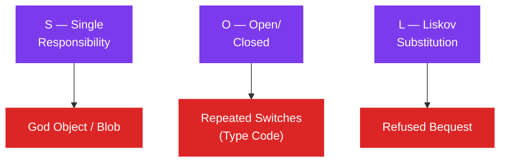
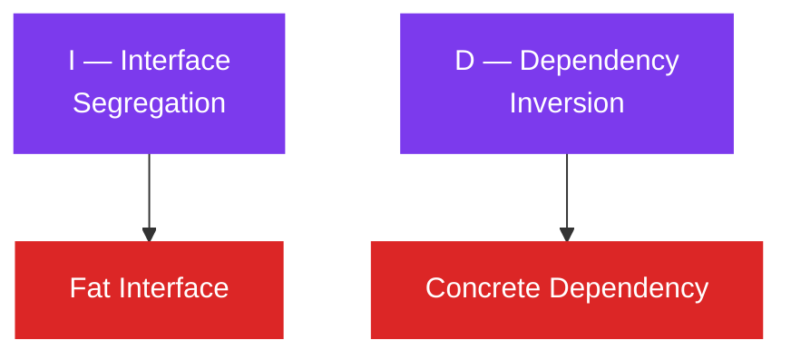
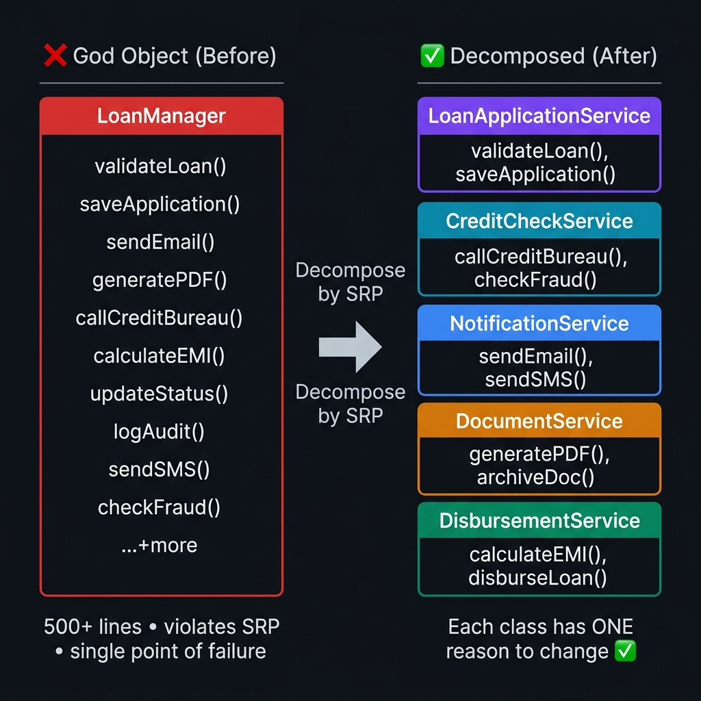
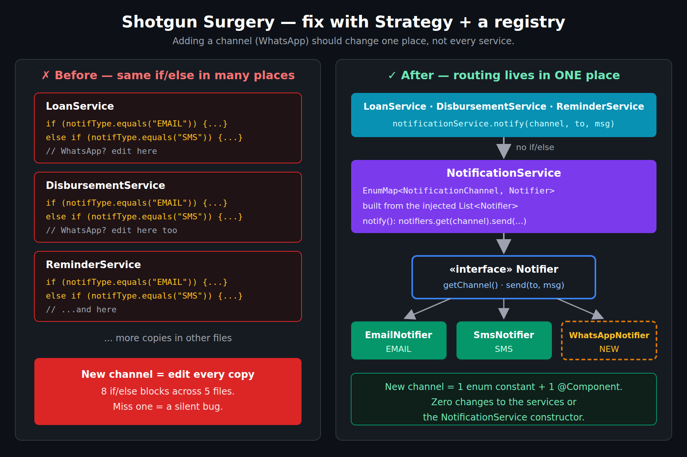
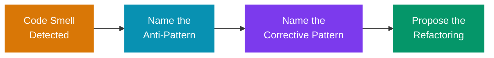

# Anti-Patterns in Java

**Anti-Patterns in Java** | How to spot common design mistakes. Knowing what NOT to do is as useful as knowing patterns. Tier-1 interviewers test your design judgment on purpose. They use code review and "what's wrong here?" questions.

> 🔥🔥 Must-know — very frequently tested &nbsp;·&nbsp; 🔥 High priority &nbsp;·&nbsp; ⚡ Medium priority &nbsp;·&nbsp; 💤 Low priority

---

<a id="1-why-anti-patterns-matter-in-tier-1-interviews"></a>
## 1. Why Anti-Patterns Matter in Tier-1 Interviews 💤

Tier-1 interviewers don't only ask "what pattern would you use?". They also show bad code and ask **"what's wrong here?"** or **"how would you improve this?"**

🔑 **Key points:**

> *"In code reviews and design discussions, say: 'this violates SRP — it's a God Object, I'd break it into LoanApplicationService, CreditCheckService, and DisbursementService'. This is what separates senior engineers from mid-level ones. It shows you think in systems, not only in features."*

---

<a id="2-solid-violations-as-anti-patterns"></a>
## 2. SOLID Violations as Anti-Patterns 🔥

Every SOLID violation has a named anti-pattern. Know both the violation AND the anti-pattern name. Then you can speak exactly in design reviews.

| SOLID Violation | Anti-Pattern Name | Symptom | Corrective Pattern |
|---|---|---|---|
| Single Responsibility broken | **God Object / Blob** | One class with 500+ lines, handles DB + logic + formatting | Extract into focused service classes |
| Open/Closed broken | **Repeated Switches / Type Code** | Every new variant means editing the same `switch` or `if-else` ladder | Strategy / Template Method — extend, don't modify |
| Liskov broken | **Refused Bequest** | Subclass throws `UnsupportedOperationException` for inherited methods | Restructure hierarchy; prefer composition |
| Interface Segregation broken | **Fat Interface** | One interface with 20 methods; implementors leave most empty | Split into smaller role-specific interfaces |
| Dependency Inversion broken | **Concrete Dependency** | Service `new`s its dependencies directly | Constructor injection; code to interfaces |

**① Class-level violations (S, O, L) — they show up as classes that are hard to maintain:**



**② Boundary-level violations (I, D) — they show up as seams (the points where classes connect) that are hard to test:**



> This is the same mapping as the table above. It is split by *where the problem shows up*:
> - ① inside one class
> - ② at the seam between classes. This is also why ② makes code hard to mock in tests.

⚠️ **Use the catalog names, not invented ones. The point from §1 can also hurt you.**
- *God Object / Blob* (Brown, *AntiPatterns*) is a real entry that someone can look up.
- So are *Refused Bequest*, *Repeated Switches*, *Divergent Change* and *Shotgun Surgery* (Fowler, *Refactoring*).
- **Fat Interface** is widely used but informal.
- **Concrete Dependency** is a description, not a catalog term.
- Say those two as descriptions, not as "the anti-pattern is called…".

Naming a term that doesn't exist is the one way this move hurts you. The interviewer either doesn't recognise it or knows it isn't real.

> **Do not mix these up:** *Repeated Switches* (above, OCP) and *Divergent Change* (§7's table, SRP) are related, but they are not the same.
> - Repeated Switches = **one ladder** edited for every new variant.
> - Divergent Change = **one class** edited for many *unrelated* reasons.
> - Their opposite is Shotgun Surgery (§3.3) — one change touches **many** classes.

💡 **Interview tip:** When you spot a SOLID violation, give a three-part answer:
1. the principle that is broken
2. the anti-pattern name
3. the pattern that fixes it

This shows strong design knowledge.

---

<a id="3-the-core-anti-patterns"></a>
## 3. The Core Anti-Patterns 🔥

<a id="31-god-object-blob"></a>
### 3.1 God Object (Blob) 🔥🔥

**What it is:** One class that knows everything and does everything. The whole system starts to depend on it.

**Symptoms:**
- 500+ line class with dozens of unrelated fields
- Handles DB + business logic + formatting + validation + notifications, all in one place
- Every new feature needs a change in this class

**Why it's dangerous:**
- Any change means touching this class.
- You cannot unit test it in isolation.
- It causes merge conflicts in every sprint.
- New developers spend hours learning what it does before they can change anything.

❌️ **Bad — `LoanManager` does everything:**

```java
public class LoanManager {

    public void applyLoan(String customerId, double amount) {
        // validates customer
        // checks credit score (external API call)
        // saves to DB
        // sends email
        // logs audit
    }

    public boolean checkCredit(String customerId) {
        // calls external credit bureau API
        return true;
    }

    public void disburseLoan(String loanId) {
        // updates loan status in DB
        // transfers amount via payment gateway
        // sends SMS
    }

    public void sendEmail(String to, String subject, String body) {
        // direct SMTP logic here
    }

    public void generateReport(String loanId) {
        // builds PDF report
    }

    public void updateDatabase(Object data) {
        // raw JDBC logic
    }
}
```



✅ **Fix — split by Single Responsibility:**

```java
public class LoanApplicationService {

    public void applyLoan(String customerId, double amount) {
        // validates + saves application
    }
}

public class CreditCheckService {

    public boolean checkCredit(String customerId) {
        // external bureau API only
        return true;
    }
}

public class DisbursementService {

    public void disburseLoan(String loanId) {
        // payment gateway + status update
    }
}

public class NotificationService {

    public void sendEmail(String to, String subject, String body) {
        // SMTP logic
    }

    public void sendSms(String phone, String message) {
        // SMS gateway
    }
}
```

🔑 **Key point:** Each class now has exactly one reason to change. `NotificationService` changes only when the notification tech changes. `CreditCheckService` changes only when the credit bureau API changes.

**What to say in an interview:**
> *"This is a God Object. `LoanManager` handles credit checking, persistence, notification, reporting, and disbursement all at once. I'd split it by SRP into `LoanApplicationService`, `CreditCheckService`, `DisbursementService`, and `NotificationService`. A `ReportService` and a repository would take the persistence and reporting work. Now each class has one reason to change. I can unit test each one in isolation, without starting the entire system."*

---

<a id="32-spaghetti-code"></a>
### 3.2 Spaghetti Code 🔥

**What it is:** Deeply nested, tangled control flow. It has no clear structure and no separation of concerns.

**Symptoms:**
- 10-level if-else nesting
- Methods doing 200 things
- No meaningful variable names
- Mixed concerns (validation + business logic + persistence) in one block

❌️ **Bad — nested validation + business logic + persistence all tangled:**

```java
public void processLoan(String custId, double amt) {
    if (custId != null) {
        if (amt > 0) {
            if (amt < 10000000) {
                Customer c = db.findCustomer(custId);
                if (c != null) {
                    if (c.getAge() >= 21) {
                        if (c.getSalary() > amt * 0.3) {
                            Loan loan = new Loan();
                            loan.setAmount(amt);
                            loan.setCustomerId(custId);
                            db.saveLoan(loan);
                            emailService.send(c.getEmail(), "Your loan is approved");
                        }
                    }
                }
            }
        }
    }
}
```

✅ **Fix — guard clauses (early returns) + extracted methods:**

```java
public void processLoan(String custId, double amt) {
    validateInput(custId, amt);
    Customer customer = findCustomerOrThrow(custId);
    validateEligibility(customer, amt);
    createAndSaveLoan(custId, amt);
    notificationService.sendApprovalEmail(customer.getEmail());
}

private void validateInput(String custId, double amt) {
    if (custId == null) {
        throw new IllegalArgumentException("Customer ID required");
    }
    if (amt <= 0 || amt >= 10_000_000) {
        throw new IllegalArgumentException("Invalid loan amount");
    }
}

private Customer findCustomerOrThrow(String custId) {
    Customer customer = db.findCustomer(custId);
    if (customer == null) {
        throw new CustomerNotFoundException(custId);
    }
    return customer;
}

private void validateEligibility(Customer customer, double amt) {
    if (customer.getAge() < 21) {
        throw new EligibilityException("Minimum age is 21");
    }
    if (customer.getSalary() <= amt * 0.3) {
        throw new EligibilityException("Insufficient salary");
    }
}

private void createAndSaveLoan(String custId, double amt) {
    Loan loan = new Loan(custId, amt);
    db.saveLoan(loan);
}
```

💡 **Rule:** If you need to scroll sideways to read a condition, it is nested too deep. Each extracted method should read like a sentence of plain English. That is the goal.

**What to say in an interview:**
> *"The deep nesting makes this impossible to unit test, because each branch is tied to the next one. I'd use two techniques:*
> - *guard clauses for early returns — invert the condition, then throw or return at once*
> - *Extract Method refactoring — move each concern into its own named private method*
>
> *The result reads like plain English: `validateInput → findCustomerOrThrow → validateEligibility → createAndSaveLoan`. I can test each method on its own."*

---

<a id="33-shotgun-surgery"></a>
### 3.3 Shotgun Surgery 🔥🔥

**Contrast with God Object:**
- God Object = too much in **one** place
- Shotgun Surgery = related logic scattered in **too many** places

**Symptoms:** Adding a new notification channel (WhatsApp) needs changes in 8 different if-else blocks across 5 service files.

❌️ **Bad — the notification type is checked in many places:**

```java
// In LoanService.java
if (notifType.equals("EMAIL")) {
    emailService.send(recipient, message);
} else if (notifType.equals("SMS")) {
    smsService.send(recipient, message);
}

// In DisbursementService.java — same block repeated
if (notifType.equals("EMAIL")) {
    emailService.send(recipient, message);
} else if (notifType.equals("SMS")) {
    smsService.send(recipient, message);
}

// In ReminderService.java — same block repeated again
if (notifType.equals("EMAIL")) {
    emailService.send(recipient, message);
} else if (notifType.equals("SMS")) {
    smsService.send(recipient, message);
}
```



✅ **Fix — Strategy + a registry built from the beans Spring collects for you (each `Notifier` declares its own channel):**

```java
// The channel is an enum, not a String — see §3.4: a typo must not compile
public enum NotificationChannel {
    EMAIL, SMS
}

// Each channel is a self-describing Strategy
public interface Notifier {
    NotificationChannel getChannel();
    void send(String recipient, String message);
}

@Component
public class EmailNotifier implements Notifier {
    public NotificationChannel getChannel() {
        return NotificationChannel.EMAIL;
    }
    public void send(String recipient, String message) {
        // SMTP logic
    }
}

@Component
public class SmsNotifier implements Notifier {
    public NotificationChannel getChannel() {
        return NotificationChannel.SMS;
    }
    public void send(String recipient, String message) {
        // SMS gateway logic
    }
}

// All routing lives in ONE place — and the constructor NEVER changes again
@Service
public class NotificationService {

    private final Map<NotificationChannel, Notifier> notifiers;

    // Spring injects EVERY Notifier bean it finds; we index them by their own channel
    public NotificationService(List<Notifier> allNotifiers) {
        this.notifiers = allNotifiers.stream()
            .collect(Collectors.toMap(
                Notifier::getChannel,
                Function.identity(),
                (a, b) -> {
                    throw new IllegalStateException("Two notifiers for the same channel");
                },
                () -> new EnumMap<>(NotificationChannel.class)));
    }

    public void notify(NotificationChannel channel, String recipient, String message) {
        Notifier notifier = notifiers.get(channel);
        if (notifier == null) {
            throw new IllegalStateException("No notifier registered for channel: " + channel);
        }
        notifier.send(recipient, message);
    }
}
// Adding WhatsApp = one enum constant + one @Component WhatsAppNotifier. ZERO changes here.
```

🔑 **Key point:** If you change the same pattern in N files for one feature, that is Shotgun Surgery. The fix is to find the missing abstraction and put the logic in one place. Two small details are worth saying:

- **Inject `List<Notifier>`, not each concrete notifier.** If you inject concrete notifiers and build `Map.of(EMAIL, emailNotifier, ...)` by hand, you *still* edit the constructor for each channel. With `List<Notifier>`, each notifier describes itself through `getChannel()`. Spring collects all beans that implement the interface. Only then is "add a channel = zero changes to existing code" really true.
- **Key the registry on an enum, not a `String`.** This stops the fix from bringing back §3.4's Primitive Obsession. `notify("EMIAL", ...)` compiles and fails at runtime. `notify(NotificationChannel.EMIAL, ...)` does not compile. The merge function turns a duplicate-channel misconfiguration into a startup failure. It does not let a bean be silently dropped. Once the key is an enum, `EnumMap` is the natural map type.

**What to say in an interview:**
> *"This is Shotgun Surgery. Adding a new notification channel needs the same `if-else` change in 8 places across 5 files. The missing abstraction is one central `NotificationService` with a Strategy registry. The registry is keyed on a `NotificationChannel` enum, not a String.*
>
> *The key step is to inject `List<Notifier>`, not each concrete notifier. Spring collects every bean that implements `Notifier`, and each one declares its own `getChannel()`. So adding WhatsApp is one new `@Component` plus an enum constant. No caller changes, and not even the `NotificationService` constructor changes.*
>
> *If I wrote the map by hand in the constructor, I'd be back to editing one place per channel. That only reduces the number of places to edit. It does not remove them."*

---

<a id="34-primitive-obsession"></a>
### 3.4 Primitive Obsession 🔥

**What it is:** You use primitive types (`String`, `int`, `double`) for domain concepts that should have their own type.

**Symptoms:**
- `String customerId`, `String loanId` passed everywhere — same type, so it is easy to swap them by mistake
- `String status` compared with `"APPROVED".equals(status)` — a typo compares `false` and silently skips the branch
- No validation when the value is created — any `String` is accepted

❌️ **Bad — primitives for everything:**

```java
public LoanDetail getLoan(String customerId, String loanId, String status) {
    if (status.equals("APPROVED")) {
        // ...
    }
}

// Caller can accidentally swap customerId and loanId — same type, no compile error
getLoan(loanId, customerId, "APROVED"); // typo — compiles, never throws, silently takes the wrong branch
```

✅ **Fix — enums and value objects:**

```java
public enum LoanStatus {
    SUBMITTED, UNDER_REVIEW, APPROVED, DISBURSED, CLOSED
}

public record CustomerId(String value) {
    public CustomerId {
        if (value == null || value.isBlank()) {
            throw new IllegalArgumentException("CustomerId cannot be blank");
        }
    }
}

public record LoanId(String value) {
    public LoanId {
        if (value == null || value.isBlank()) {
            throw new IllegalArgumentException("LoanId cannot be blank");
        }
    }
}

// Now the compiler prevents swapping — CustomerId and LoanId are different types
public LoanDetail getLoan(CustomerId customerId, LoanId loanId, LoanStatus status) {
    if (status == LoanStatus.APPROVED) {
        // ...
    }
}
```

💡 **Benefits of value objects:**
1️⃣ Compile-time type safety — `CustomerId` and `LoanId` cannot be swapped
2️⃣ Validation at construction — the constructor rejects invalid values at once, so you don't find them much later in the code
3️⃣ Domain language in code — `LoanStatus.APPROVED` reads like the business domain, not like magic strings

**What to say in an interview:**
> *"Passing `String customerId` and `String loanId` everywhere is Primitive Obsession. The compiler can't tell them apart. So if you swap them by mistake, it is a silent bug that only shows up at runtime.*
>
> *I'd add value objects using Java records. `CustomerId` and `LoanId` become different types, so the compiler now catches the swap at compile time.*
>
> *Status becomes a `LoanStatus` enum. This is the stronger half of the argument. A typo like `'APROVED'` doesn't throw. It just compares `false` and quietly skips the branch. So the loan is never treated as approved, and nothing reports an error. `LoanStatus.APROVED` doesn't compile."*

---

<a id="35-lava-flow-dead-code"></a>
### 3.5 Lava Flow (Dead Code) ⚡

**What it is:** Old, unused code that nobody is brave enough to delete — *"it might be doing something important."*

**Symptoms:**
- Large commented-out blocks spanning 50+ lines
- Methods named `_old`, `_v2`, `_backup`, `_deprecated`
- Unreachable `if (false)` branches
- `// TODO: fix this` comments from 2 years ago
- Classes that are never created anywhere

**Why it's dangerous:**

✅ **Fix:** Delete by default. But first prove that the code is really dead.

💡 **Practical rule:**
- If code has been commented out for more than one sprint, delete it. Reflection cannot reach commented-out code.
- For *unreachable* (not commented-out) code, check the four kinds above.
- If you can't prove statically that it is dead, check coverage data. Or add instrumentation (code that records calls) for a short time.
- Then delete it. If you ever need it (unlikely), restore it from git.

**What to say in an interview:**

---

<a id="36-copy-paste-programming-code-duplication"></a>
### 3.6 Copy-Paste Programming (Code Duplication) 🔥

**What it is:** The same logic is copied into many places. It should live in one shared method or class.

**Why it's dangerous:**

❌️ **Bad — EMI calculation copied across loan types:**

```java
// In PersonalLoanService.java
BigDecimal r = interestRate.divide(BigDecimal.valueOf(1200), MathContext.DECIMAL64);
BigDecimal factor = BigDecimal.ONE.add(r).pow(tenure);
BigDecimal emi = amount.multiply(r).multiply(factor)
                       .divide(factor.subtract(BigDecimal.ONE), 2, RoundingMode.HALF_UP);

// In HomeLoanService.java — identical block copy-pasted
BigDecimal r = interestRate.divide(BigDecimal.valueOf(1200), MathContext.DECIMAL64);
BigDecimal factor = BigDecimal.ONE.add(r).pow(tenure);
BigDecimal emi = amount.multiply(r).multiply(factor)
                       .divide(factor.subtract(BigDecimal.ONE), 2, RoundingMode.HALF_UP);

// In VehicleLoanService.java — identical block copy-pasted again
BigDecimal r = interestRate.divide(BigDecimal.valueOf(1200), MathContext.DECIMAL64);
BigDecimal factor = BigDecimal.ONE.add(r).pow(tenure);
BigDecimal emi = amount.multiply(r).multiply(factor)
                       .divide(factor.subtract(BigDecimal.ONE), 2, RoundingMode.HALF_UP);
```

✅ **Fix — extract to a shared utility:**

```java
public final class LoanCalculator {

    private LoanCalculator() {
        // Utility class — no instantiation
    }

    public static BigDecimal calculateEMI(BigDecimal amount, BigDecimal annualInterestRate, int tenureMonths) {
        // /12 /100 in one step. MathContext is required — an unbounded divide()
        // throws ArithmeticException on a non-terminating decimal (e.g. 14.5 / 1200).
        BigDecimal monthlyRate = annualInterestRate.divide(BigDecimal.valueOf(1200), MathContext.DECIMAL64);

        // Zero-interest guard: factor - 1 == 0 when rate is 0 → ArithmeticException
        if (monthlyRate.signum() == 0) {
            return amount.divide(BigDecimal.valueOf(tenureMonths), 2, RoundingMode.HALF_UP);
        }
        BigDecimal factor = BigDecimal.ONE.add(monthlyRate).pow(tenureMonths);
        return amount.multiply(monthlyRate).multiply(factor)
                     .divide(factor.subtract(BigDecimal.ONE), 2, RoundingMode.HALF_UP);
    }
}

// PersonalLoanService, HomeLoanService, VehicleLoanService all call:
BigDecimal emi = LoanCalculator.calculateEMI(amount, interestRate, tenure);
// Fix the formula once — all loan types get the fix automatically
```

💡 **Rule of Three** (count *copies*, not *acts of copying*):
- **2 copies** — leave it. The duplication may be by chance, and you don't know yet which parts vary.
- **3rd copy** — extract the shared abstraction. With three copies, you can finally see what varies.
- Do **not** abstract at the 2nd copy "because it'll happen again". That is the premature-abstraction half of §5.

**Corrective pattern:**
- The services share only a formula → extract it to a utility class (`LoanCalculator`).
- They share a full flow and only some steps differ → use **Template Method**. Put the shared steps in an abstract class. Override only what varies per loan type.

**What to say in an interview:**
> *"The EMI formula is copied in three services. This is Copy-Paste Programming. If I fix a rounding bug in `PersonalLoanService`, it silently stays broken in the other two. I'd extract it to `LoanCalculator.calculateEMI()`.*
>
> *The services may share a bigger flow — validate, calculate, disburse — where only the calculation step differs per loan type. Then I'd use Template Method. The abstract class fixes the flow, and each subclass overrides only the calculation step."*

---

<a id="37-magic-numbers--magic-strings"></a>
### 3.7 Magic Numbers / Magic Strings ⚡

**What it is:** Hardcoded literals spread through the code. Nothing explains what they mean.

**Why it's dangerous:**

❌️ **Bad — meaningless hardcoded literals:**

```java
if (creditScore > 700) {
    annualInterest = amount.multiply(new BigDecimal("0.145"));
    if (tenure > 360) {
        throw new IllegalArgumentException("Too long");
    }
}
```

✅ **Fix — named constants with business meaning:**

```java
private static final int        MINIMUM_CREDIT_SCORE_FOR_APPROVAL = 700;
private static final BigDecimal PERSONAL_LOAN_ANNUAL_RATE         = new BigDecimal("0.145");
private static final int        MAX_TENURE_MONTHS                 = 360; // 30 years

// Note the name: amount × rate is an interest *amount*, not a rate.
// So the variable is `annualInterest`, not `interestRate`.
if (creditScore > MINIMUM_CREDIT_SCORE_FOR_APPROVAL) {
    annualInterest = amount.multiply(PERSONAL_LOAN_ANNUAL_RATE);
    if (tenure > MAX_TENURE_MONTHS) {
        throw new IllegalArgumentException(
            "Tenure exceeds maximum of " + MAX_TENURE_MONTHS + " months"
        );
    }
}
```

🔑 **Key point:** Constants work as documentation inside the code. `MINIMUM_CREDIT_SCORE_FOR_APPROVAL = 700` tells a new developer exactly why `700` exists. A change to the business rule is now a one-line change in one place.

**What to say in an interview:**

---

<a id="38-anemic-domain-model"></a>
### 3.8 Anemic Domain Model 🔥🔥

**What it is:** Domain objects (entities) that only hold data and have no behaviour. All business logic lives in service classes instead.

**Why it's a smell:**
- It separates data from the rules that control that data.
- Some rules are *intrinsic* to the object (they belong to it by nature). If such a rule "lives in a service", in practice it lives in **several** services. Over time those copies drift apart.
- That is the real defect: a duplicated invariant. The problem is not that the entity has no methods.

⚠️ **People disagree about this one — do not state it as a rule.**
- Fowler named it an anti-pattern in 2003.
- But many professional Spring/JPA teams build anemic entities *on purpose*. They have real arguments for it.
- Know both sides before you take a position in an interview. See the tradeoff callout below the fix.

❌️ **Bad — `Loan` is a bag of data; `LoanService` holds all logic:**

```java
// Loan.java — pure data bag, zero behaviour
public class Loan {

    private String id;
    private BigDecimal amount;
    private BigDecimal interestRate;
    private int tenureMonths;
    private String status;

    // Only getters and setters — 30+ of them
    public String getId() {
        return id;
    }
    public void setStatus(String status) {
        this.status = status;
    }
    // ... 28 more getters/setters
}

// LoanService.java — all business logic here, mixed with orchestration
public class LoanService {

    public BigDecimal calculateEMI(Loan loan) {
        BigDecimal r = loan.getInterestRate().divide(BigDecimal.valueOf(1200), MathContext.DECIMAL64);
        BigDecimal factor = BigDecimal.ONE.add(r).pow(loan.getTenureMonths());
        return loan.getAmount().multiply(r).multiply(factor)
                   .divide(factor.subtract(BigDecimal.ONE), 2, RoundingMode.HALF_UP);
    }

    public boolean isEligibleForPrepayment(Loan loan) {
        return loan.getTenureMonths() > 6 && "DISBURSED".equals(loan.getStatus());
    }

    public void approveLoan(Loan loan) {
        loan.setStatus("APPROVED");
    }
}
```

✅ **Fix — Rich Domain Model: push behaviour into `Loan`:**

```java
@Entity
public class Loan {

    // Non-final: Hibernate instantiates via the no-arg ctor and populates fields by reflection
    @Id
    private String id;

    // The BigDecimal type maps to DECIMAL, not the DOUBLE a `double` field gets.
    // precision/scale set the size, DECIMAL(19,2), instead of the provider default. See §4.10.
    @Column(precision = 19, scale = 2)
    private BigDecimal amount;

    @Column(precision = 6, scale = 4)
    private BigDecimal interestRate;

    private int tenureMonths;

    // EnumType.STRING is NOT optional — JPA's default is ORDINAL, which persists the
    // index. Insert a status in the middle of the enum later and every historical
    // row silently changes meaning. Always spell this out on an enum column.
    @Enumerated(EnumType.STRING)
    private LoanStatus status;

    // Required by JPA — protected so application code still uses the rich ctor below
    protected Loan() {
    }

    public Loan(String id, BigDecimal amount, BigDecimal interestRate, int tenureMonths) {
        this.id = id;
        this.amount = amount;
        this.interestRate = interestRate;
        this.tenureMonths = tenureMonths;
        this.status = LoanStatus.SUBMITTED;
    }

    // Behaviour lives HERE — not scattered in service classes
    public BigDecimal calculateEMI() {
        BigDecimal r = interestRate.divide(BigDecimal.valueOf(1200), MathContext.DECIMAL64);
        if (r.signum() == 0) {              // zero-interest guard: factor - 1 == 0 otherwise
            return amount.divide(BigDecimal.valueOf(tenureMonths), 2, RoundingMode.HALF_UP);
        }
        BigDecimal factor = BigDecimal.ONE.add(r).pow(tenureMonths);
        return amount.multiply(r).multiply(factor)
                     .divide(factor.subtract(BigDecimal.ONE), 2, RoundingMode.HALF_UP);
    }

    public boolean isEligibleForPrepayment() {
        return tenureMonths > 6 && status == LoanStatus.DISBURSED;
    }

    public void approve() {
        if (status != LoanStatus.SUBMITTED && status != LoanStatus.UNDER_REVIEW) {
            throw new IllegalStateException(
                "Only SUBMITTED or UNDER_REVIEW loans can be approved. Current: " + status
            );
        }
        this.status = LoanStatus.APPROVED;
    }

    public void disburse() {
        if (status != LoanStatus.APPROVED) {
            throw new IllegalStateException(
                "Only APPROVED loans can be disbursed. Current: " + status
            );
        }
        this.status = LoanStatus.DISBURSED;
    }

    public LoanStatus getStatus() {
        return status;
    }
    public String getId() {
        return id;
    }
    public BigDecimal getAmount() {
        return amount;
    }
}
```

> 💡 **The DDD-vs-JPA conflict (get this right — interviewers ask about it):**
>
> - A *pure* DDD Rich Domain Model wants immutability: `final` fields, set once through a single all-args constructor.
> - JPA works against that. **JPA requires a no-arg constructor (`public` or `protected`). It creates the entity by reflection, then sets each field. And the JPA spec forbids `final` persistent fields, so Hibernate will not fill them.**
> - So `final` fields + only a parameterized constructor is **not** mappable as an `@Entity`.
> - Be exact if the interviewer pushes. Reflection *can* physically set a non-static final field after `setAccessible(true)`. So the limit is not what the JVM can do. The limit is that the JPA spec forbids final persistent fields. Hibernate's User Guide repeats this JPA rule. Also, if you force it, final-field constant folding, bytecode enhancement and lazy proxies break. "Hibernate won't" is correct. "The JVM can't" is not correct, and an interviewer will correct you on it.
> - The practical middle path (shown above): a `protected` no-arg constructor for Hibernate, plus non-`final` fields. Application code still gets a rich all-args constructor and behaviour methods.
> - Hibernate does not see your *methods* (`approve()`, `calculateEMI()`). It only maps fields. So you keep the behaviour at no cost. What you give up is the **immutability**.
> - Keep pure persistence concerns (query methods, eager/lazy config) in the repository.
> - If you need true immutability, model a separate immutable domain object. Then map a thin JPA entity next to it.

**What to say in an interview:**
> *"`Loan` here is an Anemic Domain Model. It is a data bag with 30 getters/setters, and all the logic is in `LoanService`. But I'd call it a smell, not an automatic defect. And I'd be specific about what actually hurts. `calculateEMI` belongs to a loan by nature. Once it lives in a service, people copy-paste it into the eligibility and reporting services. Then the copies drift apart. That duplicated invariant is the real bug. The fix is to push `calculateEMI()`, `approve()`, and `disburse()` onto the entity, with the transition guards. I'd keep logic in the service in two cases. First, when it needs injected collaborators, like a bureau client or a rate table. You can't inject into entities without load-time weaving. Second, when the flow is really just CRUD. There, Transaction Script is a valid pattern, not a failure. My rule is: one invariant, one place."*

---

<a id="39-golden-hammer"></a>
### 3.9 Golden Hammer ⚡

**What it is:** *"When all you have is a hammer, everything looks like a nail."* You use one familiar tool, pattern, or technology for every problem, whether it fits or not. You use it because you know it, not because the problem needs it.

**Symptoms:**
- Every "it varies by type" problem gets the same deep inheritance hierarchy
- The team brings in a rules engine, message queue, or generic framework for small, stable logic
- The same design pattern shows up everywhere, even where a plain method would do
- The reason given is "We always use X here", not the requirement

**Why it's dangerous:**
- The wrong tool adds accidental complexity. The next reader must learn a heavy abstraction just to follow a two-line decision.
- It also hides the *real* design discussion. Nobody asks "is this the right tool?", because someone decided the answer in advance.

❌️ **Bad — forcing a generic rules engine onto a trivial, hardcoded check:**

```java
// "We use the RulesEngine for everything" — even two fixed conditions
RuleEngine engine = new RuleEngine();
engine.addRule(new Rule("age", ">=", 21));
engine.addRule(new Rule("salary", ">", 30000));
boolean eligible = engine.evaluate(customer);
```

✅ **Fix — plain code when the logic is simple and stable:**

```java
boolean eligible = customer.getAge() >= 21 && customer.getSalary() > 30_000;
```

🔑 **Key point:** Use a tool only when the problem it solves is real *today*. A rules engine is the right choice when business users write hundreds of rules that change often. It is not right for two conditions that engineers hardcoded. Choose the tool to fit the problem. Do not change the problem to fit the tool you like best.

**What to say in an interview:**
> *"This is a Golden Hammer. The team uses a rules engine because it always uses one, but the logic is two fixed conditions. The abstraction has a cost: every future reader must understand the engine just to follow a trivial check. And it gives nothing back. I'd inline it as a plain boolean expression. I'd bring the engine back only when there are many rules and business users write them. That is the real problem it is built for."*

---

<a id="310-service-locator"></a>
### 3.10 Service Locator 🔥

**What it is:** A global registry. Components *ask* it for their dependencies (pull), instead of getting them *handed in* (push). People often call it "dependency injection". But control goes in the opposite direction, and it hides the wiring.

**Symptoms:**
- Classes call `ServiceLocator.get(SomeService.class)` from inside their methods
- You cannot see a class's true dependencies in its constructor / signature
- Tests must fill a global locator before they can run the class under test

**Why it's dangerous:**
- Dependencies become **hidden**. You can't tell what a class needs without reading its whole body.
- It removes compile-time safety. A missing dependency fails at runtime, not at construction.
- It adds static coupling to the locator.
- It makes tests brittle. Each test must set up and tear down shared global state.
- DI was created to replace exactly this use: a locator as the *default wiring mechanism*.

❌️ **Bad — dependencies pulled from a global locator:**

```java
public class LoanService {

    public void process(String loanId) {
        // Hidden dependencies — invisible to callers and tests
        CreditCheckService credit = ServiceLocator.get(CreditCheckService.class);
        NotificationService notifier = ServiceLocator.get(NotificationService.class);

        credit.check(loanId);
        notifier.notify(NotificationChannel.EMAIL, loanId, "Processed");
    }
}
```

✅ **Fix — constructor injection (dependencies are explicit and final):**

```java
public class LoanService {

    private final CreditCheckService credit;
    private final NotificationService notifier;

    public LoanService(CreditCheckService credit, NotificationService notifier) {
        this.credit = credit;
        this.notifier = notifier;
    }

    public void process(String loanId) {
        credit.check(loanId);
        notifier.notify(NotificationChannel.EMAIL, loanId, "Processed");
    }
}
```

🔑 **Key point:**
- Constructor injection makes dependencies **explicit, final, and visible** in one place.
- You cannot build the object without them. So missing wiring fails fast, at construction.
- Tests just pass mocks to the constructor. There is no global state to set up first.
- Service Locator hides the same dependencies behind a global lookup, and you lose all of these benefits.

⚖️ **Where a locator is valid — don't call it an anti-pattern in every case.** Fowler's original *Inversion of Control Containers and the Dependency Injection Pattern* presents Service Locator as a valid alternative to DI, not a defect. Some accepted code patterns work like a locator. You should be able to name them:

- **Prototype-scoped bean inside a singleton** — Spring's `ObjectProvider<T>` / `ApplicationContext.getBean(...)` is the supported answer. If you inject a prototype into a singleton, the singleton keeps one instance for its whole lifetime
- **`java.util.ServiceLoader`** for plugin / SPI discovery, where you don't know the implementations at compile time
- **Platforms where you don't control instantiation** — a container or framework, not your code, creates your object

The failure is using a locator as the **default wiring mechanism** for ordinary collaborators. That is what the bad example above does.

**What to say in an interview:**
> *"This is the Service Locator anti-pattern. The class pulls its ordinary collaborators from a global registry. So anyone reading the constructor can't see them, and they are hard to mock in tests. I'd change it to constructor injection. The dependencies become explicit and `final`. The object can't exist in a half-wired state. And a unit test just passes in mocks. But I wouldn't call the locator wrong in every context. Fowler treats it as a valid alternative. Prototype-in-singleton lookup via `ObjectProvider`, or `ServiceLoader` for plugin discovery, are cases where you really can't control construction. The problem is using it as the default wiring mechanism."*

---

<a id="311-singleton-abuse"></a>
### 3.11 Singleton Abuse 🔥🔥

**What it is:** Using the Singleton pattern as a place to keep **global mutable state**. It is a global variable hidden behind `getInstance()`. (The GoF Singleton itself isn't evil. The problem is *keeping shared mutable state in one*.)

**Symptoms:**

**Why it's dangerous:**
- **Hidden coupling:** any class can reach in and change global state. The dependency never appears in a signature
- **Untestable:** the shared instance carries state from one test to the next. So tests depend on order and become flaky. You can't replace it with a mock
- **Concurrency bugs:** multiple threads access shared mutable fields without synchronisation

❌️ **Bad — Singleton as a global mutable state bag:**

```java
public class AppState {

    private static final AppState INSTANCE = new AppState();
    private String currentUser;
    private final Map<String, Object> cache = new HashMap<>();

    public static AppState getInstance() {
        return INSTANCE;
    }

    public void setCurrentUser(String user) {
        this.currentUser = user;       // mutated from anywhere — global state
    }

    public String getCurrentUser() {
        return currentUser;
    }
}

// Scattered across the codebase — invisible, order-dependent coupling:
AppState.getInstance().setCurrentUser("alice");
```

✅ **Fix — inject stateless collaborators; pass per-request state as an argument:**

```java
@Service
public class LoanService {

    private final CreditCheckService creditCheck; // injected, stateless, no global state

    public LoanService(CreditCheckService creditCheck) {
        this.creditCheck = creditCheck;
    }

    // Request-specific state travels as a parameter, not a global singleton
    public void process(String loanId, String currentUser) {
        creditCheck.check(loanId);
        // ... use currentUser locally
    }
}
```

> 🔗 **Related, covered elsewhere:** there is *another* Singleton failure: double-checked locking without `volatile`. There, instruction reordering publishes a half-constructed instance. This failure is worked through in [`03_Singleton_Design_Pattern_in_Java.md` §4](./03_Singleton_Design_Pattern_in_Java.md#4-double-checked-locking-in-singleton-class). It's a concurrency bug, not a design anti-pattern, so it lives there and not here.

🔑 **Key point — Spring singleton-scope beans are NOT the GoF Singleton anti-pattern.** A Spring `@Service` is different in four ways:
- It is one instance *per container* (not per JVM through a static field).
- It is **injected**, not pulled through `getInstance()`.
- It is **stateless by convention**.
- It is easy to **replace with a mock** in tests.

The anti-pattern is the static `getInstance()` holding *mutable* state. Stateless singletons managed by the container are fine. Global mutable state is the problem.

**What to say in an interview:**
> *"This is Singleton abuse. `AppState` is a global mutable variable behind `getInstance()`. Any class can change it without anyone seeing. Tests share its state and start to depend on order. And concurrent writes race. I'd inject stateless collaborators through the constructor and pass per-request data as parameters. I'd also separate this from Spring's singleton-scope beans. The container manages those beans. They are injected, stateless, and mockable. That is completely different from a static `getInstance()` that holds on to mutable state."*

---

<a id="312-field-injection"></a>
### 3.12 Field Injection 🔥🔥

**What it is:** `@Autowired` written directly on a field instead of on the constructor. It has the same hidden-dependency failure as [§3.10 Service Locator](#310-service-locator), in a friendlier form. The container still pushes the dependency in. But nothing in the class's public API shows that the dependency exists.

**Symptoms:**
- A class with a dozen `@Autowired private XService ...;` fields and no constructor at all
- A unit test that must use `ReflectionTestUtils.setField(...)` or `@InjectMocks`, because there is no way to pass the collaborators in
- The dependency count grows without anyone noticing. Adding one more field is a one-line diff, so nobody sees that the class became a God Object

❌️ **Bad — dependencies invisible outside the class body, and not `final`:**

```java
@Service
public class LoanService {

    @Autowired
    private CreditCheckService credit;

    @Autowired
    private NotificationService notifier;

    // No constructor. Cannot be instantiated in a plain unit test in a valid state.
}
```

✅ **Fix — constructor injection (Spring wires a single constructor with no annotation at all):**

```java
@Service
public class LoanService {

    private final CreditCheckService credit;
    private final NotificationService notifier;

    // No @Autowired needed — a single constructor is autowired implicitly since Spring 4.3
    public LoanService(CreditCheckService credit, NotificationService notifier) {
        this.credit = credit;
        this.notifier = notifier;
    }
}
```

🔑 **Key point — state this as a tradeoff, not a rule.**

Constructor injection gives three concrete benefits:
- Fields can be `final` (immutable, safe to publish across threads).
- Wiring failures show up at **construction**, not at first use.
- A plain `new LoanService(mockCredit, mockNotifier)` works in a unit test, with no Spring context and no reflection.

Field injection gives you shorter code. It is really fine in `@SpringBootTest` test classes and `@Configuration` classes, because nobody unit-tests those alone.

The line you can defend is **"constructor injection by default; field injection in test classes"**. If only field injection can satisfy a cycle, that is a design signal. It is not a reason to keep the cycle.

⚠️ **Spring itself now agrees — know this, or the answer above sounds old.**

**What to say in an interview:**
> *"Field `@Autowired` is the same hidden-dependency problem as a Service Locator. The class's collaborators don't appear in its public API. So you have to read the whole body to know what it needs. And a unit test has to set them by reflection. I default to constructor injection. The fields become `final`. Missing wiring fails at construction instead of at first call. And the test just passes mocks to `new`. I wouldn't call field injection always wrong — it's fine in `@SpringBootTest` and `@Configuration` classes. But sometimes a class needs field injection because constructor injection would fail on a circular dependency. In that case, the cycle is the actual bug."*

---

<a id="4-java-language-anti-patterns"></a>
## 4. Java-Language Anti-Patterns ⚡

The sections above cover **design and architecture** anti-patterns. This section covers **language-level** mistakes specific to Java code. It also covers the Spring and JPA traps that behave the same way. A *"what's wrong with this code?"* screening round tests exactly these. Each one is a quick bad → fix.

<a id="41-string-concatenation-in-a-loop"></a>
### 4.1 String concatenation in a loop ⚡

❌️ **Bad — `+=` allocates a new `String` every iteration (O(n²)):**

```java
String csv = "";
for (Loan loan : loans) {
    csv += loan.getId() + ",";   // new String + full copy each pass
}
```

✅ **Fix — `StringBuilder` (O(n)):**

```java
StringBuilder sb = new StringBuilder();
for (Loan loan : loans) {
    sb.append(loan.getId()).append(',');
}
String csv = sb.toString();
```

💡 `String` is immutable. So each `+=` allocates a new object and copies the whole prefix. That costs O(n²) time and creates a lot of garbage. `StringBuilder` changes one buffer in place.

A single concatenation *outside* a loop is fine:

- Since **Java 9 (JEP 280, Indified String Concatenation)**, `javac` compiles `a + "-" + b` to a single `invokedynamic`.
- `java.lang.invoke.StringConcatFactory` bootstraps (sets up) that call.
- It does **not** compile to a `StringBuilder`. That is the pre-Java-9 answer.
- The generated code is at least as fast as a hand-written `StringBuilder`. The bootstrap can size the buffer exactly.

The loop case is still O(n²). Each iteration is a separate concat expression. It has to copy the whole prefix built so far.

> Check it yourself: `javap -c` on a Java 9+ class shows `invokedynamic ... makeConcatWithConstants` where a Java 8 build showed `new StringBuilder`.

<a id="42-catching-exception--throwable-broadly-and-swallowing-it"></a>
### 4.2 Catching `Exception` / `Throwable` broadly and swallowing it 🔥🔥

❌️ **Bad — failure vanishes silently:**

```java
try {
    disburse(loanId);
} catch (Exception e) {
    // swallowed — no log, no rethrow
}
```

✅ **Fix — catch the narrowest type, log with the stack trace, rethrow or translate:**

```java
try {
    disburse(loanId);
} catch (PaymentGatewayException e) {
    log.error("Disbursement failed for {}", loanId, e);
    throw new DisbursementException(loanId, e);
}
```

💡 A broad `catch (Exception e)` also catches `RuntimeException`s (NPE, bugs) you never meant to handle. It hides them.

The rule on `Throwable` is **never *swallow* it**. It is not "never catch it". Catching `Throwable` is valid exactly where you must log something before the thread dies:

- a task submitted to an `ExecutorService`
- a `Thread.UncaughtExceptionHandler` (it does not catch; the JVM calls it with the `Throwable` just before the thread ends, so it only logs)
- a batch-job runner
- a message-listener loop

In the other three, you log and **rethrow**. You never swallow an `Error` like `OutOfMemoryError` that the JVM is trying to report. An empty catch block is the worst form: the failure simply disappears.

❌️ **Also bad — `e.printStackTrace()` instead of logging:**

```java
try {
    disburse(loanId);
} catch (PaymentGatewayException e) {
    e.printStackTrace();      // goes to System.err — never reaches the log pipeline
}
```

💡 `printStackTrace()` writes straight to `System.err`. It skips the logging framework completely. That means:

- **no log level, no correlation/trace id, no MDC context, and nothing in CloudWatch or ELK**
- the stack trace exists only in whatever the container did with stderr
- no way to attach the business key (`loanId`) that makes the trace searchable

Use `log.error("Disbursement failed for {}", loanId, e)`. The last `Throwable` argument is what makes SLF4J print the stack trace.

❌️ **Worst of the family — swallowing `InterruptedException`:**

```java
try {
    Thread.sleep(1000);
} catch (InterruptedException e) {
    log.warn("interrupted");   // logged, but the interrupt flag is now GONE
}
```

✅ **Fix — rethrow, or restore the flag and stop what you're doing:**

```java
try {
    Thread.sleep(1000);
} catch (InterruptedException e) {
    Thread.currentThread().interrupt();   // restore the flag you just cleared
    throw new DisbursementException("Interrupted while awaiting gateway", e);
}
```

💡 This one is special, and interviewers often ask it in a screening round. **Throwing `InterruptedException` clears the thread's interrupt flag.** So if you catch it and move on, you destroy the only record that someone asked for cancellation. Every caller above you now believes the thread is healthy:

- `awaitTermination()` after `shutdownNow()` waits until its timeout, because the task does not stop
- a `Future.cancel(true)` is ignored
- a batch job that should have stopped keeps disbursing

The rule is **rethrow it, or call `Thread.currentThread().interrupt()` and return**. Never log and continue. Note that the broad `catch (Exception e)` at the top of this section swallows `InterruptedException` too. This is how the bug usually appears: nobody chose it; a wide catch caught it by accident.

<a id="43-using-finalize-for-cleanup"></a>
### 4.3 Using `finalize()` for cleanup 💤

❌️ **Bad — `finalize()` is deprecated and unreliable:**

```java
@Override
protected void finalize() throws Throwable {
    connection.close();   // may run late, or never
}
```

✅ **Fix — try-with-resources (deterministic) or `Cleaner` (safety-net):**

```java
try (Connection connection = dataSource.getConnection()) {
    // use connection
} // close() guaranteed here, even on exception
```

💡 Know the full history. If you say "deprecated since Java 9", the interviewer may ask *"and what's happened since?"*: **deprecated in Java 9 → deprecated for removal in Java 18 (JEP 421) → planned for removal in a future release.** JEP 421 also added `--finalization=disabled`, so you can turn finalization off JVM-wide today.

The reasons haven't changed:

- GC timing is unpredictable (it may never run).
- A finalizer can bring the object back to life (resurrect it).
- It adds a cost to every instance of the class.

Implement `AutoCloseable` and use try-with-resources for deterministic (predictable) release. Use `java.lang.ref.Cleaner` only as a last-resort safety net, for a resource a caller might forget to close.

<a id="44-returning-null-instead-of-optional--an-empty-collection"></a>
### 4.4 Returning `null` instead of `Optional` / an empty collection 🔥

❌️ **Bad — `null` forces defensive checks and invites NPEs:**

```java
public List<Loan> findByCustomer(String customerId) {
    if (none) {
        return null;          // caller NPEs on iteration
    }
    return loans;
}

public Loan findLatest(String customerId) {
    return null;              // absence is implicit, easy to forget
}
```

✅ **Fix — empty collection for many, `Optional` for a possibly-absent one:**

```java
public List<Loan> findByCustomer(String customerId) {
    return loans;                       // Collections.emptyList() when none
}

public Optional<Loan> findLatest(String customerId) {
    return Optional.ofNullable(latest); // absence is explicit in the type
}
```

💡 Returning `null` for a collection forces every caller to null-check before iterating. One missed check is an NPE. Return an empty collection instead. For a single value that may be absent, use `Optional<T>`. It makes "might not exist" part of the method's contract.

⚠️ **Know where `Optional` stops. This is the follow-up to the answer above.** It was designed for one job: **a return type that may validly have no value.** Four misuses:

```java
// ❌️ As a field — Optional is not Serializable, and it adds a second
//    "absent" state on top of the field already being null
private Optional<Address> address;

// ❌️ As a parameter — forces every caller to wrap: f(Optional.of(x)) / f(Optional.empty()).
//    Two overloads, or accepting null with @Nullable, are both clearer.
public void updateLoan(String id, Optional<String> remarks) { }

// ❌️ .get() without a check — a NoSuchElementException waiting to happen;
//    it is exactly the NPE you claimed to have removed, renamed.
Loan loan = repo.findById(id).get();

// ❌️ On a collection — an empty list already says "nothing here"
public Optional<List<Loan>> findAll() { }
```

✅ The forms worth knowing:

- `orElseThrow(() -> new LoanNotFoundException(id))`. This is the default in a Spring service. `orElseThrow()` with no argument gives you a `NoSuchElementException` with no business context.
- `map`/`filter` to chain calls without unwrapping.
- `orElseGet(supplier)` rather than `orElse(expensiveCall())`. **`orElse`'s argument is evaluated even when the value is present.**

That last one is a real performance bug in code that looks normal. It is the detail that shows you have really used the API, not just read about it.

<a id="45--vs-equals-on-objects"></a>
### 4.5 `==` vs `equals()` on objects 🔥

❌️ **Bad — `==` compares references, not content:**

```java
String status = loan.getStatus();
if (status == "APPROVED") {            // reference compare — unreliable
    // ...
}

Integer a = 1000, b = 1000;
if (a == b) {                          // NOT guaranteed either way — see note below
    // ...
}
```

✅ **Fix — `equals()` for value comparison (constant first to avoid an NPE):**

```java
if ("APPROVED".equals(status)) {
    // ...
}

if (a.equals(b)) {                     // true — compares values
    // ...
}
```

💡 `==` compares object identity. `equals()` compares value. `==` *seems* to work for small interned `String`s and cached `Integer`s. Then it breaks unpredictably for anything else. Put the constant first (`"APPROVED".equals(x)`) so a `null` `x` can't NPE. Or use `Objects.equals(a, b)`.

⚠️ **Be exact about the `Integer` cache. This is the follow-up trap.**

- The JLS requires `Integer.valueOf` caching only for **−128..127**.
- Above that range, caching depends on the implementation.
- On HotSpot, you can tune the upper bound with **`-XX:AutoBoxCacheMax`**.

So `a == b` for `1000` is `false` on a default JVM. But it is **not guaranteed by the spec**. With `-XX:AutoBoxCacheMax=1000` it becomes `true`. The safe way to say it in an interview: *"reference equality on boxed types is only defined for −128..127. Even that upper bound is tunable. So never rely on either outcome. Use `equals()` or compare the unboxed `int`."*

<a id="46-calling-an-overridable-method-from-a-constructor"></a>
### 4.6 Calling an overridable method from a constructor ⚡

❌️ **Bad — the override runs before the subclass is initialized:**

```java
public class Loan {
    public Loan() {
        init();                        // overridable call during construction
    }
    protected void init() {
    }
}

public class HomeLoan extends Loan {
    private double rate = 8.5;
    @Override
    protected void init() {
        System.out.println(rate);      // prints 0.0 — field not yet assigned
    }
}
```

✅ **Fix — make lifecycle hooks `private`/`static`/`final`, or call them after construction:**

```java
public class Loan {
    public Loan() {
        // no overridable calls here
    }
    private void init() {              // private → not overridable
    }
}
```

💡 While the superclass constructor runs, the subclass's fields still hold their defaults (`0`/`null`). The subclass constructor body hasn't run yet. So an overridden method sees a half-built object. Never call an overridable method from a constructor (Effective Java, Item 19). Make it `private`, `static`, or `final`.

<a id="47-breaking-the-equals--hashcode-contract"></a>
### 4.7 Breaking the `equals()` / `hashCode()` contract 🔥🔥

❌️ **Bad — `equals()` overridden, `hashCode()` not:**

```java
public final class LoanId {

    private final String value;

    public LoanId(String value) {
        this.value = value;
    }

    @Override
    public boolean equals(Object o) {
        if (this == o) {
            return true;
        }
        if (!(o instanceof LoanId other)) {
            return false;
        }
        return value.equals(other.value);
    }
    // no hashCode() — inherits Object's identity hash
}

Map<LoanId, Loan> byId = new HashMap<>();
byId.put(new LoanId("L1"), loan);
byId.get(new LoanId("L1"));            // null — equal objects, different buckets
```

✅ **Fix — override both together, from the same fields (or use a `record`, which generates both):**

```java
@Override
public int hashCode() {
    return Objects.hash(value);
}

// Or skip the boilerplate entirely — a record derives equals/hashCode/toString from its components
public record LoanId(String value) {
}
```

💡 The contract works in one direction only, but you must follow it: **equal objects must have equal hash codes.** If you break it, every hash-based collection silently goes wrong. `HashMap.get` returns `null`, `HashSet` stores duplicates, and `distinct()` stops de-duplicating. Two related traps:

- **A mutable field in a key.** Say you change a field that `hashCode()` reads *after* the object is in a `HashMap`. The entry stays stuck in the old bucket. Lookup and `remove` can no longer reach it, even though iteration still shows it. Key types should be immutable.
- **Lombok `@Data` / `@EqualsAndHashCode` on a JPA entity.** By default they include **every** field. This causes two problems. (a) It touches lazy associations and triggers loading (or a `LazyInitializationException`) just to compute a hash. (b) It uses the `id`, which is `null` before persist. So an entity's `hashCode()` *changes* once the DB assigns the id. That breaks any `HashSet` it was already in. Use `@EqualsAndHashCode(onlyExplicitlyIncluded = true)` over a stable business key. Or hand-write `equals`/`hashCode` against that key.

<a id="48-exposing-mutable-internal-state"></a>
### 4.8 Exposing mutable internal state 🔥

❌️ **Bad — the getter hands out the live collection:**

```java
public class Loan {

    private final List<Payment> payments = new ArrayList<>();

    public List<Payment> getPayments() {
        return payments;               // caller now owns your internals
    }
}

loan.getPayments().clear();            // every invariant in Loan just got bypassed
```

✅ **Fix — copy or wrap on the way out, copy on the way in:**

```java
public class Loan {

    private final List<Payment> payments = new ArrayList<>();
    private LoanStatus status = LoanStatus.SUBMITTED;

    public List<Payment> getPayments() {
        return List.copyOf(payments);              // immutable snapshot
        // or Collections.unmodifiableList(payments) for a live read-only view
    }

    public void addPayment(Payment payment) {      // mutation goes through the invariant
        if (status != LoanStatus.DISBURSED) {
            throw new IllegalStateException("Cannot record a payment before disbursement");
        }
        payments.add(payment);
    }
}
```

💡 *Effective Java* Items 50 and 17: make defensive copies on both boundaries (going in and going out). This is the other side of §3.8. Moving behaviour into `Loan` has no value if `getPayments()` lets a caller change the list. The caller then skips every guard you just wrote. The same applies to:

- arrays (`return values.clone()`)
- any legacy mutable type you accept as a parameter. `java.util.Date` is the classic example. Prefer `LocalDate`/`Instant`, which are immutable and need no copying.

Note the difference:

- `List.copyOf` is a snapshot. It won't see later additions.
- `unmodifiableList` is a live view. It will see them, but it still blocks changes.

<a id="49-transactional-self-invocation-and-the-swallowed-rollback"></a>
### 4.9 `@Transactional` self-invocation (and the swallowed rollback) 🔥🔥

❌️ **Bad — the annotation does nothing at all:**

```java
@Service
public class LoanService {

    public void processBatch(List<String> loanIds) {
        for (String loanId : loanIds) {
            process(loanId);           // self-invocation — bypasses the proxy entirely
        }
    }

    @Transactional
    public void process(String loanId) {
        // runs with NO transaction when reached via processBatch()
    }
}
```

✅ **Fix — cross a bean boundary so the proxy is involved:**

```java
@Service
public class LoanBatchService {

    private final LoanProcessor processor;       // separate bean → proxied call

    public LoanBatchService(LoanProcessor processor) {
        this.processor = processor;
    }

    public void processBatch(List<String> loanIds) {
        for (String loanId : loanIds) {
            processor.process(loanId);           // goes through the proxy → transaction applied
        }
    }
}
```

💡 A **proxy** wrapping the bean implements `@Transactional` (see [`13_Proxy_Design_Pattern_in_Java.md`](./13_Proxy_Design_Pattern_in_Java.md)). An internal `this.process(...)` call never leaves the target object. So the proxy's interceptor never runs, and the annotation silently does nothing. There is no error and no warning. The same applies to `@Async`, `@Cacheable`, and `@PreAuthorize`.

Fixes, in order of preference:

1. Move the annotated method to a separate bean.
2. Inject `TransactionTemplate` and call it explicitly.
3. Self-inject via `ObjectProvider<LoanService>`. It works, but it looks like a workaround.

AspectJ load-time weaving also solves it, but it makes the build more complex.

⚠️ **The sibling bug — swallowing an exception inside a transaction:**

```java
@Transactional
public void process(String loanId) {
    try {
        auditService.record(loanId);      // also @Transactional, joins this same transaction
    } catch (Exception e) {
        log.error("Audit failed", e);     // swallowed — but rollbackOnly is already set
    }
    loanRepository.markProcessed(loanId);
}                                         // commit → UnexpectedRollbackException
```

Say an inner `@Transactional` method (default propagation `REQUIRED`) throws a runtime exception. Spring marks the **shared** transaction rollback-only before the exception propagates. Catching it in the outer method doesn't undo that flag. So the outer method returns normally, and then the commit fails with `UnexpectedRollbackException`. The work you thought you saved is gone.

Two fixes:

- Let the exception propagate.
- Or make the inner call `@Transactional(propagation = Propagation.REQUIRES_NEW)`. Then its failure stays inside its own physical transaction.

<a id="410-double--float-for-money"></a>
### 4.10 `double` / `float` for money 🔥🔥

❌️ **Bad — binary floating point cannot represent decimal fractions:**

```java
private double amount;          // and DOUBLE in the DB column

double rate = 0.145;
double interest = 100_000.00 * rate;      // 14499.999999999998
double total = 0.1 + 0.2;                 // 0.30000000000000004

if (balance == 0) {                       // false on a loan that IS closed
    closeLoan();
}
```

✅ **Fix — `BigDecimal`, constructed from a `String`, compared with `compareTo`:**

```java
@Column(precision = 19, scale = 2)        // → DECIMAL(19,2), not DOUBLE
private BigDecimal amount;

// new BigDecimal(0.145) captures the binary error — always use the String ctor
private static final BigDecimal RATE = new BigDecimal("0.145");

BigDecimal interest = amount.multiply(RATE)
                            .setScale(2, RoundingMode.HALF_UP);

if (balance.signum() == 0) {              // or compareTo(BigDecimal.ZERO) == 0
    closeLoan();
}
```

💡 `double` is base-2. So `0.1`, `0.145`, and most rupee amounts have no exact representation. Four results, in the order an interviewer asks about them:

1. **Accumulation** — the sum of a disbursement ledger slowly moves away from zero. Then a ledger that must balance exactly no longer balances. "Off by ₹0.03" is an audit finding, not a rounding choice.
2. **Comparison** — `==` and `equals` fail on values that mean the same number. Use `compareTo`. Note that `BigDecimal.equals()` also compares **scale**. So `2.0` and `2.00` are *not* `equals`, but they *are* `compareTo == 0`. Interviewers often ask this follow-up.
3. **Rounding is unspecified** — `double` gives you no control. `BigDecimal` forces an explicit `RoundingMode`. In lending, how you round the final EMI instalment is a specified business rule, not an implementation detail.
4. **`divide()` throws** — `14.5 / 1200` is non-terminating. So an unbounded `divide()` raises `ArithmeticException`. Always pass a scale + `RoundingMode`, or a `MathContext` (§3.6).

⚠️ Two traps worth naming:

- **`new BigDecimal(0.145)`** takes a `double`. So it keeps the exact error you are trying to avoid. Use `new BigDecimal("0.145")` or `BigDecimal.valueOf(0.145)`.
- A JPA field declared `double` silently maps to a `DOUBLE` column. So the schema loses the precision, even if you fix the Java side later. The `BigDecimal` type is what gives a `DECIMAL` column. `@Column(precision, scale)` then sets its size.

> 📝 **Note on the other examples in this file:** §3.1 and §3.2 still use `double amount` on purpose. Their lessons are God Object and guard clauses. There, `amt.compareTo(MAX) >= 0` would add noise to a point that isn't about money. The sections that are really about money arithmetic — §3.6, §3.7, §3.8 and §5 — use `BigDecimal`. In real code, use `BigDecimal` everywhere money appears.

<a id="411-returning-jpa-entities-from-the-api-layer"></a>
### 4.11 Returning JPA entities from the API layer 🔥

❌️ **Bad — the entity *is* the response body:**

```java
@GetMapping("/loans/{id}")
public Loan getLoan(@PathVariable String id) {
    return loanRepository.findById(id).orElseThrow();
}
```

✅ **Fix — map to a response record at the boundary:**

```java
public record LoanResponse(String id, BigDecimal amount, LoanStatus status) {

    static LoanResponse from(Loan loan) {
        return new LoanResponse(loan.getId(), loan.getAmount(), loan.getStatus());
    }
}

@GetMapping("/loans/{id}")
public LoanResponse getLoan(@PathVariable String id) {
    return LoanResponse.from(loanRepository.findById(id).orElseThrow());
}
```

💡 This is §4.8 (exposing mutable internal state) one layer up. It is the same leak, at the HTTP boundary. Four separate failures:

- **The API contract is tied tightly to the schema.** Rename a column and you have silently released a breaking API change. Nothing in the compiler or the tests will tell you.
- **Every field is exposed** — internal flags, audit columns, a risk score you never meant to publish. Serialization is opt-out, so by default everything leaks.
- **Lazy associations fail on serialize.** Jackson touches `loan.getPayments()` after the transaction closed → `LazyInitializationException`. Or worse, it *works* inside an open-session-in-view setup and quietly runs N queries while writing the response.
- **Inbound is worse than outbound.** Binding a request body straight onto an entity is mass-assignment. A client that posts `{"status":"DISBURSED"}` goes straight past every guard in §3.8.

Be ready for this counter-argument: *"that's a lot of boilerplate for a CRUD screen"*. It is fair. Records plus a static factory reduce it to a few lines. The position worth keeping: a **public** API needs this separation layer. For an internal service-to-service call, on a schema you own on both sides, it is your judgment call.

<a id="412-fetchtypeeager-and-the-n1-query"></a>
### 4.12 `FetchType.EAGER` and the N+1 query 🔥🔥

❌️ **Bad — eager by default, and a loop that queries per row:**

```java
@ManyToOne                                  // ⚠️ defaults to EAGER
private Customer customer;

@OneToMany(mappedBy = "loan", fetch = FetchType.EAGER)
private List<Payment> payments;

// N+1: 1 query for the loans, then 1 more per loan for its customer
for (Loan loan : loanRepository.findAll()) {
    log.info(loan.getCustomer().getName());
}
```

✅ **Fix — lazy everywhere, then fetch explicitly where you need it:**

```java
@ManyToOne(fetch = FetchType.LAZY)
private Customer customer;

@OneToMany(mappedBy = "loan")               // @OneToMany is LAZY by default
private List<Payment> payments;

@Query("SELECT l FROM Loan l JOIN FETCH l.customer")
List<Loan> findAllWithCustomer();           // one query
```

💡 The trap: **`@ManyToOne` and `@OneToOne` default to `EAGER`**, while `@OneToMany`/`@ManyToMany` default to `LAZY`.

- This inconsistency is in the JPA spec itself.
- It is the single most common cause of a service that is slow under load for no clear reason.
- You can't turn eager fetching *off* at the query level. But you can always load a lazy association eagerly for one query, with a `JOIN FETCH` or an entity graph.

So the rule is **lazy by default, fetch explicitly per use case.** The full topic — caching levels, entity graphs, `@BatchSize`, the open-session-in-view debate — is in [`13_Hibernate_Interview_Questions.md`](../1_interview_questions/13_Hibernate_Interview_Questions.md). It is here because "spot what's wrong with this entity" is an anti-pattern screening question, not a Hibernate trivia question.

💡 **Interview framing:** These are the most useful "spot the bug" items on a Java screen. A senior answer names the *reason*. A weak answer only says "use `StringBuilder`." Reasons to name:

- "`String` immutability makes that O(n²),"
- "the subclass field isn't initialized yet,"
- "that swallows `Error`s too,"
- "the proxy is never involved on a `this.` call,"
- "catching that cleared the interrupt flag,"
- "`@ManyToOne` is eager by default"

---

<a id="5-premature-optimization-vs-premature-abstraction"></a>
## 5. Premature Optimization vs Premature Abstraction ⚡

People often mix up these two. They are different mistakes. But both pay a real cost *now* for a future gain that may never come (*hypothetical*).

| | Premature **Abstraction** | Premature **Optimization** |
|---|---|---|
| **What you add too early** | Flexibility — interfaces, patterns, extension points | Performance — hand-tuning, caching, micro-optimizations |
| **Driven by** | "We *might* need to swap this later" | "This *might* be slow" |
| **Cost paid now** | Extra layers (indirection); code that is harder to read and harder to change | Code that is hard to read; often you optimize the wrong thing |
| **The discipline** | YAGNI — add the abstraction when the 2nd variant arrives | Measure first — profile, then optimize only the proven hot path |

**Premature abstraction** is the design mistake. This whole file covers it (Strategy for one algorithm, Factory for one type — see §6).

**Premature optimization** is the performance mistake. Knuth called it *"the root of all evil"*. It means you change code for speed before a profiler has shown that speed matters there.

❌️ **Bad — manual loop unrolling for a list of ~50 loans (hard to read, and no benefit):**

```java
int n = loans.size();
BigDecimal sum = BigDecimal.ZERO;
for (int i = 0; i < n; i += 4) {               // hand-unrolled "for speed"
    sum = sum.add(loans.get(i).getAmount());
    if (i + 1 < n) sum = sum.add(loans.get(i + 1).getAmount());
    if (i + 2 < n) sum = sum.add(loans.get(i + 2).getAmount());
    if (i + 3 < n) sum = sum.add(loans.get(i + 3).getAmount());
}
```

✅ **Fix — write clear code. Let the JIT optimize the hot path:**

```java
BigDecimal sum = loans.stream()
                      .map(Loan::getAmount)
                      .reduce(BigDecimal.ZERO, BigDecimal::add);
```

🔑 **Key point:**
- Correctness and readability come first.
- Optimize only what a profiler shows as the real bottleneck.
- Premature abstraction guesses about future *flexibility*. Premature optimization guesses about future *performance*.
- Both give up clear code today for a future that usually never comes.

**What to say in an interview:**
> *"People often mix up two things, and I'd keep them apart. Premature abstraction means adding a Strategy or Factory before a second variant exists. YAGNI says to wait. Premature optimization means tuning code by hand for speed before profiling. Knuth called it the 'root of all evil.' This unrolled loop over 50 elements is the second kind. It is hard to read, and the JIT already optimizes the simple version. I'd write the clear stream/loop. I'd optimize only after a profiler proves that a specific hot path is the bottleneck."*

---

<a id="6-when-not-to-use-a-design-pattern"></a>
## 6. When NOT to Use a Design Pattern 🔥

Tier-1 companies test this often. Interviewers ask: *"Would you use a pattern here?"* Sometimes the right answer is **no**.

You must know when a pattern is too much. This is as important as knowing how to implement it. Premature abstraction is its own anti-pattern. It is different from premature optimization (see [§5](#5-premature-optimization-vs-premature-abstraction)).

Each row is the short version. The file linked in the first column has the full details. Read that file before an LLD round.

| Pattern | Don't use when... | Why |
|---|---|---|
| [**Factory**](./04_2_Factory_Method_Design_Pattern.md#63-when-not-to-use) | You only ever create one type of object | Abstraction with zero benefit; adds an extra layer (indirection) for nothing |
| [**Singleton**](./03_Singleton_Design_Pattern_in_Java.md#downsides--why-singleton-is-often-called-an-anti-pattern) | You're tempted to use it as a global variable bag | Creates hidden dependencies; hard to test; problems with concurrent access |
| [**Observer**](./11_Observer_Design_Pattern_in_Java.md#14-when-not-to-use-observer) | Simple 1-to-1 callback, no future extension planned | Observer's strength is decoupling 1-to-many; too much for one subscriber |
| [**Strategy**](./10_Strategy_Design_Pattern_in_Java.md#11-when-not-to-use-strategy) | You only have one algorithm, no swap needed | Premature abstraction — YAGNI; a private method is simpler |
| [**Builder**](./06_Builder_Design_Pattern_in_Java.md#7-when-not-to-use-builder) | Object has ≤3–4 fields | Constructor or static factory is simpler and clearer |
| [**Decorator**](./07_Decorator_Design_Pattern_in_Java.md#5--when-not-to-use-decorator) | Behaviour is fixed, no runtime stacking needed | Decorator's value is composition at runtime (dynamic); adds complexity for nothing |
| [**Template Method**](./05_Template_Method_Design_Pattern.md#10-when-not-to-use-template-method) | Subclass variation is extremely unlikely | An abstract class hierarchy is harder to understand than a simple method |

<a id="61-the-three-principles-that-govern-this"></a>
### 6.1 The three principles that govern this 🔥

```
KISS     — Keep It Simple. Patterns add complexity — only justified
           when the complexity they solve is demonstrably real today.

YAGNI    — You Aren't Gonna Need It. Don't build for hypothetical
           future requirements. Add the abstraction when the second
           algorithm / variant / subscriber actually arrives.

Rule     — 2 copies: leave it.
of 3       3rd copy: extract a shared abstraction.
           Count copies, not acts of copying.
```

> *"When asked 'would you use a pattern here?' and the answer is no: 'This has a single algorithm, with no plans to swap it. Adding Strategy would add an interface and a concrete class for zero benefit. YAGNI. I'd keep it as a private method until a second algorithm actually arrives.'"*

---

<a id="7-code-smell-quick-reference"></a>
## 7. Code Smell Quick Reference 💤

Use this table during code reviews to quickly name what you're seeing and what to do about it.

⚠️ **These are signs to take a second look. They are not final judgments.** This is most true for the rows with numbers:
- A JPA entity with 30 mapped fields has more than 200 lines. It is still perfectly fine.
- A full (exhaustive) `switch` over a 40-value enum has more than 20 lines. It is also perfectly fine.

Say *"that prompts me to look"*. Never say *"that's a defect"*. The interviewer may have a valid counter-example in mind. If you treat a line count as proof of a defect, the interviewer will quickly stop trusting your judgment.

| Code Smell | What It Signals | Suggested Fix |
|---|---|---|
| Method > 20 lines | Possibly too many responsibilities — worth a second look | Extract Method |
| Class > 200 lines | God Object may be forming — worth a second look | Extract Class |
| 3+ levels of nesting | Spaghetti code / no Guard Clauses | Early returns, extract methods |
| `if (type.equals("X"))` chain growing | Missing polymorphism | Strategy or Factory |
| Copy-pasted block with 1-line difference | Missing abstraction | Template Method or parameterize |
| `public static` mutable field | Shared mutable state | Make instance field or inject as dependency |
| `boolean` params: `doX(true, false, true)` | Flag argument anti-pattern | **One** flag → two named methods (`doX()` / `doXQuietly()`). **Two or more** → an options object or an enum — never one method per combination, that's 2ⁿ methods |
| `double` / `float` holding a money value | Rounding errors add up, broken `==`, `DOUBLE` column | `BigDecimal` + `@Column(precision, scale)` (§4.10) |
| `catch (InterruptedException e)` with no rethrow | Cancellation signal destroyed | Restore the flag or rethrow (§4.2) |
| `@Entity` used as a controller request/response type | Schema tightly tied to the API contract | Map to a DTO/record at the boundary (§4.11) |
| `// TODO: fix this` older than 1 sprint | Lava Flow starting to form | Fix now or delete |
| Long parameter list (5+ params) | Missing object / value-object | Create a request/command object |
| Divergent change (class changed for many different reasons) | God Object / SRP violation | Split class by reason for change |



💡 **Interview flow:** Code smell → anti-pattern name → corrective pattern → proposed refactoring. There are four steps. Each step shows a deeper level of design skill.

---
