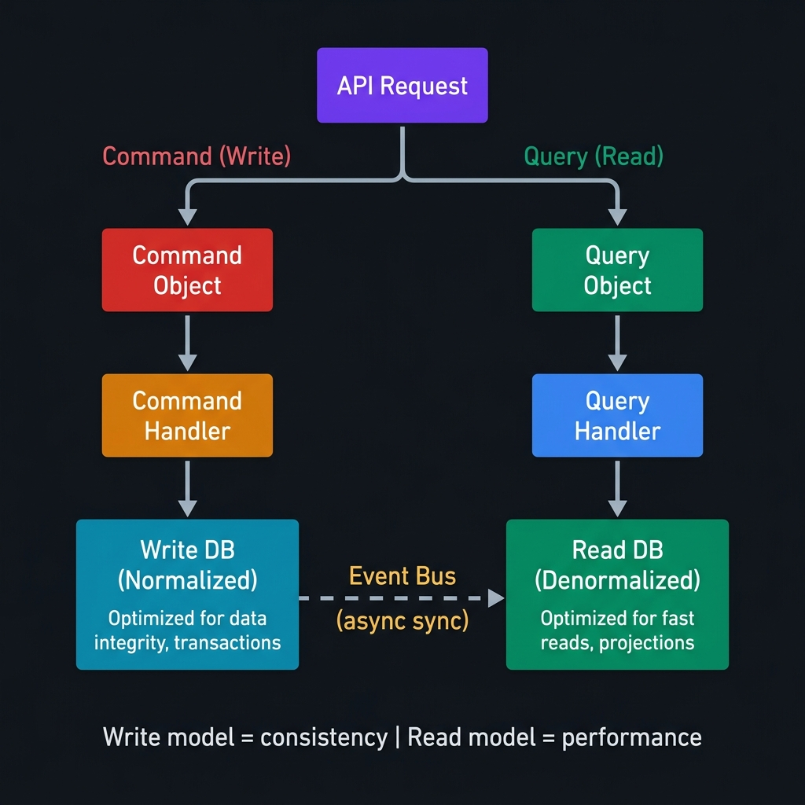
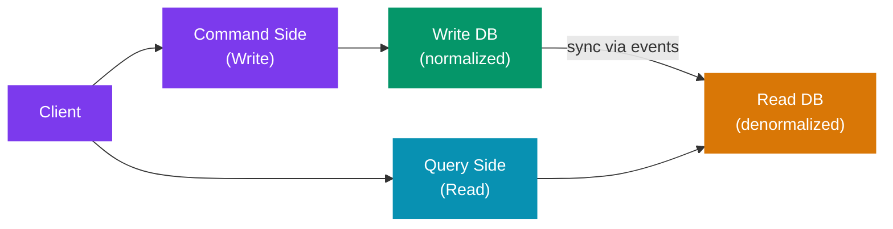
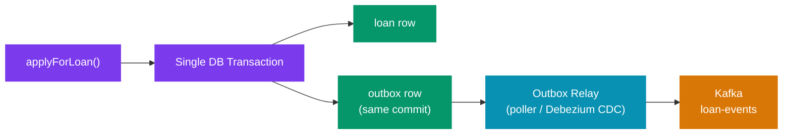
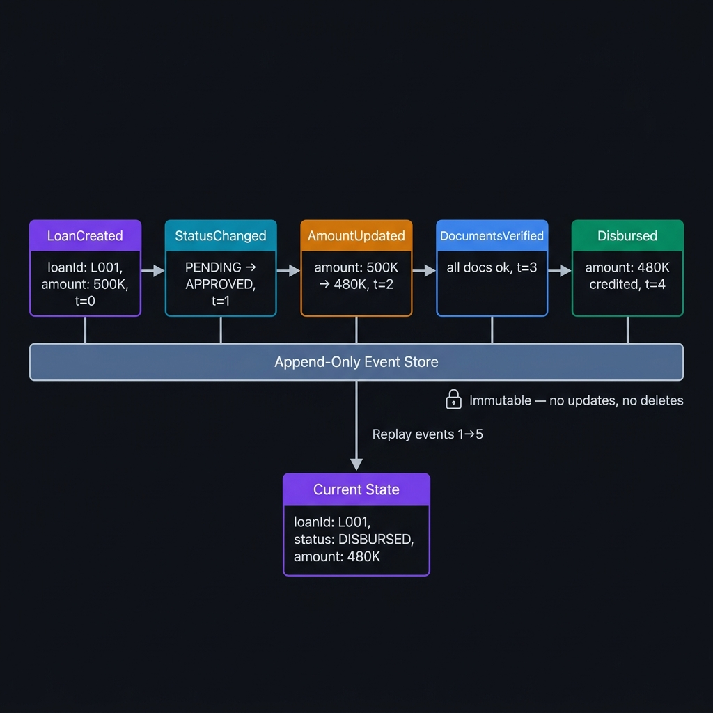
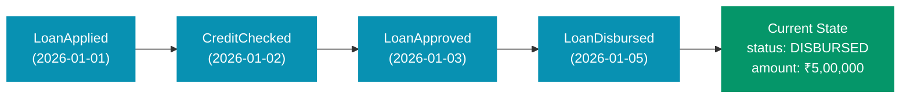
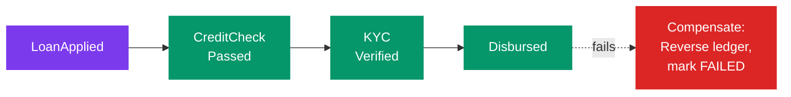

# CQRS and Event Sourcing

- They matter a lot in fintech, where you must track every state change.
- Senior/staff HLD rounds ask about them.
- How often depends on the domain. They come up most where audit trails or heavy read load are real needs.

> 🔥🔥 Must-know — very frequently tested &nbsp;·&nbsp; 🔥 High priority &nbsp;·&nbsp; ⚡ Medium priority &nbsp;·&nbsp; 💤 Low priority

---

<a id="1-cqrs--command-query-responsibility-segregation"></a>
## 1. CQRS — Command Query Responsibility Segregation 🔥

<a id="11-the-problem-with-a-single-model"></a>
### 1.1 The Problem with a Single Model ⚡

In a traditional CRUD architecture, one model handles both reads and writes. But reads and writes have very different needs:

- **Reads** need JOINs, projections, and denormalized views for display
- **Writes** need validation, business rule checks, and transactional consistency
- Under high load, read queries compete with writes. They either block the writes or need complex locking strategies

❌️ **Traditional approach — one service, one model:**

```java
@Service
public class LoanService {

    // writes — domain logic, validations
    public Loan applyForLoan(LoanApplicationRequest request) {
        // validates eligibility, saves entity
    }

    public void disburse(String loanId) {
        // updates status in the same model
    }

    // reads — different shape, same model
    public List<LoanSummaryDTO> getCustomerLoans(String customerId) {
        // JOINs across multiple tables + projections
    }

    public LoanDetailDTO getLoanDetails(String loanId) {
        // complex fetch with lazy-loaded associations
    }
}
```

⚠️ Problems:
- The `Loan` entity is optimized for neither writes (business rules) nor reads (display projections)
- You must scale everything together. You can't scale reads on their own
- Read queries often cause N+1 problems. They can also trigger lazy loading inside write paths when you do not expect it

---

<a id="12-cqrs-split-into-command-and-query-sides"></a>
### 1.2 CQRS: Split into Command and Query Sides 🔥🔥



🔑 **Core idea:** separate the model that changes state (Command side) from the model that reads state (Query side).

- **Command side:** Handles writes (state changes). It uses a rich domain model with business rules
- **Query side:** Handles reads. It uses optimized read models (denormalized, pre-joined, ready for display)
- Commands return `void` or an ID. They change state; they don't return data
- Queries return data but **never** change state



**CQRS-lite — the version you actually ship first.** The diagram above is the *largest* form: two stores, synced by events. CQRS does **not** require that. The pattern splits the **model**. It does not have to split the storage:

| Level | Write side | Read side | Sync mechanism | Consistency |
|---|---|---|---|---|
| **Lite** (most common) | JPA entities + domain rules | Native SQL / JPA projection interface / DB view — **same database, same transaction** | none needed | Strong — read-your-own-writes for free |
| **Read replica** | Primary | Same schema, replica connection (`AbstractRoutingDataSource`) | DB replication | Replica lag (ms) |
| **Materialised** | OLTP tables | Denormalised table or materialised view | Batch job / scheduled refresh | Stale until next refresh |
| **Event-driven** (§1.3–§2) | Aggregate + outbox | Separate read store, own service | Events over Kafka | Eventual — needs idempotency |

🔑 **"Do I need Kafka to do CQRS?" — no.**

- Take a `LoanCommandService` that writes entities.
- Add a `LoanQueryService` that runs a hand-written projection query on the *same* schema.
- That is already CQRS.

Each row down that table gives you more scale. You pay for it with weaker consistency. Start at the top row. Move down only when a real read/write mismatch forces you. Everything from §1.3 onward describes the bottom row. That version has the most parts to build and run. It is not the version you should pick first.

---

<a id="13-cqrs-implementation-in-javaspring"></a>
### 1.3 CQRS Implementation in Java/Spring 🔥

**Command side — commands and handler:**

```java
// Commands — represent explicit intent to change state
public record ApplyForLoanCommand(String customerId, BigDecimal amount, String loanType) {}
public record DisburseLoanCommand(String loanId, String approvedBy) {}

// Domain events emitted by the command side — simple record DTOs here.
// (§3 re-models the same events as a LoanEvent class hierarchy for event sourcing —
//  same names, different shape, because the two patterns have different needs.)
// `version` is the per-aggregate monotonic sequence number — §1.5 needs it to dedup.
public record LoanAppliedEvent(String loanId, String customerId, BigDecimal amount, long version) {}
public record LoanDisbursedEvent(String loanId, String approvedBy, long version) {}

// Command Handler
@Service
public class LoanCommandService {

    private final LoanRepository loanRepository;
    private final ApplicationEventPublisher eventPublisher;

    public LoanCommandService(LoanRepository loanRepository,
                               ApplicationEventPublisher eventPublisher) {
        this.loanRepository = loanRepository;
        this.eventPublisher = eventPublisher;
    }

    @Transactional   // save + event publish must be atomic
    public String applyForLoan(ApplyForLoanCommand command) {
        // business rule validation
        validateEligibility(command.customerId(), command.amount());

        Loan loan = Loan.create(command.customerId(), command.amount(), command.loanType());
        loanRepository.save(loan);

        // publish event for query side to sync
        // ⚠️ DUAL-WRITE RISK: this in-process publish is fine for a Spring @EventListener
        // bound to the same transaction (see §1.4). But the moment "publish" means
        // "send to Kafka", the DB commit and the Kafka send are two separate systems —
        // one can succeed while the other fails. §2 (Transactional Outbox) fixes this.
        // loan.getVersion() = the JPA @Version counter — a monotonic per-aggregate
        // sequence the projection can use as a high-water mark (§1.5).
        eventPublisher.publishEvent(
            new LoanAppliedEvent(loan.getId(), command.customerId(), command.amount(),
                                 loan.getVersion())
        );

        return loan.getId();
    }

    @Transactional
    public void disburseLoan(DisburseLoanCommand command) {
        Loan loan = loanRepository.findById(command.loanId())
            .orElseThrow(() -> new LoanNotFoundException(command.loanId()));
        loan.disburse(command.approvedBy());
        // JPA bumps @Version at flush, not at save(). Flush now, so the event
        // below carries the NEW version. With plain save() it would carry the old one.
        loanRepository.saveAndFlush(loan);

        eventPublisher.publishEvent(
            new LoanDisbursedEvent(command.loanId(), command.approvedBy(), loan.getVersion())
        );
    }

    private void validateEligibility(String customerId, BigDecimal amount) {
        // credit check, KYC validation, bureau score check
    }
}
```

🔑 **Command vs Event — the name tells you which one it is.**

- Commands are **imperative** (`ApplyForLoanCommand`, `DisburseLoanCommand`). A command is a *request*. The handler is free to **reject** it. Exactly **one** handler owns it.
- Events are **past tense** (`LoanAppliedEvent`, `LoanDisbursedEvent`). An event is an immutable *fact* that already happened. It goes out to **N** subscribers. None of them can refuse it.

If you find that you want to "reject an event", you have modelled a command as an event.

| | Command | Event |
|---|---|---|
| Name | Imperative — `DisburseLoan` | Past tense — `LoanDisbursed` |
| Handlers | Exactly one | Zero to many |
| Can be rejected? | Yes — validation may fail | No — it is already history |
| Carries | Intent | Fact + its consequences |

💡 §1.2 states "commands return `void` or an ID".

- `applyForLoan` returns the new `loanId`. This is a practical middle point. The caller needs the id to navigate or poll.
- §1.4 suggests returning the *projected state* as a read-your-own-writes fix. That breaks the rule even more. You give up a clean design to save one round trip.

Say this clearly in the interview. Do not pretend the rule is absolute.

**Query side — read-optimized model and service:**

```java
// Read model — denormalized, pre-joined, optimized for display
public class LoanSummaryView {
    private String loanId;
    private String customerName;   // denormalized from Customer table
    private BigDecimal amount;
    private String status;
    private String loanType;
    private LocalDate appliedDate;
    // no business logic — pure data carrier for the UI
}

// Query service — no writes allowed
@Service
public class LoanQueryService {

    private final LoanSummaryViewRepository viewRepository;

    public LoanQueryService(LoanSummaryViewRepository viewRepository) {
        this.viewRepository = viewRepository;
    }

    public List<LoanSummaryView> getCustomerLoans(String customerId) {
        return viewRepository.findByCustomerId(customerId);
    }

    public LoanSummaryView getLoanDetails(String loanId) {
        return viewRepository.findById(loanId)
            .orElseThrow(() -> new LoanNotFoundException(loanId));
    }
}
```

**Projection — listens to events and keeps the read model in sync (a simple first version — see ⚠️ below):**

```java
@Component
public class LoanProjection {

    private final LoanSummaryViewRepository viewRepository;
    private final CustomerRepository customerRepository;

    public LoanProjection(LoanSummaryViewRepository viewRepository,
                           CustomerRepository customerRepository) {
        this.viewRepository = viewRepository;
        this.customerRepository = customerRepository;
    }

    @EventListener
    public void on(LoanAppliedEvent event) {
        Customer customer = customerRepository.findById(event.customerId()).orElseThrow();
        LoanSummaryView view = new LoanSummaryView();
        view.setLoanId(event.loanId());
        view.setCustomerName(customer.getName());   // denormalize here
        view.setAmount(event.amount());
        view.setStatus("APPLIED");
        view.setAppliedDate(LocalDate.now());
        viewRepository.save(view);
    }

    @EventListener
    public void on(LoanDisbursedEvent event) {
        LoanSummaryView view = viewRepository.findById(event.loanId()).orElseThrow();
        view.setStatus("DISBURSED");
        viewRepository.save(view);
    }
}
```

💡 **Tip:** In a microservices setup, the projection listens to a Kafka topic instead of an in-process Spring event. This fully decouples the read service from the write service.

> ⚠️ **This projection has one deliberate choice and one real bug.** The next two sections deal with them, one at a time:  
> 1. **Synchronous and transaction-bound — a choice, not always a defect.** Plain `@EventListener` runs *in the publisher's thread, inside the publisher's transaction*. That gives you strong consistency and read-your-own-writes. Many fintech flows really want this. The cost is coupling: if `on(...)` throws, the loan application rolls back with it. It is a valid choice (§1.2's "Lite" row). It is only a mistake when you *thought* you were getting the decoupled, eventually-consistent version (→ **§1.4**).  
> 2. **Not idempotent — a real bug as soon as delivery is at-least-once.** `on(LoanAppliedEvent)` does a blind `save`, so a redelivered event creates a duplicate view. `on(LoanDisbursedEvent)` does `findById(...).orElseThrow()`, so an out-of-order or duplicate delivery crashes. Kafka and the outbox both give you at-least-once delivery, so this *will* break (→ **§1.5**).

---

<a id="14-synchronous-vs-eventually-consistent-projections"></a>
### 1.4 Synchronous vs Eventually-Consistent Projections 🔥🔥

The §1.3 projection uses Spring's plain `@EventListener`. That is **synchronous and transaction-bound**. Spring calls it in the **publisher's thread, inside the publisher's transaction**. What this means:

- The read model is updated **before** `applyForLoan` returns. There is *no* lag, so the "eventual consistency" claim is not actually true here.
- The write and read sides are **coupled**. If the projection throws, the whole command transaction rolls back. A bug in a reporting view can now block loan creation.

CQRS promises **eventual consistency and decoupling**. To get them, the projection must run **after** the command commits. Ideally it runs on a different thread/process:

```java
@Component
public class LoanProjection {

    // ... constructor, repositories as before ...

    // Runs ONLY after the command transaction commits successfully.
    // Failure here does NOT roll back the command — but nothing retries it either,
    // so the read model stays stale until something re-feeds the event (see ⚠️ below).
    @Async
    @TransactionalEventListener(phase = TransactionPhase.AFTER_COMMIT)
    public void on(LoanAppliedEvent event) {
        // ... idempotent upsert (see §1.5) ...
    }
}
```

| Mechanism | When it runs | Coupling | Consistency |
|---|---|---|---|
| `@EventListener` (default) | In caller's thread + TX | Tight — projection failure rolls back command | Immediate, synchronous |
| `@TransactionalEventListener(AFTER_COMMIT)` | After command commits | Loose — projection failure leaves the read model stale, with **no automatic retry** (see ⚠️) | Eventual |
| Kafka consumer (separate service) | Independently, after publish | Fully decoupled across services | Eventual — broker redelivers on failure |

⚠️ **The in-process async version has no retry. This is its biggest weakness.**

- Nothing redelivers a Spring application event.
- If the `@Async` handler throws, the default `SimpleAsyncUncaughtExceptionHandler` only logs the exception and drops it. The read model is then wrong **permanently**.
- There is no message waiting in a queue to be consumed again.

You must add the retry on purpose. Options:

- `@Retryable` plus a dead-letter table on the handler.
- A periodic projection rebuild.
- The standard answer: move the feed to the **outbox** (§2). There, the still-unpublished row *is* the retry.

A Kafka consumer makes this retry much easier. The failed record stays in the topic. Spring Kafka's `DefaultErrorHandler` seeks back and retries it (10 attempts by default). Then it logs and skips the record, unless you add a dead-letter topic. Not committing the offset alone only re-reads the record after a restart or rebalance.

⚠️ **Trade-off — read-your-own-writes.** Once the projection is asynchronous, a client can send a command and query the read model right away. The query can run **before the projection catches up**, so the client sees stale data. Common fixes:

- (a) Return the new state directly in the command response, so the UI can show the new state at once, without waiting for the read model.
- (b) Let the client read its own just-written entity from the write model.
- (c) Pass the command's event version back to the client. The query side then waits until the projection has caught up to that version.

---

<a id="15-idempotent-projections-at-least-once-delivery"></a>
### 1.5 Idempotent Projections (At-Least-Once Delivery) 🔥🔥

Both Kafka and the transactional outbox (§2) guarantee **at-least-once** delivery, not exactly-once. So the same event *will* sometimes arrive again. Causes:

- consumer redelivery after a crash before commit
- outbox re-poll
- rebalance replay

The §1.3 projection breaks under this:

- `on(LoanAppliedEvent)` does a blind `save` → a redelivered "applied" event produces a **duplicate view row**.
- `on(LoanDisbursedEvent)` does `findById(...).orElseThrow()` → events can arrive **out of order** (disbursed before applied), or the view may be already deleted. Then it **throws and the consumer gets stuck**.

🔑 **Rule:** with at-least-once delivery, a projection handler MUST be idempotent. Applying the same event twice must give the same result as applying it once. Two standard techniques:

**(a) Track the last-applied event version per view** (works for ordered streams per aggregate):

```java
// Read model now carries the version of the last event folded into it.
// (This class is the @Entity mapped to the loan_summary_view table.)
public class LoanSummaryView {
    private String loanId;
    private String customerName;
    private BigDecimal amount;
    private String status;
    private String loanType;
    private LocalDate appliedDate;
    private long lastEventVersion = -1;   // ← high-water mark; -1 = no event applied yet

    @Version
    private long lockVersion;        // ← JPA optimistic lock — see ⚠️ below
    // getters/setters ...
}

@Component
public class LoanProjection {

    private final LoanSummaryViewRepository viewRepository;
    private final CustomerRepository customerRepository;

    public LoanProjection(LoanSummaryViewRepository viewRepository,
                           CustomerRepository customerRepository) {
        this.viewRepository = viewRepository;
        this.customerRepository = customerRepository;
    }

    @Async
    @Transactional   // MANDATORY: after AFTER_COMMIT on an @Async thread there is NO
                     // active transaction — without this, findById and save run in two
                     // separate transactions and the read-check-write is not atomic.
    @TransactionalEventListener(phase = TransactionPhase.AFTER_COMMIT)
    public void on(LoanAppliedEvent event) {
        // UPSERT: create the view if absent, otherwise reuse it — no duplicate rows.
        LoanSummaryView view = viewRepository.findById(event.loanId())
            .orElseGet(LoanSummaryView::new);

        if (view.getLastEventVersion() >= event.version()) {
            return;   // already applied (or superseded) — skip, this is a redelivery
        }

        Customer customer = customerRepository.findById(event.customerId()).orElseThrow();
        view.setLoanId(event.loanId());
        view.setCustomerName(customer.getName());
        view.setAmount(event.amount());
        view.setStatus("APPLIED");
        view.setAppliedDate(LocalDate.now());
        view.setLastEventVersion(event.version());
        viewRepository.save(view);
    }

    @Async
    @Transactional
    @TransactionalEventListener(phase = TransactionPhase.AFTER_COMMIT)
    public void on(LoanDisbursedEvent event) {
        // Don't crash on out-of-order / missing prior state: upsert instead of orElseThrow.
        // Limit: if this arrives before "applied", the later "applied" (lower version)
        // is skipped, so customerName/amount stay empty. (a) assumes per-aggregate order.
        LoanSummaryView view = viewRepository.findById(event.loanId())
            .orElseGet(() -> {
                LoanSummaryView v = new LoanSummaryView();
                v.setLoanId(event.loanId());
                return v;
            });

        if (view.getLastEventVersion() >= event.version()) {
            return;   // redelivery — already applied
        }

        view.setStatus("DISBURSED");
        view.setLastEventVersion(event.version());
        viewRepository.save(view);
    }
}
```

> ⚠️ **`@Transactional` is needed but not enough. Technique (b) is the one that holds on its own.**  
> - Even inside one transaction, (a) is a read-check-write.  
> - Two redelivered copies of the same event may run on two threads or two pods. Both can read `lastEventVersion = 3` before either one writes. Then both apply.  
> - The `@Version` optimistic lock closes that gap. The loser gets an `OptimisticLockingFailureException`. You must retry it or drop it as a duplicate.  
> - Technique **(b)** below needs none of these extra parts. The conditional upsert is a *single atomic statement*, so the database resolves the race for you.  
>
> **Use (b) by default. Use (a) only when the projection must do work SQL can't express.** An example is the `customerRepository` denormalisation lookup above.

**(b) Database-level upsert / dedup table** — move idempotency into the store, instead of doing read-modify-write:

```sql
-- Postgres upsert: a redelivered event is a harmless no-op / overwrite, never a duplicate.
INSERT INTO loan_summary_view (loan_id, customer_name, amount, status, last_event_version)
VALUES (:loanId, :customerName, :amount, :status, :version)
ON CONFLICT (loan_id) DO UPDATE
    SET status = EXCLUDED.status,
        last_event_version = EXCLUDED.last_event_version
    WHERE loan_summary_view.last_event_version < EXCLUDED.last_event_version;
```

Another option is a `processed_events(event_id PRIMARY KEY)` table:

- Each handler first tries to `INSERT` the event id, in the **same transaction** as the view update.
- A duplicate-key violation means "already processed — skip."
- This works even when events have no per-aggregate version.

💡 `event.version()` is the `long version` component on the §1.3 event records. It is the same `(aggregateId, version)` pair that the §3 event store assigns. If your events don't carry one, use the Kafka offset or the outbox sequence number as the high-water mark instead (the highest value already applied).

---

<a id="16-cqrs-benefits-and-trade-offs"></a>
### 1.6 CQRS Benefits and Trade-offs 🔥

**Benefits:**

| Benefit | Explanation |
|---|---|
| Independent scaling | Read service can be scaled separately from write service |
| Optimized models | Write model enforces business rules; read model optimized for queries |
| Clear separation | No method that does both reading AND writing |
| Audit trail | Commands are explicit intents — easy to log and trace |

**Trade-offs:**

| Trade-off | Mitigation |
|---|---|
| Eventual consistency — **only in the event-driven form** | CQRS-lite (§1.2) is strongly consistent and has no lag at all. Once the projection goes async (§1.4), the read model is behind by milliseconds-to-seconds. That is fine for most UIs. Handle read-your-own-writes explicitly (§1.4) |
| Idempotency burden | Projections must dedup under at-least-once delivery (§1.5) — version high-water mark or DB upsert |
| Increased complexity | Only apply CQRS where read/write loads really differ |
| Two models to maintain | Justified when the system is complex and read-heavy |

---

<a id="2-reliable-event-publishing-the-transactional-outbox"></a>
## 2. Reliable Event Publishing: The Transactional Outbox 🔥🔥

§1.3's `applyForLoan` does two writes to two different systems:

```java
loanRepository.save(loan);                  // (1) write to the database
eventPublisher.publishEvent(...);           // (2) publish to the broker (e.g. Kafka)
```

This is the **dual-write problem**. No distributed transaction covers both the DB and Kafka. So the two systems become **inconsistent** in these cases:

- a crash *between* (1) and (2)
- a Kafka failure after the DB commit
- a DB rollback after the Kafka send

Two examples:

- DB commits, Kafka send fails → the loan exists, but no event is ever published → the read model and downstream services never learn about it.
- Kafka send succeeds, DB transaction rolls back → consumers act on a loan that **does not exist**.

🔑 **The fix: never publish from inside business code. Write the event to an `outbox` table in the *same local transaction* as the aggregate. Publish it asynchronously later.** The aggregate row and the outbox row commit atomically (one DB transaction). So they can never disagree. A separate process reads the outbox and sends its rows to Kafka.



**The outbox table — written in the same transaction as the aggregate:**

```java
@Entity
@Table(name = "outbox")
public class OutboxEvent {

    // A DB-generated monotonic sequence (bigserial / identity) — THIS is what orders
    // the outbox. A UUID primary key carries no ordering at all, and createdAt can't
    // order it either: it is stamped by the writer pod's wall clock, so two pods with
    // even slight clock skew produce rows whose timestamps disagree with commit order.
    // Order by seq and LoanDisbursed can never overtake LoanApplied for the same loan.
    @Id
    @GeneratedValue(strategy = GenerationType.IDENTITY)
    private Long seq;

    private String eventId;         // UUID — stable dedup key for the consumer
    private String aggregateType;   // "Loan"
    private String aggregateId;     // loanId — used as the Kafka partition key
    private String eventType;       // "LoanApplied"
    @Column(columnDefinition = "text")
    private String payload;         // serialized event JSON
    private Instant createdAt;      // observability + retention only — never for ordering
    private boolean published;      // false until the relay sends it
    // getters/setters ...
}
```

```java
@Service
public class LoanCommandService {

    private final LoanRepository loanRepository;
    private final OutboxRepository outboxRepository;
    private final ObjectMapper objectMapper;

    // constructor ...

    @Transactional   // aggregate + outbox row commit atomically — no dual write
    public String applyForLoan(ApplyForLoanCommand command) throws JsonProcessingException {
        validateEligibility(command.customerId(), command.amount());

        Loan loan = Loan.create(command.customerId(), command.amount(), command.loanType());
        loanRepository.save(loan);

        LoanAppliedEvent event = new LoanAppliedEvent(
            loan.getId(), command.customerId(), command.amount(), loan.getVersion());

        OutboxEvent outbox = new OutboxEvent();
        outbox.setEventId(UUID.randomUUID().toString());
        outbox.setAggregateType("Loan");
        outbox.setAggregateId(loan.getId());
        outbox.setEventType("LoanApplied");
        outbox.setPayload(objectMapper.writeValueAsString(event));
        outbox.setCreatedAt(Instant.now());
        outbox.setPublished(false);
        outboxRepository.save(outbox);   // SAME transaction as loanRepository.save

        return loan.getId();
    }
}
```

**Draining the outbox to Kafka — two options:**

```java
public interface OutboxRepository extends JpaRepository<OutboxEvent, Long> {

    // SKIP LOCKED: every pod runs the same scheduler, so without a row lock all of
    // them read and drain the SAME rows. SKIP LOCKED lets pod B walk past the rows
    // pod A is already holding instead of blocking behind them — N pods, disjoint
    // batches, no double-send. Order by seq, never by createdAt.
    @Query(value = """
        SELECT * FROM outbox
        WHERE published = false
        ORDER BY seq
        LIMIT 100
        FOR UPDATE SKIP LOCKED
        """, nativeQuery = true)
    List<OutboxEvent> lockNextUnpublishedBatch();
}
```

```java
// Option A — polling publisher. Simple, no extra infra; trades a little latency.
// Needs @EnableScheduling on a @Configuration class, or none of this ever runs.
@Component
public class OutboxRelay {

    private final OutboxRepository outboxRepository;
    private final KafkaTemplate<String, String> kafka;

    // constructor ...

    @Scheduled(fixedDelay = 500)
    @Transactional
    public void drain() throws InterruptedException, ExecutionException {
        List<OutboxEvent> batch = outboxRepository.lockNextUnpublishedBatch();

        List<CompletableFuture<SendResult<String, String>>> sends = new ArrayList<>();
        for (OutboxEvent e : batch) {
            // key = aggregateId keeps per-loan ordering on one partition
            sends.add(kafka.send("loan-events", e.getAggregateId(), e.getPayload()));
        }

        // ⚠️ Mark published ONLY after the broker has ACKed. KafkaTemplate.send() is
        // asynchronous — it returns a future and does not block. Setting published=true
        // on an un-acked send turns at-least-once into AT-MOST-ONCE with silent event
        // loss: the send fails later, nobody notices, the event is gone forever.
        for (int i = 0; i < batch.size(); i++) {
            sends.get(i).get();               // throws if that send was rejected
            batch.get(i).setPublished(true);  // (or delete the row)
        }
    }
}
```

> ⚠️ **The relay is at-least-once, not exactly-once.** Say the relay crashes *after* the broker ACKs but *before* the `published = true` commit. Then the event is re-sent on the next poll. That is fine *because consumers are idempotent* (§1.5). This is exactly why idempotent projections are mandatory, not optional. Note which side is safe: re-sending is harmless, but **never sending is not**. That is why the relay must wait for the ACK before it sets the flag.

💡 **Alternative to `SKIP LOCKED`: a distributed lock** (ShedLock, or a Redis/DB lease). With it, exactly one pod runs the relay at a time.

- It is simpler to think about.
- But it limits outbox throughput to one instance.
- It also adds a failover gap (a short time with no relay running).

`SKIP LOCKED` scales horizontally: you can add more pods. It is the better default when the database supports it.

**Option B — Change Data Capture (Debezium).** Debezium does not poll. It reads the database's write-ahead log (the log where the DB records every change) as it grows. It streams every committed `outbox` insert straight to Kafka.

- Pros: no polling latency, no read load on the DB, no relay code.
- Cons: more work to operate (you must run and monitor Kafka Connect + Debezium).

Teams usually move to this pattern *only when they already run Kafka Connect*. A polling relay is simpler, and it is still extremely common.

---

<a id="3-event-sourcing"></a>
## 3. Event Sourcing 🔥

<a id="31-the-problem-state-vs-history"></a>
### 3.1 The Problem: State vs History ⚡

Traditional persistence stores only the **current state**. For example: "Loan is DISBURSED, amount = ₹5,00,000". Once you overwrite it, the history is gone.

In fintech, this is a **compliance problem**:
- RBI requires a full audit trail: who approved, what the original amount was, what changed and when
- Overwriting state destroys this evidence
- Debugging production issues is hard when you can only see the final state

✅ What we want: to answer two questions. "What was the state of this loan at any point in time? What caused each transition?"

---

<a id="32-event-sourcing-store-events-not-state"></a>
### 3.2 Event Sourcing: Store Events, Not State 🔥



🔑 **Core idea:** Do not save the current state. Save every **event** that led to the current state. You **derive** the state by replaying the events.



The event store is **append-only**. Nobody updates or deletes an event. This is why it gives a perfect audit trail.

---

<a id="33-event-sourcing-implementation"></a>
### 3.3 Event Sourcing Implementation ⚡

**Base event and domain events:**

```java
// Base event — all domain events extend this
public abstract class LoanEvent {

    private final String loanId;
    private final LocalDateTime occurredAt;
    private final String eventType;

    protected LoanEvent(String loanId, String eventType) {
        this.loanId = loanId;
        this.eventType = eventType;
        this.occurredAt = LocalDateTime.now();
    }

    public String getLoanId() {
        return loanId;
    }

    public LocalDateTime getOccurredAt() {
        return occurredAt;
    }

    public String getEventType() {
        return eventType;
    }
}

// Domain events — one per state transition
public class LoanAppliedEvent extends LoanEvent {

    private final String customerId;
    private final BigDecimal amount;
    private final String loanType;

    public LoanAppliedEvent(String loanId, String customerId, BigDecimal amount, String loanType) {
        super(loanId, "LOAN_APPLIED");
        this.customerId = customerId;
        this.amount = amount;
        this.loanType = loanType;
    }

    public String getCustomerId() {
        return customerId;
    }
    public BigDecimal getAmount() {
        return amount;
    }
    public String getLoanType() {
        return loanType;
    }
}

public class LoanApprovedEvent extends LoanEvent {

    private final String approvedBy;

    public LoanApprovedEvent(String loanId, String approvedBy) {
        super(loanId, "LOAN_APPROVED");
        this.approvedBy = approvedBy;
    }

    public String getApprovedBy() {
        return approvedBy;
    }
}

public class LoanDisbursedEvent extends LoanEvent {

    private final BigDecimal disbursedAmount;

    public LoanDisbursedEvent(String loanId, BigDecimal disbursedAmount) {
        super(loanId, "LOAN_DISBURSED");
        this.disbursedAmount = disbursedAmount;
    }

    public BigDecimal getDisbursedAmount() {
        return disbursedAmount;
    }
}
```

**Aggregate — rebuilt by replaying events:**

```java
public class LoanAggregate {

    private String loanId;
    private String customerId;
    private BigDecimal amount;
    private String status;
    private String loanType;
    private List<LoanEvent> uncommittedEvents = new ArrayList<>();

    // Private — only created via reconstitute or fromSnapshot
    private LoanAggregate() {}

    // Reconstitute from full event history (cold start)
    public static LoanAggregate reconstitute(List<LoanEvent> history) {
        LoanAggregate aggregate = new LoanAggregate();
        for (LoanEvent event : history) {
            aggregate.apply(event);
        }
        return aggregate;
    }

    // Rebuild from a snapshot — skips replaying the events before it (see §3.5)
    public static LoanAggregate fromSnapshot(LoanSnapshot snapshot) {
        LoanAggregate aggregate = new LoanAggregate();
        aggregate.loanId = snapshot.getLoanId();
        aggregate.customerId = snapshot.getCustomerId();
        aggregate.amount = snapshot.getAmount();
        aggregate.loanType = snapshot.getLoanType();
        aggregate.status = snapshot.getStatus();
        return aggregate;
    }

    // Replay events on top of the current state (e.g. the events after a snapshot)
    public void replayEvents(List<LoanEvent> events) {
        for (LoanEvent event : events) {
            apply(event);
        }
    }

    // Apply each event to mutate state — no business logic here
    private void apply(LoanEvent event) {
        if (event instanceof LoanAppliedEvent e) {
            this.loanId = e.getLoanId();
            this.customerId = e.getCustomerId();
            this.amount = e.getAmount();
            this.loanType = e.getLoanType();
            this.status = "APPLIED";
        } else if (event instanceof LoanApprovedEvent) {
            this.status = "APPROVED";
        } else if (event instanceof LoanDisbursedEvent e) {
            // disbursed amount becomes the current amount; the originally-applied
            // amount is never lost — it stays in the event log
            this.amount = e.getDisbursedAmount();
            this.status = "DISBURSED";
        }
    }

    // Business operation — validates, then generates a new event
    public void approve(String approvedBy) {
        if (!"APPLIED".equals(status)) {
            throw new IllegalStateException(
                "Loan must be in APPLIED state to approve. Current: " + status
            );
        }
        LoanApprovedEvent event = new LoanApprovedEvent(loanId, approvedBy);
        apply(event);
        uncommittedEvents.add(event);
    }

    public void disburse(BigDecimal disbursedAmount) {
        if (!"APPROVED".equals(status)) {
            throw new IllegalStateException(
                "Loan must be APPROVED before disbursement. Current: " + status
            );
        }
        LoanDisbursedEvent event = new LoanDisbursedEvent(loanId, disbursedAmount);
        apply(event);
        uncommittedEvents.add(event);
    }

    public List<LoanEvent> getUncommittedEvents() {
        return Collections.unmodifiableList(uncommittedEvents);
    }

    public void markEventsAsCommitted() {
        uncommittedEvents.clear();
    }

    public String getStatus() {
        return status;
    }
    public String getLoanId() {
        return loanId;
    }
}
```

**Event Store — append-only storage:**

```java
@Repository
public class LoanEventStore {

    // In production: backed by a DB table or a dedicated event store (EventStoreDB, Axon)
    private final Map<String, List<LoanEvent>> store = new ConcurrentHashMap<>();

    public void save(String loanId, List<LoanEvent> newEvents) {
        store.computeIfAbsent(loanId, k -> new ArrayList<>()).addAll(newEvents);
    }

    public List<LoanEvent> load(String loanId) {
        return store.getOrDefault(loanId, Collections.emptyList());
    }

    public List<LoanEvent> loadAfterVersion(String loanId, int afterVersion) {
        List<LoanEvent> all = load(loanId);
        return all.subList(Math.min(afterVersion, all.size()), all.size());
    }
}

// Service coordinating aggregate + event store
@Service
public class LoanEventSourcedService {

    private final LoanEventStore eventStore;
    private final ApplicationEventPublisher publisher;

    public LoanEventSourcedService(LoanEventStore eventStore,
                                    ApplicationEventPublisher publisher) {
        this.eventStore = eventStore;
        this.publisher = publisher;
    }

    public void approve(String loanId, String approvedBy) {
        List<LoanEvent> history = eventStore.load(loanId);
        LoanAggregate loan = LoanAggregate.reconstitute(history);

        loan.approve(approvedBy);   // business validation + event creation

        List<LoanEvent> newEvents = loan.getUncommittedEvents();
        eventStore.save(loanId, newEvents);
        loan.markEventsAsCommitted();

        // publish for CQRS projections / Kafka fanout
        newEvents.forEach(publisher::publishEvent);
    }
}
```

> ⚠️ **Production concern — optimistic concurrency.** The in-memory store above is simplified. A real event store checks every append with an **expected-version check**. For example, `save(loanId, expectedVersion, newEvents)` fails if another writer appended after this aggregate was loaded. Without this check, two concurrent commands silently corrupt the stream. (The inner `ArrayList` is also not safe for concurrent appends to the same key.) Two options give you both the version check and safe concurrent appends: a DB table with a unique `(loanId, version)` constraint, or a dedicated store like EventStoreDB / Axon.

📤 **Result:** Every business operation appends to the event log. The current state at any time is `LoanAggregate.reconstitute(eventStore.load(loanId))`.

---

<a id="34-event-sourcing-benefits-and-trade-offs"></a>
### 3.4 Event Sourcing Benefits and Trade-offs 🔥🔥

**Benefits:**

| Benefit | Why it matters |
|---|---|
| Complete audit trail | Every state change recorded — critical for fintech compliance (RBI, SEBI) |
| Time travel | Replay events up to any timestamp to see past state |
| Debugging | Reproduce production bugs by replaying the exact event sequence |
| Event-driven integration | Events can be published to Kafka for downstream services |

**Trade-offs:**

| Trade-off | Mitigation |
|---|---|
| Querying current state requires replay | Use **Snapshots** — periodically save state, replay only from last snapshot |
| Schema evolution is hard | Event versioning and upcasters (transform old events to new schema) |
| Not suitable for simple CRUD | Only apply when audit trail and full history genuinely matter |
| Event store size grows indefinitely | Archival policies + snapshot pruning |
| **Right to erasure vs an immutable log** | Crypto-shredding, or keep PII out of events entirely (see below) |

**🔧 Schema evolution — upcasting.** This is the hard long-term problem of event sourcing. This question shows who has *run* an event-sourced system and who has only read about one. The problem: a five-year-old `LoanAppliedEvent` must still deserialize into today's code.

- **Additive changes are safe.** You can add an optional field to an event. Old events do not have it, and the deserializer supplies a default. Renaming a field, changing its type, or removing it is not safe. In practice you can **never remove a field** that old events carry.
- **The upcaster chain.** An upcaster is a function that converts an old event version to the next one. Register one transform per version step — `v1 → v2 → v3`. The chain runs *at load time*, before the event reaches `apply(...)`. The aggregate only sees the latest format. The chain handles all the old versions. Axon models exactly this.
- **Weak schema is better than strict.** JSON with tolerant readers handles change far better than Java serialization. The reason: the reader ignores unknown fields instead of failing. Avro also supports change, but only within its schema compatibility rules, and every reader needs the writer's schema.
- **Schema changes invalidate snapshots.** A snapshot is serialized *aggregate state*, not events. If you change the aggregate's structure, you must discard every existing snapshot and rebuild it from the log. Give your snapshots an explicit version. Then the code detects an old one instead of silently reading it wrong.

**🔒 Right to erasure vs "events are never deleted".** GDPR (and India's DPDP Act 2023) give a data subject the right to have their personal data erased. A data subject is the person the data is about. An append-only event log that you keep forever breaks that rule directly. This is *the* hard question about event sourcing in a fintech interview. There are two accepted answers:

1. **Crypto-shredding.** Encrypt every PII field in the event payload with a **per-subject key**. Keep the keys in a separate key store. To erase the subject, delete their key.
   - The events stay. The log's integrity, the ordering and the replayability are all intact.
   - But the payload becomes permanently unreadable.
   - Replays after erasure give a tombstoned/anonymous aggregate (the PII can no longer be read). Projections must handle that.
2. **Keep PII out of the events.** The event carries only a `customerId`. Name, PAN, address, and phone live in a normal customer store that you can update and erase. The log becomes a stream of *references*. Erasure is an ordinary `DELETE` in that one store.

⚠️ What is **not** an answer: deleting or rewriting events. That breaks the replay of every downstream projection. It also destroys the audit guarantee, which is the reason you chose event sourcing. If someone suggests editing the log, they have not understood the pattern.

---

<a id="35-snapshot-pattern-performance-optimization"></a>
### 3.5 Snapshot Pattern (Performance Optimization) 🔥

Some aggregates have long event histories (e.g. a loan with 200+ lifecycle events over years). For them, replaying from the beginning on every load is slow. Snapshots solve this.

💡 **Strategy:** After every N events (or on schedule), save a snapshot of the current aggregate state. On load, start from the latest snapshot. Then replay only the events that came after it.

```java
// Snapshot — captures aggregate state at a point in time
public class LoanSnapshot {

    // Captures the FULL aggregate state — fromSnapshot() must be able to rebuild
    // the aggregate without replaying any pre-snapshot events.
    private final String loanId;
    private final String customerId;
    private final String status;
    private final BigDecimal amount;
    private final String loanType;
    private final int eventVersion;   // snapshot taken after this many events
    private final LocalDateTime snapshotAt;

    public LoanSnapshot(String loanId, String customerId, String status, BigDecimal amount,
                         String loanType, int eventVersion, LocalDateTime snapshotAt) {
        this.loanId = loanId;
        this.customerId = customerId;
        this.status = status;
        this.amount = amount;
        this.loanType = loanType;
        this.eventVersion = eventVersion;
        this.snapshotAt = snapshotAt;
    }

    public String getLoanId() {
        return loanId;
    }
    public String getCustomerId() {
        return customerId;
    }
    public String getStatus() {
        return status;
    }
    public BigDecimal getAmount() {
        return amount;
    }
    public String getLoanType() {
        return loanType;
    }
    public int getEventVersion() {
        return eventVersion;
    }
    public LocalDateTime getSnapshotAt() {
        return snapshotAt;
    }
}

// Load with snapshot optimization
@Service
public class LoanLoader {

    private final LoanEventStore eventStore;
    private final LoanSnapshotStore snapshotStore;

    public LoanLoader(LoanEventStore eventStore, LoanSnapshotStore snapshotStore) {
        this.eventStore = eventStore;
        this.snapshotStore = snapshotStore;
    }

    public LoanAggregate load(String loanId) {
        Optional<LoanSnapshot> snapshot = snapshotStore.findLatest(loanId);

        if (snapshot.isPresent()) {
            // only load events AFTER the snapshot version — much faster
            List<LoanEvent> recentEvents = eventStore.loadAfterVersion(
                loanId, snapshot.get().getEventVersion()
            );
            LoanAggregate aggregate = LoanAggregate.fromSnapshot(snapshot.get());
            aggregate.replayEvents(recentEvents);
            return aggregate;
        } else {
            // no snapshot — full replay from beginning
            List<LoanEvent> history = eventStore.load(loanId);
            return LoanAggregate.reconstitute(history);
        }
    }
}
```

---

<a id="36-correcting-a-bad-event-compensating-events"></a>
### 3.6 Correcting a Bad Event (Compensating Events) 🔥

> *"A bug appended `LoanDisbursed(₹50,00,000)` instead of `₹5,00,000`, and it's already in the store. Fix it."*

CRUD work teaches you to update the row. Here that is exactly the wrong move. Interviewers ask this question to see if you try it.

❌️ **Never mutate or delete a stored event.** Every projection, snapshot and downstream consumer has *already* applied that event.
- Editing it breaks the sync with everything built from the log before the edit, and nothing warns you.
- It also destroys the audit guarantee, which is why you chose event sourcing.
- In a regulated domain, an event log you are willing to edit is not evidence.

✅ **The store is append-only, so the fix is another append.**

```java
public class LoanDisbursementCorrectedEvent extends LoanEvent {

    private final BigDecimal correctedAmount;
    private final String reason;
    private final String correctedBy;

    public LoanDisbursementCorrectedEvent(String loanId, BigDecimal correctedAmount,
                                           String reason, String correctedBy) {
        super(loanId, "LOAN_DISBURSEMENT_CORRECTED");
        this.correctedAmount = correctedAmount;
        this.reason = reason;
        this.correctedBy = correctedBy;
    }

    public BigDecimal getCorrectedAmount() {
        return correctedAmount;
    }
    public String getReason() {
        return reason;
    }
    public String getCorrectedBy() {
        return correctedBy;
    }
}
```

```java
// New branch in LoanAggregate.apply(...) — replay now lands on the right amount,
// and the wrong one is still visible in the log, which is the point.
private void apply(LoanEvent event) {
    // ... existing LoanApplied / LoanApproved / LoanDisbursed branches ...
    if (event instanceof LoanDisbursementCorrectedEvent e) {
        this.amount = e.getCorrectedAmount();   // status stays DISBURSED
    }
}
```

People often mix up three different situations. Keep them apart:

| Situation | What you append | Note |
|---|---|---|
| **Data was wrong** (typo, bug) | A **corrective** event — `…Corrected` | A new event fixes the state; the error stays in the log with `reason` + `correctedBy` |
| **Business decision reversed** (disbursement taken back) | A **compensating/reversal** event — `…Reversed` | An undo in business terms, not an erasure. The double-entry ledger's reversal entry is the standard example (§5) |
| **Schema was wrong**, data is fine | Nothing — an **upcaster** (§3.4) | No new event; the old one is transformed at load time |

⚠️ **The correction has to propagate.**
- Appending the event fixes replay.
- But some projections or downstream services already reacted to the bad event. Each of them needs a handler for the corrective event too.
- Some side effects already happened outside the system (a payment sent, an SMS delivered). You can only *compensate* them, never undo them.

Saga has the same limit: some steps cannot be undone (§5).

💡 If corrections become frequent, that is a sign of a modelling problem, not a process problem. Two likely causes:
- the events are too coarse (each one covers too much), or
- validation is on the wrong side. It belongs on the command side, where it can still **reject** the change. On the event side it cannot.

---

<a id="4-cqrs--event-sourcing-together"></a>
## 4. CQRS + Event Sourcing Together ⚡

CQRS and Event Sourcing are **complementary**. They solve different problems, but they work well together:

- **Event Sourcing** gives you the event stream on the write side.
- **CQRS Projections** read those events. They build fast read models on the query side.
- **Kafka** sits between them in a microservices setup. It keeps the write and read services separate.
  - But the step from the event store to Kafka still crosses two systems.
  - So it goes through the **outbox relay** (§2). The write path does not send to Kafka directly from inside the business code.

```mermaid
graph LR
    CMD["Command<br/>(ApplyForLoan)"] --> CH["Command<br/>Handler"]
    CH --> ES["Event Store<br/>(the log IS the outbox)"]
    ES --> RLY["Outbox Relay<br/>(poller / Debezium)"]
    RLY --> KT["Kafka Topic<br/>loan-events"]
    KT --> PR["Idempotent Projection<br/>(Kafka consumer)"]
    PR --> RDB["Read DB<br/>(LoanSummaryView)"]
    RDB --> QS["Query Service<br/>→ Client"]

    classDef purple fill:#7C3AED,stroke:#7C3AED,color:#fff
    classDef cyan fill:#0891B2,stroke:#0891B2,color:#fff
    classDef green fill:#059669,stroke:#059669,color:#fff
    classDef orange fill:#D97706,stroke:#D97706,color:#fff
    classDef pink fill:#DC2626,stroke:#DC2626,color:#fff

    class CMD,CH purple
    class ES pink
    class RLY cyan
    class KT orange
    class PR,RDB cyan
    class QS green
```



🔑 **Key insight:** The event store IS the source of truth. The read DB is just a **projection**. A projection is a derived view. You can always rebuild it by replaying the event stream.

With an event store, the event log *is* the outbox. There is no separate dual write. The relay just reads the new events as they are appended.

**Practical benefit for microservices:** Say a new service needs loan data in a different format. Just write a new projection that reads the same Kafka topic. The write side does not change.

⚠️ **This is a heavy setup, and most systems should not run it.** §1.6, §3.4 and §7 each list the cost of the two patterns separately. If you combine them, **you pay both costs**:

- eventual consistency
- replay-to-read
- schema evolution
- idempotent projections
- an outbox relay to operate

And the team now has to debug all of it, even at 2am during an incident. Greg Young named CQRS and made event sourcing popular. Even he often says in his talks that people should not use event sourcing by default.

Say this clearly in an interview. The strong answer is: "here is the combined architecture. Here is why I would ship §1.2's CQRS-lite first. I would move to this only when audit *and* read scale are both real needs."

---

<a id="5-saga--process-managers"></a>
## 5. Saga / Process Managers 🔥🔥

Event sourcing records what happened to **one** aggregate. But a real loan-approval workflow covers **several** aggregates/services and several steps. None of them share a transaction:

`LoanApplied → credit-check service → KYC service → disbursement service → ledger service`

You cannot wrap that in a single ACID transaction. The services use different databases, with a network in between. A **Saga** handles it as a sequence of local transactions:

- Each local transaction emits an event.
- That event triggers the next step.
- If a later step fails, **compensating actions** undo the earlier steps.



Two coordination styles:

| Style | How it works | Trade-off |
|---|---|---|
| **Choreography** | Each service listens for the previous event and emits the next. There is no central coordinator | Decoupled. But the end-to-end flow is not written down in one place, and it is hard to trace |
| **Orchestration (process manager)** | A central **process manager** subscribes to the event stream. It holds the workflow state and sends the next command | Explicit, observable, testable. But the orchestrator is one more component to own |

🔑 A **process manager** is the stateful kind of saga. It:

- consumes events
- tracks "where are we in the loan workflow"
- decides the next command

It is often an event-sourced aggregate itself. In an event-sourced system, the saga fits easily on top of the same event stream. The projections already consume that stream.

> ⚠️ Saga gives you **atomicity without isolation**. Other readers can see the in-between states (e.g. "credit checked but not yet disbursed"). Design the read model and UI to handle those in-progress states.  
> Compensations undo the business meaning (a reversal entry). They are not rollbacks.  
> For more detail on Saga, see `17_Spring_Microservices_Interview_Questions.md` / `01_System_Design_HLD_Interview_Questions.md`.

---

<a id="6-event-sourcing-vs-event-driven-architecture"></a>
## 6. Event Sourcing vs Event-Driven Architecture ⚡

People mix these two up in interviews. Both use "events". But the **role** of the event is completely different.

| | **Event Sourcing (ES)** | **Event-Driven Architecture (EDA)** |
|---|---|---|
| Event is... | **State** — the source of truth | **A notification** — a message between services |
| Purpose | Persistence: rebuild aggregate state by replaying events | Integration: tell other services something happened |
| Store | Append-only **event store**, retained forever | Broker (Kafka/SQS), often with finite retention |
| Can you delete/replay? | Replay is core; events are never deleted | Events are consumed and may be discarded after retention |
| Granularity | Fine-grained domain events of one aggregate | Often coarser integration/business events |

🔑 **One-liner:** ES is *event-as-state* (the log **is** the database). EDA is *event-as-notification* (the log is the **channel** between services).

They work together. An event-sourced service often publishes some of its internal events onto an EDA broker (via the outbox, §2). Then other services can react.

Each one also works alone:

- **EDA without ES:** services just emit notifications over Kafka.
- **ES without EDA:** a single service replays its own log, and nobody else subscribes.

---

<a id="7-when-to-use"></a>
## 7. When to Use 🔥

These two patterns have **different reasons** to use them. Don't treat them as one package.

- Pick CQRS when reads and writes need different things.
- Pick Event Sourcing when you need audit/history.

In fintech you often need both. But they are independent decisions.

**Use CQRS when:**

| ✅ Use it when... | ❌️ Don't use it when... |
|---|---|
| **High read/write ratio** — reads are far more than writes and need different formats | No performance problems exist with a single model |
| Multiple denormalized views of the same data are needed | Read and write loads are similar and modest |
| Read and write sides need to scale independently | Small system with 1–2 developers, short timeline |

**Use Event Sourcing when:**

| ✅ Use it when... | ❌️ Don't use it when... |
|---|---|
| **Audit trail / full history is a requirement** (fintech, healthcare, banking — RBI/SEBI) | Simple CRUD with no history requirements |
| Debugging and time-travel queries matter | Aggregate event history is very short |
| The domain is naturally a sequence of state transitions | Team does not know it — hard to learn, and no strong reason to use it |

⚠️ **CQRS without Event Sourcing** is valid and common. Use it when read/write loads differ but you don't need full event history. And CQRS without *events at all* is the most common form of all. See the CQRS-lite table in §1.2 before you add a broker.

⚠️ **Event Sourcing without CQRS** is possible in theory but rare. When you have an event store, you almost always want optimized read models.

---
