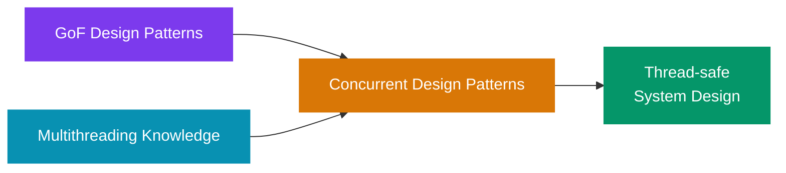
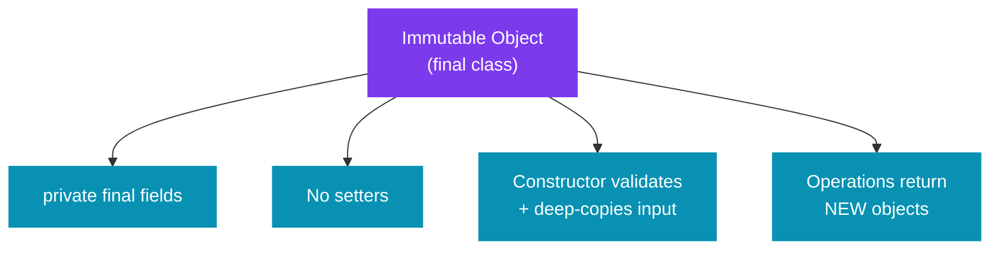
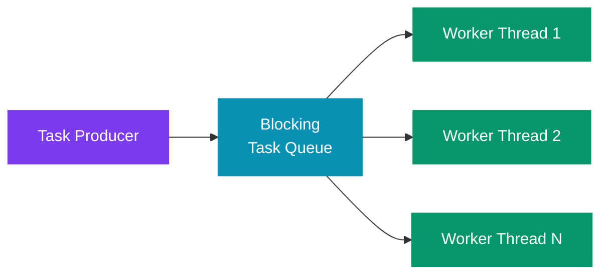
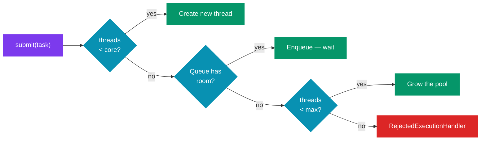
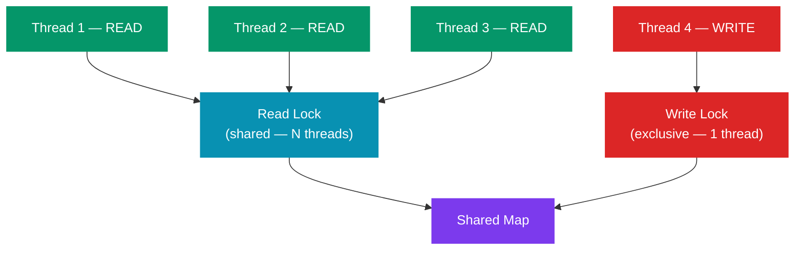
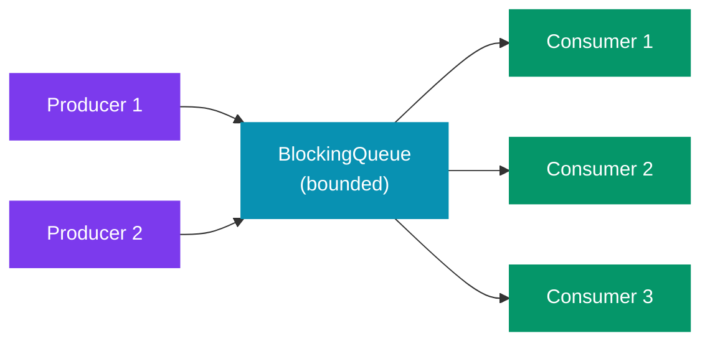
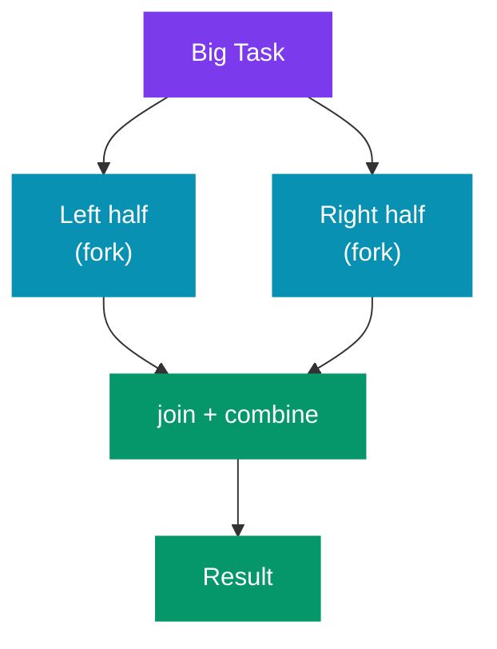
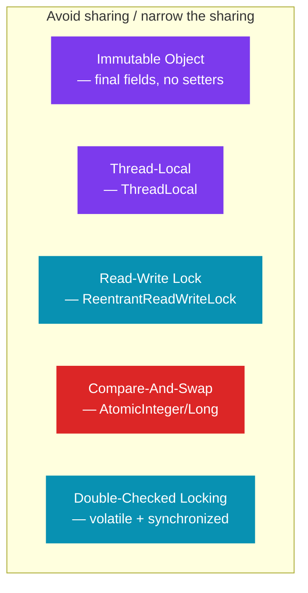
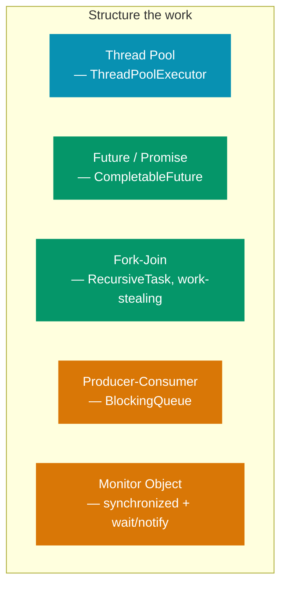

# Concurrent Design Patterns in Java

**Concurrent Design Patterns in Java** | Design patterns made for multi-threaded code. Tier-1 companies ask about them often. At these companies, concurrency, performance and thread-safety are core skills.

> 🔥🔥 Must-know — very frequently tested &nbsp;·&nbsp; 🔥 High priority &nbsp;·&nbsp; ⚡ Medium priority &nbsp;·&nbsp; 💤 Low priority

---

<a id="1-why-concurrent-patterns-matter-at-tier-1"></a>
## 1. Why Concurrent Patterns Matter at Tier-1 💤

Senior SDE interviews test Java concurrency very often.

- Most candidates can explain `synchronized` or `ExecutorService` on its own.
- Tier-1 interviewers go further. They check if you can **design** a concurrent system, not only use concurrent tools.

Concurrent patterns are GoF design patterns applied to shared state, race conditions and performance limits. They join two skills: multithreading and design patterns. Few candidates have both skills. So this knowledge quickly shows that you are senior.



> 💡 **Interview callout:** Say you tell the interviewer *"I used ExecutorService with a thread pool"*. The usual next question is: *"Walk me through how you designed that."* If you know the Thread Pool pattern, you can answer with confidence. Cover core size, queue type, rejection policy and graceful shutdown.

---

<a id="2-immutable-object-pattern"></a>
## 2. Immutable Object Pattern 🔥

<a id="21-what-it-is"></a>
### 2.1 What It Is 🔥

An **immutable object** is an object whose state cannot change after construction. No code can change it. So immutable objects are **thread-safe by nature**. They need no synchronization at all.

> 🔑 **"The safest concurrent object is one that never changes."**

Many threads can read an immutable object at the same time. They need:

- no locks,
- no worry about seeing a half-written state,
- no worry about memory visibility.

<a id="22-rules-for-immutable-objects-from-effective-java"></a>
### 2.2 Rules for Immutable Objects (from *Effective Java*) 🔥🔥

1. Declare the class as `final`. This stops a subclass from adding mutable state
2. All fields must be `private final`
3. No setters
4. Deep-copy mutable fields in the constructor (e.g., a `List` passed in must be copied)
5. Return defensive copies from getters for any mutable fields



<a id="23-java-example--immutable-money-value-object"></a>
### 2.3 Java Example — Immutable Money Value Object ⚡

```java
public final class Money {
    // BigDecimal — never use double/float for money (precision loss on arithmetic)
    private final BigDecimal amount;
    private final String currency;

    public Money(BigDecimal amount, String currency) {
        if (amount == null || amount.signum() < 0)
            throw new IllegalArgumentException("Amount cannot be negative");
        if (currency == null || currency.isBlank())
            throw new IllegalArgumentException("Currency required");
        this.amount = amount;
        this.currency = currency;
    }

    public BigDecimal getAmount() {
        return amount;
    }

    public String getCurrency() {
        return currency;
    }

    // Operations return NEW objects — never mutate
    public Money add(Money other) {
        if (!this.currency.equals(other.currency)) {
            throw new IllegalArgumentException("Currency mismatch");
        }
        return new Money(this.amount.add(other.amount), this.currency);
    }

    public Money multiply(BigDecimal factor) {
        return new Money(this.amount.multiply(factor), this.currency);
    }

    // Value object — must define value-based equality.
    // compareTo (not equals) so 500000 and 500000.00 are treated as equal.
    @Override
    public boolean equals(Object o) {
        if (this == o) return true;
        if (!(o instanceof Money)) return false;
        Money money = (Money) o;
        return amount.compareTo(money.amount) == 0 && currency.equals(money.currency);
    }

    @Override
    public int hashCode() {
        // stripTrailingZeros keeps hashCode consistent with the compareTo-based equals
        return Objects.hash(amount.stripTrailingZeros(), currency);
    }

    @Override
    public String toString() {
        return currency + " " + amount;
    }
}
```

**Usage:**

```java
Money loan = new Money(new BigDecimal("500000"), "INR");
Money withInterest = loan.multiply(new BigDecimal("1.145"));
// loan is unchanged — withInterest is a brand new object
System.out.println(loan);         // INR 500000
System.out.println(withInterest); // INR 572500.000
```

📤 **Output:**
```
INR 500000
INR 572500.000
```

✅ No code ever changes `loan`. You can pass both objects to any number of threads with zero synchronization.

> ⚠️ **`BigDecimal` and the deep-copy rule.** Rule 4 says "deep-copy mutable fields".  
> - But `BigDecimal` is **not `final`**. Anyone can subclass it.  
> - So, in theory, a harmful subclass could override methods and act mutable.  
> - In practice, everyone treats `BigDecimal` as **effectively immutable**. That is why we store it directly.  
> - Say `amount` comes from a fully untrusted source. Then the fully correct defensive copy is `amount = new BigDecimal(amount.toPlainString())`. Do not use `amount.stripTrailingZeros()` for this. A harmful subclass can override it and return itself.  
> - This gives you a real `BigDecimal` object, whatever subtype the caller passed in.

<a id="24-javas-built-in-immutable-classes"></a>
### 2.4 Java's Built-in Immutable Classes ⚡

| Class | Notes |
|---|---|
| `String` | Immutable; string pool is possible because of this |
| `Integer`, `Long`, `Double` | All wrapper types are immutable |
| `LocalDate`, `LocalDateTime` | Java 8 date/time API — all immutable |
| `record` (Java 16+) | Immutable by default; all fields final, no setters generated |

**Java 16+ `record` shorthand:**

```java
public record LoanApplication(String customerId, BigDecimal amount, String loanType) {}
// All fields are final, constructor is auto-generated, no setters possible
```

<a id="25-when-to-use"></a>
### 2.5 When to Use 💤

- Value objects: `Money`, `CustomerId`, `LoanId`, `EmailAddress`
- Configuration objects that load once at startup and are shared across threads
- Any object shared across threads where you want zero locking cost
- DTO/event objects that move through message queues or async pipelines

<a id="26-why-it-actually-works--safe-publication--the-final-field-freeze"></a>
### 2.6 Why It Actually Works — Safe Publication & the Final-Field Freeze 🔒 🔥🔥

"Immutable objects are thread-safe by nature" is not magic. It depends on two JMM (Java Memory Model) rules. Learn to state them. They also explain *why* §10's singleton needs `volatile` and a `Money` object doesn't.

**Safe publication.** Creating an object in a thread-safe way is only half the job. The *reference* must also become visible to other threads.

- Say you publish the reference through a plain non-final field. This gives no happens-before edge.
- So another thread can see the reference before it sees the constructor's writes.
- That thread then sees a **partially-constructed object**. This is the same danger as §10.2 double-checked locking.

An object is *safely published* when the reference is passed through one of these:

- a `static` initializer (the class-init lock creates the happens-before edge),
- a `volatile` field or an `AtomicReference`,
- a `final` field of a properly constructed object,
- a field guarded by a lock the reader also acquires,
- or a thread-safe collection / `BlockingQueue` handoff.

**The final-field freeze guarantee.** This special rule is what makes immutability special: it stays safe even when the reference is published unsafely.

- The JMM adds a **freeze action** at the end of a constructor that writes `final` fields.
- Any thread that sees a reference to the object will see the correct values of its `final` fields.
- This holds **even if the reference itself was published unsafely (a data race)**.
- The guarantee covers *only* `final` fields. It also needs `this` to not escape the constructor (no other code got `this` before the constructor ended).

> 🔑 **The one-line reason:** `Money`'s fields are all `final`. So the freeze guarantee covers them, and no `volatile` is needed. The singleton's `instance` field is **not** final (it's assigned lazily). So nothing covers the publication, and it needs `volatile`. Same rule, two results.

⚠️ Two things the freeze does **not** cover:

1. Non-`final` fields of the same object. One `final` field does not protect the other fields.
2. A mutable object *referenced* by a `final` field. `private final List<String> items` still gives out a mutable list unless you copy it. Rules 4 and 5 of §2.2 exist for exactly this job.

---

<a id="3-thread-pool-pattern"></a>
## 3. Thread-Pool Pattern 🔥🔥

<a id="31-problem--thread-per-task"></a>
### 3.1 Problem — Thread per Task ⚡

Creating a new OS thread for every new task is expensive:
- Thread creation: usually tens to hundreds of microseconds (up to ~1ms on a busy machine). Quote this only as a rough size, not an exact number.
- Stack memory: **~1MB reserved per thread** by default (`-Xss`). Use this number if the interviewer asks for details. It is a fixed setting you can check. A timing number changes from machine to machine.
- Under high load: thousands of threads → `OutOfMemoryError`, too much context-switching, lower throughput

❌️ **Bad — unbounded thread-per-task:**

```java
public void processLoanApplications(List<LoanApplication> applications) {
    for (LoanApplication app : applications) {
        new Thread(() -> {
            processApplication(app);
        }).start(); // new OS thread per application — uncontrolled, expensive
    }
}
```

<a id="32-thread-pool-pattern--reuse-a-fixed-set-of-worker-threads"></a>
### 3.2 Thread Pool Pattern — Reuse a Fixed Set of Worker Threads 🔥

The pool keeps a fixed number of threads alive. You submit tasks to a shared queue. Idle threads pick them up.



✅ **Thread pool — basic usage:**

```java
private final ExecutorService pool = Executors.newFixedThreadPool(10);

public void processLoanApplications(List<LoanApplication> applications) {
    for (LoanApplication app : applications) {
        pool.submit(() -> processApplication(app));
    }
}

// Always shut down gracefully — never skip this.
// The canonical TWO-PHASE idiom (straight out of the ExecutorService javadoc):
public void shutdownPool() {
    pool.shutdown();                            // phase 1: stop accepting, let queued work drain
    try {
        if (!pool.awaitTermination(60, TimeUnit.SECONDS)) {
            pool.shutdownNow();                 // phase 2: interrupt running tasks, drop the queue
            if (!pool.awaitTermination(60, TimeUnit.SECONDS)) {
                log.error("Pool did not terminate");
            }
        }
    } catch (InterruptedException e) {
        pool.shutdownNow();
        Thread.currentThread().interrupt();     // ✅ restore the interrupt flag
    }
}
```

> ⚠️ **Three details candidates often miss here.**
> 1. `awaitTermination` returns a **`boolean`**. If you ignore it, you *think* the shutdown was clean when it was not.
> 2. `shutdown()` alone never interrupts a running task. A task stuck in a blocking call keeps your JVM running forever. `shutdownNow()` is the next, stronger step. But it only *interrupts*. A task that catches and ignores `InterruptedException` still won't stop.
> 3. `awaitTermination` throws the checked `InterruptedException`. The handler must restore the interrupt flag.

<a id="33-choosing-the-right-thread-pool-type"></a>
### 3.3 Choosing the Right Thread Pool Type 🔥🔥

| Pool Type | Factory Method | When to Use |
|---|---|---|
| Fixed Thread Pool | `Executors.newFixedThreadPool(n)` | CPU-bound tasks; n = number of CPU cores. For I/O-bound work use the formula in §3.5 instead |
| Cached Thread Pool | `Executors.newCachedThreadPool()` | Short I/O tasks that come in **bursts but with a limit**. It creates threads when needed. A thread idle for 60s is terminated. ⚠️ **No limit on thread count** — see the OOM warning below |
| Single Thread Executor | `Executors.newSingleThreadExecutor()` | Tasks run one after another, in order |
| Scheduled Thread Pool | `Executors.newScheduledThreadPool(n)` | Delayed or periodic tasks (cron-like) |
| Virtual Thread Executor (Java 21) | `Executors.newVirtualThreadPerTaskExecutor()` | High-concurrency I/O. Lightweight threads, so you don't need to manage a pool. **Don't pool virtual threads.** They are cheap to create and to throw away, so create one per task. A pool removes their benefit and brings back the contention they were made to avoid |

> ⚠️ **The `newCachedThreadPool` OOM trap. It is the exact opposite of the unbounded-queue trap below.** Look at what the factory creates, and the danger is clear:
> ```java
> new ThreadPoolExecutor(0, Integer.MAX_VALUE, 60L, TimeUnit.SECONDS, new SynchronousQueue<>())
> ```
> - A `SynchronousQueue` has **zero capacity**. It passes a task directly to a thread. It does not store tasks.
> - So when all threads are busy, a new task **cannot be queued**. Instead, it starts a **brand-new thread**.
> - `maximumPoolSize` is `Integer.MAX_VALUE`, so nothing stops this.
> - A burst of slow blocking I/O tasks creates thousands of platform threads. The result is `OutOfMemoryError: unable to create native thread` (~1MB of stack each, §3.1).
>
> `newFixedThreadPool` limits the threads, but the *queue* can grow without limit. `newCachedThreadPool` limits the queue, but the *threads* can grow without limit. Neither is safe under overload. This is the main reason for §3.4.

> 💡 **Virtual threads — know what changed in JDK 24.**
> - A lot of 2023–24 material says: "always replace `synchronized` with `ReentrantLock` on virtual threads".
> - The reason was pinning. A virtual thread blocking inside `synchronized` **pinned** its carrier thread (it could not leave the OS thread it was running on).
> - That was true for JDK 21–23. **JEP 491 in JDK 24 removed this problem.** A virtual thread now unmounts normally inside `synchronized`.
> - The table row above is still true: **don't pool virtual threads**.
>
> If you can tell which rule is still valid and which is out of date, you stand out from other candidates. More detail in [`../1_interview_questions/05_Advanced_Concurrency_and_Async_Patterns_Interview_Questions.md`](../1_interview_questions/05_Advanced_Concurrency_and_Async_Patterns_Interview_Questions.md).

<a id="34-custom-threadpoolexecutor--what-tier-1-asks-about"></a>
### 3.4 Custom `ThreadPoolExecutor` — What Tier-1 Asks About 🔥🔥

For production, always configure `ThreadPoolExecutor` directly. Don't use the `Executors` factory methods. Their defaults hide important settings:

```java
ThreadPoolExecutor executor = new ThreadPoolExecutor(
    5,                              // corePoolSize — always-alive threads
    20,                             // maximumPoolSize — max threads under burst load
    60L, TimeUnit.SECONDS,          // keepAliveTime — idle threads above core die after this
    new ArrayBlockingQueue<>(100),  // bounded queue — prevents OOM under overload
    new ThreadFactory() {
        private final AtomicInteger count = new AtomicInteger(1);

        @Override
        public Thread newThread(Runnable r) {
            Thread t = new Thread(r);
            t.setName("loan-processor-" + count.getAndIncrement());
            t.setDaemon(false);
            return t;
        }
    },
    new ThreadPoolExecutor.CallerRunsPolicy() // back-pressure: caller runs when queue full
);
```

**The growth order — the most-asked `ThreadPoolExecutor` question.** Almost every candidate gets this wrong. They think the pool grows to `maximumPoolSize` first, and only uses the queue when it has no more threads. It is the other way round:

1. Fewer than `corePoolSize` threads alive → **create a new thread**, even if an existing one is idle.
2. Core is full → **offer the task to the queue**. If it fits, it waits there. No new thread is created.
3. Queue is **full** → *now* create threads, up to `maximumPoolSize`.
4. Queue full **and** at `maximumPoolSize` → hand the task to the `RejectedExecutionHandler`.



> 🔑 **Why this matters — it can make `maximumPoolSize` useless.**
> - Take an **unbounded** `LinkedBlockingQueue` (what `Executors.newFixedThreadPool` uses). Step 2 **never fails**.
> - So the code never reaches step 3, and the pool never grows past `corePoolSize`.
> - Setting `maximumPoolSize = 200` on this pool changes nothing.
> - The rejection handler is never called either. A queue that never fills never rejects a task.
>
> This answers *"your pool is full — what happens to the next task?"*. **It depends fully on the queue.** If the queue is unbounded, the true answer is: "the pool is never full; you run out of heap instead."

> 💡 **Why a bounded queue?** `Executors.newFixedThreadPool` uses an unbounded `LinkedBlockingQueue`. Under very high load, tasks keep adding up until the JVM runs out of heap. A bounded `ArrayBlockingQueue` + rejection policy is safer in production.

> 💡 **Two related settings you should name.**
> - `allowCoreThreadTimeOut(true)` lets even core threads die after `keepAliveTime`. This helps a pool that is idle most of the day.
> - `prestartAllCoreThreads()` starts the core threads in advance. So the first requests don't wait for thread creation.
>
> A `SynchronousQueue` makes step 2 fail whenever no idle thread is waiting to take the task. That is exactly how `newCachedThreadPool` reaches step 3 on every burst.

**Rejection Policies:**

| Policy | Behaviour | When to Use |
|---|---|---|
| `AbortPolicy` (default) | Throws `RejectedExecutionException` | When the caller must know about the rejection |
| `CallerRunsPolicy` | Caller thread runs the task itself | Natural back-pressure — the producer slows down on its own |
| `DiscardPolicy` | Silently drops the task | Non-critical fire-and-forget (metrics, analytics) |
| `DiscardOldestPolicy` | Drops the oldest queued task, retries the new one | When the latest data matters more than older queued work |

<a id="35-sizing-the-pool--the-formula-they-actually-want"></a>
### 3.5 Sizing the Pool — the Formula They Actually Want 🔥

*"Why 20?"* is the next question after any pool config. *"Number of cores"* is the right answer only for **CPU-bound** work. With more threads than cores, a fully busy CPU just does more context-switching.

A Spring backend almost always does **I/O-bound** work. Here the threads are mostly *blocked*, not running. So you want many more threads than cores:

> **N = cores × targetUtilization × (1 + waitTime / computeTime)**

- `waitTime` = time the task spends **blocked** (HTTP call to a bureau, JDBC round-trip, S3 upload)
- `computeTime` = time it spends actually **on-CPU** (parsing, mapping, scoring)
- `targetUtilization` ∈ (0, 1] — how much of the CPU you want to give this pool

**Worked example:** a credit-decision call spends **90 ms** blocked on the bureau API and **10 ms** computing. The ratio is 9, so the multiplier is `1 + 9 = 10`. On 4 cores at 100% target utilization → `4 × 1 × 10 = 40` threads. This is why an I/O pool looks "too big" next to the core count, and that is correct.

⚠️ Two checks before you quote the number:
1. The pool is not the only limit. Say all 40 threads need a DB connection and the HikariCP pool is 10. Then the real limit is 10. The other 30 threads just wait on the connection pool.
2. Every extra thread is ~1MB of stack. Stack memory is outside the heap. So a container with a 512 MB memory limit has its own limit too.

**The formula gives you an upper bound to start measuring from. It is not a value to ship without testing.**

---

<a id="4-future--promise-pattern-completablefuture"></a>
## 4. Future & Promise Pattern (CompletableFuture) 🔥🔥

<a id="41-future-vs-promise--two-halves-of-the-same-object"></a>
### 4.1 Future vs Promise — Two Halves of the Same Object ⚡

The **Future/Promise** pattern stands for a value that **will exist later**. It is the result of an asynchronous computation.

- A **`Future`** is the **read side**. It is a read-only handle you hold while a task runs on another thread. You can ask:
  - "are you done?" (`isDone()`)
  - "give me the result, and block until it is ready" (`get()`)
- A **"Promise"** is the **write/completion side**. It is the part of the object that *produces* and publishes the result.
  - Java has no class named `Promise`. `CompletableFuture` plays **both roles**.
  - The methods `complete(value)` / `completeExceptionally(ex)` are the "promise" half. Any thread can complete it.
  - The methods `get()` / `thenApply()` are the "future" half.


<a id="42-why-futureget-blocks--and-why-completablefuture-is-better"></a>
### 4.2 Why `Future.get()` Blocks — and Why `CompletableFuture` Is Better 🔥🔥

The classic `java.util.concurrent.Future` (from `ExecutorService.submit`) is limited. The only way to read its result is to **ask for it**:

- `get()` **blocks the calling thread** until the task finishes.
- `get(timeout, unit)` blocks, but only until a deadline.

Java 19+ also added the non-blocking `resultNow()` / `exceptionNow()` / `state()`. But `resultNow()` / `exceptionNow()` throw `IllegalStateException` if the future is not complete yet, and `state()` only reports the status. So they do not change the problem.

The old `Future` has no callback, no chaining, and no built-in way to combine many futures. So you block a thread just to wait. This removes much of the benefit of going async.

```java
ExecutorService executor = Executors.newFixedThreadPool(4);
Future<String> future = executor.submit(() -> checkCredit(customerId));
// ... do other work ...
String result = future.get();   // ❌️ BLOCKS this thread until checkCredit() returns
executor.shutdown();
```

`CompletableFuture` (Java 8+) fixes this. You attach **callbacks** that run when the result is ready, so no thread sits blocked. It is also a "Promise": you can complete it by hand from any thread.

<a id="43-thenapply-vs-thencompose--dont-nest-your-futures"></a>
### 4.3 `thenApply` vs `thenCompose` — Don't Nest Your Futures 🔥🔥

| Method | Mapper returns | Result type | Use when |
|---|---|---|---|
| `thenApply(fn)` | a plain value `U` | `CompletableFuture<U>` | the next step is **synchronous** (a simple transform) |
| `thenCompose(fn)` | another `CompletableFuture<U>` | `CompletableFuture<U>` (flattened) | the next step is **itself async** — it avoids a nested `CompletableFuture<CompletableFuture<U>>` |

`thenCompose` is the `flatMap` of futures (monadic: it turns a nested wrapper into one flat wrapper). Use it to chain one async call after another. If you use `thenApply` with an async mapper, you get a nested future. Then you have to unwrap it.

```java
// thenApply — synchronous transform of the result
CompletableFuture<Integer> score =
    CompletableFuture.supplyAsync(() -> checkCredit(customerId), executor)
                     .thenApply(report -> report.length());   // String -> int

// thenCompose — chain a SECOND async call that depends on the first
CompletableFuture<LoanDecision> decision =
    CompletableFuture.supplyAsync(() -> fetchProfile(customerId), executor)
                     .thenCompose(profile -> scoreAsync(profile, executor)); // returns CF<LoanDecision>
```

<a id="44-exception-handling--exceptionally-vs-handle"></a>
### 4.4 Exception Handling — `exceptionally` vs `handle` 🔥🔥

An exception thrown inside an async stage does not reach the caller right away. The future captures it and passes it down the pipeline. You see it when you read the result. Handle it with one of these:

- **`exceptionally(fn)`** — for recovery only.
  - It runs **only on failure**.
  - It maps the `Throwable` to a fallback value of the same type.
- **`handle(fn)`** — runs on **both** success and failure.
  - It receives `(value, throwable)`. One of them is always null.
  - It can transform either outcome.
- **`whenComplete(action)`** — also sees **both** outcomes, but it **cannot transform** them.
  - It is a `BiConsumer`.
  - The stage it returns carries the *original* result or the *original* exception, unchanged.
  - One exception: if the stage succeeded but the action itself throws, the returned stage fails with the action's exception.
  - Interviewers really test this difference. Use `whenComplete` for side effects (logging, metrics, releasing a resource). Use `handle` for recovery.

```java
// exceptionally — recovery only, the mapper runs ONLY on failure
CompletableFuture<String> withFallback =
    CompletableFuture.supplyAsync(() -> checkCredit(customerId), executor)
                     .exceptionally(ex -> "CREDIT_UNAVAILABLE");

// handle — runs on BOTH outcomes; ex is null on success, non-null on failure
CompletableFuture<String> handled =
    CompletableFuture.supplyAsync(() -> checkCredit(customerId), executor)
                     .handle((result, ex) -> ex == null ? result : "FALLBACK");

// whenComplete — observes both outcomes, changes neither; the failure still propagates
CompletableFuture<String> observed =
    CompletableFuture.supplyAsync(() -> checkCredit(customerId), executor)
                     .whenComplete((result, ex) -> {
                         if (ex != null) {
                             log.error("credit check failed", ex);
                         }
                     });
```

> ⚠️ **Don't chain `exceptionally` into `handle`.** `.exceptionally(...).handle(...)` looks like extra safety, but it is not.  
> `exceptionally` has already **recovered** every failure into a stage that completed normally.  
> So when `handle` runs, its `ex` is *always* `null`. Its failure branch can never run. It is dead code.  
> Pick one per failure point. Use one or the other, not both one after the other.

<a id="45-fan-out--fan-in--allof-and-anyof"></a>
### 4.5 Fan-Out / Fan-In — `allOf` and `anyOf` 🔥🔥

```java
public void runChecks(String customerId) throws InterruptedException {
    ExecutorService executor = Executors.newFixedThreadPool(4);
    try {
        CompletableFuture<String> creditCheck = CompletableFuture.supplyAsync(
            () -> checkCredit(customerId), executor
        );
        CompletableFuture<String> kycCheck = CompletableFuture.supplyAsync(
            () -> verifyKYC(customerId), executor
        );

        // Run both checks in parallel, wait for both to finish.
        // orTimeout bounds the whole fan-out — without it, one hung bureau call hangs the request.
        CompletableFuture<Void> combined = CompletableFuture.allOf(creditCheck, kycCheck)
                                                           .orTimeout(3, TimeUnit.SECONDS);
        combined.thenRun(() -> {
            String creditResult = creditCheck.join(); // already done — won't block
            String kycResult = kycCheck.join();
            System.out.println("Both checks done: " + creditResult + ", " + kycResult);
        }).join();
    } finally {
        executor.shutdown(); // always release the pool — daemon-free pools keep the JVM alive
        if (!executor.awaitTermination(60, TimeUnit.SECONDS)) {
            executor.shutdownNow();
        }
    }
}
```

> 🔑 `allOf()` takes the parallel tasks (fan-out) and returns a future that completes when all of them complete. `anyOf()` returns as soon as the first one completes. Both are important when you coordinate the async steps of a loan workflow.

> 💡 **Use a dedicated executor.** The no-executor overloads (`supplyAsync(fn)`) run on the shared `ForkJoinPool.commonPool()`.  
> - Its threads are **daemons**.  
> - Its parallelism is **`Runtime.getRuntime().availableProcessors() − 1`**, not the CPU count. It subtracts one because the *submitting* thread also helps with the work.  
> - It is fine for CPU work, but dangerous for blocking I/O.  
> - Every library in the JVM shares this pool (parallel streams too). So one blocking call can starve it for the whole app.  
>
> Pass your own `executor` for any blocking call.

> ⚠️ **The container version of that trap — this is the 2026 version of the question.**  
> - Since **JDK 10**, `availableProcessors()` respects **cgroup CPU limits**. So your Kubernetes manifest decides the common-pool parallelism, not the node.  
> - On a pod with `limits.cpu: 1`, it computes to `1 − 1 = 0`, and the JDK raises it to `1`. On `limits.cpu: 2`, it computes to `1`.  
> - `CompletableFuture` **refuses to use the common pool when its parallelism is `≤ 1`**. It uses a `ThreadPerTaskExecutor` instead. So `supplyAsync(fn)` creates **a brand-new thread per task**.  
> - You asked for a bounded shared pool. Without any warning, you got unbounded thread creation. This happens on small containers, which have the fewest resources to spare.  
>
> Always check what the *container* reports before you reason about the common pool.

<a id="46-the-operational-surface--callback-threads-join-vs-get-timeouts"></a>
### 4.6 The Operational Surface — Callback Threads, `join` vs `get`, Timeouts 🔥🔥

These three things show the difference between "I've used `CompletableFuture`" and "I've run it in production":

**1. `thenApply` vs `thenApplyAsync` — which thread runs your callback?**

| Form | Runs the callback on |
|---|---|
| `thenApply(fn)` | **the thread that completed the previous stage** — or the *calling* thread, if the stage was already complete when you attached the callback |
| `thenApplyAsync(fn)` | sent again to the **default async executor**: the common pool, or a new thread per task if the pool's parallelism is ≤ 1 (§4.5) |
| `thenApplyAsync(fn, executor)` | sent again to **your** executor |

The first row is where the bug shows up. Say a "cheap" `thenApply` turns out to make a blocking call. It then runs on the I/O thread that completed the previous stage. For example, this can be your HTTP client's event-loop thread. That blocks the event-loop thread for all other work. Simple rule: **non-blocking transform → `thenApply`; anything that blocks → `thenApplyAsync(fn, yourExecutor)`.**

**2. `join()` vs `get()`.**

- `get()` throws the **checked** `ExecutionException` + `InterruptedException`.
- `join()` throws the **unchecked** `CompletionException`.
- So you use `join()` inside lambdas (`thenRun`, stream pipelines), where checked exceptions won't compile.
- Both **wrap** the original failure. So error handling almost always needs `e.getCause()`. A bare `catch (CompletionException e)` that logs only `e` hides the real stack trace.

**3. Timeouts (Java 9+).** A `CompletableFuture` has **no default timeout**. Without one, a downstream call that hangs keeps the stage waiting forever.

```java
// orTimeout — fail the stage with TimeoutException if it doesn't complete in time
creditCheck.orTimeout(2, TimeUnit.SECONDS)
           .exceptionally(ex -> "CREDIT_UNAVAILABLE");

// completeOnTimeout — supply a default value instead of failing
kycCheck.completeOnTimeout("KYC_PENDING", 2, TimeUnit.SECONDS);
```

> ⚠️ **`cancel(true)` does not interrupt the running task.** On `CompletableFuture`, the `mayInterruptIfRunning` flag is **ignored**.  
> - Cancelling only completes the future exceptionally with `CancellationException`, so the *downstream stages* stop.  
> - The supplier keeps running to the end on its thread.  
> - For real cancellation, keep the `Future` returned by `executor.submit(...)` (there, `cancel(true)` *does* interrupt). Or check `Thread.interrupted()` inside the task yourself.  
>
> This surprises people in production.

---

<a id="5-read-write-lock-pattern"></a>
## 5. Read-Write Lock Pattern ⚡

<a id="51-problem--read-heavy-shared-state"></a>
### 5.1 Problem — Read-Heavy Shared State 💤

A plain `synchronized` block allows **only one thread at a time**. This is true even for read operations. But concurrent reads are safe by nature. Two threads that read the same data at the same time cannot corrupt it. Only writes need exclusive access.

In read-heavy systems, locking reads that do not need a lock greatly lowers throughput. For example, think of a loan configuration cache with 1,000 reads/second and 1 write/minute.

<a id="52-reentrantreadwritelock--the-java-solution"></a>
### 5.2 `ReentrantReadWriteLock` — The Java Solution ⚡

```java
public class LoanCache {
    private final Map<String, Loan> cache = new HashMap<>();
    private final ReentrantReadWriteLock lock = new ReentrantReadWriteLock();
    private final ReentrantReadWriteLock.ReadLock readLock = lock.readLock();
    private final ReentrantReadWriteLock.WriteLock writeLock = lock.writeLock();

    // Multiple threads can hold the read lock simultaneously
    public Loan getLoan(String loanId) {
        readLock.lock();
        try {
            return cache.get(loanId);
        } finally {
            readLock.unlock();
        }
    }

    // Write lock is exclusive — all readers are blocked during a write
    public void putLoan(String loanId, Loan loan) {
        writeLock.lock();
        try {
            cache.put(loanId, loan);
        } finally {
            writeLock.unlock();
        }
    }

    public void removeLoan(String loanId) {
        writeLock.lock();
        try {
            cache.remove(loanId);
        } finally {
            writeLock.unlock();
        }
    }
}
```



<a id="53-when-to-use-reentrantreadwritelock"></a>
### 5.3 When to Use `ReentrantReadWriteLock` 🔥

✅ Use when:
- Read operations outnumber writes by 10:1 or more
- Each read does real work (computation, multiple map lookups, formatting)

⚠️ Do NOT use when:
- Writes are frequent. Taking the write lock has a cost, so `synchronized` may be faster in that case
- Reads are very fast. The lock cost may be bigger than the benefit

**Choosing the right concurrency tool:**

| Scenario | Best Choice |
|---|---|
| Simple map with high read + write | `ConcurrentHashMap` |
| Read-heavy cache, complex values | `ReentrantReadWriteLock` |
| Single compound operation (check-then-act) | `synchronized` block |
| Counter / accumulator | `AtomicLong`, `AtomicInteger` |
| Read-heavy, reads are **short and cheap to re-run** | `StampedLock` optimistic read (Java 8+) — ⚠️ **not reentrant**, no `Condition`s |

> ⚠️ **`StampedLock` — get the reason right.** Optimistic reading does **not** give you stale data. If you say it "accepts slightly stale reads", the interviewer will correct you. It works in three steps:  
> 1. `tryOptimisticRead()` returns a **stamp**.  
> 2. You copy the state into local variables **without any lock**.  
> 3. `validate(stamp)` tells you if a writer changed the data in between.  
>
> If a writer did, validation **fails**. Then you fall back to a real `readLock()` and read again. The contract is *"a consistent snapshot, or a detected failure"*. It is never *"slightly stale."* This is why the read body must be **short and side-effect-free**: you may have to run it twice.
> ```java
> long stamp = lock.tryOptimisticRead();
> double localX = x, localY = y;          // read into locals — no lock held
> if (!lock.validate(stamp)) {            // a writer got in — the locals may be torn
>     stamp = lock.readLock();
>     try {
>         localX = x; localY = y;         // re-read under a real read lock
>     } finally {
>         lock.unlockRead(stamp);
>     }
> }
> ```
> Interviewers ask about two traps:  
> - It is **not reentrant**. If a thread holds the write lock and asks for it again, it deadlocks on itself. A second read lock can also block forever if a writer is waiting. So it is *not* a direct replacement for `ReentrantReadWriteLock`.  
> - It has **no `Condition` support**.  
>
> The stamps are plain `long`s. They are not tied to the thread. If you lose one, you cannot unlock.

<a id="54-the-upgrade-trap--and-why-downgrade-is-legal"></a>
### 5.4 The Upgrade Trap — and Why Downgrade Is Legal 🔥

The standard `ReentrantReadWriteLock` interview trap:

- ❌️ **Read → write upgrade is impossible, and deadlocks if you try.** The write lock waits for *all* readers to release. That includes the read lock you still hold. So you wait for yourself, forever.
- ✅ **Write → read downgrade is legal.** It is the documented idiom:
  1. While you still hold the write lock, acquire the read lock.
  2. *Then* release the write lock.

  You never give up exclusive access. So no other writer can get in between writing the value and starting to read it.

```java
// Correct "upgrade": release read, take write, then RE-CHECK the condition
readLock.unlock();                       // must release first — no upgrade path exists
writeLock.lock();
try {
    if (!cacheValid) {                   // ✅ re-check: state can change in the gap
        cache = recompute();
        cacheValid = true;
    }
    readLock.lock();                     // ✅ downgrade: take read BEFORE releasing write
} finally {
    writeLock.unlock();                  // now only the read lock is held
}
try {
    use(cache);
} finally {
    readLock.unlock();
}
```

> 🔑 **The re-check is the whole point.** It uses the *same* reasoning as §7.2's guarded `while`. You released the lock. So anything you checked before that may no longer be true. Both idioms exist for one reason. "I checked, so it is still true" becomes false the moment you release a lock.

⚠️ Also worth knowing: `new ReentrantReadWriteLock()` is **non-fair** by default. So a steady stream of readers can starve a waiting writer for an unlimited time. (§13.3 shows the same problem, starvation from an unfair lock, at a lower level.) `new ReentrantReadWriteLock(true)` serves threads in arrival order, but it costs throughput.

<a id="55-concurrent-collections--the-check-then-act-trap"></a>
### 5.5 Concurrent Collections — the Check-Then-Act Trap 🔥🔥

This is the most-asked question on concurrent collections. It also shows why `ConcurrentHashMap` (CHM) is not always the answer:

**Each CHM operation is atomic. A *sequence* of them is not.**

```java
// ❌️ STILL A RACE — two threads can both pass the containsKey check
if (!map.containsKey(key)) {
    map.put(key, expensiveToBuild());
}

// ✅ atomic compound operations — the whole check-then-act happens under one bin lock
map.putIfAbsent(key, value);                        // value already built
map.computeIfAbsent(key, k -> expensiveToBuild());  // value built lazily, only if absent
map.merge(key, 1L, Long::sum);                      // atomic accumulate
map.compute(key, (k, v) -> v == null ? 1L : v + 1); // atomic read-modify-write
```

| Trap | What to say |
|---|---|
| `computeIfAbsent` mapping function | Runs **while holding the bin lock**. Keep it short. **Never** update the *same* map inside it, because the thread can hang forever. (Since Java 9 the JDK detects the simple case and throws `IllegalStateException` instead of hanging.) |
| `Collections.synchronizedMap` | Synchronizes each *method*, but **iteration is not covered**. You must wrap the loop in `synchronized (map) { ... }` yourself. Otherwise you risk `ConcurrentModificationException`. CHM's iterators are weakly consistent and never throw it |
| `size()` / `isEmpty()` on a CHM | **Only estimates** while other threads change the map (the count is split across cells). Fine for a metric, never for control flow |
| `CopyOnWriteArrayList` | Every write copies the whole backing array. Very good for lists that are **read often and written rarely** (listener registries, handler/rule chains built once at startup). Very bad for anything write-heavy. Its iterator is a snapshot. So it never throws `ConcurrentModificationException` and never sees later writes |
| `ConcurrentHashMap` nulls | Neither keys nor values may be `null`. Otherwise `map.get(k) == null` could mean "absent" or "present but null". You cannot lock the map to check which one |

---

<a id="6-producer-consumer-pattern"></a>
## 6. Producer-Consumer Pattern 🔥

<a id="61-what-it-is"></a>
### 6.1 What It Is ⚡

- **Producers** generate work items and put them on a shared queue
- **Consumers** take items from the queue and process them
- Producers and consumers run on separate threads and are **decoupled**. Neither one knows about the other
- Consumers block when the queue is empty; producers block when the queue is full

This is the most natural concurrent pattern in backend systems. You see it in Kafka, job queues, async request handlers, and batch processors.



<a id="62-java-implementation"></a>
### 6.2 Java Implementation 🔥🔥

```java
// Producer — generates loan applications and puts them on the queue
public class LoanApplicationProducer implements Runnable {
    private final BlockingQueue<LoanApplication> queue;

    public LoanApplicationProducer(BlockingQueue<LoanApplication> queue) {
        this.queue = queue;
    }

    @Override
    public void run() {
        try {
            for (int i = 1; i <= 50; i++) {
                LoanApplication app = new LoanApplication("CUST-" + i, BigDecimal.valueOf(100_000L * i), "PERSONAL");
                queue.put(app); // blocks if queue is full — natural back-pressure
                System.out.println("Produced: " + app.customerId()); // record accessor — see §2.4
            }
        } catch (InterruptedException e) {
            Thread.currentThread().interrupt(); // always restore interrupt flag
        }
    }
}

// Consumer — picks up applications and processes them
public class LoanApplicationConsumer implements Runnable {
    private final BlockingQueue<LoanApplication> queue;

    public LoanApplicationConsumer(BlockingQueue<LoanApplication> queue) {
        this.queue = queue;
    }

    @Override
    public void run() {
        try {
            while (true) {
                LoanApplication app = queue.poll(5, TimeUnit.SECONDS); // blocks if empty
                if (app == null) break; // timed out — assume producer is done
                processApplication(app);
                System.out.println("Consumed: " + app.customerId());
            }
        } catch (InterruptedException e) {
            Thread.currentThread().interrupt();
        }
    }

    private void processApplication(LoanApplication app) {
        // credit check, KYC validation, scoring, etc.
    }
}

// Wiring — 1 producer, 3 parallel consumers
public class Main {
    public static void main(String[] args) throws InterruptedException {
        BlockingQueue<LoanApplication> queue = new ArrayBlockingQueue<>(100);

        ExecutorService pool = Executors.newFixedThreadPool(5);
        pool.submit(new LoanApplicationProducer(queue));

        for (int i = 0; i < 3; i++) {
            pool.submit(new LoanApplicationConsumer(queue));
        }

        pool.shutdown();
        pool.awaitTermination(60, TimeUnit.SECONDS);
    }
}
```

> ⚠️ **Always handle `InterruptedException` correctly.** If you catch it and do nothing, the interrupt signal is lost. Always call `Thread.currentThread().interrupt()` after you catch it. Then the thread can respond to shutdown.

> 💡 **The `poll(5, SECONDS)` above is a rough rule, not the standard shutdown.** "Timed out, so the producer must be done" is wrong if the producer is only slow. The standard answer is the **poison pill** (a special marker object that means "stop"):  
> - After the last real item, the producer puts N sentinel objects (one per consumer).  
> - Each consumer exits its loop as soon as it takes one.  
>
> It needs no timeout and no guessing. It also processes everything already in the queue. The other option is `shutdownNow()` + interrupt-aware consumers (§3.2). That is cleaner if you *don't* want to process the backlog.

<a id="63-kafka-as-producer-consumer-at-scale"></a>
### 6.3 Kafka as Producer-Consumer at Scale 🔥

The Producer-Consumer pattern is the **basic idea** behind Kafka:

| Java `BlockingQueue` Concept | Kafka Equivalent |
|---|---|
| `queue.put(item)` | Producer publishes to a topic |
| `queue.poll()` | Consumer polls a partition |
| Bounded queue | Topic with retention limits |
| Multiple consumer threads | Consumer group with parallel consumers |
| Back-pressure when full | `buffer.memory` full → `send()` blocks up to `max.block.ms` |

The key difference: Kafka's "queue" is durable, distributed and replayable. It survives JVM restarts. The `BlockingQueue` does not. But the basic idea is the same.

---

<a id="7-monitor-object-pattern-waitnotify"></a>
## 7. Monitor Object Pattern (wait/notify) ⚡

<a id="71-what-it-is"></a>
### 7.1 What It Is 🔥

A **Monitor Object** controls how threads run its methods. It does two things:

- **Only one thread runs inside the object at a time.**
- Threads can **wait** for a condition to become true. They **signal** each other when the state changes.

In Java, every object *is* a monitor. `synchronized` gives the mutual-exclusion lock. `wait()` / `notify()` / `notifyAll()` give the condition signalling.

- `wait()` — releases the monitor lock and parks the current thread until another thread signals it. You must call it while you hold the lock.
- `notify()` — wakes **one** waiting thread. `notifyAll()` — wakes **all** waiting threads. They then compete for the lock again.


<a id="72-the-guarded-while-idiom--why-if-is-a-bug"></a>
### 7.2 The Guarded `while` Idiom — Why `if` Is a Bug 🔥🔥

You must **always re-check the wait condition in a `while` loop**, never an `if`. A thread can wake up while the condition is *still false*. There are two reasons:

1. **Spurious wakeups** — the JVM/OS may wake a waiting thread even when no thread called `notify()`. The Java spec allows this.
2. **Stolen state** — with `notifyAll()`, several threads wake up and compete for the lock again. Before one thread gets the lock back, another woken thread may take the item first. So the condition is false again.

- An `if` checks the condition **once**. After waking, the thread goes on without checking again. It acts on old state. For example, it takes from an empty buffer → `NoSuchElementException` (from `queue.remove()` in §7.3), or it returns a wrong value.
- A `while` checks again after every wakeup. If the condition is still false, the thread waits again.

✅ Rule: **guard `wait()` with `while`, never `if`.**

<a id="73-java-example--bounded-buffer"></a>
### 7.3 Java Example — Bounded Buffer 🔥

```java
public class BoundedBuffer<T> {
    private final Queue<T> queue = new LinkedList<>();
    private final int capacity;

    public BoundedBuffer(int capacity) {
        this.capacity = capacity;
    }

    public synchronized void put(T item) throws InterruptedException {
        while (queue.size() == capacity) { // ✅ while, NOT if
            wait();                        // releases lock, parks until notified
        }
        queue.add(item);
        notifyAll();                       // wake any threads waiting to take()
    }

    public synchronized T take() throws InterruptedException {
        while (queue.isEmpty()) {          // ✅ re-check on every wakeup
            wait();
        }
        T item = queue.remove();
        notifyAll();                       // wake any threads waiting to put()
        return item;
    }
}
```

> 💡 **`notifyAll()` vs `notify()`.** Use `notifyAll()`, unless you can prove that every waiter can do the job of every other waiter.
> - Producers and consumers may share one condition. Then `notify()` can wake the "wrong" kind of waiter. For example, it wakes another producer when only a consumer can move forward. The system gets stuck.
> - The modern option is `ReentrantLock` + several `Condition` objects (`notFull` / `notEmpty`). This lets you signal exactly the right group of waiters. `ArrayBlockingQueue` is built this way.

<a id="74-dont-hand-roll-it--the-javautilconcurrent-synchronizers"></a>
### 7.4 Don't Hand-Roll It — the `java.util.concurrent` Synchronizers 🔥

`wait`/`notify` is the low-level *mechanism*. In application code you almost never write it. Three standard synchronizers cover nearly every "coordinate these threads" need. Interviewers ask about them directly.

| Synchronizer | Answers | Reusable? |
|---|---|---|
| `CountDownLatch(n)` | *"Block until N things have happened."* Workers call `countDown()`, waiters call `await()` | ❌️ **One-shot** — once it hits 0 it stays there, cannot be reset |
| `CyclicBarrier(n)` | *"Block until N threads have all arrived here."* Each party calls `await()`; all release together | ✅ **Reusable** — resets automatically each cycle, and can run a barrier action when it trips |
| `Semaphore(n)` | *"At most N threads inside this section."* `acquire()` / `release()` permits | ✅ Permits are recycled |

**The common question — "latch vs barrier?"** Give three differences, in this order of importance:

1. **Who waits.** With a latch, the **waiters and the counters are different threads**. A coordinator waits, and N workers count down. With a barrier, every participant is **both**. Each of the N threads calls `await()` and blocks until all the others arrive.
2. **Reusability.** A latch works only once. A barrier resets, so you can use it again in every round. That is why it fits iterative/phased algorithms.
3. **The trip action.** When the barrier trips (all threads have arrived), a `CyclicBarrier` can run a `Runnable` on the last thread to arrive. For example, it can merge the round's partial results before it releases all threads. A latch has nothing like this.

```java
// Semaphore — cap concurrent calls to a flaky downstream, independent of pool size
private final Semaphore bureauPermits = new Semaphore(10);

public CreditReport fetchReport(String customerId) throws InterruptedException {
    if (!bureauPermits.tryAcquire(200, TimeUnit.MILLISECONDS)) {
        throw new BureauBusyException("no permit — shed load rather than queue");
    }
    try {
        return bureauClient.fetch(customerId);   // never more than 10 of these in flight
    } finally {
        bureauPermits.release();                 // ✅ ALWAYS in finally, or permits leak away
    }
}
```

This `tryAcquire`-with-timeout code is also the correct answer to *"how do you cap concurrent calls to a flaky downstream?"*
- It is the basic building block inside a bulkhead in Resilience4j. A bulkhead limits how many calls can go to one dependency at once.
- It uses the same counting idea as a fixed-window rate limiter.

> 🔑 **One sentence that links them all:** `CountDownLatch`, `CyclicBarrier` (partly), `Semaphore`, `ReentrantLock`, and `ReentrantReadWriteLock` are all built on **`AbstractQueuedSynchronizer` (AQS)**.
> - AQS is a single `volatile int state` plus a FIFO queue of parked threads.
> - Each class only defines what "acquire" and "release" mean for that state.
> - When you name AQS, you show you know these are not five unrelated classes.

⚠️ A `Semaphore` does **not** track an owner. Any thread can `release()` a permit it never acquired. Permits are also not reentrant. This has two sides:
- **Useful:** you can pass a permit from one thread to another.
- **Risky:** an extra `release()` raises your concurrency limit, and nothing warns you.

---

<a id="8-thread-local-storage-pattern-threadlocal"></a>
## 8. Thread-Local Storage Pattern (ThreadLocal) 🔥

<a id="81-what-it-is"></a>
### 8.1 What It Is ⚡

`ThreadLocal<T>` gives **each thread its own independent copy** of a variable.

- Nothing is shared. So there is no contention and no synchronization.
- Each thread reads and writes its *own* slot.
- It is the "share nothing" answer to thread-safety. You do not guard shared state. You give every thread private state.

Common uses:

- Non-thread-safe objects that you want to reuse per thread (`SimpleDateFormat`).
- **Per-request context propagation** (user/tenant/trace IDs). Code deep in the call stack can read request data. You do not need to pass it through every method signature.

```java
public class RequestContext {
    private static final ThreadLocal<String> TENANT_ID = new ThreadLocal<>();

    public static void setTenant(String id) {
        TENANT_ID.set(id);
    }

    public static String getTenant() {
        return TENANT_ID.get();
    }

    public static void clear() {
        TENANT_ID.remove();
    }
}

// SimpleDateFormat is NOT thread-safe — one per thread sidesteps that entirely
private static final ThreadLocal<SimpleDateFormat> DATE_FORMAT =
    ThreadLocal.withInitial(() -> new SimpleDateFormat("yyyy-MM-dd"));
```

<a id="82--the-critical-caveat--memory-leaks-with-thread-pools"></a>
### 8.2 ⚠️ The Critical Caveat — Memory Leaks with Thread Pools 🔥🔥

This is the #1 follow-up question at Tier-1 interviews.

- In a thread pool, **threads are reused, never destroyed**.
- A `ThreadLocal` value lives inside the `Thread` object, in its `ThreadLocalMap`.
- Say you `set()` a value and never `remove()` it. The value **survives after your task finishes**.
- The pooled thread then picks up the *next, unrelated* task. The old value is still attached to it.

This causes two separate problems:

1. **Stale data leaking across requests** — request B sees request A's tenant/user ID, because the pooled thread still holds it. This is a correctness bug *and* a security bug.
2. **Memory leak** — the `ThreadLocalMap` key is a *weak* reference to the `ThreadLocal`. But the **value is a strong reference**. The map keeps the value until one of two things happens: you call `remove()`, **or** the `ThreadLocal` key itself becomes unreachable *and* the same thread uses its map again. (`ThreadLocalMap` removes stale entries only when it gets a chance, during a later `get()` / `set()` / `remove()`.) But the `ThreadLocal` is almost always a `static final` field, as in §8.1. So it never becomes unreachable, and **in practice only `remove()` saves you**. If enough large values build up on long-lived pooled threads, you get a slow `OutOfMemoryError`.

✅ **The fix — always `remove()` in a `finally` block.** You usually put this in a servlet filter / interceptor that wraps the request:

```java
try {
    RequestContext.setTenant(extractTenant(request));
    chain.doFilter(request, response); // handle the request
} finally {
    RequestContext.clear();            // ✅ MUST remove — pooled thread is about to be reused
}
```

> 🔑 **Interview one-liner:** *"`ThreadLocal` in a thread pool without `remove()` leaks memory and leaks state across requests. Pooled threads live longer than the task. And the map holds the value by a strong reference."*

> 💡 **Scoped Values** (`ScopedValue`) are the modern replacement. They are immutable, and Java clears them for you.
> - The binding is visible only inside a `run`/`call` scope.
> - Java removes the binding on its own when the scope ends. So there is no `remove()` to forget.
> - They fit virtual threads well. A per-thread map on millions of threads is the wrong design.
>
> ⚠️ **Get the version right:**
> - It was a **preview** feature in JDK 21–24. There you needed `--enable-preview` to use it.
> - It was **finalized in JDK 25**.
> - The final API is `ScopedValue.where(KEY, value).run(...)` / `.call(...)`. The early previews had a `ScopedValue.runWhere(...)` form. That form was removed.
> - Say *"previewed from 21, final in 25"*. If you say "Java 21+", it sounds like it was ready for production in 21. It was not.

## 9. Fork-Join Pattern (Divide & Conquer) 💤

<a id="91-what-it-is"></a>
### 9.1 What It Is ⚡

The **Fork-Join** framework (Java 7+, `java.util.concurrent`) is built for **divide-and-conquer** parallelism. It works in three steps:

1. Recursively **fork** a large task into subtasks.
2. Run the subtasks in parallel.
3. Then **join** (combine) their results.

Parallel streams run on top of it.

Its main feature is **work-stealing**:

- Each worker thread has its own double-ended task queue (deque).
- A worker pushes and pops its own subtasks at one end.
- When a worker runs **out** of work, it **steals** a task from the *tail* of a busy worker's deque.
- This keeps all cores busy with very little contention. It also spreads uneven work across threads on its own.



<a id="92-recursivetask-example--parallel-sum"></a>
### 9.2 `RecursiveTask` Example — Parallel Sum 💤

- Use `RecursiveTask<V>` when subtasks **return a value**.
- Use `RecursiveAction` when they don't.
- Below a threshold size, compute **sequentially**. Forking tiny tasks costs more than it saves.

```java
public class SumTask extends RecursiveTask<Long> {
    private static final int THRESHOLD = 10_000;
    private final long[] data;
    private final int start, end;

    public SumTask(long[] data, int start, int end) {
        this.data = data;
        this.start = start;
        this.end = end;
    }

    @Override
    protected Long compute() {
        int length = end - start;
        if (length <= THRESHOLD) {        // base case — compute directly
            long sum = 0;
            for (int i = start; i < end; i++) {
                sum += data[i];
            }
            return sum;
        }
        int mid = start + length / 2;
        SumTask left = new SumTask(data, start, mid);
        SumTask right = new SumTask(data, mid, end);
        left.fork();                      // schedule left on the pool (async)
        long rightResult = right.compute(); // compute right in THIS thread
        long leftResult = left.join();    // wait for + collect left's result
        return leftResult + rightResult;
    }
}
```

**Usage:**

```java
long[] data = new long[1_000_000];
Arrays.fill(data, 1L);

// new ForkJoinPool() → parallelism = availableProcessors().
// NOT the same as the COMMON pool, whose parallelism is availableProcessors() - 1 (§4.5).
ForkJoinPool pool = new ForkJoinPool();
try {
    long total = pool.invoke(new SumTask(data, 0, data.length));
    System.out.println("Total: " + total); // 1000000
} finally {
    pool.shutdown();
}
```

> 💡 **`fork()` then `compute()` then `join()` — order matters.**
> - Fork one subtask. Compute the other on the current thread. Then join.
> - Do not call `left.join()` *right after* `left.fork()`, without doing the right side first. Then the work runs one after another, and you lose the parallelism.
> - Most apps do not create a pool at all. `ForkJoinPool.commonPool()` is the default. Parallel streams use it too.

---

<a id="10-double-checked-locking-thread-safe-singleton"></a>
## 10. Double-Checked Locking (Thread-safe Singleton) 🔥

[`03_Singleton_Design_Pattern_in_Java.md`](./03_Singleton_Design_Pattern_in_Java.md) covers this in depth. Here is a short summary, because interviewers often ask it when they discuss concurrent patterns.

<a id="101-the-pattern"></a>
### 10.1 The Pattern 🔥

```java
// Thread-safe lazy singleton with double-checked locking
public class LoanConfigManager {
    private static volatile LoanConfigManager instance;

    private LoanConfigManager() {
        // load config, connect to config server, etc.
    }

    public static LoanConfigManager getInstance() {
        if (instance == null) {                      // first check — fast path, no lock
            synchronized (LoanConfigManager.class) {
                if (instance == null) {              // second check — inside lock
                    instance = new LoanConfigManager();
                }
            }
        }
        return instance;
    }
}
```

<a id="102-why-volatile-is-non-negotiable"></a>
### 10.2 Why `volatile` Is Non-Negotiable 🔥🔥

`instance = new LoanConfigManager()` is not a single step. It is roughly these three steps:

1. Allocate memory for the object
2. Run the constructor (initialize all fields)
3. Publish the reference (assign the address to `instance`)

The JVM/CPU may **reorder steps 2 and 3**. It can publish the reference *before* the constructor's writes finish.

- A second thread on the fast path then sees `instance != null`.
- It skips the lock.
- It uses a **partially-constructed object**. Its fields still have default values.

`volatile` blocks exactly this:

- A `volatile` write adds a memory barrier.
- So all the constructor's writes **happen-before** the write that publishes the reference. (These are the writes that come earlier in program order.)
- So any thread that reads a non-null `instance` always sees a fully-constructed object.
- Without `volatile`, the second check can pass on a partially-constructed instance.

🔒 **Thread-safety contract:** `volatile` stops a partially constructed object from being published. `synchronized` stops two threads from entering the constructor at the same time.

> 🔑 **This is §2.6 in reverse.**
> - A `Money` object needs no `volatile`. The **final-field freeze guarantee** covers its `final` fields. So publication is safe even through a data race.
> - `instance` here is *not* `final`. The code assigns it lazily, and that is the whole point of the pattern. So no rule protects it. You must make the publication safe yourself.
> - **Unsafe lazy publication is the only reason `volatile` is in this snippet.**
> - The follow-up question tests if you can work out this need from the rules, not just repeat it.

---

<a id="11-compare-and-swap-lock-free-atomics"></a>
## 11. Compare-And-Swap (Lock-Free Atomics) 🔥

<a id="111-what-it-is"></a>
### 11.1 What It Is 🔥

**Compare-And-Swap (CAS)** is a lock-free technique. It does not take a lock. Instead, a thread works in three steps:
1. It reads the current value.
2. It computes a new value.
3. It atomically swaps in the new value, **but only if the value hasn't changed** since the read.

If another thread changed the value first, the swap fails. The operation then retries.

> 🔑 **Core idea:** *"Don't lock. Try to update. If another thread updated first, re-read and try again."*

The `java.util.concurrent.atomic` classes (`AtomicInteger`, `AtomicLong`, `AtomicReference`) work this way. Internally, CAS maps to a single CPU instruction (`CMPXCHG` on x86). There is no kernel lock, and no thread blocks.

<a id="112-problem--lost-updates-with-count"></a>
### 11.2 Problem — Lost Updates with `count++` ⚡

`count++` is **not atomic**. It is three separate steps: read → increment → write. Two threads can both read the same value. Then one increment is lost, and nothing reports an error:

```java
private int count = 0;

// ❌️ race condition — count++ is read → increment → write, so updates get lost under contention
public void increment() {
    count++;
}
```

<a id="113-java-solution--atomic-classes"></a>
### 11.3 Java Solution — Atomic Classes 🔥

```java
public class LoanCounter {
    private final AtomicLong approvedCount = new AtomicLong(0);

    // Lock-free, thread-safe increment — CAS retries internally until it wins
    public void recordApproval() {
        approvedCount.incrementAndGet();
    }

    public long getApprovedCount() {
        return approvedCount.get();
    }
}
```

What `incrementAndGet()` does internally (simplified):

```java
long prev, next;
do {
    prev = get();                          // read current value
    next = prev + 1;                       // compute new value
} while (!compareAndSet(prev, next));      // swap only if still unchanged; else retry
```

<a id="114-when-to-use--and-the-aba-caveat"></a>
### 11.4 When to Use — and the ABA Caveat 🔥🔥

✅ Use it for single-variable counters, accumulators, flags, and lock-free reference swaps. Under moderate contention it is far cheaper than `synchronized`.

⚠️ **Watch-outs:**
- **High contention** → many retries fail and waste CPU. Here a lock may actually be faster. For counters that many threads update often, prefer `LongAdder`. It splits the count across several cells, so threads compete less.
- **ABA problem** → a value goes A → B → A. CAS sees "unchanged" and succeeds. But the value was changed and then changed back. Fix it with `AtomicStampedReference`. It pairs the value with a version stamp.

---

<a id="12-quick-reference--concurrent-pattern-cheat-sheet"></a>
## 12. Quick Reference — Concurrent Pattern Cheat Sheet 💤

**① Patterns that avoid or shrink shared mutable state:**



**② Patterns that organise the *work* — pooling, async composition, hand-off:**



> Remember this split for the interview:  
> - Group ① answers *"how do I make shared state safe (or unnecessary)?"*  
> - Group ② answers *"how do I schedule and hand off work?"*  
>
> The table below shows the same ten patterns in lookup form.

| Pattern | Problem Solved | Key Class / Mechanism |
|---|---|---|
| Immutable Object | Shared state without any locks | `final` fields, no setters, defensive copies |
| Thread Pool | Avoid per-task thread creation overhead | `ThreadPoolExecutor`, `ExecutorService` |
| Future / Promise | Compose async results without blocking | `CompletableFuture` (`thenCompose`, `allOf`) |
| Read-Write Lock | High-read / low-write shared state | `ReentrantReadWriteLock` |
| Producer-Consumer | Decouple producers from consumers | `BlockingQueue` (`ArrayBlockingQueue`) |
| Monitor Object | Wait for a condition, signal on change | `synchronized` + `wait`/`notifyAll` (guarded `while`) |
| Thread-Local | Per-thread state, zero contention | `ThreadLocal` (always `remove()` in pools) |
| Fork-Join | Divide-and-conquer parallelism | `ForkJoinPool`, `RecursiveTask`, work-stealing |
| Double-Checked Locking | Thread-safe lazy singleton | `volatile` + `synchronized` |
| Compare-And-Swap | Lock-free counter / accumulator | `AtomicInteger`, `AtomicLong`, `AtomicReference` |

---

<a id="13-concurrency-anti-patterns--what-not-to-do"></a>
## 13. Concurrency Anti-Patterns — What NOT to Do 🔥

These are the opposite of the patterns above. Tier-1 interviewers ask "what can go wrong?" as often as "how do you design it?"

---

<a id="131-deadlock"></a>
### 13.1 Deadlock 🔥🔥

**Definition:** Two or more threads wait forever for each other to release locks. The threads have a circular dependency on resources.

**Four necessary conditions (all must hold):**
1. **Mutual Exclusion** — resource can only be held by one thread
2. **Hold and Wait** — thread holds a lock and waits for another
3. **No Preemption** — a held lock cannot be forcibly taken away
4. **Circular Wait** — T1 waits for T2's lock, T2 waits for T1's lock

```java
// Deadlock example
synchronized (lockA) {          // T1 holds lockA
    synchronized (lockB) { }    // T1 waits for lockB
}
// Meanwhile, T2:
synchronized (lockB) {          // T2 holds lockB
    synchronized (lockA) { }    // T2 waits for lockA → DEADLOCK
}
```

**Prevention strategies:**

| Strategy | How |
|---|---|
| **Consistent lock ordering** | Always acquire locks in the same order (e.g., always lockA before lockB) |
| **`tryLock()` with timeout** | `lock.tryLock(100, TimeUnit.MILLISECONDS)` — back off if you can't acquire |
| **Lock timeout + retry** | Release all held locks on timeout and retry the entire operation |
| **Avoid nested locks** | Redesign so you never need to hold two locks simultaneously |

```java
// Fix: consistent ordering — always acquire the lower-id account's lock first.
// NOTE: `<` only compiles for primitive ids (long/int). For String/UUID ids
// use compareTo(...); identity hash breaks the tie when ids are equal.
int cmp = accountA.getId().compareTo(accountB.getId());
if (cmp == 0) {
    // Same id (e.g. self-transfer, or two handles to the same account):
    // fall back to identity ordering so two threads never pick opposite orders.
    // (If both are the SAME object, we lock one monitor twice — harmless, it is reentrant.)
    cmp = Integer.compare(System.identityHashCode(accountA), System.identityHashCode(accountB));
}
if (cmp < 0) {
    synchronized (accountA) { synchronized (accountB) { transfer(); } }
} else {
    synchronized (accountB) { synchronized (accountA) { transfer(); } }
}
```

> 🔍 **"How would you actually find one in production?"** Interviewers always ask this next. Prevention strategies don't answer it. There are two answers:  
> - **(1)** `jstack <pid>` (or `kill -3`) dumps all thread stacks. It prints an explicit `Found one Java-level deadlock:` section. That section names the threads, the monitors they hold, and the monitors they want. The JVM detects the cycle for you.  
> - **(2)** In code, call `ManagementFactory.getThreadMXBean().findDeadlockedThreads()`. It returns the ids of threads deadlocked on monitors **or** `Lock` objects. (`findMonitorDeadlockedThreads()` is the older version. It checks monitors only.) The call is cheap. You can run it from a health check and raise an alert.  
>
> ⚠️ Neither one detects a *livelock* (§13.2). Neither detects a thread blocked forever on a lock-free wait. In both cases there is no cycle to find. For those, compare several thread dumps taken one after another. Look for threads that are running but not making progress.

> ⚠️ **Edge cases the `<` version misses:**  
> - **(1)** If `getId()` returns a `String`/`UUID`, `<` does not compile. Use `.compareTo(...) < 0` instead.  
> - **(2)** Both ids can be equal. This happens when both refer to the same account. You then need a deterministic fallback (`System.identityHashCode`). With it, two threads never pick opposite orders.  
>
> Two different objects with the same id can still get the same `identityHashCode`. In production, account ids are globally unique. So, in practice, the `cmp == 0` branch only guards against a self-transfer.

---

<a id="132-livelock"></a>
### 13.2 Livelock ⚡

**Definition:** Threads keep changing state in response to each other, but make **no actual progress**. They stay "busy" but complete no work.

In a deadlock, threads are blocked/waiting. In a livelock, threads keep running, but they keep yielding to each other.

```
T1: "You go first."
T2: "No, you go first."
T1: "You go first."   ← repeats forever — CPU busy but no work done
```

**Real example:** Two threads both detect a conflict. Each one backs off and retries. But they back off at the same time, so they collide again every time.

**Prevention:** Add **randomized back-off** (like Ethernet CSMA/CD). Then threads don't yield at the same time:
```java
Thread.sleep(random.nextInt(100));  // random delay before retry
```

---

<a id="133-starvation"></a>
### 13.3 Starvation ⚡

**Definition:** A thread never gets CPU time. Either **higher-priority threads always preempt it**, or it always loses the race for a lock.

**Common causes:**
- `synchronized` is **not fair**. New threads may keep arriving and grabbing the lock. Then a waiting thread can be skipped again and again, forever. `ReentrantLock` and `ReentrantReadWriteLock` are also not fair by default (§5.4)
- A long-running thread holds a lock for most of its time slice. So waiting threads rarely get a chance
- Thread priority is set too low. ⚠️ But be careful when you give this one:
  - Java thread priorities are **hints to the OS scheduler, not guarantees**.
  - On Linux, the HotSpot default mostly ignores them. To map onto real `nice` values, they need `-XX:ThreadPriorityPolicy=1` *and* root permissions. (`UseThreadPriorities` is already on by default.)
  - Never *design* around priorities. Don't give this as your main example of starvation

**Prevention:**
```java
// ReentrantLock with fair=true — threads served in arrival order
ReentrantLock fairLock = new ReentrantLock(true);
```

> ⚠️ Fair locks have lower throughput than unfair locks. Use them only when starvation is a real risk.

---

<a id="134-race-condition"></a>
### 13.4 Race Condition 🔥

**Definition:** The program's result depends on the **non-deterministic relative timing** of threads. (Non-deterministic: the order can change from run to run.)

```java
// Classic race condition — check-then-act without atomicity
if (balance >= amount) {       // T1 checks: balance = 1000, amount = 800 ✓
                               // T2 checks: balance = 1000, amount = 900 ✓ (same balance!)
    balance -= amount;         // T1 deducts: balance = 200
    // T2 deducts: balance = -700 ← overdraft bug
}
```

**Fix — atomic operation:**
```java
synchronized (this) {
    if (balance >= amount) { balance -= amount; }
}
// OR use AtomicInteger/AtomicLong for single-variable operations
```

---

<a id="135-visibility-bug-forgotten-volatile--synchronized"></a>
### 13.5 Visibility Bug (Forgotten volatile / synchronized) 🔥🔥

**Definition:** One thread writes a value, but other threads keep reading a **stale value**. There are two reasons:
- Without a memory barrier, the JIT may reorder the read. Or it may hoist the read into a register (read it once and reuse it).
- There is no happens-before edge that forces the new write to become visible.

```java
boolean running = true;    // no volatile!

// Thread 1: running = false — write may sit in a store buffer / register, not yet published
// Thread 2: while (running) — JIT can cache 'running' in a register → reads 'true' forever
```

**Fix:** `volatile boolean running = true;`

> 🔑 **Common misconception:** `volatile` does **not** "bypass the CPU cache". Modern CPUs are cache-coherent (MESI). The hardware keeps caches in sync anyway. What `volatile` really does is insert **memory barriers**. These barriers:  
> - (a) stop the compiler/CPU from reordering the access or caching it in a register.  
> - (b) create a **happens-before edge**. So a `volatile` write is guaranteed visible to any thread that later does a `volatile` read of the same field.

---

<a id="136-anti-pattern-quick-reference"></a>
### 13.6 Anti-Pattern Quick Reference 🔥

| Anti-Pattern | Symptom | Root Cause | Fix |
|---|---|---|---|
| **Deadlock** | Threads frozen, no progress | Circular lock dependency | Consistent lock ordering, `tryLock` with timeout |
| **Livelock** | High CPU, no progress | Threads keep yielding to each other | Randomized back-off before retry |
| **Starvation** | One thread never runs | Unfair lock contention (default locks are non-fair) | `ReentrantLock(fair=true)` |
| **Race Condition** | Inconsistent results under load | Non-atomic check-then-act | `synchronized` block or atomic classes |
| **Visibility Bug** | Thread reads stale value | No memory barrier / happens-before edge (JIT reorders or register-caches the read) | `volatile` keyword or `synchronized` |

---

> 🎯 **Interview footer — Concurrent Design Patterns**  
> **Seen in:** almost all of `java.util.concurrent`. This includes `ThreadPoolExecutor` and `Executors`, `CompletableFuture`, `ReentrantReadWriteLock`, and the `BlockingQueue` family. It also includes `ForkJoinPool`'s work-stealing (which also powers parallel streams) and `AtomicLong` / `LongAdder` / `AtomicStampedReference`. It also covers the `CountDownLatch` / `CyclicBarrier` / `Semaphore` synchronizers (all built on `AbstractQueuedSynchronizer`), and `ConcurrentHashMap` / `CopyOnWriteArrayList`. `String` / `Integer` / `List.of()` are examples of immutable objects. In Spring: the `TaskExecutor` abstraction behind `@Async`, `ThreadLocal`-backed `RequestContextHolder` and `TransactionSynchronizationManager`, and the singleton bean registry's double-checked creation.  
> **This invites:** *"Your pool is full — what happens to the next task?"* (§3.4 — the core → queue → max → reject order, and why an unbounded queue makes `maximumPoolSize` dead code) · *"How did you pick that pool size?"* (§3.5 — the I/O-bound formula, and the connection-pool limit that overrides it) · *"Why must you `remove()` a `ThreadLocal` in a pooled thread?"* (§8.2–8.3 — leak plus cross-request data bleed) · *"`volatile` alone, or do you need `synchronized`?"* (§10, §13.5 — visibility vs atomicity, and §2.6 for why a `final` field needs neither) · *"`ConcurrentHashMap` makes this thread-safe, right?"* (§5.5 — each op is atomic, a *sequence* of them is not) · *"Latch or barrier?"* (§7.4 — who waits, reusability, the trip action) · *"CAS or a lock?"* (§11 — contention, and the ABA trap) · *"How would you find a deadlock in production?"* (§13.1 — `jstack`, `ThreadMXBean.findDeadlockedThreads()`).
