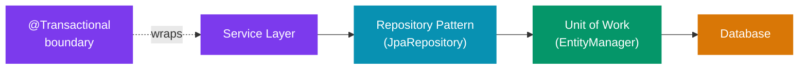
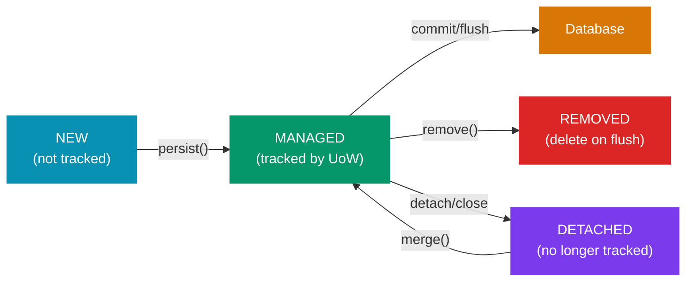
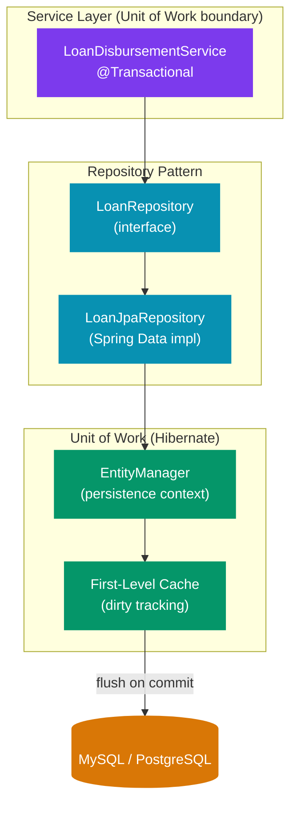

# Repository and Unit of Work Pattern

> 📖 **Master guide:** [LLD Interview Patterns Guide](./01_LLD_Interview_Patterns_Guide.md). This file goes deeper on the *architectural patterns* row of that guide. It covers the persistence layer, not GoF LLD.

**Repository and Unit of Work Pattern** | Two basic domain patterns from DDD (Domain-Driven Design). Every Spring developer uses them daily. JpaRepository IS the Repository pattern, and @Transactional IS the Unit of Work. If you name these in interviews, it shows senior-level thinking.

- [1. Why These Patterns Matter 🔥](#1-why-these-patterns-matter)
- [2. Repository Pattern 🔥🔥](#2-repository-pattern)
  - [2.1 What It Is 🔥](#21-what-it-is)
  - [2.2 Repository vs DAO 🔥🔥](#22-repository-vs-dao)
  - [2.3 Problem Without Repository 🔥](#23-problem-without-repository)
  - [2.4 Repository Interface Design ⚡](#24-repository-interface-design)
  - [2.5 Custom Repository for Complex Queries ⚡](#25-custom-repository-for-complex-queries)
  - [2.6 Specification Pattern 🔥](#26-specification-pattern)
  - [2.7 Testing with Repository Pattern 🔥](#27-testing-with-repository-pattern)
- [3. Unit of Work Pattern 🔥🔥](#3-unit-of-work-pattern)
  - [3.1 What It Is 🔥](#31-what-it-is)
  - [3.2 Spring's Unit of Work: @Transactional 🔥🔥](#32-springs-unit-of-work-transactional)
  - [3.3 How Hibernate Implements Unit of Work Internally 🔥🔥](#33-how-hibernate-implements-unit-of-work-internally)
  - [3.4 @Transactional Propagation — Unit of Work Boundaries 🔥🔥](#34-transactional-propagation--unit-of-work-boundaries)
  - [3.5 Common @Transactional Pitfalls 🔥🔥](#35-common-transactional-pitfalls)
- [4. Repository + Unit of Work Together — The Full Picture 🔥](#4-repository--unit-of-work-together--the-full-picture)
- [5. What to Say in an Interview 🔥](#5-what-to-say-in-an-interview)
- [6. When the Repository Abstraction Is Ceremony 🔥](#6-when-the-repository-abstraction-is-ceremony)
- [7. Interview Q&A 🔥🔥](#7-interview-qa)

> 🔥🔥 Must-know — very frequently tested &nbsp;·&nbsp; 🔥 High priority &nbsp;·&nbsp; ⚡ Medium priority &nbsp;·&nbsp; 💤 Low priority

---

<a id="1-why-these-patterns-matter"></a>
## 1. Why These Patterns Matter 💤

You have used both of these patterns in every Spring Boot project. This file helps you **name and explain them** when asked. An interviewer may ask *"what design patterns do you use in your project?"*. They expect you to say:

> *"Repository and Unit of Work, implemented via Spring Data JPA and `@Transactional`"*

— not just *"I use JpaRepository."*

A senior candidate knows the pattern names and can explain why they exist. This is what separates them from a mid-level candidate.

| What You Use in Spring | The Pattern Behind It |
|---|---|
| `JpaRepository`, `CrudRepository` | Repository Pattern |
| `@Transactional` method | Unit of Work Pattern |
| `EntityManager.persist/merge/remove` | Unit of Work (manual) |
| `@Repository` annotation | Repository Pattern (marker) |



---

<a id="2-repository-pattern"></a>
## 2. Repository Pattern ⚡

<a id="21-what-it-is"></a>
### 2.1 What It Is 🔥

The Repository pattern **sits between the domain model and the data source**. It gives you a collection-like interface to access domain objects. It hides all database access logic from the service layer.

🔑 **Core idea:** *"Think of it as an in-memory collection of domain objects. You add, remove, and find them. You don't care how they're stored."*

Key characteristics:
- The service layer talks to a repository interface, not to JPA, SQL, or any DB-specific API
- The repository looks and behaves like a collection (`findById`, `save`, `delete`). It does not behave like a SQL query engine
- The interface is a **boundary seam** (a point where you can swap the code behind it). You can stub it, wrap it, or rewrite the query behind it. The service layer does not change
- It makes proper unit testing possible. Inject an in-memory repository for fast tests with no DB

⚠️ **The claim to *not* make: "we could swap MySQL for MongoDB without touching the service layer."** Textbooks give this as the main benefit. It is the weakest one.
- Aggregate-shaped queries, transactions and lazy loading break when you swap the database.
- A repository may return `Page<T>`, a `Specification`, or anything built from a query tied to one SQL dialect. At that point, the abstraction leaks.

<a id="22-repository-vs-dao"></a>
### 2.2 Repository vs DAO 🔥🔥

This is **the most common way interviewers ask** about this topic: *"What's the difference between a Repository and a DAO?"* They look similar, because both hide data access. But they come from different ways of thinking:

| Aspect | DAO (Data Access Object) | Repository |
|---|---|---|
| **Origin** | Classic J2EE persistence pattern | Domain-Driven Design (DDD) |
| **Centered on** | The **data source / table** | The **domain / aggregate** |
| **Granularity** | One DAO **per table** (`LoanDao`, `LoanDocumentDao`) | One Repository **per aggregate root** (`LoanRepository`) |
| **Vocabulary** | Persistence terms — `insert`, `update`, `selectById` | Ubiquitous (domain) language — `save`, `findActiveLoansFor` |
| **Abstraction level** | Thin wrapper over CRUD on a data source | Collection-like illusion over the whole domain object graph |
| **Can sit on top of** | A single data source | **Multiple DAOs / sources** (e.g. JPA + Redis + an external API) — it reassembles a full aggregate |
| **Returns** | Rows / records, often table-shaped DTOs | Fully-formed **domain objects** (aggregate roots with their children) |

🔑 **One-liner for the interview:** *"A DAO is table-centric. There is one per table, and it offers CRUD over a data source. A Repository is domain-centric. There is one per aggregate root, and it uses the ubiquitous language (the shared business vocabulary). It can combine several DAOs or data sources to return a complete domain object. Spring Data `JpaRepository` mixes the two, but in concept it's a Repository."*

💡 In practice, a Spring `JpaRepository` for a simple entity behaves like a DAO. The difference matters when an aggregate (a root entity plus its child objects) spans multiple tables/sources. The Repository hides how the parts are put together. A DAO would not.

<a id="23-problem-without-repository"></a>
### 2.3 Problem Without Repository 🔥

❌️ **Without Repository — business logic mixed with SQL/JPA:**

```java
@Service
public class LoanService {

    @Autowired
    private EntityManager entityManager;

    public Loan getLoan(String loanId) {
        // SQL leaking into service layer
        return entityManager.createQuery(
                "SELECT l FROM Loan l WHERE l.id = :id", Loan.class)
                .setParameter("id", loanId)
                .getSingleResult();
    }

    public void approveLoan(String loanId) {
        Loan loan = entityManager.createQuery(
                "SELECT l FROM Loan l WHERE l.id = :id", Loan.class)
                .setParameter("id", loanId)
                .getSingleResult();
        loan.setStatus(LoanStatus.APPROVED);
        // ⚠️ Redundant: `loan` came from getSingleResult() so it's already MANAGED —
        // dirty-checking will flush the status change on commit. This merge() is a no-op
        // (worse, it re-copies state into the persistence context for nothing).
        entityManager.merge(loan);
    }
}
```

Problems with this approach:
- Query logic is **duplicated** across methods
- Service layer **knows about JPA** — tight coupling to the persistence framework
- **Impossible to unit test** unless you start a real database or write complex mocks
- **No named seam** — there is no interface to stub, wrap, cache behind, or instrument

⚠️ **The realistic version of this leak.** Nobody really injects an `EntityManager` to run `SELECT ... WHERE id = :id`. That's what `find()` is for. The example above makes the problem bigger than in real code, to teach the point. In real code, the problem is harder to see. The service calls the repository correctly, but the *business rule lives inside a 40-line native query*.

```java
@Query(value = """
        SELECT l.id, l.customer_id, l.amount
        FROM loan l JOIN customer c ON c.id = l.customer_id
        WHERE l.status = 'PENDING'
          AND l.amount <= c.credit_limit * 0.8      -- ⚠️ eligibility rule, in SQL
          AND DATEDIFF(CURDATE(), l.applied_date) <= 30
        """, nativeQuery = true)
List<Object[]> findEligibleForAutoApproval();
```

The repository interface is intact, and the service looks clean. But the *"amount ≤ 80% of credit limit"* rule now has three problems:
- You cannot test it without a database.
- The domain model cannot see it.
- The next person who needs it will copy it.

Name this leak in an interview. The answer "but I use a repository" does not fix it.

✅ **With Repository — clean separation:**

```java
@Service
public class LoanService {

    private final LoanRepository loanRepository;

    public LoanService(LoanRepository loanRepository) {
        this.loanRepository = loanRepository;
    }

    @Transactional(readOnly = true)
    public Loan getLoan(String loanId) {
        return loanRepository.findById(loanId)
                .orElseThrow(() -> new LoanNotFoundException(loanId));
    }

    @Transactional                      // ← the Unit of Work boundary (§3.2)
    public void approveLoan(String loanId) {
        Loan loan = loanRepository.findById(loanId)
                .orElseThrow(() -> new LoanNotFoundException(loanId));

        // `loan` is MANAGED inside this transaction. Mutating it is enough —
        // Hibernate dirty-checks it at flush and emits the UPDATE. No save() needed.
        loan.approve();
    }
}
```

The service layer now uses only domain terms: `find`, `approve`. It knows nothing about JPA or SQL.

⚠️ **Note what `@Transactional` is doing here. It is not just decoration.**
- Without it, `findById` runs inside `SimpleJpaRepository`'s own `@Transactional(readOnly = true)`. The entity comes back **DETACHED** (unless `open-in-view` keeps the context open for a web request).
- `loan.approve()` then changes an object that nothing tracks. So you must call `save(loan)`.
- `save(loan)` opens a *second* transaction and issues a `merge()`: an extra `SELECT` plus the `UPDATE`.

It "works", but for the wrong reason. The Repository and the Unit of Work are one design. If you show the ✅ example without a transaction boundary, you teach only half of it.

**What `save()` really does, and when you don't need it.**

`SimpleJpaRepository.save(entity)` is a two-branch method:

```java
// Spring Data's actual implementation (simplified)
public <S extends T> S save(S entity) {
    if (entityInformation.isNew(entity)) {
        entityManager.persist(entity);      // transient → MANAGED, INSERT on flush
        return entity;
    }
    return entityManager.merge(entity);     // copies state into the persistence context
}
```

| Entity state | Do you need `save()`? | Why |
|---|---|---|
| **New / transient** (no id, or `@Version` is null) | ✅ **Yes** | Nothing is tracking it — `persist()` is what registers it with the Unit of Work |
| **Managed** (loaded in *this* transaction) | ❌️ **No** | Dirty checking already emits the UPDATE at flush. `save()` → `merge()` → a no-op copy of the entity onto itself |
| **Detached** (loaded in a previous transaction, or arrived over the wire) | ✅ **Yes** | `merge()` finds/loads the managed copy and copies your state onto it, then returns **that** copy — mutate the returned reference, not your original |

🔑 **The interview line:** *"Inside a transaction you don't call `save()` on an entity you just loaded. It's managed, so dirty checking handles it. `save()` is for new entities, or for reattaching detached ones. And `merge()` returns a **different instance** from the one you passed in. That is the bug people hit."*

<a id="24-repository-interface-design"></a>
### 2.4 Repository Interface Design ⚡

The cleanest approach in DDD: define a **domain-facing interface**, and let Spring Data implement it:

```java
// Domain-facing repository interface — no JPA leaking through
public interface LoanRepository {

    Optional<Loan> findById(String loanId);

    List<Loan> findByCustomerId(String customerId);

    List<Loan> findByStatus(LoanStatus status);

    Loan save(Loan loan);

    void deleteById(String loanId);

    boolean existsById(String loanId);
}

// Spring Data JPA implementation — extends JpaRepository
@Repository
public interface LoanJpaRepository extends JpaRepository<Loan, String>, LoanRepository {

    // findByCustomerId / findByStatus are inherited from LoanRepository and
    // derived automatically by Spring Data from the method names — no body needed.

    // For queries too complex for name derivation, drop down to @Query:
    @Query("SELECT l FROM Loan l WHERE l.amount > :minAmount AND l.status = :status")
    List<Loan> findByAmountGreaterThanAndStatus(
            @Param("minAmount") double minAmount,
            @Param("status") LoanStatus status
    );
}
```

💡 In most Spring Boot projects, teams skip the separate domain interface. They extend `JpaRepository` directly. That is still the Repository pattern. But a separate interface makes testing cleaner and keeps the domain model free of DB details.

**Sharing common behaviour: a generic base repository.** Sometimes you want a method on *every* repository (e.g. a soft-delete helper, an audit hook). But you don't want that base interface to become its own Spring Data repository. Put `@NoRepositoryBean` on the middle interface. Then Spring does **not** try to create a bean for it:

```java
@NoRepositoryBean
public interface BaseRepository<T, ID> extends Repository<T, ID> {

    Optional<T> findById(ID id);

    <S extends T> S save(S entity);

    // common behaviour shared by all repositories goes here.
    // "findAllActive" cannot be derived from its name, so it needs a query.
    // #{#entityName} becomes each concrete entity (each needs an `active` field).
    @Query("select e from #{#entityName} e where e.active = true")
    List<T> findAllActive();
}

// Concrete repositories extend the base — each gets the shared methods
@Repository
public interface LoanRepository extends BaseRepository<Loan, String> {
    List<Loan> findByCustomerId(String customerId);
}
```

🔑 **Aggregate-root rule (strict DDD):** define **one repository per aggregate root**, not per entity. Child entities (e.g. a `Loan`'s `RepaymentSchedule` or `LoanDocument`) have no repository of their own. You load and persist them **through the root** (`loanRepository.save(loan)` cascades to its children). This keeps the aggregate's invariants (rules that must always be true) in one place.

⚠️ Compare the number of repositories with the number of entities. If the ratio is roughly **1:1**, you really have DAO-per-table with a Repository's name. That is an engineering choice you can defend. But say so; don't claim DDD. §6 looks at this choice honestly.

**Two `JpaRepository` methods to know by name:**

| Method | What it does | When to reach for it |
|---|---|---|
| `findById(id)` | Issues the `SELECT` immediately; returns `Optional<T>` | You need the entity's **data** |
| `getReferenceById(id)` | Returns a **lazy proxy**; no SQL until you touch a non-id field. Throws `EntityNotFoundException` on first access if the row is gone | You only need it to **set a foreign key** — `payment.setLoan(loanRepo.getReferenceById(loanId))` saves a round-trip |

```java
// ❌️ Loads the whole Loan row just to write loan_id into the payment
Loan loan = loanRepository.findById(loanId).orElseThrow();
paymentRepository.save(new Payment(loan, amount));

// ✅ No SELECT — the proxy carries only the id, which is all the FK needs
Loan loanRef = loanRepository.getReferenceById(loanId);
paymentRepository.save(new Payment(loanRef, amount));
```

💡 **`saveAll()` is not automatically a batch insert.** It loops and calls `save()` for each element. You still get N `INSERT` statements unless you switch on JDBC batching:

```yaml
spring:
  jpa:
    properties:
      hibernate:
        jdbc.batch_size: 50
        order_inserts: true
        order_updates: true
```

Also, Hibernate turns off batching without warning for entities with `GenerationType.IDENTITY`. It must run each INSERT to read back the generated key, so it cannot queue them. For real batching, use a `SEQUENCE` generator with an allocation size. "Why is my bulk insert still slow?" is a common follow-up question, and this is the answer.

<a id="25-custom-repository-for-complex-queries"></a>
### 2.5 Custom Repository for Complex Queries ⚡

Use this when Spring Data cannot build the query from the method name (complex filters, dynamic predicates, reporting queries):

```java
// Step 1: Define the custom capability interface
public interface LoanRepositoryCustom {

    List<LoanSummaryDTO> findLoanSummariesByFilters(
            String customerId,
            LoanStatus status,
            LocalDate fromDate,
            LocalDate toDate
    );
}

// Step 2: Implement using Criteria API for dynamic, type-safe queries
@Repository
public class LoanRepositoryCustomImpl implements LoanRepositoryCustom {

    @PersistenceContext
    private EntityManager entityManager;

    @Override
    public List<LoanSummaryDTO> findLoanSummariesByFilters(
            String customerId,
            LoanStatus status,
            LocalDate fromDate,
            LocalDate toDate) {

        CriteriaBuilder cb = entityManager.getCriteriaBuilder();
        CriteriaQuery<LoanSummaryDTO> query = cb.createQuery(LoanSummaryDTO.class);
        Root<Loan> loan = query.from(Loan.class);

        // ⚠️ MUST set an explicit projection. The query result type is LoanSummaryDTO,
        // but the root is Loan — without select(...) JPA defaults the selection to the
        // root (Loan), which mismatches the result type and fails at runtime (Hibernate 6.6
        // throws QueryTypeMismatchException; older 6.x versions throw a different type). cb.construct(...) maps selected columns to a DTO constructor.
        query.select(cb.construct(
                LoanSummaryDTO.class,
                loan.get("id"),
                loan.get("customerId"),
                loan.get("amount"),
                loan.get("status"),
                loan.get("appliedDate")
        ));

        List<Predicate> predicates = new ArrayList<>();

        if (customerId != null) {
            predicates.add(cb.equal(loan.get("customerId"), customerId));
        }
        if (status != null) {
            predicates.add(cb.equal(loan.get("status"), status));
        }
        if (fromDate != null) {
            predicates.add(cb.greaterThanOrEqualTo(loan.get("appliedDate"), fromDate));
        }
        if (toDate != null) {
            predicates.add(cb.lessThanOrEqualTo(loan.get("appliedDate"), toDate));
        }

        query.where(predicates.toArray(new Predicate[0]));

        return entityManager.createQuery(query).getResultList();
    }
}

// Step 3: Compose both in the main JPA repository
@Repository
public interface LoanJpaRepository
        extends JpaRepository<Loan, String>, LoanRepositoryCustom {
    // Spring Data merges both implementations automatically
}
```

💡 Spring Data automatically detects `LoanRepositoryCustomImpl` and merges it into the proxy. You get both: derived queries for simple cases, and Criteria API for complex ones.

⚠️ **Get the naming rule right. Interviewers like to test it.**
- Since Spring Data 2.0, the `Impl` postfix goes on the **fragment interface** name, not the repository interface name: `<FragmentInterfaceName>Impl`.
- So `LoanRepositoryCustom` → `LoanRepositoryCustomImpl` ✅.
- If you name it `LoanJpaRepositoryImpl` (after the repository), Spring still finds it, but through the old single-implementation rule. The Spring Data docs call that rule deprecated. Use the fragment name.
- A name that matches neither rule (for example `LoanCustomImpl`) is not picked up. Startup then fails with a `PropertyReferenceException`, because Spring tries to derive a query from the method name.
- You can change the postfix with `repositoryImplementationPostfix` on `@EnableJpaRepositories`.

<a id="26-specification-pattern"></a>
### 2.6 Specification Pattern 🔥

Raw Criteria API (above) works. But the code that builds predicates is long and **not reusable**. Every new filter combination needs another custom method.

The **Specification pattern** is Spring Data's standard answer for dynamic queries. Each business rule becomes a small, named, **composable** `Specification<T>` (you can combine it with others). You combine them with `and()` / `or()`. This matters much more in interviews than hand-written Criteria.

```java
// Step 1: enable it — extend JpaSpecificationExecutor alongside JpaRepository
@Repository
public interface LoanJpaRepository
        extends JpaRepository<Loan, String>, JpaSpecificationExecutor<Loan> {
}

// Step 2: define reusable, named specifications (each is one composable predicate)
public final class LoanSpecifications {

    private LoanSpecifications() {
    }

    public static Specification<Loan> hasCustomer(String customerId) {
        // "no constraint" — the old idiom was to return null and let Spring Data skip it.
        // Prefer Specification.unrestricted() (Spring Data JPA 3.5.2+): and()/or()/not()
        // stop accepting null specifications in 4.0.
        if (customerId == null) {
            return Specification.unrestricted();
        }
        return (root, query, cb) -> cb.equal(root.get("customerId"), customerId);
    }

    public static Specification<Loan> hasStatus(LoanStatus status) {
        if (status == null) {
            return Specification.unrestricted();
        }
        return (root, query, cb) -> cb.equal(root.get("status"), status);
    }

    public static Specification<Loan> appliedBetween(LocalDate from, LocalDate to) {
        if (from != null && to != null) {
            return (root, query, cb) -> cb.between(root.get("appliedDate"), from, to);
        }
        if (from != null) {
            return (root, query, cb) ->
                    cb.greaterThanOrEqualTo(root.get("appliedDate"), from);
        }
        if (to != null) {
            return (root, query, cb) ->
                    cb.lessThanOrEqualTo(root.get("appliedDate"), to);
        }
        return Specification.unrestricted();
    }

    public static Specification<Loan> amountAtLeast(double minAmount) {
        return (root, query, cb) ->
                cb.greaterThanOrEqualTo(root.get("amount"), minAmount);
    }
}

// Step 3: compose at the call site — read like business rules, reuse anywhere
@Service
public class LoanQueryService {

    private final LoanJpaRepository loanRepository;

    public LoanQueryService(LoanJpaRepository loanRepository) {
        this.loanRepository = loanRepository;
    }

    public List<Loan> searchLoans(
            String customerId, LoanStatus status, LocalDate from, LocalDate to) {

        // Specification.where(...) is @Deprecated(since = "3.5.0", forRemoval = true).
        // allOf(...) / anyOf(...) are the replacements (Spring Data JPA 3.0+).
        Specification<Loan> spec = Specification.allOf(
                LoanSpecifications.hasCustomer(customerId),
                LoanSpecifications.hasStatus(status),
                LoanSpecifications.appliedBetween(from, to));

        return loanRepository.findAll(spec);
    }

    // The same building blocks recombine for a different rule — zero new query code
    public List<Loan> highValuePendingLoans() {
        Specification<Loan> spec = LoanSpecifications.hasStatus(LoanStatus.PENDING)
                .and(LoanSpecifications.amountAtLeast(1_000_000));
        return loanRepository.findAll(spec);
    }
}
```

✅ **Why interviewers like this answer:**
- The predicates are **named**, so the code explains itself.
- They are **reusable**. Combine `allOf()`/`anyOf()`/`and()`/`or()` freely.
- They are **safe for optional filters**. An `unrestricted()` spec adds nothing to the `WHERE`.
- You still get pagination/sorting for free (`findAll(spec, pageable)`).

It sits between two weaker options: derived-query method names that break easily, and long hand-written Criteria.

⚠️ **Version note: the API changed recently.**
- `Specification.where(...)` is `@Deprecated(since = "3.5.0", forRemoval = true)`.
- `allOf`/`anyOf` arrived in **3.0**, and `unrestricted()` in **3.5.2**.
- On an older Spring Boot (3.2/3.3, i.e. Spring Data JPA 3.2/3.3), `unrestricted()` does not exist. You return `null` for "no filter", and `where(...)` is not deprecated yet. `allOf`/`anyOf` already work there.

So know both styles, and say which version you're on. It is an easy way to show that you follow the latest changes.

<a id="27-testing-with-repository-pattern"></a>
### 2.7 Testing with Repository Pattern 🔥

The **real benefit** of the Repository pattern is testability. Swap the JPA implementation for an in-memory one:

```java
// In-memory implementation for unit tests — zero DB dependency, runs instantly
public class InMemoryLoanRepository implements LoanRepository {

    private final Map<String, Loan> store = new HashMap<>();

    @Override
    public Optional<Loan> findById(String loanId) {
        return Optional.ofNullable(store.get(loanId));
    }

    @Override
    public Loan save(Loan loan) {
        store.put(loan.getId(), loan);
        return loan;
    }

    @Override
    public List<Loan> findByCustomerId(String customerId) {
        return store.values().stream()
                .filter(l -> l.getCustomerId().equals(customerId))
                .collect(Collectors.toList());
    }

    @Override
    public List<Loan> findByStatus(LoanStatus status) {
        return store.values().stream()
                .filter(l -> l.getStatus().equals(status))
                .collect(Collectors.toList());
    }

    @Override
    public void deleteById(String loanId) {
        store.remove(loanId);
    }

    @Override
    public boolean existsById(String loanId) {
        return store.containsKey(loanId);
    }
}

// Unit test — pure Java, no Spring context, no DB, runs in milliseconds.
// No @ExtendWith(MockitoExtension.class) needed: the in-memory repository is a real
// object, not a Mockito mock, so there is nothing for the extension to wire up.
class LoanServiceTest {

    private LoanService loanService;
    private InMemoryLoanRepository loanRepository;

    @BeforeEach
    void setUp() {
        loanRepository = new InMemoryLoanRepository();
        loanService = new LoanService(loanRepository);
    }

    @Test
    void shouldApproveLoan_whenLoanExists() {
        // Arrange
        Loan loan = new Loan("LOAN-001", "CUST-001", LoanStatus.PENDING);
        loanRepository.save(loan);

        // Act
        loanService.approveLoan("LOAN-001");

        // Assert — check via repository, not via DB
        Loan updated = loanRepository.findById("LOAN-001").orElseThrow();
        assertThat(updated.getStatus()).isEqualTo(LoanStatus.APPROVED);
    }

    @Test
    void shouldThrowException_whenLoanNotFound() {
        // Fast unit test — no H2, no Testcontainers, no overhead
        assertThatThrownBy(() -> loanService.approveLoan("NONEXISTENT"))
                .isInstanceOf(LoanNotFoundException.class);
    }
}
```

⚠️ **One thing this fake gets right by accident. Name it.**
- `approveLoan` (§2.3) no longer calls `save()`. Yet the assertion passes.
- The reason: the `HashMap` stores the entity *reference*. So a change to the object is visible through `findById`.
- That is the in-memory version of Hibernate's Identity Map + dirty checking (§3.3).
- It's luck, not a guarantee. If the fake deep-copied on `save()`, the test would fail, even though the service is correct.

Know why your fake behaves the way it does.

**There are three seams, not one. Know which question each one answers:**

| Question | Seam | What it actually exercises |
|---|---|---|
| *"How do you test the **service** layer?"* | Mock or fake the repository (above, or `@Mock JpaRepository`) | Business logic only. Zero JPA. Milliseconds. |
| *"How do you test the **repository**?"* | `@DataJpaTest` slice | Your derived-query names, `@Query` strings, and the mapping actually work. Loads only the JPA slice, wraps each test in a transaction and **rolls back** after. |
| *"How do you know the **SQL** is right?"* | `@DataJpaTest` + Testcontainers | Dialect-specific SQL, real indexes, real isolation. H2 will happily accept SQL MySQL rejects. |

```java
// Repository slice test — no web layer, no service beans, rolled back per test
@DataJpaTest
@AutoConfigureTestDatabase(replace = AutoConfigureTestDatabase.Replace.NONE)  // use the real DB
@Testcontainers
class LoanRepositoryTest {

    @Container
    static MySQLContainer<?> mysql = new MySQLContainer<>("mysql:8.0");

    @DynamicPropertySource
    static void datasource(DynamicPropertyRegistry registry) {
        registry.add("spring.datasource.url", mysql::getJdbcUrl);
        registry.add("spring.datasource.username", mysql::getUsername);
        registry.add("spring.datasource.password", mysql::getPassword);
    }

    @Autowired
    private LoanJpaRepository loanRepository;

    @Autowired
    private TestEntityManager em;

    @Test
    void findByStatus_returnsOnlyPendingLoans() {
        em.persist(new Loan("LOAN-001", "CUST-001", LoanStatus.PENDING));
        em.persist(new Loan("LOAN-002", "CUST-001", LoanStatus.APPROVED));
        em.flush();     // send the INSERTs now (this JPQL query would also auto-flush them)

        List<Loan> pending = loanRepository.findByStatus(LoanStatus.PENDING);

        assertThat(pending).extracting(Loan::getId).containsExactly("LOAN-001");
    }
}
```

⚠️ **The `@DataJpaTest` trap interviewers ask about:**
- Every test method runs inside a transaction that is rolled back.
- So the persistence context is **never cleared between your `persist()` and your query**.
- A test can pass only because of the first-level cache, while the real mapping is broken.
- `em.flush()` forces the SQL. `em.clear()` after it forces a real round-trip to the database.

If a repository test passes locally but the query fails in production, this is usually the reason.

💡 If you use `@DataJpaTest` with the default H2 replacement, you test H2's SQL dialect, not your database's. Native queries cause exactly this kind of bug. `@AutoConfigureTestDatabase(replace = NONE)` + Testcontainers fixes this.

---

<a id="3-unit-of-work-pattern"></a>
## 3. Unit of Work Pattern 🔥🔥

<a id="31-what-it-is"></a>
### 3.1 What It Is 🔥

The Unit of Work pattern **tracks all objects that were read, added, changed, or deleted during a business transaction**. At the end, it flushes all changes to the database in a single, atomic batch.

🔑 **Core idea:** *"A Unit of Work says: 'Track everything I do during this operation. Commit it all at once, or roll it all back.' This pattern gives you atomicity across many domain operations."*

Key points:
- All changes in a business operation are batched together.
- If one operation fails, **everything rolls back**. No partial state is left.
- It can reduce DB round-trips. Many changes to one entity become one `UPDATE` at flush. With JDBC batching on (§2.4), writes also go in batches.
- In Java, the `EntityManager` / Hibernate `Session` is the real implementation.

<a id="32-springs-unit-of-work-transactional"></a>
### 3.2 Spring's Unit of Work: `@Transactional` 🔥🔥

Every `@Transactional` method is a Unit of Work. Spring starts a transaction when the method starts. It commits (or rolls back) when the method ends:

```java
@Service
public class LoanDisbursementService {

    private final LoanRepository loanRepository;
    private final LedgerRepository ledgerRepository;
    private final NotificationRepository notificationRepository;

    public LoanDisbursementService(
            LoanRepository loanRepository,
            LedgerRepository ledgerRepository,
            NotificationRepository notificationRepository) {
        this.loanRepository = loanRepository;
        this.ledgerRepository = ledgerRepository;
        this.notificationRepository = notificationRepository;
    }

    // Unit of Work: all three operations commit atomically, or all roll back
    @Transactional
    public void disburseLoan(String loanId, double amount) {
        // Step 1: Update loan status — `loan` is MANAGED, so the mutation alone is
        // enough. Dirty checking emits the UPDATE at flush; no save() needed (§2.3)
        Loan loan = loanRepository.findById(loanId)
                .orElseThrow(() -> new LoanNotFoundException(loanId));
        loan.disburse();

        // Step 2: Create ledger entry — NEW entity, so save() (→ persist) IS required
        LedgerEntry entry = new LedgerEntry(loanId, amount, "DEBIT");
        ledgerRepository.save(entry);

        // Step 3: Queue notification — also new, also needs save()
        Notification notification = new Notification(
                loan.getCustomerId(), "Your loan has been disbursed");
        notificationRepository.save(notification);

        // If ANY of the above throws a RuntimeException,
        // ALL three changes are rolled back — atomicity guaranteed
    }
}
```

📤 **What Spring does inside:**
1. Before method: `BEGIN TRANSACTION`
2. During method: EntityManager tracks all dirty objects
3. On successful return: `FLUSH` (write to DB) → `COMMIT`
4. On `RuntimeException`: `ROLLBACK` — nothing reaches the DB

<a id="33-how-hibernate-implements-unit-of-work-internally"></a>
### 3.3 How Hibernate Implements Unit of Work Internally 🔥🔥

Hibernate's `Session` (JPA `EntityManager`) **is** the Unit of Work object. It keeps a **first-level cache** (the persistence context). This cache tracks the state of each entity:

```java
// Manual Unit of Work with EntityManager — shows what @Transactional does automatically
@Service
public class ManualUnitOfWorkExample {

    @PersistenceContext
    private EntityManager entityManager;

    @Transactional
    public void manualUnitOfWork(String loanId) {
        // Entity enters MANAGED state — Hibernate tracks it
        Loan loan = entityManager.find(Loan.class, loanId);

        // Mutation detected — entity is now DIRTY in the persistence context
        loan.setStatus(LoanStatus.APPROVED);

        // Another entity loaded — also tracked by the same UoW
        Customer customer = entityManager.find(Customer.class, loan.getCustomerId());
        customer.setActiveLoanCount(customer.getActiveLoanCount() + 1);

        // New entity registered with the UoW — will INSERT on flush
        Audit audit = new Audit(loanId, "APPROVED", LocalDateTime.now());
        entityManager.persist(audit);

        // At @Transactional boundary: Hibernate flushes ALL tracked changes atomically.
        // Its action queue orders INSERTs before UPDATEs (then DELETEs), so the
        // emitted SQL is:
        // → INSERT INTO audit (loan_id, action, created_at) VALUES (?, ?, ?)
        // → UPDATE loan SET status = 'APPROVED' WHERE id = ?
        // → UPDATE customer SET active_loan_count = ? WHERE id = ?
        // → COMMIT
    }
}
```

🔑 **The persistence context is an Identity Map.** Hibernate's first-level cache implements the classic **Identity Map pattern**. Inside a single session, there is **exactly one object instance per database row**.
- Call `entityManager.find(Loan.class, id)` twice in the same transaction. You get back the **same Java reference** (`a == b` is `true`).
- Hibernate never loads the row twice.
- This guarantee makes dirty-checking safe. There is only one instance, so all changes go through it.
- At flush time, the Unit of Work compares each managed instance to its loaded snapshot. It emits UPDATEs only for what really changed.

So the two patterns work together:
- **Identity Map** = one instance per row (the bookkeeping).
- **Unit of Work** = track those instances and flush them atomically (the transaction).

🔑 **Flush is the mechanism — know it exactly.** *Flush* and *commit* are two different things. If you mix them up, you fail this set of questions quickly.

- **`flush()`** — Hibernate goes through every entity in the persistence context. It dirty-checks every managed entity against its loaded snapshot. Then it **emits the SQL** (`INSERT`/`UPDATE`/`DELETE`) on the current JDBC connection. Nothing is durable yet. It is all inside the open transaction, and you can still roll it back.
- **`commit()`** — ends the DB transaction. It makes the changes durable and visible to others. Hibernate always flushes just before it commits.

| `FlushModeType` | When Hibernate flushes | Where you meet it |
|---|---|---|
| `AUTO` (JPA default) | Before commit **and** before any query whose result could be affected by pending changes | Normal `@Transactional` methods |
| `COMMIT` | Only at commit — queries may read stale data | Rarely set on purpose |
| `MANUAL` (Hibernate-specific) | Never, unless you call `flush()` yourself | **Set for you by `@Transactional(readOnly = true)`** — see the §3.5 trap |

```java
@Transactional
public void auditThenQuery(String loanId) {
    Loan loan = loanRepository.findById(loanId).orElseThrow();
    loan.setStatus(LoanStatus.APPROVED);            // dirty, not yet written

    // AUTO flush: Hibernate sees the query touches `loan`, flushes the pending
    // UPDATE first, THEN runs the SELECT — so the count is consistent.
    long approved = loanRepository.countByStatus(LoanStatus.APPROVED);

    // Explicit flush: forces the SQL now, so a constraint violation surfaces HERE
    // (where you can still catch it) instead of at commit
    loanRepository.flush();
}
```

💡 **Why you would call `flush()` yourself:**
- To make a constraint violation show up at a point you control.
- To make a trigger-generated value readable in the middle of the transaction (flush, then `refresh()`). An `IDENTITY` or sequence id is already set by `persist()`.
- Before a bulk `@Modifying` query, so the query works on rows that are already written (§3.5).

⚠️ Note that `flush()` does **not** commit. An exception after it still rolls everything back.

⚠️ **`LazyInitializationException` — the persistence-context boundary trap.**
- Lazy associations (`@OneToMany(fetch = LAZY)`, lazy proxies) can only be initialized **while the persistence context is open**. That means inside the `@Transactional` Unit of Work.
- The transaction commits and the session closes, usually at the service-layer boundary. After that, the entity is **DETACHED**.
- Then a controller or view may touch a lazy field that is not loaded yet. Hibernate has no session to load it from, so it throws `LazyInitializationException`.
- Fix: fetch what you need inside the transaction (`JOIN FETCH`, an entity graph, or a DTO projection).
- Do **not** fix it by leaving `open-in-view` on. That setting only hides the boundary problem, and it lets DB access leak into the web layer.

🔑 **Entity lifecycle states tracked by the Unit of Work:**



💡 **Optimistic locking protects concurrent Units of Work.**
- Add a `@Version` field to an entity. Hibernate then adds the version check to every UPDATE the UoW emits at flush time: `UPDATE loan SET ..., version = ? WHERE id = ? AND version = ?`. The first `?` is the new version (old + 1).
- A concurrent transaction may have already increased the version. Then the `WHERE` matches 0 rows, and Hibernate throws `OptimisticLockException`.
- So two overlapping Units of Work cannot silently overwrite each other's writes (the lost-update problem).
- No locks are held. The conflict is found only at commit. That is why it is called "optimistic".

```java
@Entity
public class Loan {

    @Id
    private String id;

    @Version          // managed entirely by Hibernate — never set it manually
    private long version;

    // ... other fields
}
```

<a id="34-transactional-propagation--unit-of-work-boundaries"></a>
### 3.4 `@Transactional` Propagation — Unit of Work Boundaries 🔥🔥

Propagation controls what happens when a `@Transactional` method calls another `@Transactional` method. In other words, it controls how Unit of Work boundaries nest:

| Propagation | Behaviour | Use When |
|---|---|---|
| `REQUIRED` (default) | Join existing transaction; create new if none exists | Standard service methods |
| `REQUIRES_NEW` | Always start a NEW transaction; suspend existing one | Audit logging (must commit even if outer rolls back) |
| `NESTED` | JDBC **savepoint** inside the existing tx; rolling back returns the *rows* to the savepoint | ⚠️ Not on JPA — see the caveat below. Meaningful with plain `JdbcTemplate` |
| `SUPPORTS` | Join if transaction exists; run non-transactionally if none | Read-only query methods |
| `NOT_SUPPORTED` | Always non-transactional; suspend any existing transaction | Operations that must run outside a tx (e.g. calling external services) |
| `NEVER` | Throw if a transaction exists | Strict non-transactional enforcement |
| `MANDATORY` | Must join existing; throw if no transaction exists | Methods that must always be called inside a tx |

⚠️ **Do not recommend `NESTED` on a JPA stack.**
- The `nestedTransactionAllowed` flag on `JpaTransactionManager` is `true` by default in Spring 6 (Boot 3). Spring 7 changed the default to `false`.
- The flag is not the real limit. With Hibernate, `NESTED` inside an existing transaction still throws `NestedTransactionNotSupportedException` (*"JpaDialect does not support savepoints"*). `HibernateJpaDialect` does not give Spring a savepoint manager.
- Even where a savepoint could be made, it applies to the **JDBC connection only**, not to the `EntityManager`.
- Spring's own javadoc says it clearly: *JPA itself does not support nested transactions*.
- So a rollback to the savepoint undoes the **rows**. But the persistence context still holds those entities in their changed state.
- The next flush can then re-emit the writes you just rolled back, with no warning.

For real partial success on JPA, do one of these:
- Use **`REQUIRES_NEW`** (a real, separate `EntityManager` and transaction).
- Or change the boundary, so the optional work is its own service call.

💡 **The key one for interviews:** `REQUIRES_NEW` for audit logging. The audit must persist even when the main transaction rolls back:

```java
@Service
public class AuditService {

    private final AuditRepository auditRepository;

    public AuditService(AuditRepository auditRepository) {
        this.auditRepository = auditRepository;
    }

    // Runs in its OWN separate transaction — commits independently
    @Transactional(propagation = Propagation.REQUIRES_NEW)
    public void logAudit(String loanId, String action, String performedBy) {
        AuditEntry entry = new AuditEntry(
                loanId, action, performedBy, LocalDateTime.now());
        auditRepository.save(entry);
        // This commits immediately — even if outer disburseLoan() rolls back,
        // the audit trail is preserved
    }
}

@Service
public class LoanDisbursementService {

    private final LoanRepository loanRepository;
    private final AuditService auditService;

    @Transactional
    public void disburseLoan(String loanId) {
        auditService.logAudit(loanId, "DISBURSE_ATTEMPT", "system"); // commits own tx

        Loan loan = loanRepository.findById(loanId).orElseThrow();
        loan.disburse();    // MANAGED — dirty checking writes it at flush, no save()

        // If this throws, loan update rolls back
        // but the audit entry above is already committed
        validateDisbursementLimits(loan);
    }
}
```

⚠️ **`REQUIRES_NEW` costs you a second connection. Say this before the interviewer does.**
- The outer transaction is *suspended*, not released. It keeps holding its pooled connection while the inner transaction borrows a second one.
- So every `REQUIRES_NEW` call doubles the connection demand of that code path.
- Example: a HikariCP pool of 10, and 10 concurrent requests all in the outer transaction. Every connection is held by a suspended transaction.
- Every inner transaction then blocks. It waits for a connection that will never be freed.
- This is a deadlock you create yourself. It shows up as `SQLTransientConnectionException: connection is not available` under load, not in testing.

Two ways to reduce it:
- Size the pool for the *nesting depth*, not the request count.
- Prefer an **outbox row + `TransactionSynchronization` after-commit hook** over `REQUIRES_NEW`. Do this when the side effect does not strictly need to survive the rollback.

<a id="35-common-transactional-pitfalls"></a>
### 3.5 Common `@Transactional` Pitfalls 🔥🔥

Tier-1 interviewers **ask these very often**. They expect you to know what goes wrong, not just how it works when everything is correct:

| Pitfall | Explanation | Fix |
|---|---|---|
| Self-invocation breaks `@Transactional` | You call a `@Transactional` method from inside the same class. The call skips the Spring proxy, so the annotation is silently ignored | Inject `self`, or move the method into a separate Spring bean |
| `@Transactional` on `private` method | Spring's proxy cannot intercept `private` methods at all. The annotation is silently ignored | Raise the visibility so the proxy can override it. (`public` is the safe answer. Since Spring Framework 6.0, CGLIB proxies do advise `protected` and package-private methods too. But a `private` method can never be intercepted) |
| `@Transactional` on `final` class or method | A CGLIB proxy cannot subclass a final class or method. The annotation is silently ignored | Remove `final` |
| Catching exceptions silently | If you catch and swallow a `RuntimeException`, rollback never happens | Rethrow, or call `TransactionAspectSupport.currentTransactionStatus().setRollbackOnly()` |
| `readOnly = true` but doing writes | Hibernate sets the persistence context to `FlushMode.MANUAL`. So dirty changes are **silently NOT flushed**. Your entity changes just disappear on commit (this is the real trap). Separately, it also marks the JDBC connection read-only, so the DB/driver can optimize | Use `readOnly` only on methods that really only read. Never change managed entities inside one |
| Checked exception does not trigger rollback | By default, only `RuntimeException` and `Error` trigger rollback. Checked exceptions do NOT | Use `@Transactional(rollbackFor = Exception.class)` when needed |
| `@Modifying` bulk update leaves **stale managed entities** | A bulk `UPDATE`/`DELETE` goes straight to the DB. The persistence context knows nothing about it. So entities already loaded keep their old values, and they can overwrite the bulk write at flush | `@Modifying(clearAutomatically = true, flushAutomatically = true)` — see below |

**Self-invocation pitfall — code example:**

```java
@Service
public class LoanService {

    // ❌️ BUG: calling updateLoan() from within the same class
    // @Transactional on updateLoan has NO effect here
    public void processLoan(String loanId) {
        updateLoan(loanId);  // direct method call — bypasses Spring proxy
    }

    @Transactional
    public void updateLoan(String loanId) {
        // This @Transactional is silently ignored when called via self-invocation
        // No transaction will be started — no rollback possible
    }
}

// ✅ FIX: extract to a separate bean so the Spring proxy intercepts it
@Service
public class LoanUpdateService {

    @Transactional
    public void updateLoan(String loanId) {
        // Now this runs inside a real transaction — proxy is in the call path
    }
}

@Service
public class LoanService {

    private final LoanUpdateService loanUpdateService;

    public LoanService(LoanUpdateService loanUpdateService) {
        this.loanUpdateService = loanUpdateService;
    }

    public void processLoan(String loanId) {
        loanUpdateService.updateLoan(loanId);  // goes through proxy — @Transactional works
    }
}
```

**Checked exception rollback pitfall:**

```java
// ❌️ Checked exception does NOT trigger rollback by default
@Transactional
public void processApplication(String applicationId) throws ApplicationException {
    Application application = applicationRepository.findById(applicationId).orElseThrow();
    application.markSubmitted();    // MANAGED — dirty checking will write this at flush

    // If validate() throws ApplicationException (checked), the transaction still COMMITS
    // — the markSubmitted() change is persisted despite the failure
    externalService.validate(applicationId);
}

// ✅ FIX: explicitly declare rollback for checked exceptions
@Transactional(rollbackFor = ApplicationException.class)
public void processApplication(String applicationId) throws ApplicationException {
    Application application = applicationRepository.findById(applicationId).orElseThrow();
    application.markSubmitted();

    externalService.validate(applicationId);  // ApplicationException now triggers rollback
}
```

**`@Modifying` bulk queries — the Unit of Work's blind spot:**

```java
public interface LoanJpaRepository extends JpaRepository<Loan, String> {

    // ❌️ Bypasses the persistence context entirely
    @Modifying
    @Query("UPDATE Loan l SET l.status = 'EXPIRED' WHERE l.appliedDate < :cutoff")
    int expireStaleLoans(@Param("cutoff") LocalDate cutoff);

    // ✅ flushAutomatically: write pending changes BEFORE the bulk query runs, so it
    //    operates on current rows.
    //    clearAutomatically: detach everything AFTER, so nothing stale survives.
    @Modifying(flushAutomatically = true, clearAutomatically = true)
    @Query("UPDATE Loan l SET l.status = 'EXPIRED' WHERE l.appliedDate < :cutoff")
    int expireStaleLoansSafely(@Param("cutoff") LocalDate cutoff);
}
```

```java
@Transactional
public void buggyExpiry(String loanId, LocalDate cutoff) {
    Loan loan = loanRepository.findById(loanId).orElseThrow();  // status = PENDING, MANAGED

    loanRepository.expireStaleLoans(cutoff);   // DB row is now EXPIRED
    // ⚠️ `loan` in memory still says PENDING — the persistence context never saw the UPDATE

    loan.setRemarks("reviewed");
    // At flush, Hibernate's default UPDATE sets EVERY column from memory, not only `remarks`:
    // UPDATE loan SET remarks = 'reviewed', status = 'PENDING' WHERE id = ?
    //                                       ^^^^^^^^^^^^^^^^^^ silently undoes the bulk update
}
```

🔑 **The rule:** a `@Modifying` query and the persistence context both write to the same rows. They do not know about each other. You have two options:
- Add `clearAutomatically = true`. Accept that *every* managed entity is detached afterwards. Anything you still hold becomes stale, and its lazy loading breaks.
- Or keep bulk operations in their own short transaction, with nothing else loaded.

The second option is usually the cleaner design.

---

<a id="4-repository--unit-of-work-together--the-full-picture"></a>
## 4. Repository + Unit of Work Together — The Full Picture ⚡

How these two patterns work together in a real Spring Boot call:



**The flow, step by step:**

1. `@Transactional` starts a Unit of Work. Hibernate opens a `Session` (persistence context).
2. The service calls `LoanRepository.findById()`. This is the **Repository pattern**. The service never touches JPA directly.
3. `LoanJpaRepository` (Spring Data) passes the call to `EntityManager.find()`. The entity enters the **MANAGED** state in the persistence context.
4. The service changes the entity. Hibernate's **dirty tracking** marks it for UPDATE.
5. The service calls `save()` for new entities. Hibernate registers them for INSERT.
6. When the `@Transactional` method exits, Hibernate **flushes** all tracked changes (UPDATE + INSERT) atomically → `COMMIT`.
7. If any step throws a `RuntimeException`: `ROLLBACK`. Nothing reaches the DB.

The two patterns complete each other:
- **Repository** hides *how* you access data.
- **Unit of Work** makes sure that *when* you write data, it is all-or-nothing.

---

<a id="5-what-to-say-in-an-interview"></a>
## 5. What to Say in an Interview ⚡

⚠️ **Pitfalls to mention before you are asked** (shows depth):
- Self-invocation skipping the proxy
- Checked exceptions not triggering rollback by default
- `REQUIRES_NEW` for audit trails — and its connection-pool cost
- `@Modifying` bulk updates leaving stale managed entities

✅ **Strengths this answer shows:**

---

<a id="6-when-the-repository-abstraction-is-ceremony"></a>
## 6. When the Repository Abstraction Is Ceremony ⚡

Everything above argues for the pattern. Here is the case against it. You should be able to make this case better than the interviewer can. A candidate who only knows the benefits has never had to maintain one.

**The strongest criticism: `JpaRepository` already *is* a Repository.** Spring Data gives you a generated interface. It works like a collection, and it uses your domain types.

You can write a second `LoanRepository` interface by hand on top of it (as §2.4 shows).
- **What you gain:** a seam to stub, and a domain model that does not depend on the DB.
- **What it costs:** an extra file per aggregate. You also get a second place to keep method signatures in sync. And most teams stop maintaining the layer after some time.

Ask: *"what would you swap in behind this interface?"*. If the answer is "nothing, ever", the interface is only ceremony (code with no real use).

| Symptom | Why it's a smell | What to do instead |
|---|---|---|
| A generic `Repository<T>` with `find(String jpql)` or `executeQuery(...)` | The persistence concern has leaked *through* the abstraction. The caller is writing queries again, just with more steps | Named methods that show their intent. If the query is dynamic, use `Specification` (§2.6) |
| `Page<Entity>` returned straight out of a controller | It serializes the entity graph. It triggers lazy loads outside the transaction (`LazyInitializationException` in the JSON writer). It ties the API contract tightly to the schema, so a column rename becomes a breaking API change | Map to a DTO inside the transaction: `page.map(LoanDto::from)`, or project directly (`Page<LoanSummary>`) |
| One repository per entity, including child entities | This is DAO-per-table. It is fine. But then do not call it DDD. And know that aggregate invariants now have no single home | Either name it honestly, or merge child repositories into the root |
| A domain interface that is a 1:1 copy of `JpaRepository`'s signatures | Only an extra layer: no method is narrower, and none is renamed into domain language | Extend `JpaRepository` directly and move on |
| Every `@Query` is `nativeQuery = true` | The interface looks like a Repository, but the contents are dialect-bound. This is fully valid engineering. It is just not portable | Keep it. But claim the *seam*, never the *portability* (§2.1) |

⚠️ **Two more things to check at the same time.** Both are strong answers to "what would you change?":

- **`spring.jpa.open-in-view`** — if it is not set anywhere, Spring Boot's default is `true`.
  - Spring Boot logs a warning at startup. Most teams have learned to ignore it.
  - With `true`, the persistence context stays open through view rendering. So lazy loads silently succeed in the web layer, and your service boundary is not real.
  - Setting it to `false` is the right choice. It will immediately show every `LazyInitializationException` the setting was hiding. That is the goal.
- **`@Modifying` without `clearAutomatically`** — see §3.5. Count both. A wide gap means a real group of bugs.

---

<a id="7-interview-qa"></a>
## 7. Interview Q&A 🔥

**Q1. Inside a `@Transactional` method you load an entity and change a field. Do you need to call `save()`?** 🔥🔥

> No. The entity came back **MANAGED**. So it is in the persistence context, with a snapshot of its loaded state. At flush, Hibernate compares the current values against that snapshot. It emits the `UPDATE` for whatever changed.
>
> If you call `save()` on it, the call goes to `merge()`. That is a no-op copy of the entity onto itself, and it can cost an extra `SELECT`. `save()` is for **new** entities (it calls `persist()`). It is also for **detached** ones that arrive from outside the transaction.
>
> The trap in the detached case: `merge()` returns a *different* instance — the managed copy. So you must keep changing the returned reference, not the one you passed in.

**Q2. What's the difference between `flush()` and `commit()`?** 🔥🔥

> `flush()` emits the SQL. Hibernate dirty-checks the persistence context and sends the `INSERT`/`UPDATE`/`DELETE` on the open connection. Nothing is durable yet. A rollback after a flush still undoes it all.
>
> `commit()` ends the transaction and makes it durable and visible. Hibernate always flushes right before commit.
>
> The default `FlushModeType.AUTO` also flushes **before a query** if pending changes could affect its results. So you never read stale data that you wrote yourself.
>
> I would call `flush()` myself for two reasons. First, to make a constraint violation throw at a point I can handle. Second, to read back a DB-generated value in the middle of the transaction.

**Q3. What's the difference between a Repository and a DAO?** 🔥🔥

> A DAO is **table-centric**. There is one per table. It offers CRUD over a data source and returns rows.
>
> A Repository is **domain-centric**. There is one per *aggregate root*. It uses the ubiquitous language (the shared business terms of the domain). It can combine many DAOs or sources to return a complete domain object.
>
> `JpaRepository` makes the line unclear. It looks like a Repository, but most teams use it as a DAO. I would say that plainly and not pretend. The honest test is the ratio of repositories to entities. Roughly 1:1 means DAO-per-table.

**Q4. A `readOnly = true` method mutates an entity. What happens?** 🔥🔥

> Nothing — silently. For a read-only transaction, Hibernate sets the persistence context to `FlushMode.MANUAL`. So dirty changes are never flushed, and the change just disappears at commit. There is no exception and no log line.
>
> It also marks the JDBC connection read-only. This lets the driver or a replica-routing layer optimise.
>
> It is a trap exactly because it fails quietly. The fix is careful coding, not a config setting: use `readOnly` only on methods that really only read.

**Q5. You run a `@Modifying` bulk UPDATE inside a transaction that already has entities loaded. What breaks?** 🔥

> The bulk query goes straight to the database. The persistence context never sees it.
>
> So an entity you loaded before the bulk update keeps its old values. Now suppose you touch any field on it. Then Hibernate's default `UPDATE` writes *every* column from the in-memory copy, not only the changed one. This includes the column the bulk update just changed, so it silently undoes that change.
>
> The guard is `@Modifying(flushAutomatically = true, clearAutomatically = true)`: flush pending writes before, and detach everything after.
>
> The cleaner design is to keep bulk operations in their own transaction, with nothing else loaded. The reason: `clearAutomatically` detaches *every* managed entity, not just the affected ones.

**Q6. Why is `@Transactional` ignored when you call the method from within the same class?** 🔥🔥

> Because Spring's transaction support is proxy-based. The proxy wraps the bean. Only calls that go *through* the proxy get advised (the transaction interceptor runs).
>
> A self-invocation is a plain `this.method()` call on the target object. The proxy is not in the call path. So the interceptor never runs, and no transaction starts.
>
> Fixes:
> - Move the method to another bean (cleanest).
> - Inject a self-reference.
> - Use `AopContext.currentProxy()`.
>
> Load-time weaving with AspectJ removes the limit completely. But it is rarely worth the extra build complexity. The same mechanism explains why `@Transactional` on a `private` method does nothing.

**Q7. Do checked exceptions roll back a transaction?** 🔥

> No. By default, only `RuntimeException` and `Error` trigger rollback. Checked exceptions commit.
>
> This default comes from EJB. In EJB, a checked exception was a *business* outcome, not a system failure.
>
> If a checked exception should roll back, declare it: `@Transactional(rollbackFor = ApplicationException.class)`.
>
> A related trap: you catch and swallow a `RuntimeException` inside the method. Then rollback never triggers either. And a nested call without `REQUIRES_NEW` may have already marked the transaction rollback-only. In that case, you get an `UnexpectedRollbackException` at commit instead.

**Q8. `REQUIRES_NEW` — when, and what does it cost?** 🔥

> Use it when the inner work must survive the outer rollback: audit trails, failure logging, reserving an idempotency key. It suspends the outer transaction. It starts a truly separate one, with its own `EntityManager`.
>
> People forget the cost. The suspended outer transaction **keeps holding its pooled connection**. At the same time, the inner one borrows a second one. Every such call path doubles connection demand.
>
> So with a small pool and enough concurrency, you deadlock. Every connection is held by a suspended transaction, and every inner transaction waits.
>
> Sometimes the side effect does not strictly need to survive the rollback. Then an outbox row plus an after-commit hook is safer.

**Q9. Would you use `Propagation.NESTED` for partial rollback on a JPA stack?** ⚡

> No. With Hibernate it throws `NestedTransactionNotSupportedException` (*"JpaDialect does not support savepoints"*), whatever the `nestedTransactionAllowed` flag says. And even a savepoint would apply to the **JDBC connection only**, not to the `EntityManager`.
>
> A rollback to the savepoint undoes the rows. But the persistence context still holds those entities in their changed state. So the next flush can re-emit exactly what you rolled back.
>
> Spring's own javadoc says not to expect JPA access code to take part in a nested transaction. For real partial success on JPA, I would use `REQUIRES_NEW` or change the boundary.

**Q10. How do you test a repository, versus testing the service that uses it?** ⚡

> Two different seams.
> - The **service** gets a mocked or in-memory repository. It is pure Java, with no Spring context, and runs in milliseconds. It tests business logic only.
> - The **repository** gets `@DataJpaTest`. This loads just the JPA slice and rolls back each test. It is what really checks derived-query names, `@Query` strings and the mapping.
>
> One trap: the test transaction stays open. So `persist()` and the next query share a persistence context. A test can then pass using the first-level cache while the SQL is broken. `em.flush()` and `em.clear()` force a real round-trip.
>
> And with native SQL, I would run it against **Testcontainers**, not H2. H2's dialect accepts things the production database rejects.

---

> **🎯 Interview footer — Repository + Unit of Work**  
> **Seen in:** Spring Data JPA's `CrudRepository`/`JpaRepository` and its query-derivation proxies; `JpaSpecificationExecutor` + the `Specification` API (§2.6); Hibernate's `Session`/`EntityManager` persistence context, dirty checking and flush-on-commit (§3.3); `@Transactional` + `PlatformTransactionManager` as the Unit-of-Work boundary (§3.2, §3.4); `TransactionSynchronizationManager` for after-commit hooks.  
> **This invites:** *"Repository vs DAO?"* → collection-of-aggregates abstraction vs per-table CRUD (§2.2, §6). *"Do you actually need to call `save()`?"* → no, not on a managed entity (§2.3) — the most-asked question in this area. *"Why does calling a `@Transactional` method from the same class do nothing?"* → self-invocation skips the proxy (§3.5). Saying this before you are asked shows seniority. *"Do checked exceptions roll back?"* → no, not by default (§3.5). *"When does Hibernate actually issue the UPDATE?"* → at flush, driven by dirty checking, not at the setter (§3.3). *"So could you swap the database out?"* → no, and here's the number (§6). *"How do you build dynamic filters without a method-name explosion?"* → Specification / Criteria API (§2.6). *"How do you test a repository vs a service?"* → `@DataJpaTest` slice vs a stubbed interface (§2.7).
