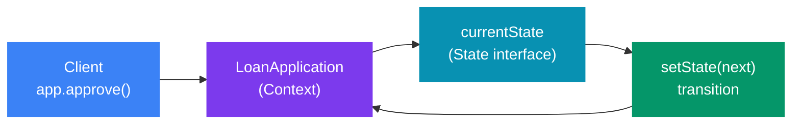
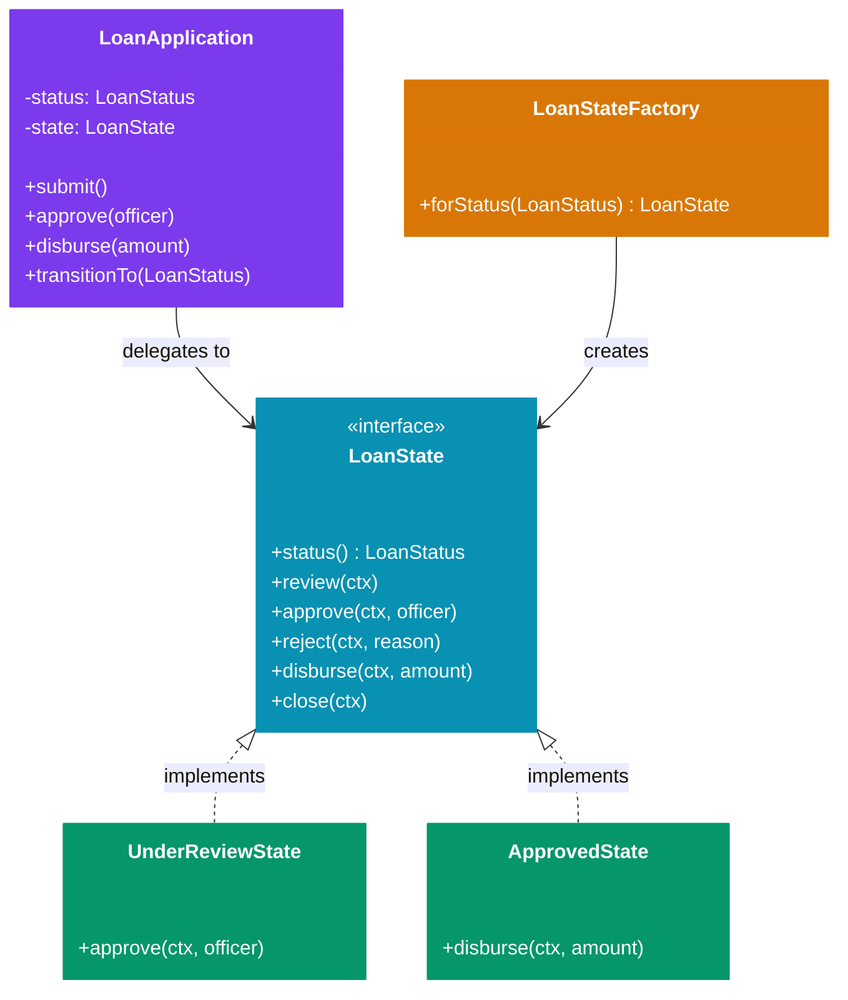
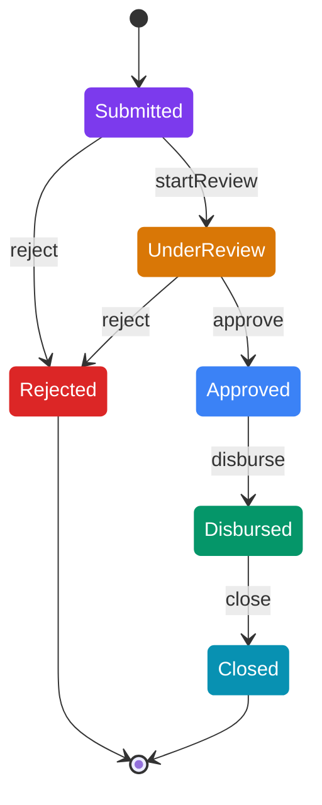
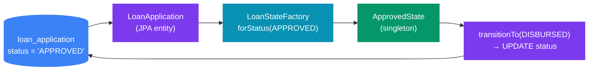
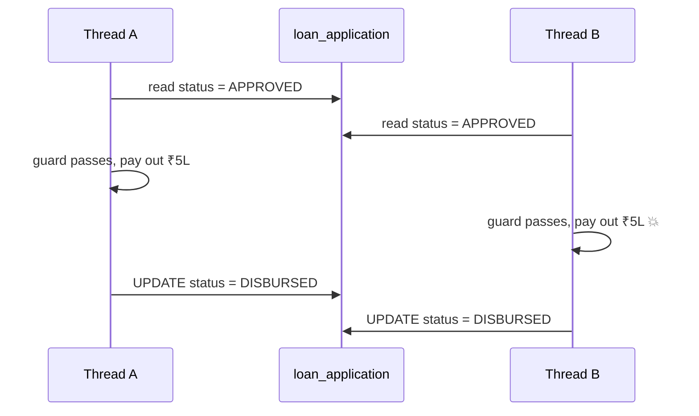
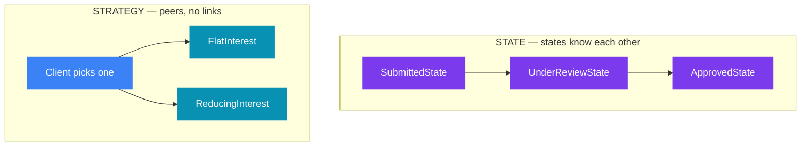
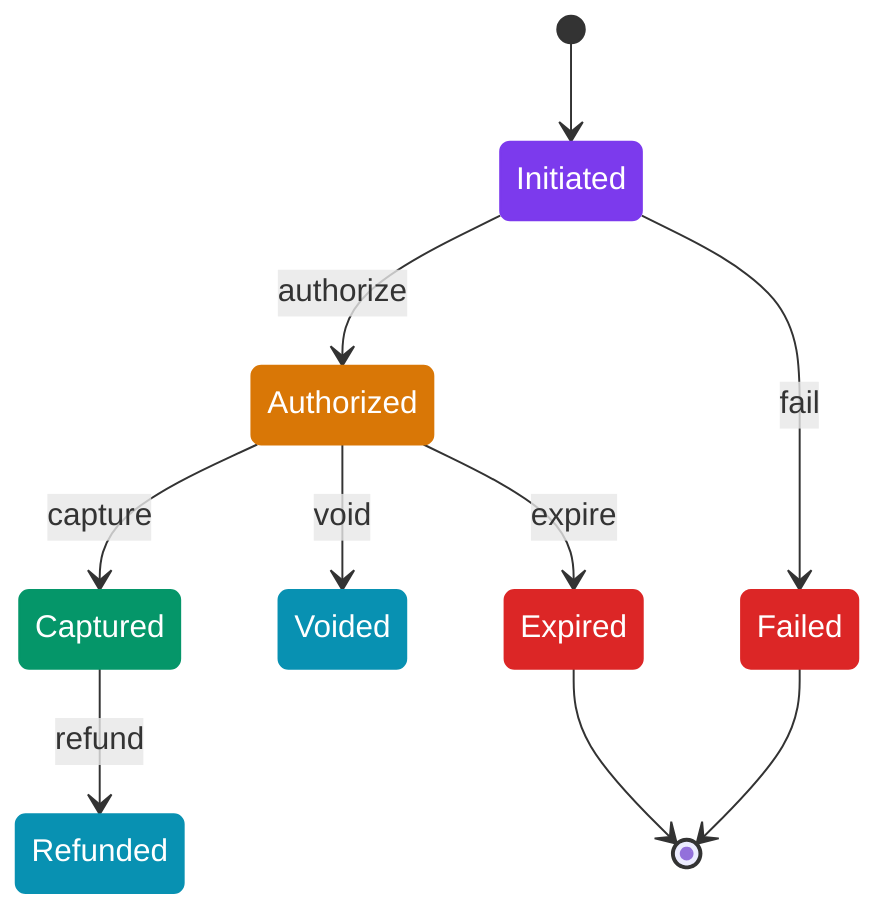

# State Design Pattern in Java

> 📖 **Master guide:** [LLD Interview Patterns Guide — §8 State](./01_LLD_Interview_Patterns_Guide.md#8-state-pattern) — this file is the depth companion.

**State Design Pattern in Java** | A behavioural pattern. It lets an object change its behaviour when its internal state changes. The object seems to change its class. This file goes beyond the textbook ATM example. It covers the parts interviewers really ask about: **persistence, concurrency, illegal transitions, and when an enum is the better answer**.

- [Introduction ⚡](#1-introduction)
- [Participants ⚡](#2-participants)
- [The Loan Application State Machine 🔥](#3-the-loan-application-state-machine)
- [Java Implementation — Built Up Step by Step 🔥🔥](#4-java-implementation--built-up-step-by-step)
- [State vs enum + switch 🔥🔥](#5-state-vs-enum--switch)
  - [5.1 The honest comparison 🔥🔥](#51-the-honest-comparison)
  - [5.2 The `switch`-expression version (do not dismiss it) 🔥](#52-the-switch-expression-version-do-not-dismiss-it)
  - [5.3 The middle ground — enum constants with abstract methods 💡 🔥🔥](#53-the-middle-ground--enum-constants-with-abstract-methods)
- [Persisting State — The Rehydration Problem 🔥🔥](#6-persisting-state--the-rehydration-problem)
  - [6.1 The entity 🔥](#61-the-entity)
  - [6.2 The factory — one instance per status 🔥](#62-the-factory--one-instance-per-status)
  - [6.3 Enforce the machine in the database too ⚡](#63-enforce-the-machine-in-the-database-too)
  - [6.4 The value in the column that isn't in your enum 🚨 🔥](#64-the-value-in-the-column-that-isnt-in-your-enum)
- [Concurrency — Guarding Transitions 🔥🔥](#7-concurrency--guarding-transitions)
  - [7.1 The lost-update bug 🔥](#71-the-lost-update-bug)
  - [7.2 Fix 1 — JPA optimistic locking with `@Version` ✅ 🔥🔥](#72-fix-1--jpa-optimistic-locking-with-version)
  - [7.3 Fix 2 — conditional UPDATE (compare-and-set at the DB) 🔥🔥](#73-fix-2--conditional-update-compare-and-set-at-the-db)
  - [7.4 Fix 3 — in-memory CAS (when there is no DB) ⚡](#74-fix-3--in-memory-cas-when-there-is-no-db)
  - [7.5 Fix 4 — pessimistic locking, and the transitions nobody calls 🔥](#75-fix-4--pessimistic-locking-and-the-transitions-nobody-calls)
  - [7.6 Choosing the mechanism 🔥🔥](#76-choosing-the-mechanism)
- [Illegal Transitions, Guards, and Entry/Exit Actions 🔥](#8-illegal-transitions-guards-and-entryexit-actions)
  - [8.1 The vocabulary — map it onto the pattern ⚡](#81-the-vocabulary--map-it-onto-the-pattern)
  - [8.2 Illegal transition — throw, ignore, or return a result? 🔥](#82-illegal-transition--throw-ignore-or-return-a-result)
  - [8.3 Entry/exit actions — centralize them in `transitionTo` 🔥](#83-entryexit-actions--centralize-them-in-transitionto)
  - [8.4 The outbox, concretely 🔥🔥](#84-the-outbox-concretely)
- [State vs Strategy 🔥🔥](#9-state-vs-strategy)
- [Spring Statemachine — and When NOT to Reach for It ⚡](#10-spring-statemachine--and-when-not-to-reach-for-it)
- [Testing State Machines ⚡](#11-testing-state-machines)
- [Production Use Cases 🔥](#12-production-use-cases)
  - [12.1 Payment / transaction lifecycle 🔥🔥](#121-payment--transaction-lifecycle)
  - [12.2 Other production machines you can name ⚡](#122-other-production-machines-you-can-name)
  - [12.3 Where it fits in a Spring Boot service 🔥](#123-where-it-fits-in-a-spring-boot-service)
  - [12.4 Connection to event sourcing 📎 ⚡](#124-connection-to-event-sourcing)
- [When NOT to Use State 🔥](#13-when-not-to-use-state)
- [Interview Q&A 🔥🔥](#14-interview-qa)

> 🔥🔥 Must-know — very frequently tested &nbsp;·&nbsp; 🔥 High priority &nbsp;·&nbsp; ⚡ Medium priority &nbsp;·&nbsp; 💤 Low priority

---

<a id="1-introduction"></a>
## 1. Introduction ⚡

Think of important business objects: a loan application, a payment, an order, a subscription, a support ticket. They are not just holders of data. They have a **lifecycle**. At any moment the object is in exactly one state. That state decides two things:

1. **Which operations are legal** (you can't disburse a loan that hasn't been approved)
2. **What each operation does** (`cancel()` on a `Submitted` application is a soft withdrawal; `cancel()` on a `Disbursed` loan is a foreclosure with interest reversal)

The State pattern models each state as its own class. All these classes implement a common interface. The **Context** delegates every operation to its current state object. The states themselves decide the next state.

🔑 **One-line summary:** "Each state is a class; the context delegates to it; the state decides what happens next."



**The problem it removes.** Without State, lifecycle logic turns into the same `switch`, repeated in every method:

```java
// ❌️ The anti-pattern State exists to kill — the same switch, five times over
public void approve() {
    switch (this.status) {
        case SUBMITTED   -> throw new IllegalStateException("must be under review first");
        case UNDER_REVIEW -> this.status = APPROVED;
        case APPROVED    -> { /* idempotent no-op? or error? nobody remembers */ }
        case DISBURSED   -> throw new IllegalStateException("already disbursed");
        case REJECTED    -> throw new IllegalStateException("rejected");
        case CLOSED      -> throw new IllegalStateException("closed");
    }
}

public void disburse() {
    switch (this.status) {   // <-- the same six branches again
        ...
    }
}
```

To add a `PENDING_DOCUMENTS` state, you must edit **every** switch in the class. If you miss one, you ship a bug. With State, you add one class. You change only the states that can transition into it. This is the **Open/Closed Principle** in its most direct form.

⚠️ **But read §5 before you use it.** For three states and two operations, that `switch` is *better* code. The pattern becomes worth it only above a certain size. A senior answer knows where that point is. A weak answer just names the pattern.

---

<a id="2-participants"></a>
## 2. Participants 💤

| Participant | Role | Loan example |
|---|---|---|
| **Context** | Holds the current state, exposes the public API, delegates every operation to the state | `LoanApplication` |
| **State** (interface) | Declares one method per operation whose behaviour varies by state | `LoanState` |
| **ConcreteState** | Implements the behaviour for exactly one state, and triggers transitions | `SubmittedState`, `UnderReviewState`, `ApprovedState`, … |
| **Client** | Calls the Context — never touches State objects directly | `LoanApplicationService` |
| **StateFactory** *(added by real systems)* | Rebuilds the right ConcreteState from a persisted enum/string | `LoanStateFactory` |



📌 **Two structural choices you must be able to defend:**

| Choice | Option A | Option B | Which to pick |
|---|---|---|---|
| **Where does the context reference live?** | State holds a field `private final LoanApplication ctx` (set in constructor) | State methods take `LoanApplication ctx` as a parameter | **B for persisted entities.** It makes states *stateless singletons*. So you can cache one instance per status. You do not create a new one on every rehydration (rebuilding the object from the DB) |
| **Who triggers the transition?** | The State calls `ctx.transitionTo(...)` | The State *returns* the next state and the Context applies it | **A** for readability. **B** when you want the Context to run entry/exit hooks and audit logging in one place (see §8.3) |

💡 The master guide's ATM example uses **option A/A** (stateful states that hold an `ATMMachine` reference). That is right for an in-memory device. For a DB-backed entity, production code uses **stateless states + parameter passing**. The code below builds that version.

---

<a id="3-the-loan-application-state-machine"></a>
## 3. The Loan Application State Machine 🔥



**The transition table.** Draw this first in an interview. Everything else comes from it: the code, the tests, the DB constraint.

| From \ Event | `startReview` | `approve` | `reject` | `disburse` | `close` |
|---|---|---|---|---|---|
| **Submitted** | → UnderReview | ❌️ | → Rejected | ❌️ | ❌️ |
| **UnderReview** | ❌️ | → Approved | → Rejected | ❌️ | ❌️ |
| **Approved** | ❌️ | ❌️ | ❌️ | → Disbursed | ❌️ |
| **Disbursed** | ❌️ | ❌️ | ❌️ | ❌️ | → Closed |
| **Rejected** *(terminal)* | ❌️ | ❌️ | ❌️ | ❌️ | ❌️ |
| **Closed** *(terminal)* | ❌️ | ❌️ | ❌️ | ❌️ | ❌️ |

💡 **Interview move:** say *"let me write the transition table first"* and fill in the grid. This helps you in three ways:

- The interviewer must commit to the requirements.
- It shows the terminal states.
- It becomes your test matrix in §11, word for word.

Some candidates jump straight to `interface LoanState`. They skip the design discussion. But the interviewer is really judging that discussion.

📌 **Guards vs transitions.** The table above shows *structural* legality. Some transitions also have a **guard** (a runtime condition). For example, `approve` is only legal if `creditScore >= 700 && kycVerified`. A structurally illegal transition throws. A failed guard is a *business* rejection. Keep them separate (§8).

---

<a id="4-java-implementation--built-up-step-by-step"></a>
## 4. Java Implementation — Built Up Step by Step 🔥🔥

1️⃣ **The status enum — the persisted vocabulary**

The enum is the value stored in the database column. It is a *label*. It does not hold the behaviour (not yet — see §5.3 for the middle ground).

```java
public enum LoanStatus {
    SUBMITTED,
    UNDER_REVIEW,
    APPROVED,
    DISBURSED,
    REJECTED,
    CLOSED;

    public boolean isTerminal() {
        return this == REJECTED || this == CLOSED;
    }
}
```

2️⃣ **The State interface — default methods reject everything**

This trick keeps concrete states very small. By default, every operation is "illegal in this state". A concrete state overrides *only* the operations it really allows.

```java
public interface LoanState {

    LoanStatus status();

    default void startReview(LoanApplication ctx) {
        throw illegal("startReview");
    }

    default void approve(LoanApplication ctx, String officerId) {
        throw illegal("approve");
    }

    default void reject(LoanApplication ctx, String reason) {
        throw illegal("reject");
    }

    default void disburse(LoanApplication ctx, BigDecimal amount) {
        throw illegal("disburse");
    }

    default void close(LoanApplication ctx) {
        throw illegal("close");
    }

    private IllegalStateTransitionException illegal(String event) {
        return new IllegalStateTransitionException(status(), event);
    }
}
```

✅ **Why this matters:** without defaults, every concrete state must implement all five methods. Then `RejectedState` becomes 40 lines of `throw`. With defaults, `RejectedState` has only one method: `status()`. The compiler still forces you to implement `status()`.

> ⚠️ `private` methods in interfaces require **Java 9+**. On Java 8, make `illegal` a `static` helper on the exception class instead.

3️⃣ **A typed exception carrying the failed transition**

```java
public class IllegalStateTransitionException extends RuntimeException {

    private final LoanStatus from;
    private final String event;

    public IllegalStateTransitionException(LoanStatus from, String event) {
        super("Cannot '%s' while loan is %s".formatted(event, from));
        this.from = from;
        this.event = event;
    }

    public LoanStatus getFrom() {
        return from;
    }

    public String getEvent() {
        return event;
    }
}
```

💡 The exception keeps `from` + `event` as fields, not just in a message string. So a `@ControllerAdvice` can map it to a clean `409 Conflict` with a machine-readable body. The client does not need a regex to parse your exception message.

4️⃣ **Concrete states — each one overrides only what it allows**

```java
public final class SubmittedState implements LoanState {

    @Override
    public LoanStatus status() {
        return LoanStatus.SUBMITTED;
    }

    @Override
    public void startReview(LoanApplication ctx) {
        ctx.assignReviewer();
        ctx.transitionTo(LoanStatus.UNDER_REVIEW);
    }

    @Override
    public void reject(LoanApplication ctx, String reason) {
        ctx.recordRejectionReason(reason);
        ctx.transitionTo(LoanStatus.REJECTED);
    }
    // approve / disburse / close inherit the throwing defaults ✅
}
```

```java
public final class UnderReviewState implements LoanState {

    private static final int MIN_CREDIT_SCORE = 700;

    @Override
    public LoanStatus status() {
        return LoanStatus.UNDER_REVIEW;
    }

    @Override
    public void approve(LoanApplication ctx, String officerId) {
        // 🛡️ Guard: a *business* rule, distinct from structural legality
        if (ctx.getCreditScore() < MIN_CREDIT_SCORE) {
            throw new GuardFailedException(
                    "approve", "creditScore >= " + MIN_CREDIT_SCORE);
        }
        if (!ctx.isKycVerified()) {
            throw new GuardFailedException("approve", "kycVerified == true");
        }
        ctx.recordApproval(officerId);
        ctx.transitionTo(LoanStatus.APPROVED);
    }

    @Override
    public void reject(LoanApplication ctx, String reason) {
        ctx.recordRejectionReason(reason);
        ctx.transitionTo(LoanStatus.REJECTED);
    }
}
```

```java
public final class ApprovedState implements LoanState {

    @Override
    public LoanStatus status() {
        return LoanStatus.APPROVED;
    }

    @Override
    public void disburse(LoanApplication ctx, BigDecimal amount) {
        if (amount.compareTo(ctx.getSanctionedAmount()) > 0) {
            throw new GuardFailedException(
                    "disburse", "amount <= sanctionedAmount");
        }
        ctx.recordDisbursement(amount);
        ctx.transitionTo(LoanStatus.DISBURSED);
    }
}
```

```java
public final class DisbursedState implements LoanState {

    @Override
    public LoanStatus status() {
        return LoanStatus.DISBURSED;
    }

    @Override
    public void close(LoanApplication ctx) {
        if (ctx.getOutstandingPrincipal().signum() != 0) {
            throw new GuardFailedException("close", "outstandingPrincipal == 0");
        }
        ctx.transitionTo(LoanStatus.CLOSED);
    }
}

// Terminal states — only status(), thanks to the throwing defaults ✅
public final class RejectedState implements LoanState {

    @Override
    public LoanStatus status() {
        return LoanStatus.REJECTED;
    }
}
// ClosedState is identical, returning LoanStatus.CLOSED
```

5️⃣ **The Context — delegates everything, owns the transition**

```java
public class LoanApplication {

    private String id;
    private LoanStatus status = LoanStatus.SUBMITTED;
    private int creditScore;
    private boolean kycVerified;
    private BigDecimal sanctionedAmount = BigDecimal.ZERO;
    private BigDecimal outstandingPrincipal = BigDecimal.ZERO;

    /** Not persisted — derived from `status` on every access. See §6. */
    private LoanState state() {
        return LoanStateFactory.forStatus(status);
    }

    // ---- public API: pure delegation, zero conditionals ----

    public void startReview() {
        state().startReview(this);
    }

    public void approve(String officerId) {
        state().approve(this, officerId);
    }

    public void reject(String reason) {
        state().reject(this, reason);
    }

    public void disburse(BigDecimal amount) {
        state().disburse(this, amount);
    }

    public void close() {
        state().close(this);
    }

    // ---- transition + callbacks used by states ----

    void transitionTo(LoanStatus next) {
        LoanStatus previous = this.status;
        this.status = next;
        DomainEvents.publish(new LoanStatusChanged(id, previous, next, Instant.now()));
    }

    void assignReviewer() { /* pick from the underwriting pool */ }

    void recordApproval(String officerId) { /* stamp approver + timestamp */ }

    void recordRejectionReason(String reason) { /* persist the reason */ }

    void recordDisbursement(BigDecimal amount) {
        this.outstandingPrincipal = amount;
    }

    // getStatus() / getCreditScore() / isKycVerified() /
    // getSanctionedAmount() / getOutstandingPrincipal() omitted
}
```

🏗️ **Notice what the Context does NOT contain:** not one `if (status == ...)`. That is the benefit. The five public methods are five one-liners. They never change again, no matter how many states you add.

6️⃣ **Client usage**

```java
LoanApplication app = new LoanApplication();   // SUBMITTED; assume score 750, KYC done, sanctioned 500000

app.startReview();                              // → UNDER_REVIEW
app.approve("officer-42");                      // → APPROVED (guards pass)
app.disburse(new BigDecimal("500000"));         // → DISBURSED

app.approve("officer-42");
// 💥 IllegalStateTransitionException: Cannot 'approve' while loan is DISBURSED
```

---

<a id="5-state-vs-enum--switch"></a>
## 5. State vs enum + switch 🔥🔥

This question shows the difference between strong and weak candidates. **Do not defend the pattern by habit.** An enum with a `switch` is often the *correct* answer. Saying so earns more credit than repeating the GoF book from memory.

<a id="51-the-honest-comparison"></a>
### 5.1 The honest comparison 🔥🔥

| Dimension | `enum` + `switch` | State pattern |
|---|---|---|
| **Lines of code for 3 states / 2 ops** | ~20 | ~50–60 (interface with throwing defaults + 3 tiny classes) |
| **Readability of the whole machine** | ✅ All transitions visible in one `switch` | ❌️ Scattered across N files — you must open every state to see the graph |
| **Adding a state** | Edit every `switch` (the compiler helps if you use exhaustive switch expressions) | Add one class; change only the states that move into it ✅ |
| **Different ops per state** | ❌️ Every op exists on the type; an illegal op fails only at runtime | ✅ Each state class lists only its allowed ops, so the rules are easy to read. An illegal op still fails at runtime, through the throwing default |
| **Per-state data** (e.g. `ApprovedState` needs a sanction letter ref) | ❌️ Fields pile onto the context | ✅ Lives on the state class |
| **Persistence** | ✅ Very easy — store the enum name | ⚠️ Needs a factory to rehydrate (§6) |
| **Testability** | Test the switch | ✅ Test each state class in isolation |
| **`switch` exhaustiveness** | ✅ **Java 14+** switch *expressions* over enums fail to compile on a missing case | n/a |

🎯 **The rule I'd state in an interview:**

> *"Use an enum and a switch when the state only decides **what value to move to next**. Move to the State pattern when each state allows a **different set of operations**. Also move when states carry their own data and behaviour. In practice, the point to change is about 4+ states × 3+ operations. Or change when you write the same `switch` a third time."*

<a id="52-the-switch-expression-version-do-not-dismiss-it"></a>
### 5.2 The `switch`-expression version (do not dismiss it) 🔥

The exhaustive switch expression (one that must cover every enum value) is really good:

- The compiler catches a forgotten state.
- You can see the whole machine in one look.

**Switch expressions and enum exhaustiveness are Java 14+** (JEP 361). *Sealed classes* came in Java 17. That is a different feature. Don't mix them up in the interview.

```java
public enum LoanStatus {
    SUBMITTED, UNDER_REVIEW, APPROVED, DISBURSED, REJECTED, CLOSED
}

public record Transition(LoanStatus from, String event) { }

public final class LoanTransitions {

    public static LoanStatus next(LoanStatus from, String event) {
        return switch (from) {
            case SUBMITTED -> switch (event) {
                case "startReview" -> LoanStatus.UNDER_REVIEW;
                case "reject"      -> LoanStatus.REJECTED;
                default -> throw new IllegalStateTransitionException(from, event);
            };
            case UNDER_REVIEW -> switch (event) {
                case "approve" -> LoanStatus.APPROVED;
                case "reject"  -> LoanStatus.REJECTED;
                default -> throw new IllegalStateTransitionException(from, event);
            };
            case APPROVED -> switch (event) {
                case "disburse" -> LoanStatus.DISBURSED;
                default -> throw new IllegalStateTransitionException(from, event);
            };
            case DISBURSED -> switch (event) {
                case "close" -> LoanStatus.CLOSED;
                default -> throw new IllegalStateTransitionException(from, event);
            };
            case REJECTED, CLOSED ->
                    throw new IllegalStateTransitionException(from, event);
        };
    }
}
```

✅ **When this is better:**

- The transition graph is the *only* thing that changes.
- The actions are the same for every state.
- You want to review the whole machine on one screen.

A `Map<Transition, LoanStatus>` table is an equally good variant. §11's parameterized test uses this table.

❌️ **When it is worse:** say `approve` needs to run *different side effects* per source state. Or `ApprovedState` needs its own fields. Then this switch needs a second level of branching and becomes hard to maintain.

<a id="53-the-middle-ground--enum-constants-with-abstract-methods"></a>
### 5.3 The middle ground — enum constants with abstract methods 💡 🔥🔥

Java enums can declare **abstract methods**, and then each constant must implement them. The code below uses a softer form: a throwing default method that only some constants override. This gives you *polymorphism per state* with *zero rehydration cost*. Rehydration means rebuilding the state object after loading from the DB. Here there is no work to do. The reason: the enum constant **is** the state object. For persisted lifecycles, this often gives you the benefits of both approaches.

```java
public enum LoanStatus {

    SUBMITTED {
        @Override
        public LoanStatus startReview(LoanApplication ctx) {
            ctx.assignReviewer();
            return UNDER_REVIEW;
        }

        @Override
        public LoanStatus reject(LoanApplication ctx, String reason) {
            ctx.recordRejectionReason(reason);
            return REJECTED;
        }
    },

    UNDER_REVIEW {
        @Override
        public LoanStatus approve(LoanApplication ctx, String officerId) {
            if (ctx.getCreditScore() < 700) {
                throw new GuardFailedException("approve", "creditScore >= 700");
            }
            ctx.recordApproval(officerId);
            return APPROVED;
        }

        @Override
        public LoanStatus reject(LoanApplication ctx, String reason) {
            ctx.recordRejectionReason(reason);
            return REJECTED;
        }
    },

    APPROVED {
        @Override
        public LoanStatus disburse(LoanApplication ctx, BigDecimal amount) {
            ctx.recordDisbursement(amount);
            return DISBURSED;
        }
    },

    DISBURSED {
        @Override
        public LoanStatus close(LoanApplication ctx) {
            return CLOSED;
        }
    },

    REJECTED,
    CLOSED;

    // Defaults: illegal unless the constant overrides
    public LoanStatus approve(LoanApplication ctx, String officerId) {
        throw new IllegalStateTransitionException(this, "approve");
    }

    public LoanStatus disburse(LoanApplication ctx, BigDecimal amount) {
        throw new IllegalStateTransitionException(this, "disburse");
    }
    // startReview / reject / close follow the same throwing shape
}
```

```java
// Context becomes trivial — no factory, no rehydration
public void approve(String officerId) {
    this.status = this.status.approve(this, officerId);
}
```

| ✅ Wins | ⚠️ Costs |
|---|---|
| The persisted value **is** the behaviour — no factory, no rehydration mismatch | One giant file; a 12-state machine becomes 400 lines in one enum |
| Constants are singletons — stateless by design, and thread-safe 🔒 | Enum constants can't take constructor-injected Spring beans |
| `values()` gives you the full state list for free (very useful for tests) | Can't add states at runtime or from a plugin/config |
| `EnumMap`/`EnumSet` for transition tables are fast and compact | You can't swap one state for a test double: constants name each other directly (`return APPROVED`). Mockito 5 can mock the enum type, but the mock equals no constant |

⚠️ **The cost nobody mentions: a constant with a body is an anonymous subclass.**

- `LoanStatus.SUBMITTED.getClass()` returns `LoanStatus$1`, **not** `LoanStatus`.
- Use `getDeclaringClass()` when you need the enum type.
- `EnumMap`/`EnumSet`/`valueOf`/`name()` all work fine.
- But some code can break on it. Examples: code that dispatches on `getClass()`, or a JSON/mapping library that resolves the runtime class.

It is better to learn this now than to find it in production.

🎯 **My default recommendation:**

- Enum-with-abstract-methods for a persisted 4–8 state lifecycle with no DI needs.
- Full State classes when states need injected collaborators (a `CreditBureauClient` inside `UnderReviewState`).
- Full State classes also when the machine has more than ~8 states.

📌 **§5.3 and §6 are alternatives, not layers on top of each other. Say clearly which one you pick.**

- §5.3's main benefit is that there *is* no rehydration step. The persisted value **is** the behaviour, so the factory in §6.2 is not needed.
- §6 is for the other case: states as separate objects that need collaborators. That need forces a factory and a `@Transient` derived field.
- Everything else in §6 applies to **both**: the column is the source of truth, `EnumType.STRING`, the DB-level guard, and unknown persisted values.

The one-line rule: *§5.3 when the machine needs nothing from outside, §6 when states need injected collaborators.*

---

<a id="6-persisting-state--the-rehydration-problem"></a>
## 6. Persisting State — The Rehydration Problem 🔥

**This section matters most for backend interviews. The textbook never covers it.**

In any real system:

- the process restarts,
- the object is not in memory,
- and there are ten instances of the service.

So the truth is not the `LoanState` object. The truth is a **column in the database**.



🔑 **The rule:** *the State object is derived, never stored.* You persist the **enum**. You rebuild the **State object** from it on every load. If you try to serialize a `LoanState` into a column, you have inverted the dependency.

<a id="61-the-entity"></a>
### 6.1 The entity 🔥

This is the §4 POJO turned into a JPA entity. It has the same public API (`startReview` / `approve` / `disburse` / `close` delegating to `currentState()`). It also adds the persistence parts below. §7 uses this class, so it has the extra fields §7 needs.

```java
@Entity
@Table(name = "loan_application")
public class LoanApplication {

    @Id
    @GeneratedValue(strategy = GenerationType.UUID)
    private UUID id;

    /**
     * 🔑 The source of truth. STRING, never ORDINAL — reordering the enum
     * would silently remap every existing row with ORDINAL.
     */
    @Enumerated(EnumType.STRING)
    @Column(name = "status", nullable = false, length = 32)
    private LoanStatus status = LoanStatus.SUBMITTED;

    @Version
    @Column(name = "version", nullable = false)
    private long version;          // optimistic lock — see §7

    @Column(name = "credit_score")
    private int creditScore;

    @Column(name = "kyc_verified", nullable = false)
    private boolean kycVerified;

    /** The account money is credited to on disbursement — used in §7.2. */
    @Column(name = "customer_account_id", nullable = false, length = 32)
    private String customerAccountId;

    @Column(name = "sanctioned_amount", precision = 19, scale = 2)
    private BigDecimal sanctionedAmount = BigDecimal.ZERO;

    @Column(name = "outstanding_principal", precision = 19, scale = 2)
    private BigDecimal outstandingPrincipal = BigDecimal.ZERO;

    /**
     * ⚠️ NOT a column. @Transient so JPA ignores it entirely.
     * Derived from `status` on every call — see currentState().
     */
    @Transient
    private LoanState cachedState;

    LoanState currentState() {
        if (cachedState == null || cachedState.status() != status) {
            cachedState = LoanStateFactory.forStatus(status);   // rehydrate
        }
        return cachedState;
    }

    void transitionTo(LoanStatus next) {
        this.status = next;
        this.cachedState = null;    // 🔑 invalidate — the next call rebuilds it
    }

    // Public API — startReview() / approve() / disburse() / close() delegate to
    // currentState(), exactly as in §4. Getters omitted.
}
```

⚠️ **The bug this design prevents.** Say you cache the `LoanState` in a field and forget to invalidate it on transition. Then the entity's behaviour and its persisted status stop matching. The row says `DISBURSED`, but the in-memory object still delegates to `ApprovedState`. Two fixes:

- Invalidate on write (as above).
- Or don't cache at all: `return LoanStateFactory.forStatus(status);` on every call. The factory returns singletons, so this costs nothing.

⚠️ **JPA field-vs-property access.** Say your entity uses property access (`@Id` on the getter). Then Hibernate calls getters during flush. A getter that lazily rebuilds and *assigns* to a field can confuse dirty-checking (Hibernate's check for changed fields). So the method is **not** named `getState()`, and this is on purpose. It is `currentState()`, so Hibernate never treats it as a property.

<a id="62-the-factory--one-instance-per-status"></a>
### 6.2 The factory — one instance per status 🔥

```java
public final class LoanStateFactory {

    // 🔒 States are stateless → safe to share as immutable singletons
    private static final Map<LoanStatus, LoanState> STATES =
            new EnumMap<>(Map.of(
                    LoanStatus.SUBMITTED,    new SubmittedState(),
                    LoanStatus.UNDER_REVIEW, new UnderReviewState(),
                    LoanStatus.APPROVED,     new ApprovedState(),
                    LoanStatus.DISBURSED,    new DisbursedState(),
                    LoanStatus.REJECTED,     new RejectedState(),
                    LoanStatus.CLOSED,       new ClosedState()
            ));

    private LoanStateFactory() {
    }

    public static LoanState forStatus(LoanStatus status) {
        LoanState state = STATES.get(status);
        if (state == null) {
            // 🚨 Someone added an enum constant and forgot the handler —
            // fail loudly, do not silently fall back to a default state.
            throw new IllegalStateException("No LoanState registered for " + status);
        }
        return state;
    }
}
```

⚠️ **Be exact about what that null check really catches.** `STATES` is filled with all six constants. So `state == null` can never happen *until someone adds a constant to `LoanStatus` and forgets a handler*. It guards against a future code change, **not** against bad data. A DB value that isn't in the enum at all never reaches this method (§6.4).

💡 **Spring-managed variant.** You need it as soon as a state has injected collaborators (e.g. `UnderReviewState` calling a credit bureau client):

```java
@Component
public class SpringLoanStateFactory {

    private final Map<LoanStatus, LoanState> states;

    public SpringLoanStateFactory(List<LoanState> allStates) {
        this.states = allStates.stream()
                .collect(Collectors.toMap(LoanState::status, Function.identity(),
                        (a, b) -> {
                            throw new IllegalStateException(
                                    "Duplicate LoanState for " + a.status());
                        },
                        () -> new EnumMap<>(LoanStatus.class)));
    }

    @PostConstruct
    void assertExhaustive() {
        // ✅ Fail at startup, not at 2 AM on a production transition
        for (LoanStatus s : LoanStatus.values()) {
            if (!states.containsKey(s)) {
                throw new IllegalStateException("Missing LoanState bean for " + s);
            }
        }
    }

    public LoanState forStatus(LoanStatus status) {
        return states.get(status);
    }
}
```

🎯 Mention that `@PostConstruct` exhaustiveness check in an interview. The enum-`switch` version gives you one thing for free: compile-time completeness. This check gets that back, but at startup time instead.

⚠️ **Once you do this, the machine has to move out of the entity.**

- Hibernate creates a JPA entity, not Spring. So the entity cannot reach `SpringLoanStateFactory`.
- That is why §6.1's `currentState()` calls the **static** factory.
- Once states become beans, the `@Transient cachedState` design stops working.
- The state machine then moves into a domain service:

```java
@Service
public class LoanStateMachine {

    private final SpringLoanStateFactory factory;

    public LoanStateMachine(SpringLoanStateFactory factory) {
        this.factory = factory;
    }

    public void approve(LoanApplication loan, String officerId) {
        factory.forStatus(loan.getStatus()).approve(loan, officerId);
    }
}
```

Name this trade-off in the interview. It is a real one: **rich domain model vs. injectable states.**

- A static factory keeps the behaviour on the entity, but blocks DI.
- A bean per state gives you DI. But the entity becomes anaemic on state: it has no state behaviour.

I'd use the static factory by default. I'd move the machine out only when a state really needs a collaborator.

<a id="63-enforce-the-machine-in-the-database-too"></a>
### 6.3 Enforce the machine in the database too ⚡

Application-level guards are not enough when other code writes the same table. For example: a data-fix script, a second service, or a batch job.

```sql
-- 1. Constrain the vocabulary
ALTER TABLE loan_application
  ADD CONSTRAINT chk_status
  CHECK (status IN ('SUBMITTED','UNDER_REVIEW','APPROVED',
                    'DISBURSED','REJECTED','CLOSED'));

-- 2. Make the transition itself atomic and conditional (see §7)
UPDATE loan_application
   SET status = 'DISBURSED'
 WHERE id = :id
   AND status = 'APPROVED';     -- 🔑 the guard IS the WHERE clause
```

📎 **Audit table = the transition log.** Every transition writes one immutable row:

```sql
CREATE TABLE loan_status_history (
    id            BIGSERIAL PRIMARY KEY,
    loan_id       UUID        NOT NULL,
    from_status   VARCHAR(32),
    to_status     VARCHAR(32) NOT NULL,
    event         VARCHAR(64) NOT NULL,
    actor_id      VARCHAR(64),
    occurred_at   TIMESTAMPTZ NOT NULL DEFAULT now()
);
```

In regulated lending, this table is a compliance requirement, not an optional extra. An auditor asks *"who moved this loan to APPROVED and when"*. The answer must be a row, not a log line. It is also the link to event sourcing (§12.4).

⚠️ **Check the SQL dialect before you claim "the DB enforces it too".**

- `BIGSERIAL` and `TIMESTAMPTZ` above are Postgres. On MySQL they're `BIGINT AUTO_INCREMENT` and `TIMESTAMP`.
- More important: **MySQL parsed but silently ignored `CHECK` constraints until 8.0.16**. On an older MySQL, that constraint does nothing.
- If the stack is MySQL, confirm the version. Or use an `ENUM` column / a lookup table with an FK instead.

Knowing that one version limit is a good signal to the interviewer. Claiming a `CHECK` constraint that isn't enforced is a bad one.

<a id="64-the-value-in-the-column-that-isnt-in-your-enum"></a>
### 6.4 The value in the column that isn't in your enum 🚨 🔥

The `CHECK` constraint above is the **preventive** half. The **detective** half covers this case: a row already holds `'PENDING_DOCS'`, and your enum has no such constant. The value may come from an older version of the service, another service, or a data-fix script.

With `@Enumerated(EnumType.STRING)`, Hibernate fails **during result-set hydration** (while it turns DB rows into objects):

```
java.lang.IllegalArgumentException: No enum constant com.example.LoanStatus.PENDING_DOCS
```

Hibernate 6 throws this raw, from `Enum.valueOf`. Through a Spring Data repository, you catch it wrapped in `InvalidDataAccessApiUsageException`, because Spring translates `IllegalArgumentException` to that type.

🔑 **Why this is worse than it looks:** it fails the whole `findById` / page query, not just that one field. So a single bad row can break a dashboard listing 50 loans. And `LoanStateFactory.forStatus` can never catch it, because the code never reaches it.

There are two ways to reduce the damage. Name both:

1️⃣ **Fail softly with an `AttributeConverter`.** Map any unknown value to an explicit `UNKNOWN` constant instead of throwing. Put `@Convert(converter = LoanStatusConverter.class)` on the field and remove `@Enumerated`. JPA says not to use both on one field:

```java
@Converter(autoApply = false)
public class LoanStatusConverter implements AttributeConverter<LoanStatus, String> {

    private static final Logger log = LoggerFactory.getLogger(LoanStatusConverter.class);

    @Override
    public String convertToDatabaseColumn(LoanStatus attribute) {
        if (attribute == null || attribute == LoanStatus.UNKNOWN) {
            // 🔑 never write UNKNOWN back — it is a read-side sentinel only
            throw new IllegalStateException("Refusing to persist " + attribute);
        }
        return attribute.name();
    }

    @Override
    public LoanStatus convertToEntityAttribute(String dbValue) {
        if (dbValue == null) {
            return null;
        }
        try {
            return LoanStatus.valueOf(dbValue);
        } catch (IllegalArgumentException e) {
            log.error("Unmapped loan status in DB: {}", dbValue);   // 🚨 alert on this
            return LoanStatus.UNKNOWN;
        }
    }
}
```

`UNKNOWN` then behaves like a terminal state. It overrides nothing, so **every** event throws `IllegalStateTransitionException`. With the §6.2 factory, you must also register an `UnknownState` that overrides nothing. If you don't, `forStatus` throws `IllegalStateException`, and the Spring factory's `@PostConstruct` check fails at startup.

- You can still read the row and show it in reports.
- You just can't transition it until someone fixes the data.

That is exactly the trade-off you want: only one row is limited, not the whole query.

2️⃣ **Treat the enum as append-only.** Never delete a constant. Only stop transitioning into it.

- Deleting an enum constant looks like a code change. But it is really a **breaking schema change**, because old rows still hold the old string.
- To rename: run a Flyway `UPDATE`, then change the constant, in that order. Never do one without the other.

💡 **The interview line:** *"`@Enumerated(EnumType.STRING)` gives you a hard failure on unknown data. That failure happens in the query, not in your state machine. Sometimes another service or a data-fix script can write the column. Then I'd put an `AttributeConverter` in front of it. It maps unknown values to an `UNKNOWN` terminal state and raises an alert. So one bad row affects one loan instead of one endpoint."*

---

<a id="7-concurrency--guarding-transitions"></a>
## 7. Concurrency — Guarding Transitions 🔥🔥

Two requests call `disburse()` for the same loan at the same millisecond. They run on two pods. What happens?

<a id="71-the-lost-update-bug"></a>
### 7.1 The lost-update bug 🔥

```java
// ❌️ BROKEN under concurrency
public void disburse(BigDecimal amount) {
    if (this.status == LoanStatus.APPROVED) {   // (1) both threads read APPROVED
        ledger.credit(customerAccount, amount); // (2) both threads pay out 💸
        this.status = LoanStatus.DISBURSED;     // (3) both threads write DISBURSED
    }
}
```

The check and the write are **not atomic**. Both threads pass the check before either one writes.



<a id="72-fix-1--jpa-optimistic-locking-with-version"></a>
### 7.2 Fix 1 — JPA optimistic locking with `@Version` ✅ 🔥🔥

The `@Version` column makes the UPDATE conditional. The UPDATE works only if the row has not changed since you read it.

```java
@Service
public class LoanDisbursementService {

    private final LoanApplicationRepository repository;
    private final LedgerService ledger;

    public LoanDisbursementService(LoanApplicationRepository repository,
                                   LedgerService ledger) {
        this.repository = repository;
        this.ledger = ledger;
    }

    @Transactional
    public void disburse(UUID loanId, BigDecimal amount) {
        LoanApplication loan = repository.findById(loanId)
                .orElseThrow(() -> new LoanNotFoundException(loanId));

        loan.disburse(amount);          // state machine validates + transitions
        ledger.credit(loan.getCustomerAccountId(), amount);
        // On flush/commit Hibernate issues:
        //   UPDATE loan_application SET status=?, version=?   (new value, e.g. 4)
        //    WHERE id=? AND version=?
        // 0 rows affected → the loser's transaction rolls back ✅
    }
}
```

The statement that Hibernate generates is the important part:

```sql
UPDATE loan_application
   SET status = 'DISBURSED', version = 4
 WHERE id = :id AND version = 3;   -- loser matches 0 rows → version conflict
```

📌 **Name the exception correctly. Many people get this wrong.** The failure shows up at **flush/commit**, not at the `repository.findById`/`save` call. It comes through three layers:

| Layer | Type |
|---|---|
| Hibernate | `org.hibernate.StaleObjectStateException` |
| JPA | `jakarta.persistence.OptimisticLockException` |
| **Spring — what you actually catch** | `org.springframework.orm.ObjectOptimisticLockingFailureException` (a subclass of `OptimisticLockingFailureException`). `JpaOptimisticLockingFailureException` shows up mainly with other JPA providers |

The exception fires at commit. So the **transaction manager** (`JpaTransactionManager.doCommit`) translates it, not repository exception translation.

- A `try/catch` around `repository.save(...)` inside the same `@Transactional` method **will not see it**.
- The catch has to be outside the transaction boundary.
- This is why the retry below sits on a separate bean.

⚠️ **The ledger-credit ordering trap.** In the snippet above, the ledger credit happens *before* the version check fires at commit.

- If `ledger.credit()` is a **local DB write in the same transaction**, the rollback undoes it. This is safe.
- If it is a **remote call to a payment rail**, the money has already moved. The rollback cannot get it back.
- For remote side effects: transition first, then commit. After that, publish an event or call the rail asynchronously with an idempotency key (outbox pattern).

Say this clearly in the interview. A payments interviewer asks exactly this follow-up.

Here is the retry policy for the loser. Note that it lives on a **different bean**, with no `@Transactional` of its own:

```java
@Service
public class LoanDisbursementRetryFacade {

    private final LoanDisbursementService service;   // 🔑 separate bean, not `this`

    public LoanDisbursementRetryFacade(LoanDisbursementService service) {
        this.service = service;
    }

    @Retryable(retryFor = OptimisticLockingFailureException.class,
               maxAttempts = 3,
               backoff = @Backoff(delay = 50, multiplier = 2))
    public void disburseWithRetry(UUID loanId, BigDecimal amount) {
        service.disburse(loanId, amount);   // proxied → real transaction per attempt
    }
}
```

⚠️ **An interviewer will ask about two things here. Say them before they ask:**

- **Self-invocation.** Suppose `disburseWithRetry` called a `@Transactional` method *in the same class*. The call would go through `this`, and the transaction proxy would never run. The retried call sits on another bean, so each attempt is a real transaction.
- **Advice ordering.** Retry must sit **outside** the transaction. If it sits inside:
  - every attempt reuses a transaction that is already marked rollback-only.
  - the reload returns the same stale entity from the same persistence context.

  Spring gets this right by default (`@EnableRetry` registers at `LOWEST_PRECEDENCE - 1`, `@EnableTransactionManagement` at `LOWEST_PRECEDENCE`). This default matters only when `@Retryable` and `@Transactional` sit on the same method. The facade above does not depend on it, because the two annotations sit on different beans. *Each attempt must get a fresh transaction and a fresh persistence context.* If not, the retry is guaranteed to fail the same way.

💡 Retrying is right for *contention*. That means two ops that can both succeed in the end, e.g. two independent field updates.

Retrying is **wrong** for a real duplicate:

- On retry, the reloaded loan is now `DISBURSED`.
- So the state machine throws `IllegalStateTransitionException`.
- This correctly ends the attempt.

The state machine is what makes the retry safe.

<a id="73-fix-2--conditional-update-compare-and-set-at-the-db"></a>
### 7.3 Fix 2 — conditional UPDATE (compare-and-set at the DB) 🔥🔥

Move the guard into the `WHERE` clause. It is one statement, so it is atomic by definition. The transition itself needs no version column.

```java
public interface LoanApplicationRepository extends JpaRepository<LoanApplication, UUID> {

    @Modifying(clearAutomatically = true, flushAutomatically = true)
    @Query("""
           UPDATE LoanApplication l
              SET l.status  = :to,
                  l.version = l.version + 1
            WHERE l.id = :id
              AND l.status = :from
           """)
    int compareAndSetStatus(@Param("id") UUID id,
                            @Param("from") LoanStatus from,
                            @Param("to") LoanStatus to);
}
```

🚨 **That `l.version = l.version + 1` is not optional if the entity has a `@Version` column.** A JPA **bulk update bypasses optimistic locking entirely**. The JPA spec says this clearly:

- A bulk update maps straight to a database `UPDATE`.
- "portable applications must manually update the value of the version column, if desired."

What goes wrong without the manual bump:

1. A concurrent request loaded the loan at `version = 3`.
2. Your CAS commits. The request still holds `version = 3`.
3. Later it flushes *any other field*. That flush succeeds, even though the row's status has already moved.

So a side path breaks the state machine's guarantee.

> 💡 The Hibernate HQL alternative is `UPDATE VERSIONED LoanApplication l SET ...`. It bumps the version for you. Either way is fine. **Doing neither, without noticing, is the bug.**

```java
@Transactional
public void disburse(UUID loanId, BigDecimal amount) {
    int updated = repository.compareAndSetStatus(
            loanId, LoanStatus.APPROVED, LoanStatus.DISBURSED);

    if (updated == 0) {
        // Either the loan wasn't APPROVED, or another thread won the race.
        throw new ConcurrentTransitionException(loanId, LoanStatus.APPROVED);
    }
    // 🔑 Only the winner reaches here — exactly one disbursement
    LoanApplication loan = repository.findById(loanId).orElseThrow();
    ledger.credit(loan.getCustomerAccountId(), amount);
}
```

🔑 **`updated == 1` is the lock.** This is a `compareAndSet(expected, new)` written in SQL. It is the single most useful concurrency pattern for state machines.

<a id="74-fix-3--in-memory-cas-when-there-is-no-db"></a>
### 7.4 Fix 3 — in-memory CAS (when there is no DB) ⚡

Some machines live only inside the JVM: a circuit breaker, a connection pool entry, a game session. For them, use the same idea with `AtomicReference`:

```java
public class CircuitBreakerContext {

    private final AtomicReference<BreakerState> state =
            new AtomicReference<>(ClosedBreakerState.INSTANCE);

    /** Returns true only for the thread that actually performed the transition. */
    public boolean transition(BreakerState expected, BreakerState next) {
        boolean won = state.compareAndSet(expected, next);
        if (won) {
            log.info("Breaker {} -> {}", expected.name(), next.name());
        }
        return won;
    }

    public void recordFailure() {
        BreakerState current = state.get();
        if (current.shouldTrip() && transition(current, OpenBreakerState.INSTANCE)) {
            scheduleHalfOpenProbe();     // 🔑 runs exactly once, on the winner
        }
    }
}
```

<a id="75-fix-4--pessimistic-locking-and-the-transitions-nobody-calls"></a>
### 7.5 Fix 4 — pessimistic locking, and the transitions nobody calls 🔥

Optimistic locking and CAS both assume that *somebody is calling your API*. Two cases break that assumption.

**Pessimistic lock — when the critical section spans several statements.** `@Lock` on a Spring Data query method emits `SELECT … FOR UPDATE`. So the row stays locked for the rest of the transaction:

```java
public interface LoanApplicationRepository extends JpaRepository<LoanApplication, UUID> {

    @Lock(LockModeType.PESSIMISTIC_WRITE)
    @Query("SELECT l FROM LoanApplication l WHERE l.id = :id")
    Optional<LoanApplication> findByIdForUpdate(@Param("id") UUID id);
}
```

Under `REPEATABLE READ`, a plain `SELECT` reads a consistent snapshot. It would let two transactions both see `APPROVED`.

In MySQL InnoDB, `FOR UPDATE` takes a **current read** (it reads the latest committed row, not the snapshot) plus an exclusive row lock. So the second transaction blocks at the `SELECT`, instead of failing at commit. (PostgreSQL `REPEATABLE READ` is different. The second transaction also blocks. But when the first one commits its change, the second fails with a serialization error.)

The cost: you hold the lock for the whole transaction.

- Never make a remote call while you hold one.
- Always acquire locks in the same order. If not, you will deadlock.

**Time-triggered transitions.** Examples: "An approval expires after 30 days", "an auth hold expires". Nothing calls your API for these, so a sweep (a scheduled job) has to do it.

`FOR UPDATE SKIP LOCKED` makes the sweep safe with N pods. Each pod takes a disjoint (non-overlapping) batch. The pods do not fight over the same rows.

```java
public interface LoanApplicationRepository extends JpaRepository<LoanApplication, UUID> {

    @Query(value = """
           SELECT * FROM loan_application
            WHERE status = 'APPROVED'
              AND approved_at < :cutoff
            ORDER BY approved_at
            LIMIT :batchSize
              FOR UPDATE SKIP LOCKED
           """, nativeQuery = true)
    List<LoanApplication> claimExpiredApprovals(@Param("cutoff") Instant cutoff,
                                                @Param("batchSize") int batchSize);
}
```

```java
@Scheduled(fixedDelay = 60_000)
@Transactional
public void expireStaleApprovals() {
    Instant cutoff = Instant.now().minus(30, ChronoUnit.DAYS);
    for (LoanApplication loan : repository.claimExpiredApprovals(cutoff, 200)) {
        loan.expire();   // 🔑 same state machine — a timer is just another event
    }
}
```

🎯 **The point to say in the interview:** *a timer is not a special mechanism. It is just another event on the transition table* — `APPROVED --expire--> EXPIRED`.

Two things are special:

- **who fires it**
- **how you stop ten pods from firing it ten times**

The answer is `SKIP LOCKED`. For an in-memory machine, use a delay queue / `ScheduledExecutorService` instead. Resilience4j does this for half-open probes when `automaticTransitionFromOpenToHalfOpenEnabled` is on. By default it moves to half-open lazily, on the first call after the wait time.

<a id="76-choosing-the-mechanism"></a>
### 7.6 Choosing the mechanism 🔥🔥

| Mechanism | Use when | Cost |
|---|---|---|
| **`@Version` optimistic lock** | Contention is rare; you already load the entity and update several fields | A retry on conflict; needs a version column |
| **Conditional `UPDATE ... WHERE status = ?`** | The transition is the *only* change; you want one round trip | Bypasses the persistence context (`clearAutomatically`) **and optimistic locking** — bump `version` yourself (§7.3) |
| **`SELECT ... FOR UPDATE`** (pessimistic) | Contention is high and retries waste work; long critical section; batch sweeps with `SKIP LOCKED` | Holds a row lock — deadlock risk, throughput hit |
| **`AtomicReference.compareAndSet`** | Purely in-memory machine, single JVM | None, but doesn't survive restart or scale out |
| **Distributed lock (Redis/ZooKeeper)** | The critical section spans multiple resources you can't put in one transaction | Complexity, lock expiry / fencing-token problems |

🎯 **Default answer:** *"Conditional UPDATE for the transition itself. `@Version` for everything else on the row. And the conditional UPDATE has to bump the version column by hand, because a JPA bulk update doesn't."*

- That last part turns an answer into the *correct* answer.
- Do not use a distributed lock when a `WHERE status = 'APPROVED'` is enough. That is over-engineering, and interviewers notice it.

---

<a id="8-illegal-transitions-guards-and-entryexit-actions"></a>
## 8. Illegal Transitions, Guards, and Entry/Exit Actions 🔥

<a id="81-the-vocabulary--map-it-onto-the-pattern"></a>
### 8.1 The vocabulary — map it onto the pattern ⚡

Interviewers who have built state machines use exact words. Use the same words.

| Term | Meaning | Where it lives in the pattern |
|---|---|---|
| **Event** (trigger) | The thing that happened — `approve`, `disburse` | A method on the `State` interface |
| **Guard** | A boolean condition that must hold for the transition to fire — `creditScore >= 700` | An `if` at the top of the state's method |
| **Action** (effect) | Side effect that runs *during* the transition — write the audit row, publish an event | Inside the state's method, or in `transitionTo` |
| **Transition** | `(source, event, guard) → target` | The state's method body |
| **Entry action** | Runs whenever a state is *entered*, no matter which transition got there | Hook in `Context.transitionTo` |
| **Exit action** | Runs whenever a state is *left* | Hook in `Context.transitionTo` |
| **Terminal state** | No outgoing transitions | A state that overrides nothing |

<a id="82-illegal-transition--throw-ignore-or-return-a-result"></a>
### 8.2 Illegal transition — throw, ignore, or return a result? 🔥

| Strategy | Code | Use when | Danger |
|---|---|---|---|
| **Throw** ✅ default | `throw new IllegalStateTransitionException(...)` | Money, compliance, anything where a silent no-op hides a bug | Noisy if the event stream has valid duplicates |
| **Ignore (no-op)** | `default void approve(ctx) { }` | The event is truly idempotent — `close()` on an already-closed loan | Hides real bugs; you lose the signal |
| **Return a result object** | `TransitionResult.rejected(from, event, reason)` | Bulk/batch processing where one bad record must not abort 10,000 good ones; also better for public APIs | More verbose; callers can ignore the result |

```java
public sealed interface TransitionResult {

    record Applied(LoanStatus from, LoanStatus to) implements TransitionResult { }

    record Rejected(LoanStatus from, String event, String reason)
            implements TransitionResult { }

    record NoOp(LoanStatus at, String reason) implements TransitionResult { }
}
```

```java
// Batch consumer: one bad message must not poison the batch
TransitionResult result = loan.tryApprove(officerId);
switch (result) {
    case TransitionResult.Applied a  -> publisher.publish(a);
    case TransitionResult.NoOp n     -> log.debug("skipped: {}", n.reason());
    case TransitionResult.Rejected r -> deadLetter.send(loan.getId(), r.reason());
}
```

💡 **A detail worth saying:** *idempotency* and *illegality* are different.

- You replay a Kafka message that says "approve loan X", and X is already `APPROVED`. This is a **duplicate**, not an error. Return `NoOp`.
- You call `approve` on a `DISBURSED` loan. This is a real ordering violation. Throw.

To tell them apart, check whether the target state equals the current state.

<a id="83-entryexit-actions--centralize-them-in-transitionto"></a>
### 8.3 Entry/exit actions — centralize them in `transitionTo` 🔥

You can put "send the approval SMS" inside `UnderReviewState.approve()`. This works at first. Then a second transition also ends in `APPROVED` (say, an appeal from `REJECTED`). You forget to copy the SMS call there.

Entry actions solve this. They attach to the **state**, not the transition.

```java
public interface LoanState {

    LoanStatus status();

    /** Runs whenever this state is entered, from any source. */
    default void onEntry(LoanApplication ctx, LoanStatus from) {
    }

    /** Runs whenever this state is left, to any target. */
    default void onExit(LoanApplication ctx, LoanStatus to) {
    }
    // ... event methods with throwing defaults ...
}
```

```java
public final class ApprovedState implements LoanState {

    @Override
    public LoanStatus status() {
        return LoanStatus.APPROVED;
    }

    @Override
    public void onEntry(LoanApplication ctx, LoanStatus from) {
        ctx.generateSanctionLetter();                                    // local write ✅
        ctx.enqueueOutbox(NotificationTemplate.LOAN_APPROVED);           // 🔑 not a send
    }

    @Override
    public void onExit(LoanApplication ctx, LoanStatus to) {
        ctx.expireSanctionLetterIfUnused();
    }

    @Override
    public void disburse(LoanApplication ctx, BigDecimal amount) {
        ctx.recordDisbursement(amount);
        ctx.transitionTo(LoanStatus.DISBURSED);
    }
}
```

```java
// Context — the single place a transition is executed
void transitionTo(LoanStatus next) {
    LoanStatus from = this.status;
    LoanState fromState = LoanStateFactory.forStatus(from);
    LoanState toState = LoanStateFactory.forStatus(next);

    fromState.onExit(this, next);        // 1. exit action
    this.status = next;                  // 2. the actual change
    this.cachedState = null;
    auditLog.record(id, from, next, currentActor());   // 3. transition action
    toState.onEntry(this, from);         // 4. entry action
}
```

⚠️ **Ordering and failure semantics.** Decide what happens if `onEntry` throws, and say it. Does the transition roll back?

- In a `@Transactional` service, the DB change rolls back. An SMS that was already sent does not.
- Simple rule: **entry/exit actions should only touch the transaction** (write rows, publish to an outbox table).
- Anything external goes on the outbox. The system dispatches it after commit.

This is why `onEntry` above *enqueues* the notification instead of sending it.

<a id="84-the-outbox-concretely"></a>
### 8.4 The outbox, concretely 🔥🔥

Two points in this file depend on the outbox:

- the remote-payout trap in §7.2
- the entry-action rule above

So it needs six lines here, not just a name. The whole idea: **one transaction writes both the state change and the plan to tell other systems**. So the two cannot disagree.

```sql
CREATE TABLE loan_outbox (
    id           BIGSERIAL PRIMARY KEY,
    loan_id      UUID        NOT NULL,
    event_type   VARCHAR(64) NOT NULL,
    payload      JSONB       NOT NULL,
    created_at   TIMESTAMPTZ NOT NULL DEFAULT now(),
    dispatched_at TIMESTAMPTZ                      -- NULL = still pending
);
```

```java
// Inside the SAME @Transactional as the status change — no remote call here
void enqueueOutbox(NotificationTemplate template) {
    outboxRepository.save(new OutboxEntry(this.id, template.name(), payloadFor(template)));
}
```

```java
// A separate relay, after commit. SKIP LOCKED so N pods don't fight (§7.5).
@Scheduled(fixedDelay = 2_000)
@Transactional
public void dispatchPending() {
    for (OutboxEntry entry : outboxRepository.claimPending(100)) {
        notifier.send(entry.getEventType(), entry.getPayload(),
                      entry.getId().toString());   // 🔑 id = idempotency key
        entry.markDispatched(Instant.now());
    }
}
```

| Guarantee | Why |
|---|---|
| **Never sends on a rolled-back transition** ✅ | The outbox row rolls back with the status change |
| **Never loses a notification** ✅ | The row survives a crash; the relay picks it up on restart |
| **At-least-once, not exactly-once** ⚠️ | The relay can crash between `send` and `markDispatched` — hence the idempotency key |

⚠️ The relay does hold outbox row locks during `send`. §7.5 says not to do that on the loan row. Here it is acceptable: only other relays touch these rows, and `SKIP LOCKED` makes them skip, not wait. Keep the batch small and the `send` timeout short.

🎯 The honest way to say it: *"the outbox turns a distributed-transaction problem into a local-transaction problem plus a retry. It gives you atomicity, not exactly-once. The consumer still has to be idempotent."*

---

<a id="9-state-vs-strategy"></a>
## 9. State vs Strategy 🔥

⚠️ **Interviewers almost always ask this next.** The two patterns have *identical* UML. The only difference is the intent (the reason you use it).

| Aspect | **State** | **Strategy** |
|---|---|---|
| **Intent** | Behaviour changes because the object moved to a new **step in its lifecycle** | Behaviour changes because the **caller chose an algorithm** |
| **Who picks the implementation** | The object itself — one state moves the object to the next state | The client, which injects it from outside |
| **Do implementations know each other?** | ✅ Yes — `SubmittedState` names `UnderReviewState` | ❌️ No — `UpiPayment` knows nothing of `CardPayment` |
| **Changes over the object's life** | ✅ Many times, in a defined order | Usually set once per operation |
| **Legal operations** | Differ per state (`disburse` is not allowed in `Submitted`) | Same for all strategies — same contract, different math |
| **Transition graph** | The core of the design | Has no meaning — there is no graph |
| **Example** | Loan: Submitted → UnderReview → Approved | Interest calc: Flat vs Reducing vs Bullet |



🎯 **The one-liner:** *"Strategy is about **how** you do something. State is about **what you're allowed to do right now**. In Strategy, the client chooses. In State, the object chooses its own next state."*

💡 **You can use them together.** A real loan system uses both. The `ApprovedState` (State) may call an `InterestCalculationStrategy` (Strategy) to compute the sanction terms. Saying this shows that you see patterns as building blocks, not as exam answers. See [Strategy Design Pattern](./10_Strategy_Design_Pattern_in_Java.md).

---

<a id="10-spring-statemachine--and-when-not-to-reach-for-it"></a>
## 10. Spring Statemachine — and When NOT to Reach for It ⚡

Spring Statemachine turns the transition table into declarative configuration (you describe the transitions; the library runs them):

```java
@Configuration
@EnableStateMachineFactory
public class LoanStateMachineConfig
        extends StateMachineConfigurerAdapter<LoanStatus, LoanEvent> {

    @Override
    public void configure(StateMachineStateConfigurer<LoanStatus, LoanEvent> states)
            throws Exception {
        states.withStates()
              .initial(LoanStatus.SUBMITTED)
              .states(EnumSet.allOf(LoanStatus.class))
              .end(LoanStatus.REJECTED)
              .end(LoanStatus.CLOSED);
    }

    @Override
    public void configure(
            StateMachineTransitionConfigurer<LoanStatus, LoanEvent> transitions)
            throws Exception {
        transitions
            .withExternal()
                .source(LoanStatus.SUBMITTED).target(LoanStatus.UNDER_REVIEW)
                .event(LoanEvent.START_REVIEW)
                .and()
            .withExternal()
                .source(LoanStatus.UNDER_REVIEW).target(LoanStatus.APPROVED)
                .event(LoanEvent.APPROVE)
                .guard(ctx -> (int) ctx.getExtendedState()
                        .getVariables().get("creditScore") >= 700)   // 🛡️ guard
                .action(ctx -> log.info("approved by {}",
                        ctx.getMessageHeader("officerId")))          // ⚡ action
                .and()
            .withExternal()
                .source(LoanStatus.APPROVED).target(LoanStatus.DISBURSED)
                .event(LoanEvent.DISBURSE);
    }
}
```

| ✅ Where the library is worth it | ❌️ Where your own code is better |
|---|---|
| **Hierarchical / nested states** — `UnderReview` containing `AwaitingDocs`, `CreditCheck`, `ManualQueue` | A flat 5-state lifecycle — the config is longer than the pattern itself |
| **Persist-and-resume** via `StateMachinePersister` (JPA/Redis/MongoDB recipes) | You already own a `status` column and a repository |
| **Parallel regions / orthogonal states** (independent states that run side by side) — KYC and credit check run separately | A flow where each step simply follows the last |
| **Visualization + docs** from the config; you can audit the machine as data | Your team can already read a transition table easily |
| **Timers / deferred events** — auto-expire an approval after 30 days | A scheduled job does this in 10 lines |
| **The graph changes without a deploy** (config-driven workflows) | Transitions are stable business rules |

```java
public final class UnderReviewState implements LoanState {

    private static final Map<ReviewSubStatus, ReviewSubState> SUB =
            new EnumMap<>(Map.of(
                    ReviewSubStatus.AWAITING_DOCS, new AwaitingDocsSubState(),
                    ReviewSubStatus.CREDIT_CHECK,  new CreditCheckSubState(),
                    ReviewSubStatus.MANUAL_QUEUE,  new ManualQueueSubState()));

    @Override
    public LoanStatus status() {
        return LoanStatus.UNDER_REVIEW;
    }

    /** Only the sub-state that owns the exit can leave the parent. */
    @Override
    public void approve(LoanApplication ctx, String officerId) {
        SUB.get(ctx.getSubStatus()).approve(ctx, officerId);
    }
}
```

🔑 **The rule that keeps this simple:** *the parent owns the exits.* Sub-states may move between each other freely. But only one sub-state may trigger a transition out of `UNDER_REVIEW`. When you need **two** levels of nesting, or parallel regions, the library becomes worth its cost.

⚠️ **The honest answer for interviews:** *your own code is better.* Spring Statemachine has these problems:

- It is hard to learn.
- Its `StateContext`/`ExtendedState` APIs are heavy.
- It does not work smoothly with `@Transactional`.
- Most important: the state machine instance is a **separate object from your entity**. So you now have two things that can disagree about the current status.

For most LLD answers, say:

> *"I'd write it myself. The transition table is six rows, and I want the status column to be the single source of truth. I'd use Spring Statemachine only if the machine had hierarchical or parallel states. Or if business users needed to change the workflow without a deploy."*

📌 **Other options to mention:** some workflows are really complex, run for a long time, and need people to act in the middle. For these, a **workflow engine** (Temporal, Camunda, AWS Step Functions) is a better answer than a state-machine *library*. It gives you durability, timers, retries, and compensation (undo steps), all built in. Name the three levels — pattern → library → workflow engine. This shows senior-level thinking.

---

<a id="11-testing-state-machines"></a>
## 11. Testing State Machines ⚡

The transition table from §3 **is** the test suite. Generate the tests from data. Do not hand-write one test per case.

1️⃣ **Parameterized happy paths**

```java
class LoanStateMachineTest {

    static Stream<Arguments> legalTransitions() {
        return Stream.of(
                Arguments.of(SUBMITTED,    "startReview", UNDER_REVIEW),
                Arguments.of(SUBMITTED,    "reject",      REJECTED),
                Arguments.of(UNDER_REVIEW, "approve",     APPROVED),
                Arguments.of(UNDER_REVIEW, "reject",      REJECTED),
                Arguments.of(APPROVED,     "disburse",    DISBURSED),
                Arguments.of(DISBURSED,    "close",       CLOSED)
        );
    }

    @ParameterizedTest(name = "{0} --{1}--> {2}")
    @MethodSource("legalTransitions")
    void appliesLegalTransition(LoanStatus from, String event, LoanStatus expected) {
        // 🔑 The builder MUST satisfy every guard — see the note below
        LoanApplication loan = TestLoans.inState(from).allGuardsSatisfied();

        fire(loan, event);

        assertThat(loan.getStatus()).isEqualTo(expected);
    }
}
```

⚠️ **That `allGuardsSatisfied()` is not boilerplate. It is the §8 difference (structural legality vs guard), now in the test suite.**

- A bare `TestLoans.inState(UNDER_REVIEW)` fails `UNDER_REVIEW --approve--> APPROVED` with `GuardFailedException`.
- The transition is not illegal. It fails because the test data does not set `creditScore >= 700 && kycVerified`.
- The legal-transition suite tests **structural legality** (is this move in the table?). So its fixture must make every guard pass.
- Guards get their own suite (step 3️⃣).

If you mix up the two, you may "fix" a transition table just to make a fixture pass.

2️⃣ **Check every illegal transition — the test that finds real bugs** ✅

Generate the **complement** of the legal set (every pair that is not legal). Every (state, event) pair not in the table must throw. This catches the state you added last sprint and forgot to protect.

```java
static Stream<Arguments> illegalTransitions() {
    Set<String> legal = legalTransitions()
            .map(a -> a.get()[0] + "|" + a.get()[1])
            .collect(Collectors.toSet());

    return Arrays.stream(LoanStatus.values())
            .flatMap(from -> ALL_EVENTS.stream()
                    .filter(e -> !legal.contains(from + "|" + e))
                    .map(e -> Arguments.of(from, e)));
}

@ParameterizedTest(name = "{0} --{1}--> rejected")
@MethodSource("illegalTransitions")
void rejectsIllegalTransition(LoanStatus from, String event) {
    LoanApplication loan = TestLoans.inState(from);

    assertThatThrownBy(() -> fire(loan, event))
            .isInstanceOf(IllegalStateTransitionException.class)
            .hasMessageContaining(from.name());
}
```

🎯 With 6 states × 5 events, that is 30 pairs: 6 legal, **24 illegal**. You get them from about 20 lines of test code. Interviewers like it when you mention this ratio. The useful tests are the ones you did *not* write by hand.

3️⃣ **Guard tests** — same source state, guard fails

```java
@Test
void approveFailsGuardWhenCreditScoreTooLow() {
    LoanApplication loan = TestLoans.inState(UNDER_REVIEW).withCreditScore(640);

    assertThatThrownBy(() -> loan.approve("officer-42"))
            .isInstanceOf(GuardFailedException.class)
            .hasMessageContaining("creditScore >= 700");

    assertThat(loan.getStatus()).isEqualTo(UNDER_REVIEW);   // 🔑 no partial transition
}
```

4️⃣ **Structural invariants**

```java
@Test
void everyStatusHasARegisteredStateHandler() {
    for (LoanStatus status : LoanStatus.values()) {
        assertThatNoException()
                .isThrownBy(() -> LoanStateFactory.forStatus(status));
    }
}
```

Also add a terminal-state test. It checks that `REJECTED` and `CLOSED` reject **every** event. This is cheap protection. It stops someone from adding a "reopen" transition without discussing it.

5️⃣ **Concurrency test — prove the double-disbursement is impossible**

```java
@Test
void concurrentDisburseAppliesExactlyOnce() throws Exception {
    UUID loanId = seedLoanInState(APPROVED);
    int threads = 16;
    var latch = new CountDownLatch(1);
    var successes = new AtomicInteger();

    try (var pool = Executors.newFixedThreadPool(threads)) {   // ⚠️ Java 19+
        for (int i = 0; i < threads; i++) {
            pool.submit(() -> {
                latch.await();
                try {
                    service.disburse(loanId, new BigDecimal("500000"));
                    successes.incrementAndGet();
                } catch (ConcurrentTransitionException
                         | OptimisticLockingFailureException expected) {
                    // exactly what should happen to the losers ✅
                    // (a late loser that loads DISBURSED throws
                    //  IllegalStateTransitionException; the unread Future keeps it)
                }
                return null;
            });
        }
        latch.countDown();
    }

    assertThat(successes.get()).isEqualTo(1);
    assertThat(ledger.entriesFor(loanId)).hasSize(1);   // 🔑 money moved once
}
```

> ⚠️ `ExecutorService` only became `AutoCloseable` in **Java 19**. The whole test depends on `close()`: it blocks until every task finishes, and only then do the assertions run. On Java 17 this does not compile. The obvious fix is wrong: `shutdown()` alone does **not** wait. Use `pool.shutdown(); pool.awaitTermination(30, TimeUnit.SECONDS);` before asserting.

⚠️ Run this against a **real database** (Testcontainers), not H2. H2's locking works quite differently from Postgres/MySQL. So a passing H2 test proves nothing about production.

---

<a id="12-production-use-cases"></a>
## 12. Production Use Cases ⚡

<a id="121-payment--transaction-lifecycle"></a>
### 12.1 Payment / transaction lifecycle 🔥🔥

This is the second standard machine. Payments interviewers (PhonePe, Razorpay, CRED tier) really ask about this one:



| State | Legal operations | Why it's a State, not a flag |
|---|---|---|
| `INITIATED` | `authorize`, `fail` | Cannot refund what was never captured |
| `AUTHORIZED` | `capture`, `void`, `expire` | Auth holds expire — a scheduled job fires `expire` → `EXPIRED` (§7.5) |
| `CAPTURED` | `refund` (full/partial) | Refund only makes sense after capture |
| `REFUNDED` | *(terminal, or `PARTIALLY_REFUNDED` loops)* | Partial refunds make this a self-loop, with a guard on the remaining amount |

⚠️ **The key detail:** payment callbacks from the gateway arrive **out of order and more than once**. The `capture` webhook can arrive before the `authorize` webhook. Your machine needs two things:

- (a) idempotency keyed on the gateway's event id.
- (b) a decision on out-of-order events. Either buffer them, or make the transition table tolerant (`INITIATED --capture--> CAPTURED` as a legal shortcut).

This is exactly where the `TransitionResult.NoOp` from §8.2 becomes useful.

<a id="122-other-production-machines-you-can-name"></a>
### 12.2 Other production machines you can name ⚡

| Domain | Machine | Interesting detail |
|---|---|---|
| **Lending** | Loan application lifecycle | Audit trail for the regulator on every transition |
| **E-commerce** | Order: Placed → Confirmed → Packed → Shipped → Delivered → Returned | You can reach `Returned` only within N days of `Delivered` — a transition with a time guard |
| **Food delivery** | Order + rider assignment run as **two coupled machines** | Guards across machines: the order can't be `PickedUp` until the rider is `AtRestaurant` |
| **Resilience** | Circuit breaker: Closed → Open → HalfOpen | Time-triggered transition. Resilience4j uses the same idea as §7.4: an `AtomicReference` holds the state, and a CAS lets only one thread trip it |
| **Infra/DevOps** | Deployment: Pending → Rolling → Healthy / RolledBack | Kubernetes rollout status is a state machine |
| **JDK** | `Thread.State`, `Future`/`CompletableFuture` completion, `TCP` connection states | They follow the idea, but not the GoF class structure |
| **Support** | Ticket: Open → Assigned → Pending → Resolved → Closed | Reopen creates a cycle — check for infinite loops in reporting |

<a id="123-where-it-fits-in-a-spring-boot-service"></a>
### 12.3 Where it fits in a Spring Boot service 🔥

The controller stays thin (`POST /api/loans/{id}/disburse` → `service.disburse(...)`). The interesting part is how the two failure types map to HTTP:

```java
@RestControllerAdvice
public class StateMachineExceptionHandler {

    // 409 — the request was well-formed but the resource is in the wrong state
    @ExceptionHandler(IllegalStateTransitionException.class)
    public ProblemDetail onIllegalTransition(IllegalStateTransitionException ex) {
        ProblemDetail pd = ProblemDetail.forStatusAndDetail(
                HttpStatus.CONFLICT, ex.getMessage());
        pd.setTitle("Illegal state transition");
        pd.setProperty("currentStatus", ex.getFrom());
        pd.setProperty("attemptedEvent", ex.getEvent());
        return pd;
    }

    // 422 — structurally legal, but a business rule blocked it
    @ExceptionHandler(GuardFailedException.class)
    public ProblemDetail onGuardFailed(GuardFailedException ex) {
        return ProblemDetail.forStatusAndDetail(
                HttpStatus.UNPROCESSABLE_ENTITY, ex.getMessage());
    }
}
```

💡 **Few candidates know this status-code difference, so it helps you in interviews:**

- `409 Conflict` = "you asked for something impossible *right now*. Retry after the state changes."
- `422 Unprocessable Entity` = "the transition exists, but your data doesn't qualify."

Most candidates return `400` for both.

📌 The code targets Spring Framework 6. In Spring Framework 7, `HttpStatus.UNPROCESSABLE_ENTITY` is deprecated. Use `HttpStatus.UNPROCESSABLE_CONTENT` there (the RFC 9110 name for 422).

<a id="124-connection-to-event-sourcing"></a>
### 12.4 Connection to event sourcing 📎 ⚡

Look at the audit table from §6.3 again. It is an **ordered, append-only log of state changes**. That is one short step from event sourcing:

| State pattern + audit log | Event sourcing |
|---|---|
| `status` column = current state (source of truth). The history table is derived and extra | The **event log** is the source of truth. You get the current state by replaying it |
| Transition writes both the new status and a history row | Transition appends **only** an event. The read model is built from it |
| Rebuild = read one row | Rebuild = `fold(events, initialState)` — the state machine's transition function *is* the fold |
| Losing history is a problem, but not a disaster | Losing history means losing the data |

🔑 **The point to say in the interview:** *"The state machine's transition function `(state, event) -> state` is exactly the fold function in event sourcing. If I already have a clean state machine, I can move to event sourcing later. That is mostly a change in what I persist, not a redesign."* More detail in [CQRS and Event Sourcing](./15_CQRS_and_Event_Sourcing.md).

---

---

<a id="13-when-not-to-use-state"></a>
## 13. When NOT to Use State 🔥

| Situation | Why it's wrong | Use instead |
|---|---|---|
| **2–3 states, one or two operations** | ~50–60 lines of interface + classes to replace a 20-line switch. The graph becomes harder to see, not easier | An `enum` + `switch` expression (§5.2) |
| **All states allow the same operations** — only the *values* differ | Per-state classes add nothing. You've built Strategy and called it State | **Strategy**, or a simple `Map<Status, Config>` |
| **A boolean flag is really enough** — `active` / `inactive` | You're turning a two-value field into a class hierarchy | A `boolean` |
| **The "states" are really a workflow across services with retries, timers, and compensations** | The pattern gives you no durability, no timers, no retry semantics | **Temporal / Camunda / Step Functions**, or Saga |
| **Behaviour varies but there are no transitions** | No graph = no state machine. It is just polymorphism | Plain polymorphism / Strategy |
| **You need to see the whole flow at a glance and the team is small** | State spreads the graph across N files. New team members need real time to learn it | Transition table as data (`Map<Transition, LoanStatus>`) + one dispatcher |
| **States must be added at runtime from config** | Concrete classes are fixed at compile time. You'd need a plugin/classloader mechanism | Config-driven table, or Spring Statemachine |

⚠️ **The most common over-engineering mistake:** building six state classes for a lifecycle that will only ever be `DRAFT → PUBLISHED`. Interviewers judge pattern usage on *fit*, not on how well you remember it. In an LLD interview, say this clearly: *"There are three states here, so I'd use an enum. I'd move to the State pattern if you told me each state allows different operations."* This scores higher than using the pattern when nobody asked for it.

---

<a id="14-interview-qa"></a>
## 14. Interview Q&A 🔥

**Q1. When would you use State over a simple enum with a switch?** 🔥

> I'd use State in three cases:
>
> - Each state allows a **different set of operations**.
> - Transitions carry rules/guards.
> - States need their own data or injected collaborators.
>
> Take a 3-state lifecycle where every state supports the same operations. There, an enum with an exhaustive `switch` expression is better code. It's shorter, and you can see the whole machine in one place. In practice, the change point is about 4+ states × 3+ operations. Another sign is the third time I write the same switch. There's also a middle option I'd usually try first: **enum constants with abstract methods**. You get polymorphism per state, but the persisted value *is* the behaviour. So there's no rehydration step (no rebuilding the state object after a load).

**Q2. Where is the state stored in a real system?** 🔥

> In a **database column**. That's the source of truth, because the process restarts and there are N instances of the service. The State *object* is derived. On load, a factory maps `LoanStatus.APPROVED` to the `ApprovedState` singleton. I'd persist it with `@Enumerated(EnumType.STRING)`, never `ORDINAL`. If you reorder the enum, `ORDINAL` would silently remap existing rows. And I'd never try to serialize the State object itself. It's stateless and can be rebuilt, so storing it would invert the dependency.

**Q3. Two threads call `disburse()` on the same loan simultaneously. What happens?** 🔥

> Take a naive `if (status == APPROVED) { pay(); status = DISBURSED; }`. Both threads read `APPROVED`, both pass the check, and money leaves twice. Check-then-act isn't atomic. `synchronized` doesn't help, because there are multiple pods. There are two fixes:
>
> - A **conditional UPDATE**: `UPDATE loan SET status='DISBURSED' WHERE id=? AND status='APPROVED'`. Here `rowsAffected == 1` identifies the single winner.
> - **JPA optimistic locking** with `@Version`. The loser's UPDATE matches zero rows.
>
> Be exact about that failure. Hibernate raises `StaleObjectStateException` → JPA's `OptimisticLockException` → and in a Spring app, the transaction manager translates it at **commit** into `ObjectOptimisticLockingFailureException`. So that's what you catch. And you catch it *outside* the transaction boundary, not around `repository.save()`.
>
> I'd default to the conditional UPDATE for the transition itself. There is one trap worth mentioning without being asked: a JPA bulk `UPDATE` **bypasses optimistic locking**. So if the entity is versioned, the CAS statement has to bump `version` by hand (or use Hibernate's `UPDATE VERSIONED`). One more warning: if the payout is a *remote* call, rollback can't undo it. So the transition must commit first. The payout must go out afterwards from an outbox, with an idempotency key.

**Q4. What should happen on an illegal transition — throw, or ignore?** ⚡

> Default to **throwing** a typed exception that carries the source state and the attempted event. Map it to `409 Conflict`. A silent no-op hides bugs, and in a money flow that's not acceptable. There are two exceptions:
>
> - A truly **idempotent** event should be a no-op. Example: a replayed Kafka message asks to approve an already-approved loan. That's a duplicate, not an ordering violation.
> - **Batch processing.** Here I'd return a `TransitionResult` sealed type, so one bad record doesn't abort ten thousand good ones.
>
> I'd also separate structural illegality (409) from a failed guard like `creditScore >= 700` (422).

**Q5. What's the difference between State and Strategy? They look identical.** 🔥

> Same structure, opposite intent.
>
> - In **Strategy**, the client picks the algorithm. The implementations are peers that know nothing about each other — for example, flat vs reducing interest calculation.
> - In **State**, the object picks its own next state. So `SubmittedState` explicitly names `UnderReviewState`. The implementations form a graph.
> - Also, in State, different states expose different legal operations. Strategies all follow the same contract.
>
> One-liner: Strategy is *how* you do something. State is *what you're allowed to do right now*. You can use them together — `ApprovedState` can delegate to an `InterestStrategy`.

**Q6. Would you use Spring Statemachine?** ⚡

> Usually not. For a flat, sequential lifecycle, the configuration is longer than writing the code yourself. Also, the library gives you a state machine instance that's a *separate object from your entity*. Now two things can disagree about the current status. I'd write it myself and keep the `status` column as the single source of truth.
>
> The library is worth it in four cases: **hierarchical or parallel states**, **persist-and-resume**, and **timers/deferred events**. The fourth case is when business users need to change the workflow without a deploy. And if the flow spans services with retries and compensations, I'd skip the library completely. I'd use a workflow engine like Temporal. That's a durability problem, not a modelling problem.

**Q7. How do you test a state machine?** ⚡

> The transition table is the test suite.
>
> - First, parameterized tests over the legal transitions.
> - Then the important part: generate the **complement** and assert every illegal (state, event) pair throws. With 6 states and 5 events, that's 24 illegal pairs from about 20 lines of test code. It also covers, automatically, the state someone adds next sprint.
> - Guard tests that assert the status is *unchanged* after a guard failure (no partial transition).
> - A startup/structural test that every enum value has a registered handler.
> - A concurrency test with 16 threads that asserts exactly one succeeds. Run it against Testcontainers, not H2, because H2's locking works differently from production.

**Q8. What are entry and exit actions, and why not just put the side effect in the transition?** ⚡

**Q9. How does this relate to event sourcing?** 💤

> Every transition already writes an immutable audit row. Together, these rows are an ordered, append-only log of state changes. Event sourcing swaps which one is the source of truth. Today, the `status` column is the truth and history is extra. In event sourcing, the **event log** is the truth, and you get the current state by folding over it. The nice part: the state machine's transition function `(state, event) -> state` *is* the fold function. So if I've already built a clean state machine, I can move to event sourcing later. It is mostly a change in what I persist, not a redesign.

**Q10. Your State classes need a `CreditBureauClient`. How do you wire that up?** ⚡

> That's exactly the case where I'd drop the enum-with-abstract-methods approach. Enum constants can't take constructor-injected beans. Instead:
>
> - I'd make each state a `@Component` implementing `LoanState`.
> - I'd inject `List<LoanState>` into a factory.
> - I'd index them into an `EnumMap` by `state.status()`.
>
> I'd add two details. First, fail on duplicate registrations. Second, add a `@PostConstruct` check that every enum value has a bean. That gives back the compile-time exhaustiveness that the switch version gives for free. The check just runs at startup, not at 2 AM in production.
>
> And I'd point out one result without being asked. Hibernate builds a JPA entity, not Spring, so the entity can't reach that factory. Once states become beans, the machine has to move out of the entity into a domain service. The entity then becomes anaemic on state (it holds the data but no state logic). That's a real choice between a rich domain model and injectable states, not a detail.

---

> 🎯 **Interview footer — State**  
> **Seen in:** Spring Statemachine, Resilience4j's circuit breaker (Closed/Open/HalfOpen via CAS), `Thread.State`, TCP connection states, every order/payment/loan lifecycle in production.
