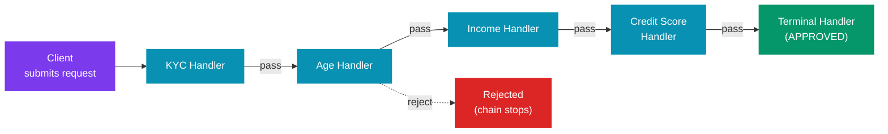
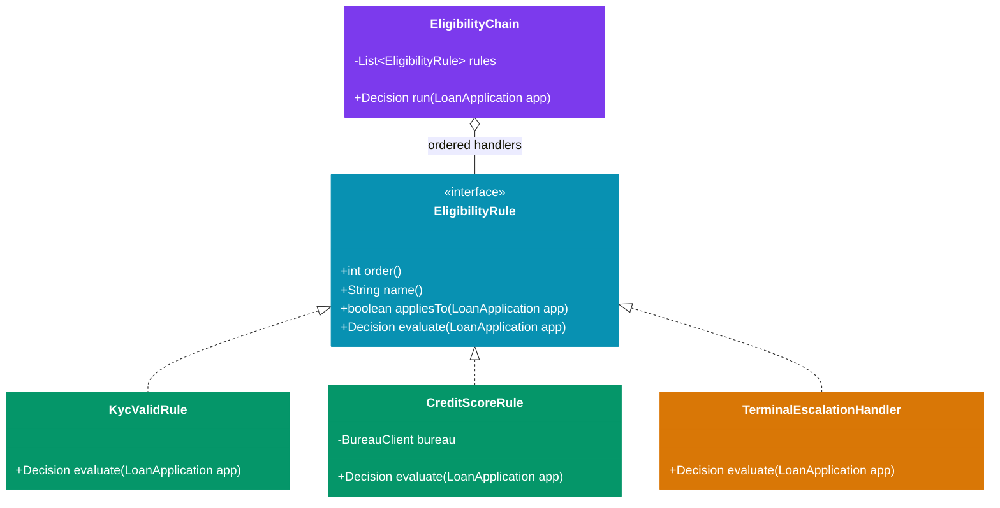
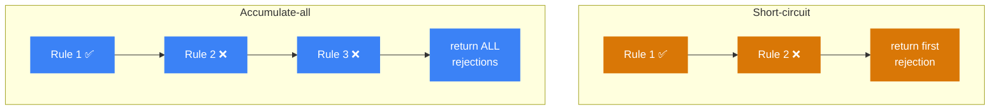
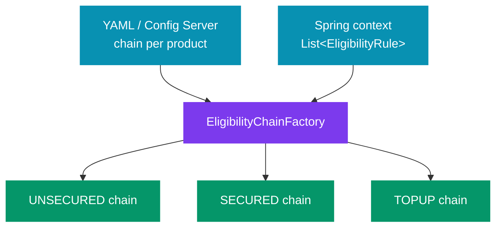
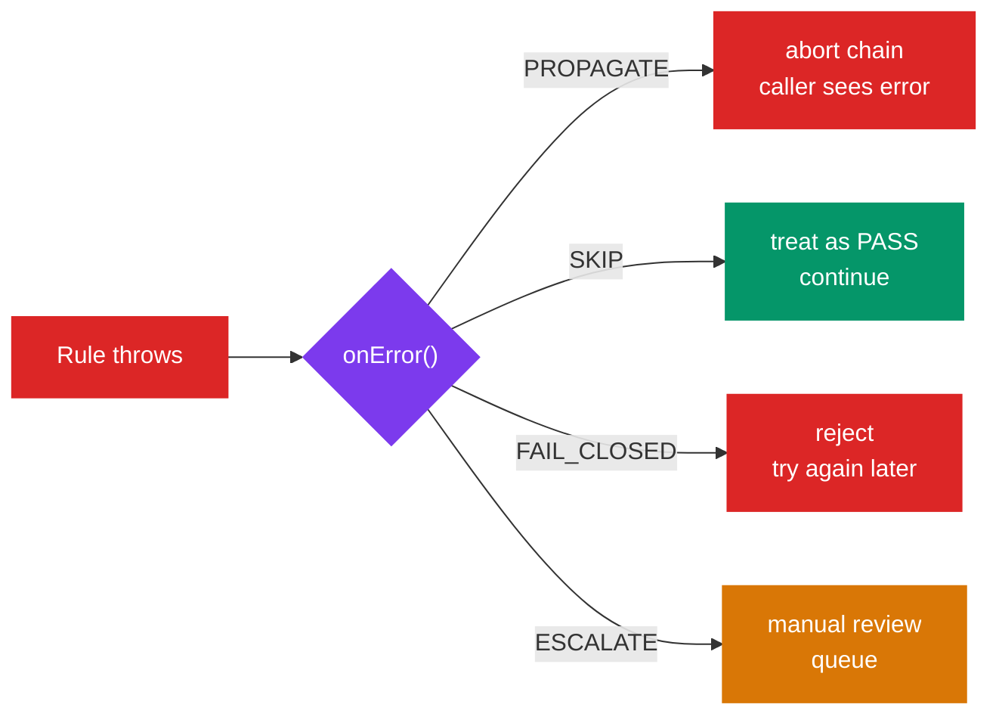
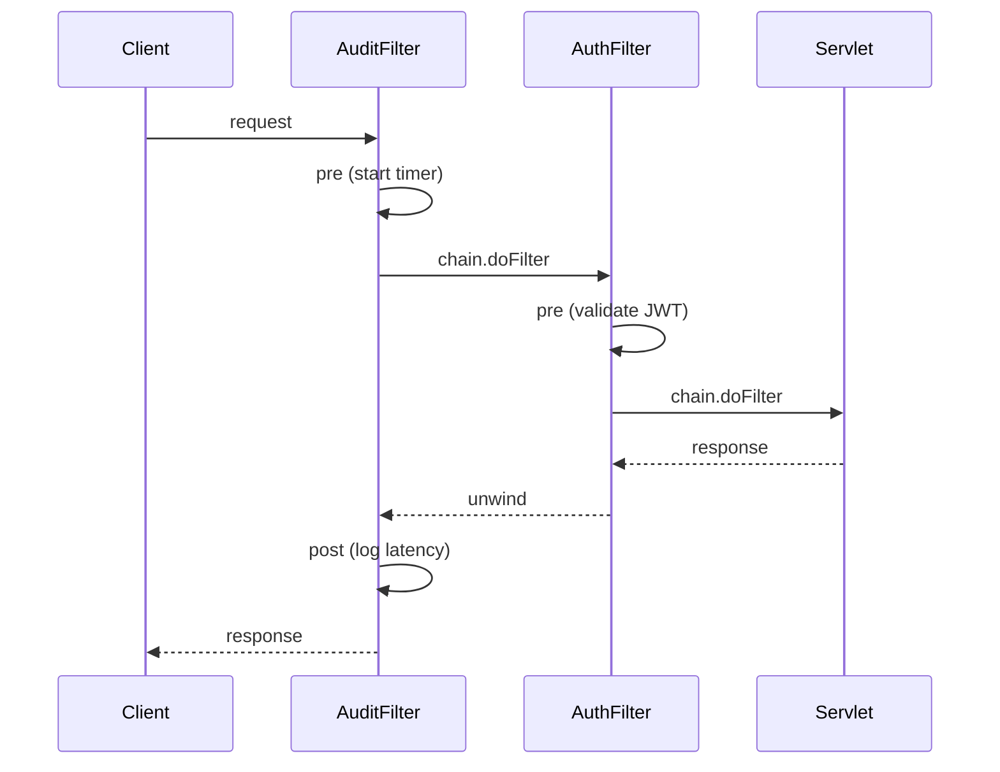
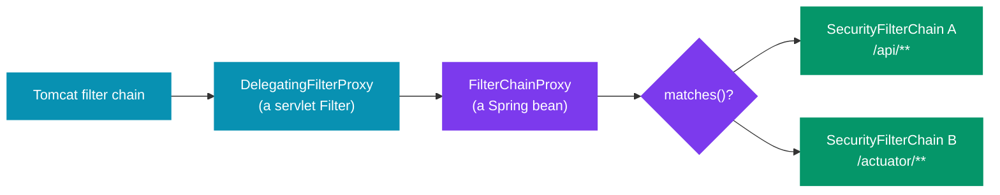

# Chain of Responsibility Design Pattern in Java

> 📖 **Master guide:** [LLD Interview Patterns Guide — §9 Chain of Responsibility](./01_LLD_Interview_Patterns_Guide.md#9-chain-of-responsibility-pattern) — this file is the depth companion.

**Chain of Responsibility (CoR)** | A behavioural pattern that passes a request along a chain of handlers. Each handler decides what to do with the request:

- process it,
- change it,
- stop the chain, or
- pass it to the next handler.

So the sender never knows which handler finally serves the request.

- [Introduction ⚡](#1-introduction)
  - [1.1 The two distinct shapes of CoR 🔥](#11-the-two-distinct-shapes-of-cor)
- [Participants 🔥](#2-participants)
- [Java Implementation — Loan Eligibility Chain 🔥🔥](#3-java-implementation--loan-eligibility-chain)
  - [1️⃣ Model the request and the outcome ⚡](#1-model-the-request-and-the-outcome)
  - [2️⃣ Define the Handler interface ⚡](#2-define-the-handler-interface)
  - [3️⃣ Implement the concrete handlers ⚡](#3-implement-the-concrete-handlers)
  - [4️⃣ Assemble and run the chain 🔥](#4-assemble-and-run-the-chain)
  - [5️⃣ Client 💤](#5-client)
- [Short-Circuit vs Accumulate-All 🔥](#4-short-circuit-vs-accumulate-all)
  - [4.1 The accumulating chain 🔥](#41-the-accumulating-chain)
  - [4.2 Which to pick 🔥🔥](#42-which-to-pick)
- [Building the Chain from Configuration 🔥](#5-building-the-chain-from-configuration)
  - [5.1 The idiomatic Spring answer — inject `List<Handler>` + `@Order` 🔥🔥](#51-the-idiomatic-spring-answer--inject-listhandler--order)
  - [5.2 Per-product chains from YAML ⚡](#52-per-product-chains-from-yaml)
- [The Unhandled-Request Problem 🔥](#6-the-unhandled-request-problem)
  - [6.1 Fix 1 — an explicit terminal handler 🔥](#61-fix-1--an-explicit-terminal-handler)
  - [6.2 Fix 2 — make the return type carry "unhandled" 🔥](#62-fix-2--make-the-return-type-carry-unhandled)
- [⚠️ CoR vs a Plain List Loop — When the Pattern Is Overkill 🔥🔥](#7-cor-vs-a-plain-list-loop--when-the-pattern-is-overkill)
  - [7.1 Side-by-side 🔥🔥](#71-side-by-side)
  - [7.2 When the loop is genuinely better ✅ 🔥](#72-when-the-loop-is-genuinely-better)
  - [7.3 When real CoR earns its place ✅ 🔥🔥](#73-when-real-cor-earns-its-place)
  - [7.4 The line to say out loud 🔥](#74-the-line-to-say-out-loud)
- [Exception Handling and Resilience in a Chain ⚡](#8-exception-handling-and-resilience-in-a-chain)
  - [8.1 A resilient chain runner 🔥](#81-a-resilient-chain-runner)
  - [8.2 Additional hardening ⚡](#82-additional-hardening)
- [Servlet FilterChain & Spring Security Internals 🔥🔥](#9-servlet-filterchain--spring-security-internals)
  - [9.1 `doFilter` is recursion over an index 🔥🔥](#91-dofilter-is-recursion-over-an-index)
  - [9.2 Why a filter both pre- and post-processes 🔥](#92-why-a-filter-both-pre--and-post-processes)
  - [9.3 Why that makes it a CoR/Decorator hybrid 🔥🔥](#93-why-that-makes-it-a-cordecorator-hybrid)
  - [9.4 Spring Security specifics 🔥🔥](#94-spring-security-specifics)
  - [9.5 The double-registration trap — your JWT filter runs twice 🔥](#95-the-double-registration-trap--your-jwt-filter-runs-twice)
  - [9.6 `ThreadLocal` hygiene across a chain 🔥](#96-threadlocal-hygiene-across-a-chain)
  - [9.7 WebFlux: post-processing must be *composed*, not sequential ⚡](#97-webflux-post-processing-must-be-composed-not-sequential)
- [Spring MVC HandlerInterceptor ⚡](#10-spring-mvc-handlerinterceptor)
  - [10.1 Filter vs Interceptor — pick the right one 🔥](#101-filter-vs-interceptor--pick-the-right-one)
- [CoR vs Decorator vs Pipeline 🔥🔥](#11-cor-vs-decorator-vs-pipeline)
- [Testing a Chain ⚡](#12-testing-a-chain)
  - [12.1 Test each handler in isolation — it's a pure function ⚡](#121-test-each-handler-in-isolation--its-a-pure-function)
  - [12.2 Assert the chain's ORDER 🔥](#122-assert-the-chains-order)
  - [12.3 Test short-circuiting — assert what did NOT happen ⚡](#123-test-short-circuiting--assert-what-did-not-happen)
  - [12.4 Test the terminal / unhandled path 💤](#124-test-the-terminal--unhandled-path)
  - [12.5 Test a filter chain with `MockMvc` ⚡](#125-test-a-filter-chain-with-mockmvc)
- [Production Use Cases 🔥](#13-production-use-cases)
- [When NOT to Use CoR 🔥](#14-when-not-to-use-cor)
- [Interview Q&A 🔥🔥](#15-interview-qa)

> 🔥🔥 Must-know — very frequently tested &nbsp;·&nbsp; 🔥 High priority &nbsp;·&nbsp; ⚡ Medium priority &nbsp;·&nbsp; 💤 Low priority

---

<a id="1-introduction"></a>
## 1. Introduction 💤

The master guide covers the standard form:

- an abstract handler with a `next` pointer,
- handlers linked with fluent `setNext(...)` calls,
- a chain that approves a loan by amount tier.

That is the *textbook* answer. It is enough to name the pattern.

It is **not** enough to pass an LLD round at a Tier-1 product company. Interviewers really ask these follow-up questions:

> *"What happens if no handler handles it?"*  
> *"How do you make the chain configurable per loan product without recompiling?"*  
> *"Why is this better than a `for` loop over a list of rules?"*  
> *"One handler calls a flaky bureau API and throws — what happens to the rest of the chain?"*  
> *"Do you want the first failure or all failures?"*

This file answers exactly those questions. Everything below assumes you already know the `setNext` version.

🔑 **One-line summary:** "A linked list of handlers. Each link decides whether the rest of the list runs at all."



<a id="11-the-two-distinct-shapes-of-cor"></a>
### 1.1 The two distinct shapes of CoR 🔥

Interviewers mix these two up. You should not. Both are "Chain of Responsibility", but they behave very differently:

| Shape | Semantics | Example |
|---|---|---|
| **Dispatch chain** (pure GoF) | Exactly **one** handler serves the request. The rest are skipped. The chain is a *lookup* for the right receiver. | Approval authority by amount — branch → regional → head office. Only one approves. |
| **Filter/validation chain** | **Every** handler runs (unless one vetoes, that is, rejects). Each adds a check or a change to the request. | Loan eligibility rules, Servlet filters, Spring Security filter chain. |

💡 **Say this clearly in an interview.** "GoF's intent is the dispatch shape — one receiver. The filter shape is the industry variant. It is what Servlet filters and Spring Security really implement." That one sentence shows you have read beyond the textbook.

---

<a id="2-participants"></a>
## 2. Participants 💤

| Participant | Role | Example in this file |
|---|---|---|
| **Handler** | Interface or abstract class. It declares the handling method and (optionally) holds the `next` reference | `EligibilityRule` |
| **ConcreteHandler** | Implements the check. Decides to handle, change, veto, or pass on the request | `KycValidRule`, `AgeRule`, `IncomeRule`, `CreditScoreRule` |
| **TerminalHandler** | Explicit handler at the end of the chain, so an unhandled request is never silently dropped | `TerminalEscalationHandler` (§6.1) |
| **Request / Context** | The object that moves down the chain. Often mutable, so handlers can add data to it | `LoanApplication` + `EligibilityContext` |
| **ChainBuilder / Assembler** | Puts the handlers in order — from code, config, or the Spring context | `EligibilityChainFactory` |
| **Client** | Gives the request to the head of the chain and reads the result | `LoanEligibilityService` |



📌 **Note the design choice you can already see here:** `EligibilityChain` holds a `List<EligibilityRule>`. Each rule does not hold a `next` pointer. That is the *ordered-collection* variant of CoR. §5 and §7 explain when it is the right choice, and when it stops being CoR at all.

---

<a id="3-java-implementation--loan-eligibility-chain"></a>
## 3. Java Implementation — Loan Eligibility Chain 🔥

The order matters for real reasons:

- KYC and age are free local checks.
- The credit-score rule costs money (a bureau pull is a paid API call).
- So you want the cheap rules to reject first.

<a id="1-model-the-request-and-the-outcome"></a>
### 1️⃣ Model the request and the outcome ⚡

```java
public record LoanApplication(
        String applicationId,
        String customerId,
        String panNumber,
        boolean kycVerified,
        int age,
        BigDecimal monthlyIncome,
        BigDecimal requestedAmount,
        String productCode
) {
}
```

```java
// The result of a single rule. A sealed interface keeps the outcomes exhaustive,
// so `switch` over it needs no default branch.
public sealed interface Decision permits Decision.Pass, Decision.Reject {

    record Pass() implements Decision {
    }

    record Reject(String code, String message) implements Decision {
    }

    Decision PASS = new Pass();

    static Decision reject(String code, String message) {
        return new Reject(code, message);
    }

    default boolean isRejected() {
        return this instanceof Reject;
    }
}
```

⚠️ **Why not `void` or `boolean`?**

See §6 for the full argument.

<a id="2-define-the-handler-interface"></a>
### 2️⃣ Define the Handler interface ⚡

```java
public interface EligibilityRule {

    /**
     * Lower runs first. Cheap local checks get low numbers so expensive
     * external calls (bureau pulls) never happen for an applicant who
     * would have been rejected anyway.
     */
    int order();

    /** A stable code used in logs, metrics, and tests. */
    String name();

    Decision evaluate(LoanApplication app);

    /**
     * Lets a rule opt out for a given product without being removed from
     * the chain — e.g. an income floor that only applies to unsecured loans.
     */
    default boolean appliesTo(LoanApplication app) {
        return true;
    }
}
```

💡 **`appliesTo` is a small addition with a big benefit.** Without it, every "does this rule apply?" branch goes into `evaluate`. Then the rule returns `PASS` for two very different reasons:

- *"checked and fine"*
- *"not my business"*

Keeping them separate keeps the audit trail correct.

<a id="3-implement-the-concrete-handlers"></a>
### 3️⃣ Implement the concrete handlers ⚡

```java
@Component
public class KycValidRule implements EligibilityRule {

    @Override
    public int order() {
        return 10;
    }

    @Override
    public String name() {
        return "KYC_VALID";
    }

    @Override
    public Decision evaluate(LoanApplication app) {
        if (!app.kycVerified()) {
            return Decision.reject("KYC_PENDING", "Complete KYC before applying.");
        }
        return Decision.PASS;
    }
}
```

```java
@Component
public class AgeRule implements EligibilityRule {

    private static final int MIN_AGE = 21;
    private static final int MAX_AGE = 60;

    @Override
    public int order() {
        return 20;
    }

    @Override
    public String name() {
        return "AGE_RANGE";
    }

    @Override
    public Decision evaluate(LoanApplication app) {
        if (app.age() < MIN_AGE || app.age() > MAX_AGE) {
            return Decision.reject("AGE_OUT_OF_RANGE",
                    "Applicant age must be between " + MIN_AGE + " and " + MAX_AGE + ".");
        }
        return Decision.PASS;
    }
}
```

```java
@Component
public class IncomeRule implements EligibilityRule {

    private static final BigDecimal MIN_MONTHLY_INCOME = new BigDecimal("25000");

    @Override
    public int order() {
        return 30;
    }

    @Override
    public String name() {
        return "MIN_INCOME";
    }

    @Override
    public boolean appliesTo(LoanApplication app) {
        // Secured products are collateral-backed — no income floor.
        return !"SECURED".equals(app.productCode());
    }

    @Override
    public Decision evaluate(LoanApplication app) {
        if (app.monthlyIncome().compareTo(MIN_MONTHLY_INCOME) < 0) {
            return Decision.reject("INCOME_TOO_LOW",
                    "Minimum monthly income of 25,000 required.");
        }
        return Decision.PASS;
    }
}
```

```java
@Component
public class CreditScoreRule implements EligibilityRule {

    private static final int MIN_SCORE = 700;

    private final CreditBureauClient bureau;   // paid, rate-limited, sometimes slow

    public CreditScoreRule(CreditBureauClient bureau) {
        this.bureau = bureau;
    }

    @Override
    public int order() {
        return 40;   // deliberately AFTER the free checks
    }

    @Override
    public String name() {
        return "CREDIT_SCORE";
    }

    @Override
    public Decision evaluate(LoanApplication app) {
        int score = bureau.fetchScore(app.panNumber());
        if (score < MIN_SCORE) {
            return Decision.reject("LOW_CREDIT_SCORE",
                    "Credit score " + score + " is below the required " + MIN_SCORE + ".");
        }
        return Decision.PASS;
    }
}
```

```java
@Component
public class BlacklistDedupeRule implements EligibilityRule {

    private final BlacklistRepository blacklist;
    private final LoanRepository loans;

    public BlacklistDedupeRule(BlacklistRepository blacklist, LoanRepository loans) {
        this.blacklist = blacklist;
        this.loans = loans;
    }

    @Override
    public int order() {
        return 50;
    }

    @Override
    public String name() {
        return "BLACKLIST_DEDUPE";
    }

    @Override
    public Decision evaluate(LoanApplication app) {
        if (blacklist.contains(app.panNumber())) {
            return Decision.reject("BLACKLISTED", "Applicant is not eligible.");
        }
        if (loans.hasActiveApplication(app.customerId())) {
            return Decision.reject("DUPLICATE_APPLICATION",
                    "An application is already in progress.");
        }
        return Decision.PASS;
    }
}
```

<a id="4-assemble-and-run-the-chain"></a>
### 4️⃣ Assemble and run the chain 🔥

```java
public class EligibilityChain {

    private final List<EligibilityRule> rules;

    public EligibilityChain(List<EligibilityRule> rules) {
        this.rules = rules.stream()
                .sorted(Comparator.comparingInt(EligibilityRule::order))
                .toList();
    }

    public Decision run(LoanApplication app) {
        for (EligibilityRule rule : rules) {
            if (!rule.appliesTo(app)) {
                continue;
            }
            Decision decision = rule.evaluate(app);
            if (decision.isRejected()) {
                return decision;          // short-circuit: first failure wins
            }
        }
        return Decision.PASS;
    }
}
```

<a id="5-client"></a>
### 5️⃣ Client 💤

```java
@Service
public class LoanEligibilityService {

    private final EligibilityChain chain;

    public LoanEligibilityService(EligibilityChain chain) {
        this.chain = chain;
    }

    public EligibilityResponse check(LoanApplication app) {
        Decision decision = chain.run(app);
        return switch (decision) {
            case Decision.Pass p ->
                    EligibilityResponse.eligible(app.applicationId());
            case Decision.Reject r ->
                    EligibilityResponse.ineligible(app.applicationId(), r.code(), r.message());
        };
    }
}
```

📤 **Output** for `new LoanApplication("APP-1", "CUST-9", "ABCDE1234F", true, 30, new BigDecimal("18000"), new BigDecimal("300000"), "UNSECURED")`:

```
INELIGIBLE  code=INCOME_TOO_LOW  message=Minimum monthly income of 25,000 required.
```

Note what did **not** happen: the code never called the credit bureau. The rule order saved one paid API call.

---

<a id="4-short-circuit-vs-accumulate-all"></a>
## 4. Short-Circuit vs Accumulate-All 🔥

This difference shows who has built a real rule chain in production, and who has only read about it.

The chain in §3 short-circuits. It returns the first rejection, and the other rules never run.

- This is right for **cost-sensitive gating** (checks where some steps cost money). Don't pay for a bureau pull if age already rules the user out.
- It is **wrong** for **user-facing form validation**. There, one error at a time gives the worst possible UX:
  - the user fixes income and resubmits;
  - then learns their age is wrong, and resubmits;
  - then learns their KYC is pending.



<a id="41-the-accumulating-chain"></a>
### 4.1 The accumulating chain 🔥

```java
public record EligibilityResult(List<Decision.Reject> failures) {

    public boolean isEligible() {
        return failures.isEmpty();
    }

    public static EligibilityResult of(List<Decision.Reject> failures) {
        return new EligibilityResult(List.copyOf(failures));
    }
}
```

```java
public class AccumulatingEligibilityChain {

    private final List<EligibilityRule> rules;

    public AccumulatingEligibilityChain(List<EligibilityRule> rules) {
        this.rules = rules.stream()
                .sorted(Comparator.comparingInt(EligibilityRule::order))
                .toList();
    }

    public EligibilityResult run(LoanApplication app) {
        List<Decision.Reject> failures = new ArrayList<>();

        for (EligibilityRule rule : rules) {
            if (!rule.appliesTo(app)) {
                continue;
            }
            if (rule.evaluate(app) instanceof Decision.Reject reject) {
                failures.add(reject);
                if (rule.fatal()) {
                    break;   // some failures make later rules meaningless
                }
            }
        }
        return EligibilityResult.of(failures);
    }
}
```

The `fatal()` flag is a practical middle option. Add it to `EligibilityRule` as a default method:

```java
default boolean fatal() {
    return false;
}
```

`KycValidRule` overrides it to `true`. If KYC is not done, a credit-bureau pull on an unverified PAN wastes money. It may also be **non-compliant** (it may break the law or regulations). All other rules accumulate.

<a id="42-which-to-pick"></a>
### 4.2 Which to pick 🔥🔥

| Dimension | Short-circuit | Accumulate-all |
|---|---|---|
| **UX** | User fixes one problem per round-trip ❌️ | User sees the full list once ✅ |
| **Cost** | Skips expensive downstream rules ✅ | Runs every rule, including paid API calls ❌️ |
| **Compliance** | Stops before an illegal check runs ✅ | Risk of pulling a bureau report you had no right to pull ❌️ |
| **Latency** | Best case very fast | Always pays for the full chain (unless rules run in parallel) |
| **Determinism of message** | Reason depends on rule order. Reorder the chain and the customer sees a different message ⚠️ | Order-independent output ✅ |
| **Typical fit** | Authorization, gating, dispatch (one receiver) | Form/field validation, pre-qualification screens |

⚠️ **The order-dependence trap.** With short-circuiting, the chain order decides which reason code the customer gets. Say someone reorders the chain to optimize latency. Then:

- your customer-facing rejection messages change;
- your analytics on "top rejection reason" change without any warning.

Lock the order in place with a test (§12).

---

<a id="5-building-the-chain-from-configuration"></a>
## 5. Building the Chain from Configuration 🔥

Hardcoded `branch.setNext(regional).setNext(head)` is fine on a whiteboard. It is not acceptable in production:

<a id="51-the-idiomatic-spring-answer--inject-listhandler--order"></a>
### 5.1 The idiomatic Spring answer — inject `List<Handler>` + `@Order` 🔥🔥

**For a Spring interview, this is the most useful point in this file.** Spring will inject *every* bean of a type as a `List`. It also **sorts that list automatically** by `@Order` / `@Priority` / the `Ordered` interface.

```java
@Component
@Order(10)
public class KycValidRule implements EligibilityRule {
    // ...
}

@Component
@Order(40)
public class CreditScoreRule implements EligibilityRule {
    // ...
}
```

```java
@Service
public class LoanEligibilityService {

    private final List<EligibilityRule> rules;

    // Spring injects ALL EligibilityRule beans, already sorted by @Order.
    public LoanEligibilityService(List<EligibilityRule> rules) {
        this.rules = rules;
    }

    public Decision check(LoanApplication app) {
        for (EligibilityRule rule : rules) {
            Decision decision = rule.evaluate(app);
            if (decision.isRejected()) {
                return decision;
            }
        }
        return Decision.PASS;
    }
}
```

To add a new rule now, write a `@Component` and give it an `@Order`. That is all. You need no factory edit and no `setNext` line. You cannot forget to wire it.

⚠️ **Three traps interviewers ask about:**

1. **`@Order` sorts injected `List`s and `Ordered` collections. It does not affect bean *creation* order.** If you need one bean created before another, use `@DependsOn`, not `@Order`.
2. **Injecting a `Set<EligibilityRule>` loses the ordering.** It must be a `List`.
3. **`@Order` without a value defaults to `Ordered.LOWEST_PRECEDENCE`** (`Integer.MAX_VALUE`). So a rule with no annotation moves to the end, with no warning. Always give an explicit value. Leave gaps (10, 20, 30) so you can insert rules later.

💡 Maybe you do not want ordering spread across many annotations. Then extend `Ordered` and connect it to the `order()` method your chain already uses. The same number then drives both, with no duplication:

```java
public interface EligibilityRule extends Ordered {

    /** The chain's own ordering method (§3) — still the single source of truth. */
    int order();

    /** Spring reads THIS when injecting List<EligibilityRule>; it just delegates. */
    @Override
    default int getOrder() {
        return order();
    }

    String name();

    Decision evaluate(LoanApplication app);
}
```

⚠️ **Precedence, if a bean has both.** Say a bean implements `Ordered` *and* has `@Order`. Then the **interface wins**:

- `AnnotationAwareOrderComparator.findOrder()` checks `Ordered.getOrder()` first.
- It uses the annotation only when that returns `null`.

So take a rule that already returns `40` from `getOrder()`. An `@Order(10)` on it is ignored, with no warning. Pick one way per type.

One exception: if the bean is an AOP proxy (for example, it has `@Transactional`), Spring reads the order from the target class first. Then `@Order(10)` wins. This is one more reason to pick only one way.

<a id="52-per-product-chains-from-yaml"></a>
### 5.2 Per-product chains from YAML ⚡

`@Order` gives one global chain. Real lending needs a different chain per product:

```yaml
loan:
  eligibility:
    chains:
      UNSECURED:
        mode: SHORT_CIRCUIT
        rules: [KYC_VALID, AGE_RANGE, MIN_INCOME, CREDIT_SCORE, BLACKLIST_DEDUPE]
      SECURED:
        mode: ACCUMULATE
        rules: [KYC_VALID, AGE_RANGE, COLLATERAL_VALUE, BLACKLIST_DEDUPE]
      TOPUP:
        mode: SHORT_CIRCUIT
        rules: [KYC_VALID, EXISTING_LOAN_HEALTHY, CREDIT_SCORE]
```

```java
public enum ChainMode {
    SHORT_CIRCUIT,
    ACCUMULATE
}
```

```java
@ConfigurationProperties(prefix = "loan.eligibility")
public record EligibilityProperties(Map<String, ChainSpec> chains) {

    public record ChainSpec(ChainMode mode, List<String> rules) {
    }
}
```

⚠️ **`@ConfigurationProperties` alone creates no bean.** A record gets constructor binding for free (Boot 2.6+). But the annotation is only a *marker*. Nothing registers it as a bean. Do one of these two:

- add `@EnableConfigurationProperties(EligibilityProperties.class)` on a `@Configuration` class; or
- put `@ConfigurationPropertiesScan` on the application class.

Without one of them, the factory below cannot get `EligibilityProperties`. Startup fails with `UnsatisfiedDependencyException`, caused by `NoSuchBeanDefinitionException`.

```java
@SpringBootApplication
@ConfigurationPropertiesScan
public class LendingApplication {
    // ...
}
```

```java
@Component
public class EligibilityChainFactory {

    private final Map<String, EligibilityRule> byName;
    private final EligibilityProperties properties;

    public EligibilityChainFactory(List<EligibilityRule> allRules,
                                   EligibilityProperties properties) {
        this.byName = allRules.stream()
                .collect(Collectors.toUnmodifiableMap(EligibilityRule::name, r -> r));
        this.properties = properties;
    }

    /**
     * Fail fast at startup: an unknown rule name in YAML is a deployment bug,
     * not something to discover at 2 a.m. when the first application arrives.
     */
    @PostConstruct
    void validateConfiguredNames() {
        properties.chains().forEach((product, spec) -> spec.rules().forEach(name -> {
            if (!byName.containsKey(name)) {
                throw new IllegalStateException(
                        "Unknown eligibility rule '" + name + "' for product " + product);
            }
        }));
    }

    public EligibilityChain forProduct(String productCode) {
        EligibilityProperties.ChainSpec spec = properties.chains().get(productCode);
        if (spec == null) {
            throw new IllegalArgumentException("No eligibility chain for product " + productCode);
        }
        List<EligibilityRule> ordered = spec.rules().stream()
                .map(byName::get)
                .toList();
        return EligibilityChain.inGivenOrder(ordered, spec.mode());
    }
}
```

⚠️ **Two ordering sources can easily cause a bug.** §3's constructor re-sorts by each rule's own `order()`.

- Say the factory passed its YAML list straight to that constructor.
- Then the configured order would be **thrown away, with no warning**.
- That breaks the main goal of this section.

Once order comes from config, the chain must stop sorting. So this section changes `EligibilityChain`:

- §3's single public constructor becomes two **named** entry points.
- The caller must say which ordering source it means.
- The `mode` from the YAML now also decides short-circuit vs accumulate (§4).
- So §3's and §4's two classes merge into one:

```java
public class EligibilityChain {

    private final List<EligibilityRule> rules;
    private final ChainMode mode;

    private EligibilityChain(List<EligibilityRule> rules, ChainMode mode) {
        this.rules = rules;
        this.mode = mode;
    }

    /** Order comes from the rules themselves (§3's form — @Order / order()). */
    public static EligibilityChain sortedByRuleOrder(List<EligibilityRule> rules, ChainMode mode) {
        return new EligibilityChain(
                rules.stream().sorted(Comparator.comparingInt(EligibilityRule::order)).toList(),
                mode);
    }

    /** Order is already decided by config — preserve it verbatim, do not re-sort. */
    public static EligibilityChain inGivenOrder(List<EligibilityRule> rules, ChainMode mode) {
        return new EligibilityChain(List.copyOf(rules), mode);
    }

    public EligibilityResult run(LoanApplication app) {
        List<Decision.Reject> failures = new ArrayList<>();
        for (EligibilityRule rule : rules) {
            if (!rule.appliesTo(app)) {
                continue;
            }
            if (rule.evaluate(app) instanceof Decision.Reject reject) {
                failures.add(reject);
                if (mode == ChainMode.SHORT_CIRCUIT || rule.fatal()) {
                    break;
                }
            }
        }
        return EligibilityResult.of(failures);
    }
}
```

🔑 **Why this is the strong answer:** the *order lives in configuration, not in code*. Rule classes no longer know about each other at all. There is no `next` field, no `setNext`, and no accidental cycle. To add a rule to one product, you change the YAML and redeploy the config. With Spring Cloud Config, you can also refresh the config at runtime. But a refresh does not rebind a record, because Spring binds it only once, through the constructor. If you need runtime refresh, use a JavaBean properties class with setters instead. Spring Cloud rebinds that class in place.

⚠️ **Cache the built chains.** `forProduct` rebuilds the rule list on every call. In a hot path (code that runs very often), build a `Map<String, EligibilityChain>` once in `@PostConstruct`. Then look chains up in it.



---

<a id="6-the-unhandled-request-problem"></a>
## 6. The Unhandled-Request Problem ⚡

This is the classic bug in every naive CoR (Chain of Responsibility) implementation:

```java
// ❌️ The silent-drop bug
public abstract class LoanApprovalHandler {

    protected LoanApprovalHandler next;

    public void approve(double amount) {
        if (next != null) {
            next.approve(amount);
        }
        // if next == null, the request evaporates — no log, no exception, no result
    }
}
```

Take a request for ₹50,00,000:

- It goes past branch, regional, and head office. Each one declines to handle it.
- It reaches the end of the chain, and **nothing happens**.
- The caller sees no exception and no result.

<a id="61-fix-1--an-explicit-terminal-handler"></a>
### 6.1 Fix 1 — an explicit terminal handler 🔥

Make "nobody handled it" an *outcome*. Do not let it be just a missing result:

```java
@Component
@Order(Ordered.LOWEST_PRECEDENCE)
public class TerminalEscalationHandler implements ApprovalHandler {

    private final ManualReviewQueue reviewQueue;
    private static final Logger log = LoggerFactory.getLogger(TerminalEscalationHandler.class);

    public TerminalEscalationHandler(ManualReviewQueue reviewQueue) {
        this.reviewQueue = reviewQueue;
    }

    @Override
    public Optional<ApprovalOutcome> approve(LoanApplication app) {
        log.warn("No approval authority matched amount={} for application={} — escalating",
                app.requestedAmount(), app.applicationId());
        reviewQueue.enqueue(app, "NO_MATCHING_AUTHORITY");
        return Optional.of(ApprovalOutcome.pendingManualReview(app.applicationId()));
    }
}
```

✅ The terminal handler **always** handles the request. It may escalate, reject with a default reason, or throw a domain exception. But the request never disappears.

- In the dispatch shape, this handler is mandatory.
- In the filter shape, it is how you express "everything passed → APPROVED".

<a id="62-fix-2--make-the-return-type-carry-unhandled"></a>
### 6.2 Fix 2 — make the return type carry "unhandled" 🔥

`void` cannot express "nobody handled this". Here are four signatures, each better than the one before:

| Signature | Can express | Problem |
|---|---|---|
| `void handle(Request r)` | nothing | A silent drop cannot be seen. Failure must travel via exceptions or a changed context. |
| `boolean handle(Request r)` | handled / not handled | Tells you *that* nobody handled it, but not *why*. It carries no result payload. |
| `Optional<Result> handle(Request r)` | handled + result, or empty | ✅ The type system *forces* the caller to deal with the empty case. |
| `Decision handle(Request r)` (sealed) | pass / reject-with-reason / escalate | ✅ Best for domain chains. Gives an exhaustive `switch` and reason codes for the customer. |

```java
public interface ApprovalHandler {

    /**
     * Empty = "not my authority level, try the next handler".
     * The chain runner treats an empty result from the LAST handler as an error.
     */
    Optional<ApprovalOutcome> approve(LoanApplication app);
}
```

```java
public class ApprovalChain {

    private final List<ApprovalHandler> handlers;

    public ApprovalChain(List<ApprovalHandler> handlers) {
        this.handlers = handlers;
    }

    public ApprovalOutcome approve(LoanApplication app) {
        for (ApprovalHandler handler : handlers) {
            Optional<ApprovalOutcome> outcome = handler.approve(app);
            if (outcome.isPresent()) {
                return outcome.get();
            }
        }
        // Loud, not silent. This is a configuration bug and should page someone.
        throw new NoApprovalAuthorityException(
                "No approval handler accepted application " + app.applicationId());
    }
}
```

⚠️ **Don't name it `NoHandlerFoundException`.** `org.springframework.web.servlet.NoHandlerFoundException` already exists.

- It means something completely different (`DispatcherServlet` found no mapping → 404).
- It has no single-`String` constructor. Its signature is `(String httpMethod, String requestURL, HttpHeaders headers)`.
- An IDE auto-import can pick the Spring class by mistake. At best you get a compile failure. At worst you get a misleading 404.

Reusing framework type names is an easy mistake to avoid. If you point it out in the interview, it makes a good impression.

💡 **What to say:** *"`void` handlers are the classic CoR bug. An unmatched request disappears with no signal. I return an `Optional` or a sealed `Decision`. So 'nobody handled it' is a value the compiler makes you handle. I still add an explicit terminal handler, so the normal path never reaches the throw."*

🔒 **Thread-safety note:** handlers built this way are **stateless**. So request threads can safely share a single chain instance. But if a handler caches per-request state in a field, you create a race condition. Keep mutable state in the request/context object that flows through the chain. Never keep it in the handler.

---

<a id="7-cor-vs-a-plain-list-loop--when-the-pattern-is-overkill"></a>
## 7. ⚠️ CoR vs a Plain List Loop — When the Pattern Is Overkill 🔥🔥

Be honest here. Interviewers give you points for it.

Look again at §3 step 4️⃣. The "chain" is:

```java
for (EligibilityRule rule : rules) {
    Decision d = rule.evaluate(app);
    if (d.isRejected()) {
        return d;
    }
}
```

That is a `for` loop over a list. There is no `next` pointer, no recursion and no linked list.

- **Calling it Chain of Responsibility is not really accurate.**
- And that is fine. For this problem, it is the *better* design. Say so.

<a id="71-side-by-side"></a>
### 7.1 Side-by-side 🔥🔥

| | Linked CoR (`next` pointers) | Ordered `List<Rule>` loop |
|---|---|---|
| **Wiring** | Each handler holds a reference to the next one. You wire it in code, and it is easy to get wrong (a missed link, a cycle by mistake) | The order is data — a list, a YAML array, an `@Order` value |
| **Readability** | You must follow the pointers to know the order | The order is simply the list |
| **Reordering** | Rewire the `setNext` calls | Move a line in YAML |
| **Debuggability** | Deep recursive stack traces (`handler → handler → handler`) | Flat stack. One frame per rule. The loop index tells you where you are |
| **Testing a single handler** | Needs a stubbed `next` to see the delegation | Call `evaluate()` directly — it is a pure function |
| **Skipping the rest of the chain** | Easy: just don't call `next` | The loop must read a return value and decide |
| **Wrapping the rest of the chain** (pre + post around downstream) | Easy — call `chain.doFilter()` in the middle of the method | ❌️ Impossible in a plain loop |

<a id="72-when-the-loop-is-genuinely-better"></a>
### 7.2 When the loop is genuinely better ✅ 🔥

- **Validation / rule engines.** Every rule is independent. Each rule checks the same input and gives a pass/fail. No handler decides what the next handler sees.
- **You want to collect all results.** A loop that adds into a list is very clear (§4).
- **Config or non-engineers must be able to reorder the rules.** Keeping the order as data (a list) is better than keeping it as next pointers.
- **You want to run rules in parallel.** This is easy with a list (`rules.parallelStream()` or a `CompletableFuture.allOf`). It is impossible with a linked chain. The reason: you can reach handler *n+1* only through handler *n*.

<a id="73-when-real-cor-earns-its-place"></a>
### 7.3 When real CoR earns its place ✅ 🔥🔥

1. **A handler must decide if the rest of the chain runs at all — and do work *after* it.** This is the deciding test.
   - A Servlet filter calls `chain.doFilter(req, res)` *in the middle* of its method.
   - Code before the call is pre-processing. Code after it is post-processing.
   - The filter can also choose not to call it at all.
   - A `for` loop cannot say "run the rest of the chain, then continue here."

```java
// Only a real chain can do this: the handler WRAPS the rest of the chain.
public void doFilter(ServletRequest req, ServletResponse res, FilterChain chain)
        throws IOException, ServletException {
    long start = System.nanoTime();
    MDC.put("traceId", UUID.randomUUID().toString());
    try {
        chain.doFilter(req, res);          // <-- the entire remainder runs HERE
    } finally {
        log.info("request took {}ms", (System.nanoTime() - start) / 1_000_000);
        MDC.clear();                       // <-- post-processing, after everything downstream
    }
}
```

2. **The handler changes the request for the handlers after it.** Examples: it decrypts a payload, adds a fetched customer profile, or rewrites a URL. Each handler's output is the next handler's input. So the handlers are not independent.
3. **Handlers are deployed on their own or found at runtime.** This is a plugin/extension model. The set of handlers is not known at compile time. Example: an API gateway that loads filters from a registry.
4. **The chain does real dispatch.** Exactly one handler should serve the request. The pattern's job is to *find* that handler. Examples: approval authority by amount, exception-handler resolution.
5. **The chain is recursive or re-entrant.** Examples: retries that enter the chain again from a given point, or nested sub-chains.

<a id="74-the-line-to-say-out-loud"></a>
### 7.4 The line to say out loud 🔥

> *"For a flat set of independent validation rules, I'd use an ordered `List<Rule>` and a loop. It's easier to read and very easy to reorder. Each rule is a pure function I can unit test. I'd use true Chain of Responsibility when a handler must control whether the rest of the chain runs. It must also do work after the rest returns. That's why Servlet filters are a real chain and my eligibility rules are not."*

⚠️ **A good interviewer sees an overkill pattern as a warning sign.**
- Using CoR to run five independent `if` checks makes the code *harder* to follow than the five `if`s.
- The pattern gives you dynamic composition (building the chain at runtime).
- If the composition is static, you paid a cost and got nothing.

---

<a id="8-exception-handling-and-resilience-in-a-chain"></a>
## 8. Exception Handling and Resilience in a Chain ⚡

Most candidates struggle with this question: **"Your credit-score handler calls a bureau API. It times out and throws. Now what?"**

There are exactly four policies. You must choose one on purpose:

| Policy | Behaviour | When it's right |
|---|---|---|
| **Propagate (abort)** | The exception leaves the chain. The caller sees it | The rule is mandatory — you cannot approve a loan without a compliance check |
| **Skip (log and continue)** | Catch, log, treat as PASS, continue | The rule is advisory — a "nice-to-have" enrichment or soft signal |
| **Fail-closed** | Catch, convert to a `Reject` | Risk-sensitive: if the fraud service is down, it means *do not lend* |
| **Fail-open with escalation** | Catch, convert to "route to manual review" | ✅ The usual lending answer — a human decides, so the system does not guess |

⚠️ **Fail-open vs fail-closed is a business decision, not an engineering one.**
- Say this clearly in the interview: "I'd confirm with risk/compliance whether an unreachable bureau means auto-reject or manual review."
- That one sentence shows senior-level thinking.

<a id="81-a-resilient-chain-runner"></a>
### 8.1 A resilient chain runner 🔥

Do not put `try/catch` in every handler. That code gets duplicated, and it is easy to forget. Instead, put the policy in the **runner**. Let each handler declare what it wants:

```java
public enum FailurePolicy {
    PROPAGATE,
    SKIP,
    FAIL_CLOSED,
    ESCALATE
}
```

```java
public interface EligibilityRule {

    int order();

    String name();

    Decision evaluate(LoanApplication app);

    default FailurePolicy onError() {
        return FailurePolicy.ESCALATE;   // safe default for a lending platform
    }
}
```

```java
public class ResilientEligibilityChain {

    private static final Logger log = LoggerFactory.getLogger(ResilientEligibilityChain.class);

    private final List<EligibilityRule> rules;
    private final MeterRegistry metrics;

    public ResilientEligibilityChain(List<EligibilityRule> rules, MeterRegistry metrics) {
        this.rules = rules;
        this.metrics = metrics;
    }

    public Decision run(LoanApplication app) {
        for (EligibilityRule rule : rules) {
            Decision decision;
            try {
                decision = rule.evaluate(app);
            } catch (RuntimeException ex) {
                metrics.counter("eligibility.rule.error", "rule", rule.name()).increment();
                decision = handleFailure(rule, app, ex);
            }
            if (decision.isRejected()) {
                return decision;
            }
        }
        return Decision.PASS;
    }

    private Decision handleFailure(EligibilityRule rule, LoanApplication app, RuntimeException ex) {
        log.error("Rule {} failed for application {}", rule.name(), app.applicationId(), ex);
        return switch (rule.onError()) {
            case PROPAGATE -> throw new EligibilityEvaluationException(rule.name(), ex);
            case SKIP -> Decision.PASS;
            case FAIL_CLOSED -> Decision.reject("RULE_UNAVAILABLE_" + rule.name(),
                    "We could not complete your application. Please try again later.");
            case ESCALATE -> Decision.reject("MANUAL_REVIEW",
                    "Your application needs a manual review.");
        };
    }
}
```

<a id="82-additional-hardening"></a>
### 8.2 Additional hardening ⚡

- 🔒 **Timeouts belong in the handler, not the chain.**
  - A bureau client with no read timeout will hold a request thread forever.
  - The chain has no way to interrupt it.
  - Set a connect and read timeout on the HTTP client, and wrap it with Resilience4j `@CircuitBreaker`. Then the handler itself fails fast.
  - `@TimeLimiter` works only on methods that return a `CompletableFuture` or a reactive type. It does not fit a blocking `fetchScore()`.
- **Never let one handler's failure look like another handler's failure.** Always log `rule.name()` and tag metrics with it. If you don't, your dashboard says "eligibility failing" and you cannot tell which rule failed.
- ⚠️ **A blocking handler must restore the interrupt flag.**
  - The runner above catches `RuntimeException`. That is right when handlers throw unchecked domain exceptions.
  - But a handler may block (`Future.get()`, a latch, a synchronous client). Then it gets a *checked* `InterruptedException`.
  - `evaluate()` declares no checked exceptions. So the handler must catch `InterruptedException` itself.
  - In that catch, restore the flag: `Thread.currentThread().interrupt();`. Then throw an unchecked exception, which the runner catches.
  - If you don't, the thread loses its cancellation signal without any error. The code that asked to cancel never sees it.
- **Idempotency on re-entry.** A failed chain may be retried. Some handlers write side effects: a bureau pull is *billable*, and a dedupe check may *insert* a lock row. These handlers must be idempotent, or guarded by a request-scoped cache.
- ⚠️ **If one handler throws a checked exception, the shared interface method must declare it. Then every caller must handle it.** It is better to use a single unchecked domain exception (`EligibilityEvaluationException`) at the boundary.



---

<a id="9-servlet-filterchain--spring-security-internals"></a>
## 9. Servlet FilterChain & Spring Security Internals 🔥🔥

Interviewers ask Spring developers about this very often. The master guide only names it. Here is how it really works.

<a id="91-dofilter-is-recursion-over-an-index"></a>
### 9.1 `doFilter` is recursion over an index 🔥🔥

`jakarta.servlet.FilterChain` has one method:

```java
public interface FilterChain {
    void doFilter(ServletRequest request, ServletResponse response)
            throws IOException, ServletException;
}
```

Here is Tomcat's `ApplicationFilterChain`, reduced to its main parts:

```java
public final class ApplicationFilterChain implements FilterChain {

    private ApplicationFilterConfig[] filters;
    private int pos = 0;        // cursor into the filter array
    private int n = 0;          // number of filters
    private Servlet servlet;

    @Override
    public void doFilter(ServletRequest request, ServletResponse response)
            throws IOException, ServletException {

        if (pos < n) {
            ApplicationFilterConfig config = filters[pos++];   // advance the cursor
            Filter filter = config.getFilter();
            // Pass THIS SAME chain object back in — the cursor is the state
            filter.doFilter(request, response, this);
            return;
        }
        // Cursor exhausted -> the terminal "handler" is the servlet itself
        servlet.service(request, response);
    }
}
```

🔑 **The mechanism to name in the interview:**
- The chain object is passed *back into* each filter.
- The filters have no `next` pointer at all.
- The chain's `pos` field is the state.
- `filter.doFilter(req, res, this)` is mutual recursion between the chain and the filters (each one calls the other).
- The **servlet is the terminal handler** — §6's rule, implemented by Tomcat.

<a id="92-why-a-filter-both-pre--and-post-processes"></a>
### 9.2 Why a filter both pre- and post-processes 🔥

`chain.doFilter(...)` is a *synchronous call that returns*. So the code after it runs only when everything downstream has finished. That means every later filter, the servlet, the controller, and the response rendering:

```java
@Component
public class RequestAuditFilter extends OncePerRequestFilter {

    private static final Logger log = LoggerFactory.getLogger(RequestAuditFilter.class);

    @Override
    protected void doFilterInternal(HttpServletRequest request,
                                    HttpServletResponse response,
                                    FilterChain chain) throws ServletException, IOException {
        String traceId = Optional.ofNullable(request.getHeader("X-Trace-Id"))
                .orElseGet(() -> UUID.randomUUID().toString());
        MDC.put("traceId", traceId);
        long start = System.nanoTime();

        try {
            chain.doFilter(request, response);     // ⬅ everything downstream happens here
        } finally {
            long ms = (System.nanoTime() - start) / 1_000_000;
            log.info("{} {} -> {} in {}ms",
                    request.getMethod(), request.getRequestURI(), response.getStatus(), ms);
            MDC.clear();                           // ⬅ post-processing (unwind phase)
        }
    }
}
```



⚠️ **Response commitment trap.**
- Once the response is committed (headers flushed), a filter's post-processing can no longer change the status or headers.
- That is why "add a header after the controller runs" often does nothing, with no error.
- If you really need it, buffer the response with a `ContentCachingResponseWrapper`.

⚠️ **Async dispatch breaks the unwind model — the filter above logs the wrong latency.**
- Say the controller returns a `DeferredResult`, a `CompletableFuture`, or a `Callable`.
- Then the container releases the thread *as soon as the controller returns*. This is long before the result exists.
- The `finally` block runs at that moment. So the log line measures "time to hand off", not request latency.
- Worse, `MDC.clear()` wipes the trace id that the async worker thread still needs.

Two things to know:

- `OncePerRequestFilter.shouldNotFilterAsyncDispatch()` returns **`true`** by default. So the filter is *skipped entirely* on the later `ASYNC` dispatch. If you need the filter to run on both passes, override it to `false`. Then make the filter re-entrant (safe to run more than once for the same request), because it now runs twice per request.
- For timing, the right hook is `request.getAsyncContext().addListener(...)` (or a `CallableProcessingInterceptor`), not a `finally`.

💡 **Say this in the interview:** *"A filter's post-processing only wraps the downstream call while the request is synchronous. As soon as a controller goes async, the `finally` runs on hand-off. So latency logging and `ThreadLocal` cleanup both have to move to an async-aware hook."*

<a id="93-why-that-makes-it-a-cordecorator-hybrid"></a>
### 9.3 Why that makes it a CoR/Decorator hybrid 🔥🔥

| Aspect | Evidence for **CoR** | Evidence for **Decorator** |
|---|---|---|
| Sender doesn't know the receiver | ✅ The client does not know which filter answers | — |
| A handler can stop the chain | ✅ Don't call `chain.doFilter` → request never reaches the servlet | — |
| Handler wraps the downstream call | — | ✅ Pre- and post-processing *around* `chain.doFilter` |
| Composable, order-sensitive, same interface at every layer | — | ✅ Exactly like `BufferedInputStream(FileInputStream(...))` |

💡 **The short answer:** *"A Servlet filter chain is Chain of Responsibility because it can terminate the request. It is Decorator because it can wrap the downstream call with pre/post behaviour. Pure GoF CoR passes the request on and does nothing more. A filter passes the request on and then continues its own work. The industry name for this hybrid is 'middleware'."*

<a id="94-spring-security-specifics"></a>
### 9.4 Spring Security specifics 🔥🔥



- **`DelegatingFilterProxy`** is registered in the servlet container. It has no logic of its own. It looks up a Spring bean named `springSecurityFilterChain` and delegates to it. This is what lets Security filters be Spring beans with dependency injection.
- **`FilterChainProxy`** holds a `List<SecurityFilterChain>`. Each `SecurityFilterChain` has a `RequestMatcher` and its own ordered `List<Filter>`. **The first matching chain wins, and the rest are never checked.** That itself is a Chain of Responsibility over *chains*.
- Inside a matched chain, `FilterChainProxy.VirtualFilterChain` re-implements the same cursor recursion as Tomcat's `ApplicationFilterChain`. When it runs out of filters, it hands control back to the *original* container chain.
- A filter such as `UsernamePasswordAuthenticationFilter` or `BearerTokenAuthenticationFilter` sets the `SecurityContext` and calls `chain.doFilter`.
- `AuthorizationFilter` may throw `AccessDeniedException`. `ExceptionTranslationFilter` sits *earlier* in the chain. It catches that exception in its post-processing and converts it to a 401/403. That is post-processing doing real work.

**The standard order inside one `SecurityFilterChain`** (Spring Security 6, cut down to the important ones — the full sequence is fixed in `FilterOrderRegistration`):

| # | Filter | What it does |
|:--:|---|---|
| 1 | `DisableEncodeUrlFilter` → `WebAsyncManagerIntegrationFilter` | Setup work; propagates the `SecurityContext` into async dispatches |
| 2 | `SecurityContextHolderFilter` | Loads the `SecurityContext` from the repository and **clears it on the unwind** |
| 3 | `HeaderWriterFilter` · `CorsFilter` · `CsrfFilter` | Response headers, CORS preflight, CSRF token check |
| 4 | `LogoutFilter` | Terminates the chain on `/logout` |
| 5 | `UsernamePasswordAuthenticationFilter` | Form login — **the usual reference point for placing a custom JWT filter** |
| 6 | `BearerTokenAuthenticationFilter` (resource server) | Reads the `Authorization: Bearer` header |
| 7 | `AnonymousAuthenticationFilter` | Puts in an anonymous token, so "unauthenticated" is still an `Authentication` |
| 8 | `ExceptionTranslationFilter` | Catches `AccessDeniedException` / `AuthenticationException` on the **unwind** → 401/403 |
| 9 | `AuthorizationFilter` | The last filter; evaluates `authorizeHttpRequests` and throws |

🔑 **Why a JWT filter goes *before* `UsernamePasswordAuthenticationFilter`:**
- The position of that filter is not the real reason. The goal is to place the JWT filter **before `AnonymousAuthenticationFilter` and `AuthorizationFilter`**.
- Then the `SecurityContext` is already filled when authorization runs.
- A bad token should not make the JWT filter throw. `ExceptionTranslationFilter` catches only exceptions from filters *after* it, so a throw here escapes as a 500. Leave the context empty instead. Then `AuthorizationFilter` throws, and that is translated into a proper 401.
- `UsernamePasswordAuthenticationFilter` is simply a well-known, stable position that meets both needs.

```java
@Configuration
@EnableWebSecurity
public class SecurityConfig {

    @Bean
    @Order(1)
    SecurityFilterChain actuatorChain(HttpSecurity http) throws Exception {
        return http
                .securityMatcher("/actuator/**")
                .authorizeHttpRequests(auth -> auth.anyRequest().hasRole("OPS"))
                .httpBasic(Customizer.withDefaults())
                .build();
    }

    @Bean
    @Order(2)
    SecurityFilterChain apiChain(HttpSecurity http, JwtAuthFilter jwtAuthFilter) throws Exception {
        return http
                .securityMatcher("/api/**")
                .csrf(csrf -> csrf.disable())
                .sessionManagement(s -> s.sessionCreationPolicy(SessionCreationPolicy.STATELESS))
                .authorizeHttpRequests(auth -> auth
                        .requestMatchers("/api/public/**").permitAll()
                        .anyRequest().authenticated())
                .addFilterBefore(jwtAuthFilter, UsernamePasswordAuthenticationFilter.class)
                .build();
    }
}
```

⚠️ **`@Order` on `SecurityFilterChain` beans really matters.** If a broad matcher comes first, it takes the requests meant for a later chain. This is the most common Spring Security misconfiguration.

<a id="95-the-double-registration-trap--your-jwt-filter-runs-twice"></a>
### 9.5 The double-registration trap — your JWT filter runs twice 🔥

Look closely at the config above. `jwtAuthFilter` is injected as a bean and added with `addFilterBefore`.
- Say that class is also annotated `@Component` (or `@Bean`-defined as a `Filter`).
- Then **Spring Boot auto-registers it into the servlet container's own filter chain as well**.
- The request passes through it twice — once in the container chain, once inside `FilterChainProxy`.

The symptoms are confusing. Nothing clearly breaks:
- The token is parsed twice (double the crypto cost).
- An audit filter writes two rows per request.
- A rate-limiter decrements the bucket twice.
- A filter that consumed the request body finds it empty the second time.

It is the most common Spring Security bug that developers cause themselves.

Two fixes, both small:

```java
// Fix A — keep @Component, but tell Boot not to auto-register it.
@Bean
FilterRegistrationBean<JwtAuthFilter> disableAutoRegistration(JwtAuthFilter filter) {
    FilterRegistrationBean<JwtAuthFilter> registration = new FilterRegistrationBean<>(filter);
    registration.setEnabled(false);   // ⬅ present as a bean, absent from the container chain
    return registration;
}
```

```java
// Fix B — drop @Component and declare it only where it is used.
@Bean
JwtAuthFilter jwtAuthFilter(JwtDecoder decoder) {
    return new JwtAuthFilter(decoder);
}
```

💡 Which fix to pick:
- Fix B is cleaner when the filter is only ever a security filter.
- Fix A is what you need when something else already depends on the bean.
- `OncePerRequestFilter` hides this bug but does not fix it. Both registrations use the same bean, so they share one filter name. The second pass sees the "already filtered" request attribute and skips the work. A filter that does not extend `OncePerRequestFilter` really runs twice. Remove the extra registration in both cases.

<a id="96-threadlocal-hygiene-across-a-chain"></a>
### 9.6 `ThreadLocal` hygiene across a chain 🔥

- `SecurityContextHolder` and SLF4J's `MDC` are both `ThreadLocal`-backed.
- Container threads are pooled and reused.
- So a value left behind by request *A* is visible to request *B* on the same thread.
- In a lending context, that is a cross-tenant data leak, not a small logging problem.

Three rules:

1. **Whoever sets it, clears it — in a `finally`.** `SecurityContextHolderFilter` does exactly this for the `SecurityContext`. §9.2's filter does it for the MDC. Never clear state you did not set. A `finally` in filter *n* cannot clean up what filter *n+1* put there. Filter *n* does not know it exists.
2. **Clear on the unwind, not at the start.** Clearing on entry hides the leak instead of fixing it. It also breaks context that was correctly inherited.
3. **A `ThreadLocal` does not follow work you hand to an executor.** `@Async`, a `CompletableFuture.supplyAsync`, or a parallel stream inside a handler runs on a *different* thread with an empty holder. Propagate the value yourself: `DelegatingSecurityContextExecutor` for the security context, an MDC copy for logging. If you don't, accept that downstream logs lose the trace id.

<a id="97-webflux-post-processing-must-be-composed-not-sequential"></a>
### 9.7 WebFlux: post-processing must be *composed*, not sequential ⚡

The rule "code after `chain.doFilter` is post-processing" is a **blocking-stack rule**. In WebFlux it breaks, with no error.
- A `WebFilter` returns a `Mono<Void>`.
- Calling `chain.filter(exchange)` only *builds* the pipeline. Nothing has run yet.

```java
// ❌️ Broken — logs immediately, before a single byte has been handled.
@Component
public class BrokenTimingFilter implements WebFilter {

    private static final Logger log = LoggerFactory.getLogger(BrokenTimingFilter.class);

    @Override
    public Mono<Void> filter(ServerWebExchange exchange, WebFilterChain chain) {
        long start = System.nanoTime();
        Mono<Void> downstream = chain.filter(exchange);
        log.info("took {}ns", System.nanoTime() - start);   // ⬅ ~0. Nothing ran.
        return downstream;
    }
}
```

```java
// ✅ Correct — the post-processing is part of the returned pipeline.
@Component
public class TimingWebFilter implements WebFilter {

    private static final Logger log = LoggerFactory.getLogger(TimingWebFilter.class);

    @Override
    public Mono<Void> filter(ServerWebExchange exchange, WebFilterChain chain) {
        long start = System.nanoTime();
        return chain.filter(exchange)
                .doFinally(signal -> log.info("{} {} in {}ms",
                        exchange.getRequest().getMethod(),
                        exchange.getRequest().getPath(),
                        (System.nanoTime() - start) / 1_000_000));
    }
}
```

🔑 **The idea that applies to both models:**
- The chain structure is the same: a cursor, a terminal handler, and a veto done by not passing the request on (`return Mono.empty()` instead of calling `chain.filter`).
- What changes is *when* the downstream runs.
- In the servlet model, the call blocks. So "after the call" means "after downstream".
- In the reactive model, the call returns a recipe (a plan that runs only when someone subscribes to it). So you must write "after downstream" as an operator (`doFinally`, `then`, `contextWrite`) attached to that recipe.
- For the same reason, `ThreadLocal`-based MDC does not work in WebFlux. Use the Reactor `Context` instead.

---

<a id="10-spring-mvc-handlerinterceptor"></a>
## 10. Spring MVC HandlerInterceptor ⚡

Filters sit in the servlet container and see raw `ServletRequest`s. **Interceptors sit inside `DispatcherServlet`.** They know which `@Controller` method is about to run. So they can make decisions that a filter cannot.

```java
public interface HandlerInterceptor {

    default boolean preHandle(HttpServletRequest request,
                              HttpServletResponse response,
                              Object handler) throws Exception {
        return true;
    }

    default void postHandle(HttpServletRequest request,
                            HttpServletResponse response,
                            Object handler,
                            ModelAndView modelAndView) throws Exception {
    }

    default void afterCompletion(HttpServletRequest request,
                                 HttpServletResponse response,
                                 Object handler,
                                 Exception ex) throws Exception {
    }
}
```

| Callback | Runs | Chain effect |
|---|---|---|
| `preHandle` | Before the controller method | **Returning `false` stops the chain.** The controller never runs. No later interceptor's `preHandle` runs |
| `postHandle` | After the controller returns, **before** view rendering | Skipped fully if the controller threw an exception |
| `afterCompletion` | After rendering, always. It runs even on an exception (`ex` is non-null) | The cleanup hook. Runs in **reverse** order |

```java
@Component
public class LoanRateLimitInterceptor implements HandlerInterceptor {

    private final RateLimiterService limiter;

    public LoanRateLimitInterceptor(RateLimiterService limiter) {
        this.limiter = limiter;
    }

    @Override
    public boolean preHandle(HttpServletRequest request,
                             HttpServletResponse response,
                             Object handler) throws Exception {
        String customerId = request.getHeader("X-Customer-Id");
        if (!limiter.tryAcquire(customerId)) {
            response.setStatus(HttpStatus.TOO_MANY_REQUESTS.value());
            response.getWriter().write("{\"error\":\"RATE_LIMITED\"}");
            return false;   // ⬅ chain stops here; controller never invoked
        }
        request.setAttribute("rateLimitStart", System.nanoTime());
        return true;
    }

    @Override
    public void afterCompletion(HttpServletRequest request,
                                HttpServletResponse response,
                                Object handler,
                                Exception ex) {
        limiter.release(request.getHeader("X-Customer-Id"));
    }
}
```

```java
@Configuration
public class WebConfig implements WebMvcConfigurer {

    private final LoanRateLimitInterceptor rateLimitInterceptor;

    public WebConfig(LoanRateLimitInterceptor rateLimitInterceptor) {
        this.rateLimitInterceptor = rateLimitInterceptor;
    }

    @Override
    public void addInterceptors(InterceptorRegistry registry) {
        registry.addInterceptor(rateLimitInterceptor)
                .addPathPatterns("/api/loans/**")
                .excludePathPatterns("/api/loans/health")
                .order(1);
    }
}
```

🔑 **The unwind rule that interviewers test:** say interceptor #3's `preHandle` returns `false`. Then `afterCompletion` is called **only for interceptors 1 and 2**. These are the ones that already returned `true`. Spring tracks this with an `interceptorIndex` field in `HandlerExecutionChain`. It is the same cursor idea as in `ApplicationFilterChain`.

<a id="101-filter-vs-interceptor--pick-the-right-one"></a>
### 10.1 Filter vs Interceptor — pick the right one 🔥

| | Servlet `Filter` | `HandlerInterceptor` |
|---|---|---|
| **Lives in** | Servlet container, outside Spring MVC | Inside `DispatcherServlet` |
| **Sees** | Raw `ServletRequest`/`Response` | The resolved handler (`HandlerMethod`): controller class + method + annotations |
| **Can modify request/response body** | ✅ Via wrappers | ❌️ Not the raw stream |
| **Runs for static resources / errors** | Static files ✅. The later `ERROR` dispatch to `/error`: ❌️ by default in Boot | Only for requests `DispatcherServlet` handles. In Boot, that includes static files and `/error` |
| **Use for** | Auth, CORS, compression, tracing, body caching | Per-controller rate limits, tenant resolution, annotation-driven checks, timing |

💡 Do you need to read a custom annotation on the controller method (`@RequiresRole("OPS")`)? Then you need an **Interceptor** (or AOP). A filter does not know which method will run.

---

<a id="11-cor-vs-decorator-vs-pipeline"></a>
## 11. CoR vs Decorator vs Pipeline 🔥

All three link objects together. Many candidates mix them up, so interviewers use this question to find weak candidates.

| Aspect | **Chain of Responsibility** | **Decorator** | **Pipeline / Middleware** |
|---|---|---|---|
| **Intent** | Find a handler / let handlers veto | Add behaviour to one object | Transform data through stages |
| **Does every element run?** | No. A handler may stop the chain | Yes. Every wrapper runs | Yes. Every stage runs |
| **Return type across the chain** | Same type end-to-end | Same type end-to-end | **Changes.** Stage *n*'s output is stage *n+1*'s input type |
| **Can it short-circuit?** | ✅ Core feature | ❌️ Not the intent | ⚠️ Only if the pipeline models failure (`Either`/`Result`) |
| **Composition** | Linear list, order = priority | Nested wrapping | Linear, order = data dependency |
| **Java example** | Servlet filters, `@ExceptionHandler` resolution | `BufferedInputStream(new FileInputStream(f))` | `Stream.map().filter().collect()`, `Function.andThen` |
| **Failure mode** | Nobody handles it (§6) | Wrapper order changes the behaviour | A stage's type does not match the next stage |

```java
// Pipeline — types change at each stage; nothing short-circuits.
Function<RawApplication, ValidatedApplication> validate = validator::validate;
Function<ValidatedApplication, ScoredApplication> score = scorer::score;
Function<ScoredApplication, UnderwritingDecision> decide = underwriter::decide;

UnderwritingDecision result = validate.andThen(score).andThen(decide).apply(raw);
```

```java
// Decorator — same type throughout; every layer runs; each ADDS behaviour.
NotificationSender sender =
        new RetryingSender(
            new EncryptingSender(
                new SmsSender(gateway)));
sender.send(customerId, "Your loan is approved.");
```

🔑 **The one-liners:**

- **CoR** — *"Who should handle this, and should the rest even run?"*
- **Decorator** — *"Everyone runs; each one adds something."*
- **Pipeline** — *"Everyone runs; each one transforms into the next stage's input type."*

⚠️ Middleware (Servlet filters, Express.js, Spring Security) is a **CoR/Decorator hybrid** by design:

- It can veto the request (CoR).
- It can *also* wrap the downstream call (Decorator).

Saying "it's a hybrid" is more correct than picking one.

---

<a id="12-testing-a-chain"></a>
## 12. Testing a Chain 💤

There are two separate things to test. Candidates usually forget the second one.

<a id="121-test-each-handler-in-isolation--its-a-pure-function"></a>
### 12.1 Test each handler in isolation — it's a pure function ⚡

```java
class IncomeRuleTest {

    private final IncomeRule rule = new IncomeRule();

    @Test
    void rejectsWhenIncomeBelowFloor() {
        LoanApplication app = applicationWithIncome(new BigDecimal("18000"));

        Decision decision = rule.evaluate(app);

        assertThat(decision).isInstanceOf(Decision.Reject.class);
        assertThat(((Decision.Reject) decision).code()).isEqualTo("INCOME_TOO_LOW");
    }

    @Test
    void skipsSecuredProducts() {
        LoanApplication securedApp = applicationWithProduct("SECURED");

        assertThat(rule.appliesTo(securedApp)).isFalse();
    }
}
```

✅ You do not need a mock of a "next handler". The rule does not know about the chain. This is a direct benefit of the list-based design from §5.

<a id="122-assert-the-chains-order"></a>
### 12.2 Assert the chain's ORDER 🔥

Order is behaviour. Say someone moves `CreditScoreRule` before `AgeRule`:

- Nothing fails to compile.
- No unit test breaks.
- You start paying for bureau pulls on 19-year-olds.

So lock the order in place with a test:

```java
@SpringBootTest
class EligibilityChainOrderTest {

    @Autowired
    private List<EligibilityRule> rules;   // Spring injects them already sorted by @Order

    @Test
    void chainOrderIsPinned() {
        assertThat(rules)
                .extracting(EligibilityRule::name)
                .containsExactly(
                        "KYC_VALID",
                        "AGE_RANGE",
                        "MIN_INCOME",
                        "CREDIT_SCORE",
                        "BLACKLIST_DEDUPE");
    }

    @Test
    void everyRuleHasAUniqueOrder() {
        assertThat(rules.stream().map(EligibilityRule::order).distinct().count())
                .isEqualTo(rules.size());   // ties make ordering non-deterministic
    }
}
```

⚠️ **The duplicate-`@Order` trap:** two beans with the same order value get an *unspecified* order between them. In practice it is usually the classpath-scan order. That order can differ between your laptop and the CI container. This gives a very hard heisenbug (a bug that is hard to catch: it seems to disappear when you try to find it). The second test above prevents it.

<a id="123-test-short-circuiting--assert-what-did-not-happen"></a>
### 12.3 Test short-circuiting — assert what did NOT happen ⚡

```java
@Test
void doesNotCallBureauWhenAgeFails() {
    CreditBureauClient bureau = mock(CreditBureauClient.class);
    EligibilityChain chain = EligibilityChain.sortedByRuleOrder(
            List.of(new AgeRule(), new CreditScoreRule(bureau)), ChainMode.SHORT_CIRCUIT);

    EligibilityResult result = chain.run(applicationWithAge(19));

    assertThat(result.failures())
            .extracting(Decision.Reject::code)
            .containsExactly("AGE_OUT_OF_RANGE");
    verifyNoInteractions(bureau);   // ⬅ the cost saving IS the requirement
}
```

<a id="124-test-the-terminal--unhandled-path"></a>
### 12.4 Test the terminal / unhandled path 💤

```java
@Test
void throwsWhenNoHandlerAccepts() {
    ApprovalChain chain = new ApprovalChain(List.of(new BranchManagerHandler()));

    assertThatThrownBy(() -> chain.approve(applicationOfAmount(new BigDecimal("5000000"))))
            .isInstanceOf(NoApprovalAuthorityException.class);
}
```

<a id="125-test-a-filter-chain-with-mockmvc"></a>
### 12.5 Test a filter chain with `MockMvc` ⚡

```java
@Test
void rateLimitedRequestNeverReachesController() throws Exception {
    given(limiter.tryAcquire("CUST-9")).willReturn(false);

    mockMvc.perform(post("/api/loans").header("X-Customer-Id", "CUST-9"))
            .andExpect(status().isTooManyRequests());

    verifyNoInteractions(loanService);   // preHandle returned false
}
```

---

<a id="13-production-use-cases"></a>
## 13. Production Use Cases ⚡

| Domain | Chain | Shape | Notes |
|---|---|---|---|
| **Lending — eligibility** | KYC → age → income → credit score → blacklist/dedupe | Filter (short-circuit) | Cheap local rules first. The paid bureau call last |
| **Lending — approval authority** | Branch → Regional → Head Office → manual queue | Dispatch | Exactly one approver. The terminal handler is the manual review queue |
| **Lending — document verification** | Format → OCR extract → cross-check against KYC → fraud signal | Pipeline-ish CoR | Each stage enriches the context for the next |
| **Payments** | Idempotency key → balance check → risk/fraud → limit check → route to PSP | Filter (short-circuit) | Fail-closed on the fraud step |
| **HTTP ingress** | Tracing → CORS → rate limit → JWT auth → authorization → controller | Middleware hybrid | Servlet filters; §9 |
| **API Gateway** | Spring Cloud Gateway `GlobalFilter` / `GatewayFilter` | Middleware hybrid | Ordered by `getOrder()`. Pre and post logic around `chain.filter(exchange)` |
| **HTTP clients** | OkHttp `Interceptor` | Middleware hybrid | Retry/auth/logging wrap `chain.proceed(request)` |
| **Spring exception handling** | `HandlerExceptionResolver` list → `@ExceptionHandler` matching | Dispatch | First resolver that returns non-null wins |
| **Logging** | SLF4J/Logback appender + filter chain; `java.util.logging` parent handlers | Filter | Log events propagate up the logger hierarchy |
| **Messaging** | Kafka `ConsumerInterceptor`, Spring Integration channel interceptors | Filter (list of callbacks) | Separate callbacks before and after delivery. Like Feign (below), there is no `proceed`, so they do not wrap the call |
| **Support/ticketing** | L1 → L2 → L3 → engineering escalation | Dispatch | The standard textbook example, and it really works this way |

⚠️ **Feign's `RequestInterceptor` is *not* on this list.** If you know why, you do better than most candidates. Its whole interface is:

```java
public interface RequestInterceptor {
    void apply(RequestTemplate template);
}
```

It has no chain argument, no `proceed`, and no return value. So a Feign interceptor **cannot veto the call and cannot post-process the response**.

- It is a list of pre-processing mutators (objects that only change the request before it is sent).
- That is exactly the plain `List<Rule>` loop design that §7 says is not real CoR.
- In Feign, you wrap a call with a decorated `Client`. This is your own `Client` implementation that wraps `Client.Default`. That *is* the middleware design.
- OkHttp's `Interceptor` does this correctly. It takes a `Chain` and calls `chain.proceed(request)`.

---

<a id="14-when-not-to-use-cor"></a>
## 14. When NOT to Use CoR 🔥

| Situation | Why it's wrong | Use instead |
|---|---|---|
| A fixed set of independent checks that always all run | The `next` wiring adds an extra layer and gives no extra flexibility. Five `if`s are clearer | An ordered `List<Rule>` + a `for` loop, or Bean Validation (`@Valid`) |
| Exactly one handler and it's known at compile time | A chain of one is extra code for nothing | Call the method |
| Selecting behaviour by a **key**, not by trying handlers in turn | A chain is O(n) trial-and-error. A lookup is O(1) and explains itself | **Strategy** + `Map<Key, Strategy>` (Spring injects `Map<String, Handler>` keyed by bean name) |
| Handlers must run **in parallel** | A linked chain is sequential by nature. Handler *n+1* can only be reached through *n* | A `List` + `CompletableFuture.allOf`, or a fork/join over rules |
| Every handler must run and each **transforms** the type | That is not chaining responsibility. It is data flow | **Pipeline** — `Function.andThen`, or a Stream |
| You need to know *which* handler will run before invoking | CoR deliberately hides the receiver from the sender | Explicit dispatch / a registry lookup |
| Deep chains in a hot path | Long chains mean long stack traces. With the recursive form, they also mean real stack depth. Profiling gets harder | Flatten to a loop. Measure before optimizing |
| The framework already provides it | Writing your own filter chain next to Spring Security's duplicates infrastructure | `Filter` / `HandlerInterceptor` / `GlobalFilter` |
| Order is implicit or accidental | A silent reorder changes behaviour with no compile error | Make order explicit data (config/`@Order`) **and** pin it with a test |

---

<a id="15-interview-qa"></a>
## 15. Interview Q&A 🔥

**Q1. What happens if no handler in the chain handles the request?**  
Nothing happens, and that is the bug. With a `void handle()` signature, the request silently disappears. There is no exception, no result, no log. There are two fixes, and I use both:

- (a) An explicit **terminal handler** at the end that always handles. It escalates to a manual review queue or returns a default rejection.
- (b) A **return type that can express "unhandled"**, such as `Optional<Result>` or a sealed `Decision`. Then the compiler forces the caller to deal with the empty case.

If the request ever reaches the end unhandled, the chain runner throws a domain exception that nobody can miss: `NoApprovalAuthorityException`. It is deliberately *not* named after Spring's `NoHandlerFoundException`. Once the terminal handler exists, this should never happen.

**Q2. Why is Chain of Responsibility better than a `for` loop over a list of rules?**  
Often it is not, and I would say so. For independent validation rules, the loop is better:

- Order lives in a list, not in `next` pointers.
- Reordering is a config change.
- Stack traces are flat.
- Each rule is a pure function that I can unit test with no stub.

CoR is worth it when a handler must decide **whether the rest of the chain even runs, and then do work after it returns**. An example is a Servlet filter that starts a timer, calls `chain.doFilter`, and logs latency in a `finally`. A `for` loop cannot express "run the rest, then continue here." CoR also fits when handlers transform the request for downstream handlers. It also fits when the handler set is discovered at runtime or is plugin-based.

**Q3. How do you make a chain configurable without recompiling?**  
There are two levels.

- **In Spring**, inject `List<Handler>` into the service. Spring collects every bean of that type and **sorts by `@Order`/`Ordered` automatically**. So adding a handler just means adding a `@Component`.
- **For per-product chains** I go further. I use a YAML map of product → ordered rule names. A factory resolves the names against a `Map<String, Rule>` built from the injected list. A `@PostConstruct` validation fails startup on an unknown rule name.

Two traps:

- Inject a `List`, not a `Set`. A `Set` loses order.
- Always give `@Order` an explicit value. The default is `LOWEST_PRECEDENCE`, so a handler without the annotation silently moves to the end.

**Q4. Short-circuit on the first failure, or collect all failures?**  
It depends on who reads the output.

- Customer-facing pre-qualification should **accumulate**. If you return one error per round-trip, the user resubmits four times, and more users give up.
- Internal underwriting should **short-circuit**. A credit-bureau pull costs money. It may also break compliance rules on an applicant who has not finished KYC. So cheap local rules run first, and a hard failure stops everything.

In practice I support both with a `fatal()` flag per rule. Non-fatal failures accumulate. A fatal one breaks the loop at once. One warning about short-circuiting: the rejection message depends on chain order. So I pin the order in a test.

**Q5. A handler throws an exception. What happens to the chain?**  
That is a policy decision, not a default. There are four options:

- **Propagate**: abort. The rule is mandatory.
- **Skip**: log it and treat it as a pass. The rule is advisory.
- **Fail-closed**: convert it to a rejection. This is right for fraud/risk checks.
- **Fail-open with escalation**: route to manual review. This is usually the right answer in lending.

I put the `try/catch` in the chain runner. Each handler declares its `FailurePolicy`. So the policy is not duplicated in every handler and cannot be forgotten. Timeouts and circuit breakers belong inside the handler's client. The chain cannot interrupt a blocked socket read.

**Q6. Explain how `FilterChain.doFilter` actually works.**  
`ApplicationFilterChain` holds the filter array and an integer cursor `pos`.

- Its `doFilter` takes `filters[pos++]` and calls `filter.doFilter(request, response, this)`. It passes **the same chain object back in**.
- So the filters hold no `next` pointer at all. The cursor is the state. The chain and the filters call each other (mutual recursion).
- When the cursor reaches the end, it calls `servlet.service(...)`. The servlet is the terminal handler.
- `chain.doFilter` is a normal synchronous call that returns. So code after it runs on the unwind, after the whole downstream, including the controller. That is why a filter can do both pre- and post-processing.

Spring Security adds layers on top:

- `DelegatingFilterProxy`: a container filter that delegates to a Spring bean.
- → `FilterChainProxy`: picks the first `SecurityFilterChain` whose `RequestMatcher` matches.
- → a `VirtualFilterChain` that uses the same cursor pattern.

**Q7. Filter or HandlerInterceptor — how do you choose?**  
**A filter** lives in the servlet container. It sees the raw request/response and can wrap the streams. It runs for every request, including static resources. By default it does not run again on the `ERROR` dispatch to `/error`. Boot registers a plain `Filter` for `REQUEST` only, and `OncePerRequestFilter` skips error dispatches. So it is right for auth, CORS, tracing, compression and body caching.

**An interceptor** lives inside `DispatcherServlet` and receives the resolved `HandlerMethod`. So it knows which controller method is about to run, and it can read annotations on it. It is right for per-endpoint rate limits, tenant resolution and annotation-driven checks.

Returning `false` from `preHandle` stops the chain and skips the controller. `afterCompletion` then runs only for the interceptors that had already returned `true`. Spring tracks this with an `interceptorIndex` in `HandlerExecutionChain`.

**Q8. Is a Servlet filter chain CoR or Decorator?**  
Both. It is a hybrid by design, and saying so is more accurate than picking one.

- **It is CoR** because a filter can choose not to call `chain.doFilter` and end the request. Also, the client does not know which component finally responds.
- **It is Decorator** because a filter wraps the downstream call with pre- and post-processing. It shows the same interface at every layer.

Pure GoF CoR passes the request on and does nothing more. Middleware passes the request on and then continues its own work. The industry name for the hybrid is "middleware". Express.js, OkHttp interceptors and Spring Cloud Gateway filters use the same design.

**Q9. How do you test a chain?**  
Three things.

- **Each handler** is a pure function. So it is a plain unit test with no `next` stub.
- **The order** is behaviour. I pin it with a test that asserts the injected `List<Handler>` names in exact sequence. I add a test that every `@Order` value is unique. Duplicate order values give an unspecified order between them, and it can differ between a laptop and CI.
- **Short-circuiting**: I test it by asserting what did not happen. I call `verifyNoInteractions(bureauClient)` when an earlier rule rejects. Not making the paid call *is* the requirement.

For filter/interceptor chains, `MockMvc` plus `verifyNoInteractions` on the service proves that the request never reached the controller.

**Q10. When would you not use CoR at all?**  
- **When selection is by key, not by trial.** A `Map<PaymentMethod, Handler>` lookup is O(1) and explains itself. It is better than walking a chain and asking "is this yours?".
- **When every handler must run and each transforms the type.** That is a pipeline, not a chain.
- **When handlers should run in parallel.** A linked chain makes this impossible. Use a list.
- **When the framework already gives you the chain** (Spring Security, Servlet filters, Gateway filters). Writing your own parallel one duplicates infrastructure.

---

> **🎯 Interview footer — Chain of Responsibility**  
> **Seen in:** Servlet `FilterChain.doFilter()`; Spring Security's `SecurityFilterChain` (§9); Spring MVC `HandlerInterceptor` (§10); WebFlux `WebFilter` (§9.7); Spring Cloud Gateway filters; `@ExceptionHandler` resolution; OkHttp `Interceptor` (but **not** Feign's `RequestInterceptor` — §13); Express.js middleware, which is the same idea in another language.  
> **This invites:** *"What if no handler handles it?"* → you need a terminal handler. A silent fall-through is a real production bug. *"Short-circuit or collect all reasons?"* → a rejection screen usually wants all of them. A paid downstream call wants the short-circuit. *"How is this different from Decorator?"* → same structure, different intent (§11). Every decorator runs; a chain may stop. *"How do you make the chain configurable per product?"* → build it from config instead of wiring `setNext` in code. *"When is a plain `List<Rule>` loop better?"* → §7. Saying this without being asked shows seniority. *"Where does your JWT filter go in the Spring Security chain, and why?"* → §9.4. Put it before `AuthorizationFilter` and `ExceptionTranslationFilter`. Watch for the `@Component` double-registration (§9.5).
