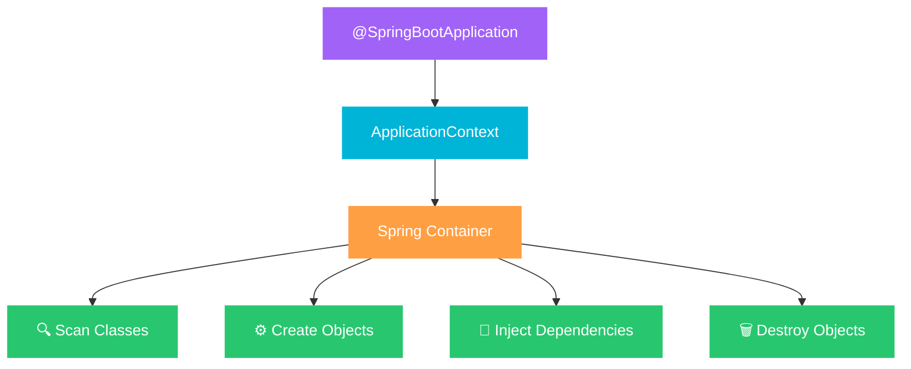
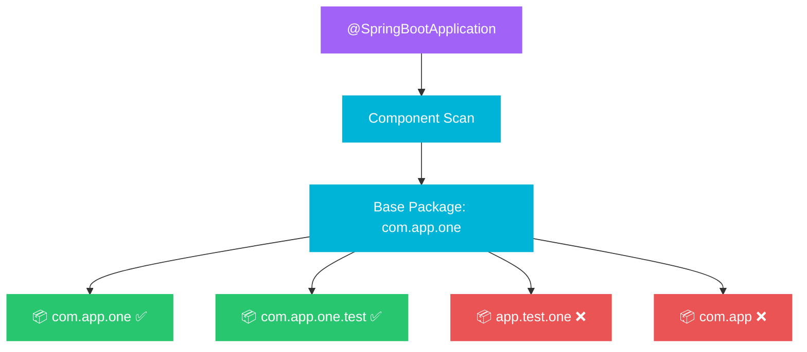
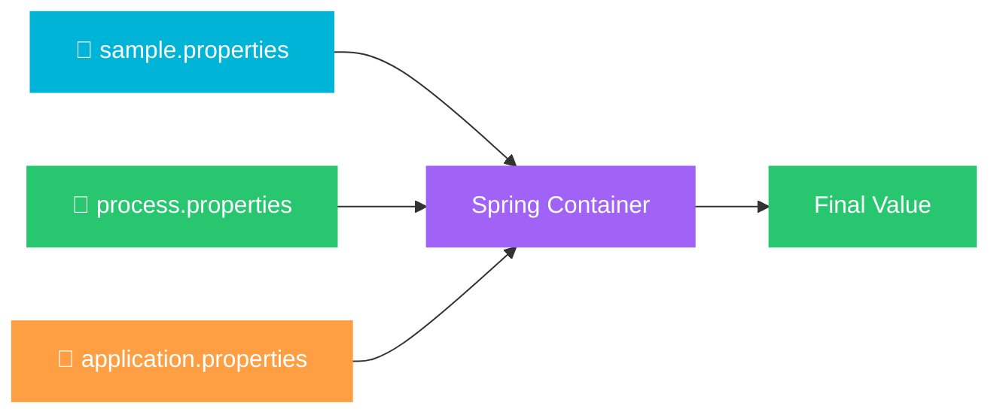
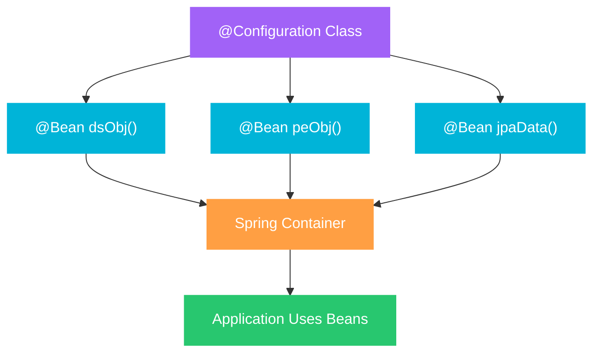

# Spring Boot Core Introduction

**Spring Boot Core Introduction** | Our Project is called a Child Project. This is connected to the parent Project (Spring Boot). We can create our Project using either Maven or Gradle.

- [Spring Annotation Configuration](#1-spring-annotation-configuration)
- [Component Scanning](#2-component-scanning)
- [Properties File (application.properties)](#3-properties-file-applicationproperties)
- [@PropertySource](#4-propertysource)
- [@Value](#5-value)
- [Example of loading Properties file from Multiple files](#6-example-of-loading-properties-file-from-multiple-files)
- [Spring Java Configuration](#7-spring-java-configuration)

---

Spring Boot Application must have 3 types of files. Those are:

1. 🚀 Starter class / Main class / Entry class / Bootstrap class
2. 📄 Input Files (`application.properties` or `application.yml`)
3. 🔨 Build Information file (Maven - `pom.xml`, Gradle - `build.gradle`)

**Starter class / Main class / Entry class / Bootstrap class** :- This class behaves as an entry point of execution. It mainly creates the Spring container, by taking inputs from the Programmer.

🧠 **In Simple Words:**
The starter class boots up the Spring container, which then manages all the objects in your application.

Spring container:-

- 🔍 Detect (Scan) our classes and create the object
- 📥 Provide data to object created
- 🔗 Link objects based on relations (HAS-A/Association Mapping)
- 🗑️ Finally, destroy objects (when we stop the application)

For this the programmer has to give two inputs:-

1. 📋 Spring Configuration File (XML/Java/**Annotation** *)
2. ⚙️ Spring Bean (class + rules given by container)

**Starter class example:**

```java
@SpringBootApplication
public class DemoApp {
    public static void main(String[] args) {
        SpringApplication.run(DemoApp.class, args);
    }
}
```

Spring container is two types:-

1. 🕰️ `BeanFactory(I)` (XML) [Legacy Container]
2. ⚡ `ApplicationContext(I)` [XML/Java/**Annotation**] [New container]

Spring Boot uses new Container only `ApplicationContext`. The implementation class is: `AnnotationConfigApplicationContext(C)`



---

## 1. Spring Annotation Configuration

There are 5 StereoType Annotations which are meant for object creation.

| Annotation 🏷️ | Purpose 📋 |
|---------------|-----------|
| **`@Component`** | ⚙️ Creating an object to our class |
| **`@Repository`** | 💾 Creating object + DB Operations (Insert, Update, Delete) |
| **`@Service`** | 🧮 Creating object + Calculations/Operations + Transaction Management etc. |
| **`@Controller`** | 🌐 Creating object + HTTP Protocol (web application) |
| **`@RestController`** | 📡 Creating object + HTTP protocol (Global Data support + REST calls) |

For Data/Link specific the following annotations are available:-

- 📥 **`@Value`** → Provide data. It is used for static data/expression/data from input files.
- 🔗 **`@Autowired`** / **`@Qualifier`** / **`@Primary`** → Linking objects

To use `@Component` => It must not be an interface or an abstract class.

**Using `@Component` on a class:**

```java
@Component
class DbConn { }
```

It creates an object using className, the first letter small in the spring container as follows:-

**Object created by container:**

```java
DbConn dbConn = new DbConn();
```

We can provide object names also:-

**Custom object name:**

```java
@Component("con")
class DbConn { }
```

We can provide data to variables using `@Value("Data")`

**Injecting values with `@Value`:**

```java
@Component
class DbConn {
    @Value("Oracle.Driver")
    String driver; // driver = "Oracle.Driver"
    // it is not reading value from the properties file,
    // it is direct assignment (hardcoded value)
}
```

📝 **Note:** When using `@Value` with a hardcoded string, it directly assigns the value. To read from a properties file, use the `${key}` syntax instead.

---

## 2. Component Scanning

It is the process of finding our classes by using one package name, done by Spring container.

- 📦 The container will read our class from the given package and sub-package classes.
- ⚠️ If our class is not under the given package then the object is not created.

We used to provide `@ComponentScan(basePackage="onePackageName")` to find classes by Spring container in Spring Framework but it is not required in Spring Boot. In Spring boot, by default starter class package is considered as basePackage. Therefore our classes must be provided under the starter class package or its sub-package.

> ⚠️ **Caution:** If our class is not under the base package or its sub-package then the container will not find and no object is created, if we try to read the object, the container says exception: `NoSuchBeanDefinitionException`: No bean named 'product' available.

**Example:-**
main class => package : `com.app.one`

| Class 🏷️ | Package 📦 | Detected? ✅❌️ |
|----------|-----------|--------------|
| **class#A** | `com.app.one` | ✅ YES |
| **class#B** | `app.test.one` | ❌️ NO |
| **class#C** | `com.app` | ❌️ NO |
| **class#D** | `com.app.one.test` | ✅ YES |

**Who will provide `@ComponentScan(basePackage="")` in Spring boot?**
Spring boot main class contains `@SpringBootApplication` that takes the main class package as basePackage.

**Can we modify the default base package in Spring Boot?**
YES. (But not recommended). We can provide manually using `@ComponentScan(basePackages="")` one or multiple packages. But in this case, the default package given by spring boot is overridden (i.e. no starter class package is now the base package).

💡 **Tip:** The word `basePackages` is optional.

**Single base package:**

```java
@ComponentScan(basePackages = "com.app")
// Or, for single package
@ComponentScan("com.app")
```

**Multiple base packages:**

```java
@ComponentScan(basePackages = {
        "com.app",
        "com.know.program",
        "text.xyz",
        "aa.bb.cc",
        "mno.pqr.sju"
    }
)

// Or

@ComponentScan({
        "com.app",
        "com.know.program",
        "text.xyz",
        "aa.bb.cc",
        "mno.pqr.sju"
    }
)
```

**Can we give an empty base package?**
Yes. In this case, again default is considered (again starter class). So overall it has no meaning.

**Empty base package:**

```java
@ComponentScan("")
```



---

## 3. Properties File (application.properties)

This file is used to store data in the key-value format in the application. Setup data is provided using the properties file. Example:-

- 💾 Database Connection like `driver-class=oracle`, `url=jdbc:orcl`, `username=system`, `password=tiger`
- 🗄️ ORM/JPA Properties like `dialect=MySQLDialect`, `show-sql=true`, `ddlauto=create`, etc.
- 🌐 MVC(web) `view.prefix=FolderName`, `suffix=.jsp`
- 📧 Email `host=gmail`, `un=jbr@gm.com`, `pwd=abcd` etc

In Spring boot properties file has a pre-defined name `application.properties` (we can modify even it). This file exists in `src/main/resource` folder. In Spring Boot, we can use two annotations to read data from the properties file.

1. 📥 **`@Value`** :- To read one key data.
2. 📋 **[`@ConfigurationProperties`](./03_Bulk_Loading_of_Properties_in_Spring_Boot.md)** :- To read bulk/multiple values.

We have two types of keys:-

1. 🔧 Pre-defined keys (given by [Spring boot](https://docs.spring.io/spring-boot/appendix/application-properties/index.html)).
2. 👨‍💻 Programmer-defined keys (given by the programmer).

The key can have symbols like dot(.) dash(-) and underscore(\_) only. However, using underscore is very rare.

📝 **Note:** Keys are case-sensitive ( `DRIVER=`, `Driver=`, `driver=` are different ).

**How to provide comments in the properties file?** Use **#**. If we use Symbol `#` that indicates a comment.

**Properties file example:**

```properties
# datasource properties
spring.datasource.url=jdbc:mysql://localhost:3306/test
spring.datasource.username=root
spring.datasource.password=root

#jpa properties
spring.jpa.show-sql=true
spring.jpa.hibernate.ddl-auto=create
```

**What will happen if we declare the key value multiple times?**
If we provide duplicate key=val (i.e. same key with different values), then the last combination is considered. it is like value overriding. Example:-

**Duplicate key example:**

```properties
sid=10
sid=20
sid=30
```

> 💡 **Tip:** The `sid` is 30 value taken in the application. The last value always wins for duplicate keys.

---

## 4. @PropertySource

**How can we load properties files into Spring Application using Annotation?**
Using **`@PropertySource("fileName+location")`**. Apart from the `application.properties` file if we want to load other properties files also then we can use `@PropertySource`.

**Example** of loading properties file **from** the **classpath**.

**Project structure:**

```
ProjectName
    |-src/main/resource <--- classpath
        |-abcd.properties
```

The `abcd.properties` file can be loaded as follows:-

**Loading from classpath:**

```java
@PropertySource("classpath:abcd.properties")
```

**Example** of loading properties file **from** a different **folder/directory**.

**Project structure:**

```
ProjectName
    |-myfiles <--- file
        |-abcd.properties
```

The `abcd.properties` file can be loaded as follows:-

**Loading from file path:**

```java
@PropertySource("file:./myfiles/abcd.properties")
```

Spring boot uses these codes to load the properties file. We can use it only if we want to read some specific properties file.

---

## 5. @Value

Syntax to read the value from the properties file: **`@Value("${key}")`**

It is used for reading data from properties. Example:- `@Value("${app.title}")`

> ⚠️ **Caution:** If we provide a key in code, which is not present in the properties file then spring boot throws an exception: `IllegalArgumentException`: Could not resolve placeholder 'app.titles' in value "${app.titles}". It means `app.titles` key does not exist in the properties file.

In the case of Spring Boot, `@SpringBootApplication` annotation loads by default `application.properties` into the Spring container. No need to write: `@PropertySource("classpath:application.properties")` annotation.

Let us demonstrate it through an example. Create a spring starter project, without any specific dependencies.

**`application.properties`** (under `src/main/resources`):

```properties
spring.application.name=PropertiesSample
app.title-one=KP
app.title-one=ABC
#Last combination is taken for duplicate keys
app.title-one=MNO
app.version=3.3
```

**`AppInfo.java`:**

```java
import org.springframework.beans.factory.annotation.Value;
import org.springframework.stereotype.Component;

@Component("ai")
public class AppInfo {

    @Value("${app.title-one}")
    private String title;

    @Value("${app.version}")
    private Double version;

    @Override
    public String toString() {
        return "AppInfo [title=" + title + ", version=" + version + "]";
    }
}
```

**Starter class:**

```java
package com.example.demo;

import org.springframework.boot.SpringApplication;
import org.springframework.boot.autoconfigure.SpringBootApplication;
import org.springframework.context.ApplicationContext;

@SpringBootApplication
public class PropertiesSampleApplication {

    public static void main(String[] args) {
        ApplicationContext ac = SpringApplication.run(
                     PropertiesSampleApplication.class, args);
        AppInfo appInfo = ac.getBean("ai", AppInfo.class);
        System.out.println(appInfo);
    }
}
```

📤 **Output:**

```
AppInfo [title=MNO, version=3.3]
```

Example of loading properties from another file. Create a `mydata.properties` file in the `src/main/resources` folder.

**`mydata.properties`:**

```properties
app.title-one=my title
app.version=888.88
```

> 📝 **Note:** Remove or comment on the existing properties from `application.properties` because the key is the same, and the `application.properties` file will get the first priority.

**Main class with `@PropertySource`:**

```java
@SpringBootApplication
@PropertySource("classpath:mydata.properties")
public class PropertiesSampleApplication {
    // existing code
}
```

📤 **Output:**

```
AppInfo [title=my title, version=888.88]
```

**If a key is present in both `application.properties` and our properties file (`abcd.properties`) then the value from which properties file will be considered?**
The `application.properties` file will be loaded at the last and it will override the existing value. Therefore the key value from the `application.properties` file will be considered.

**Can we create and load multiple property files in the application?**
Yes. Create multiple properties files and load using:-

**Loading multiple properties files:**

```java
@PropertySource({
    "classpath:mydata.properties",
    "classpath:myinfo.properties",
    "....",
    "....",
    "...."
})
```

**If we define the same key with different values in different properties files which one is selected?**
In Spring, if you define the same key with different values in multiple properties files, the value from the last-loaded properties file will override the previous ones. Example:-

**Property loading order:**

```java
@PropertySource({
    "classpath:sample.properties", // loading order 1st
    "classpath:process.properties" // loading order 2nd
})
```

- 1️⃣ `process.properties` is loaded last.
- 🔄 If a key exists in both `sample.properties` and `process.properties`, the value from `process.properties` will be used.
- 🔍 If the key does not exist in either, Spring will check the default `application.properties` file.



> 🔑 **Key Point:** `application.properties` always has the highest priority and overrides values from custom property files.

---

## 6. Example of loading Properties file from Multiple files

Define two manual properties files:- `sample.properties`, `admin.properties`
Create one class `Information` with properties:- `id`, `code`, `model`

**`sample.properties`:**

```properties
my.app.id=100
my.app.code=knowprogram
```

**`admin.properties`:**

```properties
my.app.model=V1.0
```

Task:- Read data using `@Value` as follows,

- 🔑 `id`, and `code` => Read them from `sample.properties`
- 🔑 `model` => Read it from `admin.properties`

Create a spring starter project with Lombok dependencies.

**`Information.java`:**

```java
package com.knowprogram.demo;

import org.springframework.beans.factory.annotation.Value;
import org.springframework.boot.CommandLineRunner;
import org.springframework.context.annotation.PropertySource;
import org.springframework.stereotype.Component;

import lombok.ToString;

@Component
@ToString
@PropertySource({ "classpath:sample.properties", "classpath:admin.properties" })
public class Information implements CommandLineRunner {

    @Value("${my.app.id}")
    private Integer id;

    @Value("${my.app.code}")
    private String code;

    @Value("${my.app.model}")
    private String model;

    @Override
    public void run(String... args) throws Exception {
        System.out.println(this);
    }
}
```

📤 **Output:**

```
Information(id=100, code=knowprogram, model=V1.0)
```

---

## 7. Spring Java Configuration

**If a class is pre-defined (we have only `.jar` or `.class` files) then in this case we can't use `@Component`.**

In that case, we use the Spring Java Configuration concept **`@Configuration`** and **`@Bean`**. `@Bean` indicates to container create object. Generally, this is used for pre-defined classes:-

🧠 **In Simple Words:**
Use `@Configuration` + `@Bean` when you cannot annotate the source code directly (e.g., third-party library classes).

1️⃣ **Step#1** Define one public class with any name and apply `@Configuration`

**Configuration class skeleton:**

```java
@Configuration
public class <anyName> {
}
```

2️⃣ **Step#2** Write one method for one object using the below syntax.

**Bean method syntax:**

```java
public <ClassName> <objectName>() {
    // object code
    return obj;
}
```

**Example-1:** There is a predefined class `MyDataSource` as follows:-

**Pre-defined class:**

```java
class MyDataSource {
    String driver;
}
```

**Spring Boot Java Configuration for this:**

```java
@Configuration
public class AppConfig {

    @Bean
    public MyDataSource dsObj() {
        MyDataSource d = new MyDataSource();
        d.setDriver("Oracle");
        return d;
    }
}
```

**Example-2:**

**Pre-defined class:**

```java
public class PdfExport {
    private String module;
}
```

**Configuration class:**

```java
@Configuration
public class AppConfig {

    @Bean
    public PdfExport peObj() {
        PdfExport p = new PdfExport();
        p.setModule("ABC");
        return p;
    }
}
```

> 📝 **Note:** The above code indicates creating an object in the spring container. The above object can be used anywhere in the application. It is a re-usable object.

We can not write a direct method without a class in Java. So, we need to keep all our objects (`@Bean`) methods inside any one class and apply `@Configuration` (that indicates input to Spring container).

**Example-3:** Consider the given class as pre-defined (you only create it under the project)

**Pre-defined class:**

```java
class JpaData {
    String dialect;
    Boolean showSql;
    String ddlAuto;
}
```

Create this object using Java-based Configuration and read and print using the Starter class/Runner class.

**`JpaData.java`:**

```java
package com.knowprogram.demo;

import lombok.Getter;
import lombok.Setter;
import lombok.ToString;

@Setter
@Getter
@ToString
public class JpaData {
    String dialect;
    Boolean showSql;
    String ddlAuto;
}
```

**`AppConfig.java`:**

```java
package com.knowprogram.demo;

import org.springframework.context.annotation.Bean;
import org.springframework.context.annotation.Configuration;

@Configuration
public class AppConfig {
    @Bean
    JpaData jpaData() {
        return new JpaData();
    }
}
```

**Runner class:**

```java
package com.knowprogram.demo;

import org.springframework.beans.factory.annotation.Autowired;
import org.springframework.boot.CommandLineRunner;
import org.springframework.stereotype.Component;

import lombok.ToString;

@Component
@ToString
public class RunnerDemo implements CommandLineRunner {

    @Autowired
    private JpaData jpaData;

    @Override
    public void run(String... args) throws Exception {
        jpaData.setDdlAuto("A");
        jpaData.setDialect("B");
        jpaData.setShowSql(false);
        System.out.println(this);
    }

}
```

📤 **Output:**

```
RunnerDemo(jpaData=JpaData(dialect=B, showSql=false, ddlAuto=A))
```


