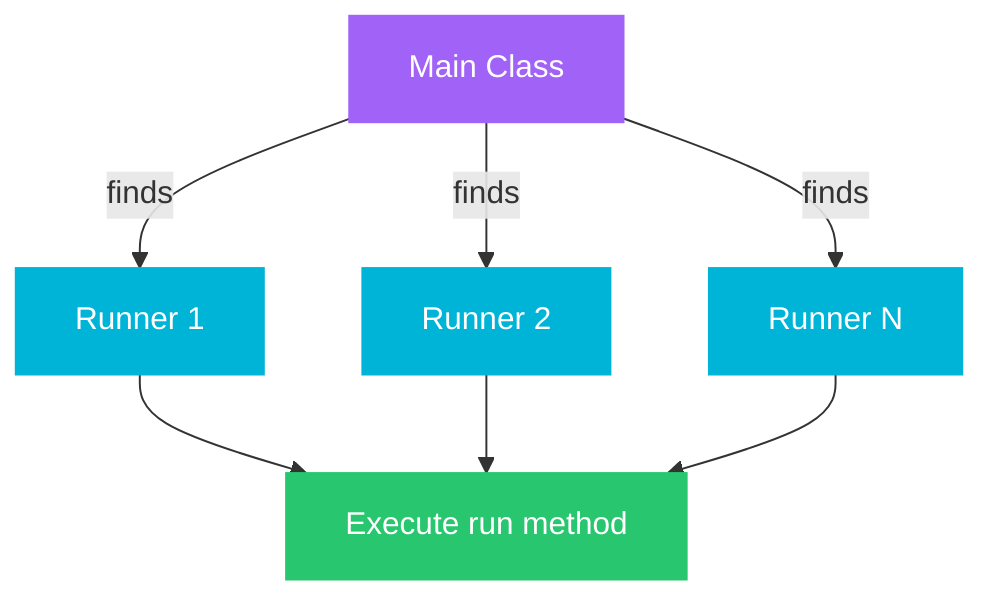
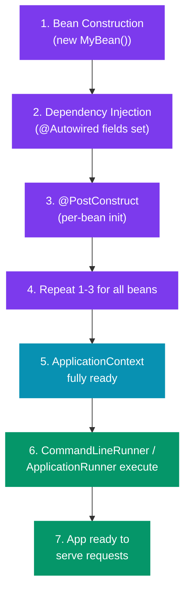

# Runners in Spring Boot

**Runners in Spring Boot** | Runners in Spring Boot are used to execute any logic only once when the application is getting started. They are used for setup/test purposes/batch processing. Usually, they are used in dev and testing environments.

- [CommandLineRunner Interface In Spring Boot](#1-commandlinerunner-interface-in-spring-boot)
- [Working with Multiple Runners in Spring Boot](#2-working-with-multiple-runners-in-spring-boot)
- [Example of Multiple Runners](#3-example-of-multiple-runners)
- [Production Use Cases](#4-production-use-cases)
- [Runner vs @PostConstruct](#5-runner-vs-postconstruct)
- [Interview & System Design Questions](#6-interview--system-design-questions)

There are two types of Runners in Spring Boot:

- 🖥️ `CommandLineRunner`(I)
- ⚙️ `ApplicationRunner`(I)

🏗️ Spring boot starter class (main class) will find all runner classes and execute/call them.



---

## 1. CommandLineRunner Interface In Spring Boot

It is a **marker interface** and **contains only one abstract method: `run()`**. It does not contain any other static or default methods.

To demonstrate it create a Spring boot project. We have to define a class that **implements** the **`CommandLineRunner`** interface **overriding** the **`run()` method** and **add `@Component`**.

📝 **Note:** Add `@Component` to the class, and implement the `CommandLineRunner` marker interface, which will include the `run()` method. Write the required logic in the `run()` method.

**MyRunner class:**

```java
package com.knowprogram.demo;

import org.springframework.boot.CommandLineRunner;
import org.springframework.stereotype.Component;

@Component
public class MyRunner implements CommandLineRunner {

    @Override
    public void run(String... args) throws Exception {
        System.out.println("MyRunner.run()");
    }

}
```

📤 **Output In Console:**

```
MyRunner.run()
```

### Example 2 - CommandLineRunner in Starter Class

Instead of creating a separate class, we can also implement `CommandLineRunner` in the starter class as follows:

**Starter class implementing CommandLineRunner:**

```java
package com.knowprogram.demo;

import org.springframework.boot.CommandLineRunner;
import org.springframework.boot.SpringApplication;
import org.springframework.boot.autoconfigure.SpringBootApplication;

@SpringBootApplication
public class CommandLineRunnerDemoApplication implements CommandLineRunner {

    public static void main(String[] args) {
        SpringApplication.run(CommandLineRunnerDemoApplication.class, args);
    }

    @Override
    public void run(String... args) throws Exception {
        System.out.println("CommandLineRunnerDemoApplication.run()");
    }

}
```

### Example 3 - Reading Properties File Values

Reading Properties file values and displaying them through `CommandLineRunner`.

**application.properties:**

```properties
know.app.id = 5
know.app.code = knowprogram
know.app.cost = 5000
```

**DataRunner class:**

```java
package com.knowprogram.demo;

import org.springframework.beans.factory.annotation.Value;
import org.springframework.boot.CommandLineRunner;
import org.springframework.stereotype.Component;

@Component
public class DataRunner implements CommandLineRunner {

    @Value("${know.app.id}")
    private Integer id;

    @Value("${know.app.code}")
    private String code;

    @Value("${know.app.cost}")
    private Double cost;

    @Override
    public void run(String... args) throws Exception {
        System.out.println(this);
    }

    @Override
    public String toString() {
        return "DataRunner [id=" + id + ", code=" + code + ", cost=" + cost + "]";
    }

}
```

📤 **Console Output:**

```
DataRunner [id=5, code=knowprogram, cost=5000.0]
```

---

## 2. Working with Multiple Runners in Spring Boot

We can even define multiple runners in the application. They are executed in naming order (A-Z naming rule).

🛠️ **Example:** Consider these runners: `SecurityRunner`, `MvcRunner`, and `JdbcRunner`. They are executed in naming order:

1. `JdbcRunner`
2. `MvcRunner`
3. `SecurityRunner`

We can provide our own execution order using annotation **`@Order`**(number). Runner having the lowest number executed first.

🏷️ **Example with `@Order`:**

- `ARunner` -- `@Order(30)`
- `BRunner` -- `@Order(12)`
- `CRunner` -- `@Order(55)`

✅ Execution order is: `BRunner`, `ARunner`, `CRunner`

### Ordering Rules and Edge Cases

**Case-1.** If we provide negative numbers, the same concept applies. The lowest number is the highest priority.

- `ARunner` -- `@Order(-51)`
- `BRunner` -- `@Order(36)`
- `CRunner` -- `@Order(0)`
- `DRunner` -- `@Order(12)`
- `ERunner` -- `@Order(-25)`

✅ Execution order is: `ARunner`, `ERunner`, `CRunner`, `DRunner`, `BRunner`.

**Case-2.** In case of multiple runners, if any runner is not assigned with order then executed last in order.

**Case-3.** If we give `@Order` but no value or no annotation even, then the value is: `2147483647` (`Integer.MAX_VALUE`) i.e. unordered Runners are executed at last (with naming rule applied).

| Runner 🏷️ | Annotation ⚙️ | Effective Value 🔢 |
|-----------|--------------|-------------------|
| **A** | `@Order(5)` | `5` |
| **B** | `@Order` (no value) | `2147483647` |
| **C** | `@Order(-9)` | `-9` |
| **D** | No annotation | `2147483647` |
| **E** | `@Order` (no value) | `2147483647` |

📋 **Execution flow:**

- 1️⃣ First consider `@Order` with value: `C`, `A`
- 2️⃣ Next, consider `@Order` without value / no annotation (naming order): `B`, `D`, `E`

✅ So, the execution order is: **C, A, B, D, E**

**Case-4.** If runners are given the same order, then again naming rule is applied:

- `Z` -- `@Order(5)`
- `M` -- `@Order(5)`
- `A` -- `@Order(5)`

✅ Execution flow: **A, M, Z**

> 🔑 **Key Point:** Always execution order is A-Z or negative -> zero -> positive. The reverse is not possible.


---

## 3. Example of Multiple Runners

We need to execute a few sets of runners in order, like:

- 4 Runners -- First
- 3 Runners -- Next
- 6 Runners -- Next
- 2 Runners -- Last

In this case, define one `CustomOrder` interface and use the same for ordering:

**CustomOrder interface:**

```java
public interface CustomOrder {
    int FIRST = -9999;
    int NEXT = 1111;
    int MID = 5555;
    int LAST = 9999;
}
```

**DataSourceRunner (FIRST priority):**

```java
@Component
@Order(CustomOrder.FIRST)
public class DataSourceRunner implements CommandLineRunner {
    @Override
    public void run(String... args) throws Exception {
        System.out.println("DataReadRunner.run()");
    }
}
```

**DBPoolRunner (FIRST priority):**

```java
@Component
@Order(CustomOrder.FIRST)
public class DBPoolRunner implements CommandLineRunner {
    @Override
    public void run(String... args) throws Exception {
        System.out.println("DBPoolRunner.run()");
    }
}
```

**JDBCRunner (NEXT priority):**

```java
@Component
@Order(CustomOrder.NEXT)
public class JDBCRunner implements CommandLineRunner {
    @Override
    public void run(String... args) throws Exception {
        System.out.println("JDBCRunner.run()");
    }
}
```

**AdminRunner (MID priority):**

```java
@Component
@Order(CustomOrder.MID)
public class AdminRunner implements CommandLineRunner {
    @Override
    public void run(String... args) throws Exception {
        System.out.println("Admin.run()");
    }
}
```

**AppTestRunner (MID priority):**

```java
@Component
@Order(CustomOrder.MID)
public class AppTestRunner implements CommandLineRunner {
    @Override
    public void run(String... args) throws Exception {
        System.out.println("AppTestRunner.run()");
    }
}
```

**MVCRunner (LAST priority):**

```java
@Component
@Order(CustomOrder.LAST)
public class MVCRunner implements CommandLineRunner {
    @Override
    public void run(String... args) throws Exception {
        System.out.println("MVCRunner.run()");
    }
}
```

**SecurityRunner (LAST priority):**

```java
@Component
@Order(CustomOrder.LAST)
public class SecurityRunner implements CommandLineRunner {
    @Override
    public void run(String... args) throws Exception {
        System.out.println("SecurityRunner.run()");
    }
}
```

📤 **Execution Order Output:**

```
DataReadRunner.run()
DBPoolRunner.run()
JDBCRunner.run()
Admin.run()
AppTestRunner.run()
SecurityRunner.run()
MVCRunner.run()
```

> 💡 **Tip:** Using a `CustomOrder` interface with named constants makes runner ordering much more readable and maintainable than using raw numbers.

---

## 4. Production Use Cases

Runners execute **after** the `ApplicationContext` is fully loaded but **before** the app starts serving requests. This makes them ideal for one-time setup tasks.

### 4.1 Database Seed / Reference Data Loading

Load lookup tables or master data on first deployment. Use `@Profile` to restrict to dev/staging.

```java
@Component
@Order(1)
@Profile("dev")
public class DataSeeder implements CommandLineRunner {
    @Autowired 
    private RoleRepository roleRepo;

    @Override
    public void run(String... args) {
        if (roleRepo.count() == 0) {
            roleRepo.saveAll(List.of(
                new Role("ADMIN"), new Role("USER"), new Role("MANAGER")
            ));
            log.info("Seeded 3 roles into database");
        }
    }
}
```

**Fintech example:** Seed loan statuses (`DRAFT`, `SUBMITTED`, `APPROVED`, `DISBURSED`), document types, or product configs on first deploy.

### 4.2 Cache Warm-up (Redis Pre-loading)

Pre-populate cache to avoid a **cache-miss storm** on cold start — critical for high-traffic APIs.

```java
@Component
@Order(2)
public class CacheWarmer implements CommandLineRunner {
    @Autowired
    private ProductService productService;
    @Autowired
    private RedisTemplate<String, Object> redis;

    @Override
    public void run(String... args) {
        List<Product> topProducts = productService.getTop100();
        topProducts.forEach(p ->
            redis.opsForValue().set("product:" + p.getId(), p, Duration.ofHours(6))
        );
        log.info("Warmed cache with {} products", topProducts.size());
    }
}
```

### 4.3 External Service Health Check on Startup

Validate that critical dependencies (payment gateway, SMS provider) are reachable before serving traffic.

```java
@Component
public class DependencyChecker implements ApplicationRunner {
    @Autowired
    private RestTemplate restTemplate;

    @Override
    public void run(ApplicationArguments args) {
        try {
            restTemplate.getForEntity("http://payment-gateway/health", String.class);
            log.info("✅ Payment gateway is reachable");
        } catch (Exception e) {
            log.error("⚠️ Payment gateway unreachable — app may fail at runtime", e);
            // Don't throw — let app start, but alert ops team
        }
    }
}
```

### 4.4 Schema / Migration Validation

Fail fast if a critical table is missing — better than a runtime `SQLSyntaxErrorException`.

```java
@Component
public class MigrationValidator implements CommandLineRunner {
    @Autowired
    private DataSource dataSource;

    @Override
    public void run(String... args) throws Exception {
        try (Connection conn = dataSource.getConnection()) {
            DatabaseMetaData meta = conn.getMetaData();
            ResultSet rs = meta.getTables(null, null, "loan_applications", null);
            if (!rs.next()) {
                throw new IllegalStateException(
                    "Critical table 'loan_applications' missing! Run Flyway migrations first."
                );
            }
        }
    }
}
```

### 4.5 Kafka Topic Verification

Verify that required Kafka topics exist before consumers start listening.

```java
@Component
public class KafkaTopicChecker implements CommandLineRunner {
    @Autowired
    private AdminClient kafkaAdmin;

    @Override
    public void run(String... args) throws Exception {
        Set<String> required = Set.of("loan-events", "payment-events", "notification-events");
        Set<String> existing = kafkaAdmin.listTopics().names().get();

        Set<String> missing = new HashSet<>(required);
        missing.removeAll(existing);

        if (!missing.isEmpty()) {
            log.warn("⚠️ Missing Kafka topics: {} — consumers may fail", missing);
        } else {
            log.info("✅ All required Kafka topics exist");
        }
    }
}
```

### 4.6 Scheduled Job Registration / Cron Initialization

Dynamically register scheduled tasks at startup instead of hardcoding `@Scheduled`.

```java
@Component
public class SchedulerInitializer implements CommandLineRunner {
    @Autowired
    private TaskScheduler scheduler;
    @Autowired
    private ReportGenerator reportGen;

    @Override
    public void run(String... args) {
        scheduler.scheduleAtFixedRate(reportGen::generateDaily, Duration.ofHours(24));
        log.info("Daily report scheduler initialized");
    }
}
```

---

## 5. Runner vs @PostConstruct

### Spring Boot Startup Execution Order



| Feature | `@PostConstruct` | `CommandLineRunner` / `ApplicationRunner` |
|---------|-----------------|------------------------------------------|
| **When it runs** | After bean is created, dependencies injected | After **all** beans are created, context fully ready |
| **Scope** | Per-bean (runs for each bean that has it) | Per-application (runs once at startup) |
| **Access to other beans** | ⚠️ Other beans may not be fully initialized yet | ✅ All beans are fully initialized |
| **Access to CLI args** | ❌️ No | ✅ Yes (`String[]` or `ApplicationArguments`) |
| **Can fail startup** | ✅ Yes (throws → bean creation fails) | ✅ Yes (throws → app startup aborts) |
| **Use case** | Initialize **this bean's** internal state | Initialize **application-level** state (cache, DB seed, health checks) |
| **Annotation** | `@PostConstruct` (Jakarta/JSR-250) | Implement `CommandLineRunner` or `ApplicationRunner` interface |

**Rule of thumb:**
- Need to set up **this specific bean**? → `@PostConstruct`
- Need to set up **cross-cutting app state** that depends on multiple beans? → Runner

Execution order:-
  1. Bean creation (constructor)
  2. Dependency injection (`@Autowired`)
  3. @PostConstruct — per bean, right after that bean's dependencies are injected
  4. (repeat 1-3 for all beans)
  5. ApplicationContext fully ready
  6. `CommandLineRunner` / `ApplicationRunner` — after ALL beans are created and initialized

So @PostConstruct runs during context initialization (per-bean), while Runners run after the entire context is ready.

```java
// @PostConstruct — initializing THIS bean's internal cache
@Service
public class CurrencyService {
    private Map<String, Double> rates;

    @PostConstruct
    void init() {
        rates = Map.of("USD", 1.0, "INR", 83.5, "EUR", 0.92);
    }
}

// Runner — cross-cutting setup that depends on multiple beans
@Component
public class AppInitializer implements CommandLineRunner {
    @Autowired
    private CurrencyService currencyService;
    @Autowired
    private ProductService productService;
    @Autowired
    private RedisTemplate<String, Object> redis;

    @Override
    public void run(String... args) {
        // Needs both services fully initialized
        productService.getAll().forEach(p -> {
            double inrPrice = p.getPrice() * currencyService.getRate("INR");
            redis.opsForValue().set("price:inr:" + p.getId(), inrPrice);
        });
    }
}
```

---

## 6. Interview & System Design Questions

### 6.1 Direct Interview Questions

**Q1: What is the difference between `CommandLineRunner` and `ApplicationRunner`?**
- `CommandLineRunner` receives raw `String... args`
- `ApplicationRunner` receives parsed `ApplicationArguments` with `getOptionValues()`, `containsOption()`, `getNonOptionArgs()`
- Both run after context is loaded, both support `@Order`

**Q2: How do you control the execution order of multiple runners?**
- Use `@Order(n)` annotation — lower value = higher priority
- `@Order` works **across both types** (CLR and AppRunner are not ordered separately)

**Q3: What happens if a runner throws an exception?**
- Application startup **aborts** — Spring Boot will shut down
- Wrap non-critical logic in try-catch if the app should start regardless

**Q4: Can you use `@Profile` with runners?**
- ✅ Yes — `@Profile("dev")` on a runner means it only runs in that profile
- Common pattern: data seeder runs in `dev`, health checker runs in `prod`

### 6.2 System Design Angles

Runners come up in system design interviews when discussing **startup behavior** and **cold start optimization**:

| Design Problem | Runner's Role |
|---|---|
| **Design a notification service** | Warm template cache, validate SMS/email provider connectivity |
| **Design a rate limiter** | Pre-load rate limit configs from DB into Redis |
| **Design an e-commerce platform** | Seed product catalog cache, verify payment gateway health |
| **How do you handle cold starts in microservices?** | Pre-fetch config from Config Server, warm connection pools |

### 6.3 Tricky Follow-ups

**"If your cache warm-up takes 30 seconds, does the app serve traffic during that time?"**
→ **No.** Runners complete before the app is marked as ready. In Kubernetes, the readiness probe fails until runners finish — no traffic is routed to the pod.

**"Would you put DB migration in a runner?"**
→ **No.** Use Flyway or Liquibase — they run before Spring context initializes and handle versioning, rollback, and idempotency. Runners are for **application-level** setup, not schema changes.

**"Runner vs `@PostConstruct` — when would you use each?"**
→ `@PostConstruct` runs per-bean before context is fully ready. Runner runs after **all** beans are created. Use runner when your setup depends on multiple beans being fully initialized (e.g., cache warm-up that needs both `ProductService` and `RedisTemplate`).

---

---
