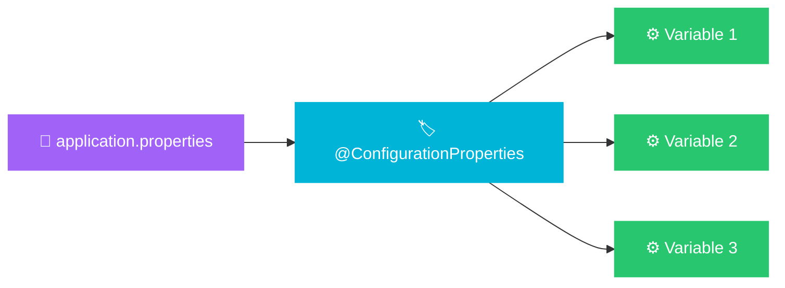
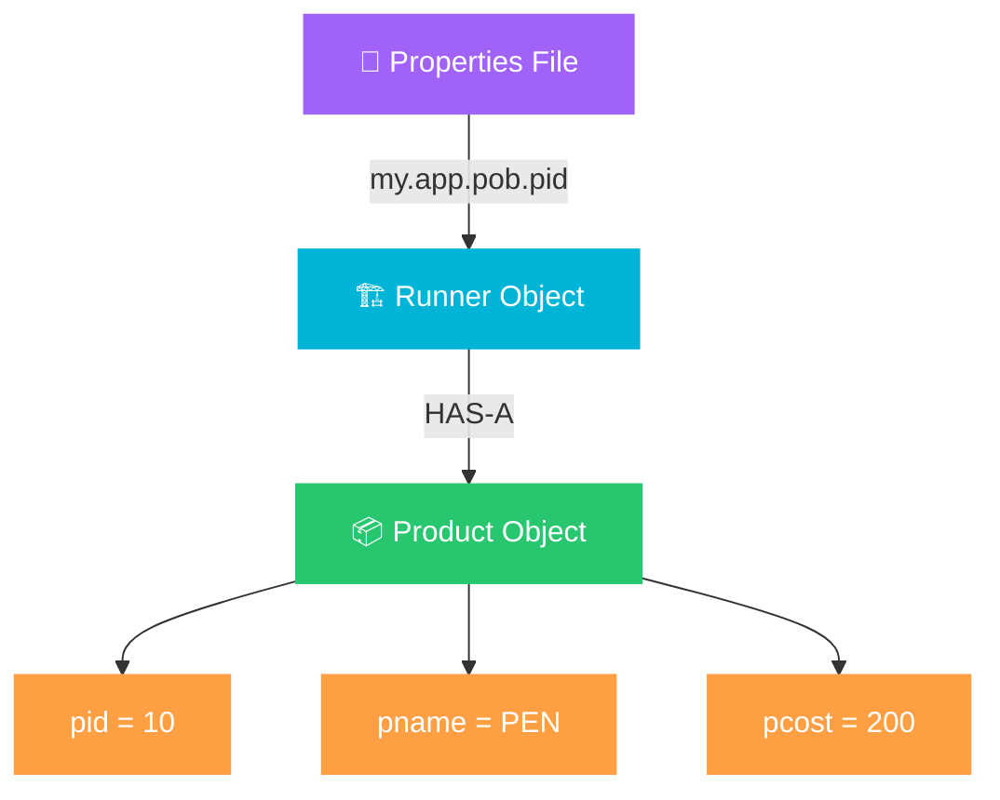

# Bulk Loading of Properties in Spring Boot

**Bulk Loading of Properties in Spring Boot** | `@Value` annotation is used to read data from properties files i.e. from one key to one variable. If we have 20 variables in a class then 20 times we have to write `@Value` which is not a good approach for multiple variables. In that case, we can use Bulk loading using `@ConfigurationProperties`.

- [Understanding @ConfigurationProperties](#1-understanding-configurationproperties)
- [Basic Example](#2-basic-example)
- [Edge Cases](#3-edge-cases)
- [@ConfigurationProperties with One-Dimensional Collections and Array](#4-configurationproperties-with-one-dimensional-collections-and-array)
- [@ConfigurationProperties with Map](#5-configurationproperties-with-map)
- [@ConfigurationProperties with Class and Object](#6-configurationproperties-with-class-and-object)
- [Comprehensive Example: Student Object](#7-comprehensive-example-student-object)
- [Production Use Cases](#8-production-use-cases)
- [@Value vs @ConfigurationProperties — When to Use Which](#9-value-vs-configurationproperties--when-to-use-which)

---

## 1. Understanding @ConfigurationProperties

`@ConfigurationProperties` is also called **Bulk Loading** or reading multiple keys from properties files to our variables at a time.



🔑 **Rules while working with @ConfigurationProperties:**

- 📄 Define the key name using the `prefix.variableName` format in the properties file.
- 🏷️ Provide that common prefix in your class using annotation `@ConfigurationProperties(prefix="")`.
- ⚙️ Define variables in your class including setter & getter methods. You can also override the `toString()` method.

---

## 2. Basic Example

Create a Spring Starter project with [Lombok](./07_Project_Lombok_Annotations_With_Examples.md) dependency.

**application.properties:**

```properties
know.app.id = 5
know.app.code = knowprogram
know.app.cost = 5000
```

**DataRunner.java:**

```java
package com.knowprogram.demo;

import org.springframework.boot.CommandLineRunner;
import org.springframework.boot.context.properties.ConfigurationProperties;
import org.springframework.stereotype.Component;

import lombok.Getter;
import lombok.Setter;

@Component
@Getter
@Setter
@ConfigurationProperties(prefix = "know.app")
public class DataRunner implements CommandLineRunner {
    private Integer id;
    private String code;
    private Double cost;

    @Override
    public void run(String... args) throws Exception {
        System.out.println(this);
    }

    @Override
    public String toString() {
        return "DataRunner [id=" + id + ", code=" + code + ", cost=" + cost + "]";
    }

}
```

📤 **Console Output:**

```
DataRunner [id=5, code=knowprogram, cost=5000.0]
```

---

## 3. Edge Cases

### Case 1: Key Not Present in Properties File

What happens if the key is not present in the properties file and we try to read the same key?

**application.properties:**

```properties
#know.app.id = 5
know.app.code = knowprogram
know.app.cost = 5000
```

| Approach 🏷️ | Behavior 📋 |
|-------------|------------|
| **`@Value`** | ❌️ Throws `IllegalArgumentException` |
| **`@ConfigurationProperties`** | ✅ Gives default value (`null`/`0`/`0.0`/`false`) |

📤 **Output:**

```
DataRunner [id=null, code=knowprogram, cost=5000.0]
```

💡 **Tip:** Internally `@ConfigurationProperties` uses the setter method. Logic looks like: `object.setVariable(key)`. Example: `ob.setCode(code);` — auto parsing is supported.

### Case 2: Value and Datatype Mismatch

What if the value and datatype do not match? For example, in the properties file `id` contains a String but the data type of the variable is `int`.

**application.properties:**

```properties
know.app.id = program
know.app.code = knowprogram
know.app.cost = 5000
```

In that case, the application will fail to start and give this message:

📤 **Error Output:**

```
Failed to bind properties under 'know.app.id' to java.lang.Integer:

Property: know.app.id
Value: "program"
Origin: class path resource [application.properties] - 1:15
Reason: failed to convert java.lang.String to java.lang.Integer (caused by java.lang.NumberFormatException: For input string: "program")

Action:
Update your application's configuration
```

> ⚠️ **Warning:** Always ensure that property values match the expected Java data types to avoid startup failures.

### Case 3: Duplicate Keys in Properties File

What if the properties file contains duplicate keys?

**application.properties:**

```properties
know.app.id = 10
know.app.id = 20
know.app.id = 30
know.app.code = knowprogram
know.app.cost = 5000
```

Values are read from top to bottom and the **last value will be taken**.

📤 **Output:**

```
DataRunner [id=30, code=knowprogram, cost=5000.0]
```

### Case 4: Prefix/Variable Name Mismatch

What will happen if prefixes/variables do not match in bulk loading?

**Annotation:**

```java
@ConfigurationProperties(prefix = "know.apps")
```

**application.properties:**

```properties
know.app.id = 10
knows.app.code = knowprogram
know.apps.cost = 5000
```

`@ConfigurationProperties` will never throw any error/exception. It will read only matching variables data. Other values are ignored, so it holds default values for non-matching keys/variables.

📤 **Output:**

```
DataRunner [id=null, code=null, cost=5000.0]
```

> 📝 **Note:** `@ConfigurationProperties` is fault-tolerant — it silently ignores mismatched prefixes and assigns default values instead of throwing exceptions.

---

## 4. @ConfigurationProperties with One-Dimensional Collections and Array

If we define a variable of type `List`/`Set`/`Array` then in the properties file we have to pass data using the below syntax:

```properties
prefix.variableName[index]=value
```

⚠️ **Caution:** Index numbers must start from zero and should be given in order, else the application will not start.

**application.properties:**

```properties
my.app.data[0]=A
my.app.data[1]=B
my.app.data[2]=C
my.app.data[3]=C
```

In the class, it can be read using one of the following:

- 📋 `List<String> data`
- 🗂️ `Set<String> data`
- 📄 `String[] data`

**CollectionDataRunner.java:**

```java
package com.knowprogram.demo;

import java.util.List;

import org.springframework.boot.CommandLineRunner;
import org.springframework.boot.context.properties.ConfigurationProperties;
import org.springframework.stereotype.Component;

import lombok.Getter;
import lombok.Setter;
import lombok.ToString;

@Component
@Setter
@Getter
@ToString
@ConfigurationProperties(prefix = "my.app")
public class CollectionDataRunner implements CommandLineRunner {

    private List<String> data;

    @Override
    public void run(String... args) throws Exception {
        System.out.println(this);
    }

}
```

📤 **Output:**

```
CollectionDataRunner(data=[A, B, C])
```

### Duplicate Values with Set vs List

**application.properties (with duplicates):**

```properties
my.app.data[0]=A
my.app.data[1]=A
my.app.data[2]=A
my.app.data[3]=A
```

| Collection Type 📦 | Behavior 📋 | Output 📤 |
|-------------------|------------|----------|
| **`Set<String>`** | ❌️ Removes duplicates | `data=[A]` |
| **`List<String>`** | ✅ Keeps all duplicates | `data=[A, A, A, A]` |

**With Set:**

```java
private Set<String> data;
// related Setter, Getter & toString methods
```

📤 **Output:**

```
CollectionDataRunner(data=[A])
```

**With List:**

```java
private List<String> data;
// related Setter, Getter & toString methods
```

📤 **Output:**

```
CollectionDataRunner(data=[A, A, A, A])
```

### Runtime Implementation Classes

Spring / Spring Boot recommends using interfaces — at runtime, implementation classes are auto-selected by the Spring container:

| Interface 🏷️ | Runtime Implementation ⚙️ |
|-------------|--------------------------|
| **`List`** | `ArrayList` |
| **`Set`** | `LinkedHashSet` |
| **`Map`** | `LinkedHashMap` |

💡 **Tip:** Due to `ArrayList`, `LinkedHashSet`, and `LinkedHashMap`, the insertion order is preserved.

**Verifying the runtime class:**

```java
@Component
@Setter
@Getter
@ToString
@ConfigurationProperties(prefix = "my.app")
public class CollectionDataRunner implements CommandLineRunner {

    private List<String> data;

    @Override
    public void run(String... args) throws Exception {
        System.out.println(data.getClass().getName());
        System.out.println(this);
    }

}
```

📤 **Console Output:**

```
java.util.ArrayList
CollectionDataRunner(data=[A, A, A, A])
```

---

## 5. @ConfigurationProperties with Map

**Syntax:** `prefix.variable.mapKey=mapVal`

**application.properties:**

```properties
my.app.subjects.eng=85
my.app.subjects.mat=95
my.app.subjects.sci=90
```

📝 **Note:** We must declare the Key as `String` only; the value can be any type: `Map<String, Integer> subjects`

**CollectionDataRunner.java:**

```java
@Component
@Setter
@Getter
@ToString
@ConfigurationProperties(prefix = "my.app")
public class CollectionDataRunner implements CommandLineRunner {

    private Map<String, Integer> subjects;

    @Override
    public void run(String... args) throws Exception {
        System.out.println(subjects.getClass().getName());
        System.out.println(this);
    }

}
```

📤 **Output:**

```
java.util.LinkedHashMap
CollectionDataRunner(subjects={eng=85, mat=95, sci=90})
```

### Duplicate Keys in Map

If duplicate keys are present then the **last one will be considered**.

**application.properties:**

```properties
my.app.subjects.eng=85
my.app.subjects.mat=95
my.app.subjects.sci=90
my.app.subjects.sci=70
my.app.subjects.sci=50
```

📤 **Output:**

```
CollectionDataRunner(subjects={eng=85, mat=95, sci=50})
```

### Case-Sensitive Keys

The keys are **case-sensitive** and considered different.

**application.properties:**

```properties
my.app.subjects.eng=85
my.app.subjects.mat=95
my.app.subjects.sci=90
my.app.subjects.SCI=70
```

📤 **Output:**

```
CollectionDataRunner(subjects={eng=85, mat=95, sci=90, SCI=90})
```

> 🔑 **Key Point:** Notice that both `sci` and `SCI` hold `90` but in the `application.properties` file, the values were different. This is because properties are read as Strings first and type casting is done afterward.

### Type Mismatch in Map Values

In Java, by default data is read in the String representation and later type casting will be done.

**application.properties:**

```properties
my.app.subjects.eng=85
my.app.subjects.mat=95
my.app.subjects.sci=9.0
```

> ⚠️ **Warning:** In this case, the application fails to start. Reason: failed to convert `java.lang.String` to `java.lang.Integer` (caused by `NumberFormatException`: For input string: "9.0").

---

## 6. @ConfigurationProperties with Class and Object

In this case, use the below syntax to define keys in properties: `prefix.hasAVariable.variable=<value>`



**application.properties:**

```properties
my.app.pob.pid=10
my.app.pob.pname=PEN
my.app.pob.pcost=200
```

**Product.java:**

```java
@Getter
@Setter
@ToString
public class Product {
    private Integer pid;
    private String pname;
    private Double pcost;
}
```

**ObjectConfigPropsRunner.java:**

```java
@Component
@Getter
@Setter
@ToString
@ConfigurationProperties(prefix = "my.app")
public class ObjectConfigPropsRunner implements CommandLineRunner {

    // variable name must be same as defined in properties file
    private Product pob; // HAS-A

    @Override
    public void run(String... args) throws Exception {
        System.out.println(this);
    }

}
```

📤 **Output:**

```
ObjectConfigPropsRunner(pob=Product(pid=10, pname=PEN, pcost=200.0))
```

---

## 7. Comprehensive Example: Student Object

Perform the following tasks:

1. Define one `CommandLineRunner`.
2. Create variables for student (`sid`, `sname`, `sfee`, `subjects:List<String>`, `grade`).
3. Read data from properties files using `@ConfigurationProperties`.

**application.properties:**

```properties
my.app.student.sid=11
my.app.student.sname=Jerry
my.app.student.sfee=1000
my.app.student.subjects[0]=Math
my.app.student.subjects[1]=English
my.app.student.subjects[2]=Science
my.app.student.grade=A
```

**Student.java:**

```java
package com.knowprogram.demo;

import java.util.List;

import lombok.Getter;
import lombok.Setter;
import lombok.ToString;

@Getter
@Setter
@ToString
public class Student {
    private Integer sid;
    private String sname;
    private Double sfee;
    private List<String> subjects;
    private String grade;
}
```

**ObjectConfigPropsRunner.java:**

```java
package com.knowprogram.demo;

import org.springframework.boot.CommandLineRunner;
import org.springframework.boot.context.properties.ConfigurationProperties;
import org.springframework.stereotype.Component;

import lombok.Getter;
import lombok.Setter;
import lombok.ToString;

@Component
@Getter
@Setter
@ToString
@ConfigurationProperties(prefix = "my.app")
public class ObjectConfigPropsRunner implements CommandLineRunner {

    private Student student; // HAS-A

    @Override
    public void run(String... args) throws Exception {
        System.out.println(this);
    }

}
```

📤 **Output:**

```
ObjectConfigPropsRunner(student=Student(sid=11, sname=Jerry, sfee=1000.0, subjects=[Math, English, Science], grade=A))
```

---

## 8. Production Use Cases

`@ConfigurationProperties` is the standard approach when you have **5+ related properties** that belong together. Here are real-world use cases across different domains:

### 8.1 Payment Gateway Integration

```java
@ConfigurationProperties(prefix = "payment.razorpay")
public class RazorpayConfig {
    private String apiKey;
    private String secretKey;
    private String webhookSecret;
    private int timeout;
    private int retryCount;
    private String callbackUrl;
    private boolean testMode;
}
```

```yaml
payment:
  razorpay:
    api-key: ${RAZORPAY_API_KEY}
    secret-key: ${RAZORPAY_SECRET_KEY}
    webhook-secret: ${RAZORPAY_WEBHOOK_SECRET}
    timeout: 5000
    retry-count: 3
    callback-url: https://api.company.com/payments/callback
    test-mode: false
```

### 8.2 Multi-Tenant SaaS Configuration

```java
@ConfigurationProperties(prefix = "tenants")
public class TenantConfig {
    private Map<String, TenantProperties> config; // key = tenant ID

    public static class TenantProperties {
        private String dbUrl;
        private String dbUsername;
        private String s3Bucket;
        private String logo;
    }
}
```

```yaml
tenants:
  config:
    hdfc:
      db-url: jdbc:postgresql://hdfc-db:5432/hdfc
      s3-bucket: hdfc-documents
    icici:
      db-url: jdbc:postgresql://icici-db:5432/icici
      s3-bucket: icici-documents
```

### 8.3 Cloud Storage (S3) Config

```java
@ConfigurationProperties(prefix = "storage.s3")
public class S3Config {
    private String accessKey;
    private String secretKey;
    private String region;
    private String bucketName;
    private long maxFileSize;
    private List<String> allowedExtensions;
    private String cdnBaseUrl;
}
```

```yaml
storage:
  s3:
    access-key: ${AWS_ACCESS_KEY}
    secret-key: ${AWS_SECRET_KEY}
    region: ap-south-1
    bucket-name: company-documents
    max-file-size: 10485760  # 10 MB
    allowed-extensions:
      - pdf
      - jpg
      - png
      - docx
    cdn-base-url: https://cdn.company.com
```

### 8.4 Rate Limiter Config per API

```java
@Data
@ConfigurationProperties(prefix = "rate-limit")
public class RateLimitConfig {
    private Map<String, ApiLimit> apis;

    @Data
    public static class ApiLimit {
        private int requestsPerMinute;
        private int burstSize;
        private boolean enabled;
    }
}
```

```yaml
rate-limit:
  apis:
    login:
      requests-per-minute: 5
      burst-size: 10
      enabled: true
    search:
      requests-per-minute: 100
      burst-size: 200
      enabled: true
```

Usage in a filter/interceptor:

```java
@Component
public class RateLimiterFilter extends OncePerRequestFilter {

    @Autowired
    private RateLimitConfig config;

    private final Map<String, Map<String, AtomicInteger>> counters = new ConcurrentHashMap<>();

    @Override
    protected void doFilterInternal(HttpServletRequest request,
                                    HttpServletResponse response,
                                    FilterChain chain) throws ServletException, IOException {

        String api = extractApiName(request); // e.g., "login", "search"
        ApiLimit limit = config.getApis().get(api);

        if (limit != null && limit.isEnabled()) {
            String clientIp = request.getRemoteAddr();
            AtomicInteger count = counters
                    .computeIfAbsent(api, k -> new ConcurrentHashMap<>())
                    .computeIfAbsent(clientIp, k -> new AtomicInteger(0));

            if (count.incrementAndGet() > limit.getRequestsPerMinute()) {
                response.setStatus(HttpStatus.TOO_MANY_REQUESTS.value());
                response.getWriter().write("{\"error\": \"Rate limit exceeded\"}");
                return;
            }
        }
        chain.doFilter(request, response);
    }
}
```

Config is injected once at startup — no need to read properties on every request. Changing YAML restarts the app with new limits (or use `@RefreshScope` with Spring Cloud for hot reload).

### 8.5 Notification Channels Config

```java
@ConfigurationProperties(prefix = "notification")
public class NotificationConfig {
    private SmtpConfig email;
    private SmsConfig sms;
    private PushConfig push;

    public static class SmtpConfig {
        private String host;
        private int port;
        private String username;
        private String password;
        private String fromAddress;
    }

    public static class SmsConfig {
        private String provider;   // twilio, msg91
        private String apiKey;
        private String senderId;
    }

    public static class PushConfig {
        private String firebaseConfigPath;
        private boolean enabled;
    }
}
```

```yaml
notification:
  email:
    host: smtp.gmail.com
    port: 587
    username: alerts@company.com
    password: ${SMTP_PASSWORD}
    from-address: no-reply@company.com
  sms:
    provider: msg91
    api-key: ${MSG91_API_KEY}
    sender-id: FINAPP
  push:
    firebase-config-path: /etc/secrets/firebase-config.json
    enabled: true
```

### 8.6 Feature Flags / Toggle Config

```java
@ConfigurationProperties(prefix = "features")
public class FeatureFlags {
    private boolean newDashboardEnabled;
    private boolean bulkUploadEnabled;
    private boolean aadhaarOcrEnabled;
    private List<String> betaUserIds;
}
```

```yaml
features:
  new-dashboard-enabled: true
  bulk-upload-enabled: false
  aadhaar-ocr-enabled: true
  beta-user-ids:
    - USR-1001
    - USR-1002
    - USR-1003
```

### 8.7 Circuit Breaker / Resilience Config

```java
@ConfigurationProperties(prefix = "resilience")
public class ResilienceConfig {
    private Map<String, CircuitBreakerProps> circuitBreakers;

    public static class CircuitBreakerProps {
        private int failureThreshold;
        private int slowCallDuration;
        private int waitDurationInOpenState;
        private int slidingWindowSize;
    }
}
```

```yaml
resilience:
  circuit-breakers:
    payment-service:
      failure-threshold: 5
      slow-call-duration: 3000
      wait-duration-in-open-state: 30000
      sliding-window-size: 10
    notification-service:
      failure-threshold: 3
      slow-call-duration: 5000
      wait-duration-in-open-state: 60000
      sliding-window-size: 20
```

### 8.8 Scheduled Job / Cron Config

```java
@ConfigurationProperties(prefix = "jobs")
public class JobConfig {
    private Map<String, JobProps> schedule;

    public static class JobProps {
        private String cron;
        private boolean enabled;
        private int batchSize;
        private int threadPoolSize;
    }
}
```

```yaml
jobs:
  schedule:
    daily-interest:
      cron: "0 0 2 * * *"
      enabled: true
      batch-size: 500
      thread-pool-size: 4
    report-generation:
      cron: "0 0 6 * * *"
      enabled: true
      batch-size: 100
```

### 8.9 Kafka / Messaging Config

```java
@ConfigurationProperties(prefix = "messaging.kafka")
public class KafkaAppConfig {
    private String bootstrapServers;
    private String groupId;
    private Map<String, TopicConfig> topics;

    public static class TopicConfig {
        private String name;
        private int partitions;
        private int replicationFactor;
        private int retryCount;
    }
}
```

```yaml
messaging:
  kafka:
    bootstrap-servers: kafka-1:9092,kafka-2:9092,kafka-3:9092
    group-id: loan-processing-group
    topics:
      loan-events:
        name: loan-events
        partitions: 6
        replication-factor: 3
        retry-count: 3
      payment-events:
        name: payment-events
        partitions: 3
        replication-factor: 3
        retry-count: 5
```

### 8.10 CORS / Security Policy Config

```java
@ConfigurationProperties(prefix = "security.cors")
public class CorsConfig {
    private List<String> allowedOrigins;
    private List<String> allowedMethods;
    private List<String> allowedHeaders;
    private boolean allowCredentials;
    private long maxAge;
}
```

```yaml
security:
  cors:
    allowed-origins:
      - https://app.company.com
      - https://admin.company.com
    allowed-methods:
      - GET
      - POST
      - PUT
      - DELETE
    allowed-headers:
      - Authorization
      - Content-Type
      - X-Request-Id
    allow-credentials: true
    max-age: 3600
```

---

## 9. @Value vs @ConfigurationProperties — When to Use Which

| Scenario | `@Value` | `@ConfigurationProperties` |
|---|---|---|
| 1-2 isolated properties | ✅ Fine | Overkill |
| 5+ related properties with same prefix | Messy | ✅ Clean |
| Nested objects (`payment.gateway.retry.count`) | ❌️ Flat only | ✅ Native |
| Collections (List, Map) | SpEL hack (`split`) | ✅ Native |
| Validation at startup (`@Validated`) | ❌️ No | ✅ Yes |
| Type safety + IDE autocomplete | ❌️ No | ✅ Yes |
| Immutable config (Java records) | ❌️ No | ✅ Yes |
| Relaxed binding (`my-prop` = `myProp` = `MY_PROP`) | ❌️ No | ✅ Yes |

💡 **Rule of thumb:** If you're writing more than 3 `@Value` annotations with the same prefix in a class, switch to `@ConfigurationProperties`.

---

