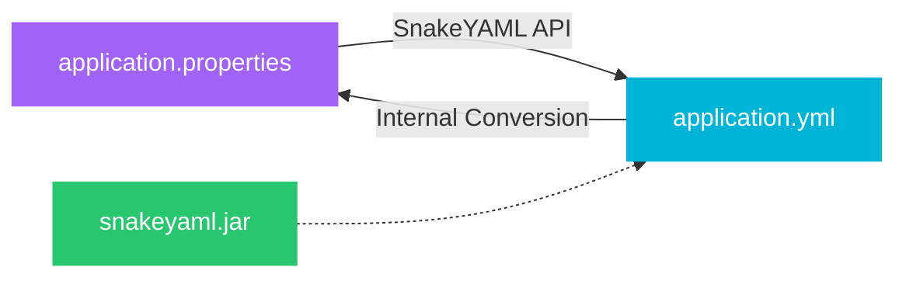
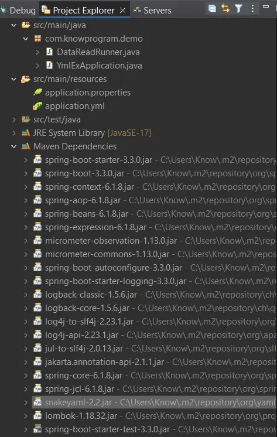
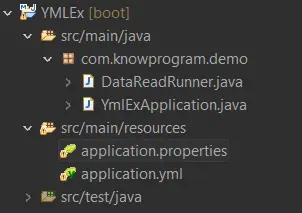
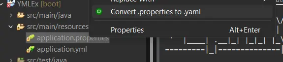

# YAML in Spring Boot

**YAML In Spring Boot** | YAML stands for Yet Another Markup Language. It is a file format (like text) that stores data in key-value format without any duplicate words/levels. Java supports key-value pairs input using `java.util.Properties`, and YAML is another format of writing properties.

- [Understanding YAML Format](#1-understanding-yaml-format)
- [Properties vs YAML Comparison](#2-properties-vs-yaml-comparison)
- [IDE Configuration for YAML](#3-ide-configuration-for-yaml)
- [Rules for Converting Properties to YAML](#4-rules-for-converting-properties-to-yaml)
- [Conversion Examples](#5-conversion-examples)
- [YAML in Spring Boot Example](#6-yaml-in-spring-boot-example)
- [YAML with @ConfigurationProperties](#7-yaml-with-configurationproperties)
- [@ConfigurationProperties With Class and Object](#8-configurationproperties-with-class-and-object)

---

## 1. Understanding YAML Format

YAML files are internally converted into Properties format using the Snake YAML API.

🔑 **Key Concept:** The dot symbol (`.`) in property keys creates a new/next level. For example: `mp.app.code=ABC` — here `my` is the 1st level, `app` is the 2nd level, and `code` is the 3rd level.

In the properties file, keys may have many duplicate levels. For example:

**`application.properties`:**

```properties
spring.datasource.driver-class-name=OracleDriver
spring.datasource.url=jdbc:oracle
spring.datasource.username=system
spring.datasource.password=abc
```

However, the YAML file does not contain duplicate levels. The same can be written as:

**`application.yml`:**

```yaml
spring:
    datasource:
        driver-class-name: OracleDriver
        url: jdbc:oracle
        username: system
        password: abc
```



> **Does SnakeYAML add overhead?**
>
> Yes, but it's negligible. `.properties` uses Java's built-in `java.util.Properties` parser (zero dependency). YAML requires SnakeYAML (~300KB JAR) which builds an intermediate tree structure before converting to flat key-value pairs.
>
> However, config files are parsed **once at startup** — not on every request. A typical 100-line YAML takes < 5ms to parse. The difference vs `.properties` is microseconds — completely irrelevant compared to DB connections or HTTP calls.
>
> **One real concern:** Older SnakeYAML versions had **deserialization CVEs** (e.g., CVE-2022-1471). Spring Boot 3.x upgraded to SnakeYAML 2.x which restricts unsafe type resolution by default. Always keep Spring Boot updated to avoid this.

---

## 2. Properties vs YAML Comparison

| Feature 📋 | Properties Format 🔧 | YAML Format 📄 |
|------------|----------------------|----------------|
| **File Extension** | `.properties` | `.yml` or `.yaml` |
| **Syntax** | `key=value` with dots | Indented hierarchy with colons |
| **Duplicate Levels** | ✅ Repeated in every key | ❌️ Written once per level |
| **Readability** | ⚠️ Verbose for nested keys | ✅ Clean and hierarchical |
| **Indentation** | Not required | Required (spaces only, no tabs) |
| **Priority** | ✅ Higher priority | Lower priority |
| **Dependency** | Built-in | `snakeyaml` jar (included in Spring Boot) |

---

## 3. IDE Configuration for YAML

In STS/Eclipse, by default tab is used for indentation purposes while writing the YAML file, but it gives errors because YAML files should use spaces for indentation, not tabs.

⚠️ **Caution:** Tabs cause parsing errors in YAML files. You must configure your IDE to use spaces instead of tabs.

🔧 **Configuration steps:**

1. Open Preferences: Go to `Window > Preferences` (or `Eclipse > Preferences` on macOS)
2. Navigate to General Text Editor: Go to `General > Editors > Text Editors`
3. Insert Spaces for Tabs: Check the option that says `Insert spaces for tabs`

---

## 4. Rules for Converting Properties to YAML

1. Replace dot (`.`) and equals (`=`) with colon (`:`)
2. After the colon, move the next level/word to the next line (do not write duplicates)
3. Before every new level (not 1st level) provide spaces (at least one) — space count must match for the same level (tab is also valid)
4. Finally, for value, give exactly one space/tab between the last level and data

🛠️ **Example:**

**`application.properties`:**

```properties
my.app.id=10
my.app.code=A
```

**`application.yml`:**

```yaml
my:
    app:
        id: 10
        code: A
```

📝 **Note:** One space only between the last level and the value.

💡 **Tip:** No plugin, configuration, or separate dependency is needed to work with YAML files in Spring Boot. The `snakeyaml-version.jar` file (included in Maven dependencies) is responsible for converting YAML data into `java.util.Properties`.



---

## 5. Conversion Examples

### Example 1

**`application.properties`:**

```properties
my.app.code=A
my.app.model=B
my.grade.service=new
my.grade.cost=600
```

**`application.yml`:**

```yaml
my:
    app:
        code: A
        model: B
    grade:
        service: new
        cost: 600
```

### Example 2

**`application.properties`:**

```properties
spring.jpa.show-sql=true
spring.jpa.ddl-auto=create
spring.hikari.size=20
spring.hikari.name=hrk
```

**`application.yml`:**

```yaml
spring:
    jpa:
        show-sql: true
        ddl-auto: create
    hikari:
        size: 20
        name: knowprogram
```

### Example 3

**`application.properties`:**

```properties
spring.jpa.hibernate.auto-create=true
spring.jpa.show-sql=true
spring.jpa.hibernate.format.export=new
spring.jpa.model=entity
spring.jpa.grade.code=accept
```

**`application.yml`:**

```yaml
spring:
    jpa:
        hibernate:
            auto-create: true
            format:
                export: new
        show-sql: true
        model: entity
        grade:
            code: accept
```

### Example 4

**`application.properties`:**

```properties
my.grade.mode=A
spring.format.text=one
my.accept.mode=new
spring.jpa.show=true
my.grade.state=SA
spring.format.active=true
spring.jpa.final=mode
```

**`application.yml`:**

```yaml
my:
    grade:
        mode: A
        state: SA
    accept:
        mode: new
spring:
    format:
        text: one
        active: true
    jpa:
        show: true
        final: mode
```

---

## 6. YAML in Spring Boot Example

Create a new Spring Boot project. In the `src/main/resources` folder where the `application.properties` file resides, create another file: `application.yml`.



**`application.yml`:**

```yaml
my:
  app:
    id: 10
    name: abc
    cost: 500.0
```

**Runner class (`DataReadRunner.java`):**

```java
package com.knowprogram.demo;

import org.springframework.beans.factory.annotation.Value;
import org.springframework.boot.CommandLineRunner;
import org.springframework.stereotype.Component;

import lombok.Getter;
import lombok.Setter;
import lombok.ToString;

@Component
@Getter
@Setter
@ToString
public class DataReadRunner implements CommandLineRunner {

    @Value("${my.app.id}")
    private Integer pid;

    @Value("${my.app.name}")
    private String name;

    @Value("${my.app.cost}")
    private Double pcost;

    @Override
    public void run(String... args) throws Exception {
        System.out.println(this);
    }
}
```

📤 **Output:**

```
DataReadRunner(pid=10, name=abc, pcost=500.0)
```

⚠️ **Caution:** If you do not follow proper rules to write the `.yml` file, SnakeYAML API throws data parsing exceptions like `org.yaml.snakeyaml.scanner.ScannerException: mapping values are not allowed here`.

⚠️ **Warning:** Duplicate keys are not allowed in YAML. Violating this will cause `org.yaml.snakeyaml.constructor.DuplicateKeyException: while constructing a mapping`.

### Properties File Priority

> 🔑 **Key Point:** If some key is present in both the `application.properties` file and the `application.yml` file, then the `application.properties` file will get higher priority.

**`application.properties`:**

```properties
my.app.id=99999
```

**`application.yml`:**

```yaml
my:
  app:
    id: 10
    name: abc
    cost: 500.0
```

📤 **Output (using the same `DataReadRunner`):**

```
DataReadRunner(pid=99999, name=abc, pcost=500.0)
```

💡 **Tip:** Spring Boot will first search for the keys in the `application.properties` file, if not available then go to the `application.yml` file.

🔧 **IDE Shortcut:** STS/Eclipse IDE also provides a built-in option to convert properties files to YAML files. Select the properties file, right click, and you will see the `Convert .properties to .yml` option.



---

## 7. YAML with @ConfigurationProperties

📝 **Prerequisite:** [Bulk Loading of Properties in Spring Boot](./03_Bulk_Loading_of_Properties_in_Spring_Boot.md)

**`application.yml`:**

```yaml
my:
  app:
    pid: 10
    name: abc
    pcost: 500.0
```

**Runner class (`DataReadRunner.java`):**

```java
package com.knowprogram.demo;

import org.springframework.boot.CommandLineRunner;
import org.springframework.boot.context.properties.ConfigurationProperties;
import org.springframework.stereotype.Component;

import lombok.Getter;
import lombok.Setter;
import lombok.ToString;

@Component
@Getter
@Setter
@ToString
@ConfigurationProperties(prefix = "my.app")
public class DataReadRunner implements CommandLineRunner {

    private Integer pid;

    private String name;

    private Double pcost;

    @Override
    public void run(String... args) throws Exception {
        System.out.println(this);
    }
}
```

📤 **Output:**

```
DataReadRunner(pid=10, name=abc, pcost=500.0)
```

### Collections in YAML

To represent array/list/set, the dash (`-`) symbol is used to represent the index in order:

- 📋 `List<String> models;`
- 📋 `Set<String> models;`
- 📋 `String[] models;`

**YAML representation:**

```yaml
my:
  app:
    models:
      - A
      - B
      - C
```

For `Map<String, Integer> grades;`:

```yaml
my:
  app:
    grades:
      eng: 90
      mat: 60
      sci: 40
```

### Application Example

**`application.yml`:**

```yaml
my:
  app:
    models:
      - A
      - B
      - C
    grades:
      g1: 10
      g2: 20
```

**Runner class (`DataReadRunner.java`):**

```java
package com.knowprogram.demo;

import java.util.List;
import java.util.Map;

import org.springframework.boot.CommandLineRunner;
import org.springframework.boot.context.properties.ConfigurationProperties;
import org.springframework.stereotype.Component;

import lombok.Getter;
import lombok.Setter;
import lombok.ToString;

@Component
@Getter
@Setter
@ToString
@ConfigurationProperties(prefix = "my.app")
public class DataReadRunner implements CommandLineRunner {

    private List<String> models;
    private Map<String, Integer> grades;

    @Override
    public void run(String... args) throws Exception {
        System.out.println(this);
    }
}
```

📤 **Output:**

```
DataReadRunner(models=[A, B, C], grades={g1=10, g2=20})
```

---

## 8. @ConfigurationProperties With Class and Object

**Model class (`Student.java`):**

```java
package com.knowprogram.demo;

import lombok.Getter;
import lombok.Setter;
import lombok.ToString;

@Getter
@Setter
@ToString
public class Student {
    private Integer sid;
    private String sname;
    private Double sfee;
}
```

**`application.yml`:**

```yaml
my:
  app:
    student:
      sid: 111
      sname: Jerry
      sfee: 1000
```

**Runner class (`DataReadRunner.java`):**

```java
package com.knowprogram.demo;

import org.springframework.boot.CommandLineRunner;
import org.springframework.boot.context.properties.ConfigurationProperties;
import org.springframework.stereotype.Component;

import lombok.Getter;
import lombok.Setter;
import lombok.ToString;

@Component
@Getter
@Setter
@ToString
@ConfigurationProperties(prefix = "my.app")
public class DataReadRunner implements CommandLineRunner {

    private Student student;

    @Override
    public void run(String... args) throws Exception {
        System.out.println(this);
    }
}
```

📤 **Output:**

```
DataReadRunner(student=Student(sid=111, sname=Jerry, sfee=1000.0))
```
