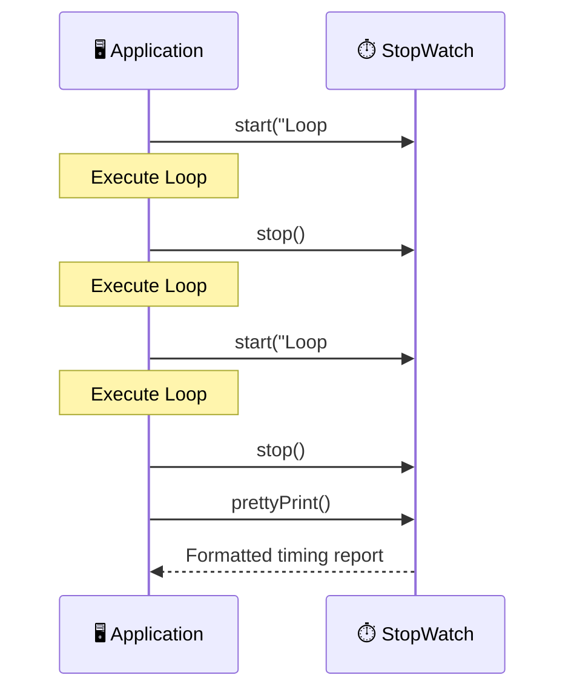

# Calculate Code Execution Time in Spring Boot

**Calculate Code Execution Time in Spring Boot** | To calculate code execution time in Spring Boot we can use the `StopWatch` class. This is a class given by Spring framework in `org.springframework.util` package to calculate the time taken for task/block/method/object creation etc.

- [StopWatch Methods](#1-stopwatch-methods)
- [Time Factor Scale](#2-time-factor-scale)
- [Basic StopWatch Usage](#3-basic-stopwatch-usage)
- [Multi-Task StopWatch Example](#4-multi-task-stopwatch-example)
- [IllegalStateException while Using StopWatch](#5-illegalstateexception-while-using-stopwatch)
- [TimeUnit](#6-timeunit)

---

## 1. StopWatch Methods

| Method 🏷️ | Description 📋 |
|-----------|---------------|
| **`start()`** | Start time counting |
| **`start(taskName)`** | Start time counting and assign task name |
| **`stop()`** | Stop time counting |
| **`getTotalTimeMillis()`** | Return `long` (milliseconds) |
| **`getTotalTimeSeconds()`** | Return `int` (seconds) |
| **`prettyPrint()`** | Return `String` (formatted output) |

---

## 2. Time Factor Scale

| Constant ⏱️ | Value 🔢 |
|-------------|----------|
| **`NANO_SCALE`** | `1L` |
| **`MICRO_SCALE`** | `1000L * NANO_SCALE` |
| **`MILLI_SCALE`** | `1000L * MICRO_SCALE` |
| **`SECOND_SCALE`** | `1000L * MILLI_SCALE` |
| **`MINUTE_SCALE`** | `60L * SECOND_SCALE` |
| **`HOUR_SCALE`** | `60L * MINUTE_SCALE` |
| **`DAY_SCALE`** | `24L * HOUR_SCALE` |


---

## 3. Basic StopWatch Usage

🧠 **In Simple Words:**
Create a `StopWatch`, call `start()` before the code block, call `stop()` after it, then read the elapsed time.

**Basic pattern:**

```java
StopWatch stopWatch = new StopWatch();
stopWatch.start();
// code
stopWatch.stop();
System.out.println(stopWatch.getTotalTimeMillis());
```

---

## 4. Multi-Task StopWatch Example

🛠️ **Full example — Single task timing:**

```java
package com.knowprogram.demo;

import org.springframework.boot.CommandLineRunner;
import org.springframework.stereotype.Component;
import org.springframework.util.StopWatch;

@Component
public class TimeTestRunner implements CommandLineRunner {

    @Override
    public void run(String... args) throws Exception {
        StopWatch stopWatch = new StopWatch();
        stopWatch.start();
        for (int i = 0; i < Integer.MAX_VALUE; i++) {
            Math.sqrt(i);
        }
        stopWatch.stop();
        System.out.println("Total time in milli seconds: "
                + stopWatch.getTotalTimeMillis());
        System.out.println("Total time in seconds: "
                + stopWatch.getTotalTimeSeconds());
    }

}
```

📤 **Output:**

```
Total time in milli seconds: 519
Total time in seconds: 0.5191696
```

Assume we have 3 parts of the code and we want to calculate execution time only for 1st and 3rd parts then we can use `stop()` and `start()` to resume the calculation.

🛠️ **Multi-task timing with named tasks:**

```java
package com.knowprogram.demo;

import org.springframework.boot.CommandLineRunner;
import org.springframework.stereotype.Component;
import org.springframework.util.StopWatch;

@Component
public class TimeTestRunner implements CommandLineRunner {

    @Override
    public void run(String... args) throws Exception {
        StopWatch watch = new StopWatch("Time Test For Loops"); // Watch#ID
        watch.start("Loop#1"); // Watch#taskName
        for (int i = 0; i < Integer.MAX_VALUE; i++) {
            Math.sqrt(i);
            // Math.pow(i + 1, 1000);
        }
        watch.stop();

        // skip this part
        for (int i = 0; i < Integer.MAX_VALUE; i++) {
            Math.sqrt(i);
        }

        watch.start("Loop#2");
        for (int i = 0; i < Integer.MAX_VALUE; i++) {
            Math.sqrt(i);
        }
        watch.stop();

        System.out.println(watch.prettyPrint());
    }

}
```

📤 **Output:**

```
StopWatch 'Time Test For Loops': 1.5267636 seconds
--------------------------------------------------
Seconds       %       Task name
--------------------------------------------------
0.5137293     34%     Loop#1
1.0130343     66%     Loop#2
```



---

## 5. IllegalStateException while Using StopWatch

> ⚠️ **Warning:** You cannot start a `StopWatch` that is already running — you must stop it first. Similarly, you cannot stop a `StopWatch` that is already stopped.

**Calling `stop()` twice:**

```java
watch.stop(); // watch stopped
watch.stop(); // exception
```

🚨 `IllegalStateException: Can't stop StopWatch: it's not running.`

**Calling `start()` twice:**

```java
watch.start(); // watch started
watch.start(); // exception
```

🚨 `IllegalStateException: Can't start StopWatch: it's already running.`

---

## 6. TimeUnit

While working with `StopWatch`, for time conversion we can use the `TimeUnit` class of `java.util.concurrent` package.

🛠️ **TimeUnit conversion example:**

```java
package com.knowprogram.demo;

import java.util.concurrent.TimeUnit;

import org.springframework.boot.CommandLineRunner;
import org.springframework.stereotype.Component;

@Component
public class TimeTestRunner implements CommandLineRunner {

    @Override
    public void run(String... args) throws Exception {
        // 3 days-> hours
        System.out.println(TimeUnit.DAYS.toHours(3));
        // 3 days-> mins
        System.out.println(TimeUnit.DAYS.toMinutes(3));
        // 1 sec-> nano sec
        System.out.println(TimeUnit.SECONDS.toNanos(1));
        // 10 min-> mill sec
        System.out.println(TimeUnit.MINUTES.toMillis(10));
    }

}
```

📤 **Output:**

```
72
4320
1000000000
600000
```

| Conversion 🔄 | Method 🏷️ | Result 📊 |
|---------------|-----------|----------|
| **3 days to hours** | `TimeUnit.DAYS.toHours(3)` | `72` |
| **3 days to minutes** | `TimeUnit.DAYS.toMinutes(3)` | `4320` |
| **1 second to nanoseconds** | `TimeUnit.SECONDS.toNanos(1)` | `1000000000` |
| **10 minutes to milliseconds** | `TimeUnit.MINUTES.toMillis(10)` | `600000` |
