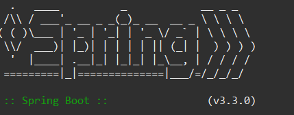
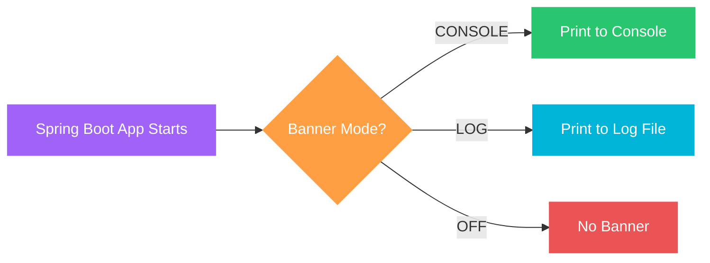

# Banner in Spring Boot

**Banner in Spring Boot** | When we start any Spring Boot application one logo is printed at the console called Banner. This Banner setup and printing is done when we run the starter class.

- [Banner Overview](#1-banner-overview)
- [Banner Modes](#2-banner-modes)
- [Turning Off the Banner](#3-turning-off-the-banner)
- [Adding Custom Banner in Spring Boot](#4-adding-custom-banner-in-spring-boot)

---

## 1. Banner Overview

When we start any Spring Boot application, a logo is printed at the console called the **Banner**. This Banner setup and printing is done when we run the starter class.



🧠 **In Simple Words:**
The banner is just a decorative text/logo shown in the console when your Spring Boot app starts up. You can customize it, change where it prints, or turn it off entirely.



---

## 2. Banner Modes

We can customize our banner behavior using the `Banner.Mode` enum inside the `Banner` interface.

**Banner interface:**

```java
interface Banner {
    enum Mode { OFF, CONSOLE, LOG };
}
```

| Mode 🏷️ | Behavior 📋 | Default? ✅ |
|----------|-------------|-------------|
| **`CONSOLE`** | Banner is printed to the console | ✅ Yes |
| **`LOG`** | Banner is printed to the log file | ❌️ No |
| **`OFF`** | Banner is completely disabled | ❌️ No |

📝 **Note:** The default mode is `Banner.Mode.CONSOLE`, therefore the banner is printed at the console by default.

---

## 3. Turning Off the Banner

To turn off the banner, modify the starter class to set the banner mode to `OFF`.

**Starter class (banner disabled):**

```java
package com.knowprogram.demo;

import org.springframework.boot.Banner;
import org.springframework.boot.SpringApplication;
import org.springframework.boot.autoconfigure.SpringBootApplication;

@SpringBootApplication
public class StopWatchDemoApplication {

    public static void main(String[] args) {
        SpringApplication sa = new SpringApplication(StopWatchDemoApplication.class);
        sa.setBannerMode(Banner.Mode.OFF);
        sa.run(args);
    }

}
```

💡 **Tip:** Instead of using `SpringApplication.run()` directly, create a `SpringApplication` instance first so you can configure banner mode, profiles, and other settings before calling `run()`.

---

## 4. Adding Custom Banner in Spring Boot

To provide your own banner file, create a `.txt` file under the `src/main/resources` folder. Spring Boot uses the following internal key:

```properties
spring.banner.location=classpath:banner.txt
```

Here, `classpath` means the `src/main/resources` folder.

1️⃣ **Generate a banner** using any [online Spring Boot Banner generator tool](https://www.google.com/search?q=spring+boot+banner+generator)

2️⃣ **Download the file** and place it in the `src/main/resources` folder as `banner.txt`

3️⃣ **Add the property** in `application.properties`:

🔧 **Configuration** (`application.properties`):

```properties
spring.banner.location=classpath:banner.txt
```

> 💡 **Tip:** You can also use image-based banners by placing an image file (e.g., `banner.gif`, `banner.jpg`, `banner.png`) in `src/main/resources` and setting `spring.banner.image.location`.
