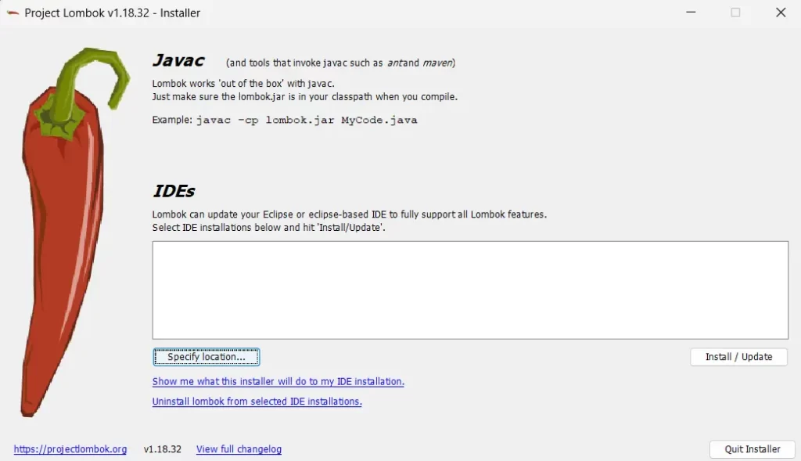
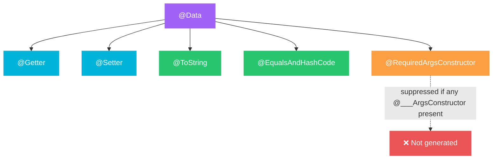

# Project Lombok Annotations With Examples

**Project Lombok Annotations With Examples** | It is an open-source Java API, used to generate code for constructors, set/get methods, toString, equals and hashCode etc.

- [Lombok Setup and Installation](#1-lombok-setup-and-installation)
- [Lombok Annotations](#2-lombok-annotations)
- [RequiredArgsConstructor and NonNull](#3-requiredargsconstructor-and-nonnull)
- [Constructor Annotation Edge Cases](#4-constructor-annotation-edge-cases)
- [Data in Lombok](#5-data-in-lombok)
- [Data with Constructor Annotations](#6-data-with-constructor-annotations)
- [Custom Constructors with Lombok](#7-custom-constructors-with-lombok)
- [Builder Pattern with Lombok](#8-builder-pattern-with-lombok)

---

## 1. Lombok Setup and Installation

To use Lombok API, we should enable/activate Lombok in STS/Eclipse then we can use Lombok API Annotations.

🔧 **Lombok Activation Steps:**

1. Download the [Lombok Jar](https://projectlombok.org/download) file.
2. Double-click to run the jar file, specify the STS/Eclipse IDE location, then click on the Install/Update Button.
3. Or, in the terminal/command prompt: `java -jar lombok.jar`, then click on the Install/Update Button.



In the Spring Starter project, while creating the project we can add the dependency for Lombok.

**Maven Dependency** (`pom.xml`):

```xml
<dependency>
    <groupId>org.projectlombok</groupId>
    <artifactId>lombok</artifactId>
    <optional>true</optional>
</dependency>
```


> 🔑 **Key Concept:** Lombok works **after your coding and before compilation only.** The Lombok dependency/jar is not required once compilation is done — this JAR is not required in production/deployment time. While compilation, it generates the required methods and the `.class` file will contain complete code with all those methods.

---

## 2. Lombok Annotations

| Annotation 🏷️ | Purpose 📋 | Generated Code 🛠️ |
|---------------|-----------|-------------------|
| `@Getter` | Generates `get()` method for every variable | `getEmpId()`, `getEname()` |
| `@Setter` | Generates `set()` method for every variable | `setEmpId()`, `setEname()` |
| `@ToString` | Generates `toString()` method | `Employee(empId=100, ename=Jerry)` |
| `@EqualsAndHashCode` | Generates `equals()` and `hashCode()` methods | Used to compare two objects of the same class |
| `@NoArgsConstructor` | Generates default (zero-arg) constructor | `Employee() {}` |
| `@AllArgsConstructor` | Generates constructor with all variables | `Employee(id, name, sal) {}` |

📝 **Note:** Java compiler provides a default constructor if no constructor exists in the code. But if another constructor exists then the Java compiler won't provide the default constructor. In that case, we can use `@NoArgsConstructor`. If either Programmer or Lombok defines any parameterized constructor, first define default/zero-args constructor, then any param constructor is fine.

**Model class:**

```java
package com.knowprogram.demo;

import lombok.Getter;
import lombok.NoArgsConstructor;
import lombok.Setter;
import lombok.ToString;

@Getter
@Setter
@ToString
@NoArgsConstructor
public class Employee {
    private Integer empId;
    private String ename;
    private Double esal;
}
```

**Runner class:**

```java
package com.knowprogram.demo;

import org.springframework.boot.CommandLineRunner;
import org.springframework.stereotype.Component;

@Component
public class LombokRunnerTest implements CommandLineRunner {

    @Override
    public void run(String... args) throws Exception {
        Employee emp = new Employee();
        emp.setEmpId(100);
        emp.setEname("Jerry");
        emp.setEsal(5000.0);

        System.out.println(emp.getEname()); // Jerry
        System.out.println(emp);
        // Employee(empId=100, ename=Jerry, esal=5000.0)
    }

}
```

📤 **Output:**

```
Jerry
Employee(empId=100, ename=Jerry, esal=5000.0)
```

---

## 3. RequiredArgsConstructor and NonNull

- 🏷️ `@RequiredArgsConstructor` — Generates a constructor with only the variables annotated with `@NonNull`.
- 🎯 `@NonNull` — Selects a variable for the constructor parameter.

### Example 1 — Single NonNull Field

**Source code with annotations:**

```java
@RequiredArgsConstructor
class Emp {
    @NonNull
    Integer eid;

    String ename;

    Double esal;
}
```

**Generated code:**

```java
class Emp {
    Integer eid;

    String ename;

    Double esal;

    Emp(Integer eid) {
        this.eid=eid;
    }
}
```

### Example 2 — Multiple NonNull Fields

**Source code with annotations:**

```java
@RequiredArgsConstructor
class Emp {
    @NonNull
    Integer eid;

    String ename;

    @NonNull
    Double esal;
}
```

**Generated code:**

```java
class Emp {
    Integer eid;

    String ename;

    Double esal;

    Emp(Integer eid, Double esal) {
        this.eid=eid;
        this.esal=esal;
    }
}
```

### Example 3 — NoArgsConstructor with RequiredArgsConstructor

**Source code with annotations:**

```java
@NoArgsConstructor
@RequiredArgsConstructor
class Emp {
    @NonNull
    Integer eid;

    String ename;

    Double esal;
}
```

**Generated code:**

```java
class Emp {
    Integer eid;

    String ename;

    Double esal;

    Emp() {
        super();
    }

    Emp(Integer eid) {
        super();
        this.eid=eid;
    }
}
```

### Example 4 — All Three Constructor Annotations

**Source code with annotations:**

```java
@NoArgsConstructor
@RequiredArgsConstructor
@AllArgsConstructor
class Emp {
    @NonNull
    Integer eid;

    String ename;

    Double esal;
}
```

**Generated code:**

```java
class Emp {
    Integer eid;

    String ename;

    Double esal;

    Emp() {
        super();
    }

    Emp(Integer eid) {
        super();
        this.eid=eid;
    }

    Emp(Integer eid, String ename, Double esal) {
        super();
        this.eid=eid;
        this.ename=ename;
        this.esal=esal;
    }
}
```

---

## 4. Constructor Annotation Edge Cases

`@NoArgsConstructor` always generates the default constructor. For `@RequiredArgsConstructor`, if there are no variables annotated with `@NonNull` then it will generate a default constructor.

**Source code:**

```java
@RequiredArgsConstructor
public class Employee {
    private Integer eid;

    private String ename;
}
```

**Generated code:**

```java
public class Employee {
    private Integer eid;

    private String ename;

    public Employee() {
        super();
    }
}
```

> ⚠️ **Warning — Duplicate Constructor Error:**

**Source code:**

```java
@NoArgsConstructor
@RequiredArgsConstructor
public class Employee {
    private Integer eid;

    private String ename;
}
```

🚨 **Compile time error:** `duplicate method Employee()`. Since there is no `@NonNull` field, `@RequiredArgsConstructor` creates a no-arg constructor and `@NoArgsConstructor` also creates a no-arg constructor. Therefore the compiler gives an error.

- 📖 `@AllArgsConstructor` — It will generate a default constructor if the class has zero variables (no variables).

**Source code:**

```java
@AllArgsConstructor
public class Employee {
}
```

**Generated code:**

```java
public class Employee {
    public Employee() {
        super();
    }
}
```

> ⚠️ **Caution:** The following also causes a compile-time error — `duplicate method Employee()`:

**Source code:**

```java
@NoArgsConstructor
@AllArgsConstructor
public class Employee {
}
```

Both `@NoArgsConstructor` and `@AllArgsConstructor` create no-args constructor when there are zero variables.

**Source code:**

```java
@NoArgsConstructor
@RequiredArgsConstructor
@AllArgsConstructor
public class Employee {
}
```

This will also give compile-time error — `duplicate method Employee()` because `@NoArgsConstructor`, `@RequiredArgsConstructor`, and `@AllArgsConstructor` all create no-args constructor when no fields exist.

---

## 5. Data in Lombok

`@Data` reduces multiple annotations coding. `@Data` is a combination of:

- ⚙️ `@Setter` — Generates setter methods
- 🔍 `@Getter` — Generates getter methods
- 📄 `@ToString` — Generates `toString()` method
- ⚖️ `@EqualsAndHashCode` — Generates `equals()` and `hashCode()` methods
- 🏗️ `@RequiredArgsConstructor` — Generates constructor for `@NonNull` fields

**Source code:**

```java
@Data
public class Employee {
    private Integer eid;
}
```

**Generated code:**

```java
public class Employee {
    private Integer eid;

    public Employee() { ___ } //default const.

    // setEid, getEid

    // equals() hashCode()

    // toString()
}
```

**Source code with `@NonNull`:**

```java
@Data
public class Employee {
    @NonNull
    private Integer eid;
}
```

**Generated code:**

```java
public class Employee {
    private Integer eid;
    // one param constructor

    public Employee(Integer eid) { this.eid=eid; }

    // setEid, getEid
    // equals() hashCode()
    // toString()
}
```

---

## 6. Data with Constructor Annotations

> 🔑 **Key Point:** `@Data` provides internally `@RequiredArgsConstructor`, **only if** the programmer did not write any Constructor annotation (`@___ArgsConstructor`).

### Example 1 — Data with NoArgsConstructor

**Source code:**

```java
@Data // it won't provide @RequiredArgsConstructor now.
@NoArgsConstructor // default constructor
public class Employee {
    @NonNull
    private Integer eid;
}
```

**Generated code:**

```java
public class Employee {
    private Integer eid;

    // only one constructor
    public Employee() { ___ }
}
```

### Example 2 — Data with AllArgsConstructor

**Source code:**

```java
@Data
@AllArgsConstructor
public class Employee {
    @NonNull
    private Integer eid;

    private String ename;

    private Double esal;
}
```

**Generated code:**

```java
public class Employee {
    private Integer eid;

    private String ename;

    private Double esal;

    public Employee(eid, ename, esal) { ___ } //3 params
}
```

---

## 7. Custom Constructors with Lombok

💡 **Tip:** Lombok supports only 3 constructors (1 default, 2 parameterized). If we need any other constructors then we must add them manually.

**Full example with all annotations and a custom constructor:**

```java
import lombok.AllArgsConstructor;
import lombok.Data;
import lombok.NoArgsConstructor;
import lombok.NonNull;
import lombok.RequiredArgsConstructor;

@Data
@NoArgsConstructor // default constructor
@RequiredArgsConstructor // 1 param constructor
@AllArgsConstructor // 3 param constructor
public class Employee {

    @NonNull
    private Integer eid;

    private String ename;

    private Double esal;

    // if we want add one more const then we can add them manually
    public Employee(String ename) {
        this.ename=ename;
    }
}
```

| Constructor Type 🏗️ | Source 📋 | Parameters 🎯 |
|---------------------|----------|--------------|
| **Default** | `@NoArgsConstructor` | None |
| **Required args** | `@RequiredArgsConstructor` | `@NonNull` fields only (`eid`) |
| **All args** | `@AllArgsConstructor` | All fields (`eid`, `ename`, `esal`) |
| **Custom** | Manual code | Any custom params (`ename`) |



---

## 8. Builder Pattern with Lombok

`@Builder` generates a **builder pattern** implementation — a fluent API for constructing objects step by step. Very common in production code and frequently asked in interviews.

> **Is this the same as the GoF Builder Design Pattern?**
>
> Yes — Lombok's `@Builder` generates the **exact same pattern** as the Gang of Four Builder, minus the boilerplate:
>
> | Aspect | GoF Builder (manual) | Lombok `@Builder` |  
> |---|---|---|  
> | Static `builder()` method | You write it | Generated |  
> | Inner `Builder` class | You write it | Generated |  
> | Fluent setters (return `this`) | You write them | Generated |  
> | `build()` calls constructor | You write it | Generated |  
> | Immutable target object | Your responsibility | Works with `final` fields |
>
> One nuance: the GoF pattern also has a **Director** class that orchestrates build steps in a specific order — Lombok doesn't generate that. But in modern Java, the Director is rarely used. When interviewers say "Builder pattern," they almost always mean the **fluent builder** (which is exactly what `@Builder` generates).
>
> For the manual implementation, see: [Builder Design Pattern in Java](../../2_design_patterns/06_Builder_Design_Pattern_in_Java.md)

### Basic `@Builder` Usage

```java
@Builder
@Getter
@ToString
public class Order {
    private String orderId;
    private String customerName;
    private double amount;
    private String status;
}
```

**Generated code (behind the scenes):**

```java
public class Order {
    private String orderId;
    private String customerName;
    private double amount;
    private String status;

    Order(String orderId, String customerName, double amount, String status) {
        this.orderId = orderId;
        this.customerName = customerName;
        this.amount = amount;
        this.status = status;
    }

    public static OrderBuilder builder() {
        return new OrderBuilder();
    }

    public static class OrderBuilder {
        private String orderId;
        private String customerName;
        private double amount;
        private String status;

        public OrderBuilder orderId(String orderId) {
            this.orderId = orderId;
            return this;
        }
        public OrderBuilder customerName(String customerName) {
            this.customerName = customerName;
            return this;
        }
        public OrderBuilder amount(double amount) {
            this.amount = amount;
            return this;
        }
        public OrderBuilder status(String status) {
            this.status = status;
            return this;
        }
        public Order build() {
            return new Order(orderId, customerName, amount, status);
        }
    }
}
```

**Usage:**

```java
Order order = Order.builder()
        .orderId("ORD-1001")
        .customerName("Alice")
        .amount(2500.00)
        .status("CONFIRMED")
        .build();

System.out.println(order);
// Order(orderId=ORD-1001, customerName=Alice, amount=2500.0, status=CONFIRMED)
```

### `@Builder.Default` — Setting Default Values

Without `@Builder.Default`, fields not set via the builder are initialized to Java defaults (`null`, `0`, `false`). Use `@Builder.Default` to provide meaningful defaults:

```java
@Builder
@Getter
@ToString
public class PaymentRequest {
    private String gateway;
    private double amount;

    @Builder.Default
    private String currency = "INR";

    @Builder.Default
    private int retryCount = 3;

    @Builder.Default
    private boolean notifyCustomer = true;
}
```

```java
PaymentRequest request = PaymentRequest.builder()
        .gateway("razorpay")
        .amount(1500.00)
        .build();

System.out.println(request);
// PaymentRequest(gateway=razorpay, amount=1500.0, currency=INR, retryCount=3, notifyCustomer=true)
```

⚠️ **Without `@Builder.Default`**, `currency` would be `null`, `retryCount` would be `0`, and `notifyCustomer` would be `false` — even if you initialize them inline. `@Builder` ignores field initializers unless `@Builder.Default` is present.

### `@Singular` — Building Collections

`@Singular` lets you add items to a collection one at a time in the builder:

```java
@Builder
@Getter
@ToString
public class Team {
    private String name;

    @Singular
    private List<String> members;

    @Singular
    private Set<String> roles;
}
```

```java
Team team = Team.builder()
        .name("Backend")
        .member("Alice")       // singular form — adds one item
        .member("Bob")
        .role("DEVELOPER")
        .role("REVIEWER")
        .build();

System.out.println(team);
// Team(name=Backend, members=[Alice, Bob], roles=[DEVELOPER, REVIEWER])
```

`@Singular` generates:
- `.member(item)` — add one item
- `.members(collection)` — add all items from a collection
- `.clearMembers()` — reset the collection

The built collection is **unmodifiable** — calling `team.getMembers().add("Charlie")` throws `UnsupportedOperationException`.

### `@Builder` with `@Data` and Constructors

```java
@Data
@Builder
@NoArgsConstructor
@AllArgsConstructor
public class Employee {
    private Long id;
    private String name;
    private String department;
}
```

This combination is very common in Spring Boot projects — it gives you:
- ✅ Getters/setters (`@Data`)
- ✅ Builder pattern (`@Builder`)
- ✅ No-arg constructor (`@NoArgsConstructor`) — needed by JPA/Hibernate
- ✅ All-arg constructor (`@AllArgsConstructor`) — needed by `@Builder`

⚠️ **`@Builder` alone generates only an all-args constructor.** If you also need a no-arg constructor (for JPA), you must add both `@NoArgsConstructor` and `@AllArgsConstructor` explicitly — otherwise compilation fails.

### `toBuilder` — Copying and Modifying Existing Objects

```java
@Builder(toBuilder = true)
@Getter
@ToString
public class Config {
    private String env;
    private int timeout;
    private boolean cacheEnabled;
}
```

```java
Config prod = Config.builder()
        .env("production")
        .timeout(5000)
        .cacheEnabled(true)
        .build();

// Create a staging config by copying prod and overriding env + timeout
Config staging = prod.toBuilder()
        .env("staging")
        .timeout(10000)
        .build();

System.out.println(staging);
// Config(env=staging, timeout=10000, cacheEnabled=true)
```

`toBuilder = true` adds a `.toBuilder()` instance method that pre-fills the builder with the current object's values — useful for creating variations of immutable objects.

### Quick Reference

| Annotation | Purpose |
|------------|---------|
| `@Builder` | Generates builder pattern (static `builder()` method + inner Builder class) |
| `@Builder.Default` | Sets default value for a field in the builder |
| `@Singular` | Adds one-at-a-time collection builder methods |
| `@Builder(toBuilder = true)` | Adds `.toBuilder()` to copy existing object into a builder |
| `@Builder(builderMethodName = "create")` | Renames `builder()` to `create()` |
| `@Builder(buildMethodName = "execute")` | Renames `build()` to `execute()` |

### Common Pitfall: `@Builder` + JPA Entity

```java
// ❌️ WRONG — Hibernate needs no-arg constructor
@Entity
@Builder
public class Product { ... }

// ✅ CORRECT — Add both constructors
@Entity
@Builder
@NoArgsConstructor
@AllArgsConstructor
public class Product { ... }
```

---
