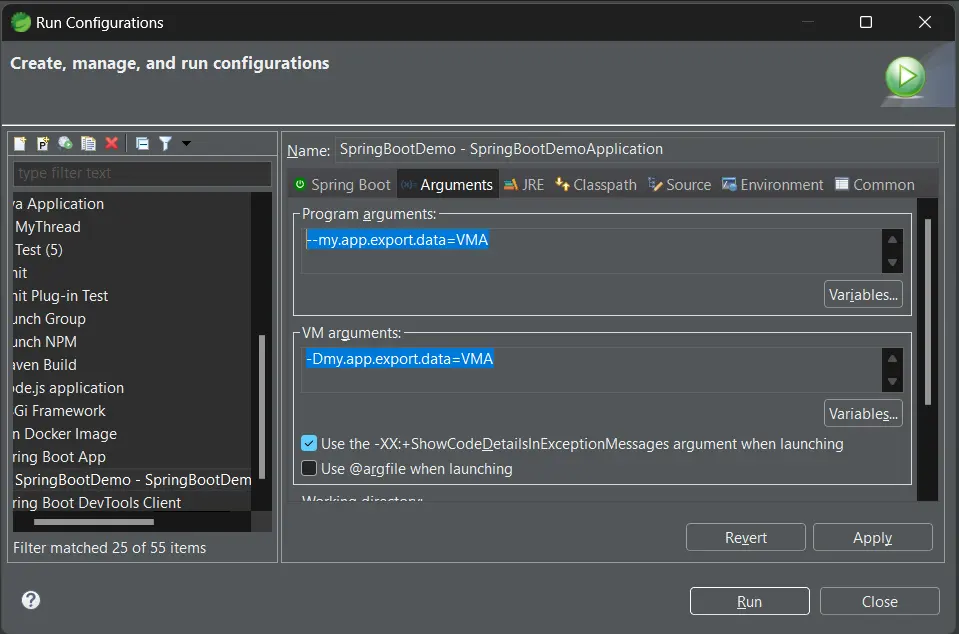
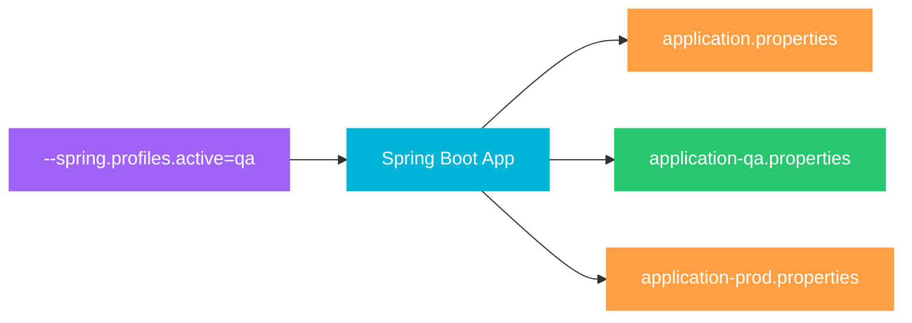
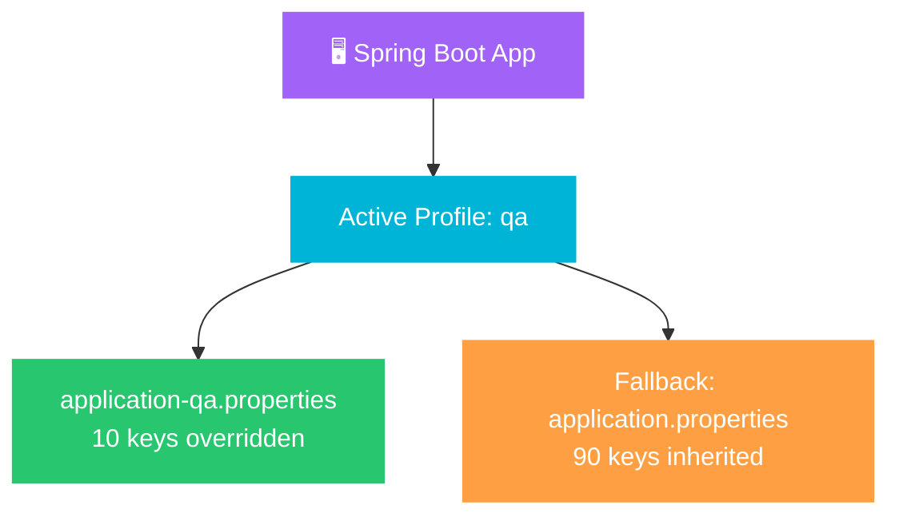
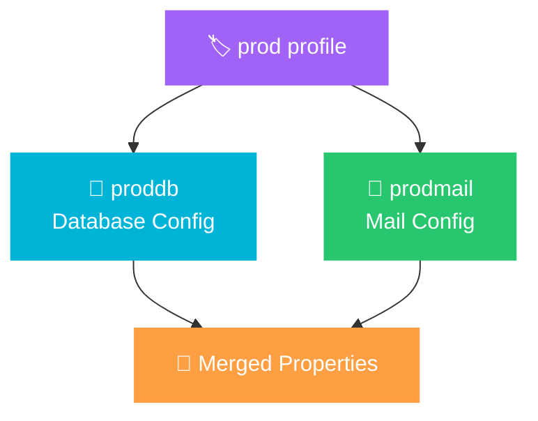
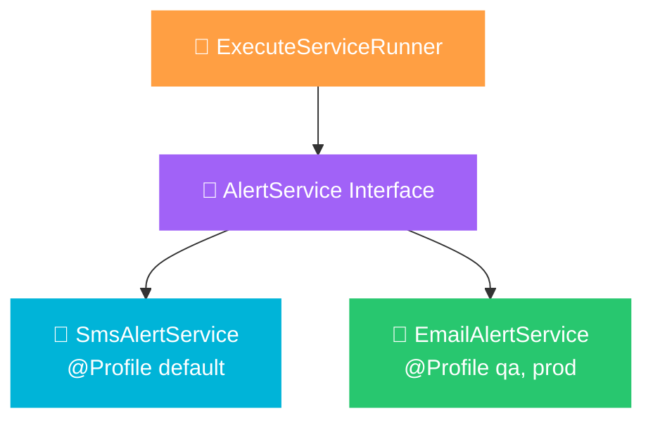

# Spring Boot Profiles

**Spring Boot Profiles** | Writing and Loading Properties File based on Environment, is called as Profiles. Profiles are used to load property files based on the environment. Define one properties file for one Environment.

- [Command Line Arguments and VM/System Args](#1-command-line-arguments-and-vmsystem-args)
- [Spring Boot Profiles Example](#2-spring-boot-profiles-example)
- [Profiles Fallback](#3-profiles-fallback)
- [Child Profiles](#4-child-profiles)
- [Profiles using YAML](#5-profiles-using-yaml)
- [@Profile Annotation](#6-profile-annotation)
- [@Profile, Service Interface & Properties](#7-profile-service-interface--properties)
- [Summary](#8-summary)
- [External Config Override at Runtime](#9-external-config-override-at-runtime)

---

## 1. Command Line Arguments and VM/System Args

🌐 **Environment:** A system/place where we can deploy and use our application. Dev Env, QA Env, UAT Env, Production Env, etc. From one Environment to another Environment, if we move our application, the code remains the same. But properties data (key=val) may get modified.

Before moving ahead let us first see what are Command Line Arguments and VM/System Args because we are going to use it for configuring the profiles.

**Command Line Arguments:** To pass input to the application while running to the `main()` method.

- 🖥️ `> java MainClassName.class val1 val2 val3 …etc`
- 📦 `> java -jar .jar --main-class MainClassName val1 val2 val3 …etc`
- ⚙️ For Spring Boot, Syntax: `--key=val` (option args)

**VM/System Args:** Creating one variable at JVM/System level is called as VM Args, this is input to every application running in same VM.

- 🔧 Syntax: `-Dkey=val`
- 📖 Read: `System.getProperty(key):val`

We can give setup data to the **Spring Boot application (Properties/Arguments data) using the below order:**

| Source 📋 | Syntax 🛠️ | Priority 🏆 |
|-----------|-----------|------------|
| **Command Line Arguments** | `--key=val` | 🥇 Highest |
| **VM Arguments** | `-Dkey=val` | 🥈 Second |
| **Properties Arguments** | `prefix.variable=value` | 🥉 Third |
| **YAML Arguments** | `prefix:\n  variable: value` | 4️⃣ Fourth |

**YAML format example:**

```yaml
prefix:
    variable: value
```

Above data, we can read using `@Value` or `@ConfigurationProperties`.

**Runner class to read properties:**

```java
package com.knowprogram.demo;

import org.springframework.beans.factory.annotation.Value;
import org.springframework.boot.CommandLineRunner;
import org.springframework.stereotype.Component;

@Component
public class TestRunner implements CommandLineRunner {

    @Value("${my.app.export.data}")
    private String data;

    @Override
    public void run(String... args) throws Exception {
        System.out.println(data);
    }

}
```

To pass either Command Line Arguments or VM Arguments follow the below steps in Eclipse or STS:

1. Right-click on the main class/starter class
2. Run as > Run Configuration
3. Click on the Arguments tab
4. Enter details under:
   - 🖥️ Program Arguments (Command Line Arguments): `--my.app.export.data=CLA`
   - ⚙️ VM Arguments: `-Dmy.app.export.data=VMA`
5. Apply > Run



Also create: `application.yml` and `application.properties` with the above key and check order.

**`application.yml`:**

```yaml
my:
 app:
  export:
   data: YML
```

**`application.properties`:**

```properties
my.app.export.data=Properties
```

📝 **Note:** For normal data we use either properties or YML files whereas Command Line Arguments and VM arguments are used while profile management.

---

## 2. Spring Boot Profiles Example

We create multiple properties files in project, by following syntax:

- 📄 `application-[profilename].properties`
- 📄 `application-[profileName].yml`

You can choose any profile name. Ex: `dev`, `qa`, `uat`, `prod` etc.

| File Name 📄 | Profile Name 🏷️ |
|-------------|-----------------|
| `application-qa.properties` | `qa` |
| `application-uat.properties` | `uat` |
| `application.properties` | `default` |

💡 **Tip:** It is recommended to define one default profile and you may define multiple other profiles. While running the application we must activate one profile (else default is activated).

**Activate a profile:**

```bash
--spring.profiles.active=<profileName>
```

**JAR based command:**

```bash
java -jar <app-name>.jar --spring.profiles.active=<profileName>
```



**`application.properties`:**

```properties
my.app.driver=Oracle-DEF
```

**`application-qa.properties`:**

```properties
my.app.driver=MySQL-QA
```

**Runner class:**

```java
import org.springframework.beans.factory.annotation.Value;
import org.springframework.boot.CommandLineRunner;
import org.springframework.stereotype.Component;

@Component
public class MessageRunner implements CommandLineRunner {
    @Value("${my.app.driver}")
    private String driver;

    public void run(String... args) throws Exception {
        System.out.println("Value is :" + driver);
    }
}
```

Run the application. Goto main class > Right-click on code > Run As > Run Configuration > Click on Arguments. Enter under program arguments:

```bash
--spring.profiles.active=qa
```

Now, apply and run.

---

## 3. Profiles Fallback

If any key-value is not present in the current profile then the same key data will be taken from default profile properties i.e. called as **profiles fallback**.

🧠 **In Simple Words:** Considering the default profile has 100 keys but in `qa` environment, we need only 10 keys with different values, the remaining 90 are the same as default, then define qa properties with 10 keys only.



**`application.properties`:**

```properties
my.app.title=KP-DEFAULT
my.app.loc=DEFAULT
```

**`application-qa.properties`:**

```properties
my.app.title=KP-QA
my.app.loc=QA
```

**`application-prod.properties`:**

```properties
my.app.title=KP-PROD
my.app.loc=PROD
```

**Runner class:**

```java
import org.springframework.beans.factory.annotation.Value;
import org.springframework.boot.CommandLineRunner;
import org.springframework.stereotype.Component;
import lombok.ToString;

@Component
@ToString
public class ProfileDataRunner implements CommandLineRunner {
    @Value("${my.app.title}")
    private String title;

    @Value("${my.app.loc}")
    private String loc;

    @Override
    public void run(String... args) throws Exception {
        System.out.println(this);
    }
}
```

---

## 4. Child Profiles

**We can divide one properties file into multiple files. Finally, combine them.** If a properties file contains more number of keys then define multiple properties files and link finally as one profile. Child Profiles makes our application modularized. Maintenance is easy.

**Include child profiles:**

```properties
spring.profiles.include=<child-profile-name-1>,<child-profile-name-2>
```

**JAR based command with child profiles:**

```bash
java -jar <projectName>.jar --spring.profiles.active=prod --spring.profiles.include=proddb,prodmail
```

**To Activate Profile:**

```bash
--spring.profiles.active=prod
```

**To Include Profile:**

```bash
--spring.profiles.include=proddb,prodmail
```



⚠️ **Caution:** If the same key is present in all locations then the last loaded file is considered as first priority.

---

## 5. Profiles using YAML

We can define YAML files for every profile as like properties files.

| YAML File 📄 | Profile 🏷️ |
|-------------|-----------|
| `application.yml` | `default` |
| `application-qa.yml` | `qa` |
| `application-prod.yml` | `prod` |

Or else we can define a single YAML file using profile separator 3 dashes (`---`).

**`application.yml` (multi-profile structure):**

```yaml
key: val
#default profile
---
key: val
spring:
  config:
    activate:
      on-profile: profilename
---
key: val
spring:
  config:
    activate:
      on-profile: profilename
```

**Runner class:**

```java
package com.knowprogram.demo;

import org.springframework.beans.factory.annotation.Value;
import org.springframework.boot.CommandLineRunner;
import org.springframework.stereotype.Component;

import lombok.ToString;

@Component
@ToString
public class Test implements CommandLineRunner {

    @Value("${my.app.title}")
    private String title;

    @Override
    public void run(String... args) throws Exception {
        System.out.println(this);
    }

}
```

**`application.yml` (example with actual values):**

```yaml
my:
  app:
    title: DEFAULT
---
my:
  app:
    title: QA
spring:
  config:
    activate:
      on-profile: qa
---
my:
  app:
    title: PROD
spring:
  config:
    activate:
      on-profile: prod
```

---

## 6. @Profile Annotation

`@Profile` annotation is used to execute logic (code) based on Environment provided.

**Component with `@Profile`:**

```java
import org.springframework.boot.CommandLineRunner;
import org.springframework.context.annotation.Profile;
import org.springframework.stereotype.Component;

@Component
//@Profile("prod")
@Profile({"prod","qa"})
public class EmailAlert implements CommandLineRunner {
    @Override
    public void run(String... args) throws Exception {
        System.out.println("FROM EMAIL ALERT");
    }
}
```

**Activate using:**

```bash
--spring.profiles.active=prod
```

or

```bash
--spring.profiles.active=qa
```

📝 **Note:** Do we need to have a properties file for the current profile? No Need. Considering your current profile is `prod`, then we can create `application-prod.properties` with keys. If we do not create `application-prod.properties` or else a file is created without keys then Fallback is implemented i.e. read data from `application.properties`.

**Component with `@Profile` and `@Value`:**

```java
import org.springframework.beans.factory.annotation.Value;
import org.springframework.boot.CommandLineRunner;
import org.springframework.context.annotation.Profile;
import org.springframework.stereotype.Component;

@Component
//@Profile("prod")
@Profile({"prod","qa"})
public class EmailAlert implements CommandLineRunner {
    @Value("${my.app.title}")
    private String title;

    @Override
    public void run(String... args) throws Exception {
        System.out.println("FROM EMAIL ALERT => " + title);
    }
}
```

**`application.properties`:**

```properties
my.app.title=DEFAULT
```

**`application-prod.properties`:**

```properties
my.app.title=PRD_TITLE
```

**`application-qa.properties`:**

```properties
my.app.title=QA_TITLE
```

---

## 7. @Profile, Service Interface & Properties



**Service Interface:**

```java
public interface AlertService {
    public void showAlertMsg();
}
```

**SMS Alert Service (default profile):**

```java
import org.springframework.beans.factory.annotation.Value;
import org.springframework.context.annotation.Profile;
import org.springframework.stereotype.Component;
import in.nareshit.raghu.service.AlertService;

@Component
@Profile("default")
//@Profile({"default","dev"})
public class SmsAlertService implements AlertService {
    @Value("${my.app.service.code}")
    private String scode;

    @Override
    public void showAlertMsg() {
        System.out.println("FROM MESSAGE SERVICE => " + scode);
    }
}
```

**Email Alert Service (qa/prod profile):**

```java
import org.springframework.beans.factory.annotation.Value;
import org.springframework.context.annotation.Profile;
import org.springframework.stereotype.Component;
import in.nareshit.raghu.service.AlertService;

@Component
@Profile({"qa","prod"})
public class EmailAlertService implements AlertService {
    @Value("${my.app.service.code}")
    private String scode;

    @Override
    public void showAlertMsg() {
        System.out.println("FROM MAIL SERVICE => " + scode);
    }
}
```

**`application.properties`:**

```properties
my.app.service.code=SMS-SERVICE
```

**`application-qa.properties`:**

```properties
my.app.service.code=EMAIL-qa-SERVICE
```

**`application-prod.properties`:**

```properties
my.app.service.code=EMAIL-prod-SERVICE
```

**Runner class:**

```java
import org.springframework.beans.factory.annotation.Autowired;
import org.springframework.boot.CommandLineRunner;
import org.springframework.stereotype.Component;
import in.nareshit.raghu.service.AlertService;

@Component
public class ExecuteServiceRunner implements CommandLineRunner {
    /**
    * -> goto container,
    * -> read impl class object
    * -> inject object to this(service) variable
    */

    @Autowired
    private AlertService service;

    @Override
    public void run(String... args) throws Exception {
        service.showAlertMsg();
    }
}
```

🔑 **Key Point:** Activate profile using `--spring.profiles.active=name`

### Production Use Cases of @Profile + Service Interface Pattern

This pattern is extremely common in production. The idea: **define a service interface, provide multiple implementations, and let the active profile decide which one gets injected** — zero `if-else` in business logic.

**1. Payment Gateway Switching**

```java
public interface PaymentGateway {
    PaymentResponse charge(PaymentRequest request);
}

@Component
@Profile("prod")
public class RazorpayGateway implements PaymentGateway {
    @Override
    public PaymentResponse charge(PaymentRequest request) {
        // Real Razorpay API call
    }
}

@Component
@Profile({"dev", "test"})
public class MockPaymentGateway implements PaymentGateway {
    @Override
    public PaymentResponse charge(PaymentRequest request) {
        // Returns success without hitting real API — no test charges
        return PaymentResponse.success("mock-txn-001");
    }
}
```

Devs never accidentally charge real cards. In prod, Razorpay is auto-injected.

**2. Notification Channel (SMS Provider Switching)**

```java
public interface SmsService {
    void send(String phone, String message);
}

@Component
@Profile("prod")
public class Msg91SmsService implements SmsService {
    // Real SMS via MSG91 API — costs money per SMS
}

@Component
@Profile({"dev", "staging"})
public class LogSmsService implements SmsService {
    @Override
    public void send(String phone, String message) {
        log.info("SMS [DEV] to={}, message={}", phone, message);
        // Logs instead of sending — no SMS cost in dev/staging
    }
}
```

**3. Document Storage (S3 vs Local Filesystem)**

```java
public interface DocumentStorage {
    String upload(MultipartFile file);
    byte[] download(String key);
}

@Component
@Profile("prod")
public class S3DocumentStorage implements DocumentStorage {
    // Real AWS S3 upload/download
}

@Component
@Profile({"dev", "local"})
public class LocalDocumentStorage implements DocumentStorage {
    @Override
    public String upload(MultipartFile file) {
        // Saves to /tmp/uploads/ — no AWS credentials needed locally
        Path path = Path.of("/tmp/uploads/" + file.getOriginalFilename());
        Files.write(path, file.getBytes());
        return path.toString();
    }
}
```

**4. Cache Strategy (Redis vs In-Memory)**

```java
public interface CacheService {
    void put(String key, Object value, Duration ttl);
    Object get(String key);
}

@Component
@Profile("prod")
public class RedisCacheService implements CacheService {
    // Real Redis — distributed, shared across instances
}

@Component
@Profile({"dev", "test"})
public class InMemoryCacheService implements CacheService {
    private final Map<String, Object> store = new ConcurrentHashMap<>();

    @Override
    public void put(String key, Object value, Duration ttl) {
        store.put(key, value);
    }

    @Override
    public Object get(String key) {
        return store.get(key);
    }
}
```

No Redis setup needed for local development.

**5. Audit Logging (Kafka vs Console)**

```java
public interface AuditLogger {
    void logEvent(AuditEvent event);
}

@Component
@Profile("prod")
public class KafkaAuditLogger implements AuditLogger {
    // Publishes audit events to Kafka topic for compliance
}

@Component
@Profile({"dev", "test"})
public class ConsoleAuditLogger implements AuditLogger {
    @Override
    public void logEvent(AuditEvent event) {
        log.info("AUDIT [DEV]: action={}, user={}, resource={}",
            event.getAction(), event.getUserId(), event.getResource());
    }
}
```

**Why this pattern matters in interviews:**

- Demonstrates **Strategy pattern** + **Dependency Injection** + **Profiles** working together
- Shows understanding of **environment isolation** (no real API calls in dev/test)
- Proves you think about **cost** (SMS, S3, payment APIs cost money)
- Zero code changes needed to switch — just change the active profile

---

## 8. Summary

- 🌐 Profiles are used for environment-based loading.
- ⚙️ Profiles can be activated using `--spring.profiles.active=name`
- 🔄 If keys are not present in the current profile then fallback -> `application.properties`
- 📦 One profile properties we can divide into small properties files and finally include them using `--spring.profiles.include=prodemail, prodb, prodsecurity`
- 🏷️ `@Profile` annotation for code/logic execution based on environment.
- 🔗 We can mix the `@Profile` + properties concept. Properties for the profile are optional (fallback is applied).
- 💡 If no profile is active, then the default is active. (`application.properties`)
- 📄 In the case of YAML, we can use a single file for multiple profiles using 3 dash symbols (not supported child profiles, if you want to write individual YAML files).
- 🏆 If both YML and properties files exist then the properties file will get priority over the YAML file.

---

## 9. External Config Override at Runtime

When you build a Spring Boot JAR (`mvn package` / `gradle build`), `application.properties` from `src/main/resources/` gets bundled inside the JAR at `BOOT-INF/classes/application.properties`. But you can **override it externally at runtime** without rebuilding.

### Property Source Priority (highest to lowest)

```
1. Command-line args          --server.port=9090
2. OS environment variables   export SERVER_PORT=9090
3. External config file       ./application.properties (same dir as JAR)
4. Internal config file       BOOT-INF/classes/application.properties (inside JAR)
5. @PropertySource            programmatic
6. Default values             @Value("${key:default}")
```

Higher priority **overrides** lower. So command-line args always win.

### Overriding with `--spring.config.location`

You can point to a completely different config file at runtime:

```bash
# Override with a specific file (JAR internal config is IGNORED)
java -jar app.jar --spring.config.location=file:/opt/config/application.properties

# Override with a directory (must end with /)
java -jar app.jar --spring.config.location=file:/opt/config/

# Multiple locations (comma-separated, last wins on conflicts)
java -jar app.jar --spring.config.location=file:/opt/config/,file:/opt/secrets/
```

### `--spring.config.location` vs `--spring.config.additional-location`

| Flag | Behavior |
|---|---|
| `--spring.config.location` | **Replaces** all default locations — JAR internal config is completely ignored |
| `--spring.config.additional-location` | **Adds** on top of defaults — JAR internal config still loads, external overrides conflicting keys |

```bash
# IGNORES the bundled application.properties entirely
java -jar app.jar --spring.config.location=file:/opt/config/application.properties

# KEEPS bundled defaults + overrides only what's different
java -jar app.jar --spring.config.additional-location=file:/opt/config/application.properties
```

`--spring.config.additional-location` is what most production setups use — you keep safe defaults inside the JAR and only override what's different per environment (DB URLs, secrets, feature flags).

### What Happens When a Property is Missing in the External File?

Assume the bundled JAR has:
```properties
# Inside JAR — application.properties
server.port=8080
spring.datasource.url=jdbc:mysql://localhost:3306/dev
app.name=MyApp
```

And the external file only has:
```properties
# External — /opt/config/application.properties
spring.datasource.url=jdbc:mysql://prod-db:3306/prod
```

**With `--spring.config.additional-location` (falls back to JAR):**
```
server.port=8080                                      ← from JAR (fallback)
spring.datasource.url=jdbc:mysql://prod-db:3306/prod  ← from external (overrides)
app.name=MyApp                                        ← from JAR (fallback)
```

**With `--spring.config.location` (NO fallback — JAR ignored):**
```
server.port=null                                      ← MISSING (JAR ignored, no fallback)
spring.datasource.url=jdbc:mysql://prod-db:3306/prod  ← from external
app.name=null                                         ← MISSING (JAR ignored, no fallback)
```

This can cause **startup failures** if required properties like `server.port` or datasource config are missing from the external file.

| Flag | Missing property behavior |
|---|---|
| `--spring.config.additional-location` | Falls back to bundled JAR config |
| `--spring.config.location` | No fallback — property is `null` / uses Spring defaults |

> **Rule of thumb:** Use `additional-location` in production. Use `location` only when you want **complete control** and are sure the external file has every required property.

### Combining with Profiles

```bash
# Activate profile + override config location
java -jar app.jar \
  --spring.profiles.active=prod \
  --spring.config.additional-location=file:/opt/config/

# This loads (in order, later overrides earlier):
# 1. application.properties          (inside JAR — defaults)
# 2. application-prod.properties     (inside JAR — profile-specific)
# 3. /opt/config/application.properties         (external — overrides defaults)
# 4. /opt/config/application-prod.properties    (external — overrides profile)
```

